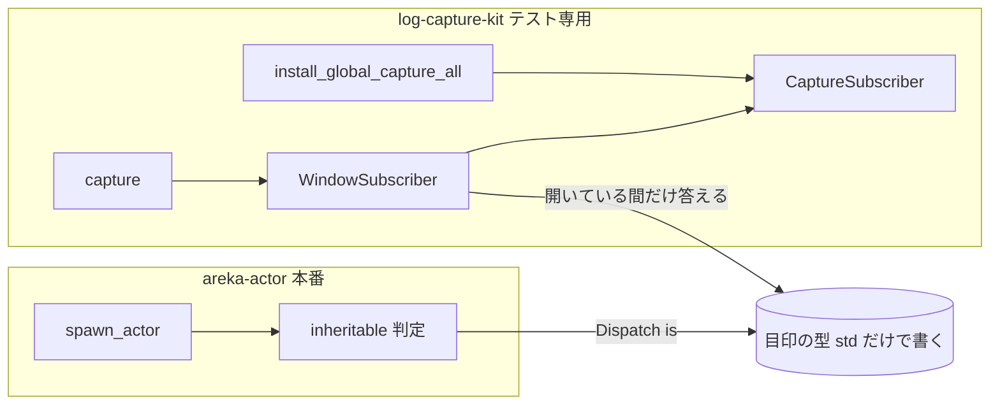
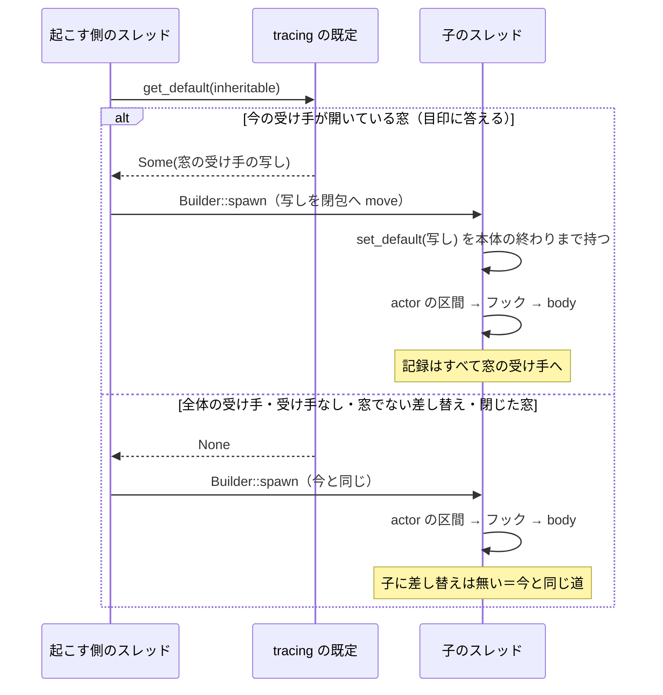

# 設計書: actor-thread-log-capture

> 2026-10-31・本ブランチ（main `da020c10` の上）での設計。要件は `requirements.md`（2026-10-31 要件討議の一括承認で確定）、調べの記録は `research.md`（1〜10 はギャップ分析と要件討議・11 は本設計の段）。
> 依存の版は `Cargo.lock` の `tracing` 0.1.44・`tracing-core` 0.1.36・`tracing-subscriber` 0.3.23。下の API の読みはどれもこの版のソースを直に読んだもの。

## Overview

**Purpose**: テストが捕捉の窓（`log_capture_kit::capture`）の中で起こしたアクターのスレッドの記録を、そのテストの窓の結果に入れる。背景のスレッド（`install`・`update`・`kanade`・`shiori` など）が書いた失敗の詳しい記録を、赤の文言に添えられるようにする。

**Users**: テストの赤を読む開発者と AI、背景のスレッドを確かめるテストの持ち主。

**Impact**: `spawn_actor` が、起こす時点の起こした側のスレッドの受け手が「開いている捕捉の窓」のときだけ、その受け手を子のスレッドの既定にする。窓かどうかは、窓の受け手だけが答える目印（型の名前の代わりになる大きさ 0 の型）を `tracing` の公開の問い合わせ（`Dispatch::is`）で尋ねて決める。本番には窓が無いので、本番の道は今と 1 ビットも変わらない（子に受け手を据えない）。

### Goals

- 窓の中で起こしたアクター（と、その子・孫）の記録が、その窓の結果に入る（要件 1）。
- 窓の外で起こしたアクター・閉じた窓・ほかのテストの窓の記録は混ざらない（要件 2）。
- 本番の記録の道は変わらない。`tracing-core` の「スレッドごとの差し替えが 1 つも無ければ全体の受け手へ直行する速い道」も本番では保たれる（要件 3）。
- 効いていることと効きすぎていないことを、`areka-actor` の中の決定論の試験で赤にできる形で固める（要件 6）。

### Non-Goals

- 素のスレッド（`std::thread` で直に起こす所・本番に 11 か所ほど）への引き継ぎ。
- `crates/areka/src/install/desk_overwrite_tests.rs` の手がかりを足すこと・既存のテストの代わりの判定の書き換え。
- 全スレッドの捕捉（`install_global_capture_all`）・濾過つきの捕捉（`capture_under_filter`）・番人の例外表に載った素の `with_default` の窓への引き継ぎ（どれも目印に答えない＝引き継がない）。
- 窓より前に起きているアクター（例: インストールの窓口が最初の依頼で 1 度だけ起こす `install` のスレッド）の記録を後の窓に入れること。

## Boundary Commitments

### This Spec Owns

- `spawn_actor` の「起こす時点で受け手を決め、窓のときだけ子へ渡す」働き（判定の関数 1 つと、子の閉包の先頭の 1 行）。
- 捕捉の窓の受け手が、窓が開いているあいだだけ目印に答え、閉じた後は記録を捨てる働き（`capture.rs` の中の窓専用の受け手）。
- 目印の型の形（`[(); 0x6172_656B]`）という、`areka-actor` と `log-capture-kit` のあいだの約束。両側に同じ形を書き、対照の試験 ⑴ がずれを赤にする。
- 対照の試験（`areka-actor` の中）と、引き継ぎで赤に変わった既存のテストの手当て。

### Out of Boundary

- 本番の記録の出先・文言・水準・`log_history` の受け手の組み方（変更 0）。
- 走り始めのフックの形と `crates/areka/src/thread_roles.rs`（変更 0）。
- `spawn_actor` の呼び手（本番の 11 ファイル）・素のスレッドを起こす所（変更 0）。
- `crates/log-capture-kit/src/global.rs`・`filter.rs`・`probe.rs`・`event.rs` と、`capture.rs` の兄弟の `capture_tests.rs`（変更 0）。
- `crates/areka/src/install/` の全ファイル（同じウェーブの `install-before-boot` の持ち物。赤になったら直す前にそのセッションと合わせる）。
- steering `structure.md` の log-capture-kit 節・areka-actor 節の追随（`/kiro-complete` の文書の同期で行う）。

### Allowed Dependencies

- `areka-actor` の本番の依存は今のまま（`tracing`・`thiserror`・`async-channel`・`wintf-winmsg-executor`）。**`log-capture-kit` を `[dependencies]` に置かない**（番人 ⑶ が赤にする）。
- `areka-actor` の `[dev-dependencies]` に `log-capture-kit = { path = "../log-capture-kit" }` の 1 行（要件 6.3）。
- `log-capture-kit` はワークスペースの中のどの crate にも依存しない（leaf）。目印は std の型の組み合わせだけで書くので、互いを知らずに済む。
- 外のクレートは増やさない。`Cargo.lock` が変わるのは `areka-actor` の依存の並びの 1 行だけ。
- 使う公開の API: `tracing::dispatcher::{get_default, set_default}`・`tracing::Dispatch::{is, clone}`・`tracing::Subscriber::downcast_raw`（下の「判定の仕組み」）。

### Revalidation Triggers

- `tracing`／`tracing-core` の版を上げるとき（`get_default` の速い道・`Dispatch::is` が `downcast_raw` を通る形・`set_default` が写しを持つ形を読み直す。`/update` の手順で読む）。
- 目印の型の形をどちらか片側で変えるとき（両側を同じに変え、対照の試験 ⑴ で確かめる）。
- `capture` の窓の受け手の形（`WindowSubscriber`）や閉じ方を変えるとき。
- 本番のコードがスレッドごとの差し替え（`set_default`／`with_default`）を新しく使うとき（窓でない受け手は目印に答えないので引き継がれないが、`SCOPED_COUNT` の速い道の前提が本番で崩れる）。
- 下流のテストが「窓の中でアクターを起こした記録」に頼り始めたとき（窓より前に起きたアクターは入らない、を読み違えないこと）。

## Architecture

### Existing Architecture Analysis

- `spawn_actor`（`crates/areka-actor/src/spawn.rs` 86〜117 行）は `thread::Builder::new().name(..).spawn(..)` で素のスレッドを起こし、子の中で `info_span!("actor")` に入り、フック（あれば）→ `body(rx)` の順に走る。受け手を渡す手は無い。
- 捕捉の窓（`crates/log-capture-kit/src/capture.rs`）は `CaptureSubscriber`（`Arc<Mutex<Vec<CapturedEvent>>>` を持つ・`enabled` は常に真）を `tracing::subscriber::with_default` で呼んだスレッドの既定へ差し、窓の中で interest を作り直し・番兵を出し・`f()` を走らせ、窓を抜けてから結果を取り出す。全スレッドの捕捉（`global.rs`）も同じ `CaptureSubscriber` をプロセスの既定に据える。
- `tracing-core` 0.1.36 の `get_default` は、プロセスにスレッドごとの差し替えが 1 つも無ければ（`SCOPED_COUNT == 0`）全体の受け手を直に返す。全体の受け手かスレッドごとの差し替えかを見分ける公開の手は無い（`research.md` 4.1）。

### 判定の仕組み（議題 1 の「見分け方」の答え）

「起こした側のスレッドの今の受け手が、開いている捕捉の窓か」を、受け手の種類（全体か差し替えか）でなく**受け手そのものに尋ねて**決める。

- `tracing::Subscriber::downcast_raw(&self, id: TypeId) -> Option<*const ()>` は、受け手が「その型であるか、その型を中に持つか」を答える公開の口で、`Dispatch::is::<T>()` がこれを通る（`tracing-core` `dispatcher.rs` 717 行・`subscriber.rs` 492〜517 行）。`tracing-subscriber` 自身が、中身を持たない目印の型（`MagicPlfDowncastMarker`）を同じ口で答えさせて層の性質を問い合わせている（`layer_filters/mod.rs` 873〜883 行）＝この口を目印の問い合わせに使うのは、ライブラリの作り手が使っている形である。
- 目印の型は **`[(); 0x6172_656B]`**（中身の大きさ 0・整列 1 の配列。数は ASCII の「arek」）。std の型だけで書けるので、`areka-actor` と `log-capture-kit` が互いに依存せずに同じ型を名指せる（同じ型の式は crate が違っても同じ `TypeId` になる）。
- **窓の受け手だけが答える**: `capture` が差す窓専用の受け手 `WindowSubscriber` は、窓が開いているあいだだけ目印の `TypeId` に `Some(self を指す印)` を返す。全スレッドの捕捉（素の `CaptureSubscriber`）・本番の `log_history` の受け手（`tracing-subscriber` の `Layered`）・「受け手なし」（`NoSubscriber`）は既定の答え（自分の型だけ）なので `None`。
- **健全さ**: `downcast_raw` の約束は「`Some` を返すなら、指す先がその型の正しい値であること」。目印は大きさ 0・整列 1 の型なので、null でない任意の番地（ここでは `self` の番地）がその型の正しい値への参照になる。読み出しは起きない。`unsafe` が要るのは `unsafe fn downcast_raw` の実装の宣言だけで、本体に危ない操作は無い（ワークスペースは `unsafe_code` を禁じていない）。
- **安定さ**: 使うのはどれも `tracing` の公開・文書化された API で、`Debug` の字面のような約束の無いものに頼らない。目印の型は両側の写しで、ずれれば引き継ぎが止まり対照の試験 ⑴ が赤になる。
- **本番の手間**: 起こす時点で `get_default`（本番は速い道で全体の受け手を返す）と、その受け手への `downcast_raw` の 1 回（`Layered` が層を順に尋ねる・`TypeId` の比べが数回）だけ。アクターを起こすときに 1 度で、記録 1 件ごとの手間は増えない。子に受け手を据えないので、`SCOPED_COUNT` は本番で 0 のまま。

### Architecture Pattern & Boundary Map



- 依存の矢印は今のまま（`areka-actor` の本番は `log-capture-kit` を知らない・`log-capture-kit` はどの crate も知らない）。両者が共有するのは std の型 1 つの形だけ。
- 既存の形を保つ所: `run_with_subscriber` の手順（番兵・取り出しの時点・自己検査）・`CaptureSubscriber` の形・全スレッドの捕捉・フックの形と呼ぶ順。
- 新しく足すもの: 判定の関数 `inheritable`（`spawn.rs`）・窓専用の受け手 `WindowSubscriber` と閉じる番 `CloseOnDrop`（`capture.rs`）・対照の試験のファイル 1 本。

### Technology Stack

| Layer | Choice / Version | Role in Feature | Notes |
|-------|------------------|-----------------|-------|
| 記録の仕組み | `tracing` 0.1.44／`tracing-core` 0.1.36 | `get_default`・`set_default`・`Dispatch::is`・`Subscriber::downcast_raw` | 新しい依存なし |
| 本番の受け手 | `tracing-subscriber` 0.3.23（`log_history`） | 目印に答えない側（`Layered::downcast_raw` は層の型と自分の型だけに答える） | 触らない |
| テストの道具 | `log-capture-kit`（ワークスペースの中・leaf） | 窓の受け手が目印に答える | `areka-actor` の `[dev-dependencies]` に 1 行 |

## File Structure Plan

### Directory Structure

```
crates/
├── areka-actor/
│   ├── Cargo.toml                     # [dev-dependencies] に log-capture-kit の 1 行
│   └── src/
│       ├── spawn.rs                   # 目印の型・判定の関数 inheritable・子の閉包の先頭で受け手を据える・試験の接続宣言
│       ├── spawn_hook_tests.rs        # フックの 1 本の試験へ 1.3（フックの中の記録が窓に入る）を足す
│       └── spawn_log_capture_tests.rs # 新規: 対照の試験 ⑴〜⑹（要件 6.2 の 5 つ＋閉じた後の 1 つ）
├── log-capture-kit/
│   ├── src/
│   │   ├── capture.rs                 # 窓専用の受け手 WindowSubscriber・目印の型・閉じる番・説明の直し
│   │   └── lib.rs                     # 「呼出スレッド局所・他スレッドは入らない」の説明の直し（コードは変えない）
│   └── tests/
│       └── with_default_guard_test.rs # 例外表 ALLOWED_DIRECT_CALLS に spawn.rs を理由つきで 1 件・件数 4→5
└── areka/src/update/
    └── worker_path_tests.rs           # 201 行の件数の主張を宛先 areka::update::desk に絞る（要件 5.5）
Cargo.lock                             # areka-actor の依存の並びに "log-capture-kit" の 1 行
```

### Modified Files

- `crates/areka-actor/src/spawn.rs` — `CaptureWindowMarker`（`pub(crate)` の型の別名）と `inheritable` を足し、`spawn_actor` の `Builder::spawn` の前で `get_default(inheritable)`、子の閉包の先頭（区間とフックより前）で受け手を据える。冒頭と `spawn_actor` の説明に「窓の中で起こすと窓の受け手を引き継ぐ・本番は据えない」を足す。`#[cfg(test)] #[path = "spawn_log_capture_tests.rs"] mod log_capture_tests;` を足す。360 行→およそ 400 行。
- `crates/areka-actor/src/spawn_hook_tests.rs` — `probe_hook` が `trace!` を 1 件出す形にし、同じ 1 本の試験の中で「窓の中で起こしたアクターのフックの記録が窓に入る」を確かめる。60 行→およそ 85 行。
- `crates/areka-actor/Cargo.toml` — `[dev-dependencies]` に `log-capture-kit = { path = "../log-capture-kit" }`（理由のコメントつき・ほかの crate の書き方に揃える）。
- `Cargo.lock` — 上の dev 依存で自動で変わる 1 行。手で書かない。
- `crates/log-capture-kit/src/capture.rs` — 窓専用の受け手と閉じる番を足し、`capture` がそれを差す。`CaptureSubscriber` と `run_with_subscriber` の形は変えない。96〜97 行の説明を直す。107 行→およそ 160 行。
- `crates/log-capture-kit/src/lib.rs` — 116〜118 行の説明を「窓を開いたスレッドと、窓の中で `areka-actor` が起こしたアクターのスレッド（その子も）の記録が入る・素のスレッドと窓の外で起きたスレッドは入らない」に直す。
- `crates/log-capture-kit/tests/with_default_guard_test.rs` — `ALLOWED_DIRECT_CALLS` に `crates/areka-actor/src/spawn.rs` を理由つきで足し、`ALLOWED_DIRECT_CALLS_COUNT` を 5 にする（要件 5.3）。
- `crates/areka/src/update/worker_path_tests.rs` — 201 行の `named(&events, "update_reload_requested")` を、UI のスレッドの発行点（`update/desk.rs` 205〜216 行・宛先 `areka::update::desk`）に絞った数え方にする。確かめる中身（UI の窓口が読み直しの頼みを 1 度だけ記録した）は落とさない。
- （全体テストで赤が出たときだけ）`research.md` 6 の表の「中」「低」のファイル — 同じく主張の対象を宛先・本文で絞る（要件 5.5）。`crates/areka/src/install/desk_overwrite_tests.rs` は直す前に `install-before-boot` のセッションと合わせる。

## System Flows



- 判定は `Builder::spawn` の前に 1 度だけ行う（要件 2.2）。子の受け手は起こした時点で決まり、後で起こした側のスレッドで窓が開いても閉じても差し替わらない。
- 子が据えた受け手は本体の終わりまで持つ（閉包の最初の束縛＝最後に落ちる）。子の中の `get_default` は窓の受け手を返すので、子が起こすアクター（何段先でも）も同じ判定で窓を引き継ぐ（要件 1.2）。
- 窓が閉じた後: 窓の受け手は目印に答えなくなり、届いた記録を捨てる。窓生まれのアクターは閉じた窓の受け手を持ち続ける（ほかの窓へは行かない＝要件 2.4）が、記録は積まれず、閉じた後に起こす孫へは渡さない（要件 2.1 の「窓を閉じた後に起こされた」に当たる）。

## Requirements Traceability

| Requirement | Summary | Components | Interfaces | Flows / 試験 |
|-------------|---------|------------|------------|-------|
| 1.1 | 窓の中で起こしたアクターの記録が入る | SpawnInherit・WindowSubscriber | `inheritable`・`set_default` | 試験 ⑴ |
| 1.2 | 何段先の子も入る | SpawnInherit | 子の中の `get_default(inheritable)` | 試験 ⑵ |
| 1.3 | フックの中の記録も入る | SpawnInherit（据えるのを区間とフックより前に置く） | 閉包の中の順 | `spawn_hook_tests.rs` の追加 |
| 1.4 | 呼んだスレッドの記録と同じ形 | WindowSubscriber（`CaptureSubscriber::event` へそのまま渡す） | `CapturedEvent::from_event` | 試験 ⑴（水準・宛先・本文・項目を照合） |
| 1.5 | 待ってから閉じれば取りこぼさない | WindowSubscriber（同じ `Mutex` へ同期に積む・取り出しは窓を抜けた後・閉じる印は取り出しの後） | `capture` | 試験 ⑴⑵（受信で済みを確かめてから閉じる） |
| 2.1 | 窓の外で起こしたアクターは入らない | SpawnInherit（窓でなければ据えない）・WindowSubscriber（閉じたら答えない） | `inheritable` | 試験 ⑶（窓の前・窓の無いスレッドから）・⑹（閉じた後に起こした孫） |
| 2.2 | 起こした時点で決め、差し替えない | SpawnInherit（`Builder::spawn` の前で判定・本体の終わりまで持つ） | `get_default` | 試験 ⑷ |
| 2.3 | 並ぶテストで混ざらない | WindowSubscriber（窓ごとに別の受け手） | `capture` | 試験 ⑶（別のスレッドの別の窓） |
| 2.4 | 閉じた後の記録はほかの窓に入らない | SpawnInherit（子は窓 A の受け手を持ち続ける）・WindowSubscriber（閉じたら捨てる） | — | 試験 ⑷ |
| 2.5 | 長生きのアクターの振る舞いは同じ | SpawnInherit（受け手の写しを持つだけ） | — | 試験 ⑷⑹（閉じた後も受信・全 Sender の drop で終わる） |
| 3.1 | 本番の記録は変わらない | SpawnInherit（本番は `None`＝何も据えない） | `inheritable` | 試験 ⑸ |
| 3.2 | テストだけの切り替えを持たない | SpawnInherit（同じ道・分かれ目は受け手が目印に答えるかだけ） | — | 設計の形（`cfg`・機能の旗・環境変数を読まない） |
| 3.3 | 名前・区間・join・起動失敗は同じ | SpawnInherit（判定と据える 1 行を足すだけ） | `spawn_actor` の形は不変 | 既存の 5 本（`spawn.rs` の `tests`） |
| 3.4 | 待ち・常駐・新しいスレッドを足さない | SpawnInherit | — | 設計の形（`get_default` と `is` の 1 回ずつ） |
| 3.5 | 本番の形の行き先を試験で固める | SpawnInherit | `inheritable` | 試験 ⑸ |
| 3.6 | 窓が無ければ据えない・受け手なしも渡さない | SpawnInherit・WindowSubscriber（目印に答えるのは開いている窓だけ） | `inheritable` | 試験 ⑸（受け手なし・窓でない受け手で `None`）・⑹ |
| 4.1 | フックの形と走る所は同じ | SpawnInherit（フックの部分に触らない） | `install_thread_start_hook` | `spawn_hook_tests.rs` の既存の主張 |
| 4.2 | フックの枠を使わない | SpawnInherit | — | 試験 ⑴〜⑹ はフックの有無に頼らない |
| 4.3 | フックがあっても同じに効く | SpawnInherit | — | `spawn_hook_tests.rs` の追加（フックを導入した後に窓の中で起こす） |
| 4.4 | `thread_roles` は変えない | — | — | 変更 0（File Structure Plan に無い） |
| 5.1 | 全体の受け手を据えない | 対照の試験 | `capture` だけ | 設計の形 |
| 5.2 | 窓の決まりを変えない | WindowSubscriber（`run_with_subscriber` と `CaptureSubscriber` は不変） | `capture` | `log-capture-kit` の既存の自己試験 |
| 5.3 | 番人を緑に保ち、例外を明示で足す | GuardException | `ALLOWED_DIRECT_CALLS`・件数 | `with_default_guard_test.rs` |
| 5.4 | 1,000 行 | すべて | — | 見積り（最大 `with_default_guard_test.rs` 約 780 行） |
| 5.5 | 赤に変わった既存のテストを絞って直す | RedFix | — | `worker_path_tests.rs` 201 行・全体テストで出たもの |
| 5.6 | 全体テスト 1 回 | — | — | 実装の最後 |
| 6.1 | 対照の試験を areka-actor の中に置く | ControlTests | — | `spawn_log_capture_tests.rs` |
| 6.2 | 5 つを確かめる | ControlTests | — | 試験 ⑴〜⑸ |
| 6.3 | 共有の窓口を通す | ControlTests | `log_capture_kit::capture` | 試験の中で受け手を差さない |
| 6.4 | 「入らない」ごとに「入る」の対照 | ControlTests | — | 試験 ⑶⑷ |
| 6.5 | 時間の待ちに頼らず上限つきで待つ | ControlTests | `recv_timeout`・join | すべての試験 |

## Components and Interfaces

| Component | Domain/Layer | Intent | Req Coverage | Key Dependencies | Contracts |
|-----------|--------------|--------|--------------|------------------|-----------|
| SpawnInherit | `areka-actor`（本番） | 起こす時点の受け手が開いている窓のときだけ、子の既定にする | 1.1〜1.3, 2.1, 2.2, 2.4, 2.5, 3.1〜3.6, 4.1〜4.3 | `tracing`（P0） | Service, State |
| WindowSubscriber | `log-capture-kit`（テスト専用） | 窓が開いているあいだだけ目印に答え、閉じた後は記録を捨てる | 1.1, 1.4, 1.5, 2.1, 2.3, 2.4, 3.6, 5.2 | `CaptureSubscriber`（P0） | State |
| GuardException | `log-capture-kit/tests` | `spawn.rs` の `set_default` 呼出を理由つきで許す | 5.3 | 番人の走査 | — |
| ControlTests | `areka-actor`（試験） | 引き継ぎが効くこと・効きすぎないことを赤にできる形で固める | 1.1〜1.5, 2.1〜2.5, 3.5, 3.6, 4.2, 4.3, 6.1〜6.5 | `log-capture-kit`（dev・P0） | — |
| RedFix | `areka`（試験） | 引き継ぎで数が変わった主張を宛先で絞る | 5.5, 5.6 | — | — |

### areka-actor

#### SpawnInherit（`crates/areka-actor/src/spawn.rs`）

| Field | Detail |
|-------|--------|
| Intent | 窓の中で起こしたときだけ、窓の受け手を子のスレッドの既定にする |
| Requirements | 1.1, 1.2, 1.3, 2.1, 2.2, 2.4, 2.5, 3.1, 3.2, 3.3, 3.4, 3.5, 3.6, 4.1, 4.2, 4.3 |

**Responsibilities & Constraints**

- 判定は受け手そのものに尋ねる（目印に答えるか）だけで、種類（全体か差し替えか）・`Debug` の字面・環境変数・ビルドの種類を見ない。
- 子に据えるのは、判定が `Some` を返したときだけ。`None` のとき子の閉包は今と 1 行も違わない道を走る。
- 据える 1 行は閉包の最初の束縛（`actor` の区間とフックより前・本体の終わりまで持ち、最後に落ちる）。
- フックの部分（`THREAD_START_HOOK`・`install_thread_start_hook`）・`ActorHandle`・起動失敗の `error!` と panic には触らない。

##### Service Interface

```rust
/// 捕捉の窓の受け手だけが答える目印。std の型だけで書いた大きさ 0 の型で、
/// `log-capture-kit` の `capture.rs` に同じ形がある（2 か所は同じでなければならない。
/// ずれると引き継ぎが止まり、`spawn_log_capture_tests.rs` の ⑴ が赤になる）。
pub(crate) type CaptureWindowMarker = [(); 0x6172_656B];

/// 起こす側のスレッドの今の受け手 `current` が開いている捕捉の窓なら、その写しを返す。
/// 全体の受け手・受け手なし・窓でない差し替え・閉じた窓は `None`（要件 3.6）。
fn inheritable(current: &tracing::Dispatch) -> Option<tracing::Dispatch>;
```

- Preconditions: なし（どのスレッドからでも呼べる。受け手の処理の中から呼ばれた入れ子では `get_default` が「受け手なし」を渡すので `None`）。
- Postconditions: `Some(d)` のとき `d.is::<CaptureWindowMarker>()` が真だった。`None` のとき何の副作用も無い。
- Invariants: 判定は `current.is::<CaptureWindowMarker>()` の 1 回だけ。

`spawn_actor` の中の使い方（形の約束）:

- `Builder::spawn` の前: `let inherited = tracing::dispatcher::get_default(inheritable);`
- 子の閉包の先頭: `let _window = inherited.map(|d| tracing::dispatcher::set_default(&d));`（`set_default` は受け手を写して持つので、`d` はその場で落ちてよい）。

##### State Management

- 状態は `Option<Dispatch>` 1 つで、閉包へ move する。子の中では `DefaultGuard`（`!Send`）を子のスレッドの中だけで作って落とす。
- 本番では `inherited` は常に `None`＝子は差し替えを持たず、`SCOPED_COUNT` は増えない。

**Implementation Notes**

- 据える呼出は、番人の走査語に当たる `(` つきの呼出の形のまま書き、番人の例外表へ登記する。関数の名前だけを渡す形（`.map(tracing::dispatcher::set_default)`）にしない——番人の目を逃れ、例外表の項目が「当たりの無い陳腐化した例外」として赤になる。上の `|d| ...(&d)` の形は clippy の `redundant_closure` にも当たらない。
- 説明（冒頭の箇条と `spawn_actor` の doc）に、引き継ぎの条件・本番では据えないこと・窓より前に起きたアクターは入らないことを書く。
- Risks: `tracing` の版上げで `Dispatch::is` が `downcast_raw` を通らなくなる形は考えにくいが、Revalidation Triggers に載せる。

### log-capture-kit

#### WindowSubscriber（`crates/log-capture-kit/src/capture.rs`）

| Field | Detail |
|-------|--------|
| Intent | 窓が開いているあいだだけ目印に答え、記録を集める。閉じた後は答えず、記録を捨てる |
| Requirements | 1.1, 1.4, 1.5, 2.1, 2.3, 2.4, 3.6, 5.2 |

**Responsibilities & Constraints**

- 中に今の `CaptureSubscriber` をそのまま持ち、`enabled`・`new_span`・`record`・`record_follows_from`・`enter`・`exit` はそのまま渡す。`event` は開いているときだけ渡す。
- `downcast_raw`: 自分の型には今の既定と同じに答え、`CaptureWindowMarker` の `TypeId` には開いているときだけ `self` を指す印を返す。ほかは `None`。
- `enabled` は閉じた後も真のまま（偽にすると、既定の `register_callsite` が `enabled` を通って発行点の interest に `never` を焼きうる＝`probe.rs` が閉じた道を開け直さない）。
- 使うのは `capture` だけ。全スレッドの捕捉（`global.rs`）・自己試験（`capture_tests.rs`）・濾過つきの捕捉は今の `CaptureSubscriber` のまま＝目印に答えない。
- 窓の既定が `CaptureSubscriber` から `WindowSubscriber` に変わるので、窓の中の `Dispatch::is::<CaptureSubscriber>()` は偽になる。`CaptureSubscriber` は crate の外へ見えず、crate の中にもその問い合わせは無い（`downcast`・`is::<` を走査して 0 件）＝要件 5.2 の「窓の結果を変えない」に当たる変化は無い。

##### State Management

```rust
/// 捕捉の窓の受け手だけが答える目印（`areka-actor` の `spawn.rs` に同じ形がある）。
pub(crate) type CaptureWindowMarker = [(); 0x6172_656B];

/// `capture` が差す窓専用の受け手。
struct WindowSubscriber {
    inner: CaptureSubscriber,
    /// 窓が開いているか。`capture` を抜けるときに `CloseOnDrop` が偽にする。
    open: Arc<AtomicBool>,
}

/// `capture` を抜けるとき（panic で抜けるときも）窓を閉じた印を立てる番。
struct CloseOnDrop(Arc<AtomicBool>);
```

- 状態の移り変わり: 開いている（`capture` の入口で真）→ 閉じた（`capture` を抜けるときに偽・戻らない）。
- 閉じる時点は `run_with_subscriber` が結果を取り出した後（`capture` の中の最初の束縛として `CloseOnDrop` を置き、関数の終わりに落ちる）。窓を抜けた後〜取り出しの前に子が出した記録はこの窓の結果に入り、取り出しの後〜閉じる前の記録は誰も読まない入れ物に残る。どちらもほかの窓へは行かない（要件 2.4）。
- 並行: 印は `AtomicBool`（立てるのは `Release`・読むのは `Acquire`）。閉じる間際に別のスレッドで出た記録が入るか捨てられるかは決まらないが、どちらでも結果は 1 つの窓に閉じる。

`capture` の形（約束）:

- `capture<R>(f: impl FnOnce() -> R) -> (R, Vec<CapturedEvent>)` の形と、番兵・取り出しの時点・自己検査（`run_with_subscriber`）は変えない。
- 中身は「印を作る → `CloseOnDrop` を置く → `WindowSubscriber { inner: CaptureSubscriber::default(), open }` を作る → その `inner.0` の写しを取り出し先にして `run_with_subscriber` へ渡す」だけ。

**Implementation Notes**

- `downcast_raw` の実装は `unsafe fn` になる。印として返すのは `self as *const Self as *const ()`（目印の型は大きさ 0・整列 1 なので、この番地はその型の正しい値への参照になる）。この理由を 1 行のコメントで書く。
- 96〜97 行の説明（「他スレッドで発火したイベントは混入しない」）と冒頭の箇条を、引き継ぎの条件と閉じた後の扱いに合わせて直す。
- 閉じた後に記録を捨てる 1 行は、公開の口から観測できない（溜まらないことは記憶と手間の性質）。檻に入れず、同じ印が目印の答えを切り替えることを試験 ⑹ で固める。

#### GuardException（`crates/log-capture-kit/tests/with_default_guard_test.rs`）

- `ALLOWED_DIRECT_CALLS` に `("crates/areka-actor/src/spawn.rs", 理由)` を足し、`ALLOWED_DIRECT_CALLS_COUNT` を 5 にする。理由の文の骨子: 「窓の中で起こしたアクターのスレッドへ窓の受け手を引き継ぐため、子のスレッドの既定を差す。差すのは起こした側の受け手が開いている捕捉の窓（目印に答える受け手）のときだけで、本番では差さない（actor-thread-log-capture 要件 3.6）」。
- 走査語を逐語で書かない約束（`concat!`）を守る（理由の文の中に `set_` `default(` を続けて書かない）。
- `KNOWN_DEV_DEPENDENTS`（10 件・「載っている crate が本当に引いている」の陽性の確かめ）は触らない。`areka-actor` を載せなくても緑で、載せると件数の約束が増えるだけになる。

### 試験

#### ControlTests（`crates/areka-actor/src/spawn_log_capture_tests.rs`・新規）

- 記録の捕捉はすべて `log_capture_kit::capture` を通す（要件 6.3）。宛先は本ファイル専用の 1 つ（例 `areka_actor::spawn_log_capture_tests`）にし、各試験は項目 `probe` の値で自分の記録を見分ける（並べて回るほかの試験や、`spawn_hook_tests.rs` のフックの記録と混ざらない）。
- 待ちはすべて受信（`recv_timeout`・上限 10 秒）か join で、眠りの時間に頼らない（要件 6.5）。上限を超えたら赤（ハングしない）。
- 各試験の中身:
  - ⑴ **窓の中で起こしたアクターの記録が入る**（1.1・1.4・1.5）: 窓の中で起こしたアクターが `warn!` と `trace!` を 1 件ずつ出し、済みを返す。テストは受信で済みを確かめてから窓を閉じる。2 件とも、水準・宛先・本文・項目 `probe` の値が出した形のまま結果にあること。
  - ⑵ **子のアクターの記録も入る**（1.2）: 窓の中で起こしたアクターが、その本体の中でさらにアクターを起こし、その子が `warn!` を出す。親は子の join を待ってから済みを返す。子の記録が結果にあること。
  - ⑶ **窓の外で起こしたアクター・ほかの窓の記録は入らない**（2.1・2.3・6.4）: ⒜ 窓を開く前に起こしたアクター ⒝ 窓の無い別のスレッドが窓の開いているあいだに起こしたアクター ⒞ 別のスレッドが自分の窓を開いて起こしたアクター、の 3 つに窓の開いているあいだに記録を出させ、済みを受けてから閉じる。どれも結果に無いこと。対照として、同じ窓の中で起こしたアクターの記録が入ることを隣で確かめる。⒞ はその別のスレッドの窓の結果に入ることも確かめる（捕捉が素通りしていないこと）。
  - ⑷ **閉じた後の記録は後から開いた窓に入らない**（2.2・2.4・2.5・6.4）: 窓 A の中でアクター X を起こし、A の中で X に 1 件出させて A の結果に入ることを確かめる（対照）。A を閉じ、窓 B を開いて X に 1 件出させ、済みを受ける。B の中で起こしたアクター Y の記録が B に入り（対照）、X の記録は B に無いこと。最後に全 Sender を落として X が正常に終わること。
  - ⑸ **窓を持たないスレッドから起こしたアクターの行き先が今と同じ**（3.1・3.5・3.6）: ⒜ 判定の関数を直に確かめる——`inheritable(&Dispatch::none())` と、試験の中の目印に答えない最小の受け手を `Dispatch::new` で包んだもの（本番の全体の受け手の代わり）の両方で `None`。窓の中の `get_default(inheritable)` は `Some`（対照）。⒝ 窓の無いスレッドから起こしたアクターの中の `get_default(|d| d.is::<NoSubscriber>())` が、起こした側の同じ問いと同じ答えであること（このテストの実行ファイルには全体の受け手が無いので、両方とも「受け手なし」）。
  - ⑹ **閉じた後は窓を引き継がない**（2.1・2.5・3.6）: 窓 A の中で起こしたアクター X が、A の中では `get_default(|d| d.is::<CaptureWindowMarker>())` に真を返し、A を閉じた後は偽を返すこと。閉じた後に X が起こした孫 G の中の既定が「受け手なし」であること。
- ⑸⒜ は議題 1 の決め（ⓑ）の檻である。「受け手なしでなければ差す（ⓐ）」に戻すと、目印に答えない受け手で `Some` になり赤。
- 「全体の受け手へ届く」ことそのものは、このテストの実行ファイルに全体の受け手を据えられない（要件 5.1）ので直には見ない。⑸⒜ で「本番の受け手のような目印に答えない受け手では据えない」を、⑸⒝ で「据えない子の行き先は起こした側と同じ」を固め、合わせて 3.5 とする。

#### `spawn_hook_tests.rs` の追加（1.3・4.1・4.3）

- `probe_hook` が今の記録（`OBSERVED`）に加え、`trace!(target: 本ファイル専用の宛先, actor = name)` を 1 件出す。
- 1 本の試験の中で、フックを導入した後に窓を開いてアクターを起こし、join してから閉じる。そのアクター名のフックの記録が結果にあること（フックの中の記録も窓に入る＝据えるのが区間とフックより前）。既存の主張（生成された側で走る・最初の導入が勝つ・導入済みでも挙動は同じ）はそのまま。

#### RedFix（`crates/areka/src/update/worker_path_tests.rs` ほか）

- 201 行: `update_reload_requested` は UI のスレッド（`update/desk.rs`）と背景のスレッド `update`（`update/procedure.rs` 187 行）の両方で出る。引き継ぎの後は窓の中で起きた `update` の記録も入るので、数える対象を宛先 `areka::update::desk` の記録に絞る（宛先の綴りは実装のときに出た記録で確かめる）。
- 全体テストで新たに赤が出たら、同じ形（宛先・本文で絞る・確かめていた中身は落とさない）で直す。`install/desk_overwrite_tests.rs` は直す前に `install-before-boot` のセッションと合わせる。

## Error Handling

### Error Strategy

- 引き継ぎは失敗する所を持たない（判定は真偽だけ・据えるのは失敗しない呼出）。新しい `Err` も panic も足さない。
- スレッドを起こせなかったときは今と同じく起こす側で `error!` と panic（`inherited` は落ちるだけ）。
- 受け手の処理の中から `spawn_actor` が呼ばれた入れ子、スレッドの後始末の最中の呼出では、`get_default` が「受け手なし」を渡すので引き継がない（今と同じ道）。
- 窓の中で番兵が捕まらないときの panic（`run_with_subscriber` の自己検査）は今のまま。

### Monitoring

- 本番の記録は 1 行も増減しない。引き継ぎの有無を知らせる記録も足さない（本番では常に「引き継がない」で、知らせる中身が無い）。

## Testing Strategy

- **単体（`areka-actor`）**: 判定の関数 `inheritable` の両側（受け手なし・目印に答えない受け手で `None`／開いている窓で `Some`）＝⑸⒜。既存の 5 本（名前・panic の写し・受信ループ 3 本）は変えずに緑（3.3）。
- **結合（`areka-actor` の中・本物の `log-capture-kit`）**: ⑴〜⑹ とフックの 1 本。どれも本物のスレッドと本物の窓で、待ちは受信と join だけ。
- **番人**: `with_default_guard_test.rs`（例外 5 件・陳腐化の検査・製品側の依存に現れない検査）・1,000 行の番人。
- **全体テスト 1 回**（5.6）: 実装の最後に 1 回（静かな机・前後の比べは要らない）。`research.md` 6 の表の「中」「低」の赤をここで洗う。`areka-test-binary-stability` が測っているあいだは着地させない。
- **檻の無い所（明示）**: 閉じた後に記録を捨てる 1 行（記憶と手間の性質で、公開の口から見えない）。同じ印が目印の答えを切り替えることは ⑹ が固める。

## Performance & Scalability

- 本番: アクターを起こすたびに `get_default` 1 回と `downcast_raw` 1 回（`TypeId` の比べが層の数だけ）。記録 1 件ごとの手間は変わらない（子に差し替えが無く、`SCOPED_COUNT` が 0 のまま）。
- テスト: 窓の中で起こしたアクターは、窓の後も窓の受け手を持つが、閉じた後は記録を積まない（ゴーストを窓の中で起こすテストで、テストの終わりまで記録が溜まり続ける形を作らない）。`enabled` は真のままなので、閉じた後の記録の組み立ての手間は「受け手へ届けて捨てる」まで残る（欄の文字への整形は `CapturedEvent::from_event` の中なので走らない）。
