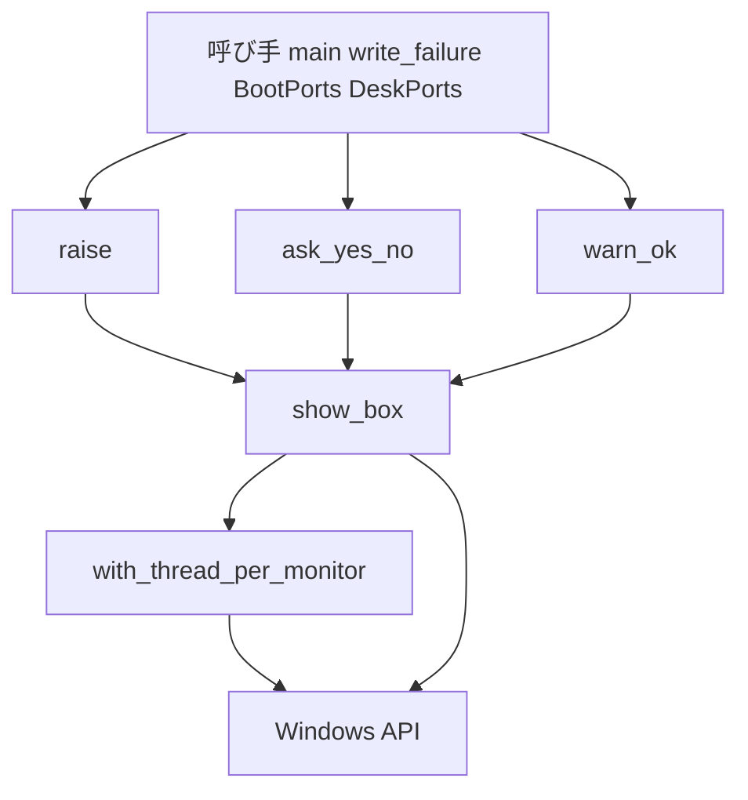
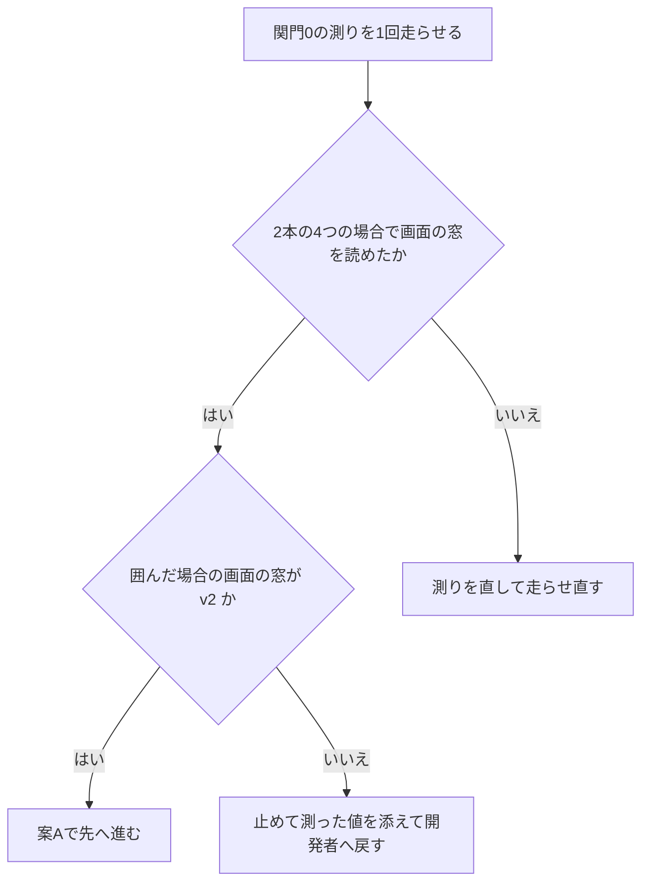

# 設計: alert-dialog-per-monitor-dpi

> 2026-11-01・本ブランチ（main `9604677a` の上）のコードを読んで書いた。コードは「何の定義か」（関数名・型名＋ファイルパス）で指す。
> 直し方は要件の討議で決めた案 A（画面を出す間だけ、呼んだスレッドの DPI の扱いをモニタごとの v2 に囲んで戻す）。**この設計は「案 A が効く」ことを実装の最初の関門（関門 0）で実機で確かめてから先へ進む形で書く**。関門 0 で効かなければ、関門より後のこの設計は使わず、測った値を添えて開発者へ戻す（要件 4.6）。案 B・案 C の設計はここに書かない。

## Overview

**目的**: 拡大率の違うモニタを並べた利用者に、areka の告知の画面（エラーの画面・はい／いいえの画面・OK だけの警告の画面）を、出たモニタの拡大率でにじまずに見せる。

**使う人**: 起動を止めた理由・SHIORI が動かなくなった知らせ・記憶を書けない知らせ・書庫の利用条件の問い・インストールの警告を読む利用者。呼び手（起動の解決・起動窓・記憶を書けない場面・起動の前と窓口のインストール）は呼び方を変えずに直しを受け取る。

**変えること**: `crates/areka/src/alert.rs` の 3 つの口（`raise`・`ask_yes_no`・`warn_ok`）が直に呼んでいた `MessageBoxW` を、1 つの内側の関数 `show_box` に集める。`show_box` は画面を出す間だけ呼んだスレッドの DPI の扱いをモニタごとの v2 にし、画面が戻ったら元へ戻す。替えられなかったら今のまま出して warn を 1 件残す。

### Goals

- 3 つの画面が、どのスレッドから・窓のアプリの前でも後でも、同じ 1 つの道（`show_box`）を通ってモニタごとの v2 の扱いで作られる（1.1〜1.4）。
- 画面の中身・答え・抑止・記録・出る場所は今のまま（2.1〜2.3）。画面の後、スレッドの扱いは前と同じに戻る（3.1〜3.3）。
- 案 A が効くことを、実装の最初に areka のコードの中から測って決める（4.6）。

### Non-Goals

- 案 B（タスクダイアログ）・案 C（自前の窓）の設計。関門 0 で案 A が効かなかったときに開発者が決める。
- 画面がどのモニタに出るか（持ち主の窓を渡さない今の決まりのまま）。出た後に利用者が画面を別のモニタへ動かしたときの描き直し。
- プロセスの DPI の扱いを立てる所（`wintf` の `ensure_process_dpi_awareness`・`BootPorts::before_dialog`）を増やすこと（ギャップ分析の案 A′ は取らない）。
- 件 2（モニタを移した後のバルーン）。フォルダや書庫を選ぶ OS の画面（`roots/pick.rs`・`install/pick.rs`）。

## Boundary Commitments

### This Spec Owns

- `alert.rs` の中の、画面を出す 1 つの道 `show_box` と、スレッドの扱いを囲んで戻す `with_thread_per_monitor`。
- 替えられなかったときの記録 warn `alert_dpi_context_unchanged`（新しい語・欄 `dialog`）。
- 兄弟のテストのファイル `alert_dpi_tests.rs`（画面を出さない決定論のテストと、関門 0 の `#[ignore]` の測り）。
- 実機の確かめの手順（関門 0 と、実装の後の短い 1 回）と、その結果をタスクの記録に書くこと。

### Out of Boundary

- 画面の文言・題名・旗・答えの読み方・抑止（`AREKA_NO_ALERT`・`AREKA_APP_SMOKE_EXIT_MS`）・既にある記録（`alert`・`ask`・`install_warning_dialog`・`*_box_failed`）の名前と水準と欄。変えない。
- プロセスの DPI の扱い（`crates/wintf/src/runtime/mod.rs` の `ensure_process_dpi_awareness`・`crates/areka/src/install/before_boot_ports.rs` の `BootPorts::before_dialog`）。変えない。
- 呼び手（`main.rs`・`write_failure.rs`・`install/before_boot_ports.rs`・`install/worker.rs`）。触らない。
- バルーンの拡大率の切替の描き直し（`emo2_boot/frame/dpi.rs` の族）。触らない（ウェーブ C15 の約束・5.1）。
- `Cargo.toml`・マニフェスト（`crates/areka/areka.manifest`）・`build.rs`。触らない（依存も機能も増やさない）。

### Allowed Dependencies

- `windows` クレートの既に有効な機能だけ: `Win32_UI_HiDpi`（`SetThreadDpiAwarenessContext`・`GetThreadDpiAwarenessContext`・`AreDpiAwarenessContextsEqual`・`GetWindowDpiAwarenessContext`・`GetAwarenessFromDpiAwarenessContext`・`GetDpiForWindow`・`GetDpiForMonitor`・`GetDpiForSystem`）・`Win32_UI_WindowsAndMessaging`（`MessageBoxW`・テストの `SetTimer`・`KillTimer`・`EnumThreadWindows`・`GetClassNameW`・`GetWindowTextW`・`PostMessageW`・`PostQuitMessage`）・`Win32_Graphics_Gdi`（テストの `MonitorFromWindow`）・`Win32_System_Threading`（テストの `GetCurrentThreadId`）。どれもワークスペースの `Cargo.toml` で有効（確かめ済み）。
- `tracing`（記録）・`log-capture-kit`（テストの記録の捕捉）・`wintf::ensure_process_dpi_awareness`（関門 0 の測りの最後の場合だけ・テストの中）。
- 依存の向き: 呼び手 → `alert.rs` の 3 つの口 → `show_box` → `with_thread_per_monitor` → Windows の API。`show_box` と `with_thread_per_monitor` は `alert.rs` の外へ出さない（`pub(crate)` にしない）。

### Revalidation Triggers

- 関門 0 で案 A が効かず、案 B／C へ替わる（画面の見た目が変わる＝要件 2.1 を緩める）。告知の画面を使う呼び手の持ち主（`install-before-boot`・窓口のインストール・起動の失敗の告知）は見た目と答えを確かめ直す。この設計も作り直す。
- 3 つの口の署名や答え（`YesNo`）が変わる。今回は変えない。
- プロセスの DPI の扱いを立てる時を変える（`ensure_process_dpi_awareness` の呼ぶ所が増える・減る）。`show_box` はスレッドだけを見るので働きは変わらないが、関門 0 の測りの場合分けを見直す。
- 新しい記録の語 `alert_dpi_context_unchanged` を名前で拾う道具や試験が足される。
- 窓のアプリを作る前に画面を出し、**その後も起動を続ける**道が足される。スレッドを戻す呼び出しは扱いを明示で置くので、プロセスの既定に従っていたスレッドは、戻した後は前の扱い（非対応）に固まり、後でプロセスを v2 にしても追わない。今は響かない: 窓のアプリの前の画面は出した後にプロセスを終える（`main.rs` の `resolve_boot` の失敗・`check_boot` の失敗）か、出す前にプロセスを v2 に立てる（`BootPorts::before_dialog`）。背景のスレッド `install` はプロセスを v2 にした後に生まれる。

## Architecture

### Existing Architecture Analysis

- 3 つの口は抑止の判断と記録を済ませてから `MessageBoxW(None, 本文, 題名, 旗)` を直に呼ぶ。戻り 0 で `Error::from_thread()` を読み、`*_box_failed` を error で残す。`unsafe` はこの 3 か所に閉じる（`alert.rs` の先頭の注釈）。
- 呼ぶスレッドは 2 つ: メインのスレッド（窓のアプリの前と後）と背景のスレッド `install`（窓口のインストール）。窓のアプリの前で、起動の前のインストールが画面を出していなければ、プロセスの扱いはまだ立っていない（既定＝非対応）。テストの実行ファイルにも DPI の申告は無い（`areka.manifest` は comctl32 の版 6 の申告だけ）。
- 前例 `crates/areka/src/ghost_session_scope_rect.rs` の `os_window_rect` が「呼ぶ間だけスレッドを v2 にし、戻りが無効なら今のまま読んで debug、有効なら読んだ後に戻す」をしている。`show_box` はこの形を写し、記録の水準だけを warn にする（1.5）。

### Architecture Pattern & Boundary Map



**決めたこと**:
- 型: 「スレッドを囲む」と「画面を出す」を分ける。囲む方（`with_thread_per_monitor`）は切り替えの関数を引数で受け、本物の API では起こせない「替えられなかった」道を決定論のテストで踏めるようにする（4.1）。画面を出す方（`show_box`）は本物の切り替えと `MessageBoxW` を渡すだけの薄い口。
- 抑止の判断と既にある記録は 3 つの口に残し、`show_box` はその後にだけ呼ぶ（2.2）。抑止の走行では DPI の扱いに触れず、新しい記録も出ない。
- 窓のアプリの前と後で道を分けない。プロセスの扱いに頼らずスレッドだけを替えるので、プロセスが非対応でも v2 でも同じ道で同じ結果になる（1.3・1.4）。このため要件 4.4 は当たらない（下の「実機の確かめ」）。
- 持ち主の窓は今どおり渡さない（2.3）。

### Technology Stack

| 層 | 選んだ物・版 | この機能での役 | 備考 |
|---|---|---|---|
| アプリ | Rust 2024・`areka` クレートの `alert.rs` | 3 つの画面の口・囲みの関数 | 新しい依存なし |
| OS の境界 | `windows` クレート（ワークスペースの版・既に有効な機能だけ） | スレッドの DPI の扱いの切り替え・メッセージボックス・テストでの窓の読み取り | 機能を足さない |
| 記録 | `tracing`（構造化の欄）・テストは `log-capture-kit` | warn `alert_dpi_context_unchanged` | steering `logging.md` に従う |

## File Structure Plan

### Directory Structure

```
crates/areka/src/
├── alert.rs                    # 3 つの口・show_box・with_thread_per_monitor（変更）
├── alert_tests.rs              # 今のまま（文面と抑止の記録の決定論のテスト）
├── alert_memory_write_tests.rs # 今のまま
└── alert_dpi_tests.rs          # 新規: 囲みの決定論のテストと関門 0 の #[ignore] の測り
```

### Modified Files

- `crates/areka/src/alert.rs` — `show_box` と `with_thread_per_monitor` を足し、3 つの口の `MessageBoxW` の呼び出しを `show_box` へ置き換える。`*_box_failed` のエラーの値は `show_box` が返す「戻す前に読んだ値」を使う。先頭の注釈の「`unsafe` は 3 か所に閉じる」を「`show_box` の中に閉じる」へ直す。末尾に `#[cfg(test)] #[path = "alert_dpi_tests.rs"] mod alert_dpi_tests;` を足す。行数は 390 → 450 前後の見込み。

### New Files

- `crates/areka/src/alert_dpi_tests.rs` — `with_thread_per_monitor` と `show_box` の決定論のテスト（画面を出さない）・3 つの口が同じ道を通ることをソースで見るテスト・関門 0 の `#[ignore]` の測り。置き場は `alert.rs` の兄弟＝ウェーブ C15 の約束（`alert.rs` とその兄弟のテストのファイルだけ）の内（ギャップ分析の「設計で決めること」7）。新しいファイルにするのは、今の `alert_tests.rs` が文面と抑止のテストで、DPI の扱いの測りとは見るものが違うから。

## System Flows

### 画面を出す道

```mermaid
sequenceDiagram
    participant Caller as 3つの口
    participant Box as show_box
    participant Scope as with_thread_per_monitor
    participant OS as Windows
    Caller->>Caller: 抑止の判断と既にある記録
    Caller->>Box: 題名 本文 旗 画面の名
    Box->>Scope: 切り替えの関数と画面を出す処理
    Scope->>OS: スレッドを v2 へ 前の扱いを受け取る
    alt 前の扱いが無効
        Scope->>Scope: warn alert_dpi_context_unchanged を1件
        Scope->>OS: 今の扱いのまま MessageBoxW
    else 前の扱いが有効
        Scope->>OS: MessageBoxW
        OS-->>Scope: 押されたボタンか 0
        Scope->>Scope: 最後のエラーをここで読む
        Scope->>OS: スレッドを前の扱いへ戻す
    end
    Scope-->>Box: 戻り値と最後のエラー
    Box-->>Caller: 戻り値と最後のエラー
    Caller->>Caller: 0 なら今と同じ box_failed を error で残す
```

- 最後のエラーは `MessageBoxW` が戻った直後、スレッドを戻す前に読む。戻す呼び出しが最後のエラーの値を上書きしても、記録の中身は今と同じになる（ギャップ分析の調べること 3 は、この順で問わずに済む）。
- 失敗の記録（`*_box_failed`）は、`show_box` が戻った後に口が残す。だから「戻してから記録する」（3.2）は形で決まる。
- 替えられなかったときは戻さない（戻す相手が無い）。画面は今の扱いのまま出す（1.5）。

### 関門 0（実装の最初の実機の測り）の判定



## Requirements Traceability

| 要件 | 要約 | 部品 | 口 | 流れ |
|---|---|---|---|---|
| 1.1 | 出たモニタの拡大率で描く | `show_box`・`with_thread_per_monitor` | `show_box` | 画面を出す道 |
| 1.2 | 主でも副でも | `show_box`（スレッドが v2 なら窓はモニタの DPI を持つ） | `show_box` | 画面を出す道・実機の確かめ |
| 1.3 | 窓のアプリの前と後 | `with_thread_per_monitor`（プロセスに頼らずスレッドだけを替える） | `with_thread_per_monitor` | 関門 0 の場合「非対応から囲む」 |
| 1.4 | 3 つの画面・どのスレッドでも同じ | 3 つの口がどれも `show_box` を通る | `raise`・`ask_yes_no`・`warn_ok` | 画面を出す道 |
| 1.5 | 替えられなければ今のまま出し warn 1 件 | `with_thread_per_monitor` | warn `alert_dpi_context_unchanged` | 画面を出す道の「前の扱いが無効」 |
| 2.1 | 題名・本文・ボタン・アイコン・旗・答え | 3 つの口（旗と答えの読み方は今の値のまま `show_box` へ渡す） | `show_box` の引数 | — |
| 2.2 | 抑止と既にある記録は今のまま | 3 つの口（抑止の判断と記録は `show_box` の前） | — | 画面を出す道の最初 |
| 2.3 | 出る場所は OS 任せのまま | `show_box`（持ち主の窓は None） | `show_box` | — |
| 3.1 | 閉じた後にスレッドの扱いを戻す | `with_thread_per_monitor` | — | 画面を出す道の「戻す」 |
| 3.2 | 出せなかったときも戻してから記録 | `with_thread_per_monitor`・3 つの口 | `BoxOutcome` | 画面を出す道の最後 |
| 3.3 | ほかの窓の大きさ・位置・座標の読み取りが変わらない | `with_thread_per_monitor`（替えるのは呼んだスレッドの扱いだけ・閉じたら戻す） | — | 実機の確かめ ⑷ |
| 4.1 | 画面を出さない決定論のテスト | `alert_dpi_tests.rs` の D1〜D6 | — | — |
| 4.2 | 実機で副のモニタに 1 つ出して DPI とにじみを見る | 実機の確かめ（実装の後） | — | 実機の確かめ ⑴〜⑶ |
| 4.3 | 副のモニタに出す手順を走行の前に決め記録する | 実機の確かめ（前面の窓とカーソルを先に副へ・だめなら開発者が主を替える） | — | 実機の確かめ ⑴ |
| 4.4 | 前と後で扱いを分けるなら両方を見る | 分けない設計なので当たらない（理由を記録に書く） | — | — |
| 4.5 | 閉じた後にゴーストの窓を動かしても今どおり追う | 実機の確かめ ⑷ | — | 実機の確かめ |
| 4.6 | 案 A が効かなければ止めて戻す | 関門 0 の測り `probe_alert_box_window_dpi` | — | 関門 0 の判定 |
| 5.1 | 件 2 を持たない・バルーンの描き直しに触らない | Out of Boundary・File Structure Plan（`alert.rs` と兄弟だけ） | — | — |
| 5.2 | 完了のときに件 2 を渡す | 完了の手続き（`/kiro-complete` の棚卸）。コードの変更は無い | — | — |

## Components and Interfaces

| 部品 | 層 | 役 | 要件 | 主な依存 | 約束 |
|---|---|---|---|---|---|
| `with_thread_per_monitor` | `alert.rs` の内側 | 呼んだスレッドの扱いを v2 に囲んで戻す・替えられなければ warn | 1.3, 1.5, 3.1, 3.2, 3.3 | 切り替えの関数（P0） | Service |
| `show_box` | `alert.rs` の内側 | 本物の切り替えと `MessageBoxW` を組み、戻り値と最後のエラーを返す | 1.1, 1.2, 1.4, 2.1, 2.3 | `with_thread_per_monitor`（P0）・`MessageBoxW`（P0） | Service |
| 3 つの口 `raise`・`ask_yes_no`・`warn_ok` | `alert.rs` | 抑止と記録の後に `show_box` を呼ぶ（署名は今のまま） | 1.4, 2.1, 2.2, 3.2 | `show_box`（P0） | Service（今のまま） |
| `alert_dpi_tests.rs` | テスト | 決定論のテスト D1〜D6 と関門 0 の測り | 4.1, 4.6 | `log-capture-kit`（P1）・`wintf`（P2） | — |

### alert.rs の内側

#### with_thread_per_monitor

| 欄 | 中身 |
|---|---|
| 役 | 渡された処理を、呼んだスレッドの DPI の扱いをモニタごとの v2 にした間だけ走らせ、終わったら前の扱いへ戻す |
| 要件 | 1.3, 1.5, 3.1, 3.2, 3.3 |

**責務と制約**
- 切り替えの関数に v2 を渡し、戻り（前の扱い）を受け取る。戻りが無効（`is_invalid()`）なら warn を 1 件残し、処理を 1 回だけ走らせ、戻さない。有効なら処理を 1 回だけ走らせ、終わったら前の扱いを切り替えの関数に渡して戻す。
- 処理の戻り値はそのまま返す。処理が何を返しても（画面が出せなかった 0 でも）戻す（3.2）。
- 替えるのは呼んだスレッドの扱いだけ。ほかのスレッドとプロセスの扱い、既にある窓には触れない（3.3）。
- `unsafe` を持たない（切り替えの関数の中に置く）。

**依存**
- Inbound: `show_box` — 本物の切り替えで呼ぶ（P0）
- Inbound: `alert_dpi_tests.rs` — 偽の切り替えで呼ぶ（P1）
- External: なし（切り替えは引数で受ける）

**約束**: Service [x]

##### Service Interface

```rust
/// 呼んだスレッドの DPI の扱いを `show` の間だけモニタごとの v2 にする。
/// `dialog` は記録の欄（"alert" | "ask" | "install_warning_dialog"）。
fn with_thread_per_monitor<T>(
    dialog: &'static str,
    switch: impl FnMut(DPI_AWARENESS_CONTEXT) -> DPI_AWARENESS_CONTEXT,
    show: impl FnOnce() -> T,
) -> T;
```

- 前提: `switch` は「渡された扱いへ替え、替える前の扱いを返す。替えられなければ無効な値を返す」（`SetThreadDpiAwarenessContext` と同じ約束）。
- 後: 有効な前の扱いを受けたときは、`switch` が「v2」「前の扱い」の順にちょうど 2 回呼ばれ、`show` はその間に 1 回だけ呼ばれる。無効を受けたときは、`switch` は 1 回だけ、`show` は 1 回だけ、warn `alert_dpi_context_unchanged` が 1 件。
- 不変: 有効な前の扱いを受けたとき、戻った後の呼んだスレッドの扱いは呼ぶ前と同じ。

**記録**

| 語（event） | 水準 | 欄 | 出す時 |
|---|---|---|---|
| `alert_dpi_context_unchanged` | warn | `dialog`（"alert"・"ask"・"install_warning_dialog"＝その画面に先立って残した記録の語） | 切り替えの戻りが無効だった（画面は今の扱いのまま出す） |

- 語は 3 つの画面で 1 つにし、どの画面かは欄 `dialog` で分ける（ギャップ分析の「設計で決めること」6）。前例 `scope_rect_dpi_context_unchanged`（debug）とは別の語にする（水準が違い、拾う側を混ぜない）。本文の文は `[alert] 画面の DPI の扱いを替えられなかった（今の扱いのまま出す）`。

#### show_box

| 欄 | 中身 |
|---|---|
| 役 | 3 つの口の唯一の画面を出す道。本物の切り替えで `with_thread_per_monitor` を呼び、その中で `MessageBoxW` を出す |
| 要件 | 1.1, 1.2, 1.4, 2.1, 2.3 |

**責務と制約**
- `MessageBoxW(None, 本文, 題名, 旗)` を呼ぶ。持ち主の窓は渡さない（2.3）。旗は口から受けた値をそのまま渡す（2.1）。
- `MessageBoxW` が戻った直後、スレッドを戻す前に最後のエラー（`windows::core::Error::from_thread()`）を読み、戻り値と一緒に返す。
- `alert.rs` の `unsafe` はこの関数の中の 2 つ（`SetThreadDpiAwarenessContext` を呼ぶ切り替えの関数と `MessageBoxW`）だけにし、どちらにも安全の理由の注釈を書く（steering `tech.md`）。
- 記録は残さない（失敗の記録は口の持ち物・替えられなかった記録は `with_thread_per_monitor` の持ち物）。

**依存**
- Inbound: 3 つの口（P0）
- Outbound: `with_thread_per_monitor`（P0）
- External: `SetThreadDpiAwarenessContext`・`MessageBoxW`（`windows` クレート・既に有効な機能）（P0）

**約束**: Service [x]

##### Service Interface

```rust
/// 画面が戻った値と、戻った直後（スレッドを戻す前）に読んだ最後のエラー。
struct BoxOutcome {
    result: MESSAGEBOX_RESULT,
    last_error: windows::core::Error,
}

fn show_box(
    dialog: &'static str,
    title: &str,
    body: &str,
    style: MESSAGEBOX_STYLE,
) -> BoxOutcome;
```

- 前提: 抑止の判断と既にある記録は呼び手が済ませている。
- 後: 戻ったとき、呼んだスレッドの DPI の扱いは呼ぶ前と同じ（替えられなかったときは初めから替わっていない）。
- 口での使い方（今の振る舞いをそのまま保つ）:
  - `raise`・`warn_ok`: `result.0 == 0` なら `last_error` を欄 `error` に載せて `alert_box_failed`／`warning_box_failed` を error で残す。
  - `ask_yes_no`: `IDYES` → `Yes`・`IDNO` → `No`・それ以外 → `last_error` を載せて `ask_box_failed` を error で残し `Unavailable`。
  - `dialog` の値は `raise` が "alert"・`ask_yes_no` が "ask"・`warn_ok` が "install_warning_dialog"。

**実装の注意**
- 統合: 3 つの口の署名・抑止・記録の行は動かさない。置き換えるのは `MessageBoxW` の呼び出しと、`*_box_failed` の欄 `error` の値の出どころ（その場の `from_thread()` → `last_error`）だけ。
- 確かめ: 既にある `alert_tests.rs`・`alert_memory_write_tests.rs` は抑止ありで呼び「記録がちょうど 1 件」を見ている。抑止の走行は `show_box` に入らないので、これらが緑のままであることが 2.2 の檻になる。
- 危うさ: 関門 0 で囲んでも画面の窓が v2 にならないときは、この部品は直しにならない（4.6 で止める）。

### alert_dpi_tests.rs（兄弟のテスト）

要約だけを書く（新しい境界を持たない）。

**決定論のテスト（画面を出さない・4.1）**

| # | 見ること | 形 | 要件 |
|---|---|---|---|
| D1 | 囲んで戻す順 | 偽の切り替え（呼ばれた値を並べて残し、有効な前の扱いとして `DPI_AWARENESS_CONTEXT_SYSTEM_AWARE` を返す）で呼ぶ。切り替えが「v2」「SYSTEM_AWARE」の順にちょうど 2 回、処理が 1 回で、処理の戻り値がそのまま返り、記録は 0 件 | 3.1 |
| D2 | 替えられなかったとき | 偽の切り替えが無効な値を返す。切り替えは 1 回（v2）だけで戻さず、処理は 1 回走り、warn `alert_dpi_context_unchanged` が欄 `dialog` 付きでちょうど 1 件 | 1.5 |
| D3 | 画面が出せなかったときも戻す | 処理が 0 を返しても、切り替えが「v2」「前の扱い」の順に 2 回 | 3.2 |
| D4 | 本物の切り替えで、処理の間は v2・後は元どおり | 新しいスレッドで扱いを非対応にしてから、本物の切り替えで呼ぶ。処理の中で読んだスレッドの扱いが v2（`AreDpiAwarenessContextsEqual`）、戻った後は非対応。v2 から始めた場合も同じ形で 1 本 | 1.3, 3.1 |
| D5 | 3 つの口が同じ道を通る | `include_str!("alert.rs")` を `//` で始まる行を除いて読み、`MessageBoxW(` がちょうど 1 回、`SetThreadDpiAwarenessContext(` がちょうど 1 回、`show_box(` が定義と 3 つの口の呼び出しの 4 回 | 1.4 |
| D6 | 3 つの口が渡す画面の名 | D5 と同じ読み方で、`raise`・`ask_yes_no`・`warn_ok` の `show_box` の呼び出しがそれぞれ "alert"・"ask"・"install_warning_dialog" を渡す | 1.5 |

- 偽の切り替えが「有効な前の扱い」として返す値は `DPI_AWARENESS_CONTEXT_SYSTEM_AWARE`（-2）に限る。`windows` 0.62 の `is_invalid()` は -1（＝`DPI_AWARENESS_CONTEXT_UNAWARE`）と null を無効と読むので、この 2 つは「替えられなかった」の側にしか使わない。本物の API が非対応のスレッドで返す前の扱いが無効と読まれないことは D4 が見る（読まれれば戻されず、後の扱いが非対応でなくなって赤）。
- テストは本物の画面を出さない（`MessageBoxW` は D1〜D6 のどれでも呼ばない）。D4 の処理は画面の代わりに `GetThreadDpiAwarenessContext` を読むだけ。
- 記録は `log-capture-kit` の `capture` で見る（steering `logging.md`）。

**関門 0 の測り（`#[ignore]`・4.6）**: 下の「関門 0」の節。

## 関門 0: 案 A が効くかを areka のコードの中から測る（4.6）

### 要件 4.6 の「設計の最初」との対応

- 要件 4.6 の「設計の最初の実機の走行」は、**実装のタスクの 1 番目（関門 0）** で行う。設計を書く段では画面を出せない（設計の係は実機の走行も画面の操作もしない）ので、設計は測りの中身と判定を決めるところまでを持ち、測るのは実装の最初とする。
- 関門 0 のタスクが作るのは、`with_thread_per_monitor`・`show_box`（3 つの口へはまだ繋がない。繋ぐまでの間は本番の組み立てで使われないので `#[cfg_attr(not(test), allow(dead_code))]` を付け、繋ぐタスクで外す）と測りのテストだけ。測りが「囲んだ画面の窓が v2」を示すまで、3 つの口の置き換え・決定論のテスト D5・D6・実装の後の実機の確かめへ進まない。
- 関門 0 で効かなければ、そこで止め、4 つの場合の測った値を添えて開発者へ戻す。案 B（要件 2.1 を緩める）・案 C へ進むかは開発者が決め、決まったらこの設計を作り直す。関門 0 のタスクで足した関数と測りは消さずに残す（案 B を測るときにも使える）。3 つの口へまだ繋いでいないので、本番の振る舞いは変わっていない。

### 置き場と走らせ方

- 置き場: `crates/areka/src/alert_dpi_tests.rs` の 2 本の `#[test] #[ignore = "real dialog: shows a message box on the desktop"]`。`fn probe_alert_box_window_dpi()`（下の表の初めの 3 つの場合）と `fn probe_alert_box_window_dpi_process_v2()`（4 つ目の場合だけ）。bin のユニットテストの実行ファイルには本番と同じ comctl32 の版 6 の申告が埋まる（`build.rs`）ので、本番の areka.exe と同じメッセージボックスの部品で測れる。
- 4 つ目を別の 1 本にするのは、プロセスの扱いは UI を作る前に立てる決まり（`SetProcessDpiAwarenessContext`）で、同じプロセスで先に画面を 3 つ作った後では立てられないか、2026-10-31 と同じ形にならないおそれがあるから。別の `cargo test` の 1 回で走らせ、そのテストの最初にプロセスを立てる。
- 走らせ方: 主の会話が排他テストの机を取ってから（`request --desk test`）、`cargo test -p areka --bin areka alert_dpi_tests::probe_alert_box_window_dpi -- --ignored --nocapture --test-threads=1 --exact` と `cargo test -p areka --bin areka alert_dpi_tests::probe_alert_box_window_dpi_process_v2 -- --ignored --nocapture --test-threads=1 --exact` を 1 回ずつ（別のプロセス）。画面はそれぞれ 0.3 秒ほどで自分で閉じる。終わったらすぐ机を返す。画面がロックされていない・スクリーンセーバーでないときに走らせる。
- どのモニタに出てもよい（窓の扱いの値はモニタによらない）。モニタの DPI と system DPI も一緒に読んで記録に残す。

### 測る場合（それぞれ新しいスレッドで・この順）

| 場合 | スレッドの扱いの作り方 | 画面の出し方 | 写すもの |
|---|---|---|---|
| `unwrapped_unaware` | `SetThreadDpiAwarenessContext(UNAWARE)` | `MessageBoxW` を直に | 窓のアプリの前で、今の areka（直す前） |
| `wrapped_from_unaware` | `SetThreadDpiAwarenessContext(UNAWARE)` | `show_box` | 窓のアプリの前で、直した後（**判定に使う**） |
| `unwrapped_thread_v2` | `SetThreadDpiAwarenessContext(PER_MONITOR_AWARE_V2)` | `MessageBoxW` を直に | スレッドが明示で v2 のとき |
| `process_v2_default` | 先に `wintf::ensure_process_dpi_awareness()` でプロセスを v2 にし、スレッドは何も替えない | `MessageBoxW` を直に | 2026-10-31 の実機（`install-before-boot` 7.2）と同じ形＝プロセスを v2 に立てた後の画面 |

- `process_v2_default` はプロセスの扱いを戻せないので、別の 1 本（`probe_alert_box_window_dpi_process_v2`）で、新しいプロセスの最初に立てる（上の「置き場と走らせ方」）。

### 画面の窓の見つけ方と読むもの

- 画面を出す前に、同じスレッドに 300 ミリ秒ごとのタイマー（`SetTimer(None, 0, 300, 呼び戻し)`）を立てる。メッセージボックスはモーダルの間も同じスレッドのメッセージを配るので、呼び戻しは画面が出ている間に同じスレッドで走る。
- 呼び戻しは `EnumThreadWindows(GetCurrentThreadId(), …)` で、クラス名が `#32770` で題名が測りの題名（`areka-alert-dpi-probe`）の窓を探す。見つけたら次を読み、スレッドの局所の置き場へ残す。
  - 画面が出ている間のスレッドの扱い（`GetAwarenessFromDpiAwarenessContext(GetThreadDpiAwarenessContext())`）。画面を出す直前の扱いも、出す前に同じ形で読む。
  - 画面の窓の扱い（`GetAwarenessFromDpiAwarenessContext(GetWindowDpiAwarenessContext(窓))`）と、それが v2 か（`AreDpiAwarenessContextsEqual(…, PER_MONITOR_AWARE_V2)`）。
  - 画面の窓の DPI（`GetDpiForWindow`）・その窓のあるモニタの DPI（`MonitorFromWindow` → `GetDpiForMonitor` の実効の DPI）・system DPI（`GetDpiForSystem`）。
- 読んだら `PostMessageW(窓, WM_COMMAND, IDOK, 0)` で閉じ、タイマーを止める。題名つきの `MB_OK` の画面だけを出すので、押されるのは OK だけ。
- 20 回（およそ 6 秒）探しても見つからなければ `PostQuitMessage(0)` でモーダルを抜けさせ、その場合は「見つからない」として残す（測りは赤）。

### 出すもの・判定

- 場合ごとに ASCII の 1 行を標準出力へ出す: `ALERT-DPI-PROBE case=<場合> process=<0|1|2> thread_before=<0|1|2> thread_during=<0|1|2> window=<0|1|2> window_v2=<true|false> window_dpi=<数> monitor_dpi=<数> system_dpi=<数> box=<戻り値>`（数は 0＝非対応・1＝system・2＝モニタごと。`process` は `GetAwarenessFromDpiAwarenessContext(GetDpiAwarenessContextForProcess(GetCurrentProcess()))`）。
- 1 本目は 3 行をすべて出してから判定の assert をする。2 本目は 1 行を出して、窓が見つかったことだけを assert する。
  - どの場合でも窓が見つからない → 赤（測りの不具合・直して走らせ直す・関門は通らない）。
  - `process_v2_default` の行は `process=2` かつ `thread_before=2` のときだけ見分けに使う。そうでなければ「プロセスが v2 にならなかった」として、見分けに使わずに記録に書く（関門の判定には響かない）。
  - `wrapped_from_unaware` の `thread_during=2` かつ `window_v2=true` → 関門を通る（案 A で先へ進む）。
  - そうでなければ赤 → 止めて、2 本の 4 行を添えて開発者へ戻す（4.6）。
- 残りの 3 つの場合は判定に使わず、比べるために残す。`process_v2_default` の値で 2026-10-31 の「v2 に立てた後でも system と返った」件を見分ける（2 なら当時の測り方の取り違え、1 ならプロセスの既定を受けたスレッドの画面が system で作られる＝囲めば直る形）。結果と見分けをタスクの記録に書く。

## 実装の後の実機の確かめ（4.2〜4.5）

関門 0 を通り、3 つの口を置き換え、決定論のテストが緑になった後に、短い 1 回だけ走らせる。

- **机と画面**: 主の会話が排他テストの机を取ってから始め、終わったらすぐ返す。画面の操作は SendInput で行う。実の GPU・実のモニタ 2 枚（主 200%・副 150%）。根と書庫はワークツリーの `target\` の下に作る。SSP は動かさない。
- **出す画面**: 起動の前のインストールの利用条件の画面（はい／いいえ）。2026-10-31 の 7.2 と同じ形（`target\` の下の根に、`terms.txt` 付きの書庫を `--install` で渡す）。この画面は「はい」で起動が続くので、閉じた後のゴーストの窓を同じ走行で見られる（4.5）。
- **⑴ 副のモニタに出す手順（4.3・走行の前に決めておく）**: まず SendInput で副のモニタの上の窓を前面にし、カーソルも副のモニタに置いてから areka を起こす。画面が主のモニタに出たら、その走行はやめて開発者に「走行の間だけ副のモニタを主に替え、終わったら戻す」操作を頼み（モニタの設定は AI が替えない）、替わってから同じ形で出し直す。出た後に画面を手で動かす形は取らない。どの手順で副に出たかを記録に書く。
- **⑵ 画面の窓の DPI（4.2）**: 画面が出ている間に、areka のプロセスの番号で絞った窓（クラス名 `#32770`・利用条件の画面の題名）を探し、`GetDpiForWindow` と、そのモニタの `GetDpiForMonitor` の実効の DPI と、窓の扱い（`GetWindowDpiAwarenessContext`）を読む。読むのは作業用のフォルダに置いたその場限りのスクリプト（PowerShell から Windows の API を呼ぶ）で、リポジトリには入れない。プロセスの番号で絞ることで、別の窓を拾う取り違え（ギャップ分析 §3 の見込み 2）を除く。期待: 窓の DPI＝144＝モニタの DPI・窓の扱い＝2。
- **⑶ にじみ（4.2）**: 画面の文字を拡大して撮り、引き延ばしや縮めのぼけが無いことを見る。
- **⑷ 閉じた後の窓（3.3・4.5）**: SendInput で「はい」を押し、起きたゴーストの窓を拡大率の違うモニタへ動かす。`WM_DPICHANGED` が届き、ゴーストとバルーンの窓の大きさが今どおり追うこと（7.2 と同じく 0.75 倍）を記録で見る。
- **4.4 について**: この設計は窓のアプリの前と後で扱いを分けない（どちらも `show_box` でスレッドだけを替える）ので、要件 4.4 は当たらない。プロセスが非対応のままの窓のアプリの前の画面は、関門 0 の `wrapped_from_unaware` が同じ道を areka のコードの中から確かめる。このことをタスクの記録に書く。
- **記録**: ⑴〜⑷ の手順と結果（読んだ数・撮った画面の見立て・記録の抜き書き）を `tasks.md` の実装の記録に書く。

## Error Handling

| 起きること | 振る舞い | 記録 |
|---|---|---|
| スレッドの扱いを替えられない（切り替えの戻りが無効） | 画面は今の扱いのまま出す。戻さない | warn `alert_dpi_context_unchanged`（欄 `dialog`）を 1 件（1.5） |
| 画面を出せない（`MessageBoxW` が 0） | スレッドを戻してから、口が今と同じ失敗の記録を残す。答えは今と同じ（`ask_yes_no` は `Unavailable`） | error `alert_box_failed`・`ask_box_failed`・`warning_box_failed`（欄 `error` は戻す前に読んだ値）（3.2） |
| 抑止の走行 | `show_box` に入らない。DPI の扱いに触れない | 今の記録だけ（2.2） |

- 新しい失敗で画面を出すのをやめる道は作らない（告知は利用者が判断するための物で、DPI の扱いのために落とさない）。
- `panic` は使わない。

## Testing Strategy

- **決定論のテスト（`alert_dpi_tests.rs`・画面なし）**: D1〜D6（上の表）。囲んで戻す順（3.1）・替えられなかったときの warn と今のままの表示（1.5）・出せなかったときも戻すこと（3.2）・本物の切り替えでの前と後（1.3・3.1）・3 つの口が同じ道と画面の名を通ること（1.4・1.5）。
- **既にあるテストを檻として保つ**: `alert_tests.rs`・`alert_memory_write_tests.rs` の抑止ありの記録の件数と中身（2.1 の文面・2.2 の記録）。今回は書き換えない。
- **関門 0（`#[ignore]`・実機・排他テストの机）**: 4 つの場合の画面の窓の扱いを areka のコードの中から読み、`wrapped_from_unaware` が v2 であることで先へ進む（4.6）。
- **実装の後の実機の短い 1 回（排他テストの机）**: 副のモニタに利用条件の画面を出し、窓の DPI＝モニタの DPI とにじみの無いことを見て、閉じた後にゴーストの窓を動かして今どおり追うことを見る（4.2・4.3・4.5・3.3）。
- **クレートのテスト**: 机を持たないときは `cargo test -p areka --bin areka` で確かめる（`crates/areka/tests/` には実機の試験が混ざるため）。

## Security Considerations

- 新しい入力の口は無い。題名と本文は今と同じ口から来る。`unsafe` は `show_box` の 2 か所に閉じ、どちらも呼び出しの間に生きている値と定数だけを渡す。
