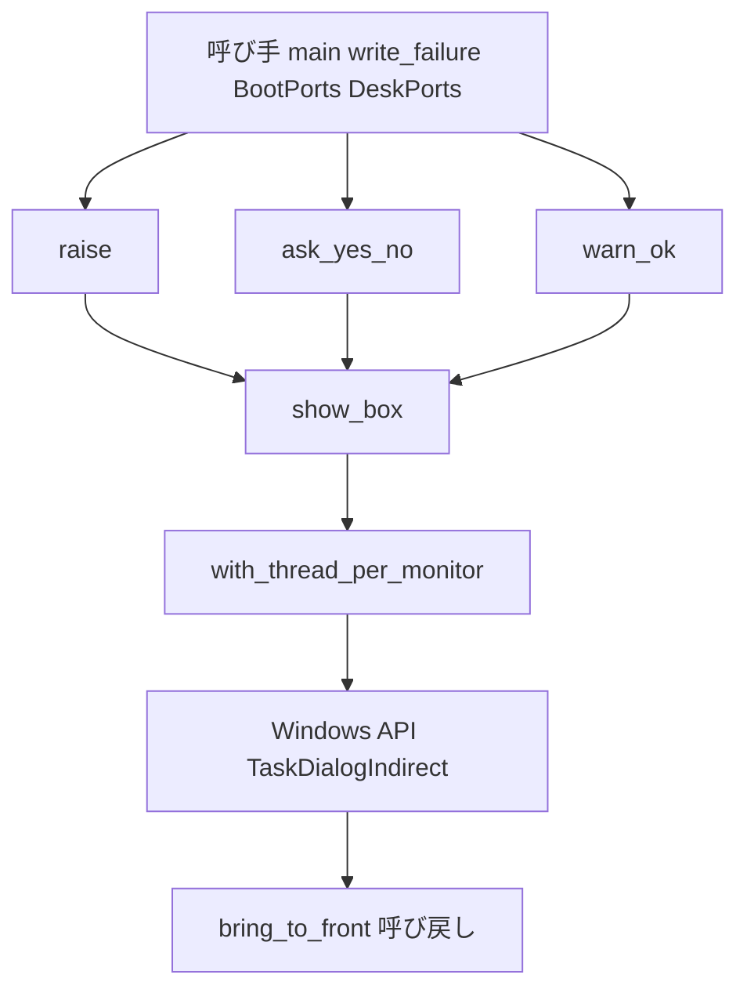

# 設計: alert-dialog-per-monitor-dpi

> 2026-11-01・本ブランチ（main `9604677a` の上・関門 0 と案 B の測りのコミット `f1393da7` まで）のコードを読んで書いた。コードは「何の定義か」（関数名・型名＋ファイルパス）で指す。
> **案 B で作り直した設計**（開発者の裁定「案 B で作り直す」・要件の「案 B への切り替え」の節）。関門 0（2026-11-01 実機）で、標準のメッセージボックスはスレッドを v2 に囲んでも画面が出ている間スレッドを system へ落とし、窓も system で作ると分かった（案 A は効かない）。同じ日の測りで、標準の部品の版 6 のタスクダイアログは扱いを落とさず、囲めば非対応のスレッドからでも窓が v2（窓の DPI＝モニタの DPI＝192）で作られた。副のモニタ（150%）ではまだ測っていない。
> 案 A で足して既にコミットした部品（`with_thread_per_monitor`・`set_thread_dpi_context`）はそのまま使う。

## Overview

**目的**: 拡大率の違うモニタを並べた利用者に、areka の告知の画面（エラーの画面・はい／いいえの画面・OK だけの警告の画面）を、出たモニタの拡大率でにじまずに見せる。

**使う人**: 起動を止めた理由・SHIORI が動かなくなった知らせ・記憶を書けない知らせ・書庫の利用条件の問い・インストールの警告を読む利用者。呼び手（起動の解決・起動窓・記憶を書けない場面・起動の前と窓口のインストール）は呼び方を変えずに直しを受け取る。

**変えること**: `crates/areka/src/alert.rs` の 3 つの口（`raise`・`ask_yes_no`・`warn_ok`）が直に呼んでいた `MessageBoxW` をやめ、1 つの内側の関数 `show_box` からタスクダイアログ（`TaskDialogIndirect`）で出す。`show_box` は画面を出す間だけ呼んだスレッドの DPI の扱いをモニタごとの v2 にし（`with_thread_per_monitor`）、画面が戻ったら元へ戻す。替えられなかったら今の扱いのまま出して warn を 1 件残す。見た目はタスクダイアログの標準に替わる（要件 2.1 を緩めた）。

### Goals

- 3 つの画面が、どのスレッドから・窓のアプリの前でも後でも、同じ 1 つの道（`show_box`）を通ってモニタごとの v2 の扱いのタスクダイアログで作られる（1.1〜1.4）。
- 題名・本文・ボタン・アイコンの種類・前面と最前面・閉じるボタンの効き・答え・抑止・記録・出る場所の決まりは今のまま（2.1〜2.3）。画面の後、スレッドの扱いは前と同じに戻る（3.1〜3.3）。
- 副のモニタ（150%）で窓の DPI＝モニタの DPI であることと、替わった見た目を実機で確かめる（4.2・4.3・4.5・4.7）。

### Non-Goals

- 案 C（自前の窓）。副のモニタの実機で案 B も効かなかったときに開発者が決める。
- 画面がどのモニタに出るか（持ち主の窓を渡さない今の決まりのまま）。出た後に利用者が画面を別のモニタへ動かしたときの描き直し。
- プロセスの DPI の扱いを立てる所（`wintf` の `ensure_process_dpi_awareness`・`BootPorts::before_dialog`）を増やすこと。
- タスクダイアログの見出し・展開・確かめの欄・リンクなどの新しい見せ方。本文は今の文字列をそのまま 1 つの欄に置く。
- 件 2（モニタを移した後のバルーン）。フォルダや書庫を選ぶ OS の画面（`roots/pick.rs`・`install/pick.rs`）。

## Boundary Commitments

### This Spec Owns

- `alert.rs` の中の、画面を出す 1 つの道 `show_box`（タスクダイアログ）・画面の種類 `Dialog`・前面と最前面へ出す呼び戻し・はい／いいえの答えの読み方 `yes_no_answer`、と既にある `with_thread_per_monitor`・`set_thread_dpi_context`。
- 新しい記録 2 つ: warn `alert_dpi_context_unchanged`（欄 `dialog`・既にコミット済み）と warn `alert_topmost_failed`（欄 `error`）。
- 兄弟のテストのファイル `alert_dpi_tests.rs`（画面を出さない決定論のテスト D1〜D5 と、`#[ignore]` の実機の測り）。
- 実機の確かめの手順（副のモニタの 1 回と、3 つの画面を撮る 1 回）と、その結果をタスクの記録に書くこと。

### Out of Boundary

- 画面の文言・題名・抑止（`AREKA_NO_ALERT`・`AREKA_APP_SMOKE_EXIT_MS`）・既にある記録（`alert`・`ask`・`install_warning_dialog`・`*_box_failed`）の名前と水準と欄。変えない。
- 3 つの口の署名と答えの型 `YesNo`。変えない。
- プロセスの DPI の扱い（`crates/wintf/src/runtime/mod.rs` の `ensure_process_dpi_awareness`・`crates/areka/src/install/before_boot_ports.rs` の `BootPorts::before_dialog`）。変えない。
- 呼び手（`main.rs`・`write_failure.rs`・`install/before_boot_ports.rs`・`install/worker.rs`・`install/terms.rs` の本文の切り詰め）。触らない。
- バルーンの拡大率の切替の描き直し（`emo2_boot/frame/dpi.rs` の族）。触らない（ウェーブ C15 の約束・5.1）。
- `Cargo.toml`・マニフェスト（`crates/areka/areka.manifest`）・`build.rs`。触らない（依存も機能も増やさない）。

### Allowed Dependencies

- `windows` クレート 0.62.2 の既に有効な機能だけ（ワークスペースの `Cargo.toml` で確かめた・案 B の測りがコンパイルして S_OK を返した）:
  - `Win32_UI_Controls`: `TaskDialogIndirect`・`TASKDIALOGCONFIG`（`Default` あり・`packed(1)`）・`TDCBF_OK_BUTTON`・`TDCBF_YES_BUTTON`・`TDCBF_NO_BUTTON`・`TD_ERROR_ICON`・`TD_WARNING_ICON`・`TD_INFORMATION_ICON`・`TDF_ALLOW_DIALOG_CANCELLATION`・`TDN_CREATED`・`TASKDIALOG_NOTIFICATIONS`・テストの `TDM_CLICK_BUTTON`・`TaskDialog`。
  - `Win32_UI_WindowsAndMessaging`: `SetWindowPos`・`HWND_TOPMOST`・`SWP_NOMOVE`・`SWP_NOSIZE`・`SetForegroundWindow`・`MESSAGEBOX_RESULT`・`IDOK`・`IDYES`・`IDNO`・テストの `SetTimer`・`KillTimer`・`EnumThreadWindows`・`GetClassNameW`・`GetWindowTextW`・`PostMessageW`・`PostQuitMessage`。
  - `Win32_UI_HiDpi`（切り替えとテストの読み取り）・`Win32_Graphics_Gdi`（テストの `MonitorFromWindow`）・`Win32_System_Threading`（テストの `GetCurrentThreadId`・`GetCurrentProcess`）・`Win32_Foundation`（`HWND`・`WPARAM`・`LPARAM`・`HRESULT`・`S_OK`）。
- comctl32 の版 6: `TaskDialogIndirect` は版 6 にだけある関数。`alert.rs` が入るのは bin（areka.exe）と bin のユニットテストの実行ファイルだけで、どちらにも `build.rs` が版 6 の申告を埋める（lib は無い・`tests/` の exe には `alert.rs` が入らない）。
- `tracing`（記録）・`log-capture-kit`（テストの記録の捕捉）。
- 依存の向き: 呼び手 → `alert.rs` の 3 つの口 → `show_box` → `with_thread_per_monitor` → Windows の API。`show_box`・`Dialog`・`yes_no_answer`・`with_thread_per_monitor` は `alert.rs` の外へ出さない（`pub(crate)` にしない）。

### Revalidation Triggers

- 副のモニタ（150%）の実機（3.1）で、タスクダイアログの窓が v2 でない、または窓の DPI がモニタの DPI と違う。そこで止め、測った値を添えて開発者へ戻す（案 C へ進むかは開発者が決める）。
- 見た目が替わったこと（要件 2.1 を緩めた）: 告知の画面を使う呼び手の持ち主（`install-before-boot`・`startup-install-option`・窓口のインストール・起動の失敗の告知）が画面の見た目を前提にした確かめを持っていれば見直す。今あるテストはどれも抑止ありで呼び、見た目に頼らない（確かめ済み）。
- comctl32 の版 6 の申告が外れる、または `alert.rs` が申告の無い実行ファイル（lib への切り出し・`tests/` の exe・サンプル）に入る。`TaskDialogIndirect` は読み込みの時に結ばれるので、その exe は起動できなくなる。
- 3 つの口の署名や答え（`YesNo`）が変わる。今回は変えない。
- プロセスの DPI の扱いを立てる時を変える。`show_box` はスレッドだけを見るので働きは変わらないが、測りの場合分けを見直す。
- 新しい記録の語 `alert_dpi_context_unchanged`・`alert_topmost_failed` を名前で拾う道具や試験が足される。
- 窓のアプリを作る前に画面を出し、**その後も起動を続ける**道が足される。スレッドを戻す呼び出しは扱いを明示で置くので、プロセスの既定に従っていたスレッドは、戻した後は前の扱い（非対応）に固まり、後でプロセスを v2 にしても追わない。今は響かない: 窓のアプリの前の画面は出した後にプロセスを終える（`main.rs` の `resolve_boot` の失敗・`check_boot` の失敗）か、出す前にプロセスを v2 に立てる（`BootPorts::before_dialog`）。背景のスレッド `install` はプロセスを v2 にした後に生まれる。

## Architecture

### Existing Architecture Analysis

- 3 つの口は抑止の判断と記録を済ませてから `MessageBoxW(None, 本文, 題名, 旗)` を直に呼ぶ。戻り 0 で `Error::from_thread()` を読み、`*_box_failed` を error で残す。
- 案 A で足した部品（コミット `7db80eae`）: `with_thread_per_monitor`（切り替えの関数を引数で受けて囲んで戻す・無効なら warn）・`set_thread_dpi_context`（本物の切り替え）・`BoxOutcome` と `show_box`（`MessageBoxW` を囲む・最後のエラーを戻す前に読む）。どれも口へは繋いでおらず `#[cfg_attr(not(test), allow(dead_code))]` が付く。
- 呼ぶスレッドは 2 つ: メインのスレッド（窓のアプリの前と後）と背景のスレッド `install`（窓口のインストール）。窓のアプリの前で、起動の前のインストールが画面を出していなければ、プロセスの扱いはまだ非対応。
- 利用条件の本文は呼び手が 25 行・1,200 字に切り詰めて渡す（`install/terms.rs` の `TERMS_MAX_LINES`・`TERMS_MAX_CHARS`）。エラーの本文も数行。タスクダイアログの本文の欄に置いて画面の高さを超える見込みは無い（メッセージボックスと同じく、本文に合わせて縦に伸びる）。

### Architecture Pattern & Boundary Map



**決めたこと**:
- 型: 「スレッドを囲む」と「画面を出す」を分けたまま（案 A の形）。画面を出す方の中身だけを `MessageBoxW` から `TaskDialogIndirect` へ替える。
- 画面の種類は旗の値でなく `Dialog`（`Alert`・`Ask`・`Warning`）で渡す。種類から記録の欄の名・ボタン・アイコン・閉じるボタンの効き・前面と最前面が決まる（下の表）。3 つの口は種類を渡すだけ。
- 結果は `windows::core::Result<MESSAGEBOX_RESULT>`（押されたボタンか、失敗の HRESULT）。失敗は戻り値で返るので、「戻す前に最後のエラーを読む」ための `BoxOutcome` は要らなくなる（消す）。
- 抑止の判断と既にある記録は 3 つの口に残し、`show_box` はその後にだけ呼ぶ（2.2）。
- 窓のアプリの前と後で道を分けない（1.3・1.4）。要件 4.4 は当たらない。
- 持ち主の窓は今どおり渡さない（`hwndParent` は空・2.3）。

### Technology Stack

| 層 | 選んだ物・版 | この機能での役 | 備考 |
|---|---|---|---|
| アプリ | Rust 2024・`areka` クレートの `alert.rs` | 3 つの口・`show_box`・囲み | 新しい依存なし |
| OS の境界 | `windows` 0.62.2（既に有効な機能だけ）・comctl32 の版 6 のタスクダイアログ | 画面・スレッドの DPI の扱いの切り替え・最前面 | 機能を足さない・申告は既にある |
| 記録 | `tracing`（構造化の欄）・テストは `log-capture-kit` | warn `alert_dpi_context_unchanged`・warn `alert_topmost_failed` | steering `logging.md` に従う |

## File Structure Plan

### Directory Structure

```
crates/areka/src/
├── alert.rs                    # 3 つの口・Dialog・show_box（タスクダイアログ）・bring_to_front・yes_no_answer・囲み（変更）
├── alert_tests.rs              # 今のまま（文面と抑止の記録の決定論のテスト）
├── alert_memory_write_tests.rs # 今のまま
└── alert_dpi_tests.rs          # 変更: 決定論のテスト D1〜D5・#[ignore] の実機の測り 2 本
```

### Modified Files

- `crates/areka/src/alert.rs` — `MessageBoxW` と `MB_*` の使用を全部消す。`Dialog` と `yes_no_answer` と呼び戻し `bring_to_front` を足し、`show_box` の中身を `TaskDialogIndirect` へ替え、`BoxOutcome` を消す。3 つの口を `show_box` へ繋ぎ、未使用の許しを全部外す。先頭の注釈の「`unsafe` は `MessageBoxW` 呼び出しに閉じる」を「`set_thread_dpi_context`・`show_box` の中の `TaskDialogIndirect`・`bring_to_front` の 3 か所に閉じる」へ、「メッセージボックス（`MessageBoxW`）」を「タスクダイアログ（`TaskDialogIndirect`）」へ直す。行数は 449 → 470 前後の見込み。
- `crates/areka/src/alert_dpi_tests.rs` — メッセージボックスの測り 2 本（`probe_alert_box_window_dpi`・`probe_alert_box_window_dpi_process_v2`）とそれだけが使う関数（`box_direct`・`box_wrapped`・`thread_inherit`）を消す。案 B の測り `probe_alert_task_dialog_window_dpi` は残す。決定論のテスト D1〜D5 と、本番の 3 つの口を出す測り `probe_alert_dialogs_production` を足す。窓を探す鍵の題名を場合ごとに替えられるようにする。

### New Files

- なし。

## System Flows

### 画面を出す道

```mermaid
sequenceDiagram
    participant Caller as 3つの口
    participant Box as show_box
    participant Scope as with_thread_per_monitor
    participant OS as Windows
    Caller->>Caller: 抑止の判断と既にある記録
    Caller->>Box: 種類 題名 本文
    Box->>Scope: 本物の切り替えと画面を出す処理
    Scope->>OS: スレッドを v2 へ 前の扱いを受け取る
    alt 前の扱いが無効
        Scope->>Scope: warn alert_dpi_context_unchanged を1件
        Scope->>OS: 今の扱いのまま TaskDialogIndirect
    else 前の扱いが有効
        Scope->>OS: TaskDialogIndirect
        OS->>OS: TDN_CREATED で最前面と前面 Ask と Warning だけ
        OS-->>Scope: 押されたボタンか 失敗の HRESULT
        Scope->>OS: スレッドを前の扱いへ戻す
    end
    Scope-->>Box: 結果
    Box-->>Caller: 結果
    Caller->>Caller: 失敗なら今と同じ box_failed を error で残す
```

- 失敗は HRESULT として戻り値に乗るので、スレッドを戻す呼び出しの後でも値は変わらない（最後のエラーを先に読む順の決まりは要らない）。
- 失敗の記録（`*_box_failed`）は `show_box` が戻った後に口が残す。だから「戻してから記録する」（3.2）は形で決まる。
- 替えられなかったときは戻さない（戻す相手が無い）。画面は今の扱いのまま出す（1.5）。

## Requirements Traceability

| 要件 | 要約 | 部品 | 口 | 流れ |
|---|---|---|---|---|
| 1.1 | 出たモニタの拡大率で描く | `show_box`（タスクダイアログ）・`with_thread_per_monitor` | `show_box` | 画面を出す道 |
| 1.2 | 主でも副でも | `show_box`（スレッドが v2 ならタスクダイアログの窓はモニタの DPI を持つ・主は測り済み） | `show_box` | 実機の確かめ ⑴〜⑶ |
| 1.3 | 窓のアプリの前と後 | `with_thread_per_monitor`（プロセスに頼らずスレッドだけを替える） | `with_thread_per_monitor` | 案 B の測り `taskdialog_wrapped_from_unaware` |
| 1.4 | 3 つの画面・どのスレッドでも同じ | 3 つの口がどれも `show_box` を通る | `raise`・`ask_yes_no`・`warn_ok` | 実機の測り `probe_alert_dialogs_production` |
| 1.5 | 替えられなければ今のまま出し warn 1 件 | `with_thread_per_monitor` | warn `alert_dpi_context_unchanged` | 画面を出す道の「前の扱いが無効」 |
| 2.1 | 題名・本文・ボタン・アイコンの種類・前面と最前面・閉じるボタン・答え（作りはタスクダイアログの標準へ） | `Dialog` の表・`bring_to_front`・`yes_no_answer` | `show_box` の引数 | 実機の確かめ 4.7 |
| 2.2 | 抑止と既にある記録は今のまま | 3 つの口（抑止の判断と記録は `show_box` の前・失敗の記録の名・水準・欄は今のまま） | — | 画面を出す道の最初と最後 |
| 2.3 | 出る場所は OS 任せのまま | `show_box`（`hwndParent` は空・位置の旗なし） | `show_box` | — |
| 3.1 | 閉じた後にスレッドの扱いを戻す | `with_thread_per_monitor` | — | 画面を出す道の「戻す」 |
| 3.2 | 出せなかったときも戻してから記録 | `with_thread_per_monitor`・3 つの口 | `show_box` の結果 | 画面を出す道の最後 |
| 3.3 | ほかの窓の大きさ・位置・座標の読み取りが変わらない | `with_thread_per_monitor`（替えるのは呼んだスレッドの扱いだけ・閉じたら戻す） | — | 実機の確かめ ⑷ |
| 4.1 | 画面を出さない決定論のテスト | `alert_dpi_tests.rs` の D1〜D5 | — | — |
| 4.2 | 実機で副のモニタに 1 つ出して DPI とにじみを見る | 実機の確かめ（3.1 のタスク）。2 回目の条件は当たらない（下の ⑸） | — | 実機の確かめ ⑴〜⑶・⑸ |
| 4.3 | 副のモニタに出す手順を走行の前に決め記録する | 実機の確かめ ⑴ | — | 実機の確かめ ⑴ |
| 4.4 | 前と後で扱いを分けるなら両方を見る | 分けない設計なので当たらない（理由を記録に書く） | — | — |
| 4.5 | 閉じた後にゴーストの窓を動かしても今どおり追う | 実機の確かめ ⑷ | — | 実機の確かめ |
| 4.6 | 案 A が効かなければ止めて戻す | 関門 0 は済み（2026-11-01・効かず・開発者が案 B を裁定）。結果は `tasks.md` の実装の記録と `research.md` | — | — |
| 4.7 | 3 つの画面を撮って開発者に見せる | 実機の測り `probe_alert_dialogs_production`（画面を数秒残す） | — | 実機の確かめ ⑹ |
| 5.1 | 件 2 を持たない・バルーンの描き直しに触らない | Out of Boundary・File Structure Plan（`alert.rs` と兄弟だけ） | — | — |
| 5.2 | 完了のときに件 2 を渡す | 完了の手続き（`/kiro-complete` の棚卸）。コードの変更は無い | — | — |

## Components and Interfaces

| 部品 | 層 | 役 | 要件 | 主な依存 | 約束 |
|---|---|---|---|---|---|
| `with_thread_per_monitor`（既にある） | `alert.rs` の内側 | 呼んだスレッドの扱いを v2 に囲んで戻す・替えられなければ warn | 1.3, 1.5, 3.1, 3.2, 3.3 | 切り替えの関数（P0） | Service |
| `set_thread_dpi_context`（既にある） | `alert.rs` の内側 | 本物の切り替え | 1.3, 3.1 | `SetThreadDpiAwarenessContext`（P0） | Service |
| `Dialog` | `alert.rs` の内側 | 画面の種類と、その種類のボタン・アイコン・旗・前面の要否 | 1.4, 2.1 | — | State |
| `show_box` | `alert.rs` の内側 | 囲みの中でタスクダイアログを出し、押されたボタンか失敗を返す | 1.1, 1.2, 1.4, 2.1, 2.3 | `with_thread_per_monitor`（P0）・`TaskDialogIndirect`（P0） | Service |
| `bring_to_front` | `alert.rs` の内側 | 画面ができた知らせで窓を最前面にして前面へ出す | 2.1 | `SetWindowPos`・`SetForegroundWindow`（P0） | Event |
| `yes_no_answer` | `alert.rs` の内側 | 結果をはい／いいえの答えへ写す（純粋） | 2.1 | — | Service |
| 3 つの口 `raise`・`ask_yes_no`・`warn_ok` | `alert.rs` | 抑止と記録の後に `show_box` を呼ぶ（署名は今のまま） | 1.4, 2.1, 2.2, 3.2 | `show_box`（P0） | Service（今のまま） |
| `alert_dpi_tests.rs` | テスト | 決定論のテスト D1〜D5 と実機の測り 2 本 | 4.1, 4.7, 1.4 | `log-capture-kit`（P1） | — |

### alert.rs の内側

#### with_thread_per_monitor・set_thread_dpi_context（既にある・変えない）

- 署名・約束は既にコミットした形のまま: `fn with_thread_per_monitor<T>(dialog: &'static str, switch: impl FnMut(DPI_AWARENESS_CONTEXT) -> DPI_AWARENESS_CONTEXT, show: impl FnOnce() -> T) -> T`。有効な前の扱いを受けたら `switch` が「v2」「前の扱い」の順にちょうど 2 回、`show` はその間に 1 回。無効なら `switch` は 1 回、`show` は 1 回、warn `alert_dpi_context_unchanged`（欄 `dialog`）が 1 件。替えるのは呼んだスレッドの扱いだけ。
- 変えるのは未使用の許し `#[cfg_attr(not(test), allow(dead_code))]` を外すことだけ。

**記録**

| 語（event） | 水準 | 欄 | 出す時 |
|---|---|---|---|
| `alert_dpi_context_unchanged` | warn | `dialog`（"alert"・"ask"・"install_warning_dialog"） | 切り替えの戻りが無効だった（画面は今の扱いのまま出す） |

#### Dialog

```rust
/// 告知の画面の種類。種類からボタン・アイコン・閉じるボタンの効き・前面の要否が決まる。
#[derive(Debug, Clone, Copy, PartialEq, Eq)]
enum Dialog {
    /// エラーの画面（`raise`）。
    Alert,
    /// はい／いいえの画面（`ask_yes_no`）。
    Ask,
    /// OK だけの警告の画面（`warn_ok`）。
    Warning,
}
```

| 種類 | 記録の欄 `dialog` | ボタン（`dwCommonButtons`） | アイコン（`pszMainIcon`） | 旗（`dwFlags`） | 最前面と前面 | 今のメッセージボックスの旗 |
|---|---|---|---|---|---|---|
| `Alert` | "alert" | `TDCBF_OK_BUTTON` | `TD_ERROR_ICON` | `TDF_ALLOW_DIALOG_CANCELLATION` | しない | `MB_OK \| MB_ICONERROR` |
| `Ask` | "ask" | `TDCBF_YES_BUTTON \| TDCBF_NO_BUTTON` | `TD_INFORMATION_ICON` | なし（閉じるボタン・Esc・Alt+F4 は効かない） | する | `MB_YESNO \| MB_ICONQUESTION \| MB_SETFOREGROUND \| MB_TOPMOST` |
| `Warning` | "install_warning_dialog" | `TDCBF_OK_BUTTON` | `TD_WARNING_ICON` | `TDF_ALLOW_DIALOG_CANCELLATION` | する | `MB_OK \| MB_ICONWARNING \| MB_SETFOREGROUND \| MB_TOPMOST` |

- 記録の欄の名は `Dialog` の小さな関数（`fn name(self) -> &'static str`）で返し、`with_thread_per_monitor` の `dialog` に渡す。
- OK だけの画面に `TDF_ALLOW_DIALOG_CANCELLATION` を立てるのは、今のメッセージボックス（`MB_OK`）と同じく閉じるボタンと Esc で閉じられるようにするため。タスクダイアログは取り消しのボタンが無いと既定で閉じるボタンを効かなくする。閉じたときの結果は `IDCANCEL` だが、OK だけの画面では押されたボタンを見ないので答えは変わらない。
- はい／いいえの画面に旗を立てないのは、今の `MB_YESNO` と同じく閉じるボタンを効かなくするため（2.1）。既定のボタンは今と同じく先頭の「はい」。
- 問いのアイコンはタスクダイアログに無い（`TD_*` は警告・エラー・情報・盾の 4 つ）。要件 2.1 のとおり情報のアイコンにする。`LoadIconW(IDI_QUESTION)` の `HICON` を渡す形は、固定の大きさの絵を拡大率に合わせて引き延ばしてにじむおそれがあるので取らない。

#### show_box

| 欄 | 中身 |
|---|---|
| 役 | 3 つの口の唯一の画面を出す道。本物の切り替えで `with_thread_per_monitor` を呼び、その中で `TaskDialogIndirect` を出す |
| 要件 | 1.1, 1.2, 1.4, 2.1, 2.3 |

**責務と制約**
- `TASKDIALOGCONFIG` を `Default` から組み、`cbSize`＝構造体の大きさ・`hwndParent`＝空（持ち主の窓なし・2.3）・`pszWindowTitle`＝題名・`pszContent`＝本文・`pszMainInstruction`＝空（太字の見出しは使わない）・`dwCommonButtons`・`pszMainIcon`・`dwFlags` は `Dialog` の表のとおり・`pfCallback` は最前面と前面が要る種類だけ `Some(bring_to_front)`（`Alert` は `None`）。位置の旗（`TDF_POSITION_RELATIVE_TO_WINDOW`）は立てない（出る場所は OS 任せ）。リンクの旗（`TDF_ENABLE_HYPERLINKS`）も立てない（本文の文字はそのまま出る）。
- `TaskDialogIndirect(&config, Some(&mut button), None, None)` を呼ぶ。`Ok` なら押されたボタン（`MESSAGEBOX_RESULT(button)`）、`Err` なら失敗の HRESULT をそのまま返す。
- 題名と本文の `HSTRING` は呼び出しの間ずっと生かす（`config` は `PCWSTR` で指すだけ）。
- 記録は残さない（失敗の記録は口の持ち物・替えられなかった記録は `with_thread_per_monitor` の持ち物）。
- `alert.rs` の `unsafe` は 3 つ: `set_thread_dpi_context` の中・この関数の中の `TaskDialogIndirect`・`bring_to_front` の中。どれにも安全の理由の注釈を書く（steering `tech.md`）。

**依存**
- Inbound: 3 つの口（P0）・`alert_dpi_tests.rs` の実機の測り（P1）
- Outbound: `with_thread_per_monitor`（P0）
- External: `TaskDialogIndirect`（comctl32 の版 6・`windows` の `Win32_UI_Controls`）（P0）

**約束**: Service [x]

##### Service Interface

```rust
/// 告知の画面を 1 つ出す（持ち主の窓は渡さない）。出す間だけスレッドをモニタごとの v2 にする。
/// 押されたボタン（IDOK・IDYES・IDNO・閉じたときの IDCANCEL）か、出せなかった HRESULT を返す。
fn show_box(dialog: Dialog, title: &str, body: &str) -> windows::core::Result<MESSAGEBOX_RESULT>;
```

- 前提: 抑止の判断と既にある記録は呼び手が済ませている。
- 後: 戻ったとき、呼んだスレッドの DPI の扱いは呼ぶ前と同じ（替えられなかったときは初めから替わっていない）。
- 口での使い方（今の振る舞いを保つ）:
  - `raise`: `show_box(Dialog::Alert, …)` が `Err(e)` なら `alert_box_failed` を error で残す（欄 `error` は `e`）。`Ok` のボタンは見ない。
  - `warn_ok`: `show_box(Dialog::Warning, …)` が `Err(e)` なら `warning_box_failed` を同じ形で残す。
  - `ask_yes_no`: 結果を `yes_no_answer` へ渡す。`Unavailable` なら `ask_box_failed` を error で残す（欄 `error` は `Err` の `e`、`Ok` の思わぬボタンなら `unexpected button <数>`）。答えをそのまま返す。
  - 失敗の記録の文は `[alert] MessageBoxW failed: …` から `[alert] TaskDialogIndirect failed: …` へ直す（語・水準・欄は今のまま・2.2）。

**実装の注意**
- 統合: 3 つの口の署名・抑止・出す前の記録の行は動かさない。置き換えるのは画面の呼び出しと、失敗の判定（戻り 0 → `Err`）と、欄 `error` の値の出どころ（`GetLastError` → 戻った HRESULT）だけ。
- 確かめ: 既にある `alert_tests.rs`・`alert_memory_write_tests.rs` は抑止ありで呼び「記録がちょうど 1 件」を見ている。抑止の走行は `show_box` に入らないので、これらが書き換えなしで緑のままであることが 2.2 の檻になる。
- 危うさ: 副のモニタで窓が v2 でなければ直しにならない（Revalidation Triggers の 1 つ目）。

#### bring_to_front

```rust
/// タスクダイアログの呼び戻し。画面ができた知らせ（TDN_CREATED）で窓を最前面にし、前面へ出す。
unsafe extern "system" fn bring_to_front(
    hwnd: HWND,
    msg: TASKDIALOG_NOTIFICATIONS,
    _: WPARAM,
    _: LPARAM,
    _: isize,
) -> HRESULT;
```

- `msg == TDN_CREATED` のときだけ `SetWindowPos(hwnd, Some(HWND_TOPMOST), 0, 0, 0, 0, SWP_NOMOVE | SWP_NOSIZE)` と `SetForegroundWindow(hwnd)` を呼ぶ（`MB_TOPMOST`・`MB_SETFOREGROUND` と同じ働き）。いつも `S_OK` を返す。
- `SetWindowPos` が失敗したら warn `alert_topmost_failed`（欄 `error`）を 1 件残し、画面はそのまま出す。`SetForegroundWindow` の偽は OS の前面の決まり（ほかのプロセスが前面を持つ）でも起き、`MB_SETFOREGROUND` も黙って同じ扱いなので記録しない。

| 語（event） | 水準 | 欄 | 出す時 |
|---|---|---|---|
| `alert_topmost_failed` | warn | `error` | はい／いいえの画面か警告の画面を最前面にできなかった（画面は出たまま） |

#### yes_no_answer

```rust
/// はい／いいえの画面の結果を答えへ写す（純粋）。
fn yes_no_answer(shown: &windows::core::Result<MESSAGEBOX_RESULT>) -> YesNo;
```

- `Ok(IDYES)` → `Yes`・`Ok(IDNO)` → `No`・それ以外（`Ok` の思わぬボタン・`Err`）→ `Unavailable`。「はい」と読むのは `IDYES` だけ（はいはインストールの同意なので、思わぬ値を同意に倒さない）。抑止と失敗を拒否へ倒すのは今どおり呼び手。

### alert_dpi_tests.rs（兄弟のテスト）

**決定論のテスト（画面を出さない・4.1）**

| # | 見ること | 形 | 要件 |
|---|---|---|---|
| D1 | 囲んで戻す順 | 偽の切り替え（呼ばれた値を並べて残し、有効な前の扱いとして `DPI_AWARENESS_CONTEXT_SYSTEM_AWARE` を返す）で呼ぶ。切り替えが「v2」「SYSTEM_AWARE」の順にちょうど 2 回、処理が 1 回で、処理の戻り値がそのまま返り、記録は 0 件 | 3.1 |
| D2 | 替えられなかったとき | 偽の切り替えが無効な値を返す。切り替えは 1 回（v2）だけで戻さず、処理は 1 回走り、warn `alert_dpi_context_unchanged` が欄 `dialog` 付きでちょうど 1 件 | 1.5 |
| D3 | 画面が出せなかったときも戻す | 処理が失敗（`Err`）を返しても、切り替えが「v2」「前の扱い」の順に 2 回で、`Err` がそのまま返る | 3.2 |
| D4 | 本物の切り替えで、処理の間は v2・後は元どおり | 新しいスレッドで扱いを非対応にしてから、`set_thread_dpi_context` を渡して囲む。処理の中で読んだスレッドの扱いが v2（`AreDpiAwarenessContextsEqual`）、戻った後は非対応。v2 から始めた場合も同じ形で 1 本 | 1.3, 3.1 |
| D5 | はい／いいえの答えの読み方 | `yes_no_answer` に `Ok(IDYES)`・`Ok(IDNO)`・`Ok(IDCANCEL)`・`Err(E_FAIL)` を渡し、`Yes`・`No`・`Unavailable`・`Unavailable` | 2.1 |

- 偽の切り替えが「有効な前の扱い」として返す値は `DPI_AWARENESS_CONTEXT_SYSTEM_AWARE`（-2）に限る。`windows` 0.62 の `is_invalid()` は -1（＝`DPI_AWARENESS_CONTEXT_UNAWARE`）と null を無効と読むので、この 2 つは「替えられなかった」の側にしか使わない。本物の API が非対応のスレッドで返す前の扱いが無効と読まれないことは D4 が見る。
- テストは本物の画面を出さない（`TaskDialogIndirect` は D1〜D5 のどれでも呼ばない）。D4 の処理は画面の代わりに `GetThreadDpiAwarenessContext` を読むだけ。
- `Dialog` の表（ボタン・アイコン・旗）と 3 つの口が `show_box` を呼ぶことは、入力によらない配線なので決定論のテストに入れない（開発者の原則「檻に入れるのは判断分岐だけ」・設計の討議の議題 2）。実機の測り `probe_alert_dialogs_production` と撮った画面（4.7）で 1 回通す。
- 記録は `log-capture-kit` の `capture` で見る（steering `logging.md`）。

**実機の測り（`#[ignore]`・排他テストの机）**

| 測り | 中身 | 残す理由 |
|---|---|---|
| `probe_alert_task_dialog_window_dpi`（既にある・変えない） | タスクダイアログを直に出す 3 つの場合（非対応・非対応から囲む・明示の v2）の窓の扱いと DPI を読む | 案 B を選んだ測りの記録。副のモニタで測り直すときにも使う |
| `probe_alert_dialogs_production`（新しい） | 画面ごとに新しいスレッドを立て（今の測りの道具の置き場・タイマー・見つからないときのモーダルの抜け方をそのまま使うため・設計の確かめの大事な点 2）、扱いを非対応にしてから、本番の口を抑止なしで 1 つ呼ぶ（`raise(&AlertScene::StartupWindow { reason: "probe" }, false)`・`ask_yes_no(題名, 本文, false)`・`warn_ok(題名, 本文, false)`）。同じスレッドのタイマーの呼び戻しで、その画面の題名の `#32770` の窓を探し、扱いと DPI に加えて最前面か（拡張の様式の `WS_EX_TOPMOST`）と前面か（`GetForegroundWindow` がその窓か）を読み、数秒（およそ 8 秒・見つからないときの上限とは別に数える）残してから `TDM_CLICK_BUTTON` で閉じる（`raise`・`warn_ok` は `IDOK`、`ask_yes_no` は `IDYES`）。画面ごとに `ALERT-DPI-PROBE case=<alert\|ask\|install_warning_dialog> …` を 1 行出し、3 つの窓が v2 で、`ask` と `install_warning_dialog` の窓が最前面・`alert` の窓が最前面でなく、`ask_yes_no` の答えが `Yes` であることを assert する（前面は OS の決まりで揺れうるので行に載せて読むだけ・要件 2.1 の前面と最前面の確かめ・設計の確かめの大事な点 1） | 3 つの口が同じ道で v2 の窓を作ること（1.4）を本番の口から確かめ、残している間に 3 つの画面を撮る（4.7） |

- メッセージボックスの測り 2 本（`probe_alert_box_window_dpi`・`probe_alert_box_window_dpi_process_v2`）は消す。本番はもうメッセージボックスを使わず、測りは今の `show_box`（メッセージボックスを囲む形）に頼っていて作り直すと形が残らない。関門 0 の 4 行と見立ては `tasks.md` の実装の記録と `research.md` に残っている。
- 窓を探す鍵の題名は、場合ごとにスレッドの局所の置き場へ置く（`raise` の題名は `alert_text` が決める「areka を起動できません」）。閉じ方はタスクダイアログだけになるので `TDM_CLICK_BUTTON` に揃える。
- 走らせるとき、環境変数 `AREKA_APP_SMOKE_EXIT_MS` が立っていると `raise` が抑止されるので、立っていないことを確かめる。

## 実機の確かめ（4.2〜4.5・4.7）

決定論のテストが緑になり、3 つの口を繋いだ後に、主の会話が排他テストの机を取ってから走らせ、終わったらすぐ返す。画面の操作は SendInput で行う。実の GPU・実のモニタ 2 枚（主 200%・副 150%）。根と書庫はワークツリーの `target\` の下に作る。SSP は動かさない。画面がロックされていない・スクリーンセーバーでないときに走らせる。

**1 回目（副のモニタ・areka の本物の走行・4.2・4.3・4.5）**

- **出す画面**: 起動の前のインストールの利用条件の画面（はい／いいえ）。2026-10-31 の `install-before-boot` 7.2 と同じ形（`target\` の下の根に、`terms.txt` 付きの書庫を `--install` で渡す）。「はい」で起動が続くので、閉じた後のゴーストの窓を同じ走行で見られる。
- **⑴ 副のモニタに出す手順（4.3・走行の前に決めておく）**: まず SendInput で副のモニタの上の窓を前面にし、カーソルも副のモニタに置いてから areka を起こす。画面が主のモニタに出たら、その走行はやめて開発者に「走行の間だけ副のモニタを主に替え、終わったら戻す」操作を頼み（モニタの設定は AI が替えない）、替わってから同じ形で出し直す。出た後に画面を手で動かす形は取らない。どの手順で副に出たかを記録に書く。タスクダイアログの出る場所はメッセージボックスと違うことがある（どちらも OS が決める）ので、⑴ の結果は 2026-10-31 の走行と比べない。
- **⑵ 画面の窓の DPI（4.2）**: 画面が出ている間に、areka のプロセスの番号で絞った窓（クラス名 `#32770`・利用条件の画面の題名）を探し、`GetDpiForWindow` と、そのモニタの `GetDpiForMonitor` の実効の DPI と、窓の扱い（`GetWindowDpiAwarenessContext`）を読む。読むのは作業用のフォルダに置いたその場限りのスクリプト（PowerShell から Windows の API を呼ぶ）で、リポジトリには入れない。期待: 窓の DPI＝144＝モニタの DPI・窓の扱い＝2。違えば止めて開発者へ戻す（Revalidation Triggers の 1 つ目）。
- **⑶ にじみ（4.2）**: 画面の文字を拡大して撮り、引き延ばしや縮めのぼけが無いことを見る。
- **⑷ 閉じた後の窓（3.3・4.5）**: SendInput で「はい」を押し、起きたゴーストの窓を拡大率の違うモニタへ動かす。`WM_DPICHANGED` が届き、ゴーストとバルーンの窓の大きさが今どおり追うこと（7.2 と同じく 0.75 倍）を記録で見る。
- **⑸ 2 回目について（4.2 の後半）**: 要件 4.2 の 2 回目は「関門 0 でプロセスを v2 に立てた後の画面が直す前から v2 だった」ときの物。関門 0 の `process_v2_default` は `window=1` だったので当たらない。窓のアプリの前（プロセスが非対応）の道は、案 B の測りの `taskdialog_wrapped_from_unaware`（非対応のスレッドから囲んで窓が v2）が areka のコードの中から確かめている。走らせない理由をタスクの記録に書く。
- **4.4 について**: 窓のアプリの前と後で扱いを分けない（どちらも `show_box` でスレッドだけを替える）ので当たらない。このことをタスクの記録に書く。

**2 回目（3 つの画面を撮る・主のモニタでよい・4.7・1.4）**

- **⑹** `cargo test -p areka --bin areka alert_dpi_tests::probe_alert_dialogs_production -- --ignored --nocapture --test-threads=1 --exact` を 1 回走らせ、3 つの画面がそれぞれ残っている数秒の間に撮る（computer-use の画面の撮り込み）。3 行の `ALERT-DPI-PROBE` で 3 つの窓が v2 で窓の DPI＝モニタの DPI であることを見る。撮った 3 枚で、題名・本文・ボタン（OK／はい・いいえ）・アイコン（エラー・情報・警告）、はい／いいえの画面の閉じるボタンが効かない（灰色）ことを見て、開発者に見せる。
- **記録**: ⑴〜⑹ の手順と結果（読んだ数・撮った画面の見立て・記録の抜き書き・走らせなかった ⑸ の理由）を `tasks.md` の実装の記録に書く。

## Error Handling

| 起きること | 振る舞い | 記録 |
|---|---|---|
| スレッドの扱いを替えられない（切り替えの戻りが無効） | 画面は今の扱いのまま出す。戻さない | warn `alert_dpi_context_unchanged`（欄 `dialog`）を 1 件（1.5） |
| 画面を出せない（`TaskDialogIndirect` が失敗の HRESULT） | スレッドを戻してから、口が今と同じ失敗の記録を残す。答えは今と同じ（`ask_yes_no` は `Unavailable`） | error `alert_box_failed`・`ask_box_failed`・`warning_box_failed`（欄 `error` は HRESULT）（3.2） |
| はい／いいえの画面が思わぬボタンで戻る | `Unavailable`（拒否へ倒すのは呼び手） | error `ask_box_failed`（欄 `error` は `unexpected button <数>`） |
| 最前面にできない（`SetWindowPos` の失敗） | 画面はそのまま出す | warn `alert_topmost_failed`（欄 `error`）を 1 件 |
| 抑止の走行 | `show_box` に入らない。DPI の扱いに触れない | 今の記録だけ（2.2） |

- 新しい失敗で画面を出すのをやめる道は作らない（告知は利用者が判断するための物）。
- `panic` は使わない。呼び戻しの中でも使わない（OS の呼び出しをまたいで巻き戻さない）。

## Testing Strategy

- **決定論のテスト（`alert_dpi_tests.rs`・画面なし）**: D1〜D5（上の表）。囲んで戻す順（3.1）・替えられなかったときの warn と今のままの表示（1.5）・出せなかったときも戻すこと（3.2）・本物の切り替えでの前と後（1.3・3.1）・はい／いいえの答えの読み方（2.1）。
- **既にあるテストを檻として保つ**: `alert_tests.rs`・`alert_memory_write_tests.rs` の抑止ありの記録の件数と中身（2.1 の文面・2.2 の記録）。今回は書き換えない。
- **実機の確かめ（`#[ignore]` と本物の走行・排他テストの机）**: 副のモニタで利用条件の画面の窓の DPI＝モニタの DPI とにじみの無いこと、閉じた後にゴーストの窓が今どおり追うこと（4.2・4.3・4.5・3.3）。本番の 3 つの口の窓が v2 であることと、3 つの画面の見た目（1.4・4.7）。
- **クレートのテスト**: 机を持たないときは `cargo test -p areka --bin areka` で確かめる（`crates/areka/tests/` には実機の試験が混ざるため）。`cargo clippy -p areka` と `cargo fmt --check` も通す。

## Security Considerations

- 新しい入力の口は無い。題名と本文は今と同じ口から来る。リンクの旗を立てないので、本文に `<a>` があってもただの文字として出る。
- `unsafe` は `set_thread_dpi_context`・`show_box` の中の `TaskDialogIndirect`・`bring_to_front` の 3 か所に閉じ、どれも呼び出しの間に生きている値と OS の定数と、OS が渡した窓だけを使う。
- はい／いいえの答えは `IDYES` のときだけ「はい」と読む（同意を思わぬ値へ倒さない）。
