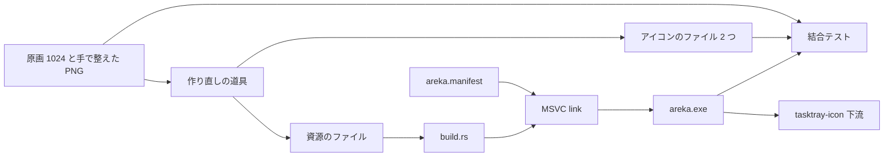
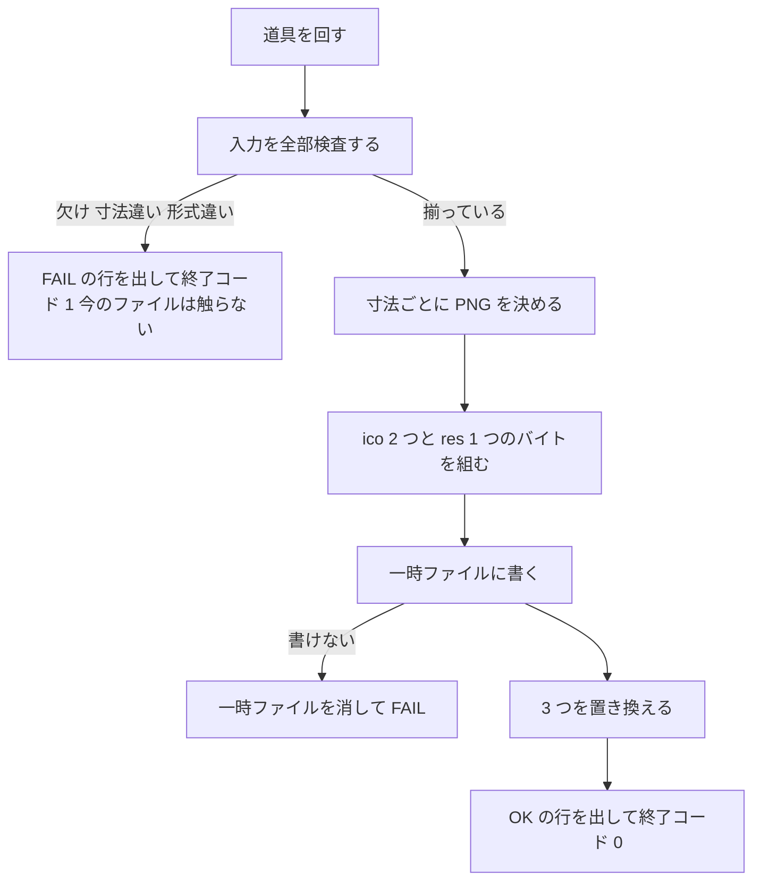

# 設計: areka-P0-app-icon

## Overview

**Purpose**: `areka.exe` に、areka の顔になるアプリのアイコンと通知領域用のアイコンを入れる。エクスプローラー・タスクマネージャー・ショートカットに areka の絵が出て、後続の `areka-P0-tasktray-icon` は絵のファイルを別に配らずに exe から通知領域用の絵を引ける。

**Users**: areka を受け取って使う人（exe の絵で areka と分かる）、後続の spec（決まった番号で通知領域用の絵を引く）、絵を直したい開発者（同じ手順で作り直す）。

**Impact**: 今の `areka.exe` はマニフェストしか資源を持たない。本設計は、作り直しの道具が作る資源のファイル（`.res`）を、今のマニフェストと同じ道（`build.rs` から bin にだけ届くリンカへの指示）で `areka.exe` に足す。コード（`crates/areka/src/`）は変えない。依存も `Cargo.lock` も変えない。

### Goals

- `areka.exe` の資源に、アプリのアイコン（組の 1 番）と通知領域用のアイコン（組の 2 番）を、それぞれ 8 寸法（16・20・24・32・40・48・64・256）で入れる。
- 1024 の原画と手で整えた小さい寸法の PNG から、アイコンのファイル 2 つと資源のファイル 1 つを、1 本の道具で同じバイトに作り直せる。
- 組んだ `areka.exe` を全体テストが開いて、2 つの組・16 枚の絵・マニフェストが揃っていることと、フォルダのファイルと中身が一致することを確かめる。

### Non-Goals

- 通知領域にアイコンを出すコード（`areka-P0-tasktray-icon`）・ゴーストが決めるアイコン（`areka-P0-tasktray-ghost-icon`）。アイコンを読む・出すコードは `crates/` のどこにも足さない（テストを除く）。
- 窓のタイトルバー・タスクバーのボタンのアイコン、インストーラー版、winget のマニフェストのアイコンの欄、README やサイトのロゴ、`.nar` の関連付けの絵。
- マニフェストの中身と埋め方の変更。`tools/package.ps1`・`.github/workflows/release.yml`・`tools/test-all.ps1` の変更。
- `areka-mcp-bridge.exe`・`shiori-host32-helper.exe` へのアイコン。
- 絵柄の決め直し（要件の段で開発者が選んで確定した）。

## Boundary Commitments

### This Spec Owns

- アイコンのフォルダ `crates/areka/icon/` と、その中のすべてのファイル（原画・焼き方の SVG・手で整えた PNG・アイコンのファイル 2 つ・資源のファイル・説明の文書）。
- 資源の番号の取り決め（下の「資源の番号の表」）。完了の後は変えない（要件 3.3）。
- 作り直しの道具 `tools/app-icon.ps1`（入力の決まり・出力の形・失敗の文・自分の検査）。
- `crates/areka/build.rs` の、資源のファイルをリンカへ渡す 2 行。
- 結合テスト `crates/areka/tests/embedded_icon_test.rs`。
- 絵の出どころと権利の記録、作り直しと実機の確かめの手順（`crates/areka/icon/README.md`）。

### Out of Boundary

- 番号の定数を Rust のコードに置くこと（読む側の `areka-P0-tasktray-icon` が自分のモジュールに置く）。`crates/areka/src/` にモジュールを足さない（`main.rs` の行を増やさない）。
- `HICON` を作る・通知領域へ出す・拡大率に合わせて選ぶ処理（`LoadIconMetric` などは下流）。
- 今のマニフェスト（`crates/areka/areka.manifest`）と `/MANIFEST:EMBED` の指示。本設計は触らず、そのまま残ることをテストで見るだけ。
- 配布の zip の手順と中身の一覧、winget の手続き、署名（`release-code-signing`）。
- `THIRD-PARTY-NOTICES.md`（`cargo about` の生成物）。
- `.kiro/steering/structure.md` の「`build.rs` は 0 件」の古い記述の直し（完了のときに直す。本設計の実装では触らない）。

### Allowed Dependencies

- 組み立て: Rust の std（`build.rs`）と、今使っている MSVC の `link.exe`（`.res` を入力に取る）。新しいクレート・`[build-dependencies]`・SDK の `rc.exe` は使わない。
- テスト: `areka` が通常の依存に持つ `windows`（根の `[workspace.dependencies.windows]` に既に在る `Win32_Foundation`・`Win32_System_LibraryLoader`・`Win32_UI_WindowsAndMessaging` の機能）と std。`Cargo.toml` の依存と機能は足さない。
- 作り直しの道具: PowerShell 7（pwsh）と、Windows に入っている `System.Drawing`（GDI+）。外の画像の道具（ImageMagick など）は使わない。
- 依存の向き: 道具 → アイコンのフォルダ（書く）→ `build.rs`（読む）→ `areka.exe` → テスト（読む）。組み立てとテストは spec のフォルダ（`.kiro/specs/`）を読まない。

### Revalidation Triggers

- 組の番号（アプリ 1・通知領域 2）か資源の言語（0）を変える → `areka-P0-tasktray-icon` が引き直す。
- 寸法の並び（8 寸法）か絵の形式（PNG）を変える → 下流の `LoadIconMetric` での見え方と、要件 6.3 の実機の確かめをやり直す。
- アイコンのフォルダの場所か資源のファイルの名前を変える → `build.rs`・テスト・説明の文書を同時に直す。
- マニフェストの埋め方を変える（別の spec）→ 本設計のテストのマニフェストの検査を見直す。

## Architecture

### Existing Architecture Analysis

- `crates/areka/build.rs`（22 行）は、`CARGO_CFG_TARGET_ENV` が `msvc` でなければ何もせず返り、`msvc` なら `cargo:rustc-link-arg-bins=` で `/MANIFEST:EMBED` と `/MANIFESTINPUT:<areka.manifest>` をリンカへ渡す。`rustc-link-arg-bins` は `areka` の bin（と bin のユニットテストの exe）だけに届き、ほかのクレートの exe には届かない。本設計はこの形に 1 つ足すだけで、早く返る所も同じに使う（要件 3.5・3.8）。
- 結合テストは `env!("CARGO_BIN_EXE_areka")` で組んだ `areka.exe` の場所を受け取る（`smoke_boot_loop_exit.rs` の前例）。テストは exe をファイルとして開くので、bin への指示がテストの exe 自身に届かないことは問題にならない。
- `tools/*.ps1` は段 `encoding check`（`tools/encoding-check.ps1`）が構文で見張る（端末へ出す文の ASCII の外の字・端末の文字コードの書き替え）。新しい道具を `tools/` に置けば要件 5.7 は既存の段が見張る。

### Architecture Pattern & Boundary Map



**Architecture Integration**:
- 選んだ形: 資源のファイルを道具で作ってコミットし、組み立ては渡すだけ（要件の討議の案 A）。資源の形を知るのは道具 1 か所で、組み立ては外の道具も依存も要らない（要件 4.2・4.3）。`build.rs` に資源を組み立てさせる案 A′ は、資源の形の知識が道具と `build.rs` の 2 か所に分かれるので採らない（`research.md`「Architecture Pattern Evaluation」）。
- 境界: 絵と資源の中身はアイコンのフォルダが持ち、`build.rs` は場所を渡すだけ、テストは読むだけ。下流は番号だけを知る。
- 残す形: MSVC のときだけ bin に指示を出す形、`CARGO_BIN_EXE_areka` を開く結合テストの形、`tools/` の PowerShell の道具と `-SelfTest` の形。
- steering との整合: 依存を足さない、端末へ出す文は ASCII、失敗は名前を示して止まる（黙って通さない）、テストの一時の置き場はワークツリーの `target\` の下。

### Technology Stack

| Layer | Choice / Version | Role in Feature | Notes |
|-------|------------------|-----------------|-------|
| 組み立て | Rust std・MSVC `link.exe`（今のもの） | `.res` を `areka.exe` に入れる | x64 と arm64 で同じ `.res` を渡す |
| テスト | `windows` 0.62.2（既存の機能だけ） | 組んだ exe の資源を読む | `LoadLibraryExW`・`FindResourceW`・`LoadResource`・`LockResource`・`SizeofResource`・`FreeLibrary`・`RT_ICON`・`RT_GROUP_ICON`・`RT_MANIFEST` |
| 道具 | PowerShell 7・`System.Drawing`（GDI+） | 原画を縮め、`.ico` と `.res` を書く | GDI+ は Windows に入っている。新しい道具は増えない |
| 焼き直し（絵を変えるときだけ） | Microsoft Edge（窓なし） | SVG から 1024 の原画を焼く | 道具の外の手順。説明の文書に書く |

## File Structure Plan

### Directory Structure

```
crates/areka/
├── build.rs                    # 変更: 資源のファイルをリンカへ渡す 2 行を足す
├── icon/                       # 新規: アイコンのフォルダ（要件 5.1）
│   ├── README.md               # 中身の一覧・資源の番号の表・作り直し方・焼き直し方・出どころと権利・実機の確かめ方
│   ├── app.svg                 # アプリ用の焼き方（2 人の輪郭の線・置き方・二重の縁取り・塗り）。spec の art/ から写す
│   ├── tray.svg                # 通知領域用の焼き方（うにゅうだけ）。spec の art/ から写す
│   ├── app.png                 # アプリ用の原画（1024×1024・RGBA）。spec の art/ から写す
│   ├── tray.png                # 通知領域用の原画（1024×1024・RGBA）。spec の art/ から写す
│   ├── tray-16.png             # 通知領域用の手で整えた絵（16×16・RGBA）
│   ├── tray-20.png             #   同 20×20
│   ├── tray-24.png             #   同 24×24
│   ├── tray-32.png             #   同 32×32
│   ├── tray-40.png             #   同 40×40
│   ├── tray-48.png             #   同 48×48
│   ├── app.ico                 # 道具の出力: アプリのアイコンのファイル（8 寸法・PNG）
│   ├── tray.ico                # 道具の出力: 通知領域用のアイコンのファイル（8 寸法・PNG）
│   └── icons.res               # 道具の出力: exe に渡す資源のファイル（2 つの組・16 枚の絵）
└── tests/
    └── embedded_icon_test.rs   # 新規: 組んだ exe の資源の検査（要件 6.1・6.2・6.4）
tools/
└── app-icon.ps1                # 新規: 作り直しの道具（要件 5.4〜5.7）と -SelfTest
```

- `girl.svg`・`unyuu.svg`・`girl-g0.png` は製品のフォルダへ写さない。`app.svg`・`tray.svg` が同じ線をそのまま中に持つ（外のファイルを読まない）ので、焼き直しに要らない。3 つは生成となぞりの記録として spec の `art/` に残り、完了で `completed/` へ移る。説明の文書はその場所を示す。
- 手で整えた PNG の名前の決まりは `<名>-<寸法>.png`（`<名>` は `app` か `tray`、`<寸法>` は 8 寸法のどれか）。今は通知領域用の 16〜48 の 6 枚だけを置く。

### Modified Files

- `crates/areka/build.rs` — `cargo:rerun-if-changed=icon/icons.res` を足し、「MSVC でなければ返る」の後ろで `cargo:rustc-link-arg-bins=<CARGO_MANIFEST_DIR>\icon\icons.res` を出す。頭の説明に、アイコンの資源も同じ道で入ることと、番号の表の在りか（`icon/README.md`）を書き足す。

### Files Not Changed（確認のため）

- `crates/areka/Cargo.toml`・`Cargo.lock`・根の `Cargo.toml`・`crates/areka/src/`・`crates/areka/areka.manifest`・`tools/package.ps1`・`tools/test-all.ps1`・`.github/workflows/*`・`THIRD-PARTY-NOTICES.md`。
- `dist/README.txt` は、モデルの利用条件が出どころの表示を求めるときだけ 1 行足す（要件 5.9）。要件の段の確かめ（2026-10-16）では表示を求める記載は無かったので、実装で権利の文書を書くときに条件を引き直し、無ければ触らない。

## System Flows

### 作り直しの流れ（道具）



- 寸法ごとの決まり: `<名>-<寸法>.png` が在ればそのバイトをそのまま使う。無ければ 1024 の原画を GDI+ の高品質の双三次で縮めて PNG に書く。通知領域用の 16〜48 は手で整えた PNG を必ず要する（要件 2.2）。
- 検査は書き始める前に全部済ませ、欠けたファイルはすべて 1 行ずつ出す（最初の 1 つで止めない）。

### 確かめの流れ（全体テストと実機）

- 全体テスト（`tools/test-all.ps1` の段 4 `cargo test --workspace`）が `embedded_icon_test.rs` を回す。Cargo が先に `areka` の bin を組み、`build.rs` の指示で `.res` が入る。テストは組んだ exe を開いて検査する（要件 6.1・6.2）。
- arm64 は全体テストでは組まない。実機の手順で arm64 の exe を組み、環境変数 `AREKA_ICON_CHECK_EXE` にその場所を入れて同じテストを回す（要件 6.4）。

## Requirements Traceability

| Requirement | Summary | Components | Interfaces | Flows |
|-------------|---------|------------|------------|-------|
| 1.1 | 方向を聞いて案に反映 | 要件の段で済み（requirements.md「議題 1」）。本設計は成果の原画を受け取るだけ | ― | ― |
| 1.2 | モデルの利用条件を先に確かめる | 要件の段で済み。説明の文書が条件の URL と確かめた日を写す | README の「出どころと権利」 | ― |
| 1.3 | 枚数とモデルを決めてから生成 | 要件の段で済み | ― | ― |
| 1.4 | 案は `target\` の下・リポジトリに入れない | 要件の段で済み。アイコンのフォルダには選んだものしか置かない | ― | ― |
| 1.5 | 選んだ原画を spec のフォルダと「選んだ原画」の節へ | 要件の段で済み（`art/`）。実装でアイコンのフォルダへ写す | ― | ― |
| 1.6 | 開発者が選ぶまで確定としない | 要件の段で済み（2026-10-16 開発者が選んだ） | ― | ― |
| 2.1 | アプリのアイコンはアプリ用の原画から | アイコンのフォルダ・作り直しの道具 | 寸法ごとの決まり | 作り直しの流れ |
| 2.2 | 通知領域用の 16〜48 は別に整える | アイコンのフォルダ（`tray-16.png`〜`tray-48.png`）・道具（必須の検査） | 寸法ごとの決まり | 作り直しの流れ |
| 2.3 | 2 つとも 8 寸法を 1 ファイルに | 道具（`app.ico`・`tray.ico`）・テスト（`.ico` の目録も読む） | アイコンのファイルの形 | ― |
| 2.4 | 明暗の地で 16 ピクセルで見分けられる | 説明の文書（実機の確かめ方）・開発者の目視 | ― | 確かめの流れ |
| 2.5 | 動かない 1 枚の絵 | 道具は 1 寸法に 1 枚の静止画（PNG）だけを書く | アイコンのファイルの形 | ― |
| 3.1 | exe の絵はアプリのアイコン | 資源の番号の表（アプリ＝組の 1 番＝最初の組） | 資源の番号の表 | ― |
| 3.2 | 通知領域用を同じ exe に・決まった番号で | 資源の番号の表（組の 2 番）・`build.rs` | 資源の番号の表 | ― |
| 3.3 | 番号を設計に書き、完了後は変えない | 本書「資源の番号の表」・README の写し | 資源の番号の表 | ― |
| 3.4 | マニフェストは今のまま・二重に入れない | 道具は `RT_ICON`・`RT_GROUP_ICON` しか書かない・テストがマニフェストを見る | 資源のファイルの形 | ― |
| 3.5 | MSVC でなければ入れずに成功 | `build.rs`（早く返る所の後ろに足す）・テストは `cfg(target_env = "msvc")` | ― | ― |
| 3.6 | x64・arm64 に同じ絵・同じ番号 | `build.rs`（同じ `.res` を渡す）・テストの環境変数の口 | 検査の関数 | 確かめの流れ |
| 3.7 | 完了で spec が移っても同じ | アイコンのフォルダ（`crates/areka/` の下）・`build.rs` は spec のフォルダを読まない | ― | ― |
| 3.8 | ほかの exe を変えない | `rustc-link-arg-bins` は `areka` の bin だけに届く | ― | ― |
| 4.1 | zip の手順と一覧を変えない | `tools/package.ps1` は触らない（組んだ exe に入るだけ） | ― | ― |
| 4.2 | ソースからの組み立てに道具を足さない | 案 A（`.res` をコミット）・`build.rs` は渡すだけ | ― | ― |
| 4.3 | 依存を足さず `Cargo.lock` を変えない | Allowed Dependencies・テストは既存の `windows` の機能だけ | ― | ― |
| 5.1 | 原画・整えた絵・`.ico`・`.res` を 1 フォルダに | `crates/areka/icon/` | ― | ― |
| 5.2 | 原画ごとのモデル・指示・日・選んだ案・条件 | README の「出どころと権利」 | ― | ― |
| 5.3 | 権利は README・`THIRD-PARTY-NOTICES.md` には書かない | README の「出どころと権利」 | ― | ― |
| 5.4 | 直して回すと `.ico` と `.res` を作り直す | 作り直しの道具 | 道具の口 | 作り直しの流れ |
| 5.5 | 同じ入力から同じバイト | 道具（時刻を書かない・決まった順・GDI+ は同じ机で同じバイト）・`-SelfTest` | 道具の口 | ― |
| 5.6 | 欠け・違いは名前を示して失敗・上書きしない | 道具（先に全部検査・一時ファイルから置き換え）・`-SelfTest` | 道具の口（失敗の文） | 作り直しの流れ |
| 5.7 | 端末へ出す文は ASCII | 道具（英語の文だけ）・段 `encoding check` | 道具の口 | ― |
| 5.8 | 手順の説明をフォルダから辿れる所に | `crates/areka/icon/README.md` | ― | ― |
| 5.9 | 表示を求める条件なら `dist/README.txt` にも 1 行 | 実装で条件を引き直し、求めるときだけ足す | ― | ― |
| 6.1 | 全体テストで 2 つの組・8 寸法・マニフェスト | 結合テスト | 検査の関数 | 確かめの流れ |
| 6.2 | 欠けたら番号と寸法を示して失敗 | 結合テスト（欠けを全部並べて失敗） | 検査の関数 | 確かめの流れ |
| 6.3 | 実機でエクスプローラー・タスクマネージャー・ショートカット | README の「実機の確かめ方」 | ― | 確かめの流れ |
| 6.4 | x64 と arm64 の両方から引ける | 結合テストの環境変数の口・README の手順 | 検査の関数 | 確かめの流れ |

## Components and Interfaces

| Component | Domain/Layer | Intent | Req Coverage | Key Dependencies | Contracts |
|-----------|--------------|--------|--------------|------------------|-----------|
| アイコンのフォルダ | 資産 | 原画・整えた絵・出力・説明を 1 か所に持つ | 2.1, 2.2, 2.5, 3.7, 5.1 | spec の `art/`（写しの元・P2） | State |
| 作り直しの道具 | 開発の道具 | 入力を検査し、`.ico` 2 つと `.res` を同じバイトで書く | 2.1, 2.2, 2.3, 2.5, 3.4, 5.4, 5.5, 5.6, 5.7 | GDI+（P0） | Batch |
| 埋め込みの指示 | 組み立て | `.res` を `areka` の bin のリンクに渡す | 3.1, 3.2, 3.5, 3.6, 3.7, 3.8, 4.1, 4.2, 4.3 | MSVC `link.exe`（P0） | ― |
| 結合テスト | テスト | 組んだ exe の資源とフォルダのファイルを突き合わせる | 2.3, 3.1, 3.2, 3.4, 3.6, 6.1, 6.2, 6.4 | `windows`（P0） | Service |
| 説明の文書 | 文書 | 番号の表・作り直し方・権利・実機の確かめ方 | 1.2, 2.4, 3.3, 5.2, 5.3, 5.8, 5.9, 6.3, 6.4 | ― | ― |

### 資産

#### アイコンのフォルダ（`crates/areka/icon/`）

| Field | Detail |
|-------|--------|
| Intent | 絵の入力と出力と説明を、組み立てが読める場所に 1 つにまとめる |
| Requirements | 2.1, 2.2, 2.5, 3.7, 5.1 |

**Responsibilities & Constraints**
- 原画 `app.png`・`tray.png` は 1024×1024・8 ビット RGBA の PNG。spec の `art/` の同名のファイルをバイトのまま写す。
- 手で整えた PNG `<名>-<寸法>.png` は、その寸法ちょうどの 8 ビット RGBA の PNG。今は `tray-16.png`〜`tray-48.png` の 6 枚。作り方（縮めた絵を元に画素を直すなど）は実装に任せ、背景は完全に透明、縁取りの二重（内側の白・外側の灰）は寸法が許す限り残す（要件の討議の決め）。
- 出力 `app.ico`・`tray.ico`・`icons.res` は道具だけが書く。手で直さない。
- 焼き方の SVG `app.svg`・`tray.svg` は spec の `art/` からバイトのまま写す。道具は読まない（焼き直しは絵を変えるときだけの手順）。

**Contracts**: State [x]

##### State Management
- 正本: 入力（原画・手で整えた PNG）。出力は入力から道具が作る写し。
- 一致の守り: 結合テストが exe・`.ico`・手で整えた PNG をバイトで突き合わせる（原画 1024 の直しの回し忘れだけは拾えない＝Risks）。

### 開発の道具

#### 作り直しの道具（`tools/app-icon.ps1`）

| Field | Detail |
|-------|--------|
| Intent | 入力を検査し、アイコンのファイル 2 つと資源のファイル 1 つを同じバイトで作り直す |
| Requirements | 2.1, 2.2, 2.3, 2.5, 3.4, 5.4, 5.5, 5.6, 5.7 |

**Responsibilities & Constraints**
- このスクリプトの在るリポジトリの `crates/areka/icon/` を読み書きする（呼ばれた場所によらない・今のフォルダを変えない）。
- 端末へ出す文・例外の文は ASCII の英語だけ。端末の文字コードを読みも書きもしない。
- ファイルに時刻を書かない。並びは決まった順（組はアプリ → 通知領域、絵は寸法の小さい順）。

**Dependencies**
- External: `System.Drawing`（GDI+）— 原画を縮めて PNG に書く（P0）

**Contracts**: Batch [x]

##### Batch / Job Contract
- **Trigger**: 開発者が `pwsh -NoProfile -File <repo>\tools\app-icon.ps1` を回す（原画か手で整えた PNG を直したとき）。`-SelfTest` で自分の検査。
- **Input / validation**（書き始める前に全部見る・欠けごとに 1 行）:
  - `app.png`・`tray.png` が在り、PNG の印で始まり、最初の塊が `IHDR` で、幅と高さが 1024、ビットの深さ 8、色の型 6（RGBA）。
  - 通知領域用の `tray-16.png`・`tray-20.png`・`tray-24.png`・`tray-32.png`・`tray-40.png`・`tray-48.png` が在る（要件 2.2）。
  - 在る `<名>-<寸法>.png` はすべて、幅と高さがその寸法で、ビットの深さ 8・色の型 6。
- **寸法ごとの PNG**: `<名>-<寸法>.png` が在ればそのバイト。無ければ原画を GDI+ で縮め（32 ビット ARGB の画板・高品質の双三次・縁の折り返し）、PNG で書いたバイト。
- **Output / destination**: `app.ico`・`tray.ico`・`icons.res`（形は「Data Models」）。
- **端末への出力**:

| 行 | とき |
|----|------|
| `FAIL input <file>: missing` | 入力のファイルが無い |
| `FAIL input <file>: not a PNG` | PNG の印か `IHDR` が無い |
| `FAIL input <file>: size <w>x<h>, want <n>x<n>` | 寸法が違う |
| `FAIL input <file>: not 8-bit RGBA` | 深さか色の型が違う |
| `FAIL write <file>: <reason>` | 一時ファイルを書けない・置き換えられない |
| `OK wrote <file> (<n> images)` | 書けたファイルごと（`.res` は `(2 groups, 16 images)`） |

- 終了コード: 0＝3 つとも書けた／1＝FAIL の行を出した。FAIL のときは今の 3 つのファイルを触らない（一時ファイルは消す）。
- **Idempotency & recovery**: 同じ入力から同じバイト（同じ机・同じ OS の版で。GDI+ が OS の版で変わると縮めた寸法のバイトが変わりうる＝説明の文書に書く）。書き込みは 3 つとも一時ファイルへ書けてから置き換える。

##### `-SelfTest`
判定ごとに `ok selftest <名前>` か `FAIL selftest <名前>` を出し、1 つでも FAIL なら終了コード 1。一時の置き場はワークツリーの `target\app-icon-selftest\`（毎回作り直す）。入力は本物のアイコンのフォルダの入力を写して使う。
1. `same bytes twice` — 同じ入力から 2 回作った 3 つのファイルがバイトまで同じ。
2. `missing tuned fails` — `tray-16.png` を消した写しで、`tray-16.png` を名指す FAIL の行が出て終了コード 1、写しの出力 3 つが前と同じバイト。
3. `wrong size fails` — `tray-16.png` を 20×20 の PNG に差し替えた写しで、寸法の FAIL の行が出て、出力が前と同じ。
4. `not rgba fails` — `app.png` を 24 ビット RGB の PNG に差し替えた写しで、形式の FAIL の行が出て、出力が前と同じ。

**Implementation Notes**
- Integration: 段 `encoding check` が `tools/*.ps1` を見張るので、置くだけで要件 5.7 の検査に入る。全体テストの段は足さない（要件の討議の決め）。`-SelfTest` は道具を直したときと実装の確かめで回す。
- Validation: 道具が書いた `.res` を exe に入れて読めることは結合テストが見る（道具の中で `.res` を読み返さない）。
- Risks: 原画を直して道具を回し忘れても結合テストは拾えない → 説明の文書に「原画を直したら道具を回し、出力 3 つを一緒にコミット」と書く。

### 組み立て

#### 埋め込みの指示（`crates/areka/build.rs`）

| Field | Detail |
|-------|--------|
| Intent | `icons.res` を `areka` の bin のリンクに入力として渡す |
| Requirements | 3.1, 3.2, 3.5, 3.6, 3.7, 3.8, 4.1, 4.2, 4.3 |

**Responsibilities & Constraints**
- `cargo:rerun-if-changed=icon/icons.res` を、今の 2 つの `rerun-if-changed` と並べて出す（`.res` が変われば組み直す）。
- 「MSVC でなければ返る」の後ろで、`CARGO_MANIFEST_DIR` からの絶対パスを `cargo:rustc-link-arg-bins=` に出す。今の `/MANIFEST:EMBED`・`/MANIFESTINPUT:` の 2 行は変えない。
- `.res` が無いときに前もって調べない。リンカがファイル名を示して落ちる（黙って絵の無い exe を作らない）。
- x64 と arm64 は同じ `.res` を渡す。`.res` は機械の種別を持たず、`link.exe` が目的の機械の形に直して入れる。

**Implementation Notes**
- Integration: 資源はリンクの段で入るので、`[profile.release]` の `opt-level`・`lto`・`strip` と関わらない。bin のユニットテストの exe にも同じ資源が入る（今のマニフェストと同じ・害は無い）。
- Validation: 結合テスト。arm64 の通りは実装で `tools/package.ps1 -Arch arm64` を 1 回回して確かめる。
- Risks: arm64 の `link.exe` が受けないとき → 本設計の前提が崩れるので、実装はそこで止めて報告する。

### テスト

#### 結合テスト（`crates/areka/tests/embedded_icon_test.rs`）

| Field | Detail |
|-------|--------|
| Intent | 組んだ exe に 2 つの組・16 枚の絵・マニフェストが在り、フォルダのファイルと中身が一致することを確かめる |
| Requirements | 2.3, 3.1, 3.2, 3.4, 3.6, 6.1, 6.2, 6.4 |

**Responsibilities & Constraints**
- ファイルの頭に `#![cfg(target_env = "msvc")]`（MSVC でなければアイコンは入らない＝要件 3.5 と揃える）。
- exe は `LoadLibraryExW(<絶対パス>, None, LOAD_LIBRARY_AS_DATAFILE)` で開き、終わりに `FreeLibrary` する。資源は `FindResourceW`／`LoadResource`／`LockResource`／`SizeofResource` で引く。
- 欠けを見つけても止まらず、全部を文の一覧に集めてから、一覧が空でなければ全部を並べて失敗する（要件 6.2）。
- アイコンのフォルダは `env!("CARGO_MANIFEST_DIR")` から辿る。spec のフォルダを読まない。

**Dependencies**
- Inbound: 全体テストの段 4（`cargo test --workspace`）— 回す（P0）
- External: `windows` の `Win32::System::LibraryLoader`・`Win32::UI::WindowsAndMessaging`・`Win32::Foundation` — 資源を引く（P0）

**Contracts**: Service [x]

##### Service Interface
```rust
/// 組の番号（資源の番号の表）。下流は自分の定数を持つ。テストの中だけの値。
const APP_GROUP: u16 = 1;
const TRAY_GROUP: u16 = 2;
/// 8 寸法。目録の 0 は 256 と読む。
const SIZES: [u32; 8] = [16, 20, 24, 32, 40, 48, 64, 256];
/// 環境変数: 追加で検査する exe の絶対パス（arm64 の確かめ）。
const EXTRA_EXE_ENV: &str = "AREKA_ICON_CHECK_EXE";

/// exe を開いて全部の検査をし、欠けの文を返す（空なら合格）。
/// 開けないときは、その理由の 1 文だけを返す。
fn defects_of(exe: &std::path::Path) -> Vec<String>;

#[test] fn built_areka_exe_has_app_and_tray_icons();   // CARGO_BIN_EXE_areka を検査
#[test] fn extra_exe_has_app_and_tray_icons();         // EXTRA_EXE_ENV が無ければ eprintln で飛ばしを 1 行出して通す
```
- `defects_of` が見ること（欠けの文は組の番号・寸法・絵の番号を含む）:
  1. 組 1 と組 2 の `RT_GROUP_ICON` が在る。目録の頭が「予約 0・種別 1・枚数 8」。
  2. 目録の 8 項目の寸法の集まりが `SIZES` とちょうど同じ（欠けた寸法・余分な寸法・重なりを名指す）。各項目の色の深さが 32。
  3. 各項目の絵の番号の `RT_ICON` が在り、大きさが目録の大きさと同じで、PNG の印で始まり、`IHDR` の幅と高さが項目の寸法と同じ。
  4. 組ごとに、その組の絵の中身が `icon/<名>.ico` の同じ寸法の絵とバイトで同じ（`.ico` の目録も読み、8 寸法が揃うことも見る＝要件 2.3）。
  5. `icon/<名>-<寸法>.png` が在る寸法では、exe の絵がそのファイルとバイトで同じ（手で整えた絵の直しの回し忘れを拾う）。
  6. `RT_MANIFEST` の 1 番が在り、中に `Microsoft.Windows.Common-Controls` と `6.0.0.0` の両方の文字列を持つ（要件 3.4・6.1）。
- Preconditions: Cargo が `areka` の bin を先に組んでいる（`CARGO_BIN_EXE_areka`）。
- Postconditions: 開いた exe を閉じる。ファイルを書かない。
- Invariants: 判定は exe とフォルダのファイルのバイトだけで決まる（時刻・机の設定に依らない）。

**Implementation Notes**
- Integration: 新しいファイルを置けば全体テストの段 4 に入る。1 ファイル 1,000 行の目安の中に収まる（数百行）。
- Validation: 実装で一度、`.res` を渡さない組み立て（`build.rs` の 1 行を外した状態）でテストが組 1・組 2 の欠けを名指して赤になることを見てから戻す（赤を立ててから緑にする）。
- Risks: x64 のテストから arm64 の exe を開けないとき → `defects_of` の中の読み方を std で PE の資源の目録を辿る形へ替える（検査の 1〜6 は同じ）。

### 文書

#### 説明の文書（`crates/areka/icon/README.md`）

| Field | Detail |
|-------|--------|
| Intent | アイコンのフォルダの中身と、作り直し・権利・実機の確かめを 1 か所で説明する |
| Requirements | 1.2, 2.4, 3.3, 5.2, 5.3, 5.8, 5.9, 6.3, 6.4 |

節と中身（日本語・平易な語）:
- **中身の一覧**: 各ファイルの役目（入力・出力・焼き方）と、出力を手で直さないこと。
- **資源の番号の表**: 下の表の写し。変えないこと（読む側がいる）。
- **作り直し方**: 原画か `<名>-<寸法>.png` を直す → `pwsh -NoProfile -File <repo の絶対パス>\tools\app-icon.ps1` → 出力 3 つを入力と一緒にコミット。手で整えた絵を足す・外すときの名前の決まり。道具を直したら `-SelfTest`。GDI+ の版で縮めた寸法のバイトが変わりうること（入力を変えていないのに原画から縮めた寸法だけが変わったら OS の変化と読む）。
- **焼き直し方**（絵そのものを変えるときだけ）: Edge を窓なしで動かして `app.svg`・`tray.svg` を 1024×1024・透明の地で撮る（`requirements.md` の「焼き方」のコマンド）。輪郭の線は SVG の中の `path` を直す。なぞりの元（`girl.svg`・`unyuu.svg`・`girl-g0.png`）と生成の記録は spec の `art/`（完了後は `.kiro/specs/completed/areka-P0-app-icon/art/`）に在ること。
- **出どころと権利**（要件 5.2・5.3）: 女の子の素の絵＝fal の Recraft V3（`fal-ai/recraft/v3/text-to-image`）・画風・指示の文・生成日 2026-10-16・request の番号・選んだ案（g0 の頭を 1.3 倍にして 8 度かしげたもの）・利用条件の URL（モデルのページと fal の FAQ）と確かめた日。うにゅうの輪郭＝元祖の伺かの相方の輪郭を開発者の判断（2026-10-16）で使い、輪郭の形だけを持つこと。絵は areka 本体（MIT）の一部として配ること。`THIRD-PARTY-NOTICES.md` には載せないこと。
- **実機の確かめ方**（要件 6.3・6.4）:
  - エクスプローラー: アイコンの覚えに邪魔されないよう、組んだ `areka.exe` をワークツリーの `target\` の下に初めての名前で写して見る（覚えを消す道もあるが、写す方が他の表示を乱さない）。
  - タスクマネージャー: areka を動かして、プロセスの行の絵を見る。ショートカット: exe へのショートカットを作って絵を見る。
  - それぞれを、Windows の明るい表示設定と暗い表示設定、画面の拡大率 100% と 200% 以上で見る。
  - 16 ピクセルの輪郭（要件 2.4）: エクスプローラーの「小さいアイコン」か「詳細」の表示（16 ピクセルで出る）で、写した `areka.exe`（アプリの絵）と `tray.ico`（`.ico` のファイルは自分の絵で出る＝通知領域用の絵）を、明るい表示設定と暗い表示設定の両方で見る。通知領域に実際に出して見るのは下流 `areka-P0-tasktray-icon` の仕事。見分けにくければ `<名>-<寸法>.png` を手で整えて置き、道具を回し直す（設計は変わらない）。
  - arm64: `tools/package.ps1 -Arch arm64`（または `cargo build --release -p areka --target aarch64-pc-windows-msvc`）で組み、PowerShell で `$env:AREKA_ICON_CHECK_EXE = '<arm64 の areka.exe の絶対パス>'` を立てて `cargo test -p areka --test embedded_icon_test` を回す（arm64 の exe は動かさない）。コマンドは絶対パスで書く。
- **`dist/README.txt` への追記**（要件 5.9）: モデルの条件が表示を求めるときだけ「■ 同梱物とライセンス」に 1 行。要件の段の確かめでは求めていない。

## Data Models

### 資源の番号の表（要件 3.3・完了の後は変えない）

| 資源の種別 | 番号 | 中身 | 言語 |
|------------|------|------|------|
| `RT_GROUP_ICON`（14） | **1** | アプリのアイコン（exe の絵＝エクスプローラー・タスクマネージャー・ショートカット） | 0 |
| `RT_GROUP_ICON`（14） | **2** | 通知領域用のアイコン（`areka-P0-tasktray-icon` が引く） | 0 |
| `RT_ICON`（3） | 1〜8 | アプリの絵（16・20・24・32・40・48・64・256 の順） | 0 |
| `RT_ICON`（3） | 9〜16 | 通知領域用の絵（同じ順） | 0 |
| `RT_MANIFEST`（24） | 1 | 今のマニフェスト（`link.exe` の `/MANIFEST:EMBED` が入れる・本設計は作らない） | リンカの既定 |

- 名前の付いた資源は使わない。エクスプローラーは目録の並び（名前が先・番号は小さい順）で最初の組を exe の絵にするので、組の 1 番がアプリの絵になる（要件 3.1）。
- 言語 0 は「言語に依らない」。`FindResourceW` と下流の `LoadIconMetric` は表示言語によらずこれを引く。
- 下流は組の 2 番を `MAKEINTRESOURCE(2)` で引き、番号の定数は下流が自分のモジュールに置く。

### アイコンのファイルの形（`app.ico`・`tray.ico`）

- 頭（6 バイト）: 予約 0・種別 1（アイコン）・枚数 8。すべて 16 ビットの小さい端から。
- 目録の項目（16 バイト×8・寸法の小さい順）: 幅・高さ（1 バイト・256 は 0）・色数 0・予約 0・面 1・色の深さ 32・絵のバイト数・ファイルの頭からの位置。
- 絵: 項目の順に PNG のバイトをそのまま並べる。

### 資源のファイルの形（`icons.res`）

- 先頭に空の項目（32 バイト・中身 0・種別と番号は 0 の番号の形）を 1 つ置く（`.res` の決まり）。
- 項目ごとの頭（32 バイト）: 中身の大きさ・頭の大きさ 32・種別（0xFFFF＋番号）・番号（0xFFFF＋番号）・中身の版 0・記憶の印（`RT_ICON` は 0x1010、`RT_GROUP_ICON` は 0x1030・`rc.exe` と同じ値）・言語 0・版 0・特性 0。中身の後ろを 4 バイトの境まで 0 で埋める。
- 並び: `RT_ICON` の 1〜16、続いて `RT_GROUP_ICON` の 1・2。
- 組の中身（`RT_GROUP_ICON`）: 頭（6 バイト・予約 0・種別 1・枚数 8）＋項目（14 バイト×8）＝幅・高さ（256 は 0）・色数 0・予約 0・面 1・色の深さ 32・絵のバイト数・絵の番号（16 ビット）。
- `RT_MANIFEST` は書かない（要件 3.4）。

## Error Handling

### Error Strategy

- 道具: 入力の欠け・違いを書き始める前に全部見て、ファイルごとに名前を示す 1 行を出して終了コード 1。今の出力は触らない（要件 5.6）。書き込みの失敗も名前を示し、一時ファイルを消す。
- 組み立て: `icons.res` が無ければ `link.exe` が開けないファイル名を示して落ちる。絵の無い exe を黙って作らない。MSVC でないときは今と同じく何もせずに成功する（要件 3.5・これは失敗ではない）。
- テスト: 開けない・組が無い・寸法の欠け・余分・中身の違い・マニフェストの欠けを、組の番号と寸法と絵の番号を含む文で全部並べて失敗する（要件 6.2）。環境変数の口が無いときは飛ばしたことを 1 行出す（黙って通らない）。

### Monitoring

- 実行時（`areka.exe` が動いているとき）に本設計のコードは無いので、記録（`tracing`）に足すものは無い。

## Testing Strategy

- **結合テスト**（`crates/areka/tests/embedded_icon_test.rs`・全体テストの段 4）:
  1. 組んだ `areka.exe` の組 1・組 2 が 8 寸法ちょうどを持ち、色の深さが 32（要件 2.3・3.1・3.2・6.1）。
  2. 16 枚の絵が在り、大きさが目録と同じで、PNG の寸法が項目と同じ（要件 6.1・6.2）。
  3. exe の絵が `app.ico`・`tray.ico` の絵と、在る `<名>-<寸法>.png` とバイトで同じ（要件 2.2・2.3・5.4 の回し忘れ）。
  4. `RT_MANIFEST` の 1 番に版 6 の申告が在る（要件 3.4・6.1）。
  5. 環境変数で渡した arm64 の exe に同じ検査が通る（要件 3.6・6.4・実機の手順で回す）。
- **道具の自分の検査**（`tools/app-icon.ps1 -SelfTest`・手で回す）: 同じバイト・入力の欠け・寸法違い・形式違いと、失敗で出力を上書きしないこと（要件 5.5・5.6）。
- **静的な見張り**（既存の段 `encoding check`）: 道具の端末への文が ASCII だけ（要件 5.7）。
- **実機の確かめ**（開発者・README の手順）: エクスプローラー・タスクマネージャー・ショートカットのアプリの絵と、16 ピクセルの輪郭を、明暗の表示設定と拡大率 100%・200% 以上で目で見る（要件 2.4・6.3）。
- **赤を立てる**: 実装で、`.res` を渡さない状態でテストが組 1・組 2 を名指して赤になること、手で整えた PNG を 1 画素変えて道具を回さない状態で寸法を名指して赤になることを一度ずつ見てから戻す。

## Security Considerations

- 権利: 生成した絵はモデルの利用条件（商用の利用可）の下で areka 本体（MIT）の一部として配る。うにゅうの輪郭は開発者の判断で使い、その判断と日付を README に残す。元の絵（色・顔）はリポジトリに入れない。
- テストは exe をデータとして写すだけで、動かさない（`LOAD_LIBRARY_AS_DATAFILE`）。
