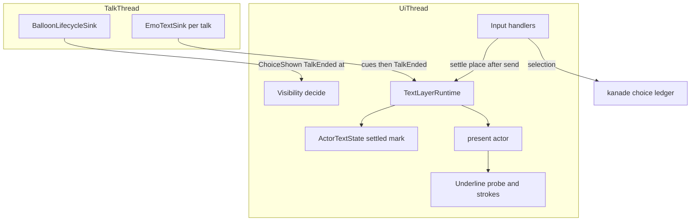
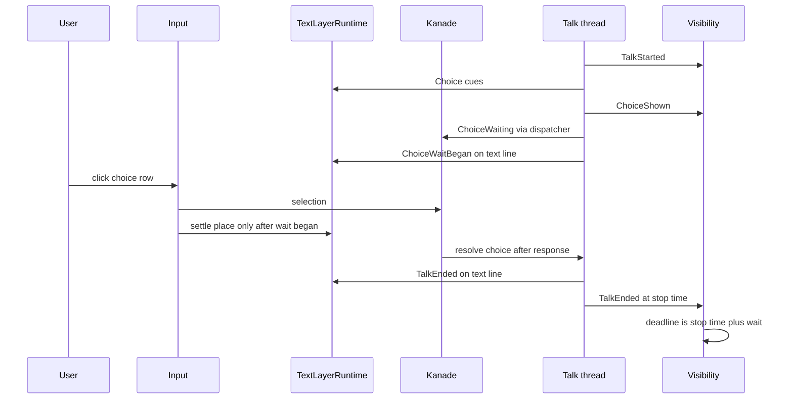
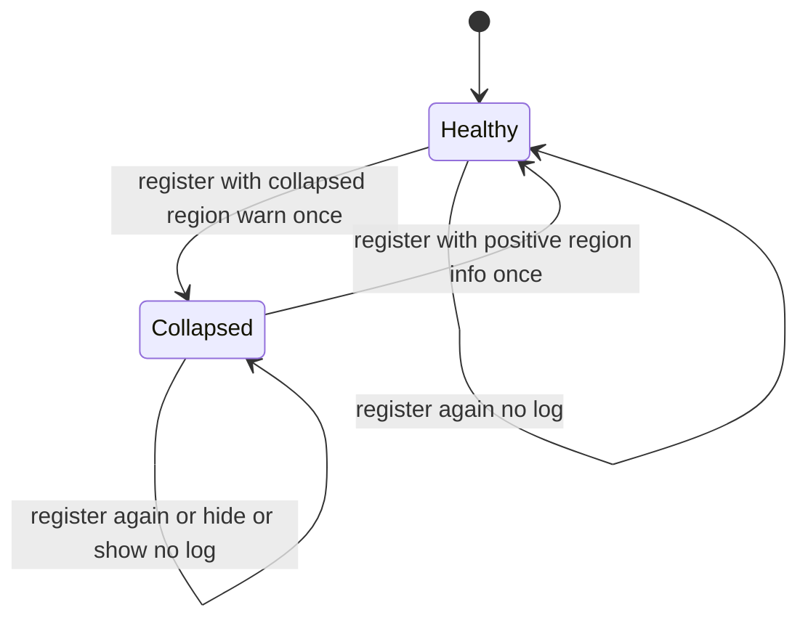
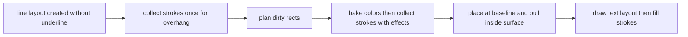

# 設計書: areka-P0-balloon-text-bugs

## 概要

**目的**: バルーンの文字の表示に残る 3 件のバグを直す。件 1＝選択の済んだバルーンが時間切れで消えず `OnBalloonTimeout` も届かない・済んだ選択肢の行が光り押せてしまう。件 2＝文字の描画範囲（validrect）が 0 以下に潰れると、供給面の生成の失敗と警告を毎フレーム出し続ける。件 3＝文字の領域の最下行の下線が面の外に出て見えない。

**使う人**: areka の利用者（用の済んだバルーンが消える・最下行のアンカーが押せる所だと見分けられる）、ゴーストの作者（選択肢つきの台詞にも `OnBalloonTimeout` が届く・下線が欠けない）、記録を読む開発者（記録が洪水にならない）。

**今の仕組みへの影響**: 可視性の判断は「選択肢の行が表示中か」を問うのをやめ、選択肢つきのトークの時間切れの起点を「選択の待ちが解けた時刻（トークが止まった時刻）」に改める。文字の層は選択肢の範囲に「済み」の境目を持ち、当たり行・強調・`choice_active` がそれに従う。文字の層の線にトークの終わりを流す。潰れた描画範囲では供給面を作らない。横書きの下線は D2D に引かせず、DirectWrite に聞いた幾何で areka がベースラインの直下に塗る。

### 目標

- 選択が済んだ（選んだ・選択肢の時間切れで解除された・中断された）バルーンが、済んでから既定の長さで隠れ、`OnBalloonTimeout` が届く。待っている間は隠れない。
- 済んだ選択肢の行は光らず、押しても選択として扱われず、警告も出ない。見た目は今のまま。
- 潰れた描画範囲では供給面を作らず描かず、記録は「潰れた」「戻った」の 1 回ずつ。
- 横書きの下線はどの行もベースラインの直下。最下行で面に収まらないときだけ面の内側へ寄せる。行の位置と入る行の数は下線の有無で変わらない。
- 3 件それぞれを決定論のテストと実機で固定し、改めた正典の決めを互換の記録（`doc/COMPAT_ARCHITECTURE.md` §8）に残す。

### 目標にしないこと

- 選択肢の見た目（`choice-marker-styling`）・範囲の選択肢（`range-choice-tag`）・選択肢の時間切れそのもの（完了 `choice-timeout-directive`）。
- 時間切れの判断のほかの規則（待ちの長さ・ドラッグ中とポインタ滞在の抑止）と 3 つのイベントの送り方。
- 縦書きの下線をどちらの側に出すか・アンカーの見た目の作者指定（`anchor-style-canon`）・下線の太さ・色・形の作者指定。
- 打ち消し線の描き方（今のまま DirectWrite と D2D）・あふれのスクロールの見せ方・入る行の数え方。
- 最下行の字の下の部分（descent）の欠け（撮り直しで確かめ、欠けていれば範囲の外として起票する）。

## 境界の約束

### この spec が持つもの

- **選択肢つきのトークの時間切れの起点**: 可視性の判断の中で、選択肢を出したトークは止まった時刻から測る（`balloon_visibility_wait.rs`）。そのための合図 `TalkLifecycleSignal::ChoiceShown`（`talk_lifecycle.rs`）。
- **選択肢の「済み」**: 場所ごとの境目（`ActorTextState` の欄）と、それに従う当たり行の写し・強調・`choice_active`（`areka-emo-text`）。押下で付ける口（`input_events`）と、文字の線のトークの終わり `TextMsg::TalkEnded`（`sink.rs`）。
- **潰れた描画範囲の扱い**: `TextRegion::is_collapsed`・提示で描かないこと・差し込み口からの片付け・状態の変わり目の記録。
- **areka が塗る下線**: 下線を引く区間の選び（今と同じ）・DirectWrite から幾何と色を集める受け手・横書きのベースライン直下への置き直し・面の内側への寄せ・行のはみ出しへの足し分。
- 上の 4 つの決定論のテスト・実機の確かめの手順・COMPAT §8 の 4 行。

### 境界の外

- kanade の選択の帳簿（`Waiting`／`Cascading`／`TimeoutInFlight`）と、選択・時間切れ・中断の決め方。kanade には触らない。
- 選択肢とアンカーの押せる範囲の作り方（`derive_hit_rows`・`to_window_physical`）・入る行の数え方（`layout.rs` の `visible_window`）・バルーン定義の読み方。
- 打ち消し線・字のグリフの描き方（`DrawTextLayout` はそのまま）・縦書きの下線の側。
- ドラッグ中・ポインタ滞在の抑止と、抑止が解けたときの測り直しの規則（触らない）。
- 区切りに達する前に押された選択を kanade が捨てる今の振る舞い（`choice_rejected_no_wait`・`steady.rs` 245 行）。本 spec はそれを変えず、そういう押下では選択肢を済みにしない（設計の討議 議題 1）。

### 使ってよい依存

- `crates/areka`（`emo2_boot`・`input_events`）→ `areka-emo-text` の公開の口（`TextLayerRuntime`・`TextMsg`・`EmoTextSink`）。逆向きは無い。
- `areka-sakura` の再生（`drive.rs`）→ `dola` の `CuePlayer::announce_choice_wait`（新）→ 登録された受け口の `CueSink::choice_wait_began`（新・何もしない既定つき）。先渡しの `preview` と同じ向きと形（設計の討議 議題 1）。
- `areka-emo-text` → `wintf`（`VisualGraphics`・`Arrangement` の部品）・`windows`（DirectWrite の `IDWriteTextRenderer`・`IDWriteTextLayout`）・**`windows-core`（`#[implement]` のため・ワークスペースの依存・新しい外部のクレートは 0）**。`areka-emo-text` は `areka-ghost` に依らないまま。
- 可視性の判断は時計・GPU・World に触れない純関数のまま（`decide`）。
- 新しい公開型は作らない。下線の受け手と幾何は `areka-emo-text` の中だけ（`pub(crate)`）。

### 確かめ直しが要る変化

- `TalkLifecycleSignal` の形が変わる（`ChoiceShown` を足す）＝この線を読む相手（今は可視性の判断だけ）。
- `TextMsg` に `TalkEnded` と `ChoiceWaitBegan` を足し、`handle_text_msg_with` が受け口を取る＝例・検査の呼び手。
- `dola::cue::CueSink` に何もしない既定つきの `choice_wait_began` を足す＝crates.io に出している `dola` の口が 1 つ増える（既定つきなので外の実装は直さずに済む）。受け口を包むもの（`ClockedTextSink`）は中へ取り次ぐ（取り次がないと既定の何もしないに落ちて、押下で済まなくなる）。
- `TextLayerRuntime::choice_active` の意味が「選択肢の行があるか」から「済んでいない選択肢があるか」へ変わる＝開発用の強調の注入（`emo2_boot/hover_inject.rs`）・`range-choice-tag`（範囲の選択肢も同じ境目に従う）。
- 下線を areka が塗る＝`anchor-style-canon`（縦書きの側の決め直しと下線の見た目はこの受け手の上に乗る）・`choice-marker-styling`（「本物の下線」はこの塗り方を使う）。
- `windows-core` を emo-text の依存に足す＝`Cargo.lock` の席（ウェーブ C7 は空き）。roadmap の約束の欄へ返す。
- 装着の記録「テキスト供給面を予約スロットへ装着した」は文を変えない（`emo2-real-run-stability` が証拠に使う）。

## 仕組み

### 今の仕組みの読み

- 時間切れの計測は、トークの終わり（`TalkEnded`）が届いてから立つ。起点は占有終端と止まった時刻の早い方（`effective_display_end`）。選択待ちの区切りは台本の最後に 1 個だけ置かれる（`crates/areka-sakura/src/compile.rs` 311〜327 行）ので、選択の待ちの間はトークが終わらない。占有終端は区切りの待ちを数えない＝選択肢のトークでは待ち始めの時刻に止まる。
- 「選択肢が表示中」の抑止（`observe_suppression`）は文字の層の `choice_active`（選択肢の範囲の記録があるか）を読む。範囲の記録は `\c`・台詞の頭でしか消えない＝トークが終わった後も真のまま（件 1 の本体）。
- 文字の層の当たり行の写し・強調は `Clear`／`ClearAll` で範囲と同時に無効になる（`actor.rs` の `apply_cue`）。入力の 4 か所は当たり行と `hit_active` しか読まない。
- 供給面は `present_actor` の初回の枝で validrect の寸から作る。0 寸でも作りに行き、失敗すると次のフレームも同じ枝へ入る。`region.rs` の `warn!` は毎フレーム解き直す再追従のたびに出る。
- 下線は行の TextLayout に `SetUnderline` の真偽を焼き、D2D の `DrawTextLayout` が DirectWrite の位置に引く。文字の面は validrect ちょうどの大きさ。

### 形と境界の図



**組み立ての方針**:
- 選んだ形: 既存の 2 本の線（可視性の線・文字の線）の中だけで完結させる。どちらの線も「トークごとの複製が落ちるときに終わりを 1 回送る」型で、次のトークの合図は前のトークの終わりより後に届く（`talk_lifecycle.rs` の Event Contract）。線をまたいで状態を書き換えない。
- 持ち場の分け方: 時間切れは可視性、済んだ行は文字の層、潰れた範囲は文字の層の登録口と提示、下線は文字の層の描画実行部。件どうしは触るファイルの重なりが `actor_present.rs` だけで、その中でも別の段（件 1＝写しと強調・件 2＝装着の枝）。
- 守る既存の型: `Clear` の原子的な無効化・log-first（失敗は `error!`＋`Err`・ループを殺さない）・装着の記録の文・純関数の判断（`decide`）・Phase 1（可謬の準備）と Phase 2（不可謬の描画）の分け方。
- steering との整合: 1 フレーム遅らせる解を取らない（同じフレームの中で決まる）・時刻は丸めない（止まった時刻をそのまま起点にする）・記録の無い失敗の経路を作らない・GPU のテストは実 GPU。

### 依存の向き

`crates/areka` の `input_events`・`emo2_boot` → `areka-emo-text` の結線層（`actor*.rs`・`sink.rs`）→ 純粋層（`state.rs`・`region.rs`・`underline.rs`）。描画実行部（`viewbox_draw*.rs`）→ 純粋層と `windows`・`windows-core`。純粋層は COM も World も名指ししない（`lib.rs` の層の檻が見張る）。逆向きの `use` は誤り。

### 技術の一覧

| 層 | 選んだもの・版 | この spec での役目 | 注 |
|---|---|---|---|
| 文字の描画 | DirectWrite（`windows` 0.62）`IDWriteTextLayout::Draw`・`IDWriteTextRenderer` | 下線の幾何（`DWRITE_UNDERLINE`）と区間の描画効果を集める | 既に使う機能の別の口。新しい依存なし |
| COM の実装 | `windows-core` 0.62 の `#[implement]` | 下線を集める受け手を作る | ワークスペースの依存（`crates/areka`・`wintf` が使用）を emo-text の直接の依存へ足す。`Cargo.lock` の emo-text の列に 1 行。**版は `windows` と同じ 0.62 の系列（ワークスペースのピン `0.62.2`）**。emo-text の `Cargo.toml` には版を書かず `{ workspace = true }` だけにする。出ている `0.100.0` は 0.62 と互換が無いので取らない（`windows` と別々に上げない） |
| 合成 | wintf の `VisualGraphics`（`on_remove`）・`visual_sync` | 潰れたときに差し込み口から文字の絵を外す | 既存の部品の取り外しだけ |
| 合図の線 | `std::sync::mpsc`（可視性）・`UiSender<TextMsg>`（文字） | 選択肢を出した・トークが終わった | 既存の線に 1 種類ずつ足す |

## ファイルの構成

### 新しく作るファイル

```
crates/areka-emo-text/src/
├── underline.rs                       # 純粋層: 下線の矩形（横書きはベースライン直下・縦書きは DirectWrite のまま）と面の内側への寄せ・はみ出しの足し分
├── underline_tests.rs                 # 上の決定論の檻（GPU なし）
├── viewbox_draw_underline.rs          # 描画実行部の子: DirectWrite に下線の幾何と描画効果を聞く受け手（#[implement(IDWriteTextRenderer)]）と、区間の下線を立てて集めて戻す手順
├── viewbox_draw_underline_tests.rs    # 実 DirectWrite の幾何の檻・実 GPU の読み戻しの檻（最下行・拡大率・縦書き・打ち消し線・字の画素）
├── actor_choice_settle_tests.rs       # 済みの境目・押下とトークの終わり・写しと強調の原子性・箱（GPU なしと実 GPU）
├── actor_region_collapse_tests.rs     # 潰れた範囲の記録の回数・描かないこと・片付け・戻り・箱（実 GPU を含む）
└── sink_talk_end_tests.rs             # 文字の線のトークの終わり（複製ごとに 1 回・cue の後・原本は送らない・ドレインで全部の場所が済む）
crates/areka/src/emo2_boot/
├── balloon_visibility_choice_wait_tests.rs  # 選択肢つきのトークの起点・待ちの間は隠さない・抑止と待ち時間の指定・箱
└── talk_lifecycle_choice_tests.rs           # ChoiceShown の送り方（1 回・順・選択肢の無いトークとアンカーでは送らない）と、受け口から判断までの通し
crates/areka/src/input_events/
└── balloon_choice_settle_tests.rs           # 押下が選択を送れたら、その場所の選択肢を済みにする（アンカーでは済みにしない・借用の失敗は error!）
```

### 直すファイル

**件 1（時間切れ）**
- `crates/areka/src/emo2_boot/talk_lifecycle.rs` — `TalkLifecycleSignal::ChoiceShown` を足す。`BalloonLifecycleSink` は複製ごとに「送った」の印を持ち、選択肢の合図（`CueCommand::Choice`）を初めて見たときに 1 回送る。冒頭の説明（「Requirement 5.4 の抑止が非表示を防ぎ…」）を新しい形へ書き直す。
- `crates/areka/src/emo2_boot/balloon_visibility.rs` — 状態に「このトークで選択肢を出した」を足す。`MeasurementOrigin` に 2 つ足す。`SuppressionKinds::choice` と `ScopeObservation::choice_active` を外す。冒頭の説明を直す。新しいテストの接続宣言。
- `crates/areka/src/emo2_boot/balloon_visibility_decision.rs` — `ChoiceShown` の畳み込み・`TalkStarted` で印を戻す。
- `crates/areka/src/emo2_boot/balloon_visibility_wait.rs` — 選択肢つきのトークの起点の規則・抑止の数え方から選択肢を外す。
- `crates/areka/src/emo2_boot/balloon_visibility_phase.rs` — `choice_active` の観測の 1 行と、見送りの記録の `choice` の欄を外す。
- `crates/areka/src/emo2_boot/balloon_visibility_test_support.rs`・`balloon_visibility_timeout_suppression_cases.rs`（⑺⑻ の `choice: true` の行）・`talk_lifecycle_tests.rs` ほか `choice_active` を書く既存の檻 — 外した欄に合わせて直す（陳腐化した行は外す）。

**件 1（済んだ行）**
- `crates/dola/src/cue/sink.rs` — `CueSink::choice_wait_began`（何もしない既定つき・`preview` の隣）。
- `crates/dola/src/cue/runtime.rs` — `CuePlayer::announce_choice_wait`（登録された全部の受け口へ `choice_wait_began` を登録順に配る）。
- `crates/areka-sakura/src/drive.rs` — `notify_choice_waiting_if_newly_waiting` が `ChoiceWaiting` を done の口へ送った**後**に `announce_choice_wait` を呼ぶ（順が逆だと、押下が kanade の待ちより先に着く窓が開く）。
- `crates/areka/src/emo2_boot/talk_clock.rs` — `ClockedTextSink` が `choice_wait_began` を内側へ取り次ぐ。
- `crates/areka-emo-text/src/state.rs` — `ActorTextState` に済みの境目の欄と読み書きの口。`TextLayerState` に場所を指す口と全部の場所の口。
- `crates/areka-emo-text/src/state_decoration.rs` — `clear_content` で境目も戻す（1 行）。
- `crates/areka-emo-text/src/sink.rs` — `TextMsg::TalkEnded`・`TextMsg::ChoiceWaitBegan`。`EmoTextSink` の複製の境界（手書きの `Clone`・`Drop`）と `choice_wait_began` の実装。`handle_text_msg_with` の受け口。新しいテストの接続宣言。
- `crates/areka-emo-text/src/actor.rs` — `settle_choices_at`（公開・選択待ちに入った後だけ効く）・選択待ちに入ったかの欄・全部の場所を済みにする内部の口・済みの選択肢を写しと強調から外す内部の手順・`choice_active` の意味の改め・`spawn_emo_text` で `ChoiceWaitBegan`・`TalkEnded` を受ける。新しいテストの接続宣言。
- `crates/areka-emo-text/src/actor_present.rs` — 当たり行の写しから済みの選択肢を外す・済みの選択肢を指す強調を装飾へ渡さない。
- `crates/areka/src/input_events/balloon.rs` — 押下の後に場所を済みにする 1 つの手順（選択肢のときだけ）。新しいテストの接続宣言。
- `crates/areka/src/input_events/balloon_pressed.rs`・`shell_box_handler.rs` — 選択を送れたら上の手順を呼ぶ（普通のバルーンの場所・箱の場所）。

**件 2**
- `crates/areka-emo-text/src/region.rs` — `TextRegion::is_collapsed` を足す。`resolve` の毎フレームの `warn!` を外し、doc の「退化した validrect の warn はそのまま残す」を改める。
- `crates/areka-emo-text/src/actor_attach.rs` — 潰れの記録の手順（状態の変わり目に 1 回）。`register_actor` から呼ぶ。`refresh_actor_binding` は新しい領域が潰れているときだけ描画資源を残す。
- `crates/areka-emo-text/src/actor_box.rs` — `register_box` から潰れの記録の手順を呼ぶ。
- `crates/areka-emo-text/src/actor.rs` — 潰れている場所の記憶の欄。
- `crates/areka-emo-text/src/actor_present.rs` — 潰れた場所は装着せず描かず、描画資源があれば片付け、当たり行を外し、提示した場所に数えない。装着の記録の文は変えない。
- `crates/areka-emo-text/src/surface_window_child.rs` — `TextSurface::release`（差し込み口の面は `VisualGraphics`・`Arrangement` を外す・窓の子の面は今の消し方）。冒頭の説明を「面の片付け」へ広げる。`surface.rs`（995 行）には触らない。

**件 3**
- `crates/areka-emo-text/src/viewbox_draw_decoration.rs` — `apply_font_ranges` は `SetUnderline` を焼かない。`LineStyles` に下線を引く区間の列を足し、`line_styles` が装飾の表と既定の見た目から選ぶ（選び方は今と同じ）。冒頭の「要件 5.7」の説明を改める。
- `crates/areka-emo-text/src/viewbox_draw.rs` — 子 `viewbox_draw_underline.rs` の接続宣言。
- `crates/areka-emo-text/src/draw_line_store.rs` — 装飾つきの行の生成のとき、下線の分を行のはみ出しへ足す。
- `crates/areka-emo-text/src/viewbox_draw_render.rs` — Phase 1 で下線を集めて寄せ、Phase 2 で字の後に塗る。
- `crates/areka-emo-text/src/lib.rs` — `mod underline;` と、新しいファイル 7 本を `PURE_SOURCES`／`SOURCES_OUTSIDE_THE_PURE_SCAN` へ（純粋層の母数の行を直す）。
- `crates/areka-emo-text/Cargo.toml` — `windows-core = { workspace = true }`（版はワークスペースのピン＝`windows` と同じ `0.62.2`。版を直書きしない・`0.100.0` は互換が無いので取らない）。`Cargo.lock` の emo-text の列（`windows-core` の項そのものは変えない）。

**共通**
- `doc/COMPAT_ARCHITECTURE.md` §8 — 4 行（時間切れの起点・済んだ行・潰れた範囲・横書きの下線）。
- 各ファイルの冒頭の「足す予定の spec」の行は触った分だけ合わせる。

## 流れ

### 件 1: 選んだときの 2 本の線



- 押した瞬間にその場所の選択肢が済む（光らない・押せない）。ただし済ませるのは、文字の線で `ChoiceWaitBegan` を受けた後（＝再生が kanade へ `ChoiceWaiting` を送った後）の押下だけ。それより前の押下は今のまま（kanade が捨て、押し直せる）。時間切れと中断では、文字の線の `TalkEnded` で全部の場所の選択肢が済む。
- 順の保証: 再生のスレッドは `ChoiceWaiting` を done の口へ送ってから `ChoiceWaitBegan` を文字の線へ積む。押下はそれを UI が受けた後にしか済みを付けない。`ChoiceWaiting` は dispatcher を経て kanade へ着くので、押下の選択が kanade に着く順がそれより後になることを、実装の最初のタスクで経路（押下の送り先と dispatcher の取り次ぎ）を読んで確かめる。後と言い切れない経路なら、そのタスクで止めて報告する。
- 可視性は線の中の `ChoiceShown` でそのトークを選択肢つきと覚え、`TalkEnded` の止まった時刻を起点に測る。選択の応答が新しい台詞を始めたときは、次の `TalkStarted` が印と計測を戻す（要件 1.7）。
- 2 本の線は互いを待たない。文字の層の状態は文字の線と押下だけが書き換え、可視性の状態は可視性の線だけが書き換える。

### 件 2: 描画範囲の状態



- 状態は場所ごと（普通のバルーン・箱）。記録は登録口が出し、提示は記録を出さない。
- `Collapsed` の場所は、提示のたびに「装着しない・描かない・当たり行を持たない」。装着済みの描画資源が残っていれば（描いた後に潰れた）、その提示で差し込み口から外して捨てる（同じフレームの下流）。`Healthy` へ戻った次の提示で今までどおり装着する。

### 件 3: 下線を塗るまで



- 集める手順は「区間に下線を立てる → `Draw` を記録の受け手へ → 区間の下線を戻す」。戻しは集めるのが失敗しても必ず行う（D2D の字の描画に下線を混ぜない）。
- 下線の無い行・変化の無いフレームでは何もしない。

## 要件の対応

| 要件 | 要約 | 部品 | 口 | 流れ |
|---|---|---|---|---|
| 1.1 | 選択を待つ間は隠さない | 可視性の判断 | `decide_timeout`（トークの終わりの前は計測しない） | 件 1 |
| 1.2 | 選んで応答が新しい台詞を始めなければ時間切れ | 可視性の判断・`BalloonLifecycleSink` | `ChoiceShown`・`effective_display_end` | 件 1 |
| 1.3 | 選択肢の時間切れの後も同じ | 同上 | 同上 | 件 1 |
| 1.4 | 中断の後も同じ | 同上 | 同上 | 件 1 |
| 1.5 | 行が残っていても理由に数えない | 可視性の判断 | `observe_suppression`（選択肢を外す） | 件 1 |
| 1.6 | ドラッグ・滞在は今までどおり | 可視性の判断 | 抑止の数え方（ドラッグ・滞在だけ） | 件 1 |
| 1.7 | 新しい台詞は今までどおり | 可視性の判断 | `TalkStarted` で印を戻す | 件 1 |
| 1.8 | 待ちの長さと起点は今のまま・待ちが解けた時から測る | 可視性の判断 | 起点の規則・`talk_timeout_secs` | 件 1 |
| 1.9 | 選択肢の時間切れそのものでは送らない | 可視性の判断 | トークの終わりの前は知らせを作らない | 件 1 |
| 1.10 | 済んだ行を光らせない | 文字の層・再生 | `settle_choices_at`（`ChoiceWaitBegan` の後だけ）・`TextMsg::TalkEnded`・強調の外し | 件 1 |
| 1.11 | 済んだ行を押しても選択にしない・警告なし | 文字の層・入力 | 当たり行の写しから外す・押下の後の済み | 件 1 |
| 1.12 | 見た目は今のまま | 文字の層 | 範囲の記録を消さない（装飾は全部の範囲で注釈） | 件 1 |
| 1.13 | 箱でも同じ | 全部 | 場所の鍵・線は場所を問わない | 件 1 |
| 2.1 | 潰れたら供給面を作らず描かない | 提示 | `TextRegion::is_collapsed`・装着の枝 | 件 2 |
| 2.2 | 毎フレーム試みず ERROR 0 行 | 提示 | 潰れた場所は `Ok` で何もしない | 件 2 |
| 2.3 | 入ったときに警告 1 回 | 登録口 | 潰れの記録の手順 | 件 2 |
| 2.4 | 戻ったら 1 回記録し次から描く | 登録口・提示 | 同上・次の提示の装着 | 件 2 |
| 2.5 | 隠す・出すで記録を増やさない | 登録口 | 場所の記憶を登録の外しで消さない | 件 2 |
| 2.6 | ほかのバルーンを妨げない | 提示 | `present_frame` の場所ごとの続行 | 件 2 |
| 2.7 | 箱でも同じ | 登録口・提示 | `register_box`・同じ装着の枝 | 件 2 |
| 2.8 | 装着の記録の文を変えない | 提示 | 記録の行に触れない | 件 2 |
| 2.9 | 描いた後に潰れたら前の字を残さない | 再追従・提示・面 | 描画資源を残す→`TextSurface::release` | 件 2 |
| 3.1 | 最下行の下線を欠けずに描く | 下線の塗り | `stroke_rect`・`pull_inside` | 件 3 |
| 3.2 | フォントと大きさに依らない | 下線の受け手 | DirectWrite の区間ごとの幾何 | 件 3 |
| 3.3 | 拡大率に依らない | 下線の塗り | 境目＝面の物理寸 ÷ k | 件 3 |
| 3.4 | 縦書きの端の列も・側と位置は今のまま | 下線の塗り | 縦書きは DirectWrite の幾何・行送りの軸で寄せる | 件 3 |
| 3.5 | 箱でも同じ | 描画実行部 | 箱も同じ `render_styled` | 件 3 |
| 3.6 | 字の見た目を変えない | 描画実行部 | `DrawTextLayout` は今のまま・線は字の後 | 件 3 |
| 3.7 | 下線で行の位置と入る行の数を変えない | 配置 | `layout.rs` に触れない | 件 3 |
| 3.8 | 打ち消し線は今のまま | 描画実行部 | `SetStrikethrough` は今のまま | 件 3 |
| 3.9 | 押せる範囲と知らせは今のまま | 当たり行 | `derive_hit_rows` に触れない | 件 3 |
| 3.10 | 横書きはどの行もベースラインの直下 | 下線の塗り | `stroke_rect`（横書き） | 件 3 |
| 3.11 | 収まらなければ面の内側へ寄せる | 下線の塗り | `pull_inside` | 件 3 |
| 4.1 | 件 1 の決定論のテスト（普通と箱） | 検査 | `balloon_visibility_choice_wait_tests.rs`・`talk_lifecycle_choice_tests.rs`・`actor_choice_settle_tests.rs`・`sink_talk_end_tests.rs`・`balloon_choice_settle_tests.rs` | — |
| 4.2 | 件 2 の決定論のテスト（普通と箱） | 検査 | `actor_region_collapse_tests.rs`・`region_tests.rs` | — |
| 4.3 | 件 3 の決定論のテスト | 検査 | `underline_tests.rs`・`viewbox_draw_underline_tests.rs` | — |
| 4.4 | 3 件の実機の確かめ・最下行の撮り直し | 実機の手順 | テストの節の「実機」 | — |
| 4.5 | 改めた決めを §8 に記録 | 文書 | `doc/COMPAT_ARCHITECTURE.md` §8 の 4 行 | — |

## 部品と口

| 部品 | 層 | 役目 | 要件 | 主な依存 | 契約 |
|---|---|---|---|---|---|
| 選択肢の合図（`BalloonLifecycleSink`） | areka・talk の線 | 選択肢を出したトークを知らせる | 1.2〜1.4・1.8・1.13 | dola の cue（P0） | Event |
| 時間切れの起点（可視性の判断） | areka・UI | 選択肢つきのトークを止まった時刻から測る | 1.1〜1.9・1.13 | 可視性の線（P0） | State |
| 済みの境目（`ActorTextState`） | emo-text・純粋 | 場所ごとに済んだ選択肢を表す | 1.10〜1.13 | なし | State |
| 済みの口（`TextLayerRuntime`） | emo-text・結線 | 済みを付け、写し・強調・問いを揃える | 1.10〜1.13 | 済みの境目（P0） | Service |
| 文字の線のトークの終わり（`EmoTextSink`・`TextMsg`） | emo-text・結線 | トークの終わりを cue と同じ線で届ける | 1.10・1.13 | `UiSender`（P0） | Event |
| 押下の後の済み（`input_events`） | areka・UI | 選択を送れたらその場所を済みにする | 1.10・1.11・1.13 | 済みの口（P0） | Service |
| 潰れの判定（`TextRegion::is_collapsed`） | emo-text・純粋 | 幅か高さが正でないか | 2.1・2.7 | なし | Service |
| 潰れの記録（登録口） | emo-text・結線 | 状態の変わり目に 1 回ずつ記録 | 2.3〜2.5・2.7 | 場所の記憶（P0） | State |
| 潰れの提示（`present_actor`） | emo-text・結線 | 描かない・片付ける・数えない | 2.1・2.2・2.6・2.8・2.9 | `TextSurface::release`（P0） | Service |
| 面の片付け（`TextSurface::release`） | emo-text・COM | 差し込み口・窓の子から面を外す | 2.9 | wintf（P0） | Service |
| 下線の幾何（`underline.rs`） | emo-text・純粋 | 矩形の置き方と寄せ | 3.1・3.3・3.4・3.10・3.11 | なし | Service |
| 下線の受け手（`viewbox_draw_underline.rs`） | emo-text・COM | DirectWrite に幾何と色を聞く | 3.1〜3.5 | DirectWrite（P0）・`windows-core`（P0） | Service |
| 下線の塗り（`render_styled`） | emo-text・COM | 集めて寄せて字の後に塗る | 3.1〜3.9 | 下線の受け手（P0） | Service |

### 可視性の判断（件 1）

#### 選択肢の合図（`BalloonLifecycleSink`）

| 欄 | 中身 |
|---|---|
| 役目 | トークの中で選択肢の合図を初めて見たら `ChoiceShown` を 1 回送る |
| 要件 | 1.2、1.3、1.4、1.8、1.13 |

**責務と制約**
- 複製（トーク）ごとに「送った」の印を持つ。印は複製で初期値へ戻る（今の `started`・`horizon` と同じ）。
- 選択肢の合図は `CueCommand::Choice`（アンカーの `AnchorBegin`・`AnchorEnd` は数えない）。場所（普通のバルーン・箱）とスコープを問わない。
- 送るのは `TalkStarted` の後（同じ `emit` の中で `TalkStarted` を先に送る既存の順）。

##### Event Contract
- 送る合図: `TalkLifecycleSignal::ChoiceShown`（中身なし）。
- 順の保証: 1 つのトークの中で `TalkStarted` → …→ `ChoiceShown`（台本の順の位置）→ … → `TalkEnded`。同じ FIFO の線。
- 回数: 1 トークに高々 1 回。選択肢の無いトークでは送らない。
- 送れなかったとき: 今の `send` と同じく `warn!` してトークは続ける。

#### 時間切れの起点（`balloon_visibility*.rs`）

| 欄 | 中身 |
|---|---|
| 役目 | 選択肢つきのトークの時間切れを、待ちが解けた時刻から測る |
| 要件 | 1.1〜1.9、1.13 |

**責務と制約**
- 状態 `talk_had_choice: bool` を `BalloonVisibilityState` に足す。`TalkStarted` で偽、`ChoiceShown` で真。
- 選択の待ちの間は、トークの終わりが届いていない＝既存の規則で計測しない（要件 1.1）。区切りは台本の最後にあるので、待ちの間にトークは終わらない。
- 起点の規則（`effective_display_end` を広げる）:

| トークの終わり | 選択肢つきでないトーク（今のまま） | 選択肢つきのトーク（新） |
|---|---|---|
| 未着 | 計測しない | 計測しない |
| 止まった時刻あり | 占有終端と止まった時刻の早い方 | **止まった時刻**（`MeasurementOrigin::ChoiceWaitEndedAt(at)`） |
| 時刻なし | 占有終端（`StopTimeMissing`） | **終わりを畳んだ後で計測が成り立つ最初のフレームの現在時刻**（`MeasurementOrigin::ChoiceWaitEndTimeMissing`） |

- 満了予定＝起点＋このトークの待ち時間（既定・`\![set,balloontimeout]` のミリ秒・なし）。丸めない。
- 抑止はドラッグ中と可視のバルーンへの滞在の 2 つ（`SuppressionKinds { dragging, hover }`）。抑止が解けたら今から測り直す規則は今のまま（要件 1.6）。選択肢の行が残っていることは数えない（要件 1.5）。
- 選択肢の時間切れそのもの（kanade の `OnChoiceTimeout`）ではトークが終わらないので、知らせは作らない（要件 1.9）。

##### State Management
- 状態: `talk_had_choice`（トーク単位・`TalkStarted` で戻す）。観測の `ScopeObservation::choice_active` は外す（文字の層の問いを可視性が読まなくなる）。
- 記録: `MeasurementStarted` の `origin` の語に `choice_wait_ended_at`・`choice_wait_end_time_missing` を足す。見送りの記録（`TimeoutSuppressed`）の欄は `dragging`・`hover` の 2 つ。

**実装の注**
- 結線: `ChoiceShown` の畳み込みは `apply_lifecycle_signals` の網羅の `match` に腕を 1 つ足す（何でも受ける腕は置かない）。
- 確かめ: 既存の表検査 ⑺⑻ の `choice: true` の行は意味を失う＝外すか、「選択肢つきのトークの起点」の行へ置き換える。
- リスク: 時刻源に起点が無いトーク（本番では起きない・受け口が `warn!` 済み）だけは、起点がフレームの現在時刻になる（観測の遅れの分だけ遅く隠れる側＝表示を保持する側）。

### 文字の層の「済み」（件 1）

#### 済みの境目（`ActorTextState`）

| 欄 | 中身 |
|---|---|
| 役目 | 場所ごとに「この序数より前の選択肢は済み」を持つ |
| 要件 | 1.10〜1.13 |

##### Service Interface
```rust
impl ActorTextState {
    /// 今ある範囲を全部済みにする（境目を範囲の数へ進める）。済むのは種類が選択肢の範囲だけ。
    pub(crate) fn settle_choices(&mut self);
    /// その範囲が済んだ選択肢か（種類が選択肢で、序数が境目より前）。
    pub fn is_settled_choice(&self, span: &ChoiceSpan) -> bool;
    /// 済んでいない選択肢が 1 つでもあるか。
    pub fn has_live_choice(&self) -> bool;
}

impl TextLayerState {
    /// 場所の選択肢を済みにする。場所の状態が無ければ何もしない（偽を返す）。
    pub(crate) fn settle_choices_at(&mut self, place: &PlaceKey) -> bool;
    /// 全部の場所の選択肢を済みにする。
    pub(crate) fn settle_all_choices(&mut self);
}
```
- 不変条件: 境目は `0..=choices.len()`。`clear_content`（`\c`・台詞の頭）で 0 に戻る＝範囲の列と同じ寿命。済みにした後に足された選択肢（序数が境目以上）は済んでいない。
- アンカーの範囲は境目より前でも済みにならない（アンカーはトークが終わっても押せる）。
- 空回しの写し（`rehearsal_copy`）は境目も写す。空回しは cue だけを流すので境目を動かさない。

#### 済みの口（`TextLayerRuntime`）

| 欄 | 中身 |
|---|---|
| 役目 | 済みを付け、当たり行の写し・強調・問いを同時に揃える |
| 要件 | 1.10〜1.13 |

##### Service Interface
```rust
impl TextLayerRuntime {
    /// 押下の口: 選択待ちに入った後なら、場所の選択肢を済みにし、写しと強調から済みの選択肢をその場で外す。
    /// 選択待ちに入る前は何もしない（kanade が捨てる押下なので、押し直せるまま残す）。
    pub fn settle_choices_at(&mut self, place: &PlaceKey);
    /// 文字の線の ChoiceWaitBegan: このトークが選択待ちに入ったと覚える。
    fn note_choice_wait_began(&mut self);
    /// 文字の線のトークの終わり: 全部の場所の選択肢を済みにし、同じく写しと強調を揃える。
    fn settle_all_choices(&mut self);
    /// 済んでいない選択肢がスコープのどこかの場所にあるか（意味の改め）。
    pub fn choice_active(&self, actor: &ActorKey) -> bool;
}
```
- 選択待ちに入ったかの欄 `choice_wait_open: bool`: `ChoiceWaitBegan` で真、`TalkEnded` と次のトークの `Upcoming` で偽。トークは 1 体のゴーストで同時に 1 本なので、場所ごとでなくランタイムに 1 つ。
- 事後条件（どちらの口も同じ・`Clear` と同じ原子性）: 戻ったときには、`choice_hit_rows_at(place)` に済みの選択肢の行が無い（アンカーの行は残る）・`choice_hover` が済みの選択肢を指していれば `None`・`choice_active` は境目を反映。提示を待たない。
- 提示（`present_actor`）は写しを作り直すときも済みの選択肢を外し、装飾へ渡す強調は、済みの選択肢を指すなら `None` にする。装飾の注釈（`annotate_lines`）は全部の範囲で行う＝字・色・印は変わらない（要件 1.12）。
- `hit_active`（押せる範囲があるか）は今のまま。済んだ選択肢しか無い場所では、押下は当たらず `choice_click_rejected`（`debug!`）で終わる＝kanade へ届かず警告は出ない（要件 1.11）。

#### 文字の線のトークの終わり（`sink.rs`）

| 欄 | 中身 |
|---|---|
| 役目 | トークの終わりを、そのトークの cue と同じ線の最後に届ける |
| 要件 | 1.10、1.13 |

##### Event Contract
- 送る合図: `TextMsg::TalkEnded`。
- 送り手: `EmoTextSink` の複製。`Clone` を手書きにし、複製は「cue を送った」の印を偽から始める。`emit` で印を立て、`Drop` で印が立っていれば 1 回送る（`NoUserBreakCueSink` と同じ型）。登録の原本・cue を送らなかった複製は送らない。`ClockedTextSink` は内側を複製するだけなので直さない。
- 順の保証: 同じ複製の cue の後（同じ FIFO）。talk スレッドは受け口を落としてから終わりを知らせ、置き換えでは配送が古いトークのスレッドを合流してから新しいトークを起こす（`user_break_cue.rs` の `Drop` の説明・`talk_lifecycle.rs` の Event Contract）＝前のトークの `TalkEnded` は次のトークの `ClearAll`・`Choice` より前に届く。
- 受け手: `spawn_emo_text` のドレインが `handle_text_msg_with(msg, on_cue, on_upcoming, on_talk_end)` の 4 つ目で受け、`settle_all_choices` を呼ぶ。借用の競合は今の cue と同じく `Err` で返し、基盤が `error!`＋続行。`handle_text_msg`（2 つの受け口の形）は `TalkEnded` を読み飛ばす。
- 送れなかったとき（ドレインの停止後・ゴーストを降ろす途中で起きうる）: ほかのトークごとの受け口の `Drop` の送り損ね（`BalloonLifecycleSink`・`NoUserBreakCueSink`）と同じく `warn!` 1 行・panic しない。

#### 文字の線の選択待ちの始まり（`CueSink::choice_wait_began`）

##### Event Contract
```rust
// crates/dola/src/cue/sink.rs
pub trait CueSink: Send {
    fn emit(&mut self, cue: TalkCue);
    fn preview(&mut self, _upcoming: &[TalkCue]) {}
    /// 再生が選択待ちに入り、その事実を done の口へ送り終えた後に 1 回呼ばれる。既定は何もしない。
    fn choice_wait_began(&mut self) {}
}

// crates/dola/src/cue/runtime.rs
impl CuePlayer {
    /// 登録された全部の受け口へ choice_wait_began を登録順に配る。
    pub fn announce_choice_wait(&mut self);
}
```
- 呼び手: `areka-sakura` の `notify_choice_waiting_if_newly_waiting` が `ChoiceWaiting` を送った後に 1 回（`choice_notified` で 1 トーク 1 回）。`CuePlayer` の状態の移り（`tick` の中）では呼ばない＝`ChoiceWaiting` より先に文字の層へ着かない。
- `EmoTextSink` は `TextMsg::ChoiceWaitBegan` を合図と同じ口へ積む。積めなかったときは `preview` と同じく `error!` 1 行・panic しない。`ClockedTextSink` は内側へ取り次ぐ。
- 受け手: `spawn_emo_text` のドレインが `note_choice_wait_began` を呼ぶ。`handle_text_msg`（2 つの受け口の形）は読み飛ばす。

#### 押下の後の済み（`input_events`）

| 欄 | 中身 |
|---|---|
| 役目 | 選択を送れた押下の後に、その場所の選択肢を済みにする |
| 要件 | 1.10、1.11、1.13 |

##### Service Interface
```rust
/// 選択を送れた押下の後に呼ぶ。種類が選択肢のときだけ場所を済みにする（アンカーは済みにしない）。
/// 借用に失敗したら error! を残して何もしない（log-first）。
pub(super) fn settle_after_selection(
    runtime: &Rc<RefCell<TextLayerRuntime>>,
    place: &PlaceKey,
    kind: SpanKind,
);
```
- 呼び手: `balloon_pressed.rs`（場所＝普通のバルーン）と `shell_box_handler.rs`（場所＝箱）。送出に成功したときだけ。送出の失敗・棄却では呼ばない。選択待ちに入る前の押下は、送出に成功しても `settle_choices_at` が何もしない（議題 1）。
- その場所の選択肢がまとめて済む（議題 1）。ほかの場所の選択肢はトークの終わりで済む。

### 潰れた描画範囲（件 2）

#### 潰れの判定・記録・提示

| 欄 | 中身 |
|---|---|
| 役目 | 幅か高さが正でない描画範囲を「描くものが無い状態」として持つ |
| 要件 | 2.1〜2.9 |

##### Service Interface
```rust
impl TextRegion {
    /// 解決した validrect の幅か高さが正でないか（非数も潰れに数える）。
    pub fn is_collapsed(&self) -> bool;
}

impl TextLayerRuntime {
    /// 登録口から呼ぶ。場所の記憶と突き合わせ、潰れに入ったら warn! 1 回、戻ったら info! 1 回。
    fn note_region_collapse(&mut self, place: &PlaceKey, label: &str, resolved: &ResolvedBalloonText);
}

impl TextSurface {
    /// 面を外す。差し込み口の面は差し込み口から VisualGraphics と Arrangement を外し、
    /// 窓の子の面は窓の子ごと消す。差し込み口が居なければ warn! して何もしない。
    pub fn release(self, world: &mut World, slot: Entity);
}
```
- 記録の中身: 入ったとき `warn!`（`balloon`＝場所の名前・`left`・`top`・`right`・`bottom`・`image_size`、文「文字の描画範囲が潰れている（幅か高さが 0 以下）——このバルーンの文字は描かない」）。戻ったとき `info!`（`balloon`・`width`・`height`、文「文字の描画範囲が戻った——次のフレームから文字を描く」）。
- 場所の記憶 `collapsed_regions: BTreeSet<PlaceKey>` は、登録を外しても・箱の束を差し替えても消さない＝隠す・出す・付け直しで記録が増えない（要件 2.5）。
- 呼び手: `register_actor`（装着・再追従）と `register_box`。名前の欄は今の 2 つの警告と同じ（普通のバルーンは結線が入れた名前か `スコープ{番号}のバルーン`、箱は `balloon.*`ブレスの名前）。
- 提示（`present_actor`）の冒頭: 領域が潰れていれば、描画資源が残っていればそれを `release` して捨て、場所の当たり行の写しを外し、`Ok` で戻る（供給面を作らない・描かない・記録しない）。`present_frame` はその場所を「提示した場所」に数えない（箱の写し `shown_boxes` に載せない）。
- 再追従（`refresh_actor_binding`）: 新しい領域が潰れているときは描画資源を捨てずに残す（World を持つ提示の段が同じフレームの下流で外す）。潰れていないときは今どおり捨てる。
- `region.rs` の `resolve` は記録を出さない（未指定の成分の `debug!` は残す）。

**実装の注**
- 結線: 普通のバルーンの描いた後の潰れは再追従から来る。箱は登録を外す（`unregister_box` が窓の子ごと消す）ので、潰れた箱の描画資源は残らない。
- 確かめ: 外した後の差し込み口に文字の層の部品が無いこと・戻ったときの装着で差し込み口が枠の面より手前に戻ること（wintf の `visual_sync` が親の子を `Children` の順に入れ直す）を ECS の檻で固定する。
- リスク: 潰れたバルーンでも文字が届けば窓は出る（枠だけで字は出ない）。これは「validrect の外には描かない」の帰結で、範囲の外。

### areka が塗る下線（件 3）

#### 下線の幾何（`underline.rs`・純粋）

| 欄 | 中身 |
|---|---|
| 役目 | DirectWrite の下線の値から、塗る矩形を決めて面の内側へ寄せる |
| 要件 | 3.1、3.3、3.4、3.10、3.11 |

##### Service Interface
```rust
/// DirectWrite が下線について教える値の写し（行の原点基準・画像の画素）。
pub(crate) struct UnderlineRaw {
    pub baseline_origin: (f32, f32),
    pub width: f32,
    pub thickness: f32,
    pub offset: f32,
    pub reading: ReadingAxis, // 左から右・右から左・上から下
}

/// 塗る矩形（画像の画素・面の左上が原点）。
pub(crate) struct StrokeRect { pub left: f32, pub top: f32, pub right: f32, pub bottom: f32 }

/// 塗る矩形を決める。横書き（左から右・右から左）は上端をベースラインに置く（offset を使わない）。
/// 縦書き（上から下）は DirectWrite の offset と太さのまま、D2D の既定の描き方と同じ向きに回す。
pub(crate) fn stroke_rect(raw: &UnderlineRaw, origin: (f32, f32)) -> StrokeRect;

/// 行送りの軸（横書き＝縦・縦書き＝横）で、面の範囲 [0, bound] に収まらなければ内側へ寄せる。
/// 太さは保つ（太さが範囲より大きければ 0 の側に揃える）。行内の軸は動かさない。収まっていれば同じ矩形。
pub(crate) fn pull_inside(rect: StrokeRect, mode: WritingMode, bound: (f32, f32)) -> StrokeRect;

/// 行の箱（行送りの軸の大きさ extent・行の原点基準）から線がはみ出す量を、はみ出した側の欄に入れて返す
/// （`LineOverhang`＝`viewbox.rs` の純粋な型。はみ出さない側は 0）。
pub(crate) fn stroke_overhang(strokes: &[StrokeRect], mode: WritingMode, extent: f32) -> LineOverhang;
```
- 前提: `bound` は面の物理寸 ÷ k（画像の画素）。面は `ceil(validrect × k)` なので `bound` は validrect の寸以上。
- 不変条件: 横書きはどの行も同じ規則（行ごとに決め方を変えない）。寄せは面からはみ出す線にだけ効く。
- 寄せを掛けるのは、見える窓に入った行（`VisibleWindow::first_visible_line` 以降の行＝あふれの数え方で面に収まった行）の線だけ。送りで面の外へ出た行の線は寄せない（今と同じく面の端で切れる）。見える窓の行は字の箱が面の中にあるので、横書きで寄せが効くのは最下行の下の端だけになる。縦書きは両端の列で効きうる（要件 3.4 の「端の列」）。

#### 下線の受け手（`viewbox_draw_underline.rs`・COM）

| 欄 | 中身 |
|---|---|
| 役目 | 行の TextLayout の下線の区間について、DirectWrite の幾何と描画効果を集める |
| 要件 | 3.1〜3.5 |

##### Service Interface
```rust
/// 1 本の線の材料（幾何と、その区間の描画効果のブラシ。無ければ既定の文字色で塗る）。
pub(crate) struct RecordedUnderline {
    pub raw: UnderlineRaw,
    pub brush: Option<ID2D1Brush>,
}

/// 区間に下線を立て、`IDWriteTextLayout::Draw` を記録の受け手へ渡し、区間の下線を戻す。
/// 戻しは集めるのが失敗しても行う。失敗は error! を残して Err（当該フレームを見送る）。
pub(crate) fn collect_underlines(
    layout: &IDWriteTextLayout,
    ranges: &[DWRITE_TEXT_RANGE],
    scale: f32,
) -> Result<Vec<RecordedUnderline>, TextLayerError>;
```
- 受け手は `#[implement(IDWriteTextRenderer)]`。`DrawUnderline` だけを記録し、`DrawGlyphRun`・`DrawStrikethrough`・`DrawInlineObject` は何もしない。画素への寄せの問い（`IsPixelSnappingDisabled`・`GetCurrentTransform`・`GetPixelsPerDip`）は D2D の描画と同じ条件（拡大率 k の変換・1 DIP＝1 画像画素）を答える。
- 描画効果は `ID2D1Brush` へ写して持つ（D2D の既定の描き方と同じ。写せない効果は既定の文字色）。

#### 下線の塗り（`render_styled`・`line_styles`・行の保持庫）

| 欄 | 中身 |
|---|---|
| 役目 | 字を今のまま描き、下線だけを areka の幾何で塗る |
| 要件 | 3.1〜3.9 |

**責務と制約**
- 区間の選び: `line_styles` が `LineStyles::underlines` を作る。選ぶのは今 `SetUnderline(true)` を焼いている区間と同じ（既定と違う装飾の区間で、見た目の下線が真で、既定の下線と違うもの）。作者の `\f[underline,1]` とアンカーの既定の下線はどちらもこの区間に入る。`apply_font_ranges` は `SetUnderline` を焼かない＝D2D の `DrawTextLayout` は下線を描かない。
- 行の生成のとき（保持庫・1 回）: 下線の区間がある行は `collect_underlines` で幾何を集め、`stroke_overhang` を実測のはみ出し（`LineOverhang`）と欄ごとの大きい方で合わせる。描き替えの範囲が線を取りこぼさない（寄せた線は寄せる前の線と字の箱の間にあるので、同じ範囲に入る）。
- Phase 1（描く行ごと・色を焼いた後）: 下線の区間がある行だけ `collect_underlines` を呼び、`stroke_rect`（行の原点＋可視窓のずれ）で矩形を決め、見える窓の行なら `pull_inside`（`bound`＝面の物理寸 ÷ k）を掛け、ブラシ（無ければ既定の文字色）と組にして持つ。
- Phase 2（ダーティ矩形ごと）: その行の `DrawTextLayout` の後に、組にした矩形を `FillRectangle` で塗る（k の変換の下・矩形の範囲限定の中）。不可謬の区間の約束を守る（可謬の呼び出しは Phase 1 で済ます）。
- 打ち消し線は今のまま `SetStrikethrough` を焼き、D2D が描く（要件 3.8）。配置・当たり行には触れない（要件 3.7・3.9）。

**実装の注**
- 結線: 箱も普通のバルーンも同じ `render_styled` を通る（要件 3.5）。
- 確かめ: 縦書きも横書きと同じ塗り方の 1 本の道で塗る（書き方ごとに D2D に任せる分かれ道を作らない・設計の討議 議題 2）。縦書きの写し方（`stroke_rect` の上から下の腕）は、D2D 自身が描いた下線（今の描き方）と次の合格の幅で一致することを実 GPU の檻で固定する: **線が覆う画素の範囲（濃さが 0 でない画素の集まり）が同じで、各画素の各成分の差が 4/255 以下**。この幅は実装の前に決めたもので、檻を通すために広げない。通らなければ写し方を直す。
- リスク: 下線のある行を描くフレームだけ、区間の下線の立て・戻しと `Draw` の呼び出しが増える（下線の無い行と `NoChange` のフレームには足さない）。

## データの形

### 状態の追加

| 持ち主 | 欄 | 型 | 寿命 | 意味 |
|---|---|---|---|---|
| `ActorTextState` | `settled` | `usize` | 範囲の列と同じ（`clear_content` で 0） | この序数より前の選択肢は済み |
| `TextLayerRuntime` | `choice_wait_open` | `bool` | トーク（`ChoiceWaitBegan` で真・`TalkEnded` と次の `Upcoming` で偽） | このトークが選択待ちに入った＝押下で済ませてよい |
| `TextLayerRuntime` | `collapsed_regions` | `BTreeSet<PlaceKey>` | ランタイムと同じ | いま描画範囲が潰れている場所 |
| `BalloonVisibilityState` | `talk_had_choice` | `bool` | トーク（`TalkStarted` で偽） | このトークで選択肢を出した |
| `BalloonLifecycleSink` | `choice_sent` | `bool` | 複製（トーク） | `ChoiceShown` を送った |
| `EmoTextSink` | `started` | `bool` | 複製（トーク） | cue を 1 つ以上送った＝落ちるときに `TalkEnded` を送る |
| `LineStyles` | `underlines` | `Vec<DWRITE_TEXT_RANGE>` | 1 行・1 フレーム | 下線を引く区間 |

### 合図の追加

- `TalkLifecycleSignal::ChoiceShown`（可視性の線・中身なし）。
- `TextMsg::TalkEnded`（文字の線・中身なし）。
- `TextMsg::ChoiceWaitBegan`（文字の線・中身なし）と、その元の `dola::cue::CueSink::choice_wait_began`（何もしない既定つき）・`CuePlayer::announce_choice_wait`。
- `MeasurementOrigin::ChoiceWaitEndedAt(f64)`・`MeasurementOrigin::ChoiceWaitEndTimeMissing`（記録の語）。

### 外すもの

- `ScopeObservation::choice_active`・`SuppressionKinds::choice`（可視性）。
- `region.rs` の `resolve` の中の退化した validrect の `warn!`。
- `apply_font_ranges` の中の `SetUnderline`。

## 失敗の扱い

### 方針

- 失敗は log-first（`error!`＋`Err`・ループを殺さない・panic しない）。潰れた描画範囲は失敗ではなく「描くものが無い状態」として扱い、`Err` を作らない。
- 判断が迷うときは表示を保持する側へ倒す（可視性の既存の規律）。

### 失敗の種類と応じ方

| 場面 | 応じ方 |
|---|---|
| `collect_underlines` の COM の失敗 | 下線を戻してから `error!`＋`Err`。そのフレームの提示を見送り、次のフレームで再試行（今の範囲指定の失敗と同じ） |
| 下線の効果を `ID2D1Brush` へ写せない | 既定の文字色で塗る（`debug!`）。線を落とさない |
| 押下の後の済みの借用の失敗 | `error!`（`balloon_runtime_borrow_failed` と同じ型）。選択の送出は済んでいる＝トークの終わりで済む |
| `TextMsg::TalkEnded` を送れない（ドレインの停止後） | `warn!` 1 行・panic しない（ほかのトークごとの受け口の `Drop` と同じ水準） |
| ドレインで `TalkEnded` を適用できない（借用の競合） | `Err` で返し、基盤が `error!`＋続行（そのトークの選択肢は次の台詞の頭で消える） |
| `TextSurface::release` で差し込み口が居ない | `warn!` して何もしない（差し込み口の寿命は emo-present の領分） |
| `TextMsg::ChoiceWaitBegan` を送れない（ドレインの停止後） | `error!` 1 行・panic しない（`preview` と同じ水準）。そのトークでは押下で済まず、トークの終わりで済む |
| 可視性の線で `ChoiceShown` を送れない | 今の `send` と同じ `warn!`・トークは続ける |

### 記録の一覧（実機の確かめが探す語）

- `[balloon-visibility] タイムアウト計測を開始`（`origin=choice_wait_ended_at`）。
- 「文字の描画範囲が潰れている」（`warn!` 1 回）・「文字の描画範囲が戻った」（`info!` 1 回）。
- 「テキスト供給面を予約スロットへ装着した」（文を変えない）。

## テストの方針

テストは要件の受け入れの条件から立てる。GPU のテストは実 GPU（`GpuPermit` を取る足場）。

### 単体（決定論・GPU なし）

1. **時間切れの起点**（`balloon_visibility_choice_wait_tests.rs`・`decide` の表）: `ChoiceShown` の後でトークの終わりが無い間は、時間がどれだけ進んでも隠さず知らせも作らない（1.1・1.9）／占有終端 2.0・止まった時刻 60.0 で終わると満了予定 90.0、90.0 で隠して知らせを返す（1.2〜1.4・1.8。選んだ・時間切れ・中断の 3 つはどれも同じ合図の形になることを名前つきの 3 行で固定）／終わりのフレームに滞在があれば保留し、離れた時刻から既定の長さ（1.6）／`ChoiceShown` の後に `TalkStarted` が来ると選択肢つきでないトークの規則に戻る（1.7）／`\![set,balloontimeout]` のミリ秒・なしが選択肢つきのトークにも効く（1.8）／時刻なしの終わりはそのフレームの現在時刻が起点（記録の語）／箱だけに文字が出ている scope も同じ（1.13）。
2. **選択肢の合図**（`talk_lifecycle_choice_tests.rs`）: 選択肢の合図 2 つで `ChoiceShown` は 1 回・`TalkStarted` の後・`TalkEnded` の前／選択肢の無いトーク・アンカーだけのトークでは送らない／複製ごとに印が戻る。受け口に cue を流して落とし、届いた合図の列を `decide` に通して止まった時刻＋待ち時間で隠れる通しの 1 本。
3. **済みの境目**（`actor_choice_settle_tests.rs`・GPU なしの部分）: `ChoiceWaitBegan` の前の `settle_choices_at` は何もしない（その場所の `choice_active` は真のまま・当たり行も残る）／`ChoiceWaitBegan` の後の `settle_choices_at` の後、その場所の `choice_active` が偽・ほかの場所は真のまま／全部の場所を済みにすると偽／アンカーの範囲は `hit_active` に残る／`\c`・台詞の頭で境目が 0 に戻り、次の選択肢は済んでいない／済みにした後に足された選択肢は済んでいない／済みの選択肢を指す強調は外れる／写しから済みの選択肢の行がその場で消え、アンカーの行は残る（1.10・1.11・1.13）。
4. **文字の線のトークの終わり**（`sink_talk_end_tests.rs`・実 `spawn_ui`）: cue を送った複製を落とすと `TalkEnded` が cue の後に 1 回届く／原本と cue を送らなかった複製は送らない／ドレインが `TalkEnded` を受けると全部の場所の選択肢が済み、`choice_wait_open` が偽に戻る／`choice_wait_began` が `ChoiceWaitBegan` として cue と同じ順で届く。
4a. **選択待ちの始まりの送り方**（`dola` の `runtime` の檻・`areka-sakura` の `drive` の檻・`talk_clock` の檻）: `announce_choice_wait` が全部の受け口へ登録順に 1 回ずつ配る／既定の実装の受け口は何もしない／再生は `ChoiceWaiting` を done の口へ送った後に `choice_wait_began` を呼び、1 トークに 1 回（台本の最後に `\w` の待ちがあっても、待ちが明けて区切りに入るまで呼ばない）／`ClockedTextSink` が内側へ取り次ぐ。
5. **押下の後の済み**（`balloon_choice_settle_tests.rs`）: 種類が選択肢なら場所が済む・アンカーなら済まない・借用の失敗で `error!` 1 行。
6. **潰れの判定と記録**（`region_tests.rs`・`actor_region_collapse_tests.rs` の GPU なしの部分）: 幅 0・負・非数で潰れ・`resolve` は記録を出さない／潰れた領域の登録で `warn!` 1 回（場所の名前と 4 つの値）・同じ値の登録し直しで 0 回・正の領域で `info!` 1 回／箱の登録→外し→登録で記録は 1 回／隠す・出すで 0 回（2.3〜2.5・2.7）。
7. **下線の幾何**（`underline_tests.rs`）: 横書きは上端＝ベースライン（offset を使わない）・左から右と右から左の幅／縦書きの写し／`pull_inside` は収まる線をそのまま返し、はみ出す線を太さを保って内側へ（`bound − thickness`）、太さが範囲より大きいと 0 の側／行内の軸は動かない／`stroke_overhang` がはみ出した側の欄にだけ量を入れる（3.10・3.11）。

### 結合（実 DirectWrite・実 GPU）

1. **下線の幾何の出どころ**（`viewbox_draw_underline_tests.rs`・DirectWrite のみ）: Yu Gothic UI 28 画素・ＭＳ ゴシック 12 画素・ほか 1 書体で、横書きの線の上端が `GetLineMetrics` のベースラインと一致し、太さが書体の `underlineThickness`×大きさ÷upem と一致する。集めた後に区間の下線が戻っている（3.2・3.10）。
2. **最下行の下線**（実 GPU の読み戻し）: 実機の形（面の高さ 122・Yu Gothic UI 28 画素・4 行）で、最下行の作者の下線とアンカーの下線の画素が面の中にある。拡大率 1.0・1.25・1.5 で同じ。線が面に収まらない形（字を大きくして最下行の線が面の外へ出る）では、線が面の下端の内側に塗られる（3.1・3.3・3.11）。
3. **見た目を変えないこと**（実 GPU）: 下線の矩形の外の画素は、下線の無い同じ台詞と 1 画素も違わない（3.6）。打ち消し線の画素は直す前の描き方と同じ（3.8）。下線の有無で行の列・`visible_window`・当たり行が同じ（3.7・3.9）。
4. **縦書き**（実 GPU）: 端でない列の下線は、D2D 自身が描いた下線（今の描き方）と合格の幅（覆う画素の範囲が同じ・各画素の各成分の差 4/255 以下）で一致する。端の列の線は面の内側にある（3.4）。
5. **箱**（実 GPU）: 箱の文字の面でも 2〜4 が成り立つ（3.5）。
6. **済んだ行**（`actor_choice_settle_tests.rs`・実 GPU）: 提示→当たり行あり→`settle_choices_at`→その座標の `click_selection` が `None`（選択の知らせを作らない・ログの檻で WARN 0 行）／済んだ行に強調を入れても読み戻しは強調なしと同じ／済む前と後で強調なしの読み戻しが同じ（1.10〜1.12）／箱の場所でも同じ（1.13）。
7. **潰れた範囲**（`actor_region_collapse_tests.rs`・実 GPU）: 潰れた場所に文字があっても `present_frame` は `Ok`・面は作られない・数十フレームで `ERROR` 0 行と `WARN` 0 行／隣のスコープは描かれる／描いた後に潰すと差し込み口から文字の層の部品が外れ、当たり行が空／戻すと次のフレームで装着し、装着の記録の文が変わらない／差し込み口が枠の面より手前に戻る／箱でも同じ（2.1・2.2・2.4・2.6〜2.9）。

### 実機（要件 4.4・emo2 と同梱のバルーン・RUST_LOG は判定の分岐の記録まで開ける）

1. 件 1: 選択肢つきの台詞で、⑴ 選んで応答が 204、⑵ 選択肢の時間切れで `OnChoiceTimeout` が 204、⑶ 中断の 3 つを回し、それぞれ済んでから既定の長さ（短縮の環境変数で測ってよい）で隠れて `OnBalloonTimeout` が届くこと、済んだ行が光らず押しても選択の知らせも警告も出ないことを記録で確かめる。箱の選択肢でも 1 回。⑷ 選択肢の後ろに字と `\w` の待ちを置いた台詞で、待ちの明ける前に押すと今のまま捨てられ（`choice_rejected_no_wait`）、待ちが明けた後に押し直すと選べることを確かめる。
2. 件 2: 小さい面のバルーン（実機の再現の形）で、記録が「潰れている」1 行だけで、隠す・出すで増えず、面を切り替えて戻すと「戻った」1 行の後に文字が描かれること。
3. 件 3: 文字の領域に 4 行入る台詞で、最下行の作者の下線とアンカーの下線を MCP の `dump_balloon` で撮り直して残す。同じ撮影で最下行の字の下の部分（`g`・`y`・`ぁ` を入れる）が欠けていないかを見て、欠けていれば範囲の外として起票する。縦書きのバルーンでも 1 枚。

## 互換の記録（`doc/COMPAT_ARCHITECTURE.md` §8 に足す 4 行）

| 項目 | 裁量 | 出典 spec |
|---|---|---|
| 選択肢つきの台詞のバルーンの時間切れの起点 | 選択の待ちが解けた時刻（そのトークが止まった時刻）から既定の長さ。選択肢の行が表示されていることは時間切れを止める理由に数えない（完了 `balloon-visibility` の要件 5.4 を改める） | areka-P0-balloon-text-bugs |
| 選択の済んだ選択肢の行 | 押した瞬間（その場所）・選択肢の時間切れと中断はトークの終わりから、光らず押しても選択にしない。見た目は変えない | areka-P0-balloon-text-bugs |
| 解決した validrect の幅か高さが 0 以下 | 文字の供給面を作らず描かない。記録は潰れたとき・戻ったときの 1 回ずつ | areka-P0-balloon-text-bugs |
| 横書きの下線の位置 | どの行もフォントのベースラインの直下（線の上端がベースラインに接する）に areka が引く。文字の面に収まらないときだけ面の内側へ寄せる（字にかぶってよい）。縦書きは DirectWrite の位置のまま、面に収まらないときだけ寄せる（完了 `text-decoration-canon` の要件 5.7 を横書きの下線について改める） | areka-P0-balloon-text-bugs |

## 移り方

- データの移し替えは無い。3 件は独立に着地できる（触るファイルの重なりは `actor_present.rs` だけで、別の段）。順の目安は件 2 → 件 3 → 件 1（brief の目安のまま）。
- 件 1 は `range-choice-tag` より先に着地させる（`actor.rs`・`state.rs`・`input_events` の重なり・開発者の裁定）。
- `windows-core` の追加で `Cargo.lock` が変わる（emo-text の列の 1 行だけ）。ウェーブ C7 の「依存を足す席」を本 spec が使うことは roadmap の約束の欄へ返した（設計の討議 議題 3）。確かめ: 着地の前に `Cargo.lock` の `windows` と `windows-core` が同じ `0.62.2` のままで、`windows-core` の項が 2 つに割れていない（`0.100` 系が入っていない）こと。
