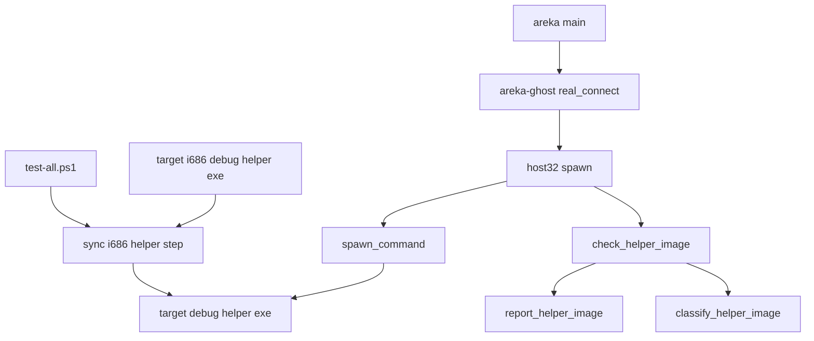
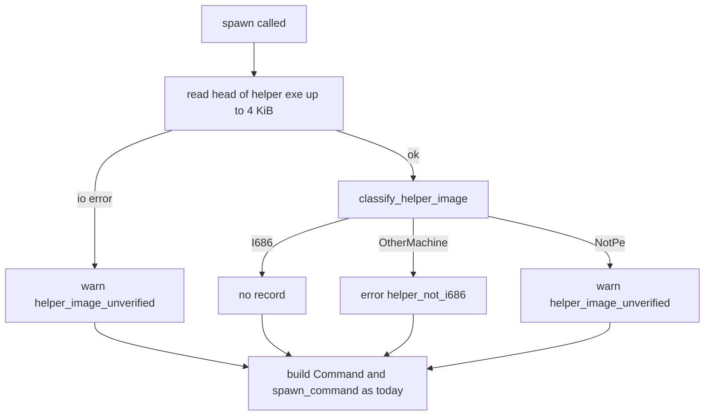
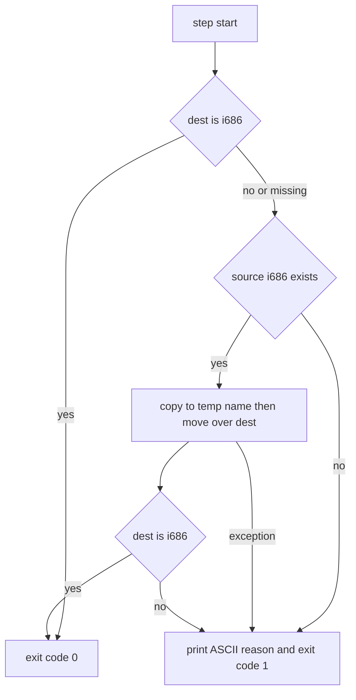

# 設計書: areka-P0-dev-helper-x64-clobber

## Overview

**Purpose**: 全体テストの後でも `target\debug\areka.exe` をそのまま使って 32bit の SHIORI のゴーストを起こせるようにし、helper の向きが違う状態になったときは理由の分かる 1 行をログに残す。開発の手順の罠（区分 C）を塞ぐ仕事で、配布物の振る舞いは変えない。

**Users**: areka の開発者と、実機で確かめをするセッション。全体テストの直後や、素の `cargo build` の後に `target\debug\areka.exe` で 32bit の SHIORI のゴースト（例: claudia の `yaya.dll`）を起こす場面で使う。

**Impact**: 3 か所を変える。① 全体テストのスクリプト `tools/test-all.ps1` の最後に「隣の helper を i686 版に揃える」段を 1 つ足す。② helper を起こす関数 `shiori_host32_host::spawn` の入口で、渡された helper の実行ファイルの見出しを読み、32bit（i686）でなければエラーの 1 行を出す（起こし方は変えない）。③ `README.md` と `.kiro/steering/tech.md` のビルドの手順を `cargo build -p areka` に替える。

### Goals
- 全体テストのスクリプトが終わったとき、`target\debug\shiori-host32-helper.exe` が i686 版である（揃えられなければ赤の行と終了コード 1）。
- 隣の helper が 32bit 版でないとき、SHIORI の読み込みの失敗の記録より前に、パス・理由・直し方を含むエラーの 1 行が出る。
- 罠の入口である素の `cargo build` を開発の手順の文書から外す。

### Non-Goals
- 配布物の helper の置き方（`tools/package.ps1`）・arm64 の helper・`target\release\` の helper。
- 32bit の SHIORI の受け口の仕組み（areka と helper のやりとり・LOAD の手順・失敗の扱い）。
- helper の置き場の決め方（`crates/areka/src/boot_config.rs` の `default_helper_exe_path`）・別の場所を探すこと・外から helper の場所を指す口。
- 全体テスト以外の操作で開発者が作った x64 版の helper を自動で置き換えること（記録で知らせるところまで）。
- 根の `Cargo.toml` の `default-members`・全体テストの x64 の段から helper を外すこと。

## Boundary Commitments

### This Spec Owns
- `tools/test-all.ps1` の新しい段「隣の helper を i686 版に揃える」（段の名前・置き場・合否の決め方・端末へ出す ASCII の文）。
- `shiori_host32_host::process_host` の中の helper の見出しの判定（純粋な判定の関数・記録の関数）と、`spawn` の入口でそれを呼ぶこと。記録の宛先（`target`）・`event` の名前・レベル。
- 上の判定と記録の兄弟のテスト `crates/shiori-host32-host/src/process_host_image_tests.rs`。
- `README.md` のビルドのコマンドの行と、`.kiro/steering/tech.md` の Common Commands のビルドの 2 行。

### Out of Boundary
- `crates/areka/src/boot_config.rs`・`crates/areka/src/main.rs`（同じウェーブの `baseware-root-list` の席）。helper のパスの決め方は今のまま受け取るだけ。
- `crates/areka-ghost/src/shiori_wiring.rs`（`real_connect`）と `crates/areka-kanade/src/shiori/real.rs`（`connect_failed` の記録・`ShioriDown`）。どちらも触らない。今の失敗の道をそのまま通す。
- `shiori_host32_host::spawn` の引数・戻り値・子への引数と環境変数と cwd の契約、`spawn_command` の起こし方。
- `crates/shiori-host32-helper` のテストの `cfg`（約 42 秒の檻は i686 の段だけ）と、x64 の段・i686 の段の中身。
- 煙テスト（`smoke_boot_loop_exit.rs`）と MCP の `get_log` の実走（`mcp_get_log_real_run.rs`）の、テストの中での i686 版の揃え方。

### Allowed Dependencies
- Rust の側は標準ライブラリ（`std::fs::File`・`std::io::Read`）と、`shiori-host32-host` が既に持つ `tracing` だけ。新しい依存も `windows` の機能の追加も無い（`Cargo.toml`・`Cargo.lock` は変わらない）。テストは既に dev-dependencies に在る `log-capture-kit` だけを使う。
- PowerShell の側は .NET の `System.IO.File` と既存の `Step` の仕組みだけ。別の道具のスクリプトを呼ばない。
- 依存の向き: `areka` → `areka-ghost` → `shiori-host32-host`（判定と記録はここ）。上の層は判定を呼ばない・知らない。kanade には host-32 のための分岐を足さない。

### Revalidation Triggers
- helper の機械の種類が i686 以外になる変更（arm64 の helper など）。判定の「32bit（i686）でなければ記録」の前提が変わる。
- `spawn` の入口の順（判定 → `Command` の組み立て）や、記録の `target`・`event` の名前の変更。ログを検索する確かめ（実機の確かめ・下流の spec）が読み替えになる。
- `tools/test-all.ps1` の段の追加・並べ替え（`clippy-199-lints` が触るとき）。揃えの段が最後の段でなくなると要件 1.1 の保証が崩れる。
- helper の置き場の変更（`baseware-root-list` など）。判定は `spawn` に渡されたパスを見るだけなので本仕様の変更は要らないが、全体テストの揃えの段の置き先（`target\debug\`）は areka の置き場と合っている必要がある。

## Architecture

### Existing Architecture Analysis
- helper の起こし方: `areka` の `main.rs` が `default_helper_exe_path()` を決め、`ShioriWiring::Helper { helper_exe }` → `areka-ghost` の `real_connect` → `shiori_host32_host::spawn(helper_exe, load_dir, shiori_name, parent_hwnd)` → `spawn_command`。`real_connect` の `Err` は kanade の shiori アクターで `connect_failed`（`error!`・`target: "shiori-actor"`）として記録され `ShioriDown` になる。判定を `spawn` の入口に置けば、この `connect_failed` より必ず前に出る（同じアクタースレッドの上で順に走る）。
- `spawn` を呼ぶのは本番では `real_connect` の 1 か所。ほかは結合テスト（`shiori-host32-host/tests/*_e2e.rs`・`error_paths.rs`・`areka-kanade/tests/kanade/real_helper_test.rs`）と `process_host.rs` の単体テスト（無いパス）で、どれも i686 の helper か無いパスを渡す。
- `process_host` は「std だけで判定のロジックを持つ」形の決まりがある（モジュールの頭の文書）。見出しの判定も std だけで書ける。
- 全体テストのスクリプトの `Step` は、段の後の `$LASTEXITCODE` を合否にする。PowerShell の文だけで書く段は、段の中で `$global:LASTEXITCODE` を自分で立てないと前の段の値が残る。

### Architecture Pattern & Boundary Map



**Architecture Integration**:
- 選んだ形: 2 つの独立した手当て。全体テストの側は「終わりの状態を揃える」、本体の側は「起こす直前に向きを見て知らせるだけ」。互いを呼ばない。
- 境界: 「helper は i686 であるべき」は host-32 の知識なので、判定と記録は `shiori-host32-host` が持つ。`areka-ghost`・kanade・`areka` は判定を知らない。
- 保つ形: `spawn` の契約・今の失敗の道（`connect_failed` → `ShioriDown`）・`Step` の合否の決め方・段の並び。
- 新しい部品の理由: 本体には今 helper の向きを見る手立てが 0 か所（テストの側の `is_i686_pe` の写し 2 つだけ）。テストの関数は本体から呼べないので、本体の側に 1 つ置く。
- steering との整合: ログ無しの失敗にしない（logging.md）・端末へ出す文は ASCII・決定論のテストは兄弟のファイル・host-32 は後付け（kanade に特別扱いを足さない）。

### Technology Stack

| Layer | Choice / Version | Role in Feature | Notes |
|-------|------------------|-----------------|-------|
| Backend / Services | Rust 2024・`std::fs`／`std::io`・`tracing`（既存） | helper の見出しを読み、i686 でなければ記録する | 新しい依存 0・`windows` の機能の追加 0 |
| Infrastructure / Runtime | PowerShell 7（`pwsh`）・.NET `System.IO.File` | 全体テストの最後に隣の helper を i686 版に揃える | 別の道具のスクリプトを足さない |

## File Structure Plan

### Directory Structure
```
crates/shiori-host32-host/src/
├── process_host.rs                 # 変更: 見出しの判定・記録の 3 関数と HelperImage を足し、spawn の入口で呼ぶ
└── process_host_image_tests.rs     # 新規: 上の判定と記録の兄弟のテスト（#[path] で process_host.rs から読む）
tools/
└── test-all.ps1                    # 変更: Test-I686Pe 関数と最後の段 'i686 helper beside areka.exe'
README.md                           # 変更: ビルドのコマンドの行
.kiro/steering/tech.md              # 変更: Common Commands のビルドの 2 行
```

### Modified Files
- `crates/shiori-host32-host/src/process_host.rs` — `HelperImage`・`classify_helper_image`・`report_helper_image`・`check_helper_image` を足す。`spawn` の最初の文として `check_helper_image(helper_exe)` を呼ぶ。`#[cfg(test)] #[path = "process_host_image_tests.rs"] mod image_tests;` を既存の `console_tests` の並びに足す。モジュールの頭の文書に「`spawn` の入口で helper の向きを見て、違えば記録する（起こし方は変えない）」を 1 段落足す。
- `tools/test-all.ps1` — `.DESCRIPTION` に 11 番目の段を書き足す。`Test-I686Pe` 関数（PE の見出しを読む）を `Step` の近くに置く。`-License` の段の後、一覧を出す前に `Step 'i686 helper beside areka.exe' { ... }` を置く。
- `README.md` — 「# ビルド」の下の `cargo build` を `cargo build -p areka` に替える。
- `.kiro/steering/tech.md` — `# Build: cargo build` を `# Build: cargo build -p areka`、`# Build (Release最適化): cargo build --release` を `# Build (Release最適化): cargo build -p areka --release` に替える（素の `cargo build` を手順として示さない・要件 1.6）。

## System Flows

### helper を起こすときの判定（要件 3）



- 判定は起こし方を一切変えない。記録の後も今と同じく `Command` を組んで起こす。x64 の helper なら今日と同じく helper の中で LOAD が失敗し、ack `[0]` → `real_connect` の `Err` → `connect_failed` → `ShioriDown` を通る（要件 3.3）。ファイルが無ければ今日と同じく `spawn_command` が `SpawnError` を返す（要件 3.5）。
- 記録は `spawn` の 1 回の呼び出しにつき多くて 1 行。ゴーストを起こし直すたびに `spawn` が呼ばれるので、そのたびに 1 行出る。

### 全体テストの揃えの段（要件 1）



- 置き先 `dest` は `target\debug\shiori-host32-helper.exe`、写し元 `source` は `target\i686-pc-windows-msvc\debug\shiori-host32-helper.exe`。
- 合否は「終わったときに `dest` が i686 版か」だけで決める（要件 1.3）。i686 の成果物のビルドの段が赤でも、写し元に前の i686 版が残っていればそれを置いて緑にする。

## Requirements Traceability

| Requirement | Summary | Components | Interfaces | Flows |
|-------------|---------|------------|------------|-------|
| 1.1 | 全体テストの終わりに隣が i686 版 | SyncI686HelperStep | `Test-I686Pe`・段 `i686 helper beside areka.exe` | 揃えの段 |
| 1.2 | 途中が赤でも止めずに 1.1 | SyncI686HelperStep | `Step`（止めない・最後の段） | 揃えの段 |
| 1.3 | 揃えられないときは赤の行と終了コード 1・合否は終わりの状態だけ | SyncI686HelperStep | `$global:LASTEXITCODE`・一覧の `FAIL` 行・`exit 1` | 揃えの段 |
| 1.4 | 直後に claudia を `0x800700C1` なしで起こせる | SyncI686HelperStep（状態の保証）・実機の確かめ | — | 揃えの段 |
| 1.5 | 端末へ出す新しい文は ASCII | SyncI686HelperStep | 段の名前と文の固定の英文 | — |
| 1.6 | 文書のビルドの手順は `cargo build -p areka` | DevDocs | README.md・tech.md の行 | — |
| 2.1 | 今ある段を 1 つも外さない | SyncI686HelperStep | 段を足すだけ | — |
| 2.2 | helper の単体テストを i686 の段で走らせ続ける | （変更なし） | `i686 tests (host-32)` の段を触らない | — |
| 2.3 | 隣に揃えて使う今のテストを今の条件で緑に | （変更なし） | x64 の段を触らない・揃えの段は x64 の段の後 | — |
| 2.4 | 約 42 秒の檻は i686 の段だけ | （変更なし） | `shiori-host32-helper` の `cfg` を触らない | — |
| 3.1 | 読む前にエラーの 1 行 | HelperImageCheck | `check_helper_image`（`spawn` の入口） | helper の判定 |
| 3.2 | 1 行にパス・理由・直し方 | HelperImageCheck | `report_helper_image` の `error!` | helper の判定 |
| 3.3 | 今の「SHIORI を読めなかった」と同じ扱い | HelperImageCheck | 判定は戻り値を持たず、起こし方を変えない | helper の判定 |
| 3.4 | i686 のときは記録しない・起こし方を変えない | HelperImageCheck | `HelperImage::I686` は記録 0 | helper の判定 |
| 3.5 | 確かめられないときはパス入りの 1 行・起こし方は変えない | HelperImageCheck | `warn!`（`helper_image_unverified`） | helper の判定 |
| 3.6 | 探す場所を広げない・外から指す口を足さない | HelperImageCheck | `spawn` に渡されたパスだけを見る | — |

## Components and Interfaces

| Component | Domain/Layer | Intent | Req Coverage | Key Dependencies (P0/P1) | Contracts |
|-----------|--------------|--------|--------------|--------------------------|-----------|
| HelperImageCheck | `shiori-host32-host::process_host` | helper の見出しを読み、i686 でなければ記録する | 3.1〜3.6 | `std::fs`（P0）・`tracing`（P0） | Service |
| SyncI686HelperStep | `tools/test-all.ps1` | 全体テストの最後に隣の helper を i686 版に揃え、合否を返す | 1.1〜1.5・2.1 | `Step`（P0）・i686 の成果物（P1） | Batch |
| DevDocs | 文書 | ビルドの手順を `cargo build -p areka` で示す | 1.6 | — | — |

### shiori-host32-host

#### HelperImageCheck

| Field | Detail |
|-------|--------|
| Intent | `spawn` に渡された helper の実行ファイルが 32bit（i686）かを見て、違えば理由の分かる 1 行を残す |
| Requirements | 3.1, 3.2, 3.3, 3.4, 3.5, 3.6 |

**Responsibilities & Constraints**
- 記録だけを行い、`spawn` の結果も起こし方も変えない（戻り値なし・失敗しない）。
- 見るのは `spawn` の引数 `helper_exe` だけ。パスを組み立てたり探したりしない（3.6）。
- 読むのは先頭の最大 4 KiB だけ。ファイルを書かない・ロックを持ち続けない（読み終えたら閉じる）。

**Dependencies**
- Inbound: `spawn`（同じモジュール）— 起こす直前に 1 回呼ぶ（P0）
- External: `std::fs::File`・`std::io::Read::take`（P0）・`tracing`（P0）

**Contracts**: Service [x]

##### Service Interface
```rust
/// helper の実行ファイルの見出しが示す形（判定の結果）。
#[derive(Debug, Clone, Copy, PartialEq, Eq)]
enum HelperImage {
    /// `MZ`・`PE\0\0`・機械の種類 0x014c（i386）。32bit の SHIORI を読める。
    I686,
    /// PE だが機械の種類が i386 でない（例: 0x8664＝x64・0xAA64＝arm64）。
    OtherMachine(u16),
    /// `MZ` が無い・`e_lfanew` が読んだ範囲の外・`PE\0\0` が無い。
    NotPe,
}

/// 見出しのバイト列だけから判定する純粋な関数（I/O なし・決定論）。
fn classify_helper_image(head: &[u8]) -> HelperImage;

/// 判定の結果を記録する（I686 は何も出さない）。テストはここへ結果を直接渡す。
fn report_helper_image(helper_exe: &Path, image: std::io::Result<HelperImage>);

/// 先頭の最大 4 KiB を読み、classify して report する。`spawn` の最初の文で呼ぶ。
fn check_helper_image(helper_exe: &Path);
```
- 判定の規則（`classify_helper_image`）: `head[0..2] == b"MZ"`、`e_lfanew = u32::from_le_bytes(head[0x3C..0x40])`、`head[e_lfanew..e_lfanew+4] == b"PE\0\0"`、`machine = u16::from_le_bytes(head[e_lfanew+4..e_lfanew+6])`。どれかが範囲外か不一致なら `NotPe`。`machine == 0x014C` なら `I686`、それ以外は `OtherMachine(machine)`。
- 記録の規則（`report_helper_image`）。宛先は `target: "host32-helper"`、どれも 1 行:

| 結果 | レベル | `event` | 構造化フィールド | 本文（要旨） |
|---|---|---|---|---|
| `Ok(I686)` | 出さない | — | — | — |
| `Ok(OtherMachine(m))` | `error!` | `helper_not_i686` | `path`（表示形）・`machine`（`0x8664` の形の 16 進） | helper が 32bit（i686）版でないので 32bit の SHIORI を読めない——このパスへ i686 版の `shiori-host32-helper.exe` を置くこと |
| `Ok(NotPe)` | `warn!` | `helper_image_unverified` | `path`・`reason = "not a PE image"` | helper の向きを確かめられなかった（実行ファイルの形をしていない）——起こし方は変えずに続ける |
| `Err(e)` | `warn!` | `helper_image_unverified` | `path`・`error`（`%e`） | helper の向きを確かめられなかった（読めない・無い）——起こし方は変えずに続ける |

- Preconditions: なし（無いパス・読めないパスも受け付ける）。
- Postconditions: 記録は多くて 1 行。`spawn` の以後の手順は判定の結果に依らず今と同じ。
- Invariants: `I686` のときは記録が 0 行（配布物の helper は常にこの場合・3.4）。

**Implementation Notes**
- Integration: `spawn` の最初の文に `check_helper_image(helper_exe);` を置く。`spawn_command`（テストが `cmd.exe` を渡す下位の口）には置かない＝helper でない子を起こすテストが記録を出さない。本番の唯一の呼び手 `real_connect` は変えない。
- Validation: 兄弟のテスト（下の Testing Strategy）。実機では `RUST_LOG` を開けなくても `error!` は既定の `info` で出る。
- Risks: 4 KiB を超える位置に PE の見出しを置く実行ファイルは `NotPe`（警告）になる。MSVC の linker が作る helper の `e_lfanew` は 0x100 前後なので当たらない。`// ponytail:` の注記で上限と広げ方（`e_lfanew` へ seek して読む）を残す。

### tools

#### SyncI686HelperStep

| Field | Detail |
|-------|--------|
| Intent | 全体テストの最後の段として、`target\debug\` の helper を i686 版に揃え、揃ったかだけで合否を返す |
| Requirements | 1.1, 1.2, 1.3, 1.4, 1.5, 2.1 |

**Responsibilities & Constraints**
- 段の名前は `i686 helper beside areka.exe`（ASCII）。すべての段（`-License` の 2 段を含む）の後、一覧を出す前に置く＝最後の段。ほかの段の中身と順は変えない（2.1・2.3）。
- 揃いの判定は `Test-I686Pe`（`MZ`・`PE\0\0`・機械の種類 0x014c を見る。ファイルが無い・短い・読めないは `$false`）。Rust の側の `classify_helper_image` と同じ規則。
- 置き方は、写し元を一時名（`shiori-host32-helper.exe.<pid>.tmp`）へ写してから `Move-Item -Force` で置き換える（テストの `ensure_i686_artifact` と同じ置き方＝書きかけを起こさない）。
- 端末へ出す文は固定の英文だけ（1.5）。.NET の例外の本文は日本語に訳されて出ることがあるので出さず、出すのは例外の型の名前と `HResult` の 16 進だけ。

**Dependencies**
- Inbound: スクリプトの本体 — 最後に 1 回呼ぶ（P0）
- Outbound: `target\i686-pc-windows-msvc\debug\shiori-host32-helper.exe`（`build i686 artifacts` の段が作る・前の回の物でも可）（P1）
- External: `Step` 関数と結果の一覧（P0）

**Contracts**: Batch [x]

##### Batch / Job Contract
- Trigger: スクリプトの最後の段として毎回（`-Format`・`-License` の有無に依らない）。
- Input / validation: 置き先 `target\debug\shiori-host32-helper.exe`・写し元 `target\i686-pc-windows-msvc\debug\shiori-host32-helper.exe`（どちらもリポジトリの根から。スクリプトは既に根へ `Set-Location` している）。
- Output / destination: 置き先が i686 版になる。段の中で `$global:LASTEXITCODE` を立てる（揃っていれば `0`、揃わなければ `1`）。`Step` がそれを読み、一覧に `OK` か `FAIL` の行が出て、赤なら全体が終了コード 1 で終わる（1.3）。
- 端末の文（例・ASCII）:
  - 揃っていた: `helper is i686: target\debug\shiori-host32-helper.exe`
  - 置いた: `placed i686 helper: <source> -> <dest>`
  - 写し元が無い・i686 でない: `cannot place i686 helper: source missing or not i686: <source>`
  - 置き換えが断られた: `cannot place i686 helper: <ExceptionType> (HResult 0x80070020): <dest> (is areka.exe running?)`
  - 置いた後も i686 でない: `helper beside areka.exe is still not i686: <dest>`
- Idempotency & recovery: 置き先が既に i686 版なら何も写さない（何度回しても同じ）。失敗したときは一時名のファイルを消してから赤にする（`target\debug\` に `*.tmp` を残さない）。

**Implementation Notes**
- Integration: `Step` は段の後の `$LASTEXITCODE` を読む。この段は PowerShell の文だけなので、前の段の値が残らないよう、段の中のすべての出口で `$global:LASTEXITCODE` を立てる。
- Validation: 実装の段では、関数と段の本体を単独で回す一回きりの確かめ（x64 の helper を置いた状態・i686 版が在る状態・写し元が無い状態）で分岐を見る。最後の 1 回の全体テストで一覧に `OK  i686 helper beside areka.exe` が出ることを見る。
- Risks: 開発者が `target\debug\areka.exe` を動かしている最中は helper が使われていて置き換えが断られる → 赤の行で知らせる（1.3 のとおり・自動で止めない）。

#### DevDocs（要約のみ）
- `README.md` の「# ビルド」の下の 1 行、`.kiro/steering/tech.md` の Common Commands の 2 行を `-p areka` 付きに替える（1.6）。`cargo build -p areka` は helper を依存に持たないので helper を作らない（research.md 3.3）。ほかの説明文は変えない。

## Error Handling

### Error Strategy
- 本体の側: 判定の失敗は記録して続ける（判定は助言であり、失敗の道を新しく作らない）。本当の失敗は今日の道（`SpawnError`、または LOAD の ack `[0]` → `connect_failed`）が `Err` として記録する。新しく足す 1 行は、その失敗の原因を名指しするための前置きである。
- スクリプトの側: 揃えられないことは段の赤（終了コード 1）として一覧に出す。ほかの段を止めない。

### Error Categories and Responses
| 状況 | 本体の記録 | その後 |
|---|---|---|
| helper が x64／arm64 | `error!` `helper_not_i686`（パス・機械の種類・直し方） | 今日と同じく起こす → LOAD 失敗 → `connect_failed` → `ShioriDown` |
| helper が無い | `warn!` `helper_image_unverified`（パス・`error`） | 今日と同じく `spawn_command` が `SpawnError` → `connect_failed` |
| helper が読めない・PE でない | `warn!` `helper_image_unverified`（パス・理由） | 今日と同じく起こす（起こせなければ `SpawnError`） |
| helper が i686 | なし | 今日と同じ |

### Monitoring
- 記録は `tracing` の既存の層（標準出力の層と、`get_log` が読む履歴の層）へそのまま流れる。`error!` は既定の `info` のフィルタでも出る。ログの検索は `event=helper_not_i686` で行える。

## Testing Strategy

決定論のテストは `crates/shiori-host32-host/src/process_host_image_tests.rs`（`process_host.rs` の兄弟・x64 の段で走る）に置く。ファイルを作らずに済むよう、純粋な判定は合成したバイト列で、記録は結果を `report_helper_image` へ直接渡して確かめる。

- Unit（`classify_helper_image`）:
  - `MZ`・`e_lfanew=0x80`・`PE\0\0`・machine `0x014C` の合成の見出し → `I686`（3.4 の前提）。
  - 同じ形で machine `0x8664` → `OtherMachine(0x8664)`、`0xAA64` → `OtherMachine(0xAA64)`（3.1 の前提）。
  - `MZ` が無い・`PE\0\0` が無い・`e_lfanew` が長さの外・長さ 0 → どれも `NotPe`（3.5 の前提）。
- Unit（`report_helper_image`・`log_capture_kit::capture`）:
  - `Ok(I686)` → `target: "host32-helper"` の記録 0 件（3.4）。
  - `Ok(OtherMachine(0x8664))` → `ERROR` 1 件・`event == "helper_not_i686"`・`path` の欄にパス・本文に「i686」と直し方が在る（3.1・3.2）。
  - `Ok(NotPe)` と `Err(NotFound)` → それぞれ `WARN` 1 件・`event == "helper_image_unverified"`・`path` の欄にパス（3.5）。
- Integration（`check_helper_image`・実ファイル）:
  - テストの実行体そのもの（`std::env::current_exe()`・x64 か arm64）を渡す → `ERROR` 1 件（読む道が実ファイルで働く・一時ファイル不要）。
  - 無いパスを渡す → `WARN` 1 件。
  - 既存の `spawn_missing_exe_returns_spawn_error_and_no_handle` が今と同じく `SpawnError::Spawn` を返すこと（3.3・3.5 の「起こし方は変えない」）。
- 全体テストのスクリプト: 実装の段で揃えの段の分岐を単独で確かめる（Implementation Notes）。最後の 1 回の全体テストで、`i686 helper beside areka.exe` が `OK` で、終わった後の `target\debug\shiori-host32-helper.exe` の machine が `014C` であること（1.1・2.1〜2.4 は既存の段の合否が今と同じであること）。
- 実機（重い回 0・`target\` の下の短い絶対パスの根・有界の自動終了・ログの検索）:
  - `cargo build -p areka` の後に `cargo build -p shiori-host32-helper`（x64）で隣を x64 版にして claudia を起こす → `helper_not_i686` の 1 行が `connect_failed` より前に 1 件（3.1〜3.3）。
  - 全体テストの 1 回の後（新しく回さず、実装の最後の検証で回す 1 回を使う）に、写す手間なしで `target\debug\areka.exe` で claudia を起こす → `0x800700C1` が出ず、`connect_failed` 0 件・`helper_not_i686` 0 件（1.4・3.4）。
- 最初のタスク（ビルドだけ・重い回 0）: research.md 7.2 の確かめ。i686 版を隣へ置いた後に素の `cargo build`（または `cargo build -p shiori-host32-helper`）を打つと、作り直しが要らなくても隣が x64 版へ戻るかを machine 欄で見て記録する。結果は設計を変えない（要件は道筋に依らない）が、文書の書き替え（1.6）の根拠になる。

## Performance & Scalability
- 判定はゴーストの SHIORI を起こすたびに 1 回、ファイルの先頭 4 KiB を読むだけ（helper のプロセスを起こす費用に比べて無視できる）。
- 揃えの段は数 MB のファイルを多くて 1 回写すだけ。
