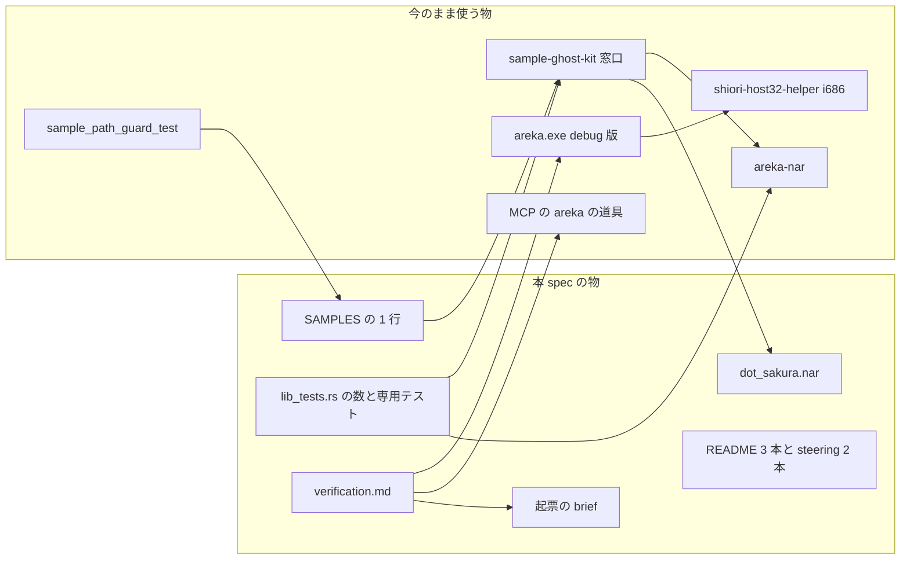
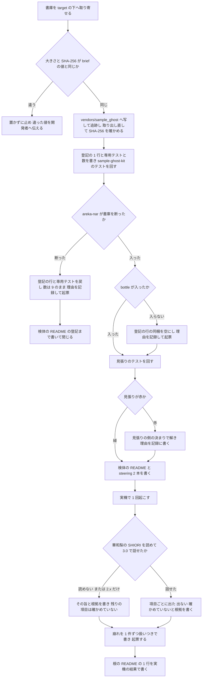
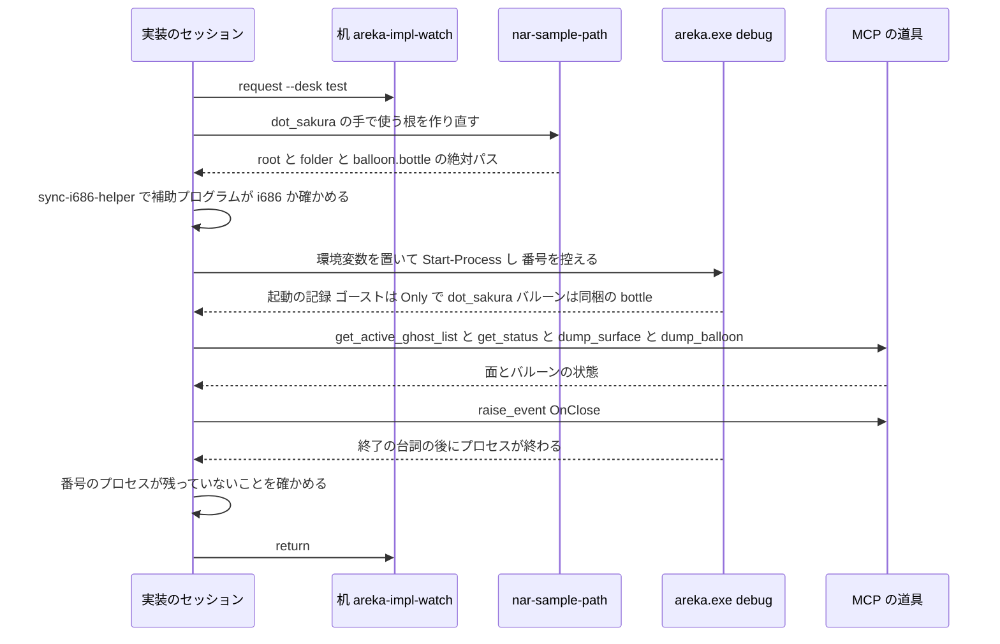

# 設計: areka-P0-dot-sakura-specimen

## Overview

**目的**: 開発者の自作のゴースト「．さくら」（`dot_sakura`）を、areka の検体に足す。書庫を受け取ったバイト列のままリポジトリに置き、検体の登記表に 1 行足し、文書に登記し、実機で 1 回起こして見えたことを記録し、areka の未対応で崩れた件を起票する。

**使う人**: areka の開発者と実装のセッション。自動テストは `SampleRoot::acquire("dot_sakura")` で、実機の確かめは `nar-sample-path dot_sakura` で、同じ検体を同じ手順で取り出す。華和梨（32 ビット）・Shift_JIS の辞書・α の無い絵・連番のオンラインの印を持つ同梱バルーン `bottle` という古い作りを、手元で繰り返し確かめられるようになる。

**変わること**: 検体の登記が 9 行から 10 行に、書庫を置く行が 8 行から 9 行になる。SHIORI の系統が 3 つ（pasta・里々・YAYA）から 4 つ（＋華和梨）になる。areka のコード（`crates/` の本番のコード）は 1 行も変えない（要件 5.10）。

### Goals

- `vendors/sample_ghost/dot_sakura.nar` が、取り寄せ先と同じバイト列（SHA-256 `0c602c6a…b7a472`）で追跡されている。
- `dot_sakura` を名前で引くと、ゴースト `dot_sakura` と同梱バルーン `bottle` が `target\` の下の根に入る。登記のテストは 10 行・書庫を置く行 9 行で緑。
- 検体の README・steering 2 本・根の `README.md` が、登記表と食い違わない。
- 実機の 1 回の記録 `verification.md` が要件 5.6・5.7 の項目を全部持ち、崩れが 1 件ずつ扱いつきで並ぶ。

### Non-Goals

- どっとさくらを起動・会話・メニューまで通すための areka の直し（起票した先が持つ）。
- 華和梨・SHIORI 2.x への対応、印（矢印・オンライン・SSTP）の表示、入力の箱 `balloonc*`、縮小版シェル 2 つの見た目。
- 書庫の畳み直し、URL の行への切り替え、配布物への同梱。
- 実機の 1 回でのネットワーク更新、メニューからのインストール（`research.md` 10 節の議題 8）。
- 実機の試験の窓口（`real-run-kit`）での繰り返せる試験（要件 5 は 1 回の記録を求める）。

## Boundary Commitments

### This Spec Owns

- 書庫 `vendors/sample_ghost/dot_sakura.nar`（受け取ったバイト列そのもの）。
- 登記表 `SAMPLES` の `dot_sakura` の 1 行と、登記の数を持つテストの数・名前の一覧・説明文（10 行・書庫を置く行 9 行）。
- `dot_sakura.nar` を空の根へ入れたときの結果を固定する決定論のテスト 1 本（警告 0・飛ばした同梱 0・最上位の `delete.txt`・`updates.txt` の置き場所）。
- `vendors/sample_ghost/README.md` の表の 1 行と `dot_sakura.nar` の節。
- `structure.md` の検体の顔ぶれ・`product.md` の適合の検体の表（`dot_sakura`・`emily4`・`pasta-in-windows` の 3 行と見出し）・根の `README.md` の動作を確かめているゴーストの表の `dot_sakura` の 1 行。
- 実機の 1 回の手順と記録 `.kiro/specs/areka-P0-dot-sakura-specimen/verification.md`。
- 崩れの起票（新しい spec の `brief.md`、既存の spec の `brief.md` への「件 N」の追記）。

### Out of Boundary

- `crates/` の本番のコード全部（`areka-nar`・`shiori-host32-*`・`areka-ghost`・`areka-emo-*`・`areka` 本体）。崩れは起票するだけで直さない（要件 5.10）。
- `crates/sample-ghost-kit/src/` の窓口のコード（`lib.rs` の `SAMPLES` の 1 行を除く）・`devroot.rs`・`bin/nar-sample-path.rs`・`examples/fold-samples.rs`。
- 見張り `crates/log-capture-kit/tests/sample_path_guard_test.rs`（要件 2.6 の枝に入ったときだけ、見張りの側の決まりを直す。入る見込みは無い）。
- `tools/package.ps1`（配布物の中身）・`tools/sample-fetch.ps1`・`vendors/sample_ghost/.gitattributes`。
- 既定のバルーン `StayseeBalloon` とその解決（`areka-P0-default-balloon-selfmade`）。
- 根の `README.md` の表への `pasta-in-windows` の行（`areka-P0-pasta-in-windows-verification`）。
- 起票した先の spec の要件・設計（本 spec が書くのは brief の事実だけ）。

### Allowed Dependencies

- 窓口 `sample-ghost-kit`（`SampleRoot::acquire`・`devroot::nar_dir`・`devroot::sample_nar`・`WorkDir`・コマンド `nar-sample-path`）を今のまま使う。
- `areka-nar` の公開の口（`NarArchive::open`・`install`・`InstallRequest`・`SingleRoot`・`InstallOutcome` の `installed`・`warnings`・`leftovers`・`skipped`）をテストから読むだけ。
- 実機の道具: debug 版の `areka.exe`・`shiori-host32-helper`（i686）・`tools/sync-i686-helper.ps1`・MCP の `areka` の道具（`get_active_ghost_list`・`get_status`・`get_property`・`dump_surface`・`dump_balloon`・`raise_event`・`get_log`）・机の道具 `areka-impl-watch`（`request --desk test`／`return`）。
- 書庫の取り寄せは `curl` と `Get-FileHash`／`sha256sum` だけ。新しい外の道具（`upx` など）は入れない。
- 守る向き: 本 spec の物（書庫・登記の行・テスト・文書）は窓口と `areka-nar` に頼るが、窓口と `areka-nar` は本 spec の物を知らない（検体ごとの専用の関数や分岐を窓口に足さない）。

### Revalidation Triggers

- 登記表の行の数・順・書庫の出どころが変わるとき: 後に続く `areka-P0-default-balloon-selfmade`（10 → 11）は、数のテストと名前の一覧と README の表を、この spec の着地の後の値から合わせ直す。
- `dot_sakura` を URL の行へ移すとき（取り寄せ先に `dot_sakura.nar.sha256` が置かれた後）: `current_rows_are_registered_as_vendored`・`only_vendored_rows_have_a_nar_in_the_repository`・README の 2 つの表と節を合わせ直す。
- `areka-nar` の同梱の扱い・最上位の普通のファイルの置き方が変わるとき: 専用のテスト（下の「決定論のテスト」）が赤になり、README の節と記録の 1 項目目を見直す。
- `bottle` を見比べの元にする `areka-P0-default-balloon-selfmade`・印の検体に使う `areka-P0-balloon-markers` は、書庫のバイト列が変わったら見比べをやり直す（本 spec は変えない）。

## Architecture

### Existing Architecture Analysis

- 検体は `vendors/sample_ghost/<名>.nar` に置き、登記表 `SAMPLES`（`crates/sample-ghost-kit/src/lib.rs`）に 1 行足すだけで、名前で引く窓口 `SampleRoot::acquire`・手で使う根を作る `nar-sample-path`・登記の往復のテスト・位置のテスト・見張りのテストが全部その行を拾う。検体ごとの専用の関数は無く、足さない（`lib.rs` の冒頭「検体を足すとき」）。
- 受け取ったバイト列のまま置く前例は `konnoyayame`・`claudia`・`emily4` の 3 本。`vendors/sample_ghost/.gitattributes` の `* -text` で改行の変換が止まる。
- `areka-nar` は、`install.txt` の `balloon.directory,bottle` を無印の同梱として見つけ、取り出し元（`balloon.source.directory` が無いので宛先と同じ `bottle`）を書庫の最上位から `balloon/bottle/` へ置き、本体 `ghost/dot_sakura/` からは取り出し元を除く。最上位の `delete.txt`・`updates.txt`・`readme.txt` は本体の普通のファイルになる（`delete.txt` を読むのはネットワーク更新 `areka-update` だけ）。
- areka の画面からのインストールで警告のダイアログが出るのは、`InstallOutcome::skipped` が空でないときだけ（`crates/areka/src/install/procedure.rs` の手続き）。
- 起動のゴーストとバルーンの決め方（`crates/areka/src/boot_resolve.rs`）: 根にゴーストが 1 体だけなら経路 `Only` でそのゴースト、同梱バルーンが根に在れば既定より先に採る。
- 見張り `sample_path_guard_test` は `crates/` の `.rs` を走査し、`SAMPLES` から組んだ語（`vendors/sample_ghost/dot_sakura/`・`vendors/sample_ghost/dot_sakura"`・`join("bottle")`・`bottle/`・`/bottle"`・`dot_sakura("bottle")`）を探す。窓口の定義 `crates/sample-ghost-kit/src/` は走査から外れるが、そこに ⑵⑷ の形が現れると「除外の宣言」の判定（`ComposedAtRuntime`）が赤になる。

### Architecture Pattern & Boundary Map

既存の形に乗るだけで、新しい部品・層は作らない。



- 選んだ形: 既存の「書庫を 1 つ置き、登記表に 1 行」をなぞる（研究の案 A）に、決定論のテスト 1 本を足す（案 B）。
- 境目: 本 spec の物は左、今のまま使う物は右。矢印は「頼る」向きで、右から左への矢印は無い。
- 守る既存の形: 登記の 1 行で全テストが拾う・検体ごとの関数を作らない・受け取ったバイト列のまま置く・実機の根は `target\` の下だけ。
- steering との合い方: 決定論のテストは実装の兄弟のファイル（`lib_tests.rs`）に置く。崩れの起票は `/kiro-discovery`。実機は短い絶対パス・有界の自動終了・記録の水準を判定の分岐まで開ける。

### Technology Stack

| 層 | 選んだ物 / 版 | 本 spec での役 | 注 |
|---|---|---|---|
| 検体の窓口 | `sample-ghost-kit`（ワークスペースの中） | 登記表・名前で引く・手で使う根 | 行を 1 つ足すだけ |
| 書庫の展開 | `areka-nar`（ワークスペースの中） | テストから空の根へ入れる | 変更 0 |
| テスト | Rust の `#[test]`（`cargo test -p sample-ghost-kit`） | 数・往復・位置・専用の 1 本 | 依存の追加 0 |
| 実機 | debug 版 `areka.exe`＋i686 の `shiori-host32-helper` | 1 回起こす | 変更 0 |
| 観察 | MCP の `areka` の道具・`tracing` の記録（`RUST_LOG`） | 面・バルーン・台詞・終了の根拠 | 新しい道具 0 |
| 取り寄せ | `curl`・`Get-FileHash`・`sha256sum` | 大きさと SHA-256 の照合 | `upx` は使わない |

## File Structure Plan

### Directory Structure

```
vendors/sample_ghost/
├── dot_sakura.nar        # 新: 取り寄せたバイト列そのまま（1,425,534 バイト）
└── README.md             # 変: 表の 1 行・見出しの数・dot_sakura.nar の節
.kiro/specs/areka-P0-dot-sakura-specimen/
└── verification.md       # 新: 実機の 1 回の記録と崩れの一覧
```

### Modified Files

- `crates/sample-ghost-kit/src/lib.rs` — `SAMPLES` の末尾（`pasta-in-windows` の後）に `dot_sakura` の 1 行とその上の 1 行の注記。ほかは触らない。
- `crates/sample-ghost-kit/src/lib_tests.rs` — 数と名前の一覧（下の「数と名前の直し」）・`claudia` の抜けの直し・専用のテスト 1 本・冒頭の説明。
- `crates/sample-ghost-kit/src/devroot_fetched_tests.rs` — 67 行目の注記「今の 8 本」を「今の 9 本」に。
- `vendors/sample_ghost/README.md` — 9 行目の「今の 8 本」を「今の 9 本」に・「書庫を置く行の検体」の表の末尾に 1 行・`emily4.nar` の節の後に `dot_sakura.nar` の節。
- `.kiro/steering/structure.md` — 検体の顔ぶれの段落（今の 421 行目）。
- `.kiro/steering/product.md` — 「適合の検体」の見出し・表の前の 1 文・表の 3 行。
- `README.md`（根）— 動作を確かめているゴーストの表の末尾（`emily4` の行の後）に 1 行。実機の 1 回の後に書く。
- 起票: `.kiro/specs/<新しい spec>/brief.md`（`/kiro-discovery` が作る）と、既存の spec の `brief.md` の末尾（`areka-P0-balloon-markers` など・見えた事実だけ）。
- 条件つき（要件 2.6 の枝に入ったときだけ）: `crates/log-capture-kit/tests/sample_path_guard_test.rs` の見張りの側の決まり。

`.kiro/steering/roadmap.md` は本 spec では触らない（完了の手続き `/kiro-complete` が持つ）。

## System Flows

### 作業の順と枝



- 書庫を断られたか（要件 2.7）は、登記の行と専用テストを書いた**後で、コミットする前に**テストを回して決める。往復のテストと専用テストが「受理されるはず」で落ちれば断られた。断られたら行とテストを戻すので、登記の数は 9 のまま残る。
- 枝 E1 では、要件 4（文書の数と顔ぶれ）と要件 5（実機）を行わない。検体の README は、書庫の行と節（断られた理由と起票先を含む）までを書く。
- 根の `README.md` の 1 行（要件 4.2）は実機の結果を書くので、最後に置く。

### 実機の 1 回



- 終わりは MCP の `raise_event`（`OnClose`）で頼む。画面の操作（右クリック・SendInput）は使わない。MCP が答えないとき（SHIORI を読めないなど）は、areka が自分で終わるのを待ち、終わらなければ自動終了の上限で終わる。それでも残れば、控えた番号のプロセスだけを止める（要件 5.4）。
- 机は areka の窓を実際のデスクトップに立てるので「排他テストの机」を取る（`doc/impl-watch.md` の判定の基準）。終わったら成否によらずすぐ返す（要件 5.5）。

## Requirements Traceability

| 要件 | 要旨 | 担う物 | 口・手順 | 流れ |
|---|---|---|---|---|
| 1.1 | 取り寄せて大きさと SHA-256 を比べる | 書庫の取り寄せ | `curl`・`Get-FileHash` | 作業の順 A・B |
| 1.2 | 違えば置かずに止める | 書庫の取り寄せ | 開発者への報告 | 作業の順 Stop |
| 1.3 | 受け取ったバイト列のまま置く | `dot_sakura.nar` | `.gitattributes` の `* -text`・畳まない | 作業の順 C |
| 1.4 | 追跡したファイルを取り出し直して確かめる | 書庫の取り寄せ | `git cat-file`＋`sha256sum` | 作業の順 C |
| 1.5 | 配布物に入れない | `tools/package.ps1`（変更 0） | 名指しの 2 本だけを組む | — |
| 2.1 | 書庫を置く形の 1 行 | `SAMPLES` の行 | `Sample { .. }` | 作業の順 D |
| 2.2 | 名前で引くと根を返す | 窓口（変更 0） | `SampleRoot::acquire`・`nar-sample-path` | — |
| 2.3 | 数 10・書庫を置く行 9・一覧の抜け 0 | `lib_tests.rs`・`devroot_fetched_tests.rs` | 数と名前の直し | 作業の順 D |
| 2.4 | 位置と往復のテストが緑 | `lib_tests.rs` の既存の 2 本 | `SAMPLES` を回す | 作業の順 D |
| 2.5 | 見張りが緑 | 見張り（変更 0） | `cargo test -p log-capture-kit --test sample_path_guard_test` | 作業の順 G |
| 2.6 | 赤なら見張りの側で解く | 見張り（条件つき） | 理由を記録に | 作業の順 H1 |
| 2.7 | 断られたら登記しない | 作業の順の枝 | 行とテストを戻す | 作業の順 E1 |
| 2.8 | バルーンだけ入らない | 作業の順の枝 | 行の同梱を空に | 作業の順 F1 |
| 3.1 | 表の 1 行と見出しの数 | 検体の README | 項目の数 204 | — |
| 3.2 | URL・SHA-256・日・畳まない | 検体の README の節 | — | — |
| 3.3 | 取り扱いの条件 | 検体の README の節 | 逐語の引用 | — |
| 3.4 | 開発者の言葉と配布物に入れない | 検体の README の節 | 逐語の引用 | — |
| 3.5 | 何を見る検体か | 検体の README の節 | — | — |
| 3.6 | URL の行にしない理由 | 検体の README の節 | — | — |
| 4.1 | `structure.md` の顔ぶれ | steering | 10 本・4 系統 | — |
| 4.2 | 根の `README.md` の 1 行 | 根の README | 実機の結果 | 作業の順 N |
| 4.3 | `product.md` の表と見出し | steering | 3 行・4 系統・日付 | — |
| 5.1 | debug 版を窓口の根から短い絶対パスで | 実機の手順 | `nar-sample-path`・`AREKA_ROOT` | 実機の 1 回 |
| 5.2 | i686 の補助プログラムを確かめる | 実機の手順 | `sync-i686-helper.ps1` | 実機の 1 回 |
| 5.3 | 記録の水準と自動終了 | 実機の手順 | `RUST_LOG`・`AREKA_APP_SMOKE_EXIT_MS` | 実機の 1 回 |
| 5.4 | プロセスを残さない | 実機の手順 | 控えた番号だけ | 実機の 1 回 |
| 5.5 | 他の実機・負荷と重ねない | 実機の手順 | 排他テストの机 | 実機の 1 回 |
| 5.6 | 記録の置き場と同定・構成・環境・日時 | `verification.md` | 節「同定」ほか | — |
| 5.7 | 8 項目の結果と根拠 | `verification.md`・専用テスト | 項目の表 | 実機の 1 回 |
| 5.8 | 読めない・2.x だけのとき | `verification.md` | 残りは確かめていない | 作業の順 K1 |
| 5.9 | 絵を貼らない | 実機の手順 | 撮った物は `target\` の下だけ | — |
| 5.10 | areka のコードの変更 0 | 境目 | 変更してよいファイルの一覧 | — |
| 5.11 | ネットワーク更新をしない | 実機の手順・`verification.md` | 確かめていないと理由 | — |
| 6.1 | 症状・根拠・見立て・扱い | `verification.md` の崩れの表 | 扱い 4 種 | 作業の順 M |
| 6.2 | 全部 `/kiro-discovery` で起票 | 起票 | 触る場所でまとめる | 作業の順 M |
| 6.3 | 既存の spec の brief へ事実を足す | 起票 | 「件 N」 | 作業の順 M |
| 6.4 | 方針で受けない件の裁定 | `verification.md` | 日付と要旨 | — |
| 6.5 | 扱いごとの件数（0 も書く） | `verification.md` | 表の末尾 | — |
| 6.6 | 中身から出る ERROR・WARN を外す | `verification.md` | 理由つきの外し | — |

## Components and Interfaces

| 部品 | 置き場 | 役 | 要件 | 頼る物 | 契約 |
|---|---|---|---|---|---|
| 検体の書庫 | `vendors/sample_ghost/dot_sakura.nar` | 受け取ったバイト列 | 1.1〜1.5 | `.gitattributes`（P0） | State |
| 登記の行 | `crates/sample-ghost-kit/src/lib.rs` | 名前で引ける | 2.1・2.2 | 窓口（P0） | State |
| 数と名前のテスト | `crates/sample-ghost-kit/src/lib_tests.rs`・`devroot_fetched_tests.rs` | 10 行・9 行・一覧 | 2.3〜2.5 | `SAMPLES`（P0） | Service |
| 決定論のテスト | `crates/sample-ghost-kit/src/lib_tests.rs` | 入れた結果を固定 | 2.4・5.7 | `areka-nar`（P0） | Service |
| 検体の README | `vendors/sample_ghost/README.md` | 出どころと条件 | 3.1〜3.6 | — | — |
| 顔ぶれの文書 | `.kiro/steering/structure.md`・`product.md`・`README.md` | 数と系統 | 4.1〜4.3 | 実機の記録（P1・4.2 だけ） | — |
| 実機の手順 | `verification.md` の「走行」 | 1 回起こす | 5.1〜5.5・5.9〜5.11 | `areka.exe`・補助プログラム・MCP（P0） | Batch |
| 実機の記録 | `.kiro/specs/areka-P0-dot-sakura-specimen/verification.md` | 結果と崩れ | 5.6〜5.8・6.1・6.4〜6.6 | 実機の手順（P0） | — |
| 起票 | 新しい spec の `brief.md`・既存の spec の `brief.md` | 崩れを渡す | 6.2・6.3 | `/kiro-discovery`（P0） | — |

### 検体の保管と登記

#### 検体の書庫

| 欄 | 中身 |
|---|---|
| 役 | 開発者のサイトで公開している書庫を、1 バイトも変えずに置く |
| 要件 | 1.1, 1.2, 1.3, 1.4, 1.5 |

**責務と約束**

- 取り寄せ: `https://ekicyou.github.io/old/dot-sakura/download/nar/dot_sakura.nar` を `curl -sSfL` で `<ワークツリー>\target\dot-sakura-verify\dl\dot_sakura.nar` へ取る。大きさ 1,425,534 バイトと SHA-256 `0c602c6a431dcbec48c02d934d98e342337d2db9628095e0a6f90d3e83b7a472` の両方が合うときだけ先へ進む（1.1）。どちらかが違えば `vendors/` に写さず、測った値を開発者へ伝えて止める（1.2）。
- 置き方: 取った書庫を `vendors/sample_ghost/dot_sakura.nar` へバイトのまま写す。`fold-samples` は通さない（展開形を作らない）。`git check-attr text vendors/sample_ghost/dot_sakura.nar` が `unset` であることを確かめてから `git add` する（1.3）。
- 取り出し直しの照合: コミットの後、Git Bash で `git cat-file -p HEAD:vendors/sample_ghost/dot_sakura.nar | sha256sum` が 1.1 の値と同じことを確かめ、記録の「同定」に書く（1.4）。PowerShell のパイプはバイトを化かすことがあるので使わない。
- 配布物: `tools/package.ps1` は検体を `emo2` と `StayseeBalloon` の名指しでしか引かないので、何も変えずに入らない。照合として `tools/package.ps1` に `dot_sakura` の綴りが 0 件であることを記録に書く（1.5）。

**State**: 書庫は追跡されたファイル 1 つ。中身の変更は 0 件（再圧縮・改行の変換・足し引き 0）。

#### 登記の行

| 欄 | 中身 |
|---|---|
| 役 | `dot_sakura` を他の検体と同じ窓口で名前で引けるようにする |
| 要件 | 2.1, 2.2 |

```rust
// ．さくら（華和梨 32 ビット・Shift_JIS・α の無い絵）。受け取ったバイト列のまま置く（畳まない）。
Sample {
    name: "dot_sakura",
    kind: SampleKind::Ghost,
    balloons: &["bottle"],
    source: SampleSource::Vendored,
},
```

- 位置は `SAMPLES` の末尾（`pasta-in-windows` の後）。登記表は足した順に並んでおり（`emily4` の後に `pasta-in-windows` を足した）、後に続く `areka-P0-default-balloon-selfmade` も末尾に足す。書庫の出どころで行を並べ替える決まりは無い。
- 窓口のコードは触らない。`SampleRoot::acquire("dot_sakura")` と `nar-sample-path dot_sakura` は、この行だけで `<根>/ghost/dot_sakura` と `<根>/balloon/bottle` を返す（2.2）。
- 要件 2.8 の枝に入ったときは `balloons: &[]` とし、行の上の注記に入らなかった理由を書く（`emily4` の行と同じ形）。

#### 数と名前のテスト

| 欄 | 中身 |
|---|---|
| 役 | 登記の数と名前の一覧を 10 行・書庫を置く行 9 行に合わせ、抜けを 0 にする |
| 要件 | 2.3, 2.4, 2.5 |

**数と名前の直し**（直した後に、検体の数としての「9」と書庫を置く行の数としての「8」が `crates/sample-ghost-kit/src/` に 0 か所であることを grep で確かめる）

| 場所 | 今 | 直した後 |
|---|---|---|
| `lib_tests.rs` 冒頭の説明 | 「既知の 9 つ」「主張は 8 本」 | 「既知の 10 個」「主張は 9 本」（専用テストの主張を 1 つ足す）・参照する spec に本 spec を足す |
| `lib_tests.rs` `current_rows_are_registered_as_vendored` の説明・一覧・文 | 「今の 8 行」・8 つ | 「今の 9 行」・`emily4` の後に `dot_sakura` |
| `lib_tests.rs` `every_registered_sample_lands_where_its_registry_row_says` の説明・数 | 9 | 10 |
| `lib_tests.rs` 未登録の名前のテスト | 関数名 `..._all_nine_known_names`・説明「9 つ」・一覧 9 つ・表示を見る一覧 8 つ（`claudia` が無い） | 関数名 `unknown_sample_fails_with_all_ten_known_names`・説明「10 個」・一覧は 10 個を 1 つの配列に書き、`known` との比べと失敗の表示の確かめの両方にその配列を使う（`claudia` の抜けが構造的に消える） |
| `lib_tests.rs` `every_sample_nar_installs_exactly_the_elements_its_registry_row_declares` の数 | 9 | 10 |
| `devroot_fetched_tests.rs` 67 行目の注記 | 「今の 8 本」 | 「今の 9 本」 |

- 名前の一覧は手で書いた配列のまま残す（`SAMPLES` から導くと比べる相手が自分自身になり、判定が恒真になる）。
- `devroot_sweep_tests.rs` の「8 本」はスレッドの数で、検体の数ではないので触らない。
- 見張り（2.5）は `cargo test -p log-capture-kit --test sample_path_guard_test` で回す。今のソースに見張りの語の当たりは 0 件なので緑の見込み。

#### 決定論のテスト

| 欄 | 中身 |
|---|---|
| 役 | `dot_sakura.nar` を空の根へ入れた結果のうち、往復のテストが見ない所（警告・飛ばした同梱・残った作業フォルダ・最上位の普通のファイル）を固定する |
| 要件 | 2.4, 5.7 |

**Service Interface**

```rust
/// `dot_sakura.nar` は同梱の宛先だけを書き、取り出し元は宛先と同じ名前のフォルダ
/// で書庫の最上位に在る。空の根へ入れると警告 0・飛ばした同梱 0 で、最上位の `delete.txt`・
/// `updates.txt` は本体の直下に普通のファイルとして置かれる（spec: areka-P0-dot-sakura-specimen
/// 要件 2.4・5.7）。
#[test]
fn dot_sakura_nar_installs_the_ghost_and_its_balloon_without_warnings();
```

- 前提: `devroot::nar_dir().join("dot_sakura.nar")` が在る。根は `WorkDir::new()` の空の根。
- 主張（どれも 1 つずつ書く・0 は 0 と書く）:
  - `outcome.installed.len() == 2`（母数の較正。本体と同梱 1 つ）。
  - `outcome.skipped` が空・`outcome.warnings` が空・`outcome.leftovers` が空。
  - `<根>/ghost/dot_sakura/delete.txt` と `<根>/ghost/dot_sakura/updates.txt` が普通のファイルとして在る。
  - `<根>/ghost/dot_sakura/` の直下に取り出し元のフォルダが無い（本体から除かれた）。
  - `<根>/balloon/<同梱の名>/descript.txt` が在る（同梱の中身が来た）。
- 見張りとの約束: 同梱の名は登記の行（`SAMPLES` の `dot_sakura` の行の `balloons[0]`）から引いて継ぎ足す。`join("bottle")`・`bottle/`・`/bottle"`・`dot_sakura("bottle")`・`vendors/sample_ghost/dot_sakura/` の綴りをコードにもコメントにも書かない（窓口の定義の中に ⑷ の形が現れると、見張りの「除外の宣言」が赤になる）。
- 置き場は `emily4_nar_installs_the_ghost_alone_and_skips_its_missing_companion` の直後。`lib_tests.rs` は 726 行から 50 行ほど増え、上限の目安 1,000 行に収まる。
- 往復のテスト（`every_sample_nar_installs_exactly_the_elements_its_registry_row_declares`）と位置のテスト（`every_registered_sample_lands_where_its_registry_row_says`）は `SAMPLES` を回すので、行を足すだけで `dot_sakura` の `ghost/dot_sakura`・`balloon/bottle` を判定する。専用のテストはそれを繰り返さない。

**Implementation Notes**

- 断られたとき（2.7）は `NarArchive::open` か `install` が `Err` になり、往復のテストと専用のテストが「受理されるはず」の文で落ちる。この赤を見て枝 E1 へ進む（行とテストを戻す）。
- 画面からのインストールの警告のダイアログは `skipped` が空でないときだけ出るので、`skipped` が空であることがダイアログの出ないことの根拠になる（記録の 1 項目目で引く）。

### 文書

#### 検体の README

| 欄 | 中身 |
|---|---|
| 役 | 出どころ・SHA-256・取り扱いの条件・置いてよい根拠・見る物を書く |
| 要件 | 3.1, 3.2, 3.3, 3.4, 3.5, 3.6 |

- 9 行目の「書庫を置く行（今の 8 本）」を「今の 9 本」に（3.1）。
- 「書庫を置く行の検体」の表の末尾に 1 行（3.1）: `dot_sakura.nar` ｜ ゴースト（華和梨 32bit・「．さくら」・同梱バルーン `bottle`・**受け取ったバイト列そのまま**＝下の節）｜ 204 ｜ 1,425,534 バイト。中のファイル数は既存の行と同じく書庫の項目の数（ファイル 196＋フォルダ 8）。登記の行と同じコミットで足す（README の「書庫を置く行で足す」手順 5 の約束）。
- 節「### `dot_sakura.nar` の出どころとライセンス」を `emily4.nar` の節の後・`pasta-in-windows` の節の前に置く。書く物:
  - 取り寄せ先の URL・SHA-256・大きさ・取り寄せた日・受け取ったバイト列のまま置いたこと（畳み直していない・deflate 129／無圧縮 75 が混ざる）（3.2）。
  - 書庫の中の `readme.txt` の条件 2 つと、シェルの `readme.txt` の条件（リビルド: 日蔭 翠・インターネット上でのアーカイブの転載不可）を、鉤括弧の逐語で（3.3）。
  - 2026-10-10 の開発者の言葉の逐語と、areka の配布物へ入れないこと。このリポジトリの MIT ライセンスはこの 1 本に及ばないこと（3.4）。
  - 見る物: 華和梨 7.4 の 32 ビットの SHIORI・Shift_JIS の辞書・α の無い絵（`tRNS` 0 枚）・同梱バルーン `bottle` の連番のオンラインの印 `online0〜15` と赤の抜き色（3.5）。
  - URL の行にしない理由: 取り寄せ先の隣に `dot_sakura.nar.sha256` が無いこと（2026-10-22 に確かめて 404）。置かれたら URL の行へ移せること（3.6）。
  - 入れた結果: ゴースト `dot_sakura` と同梱 `bottle` が入り、最上位の `delete.txt`・`updates.txt`・`readme.txt` は `ghost/dot_sakura/` の直下の普通のファイルになること。判定は専用のテストの名前で指す（`emily4` の節と同じ書き方）。
- 枝 E1 のときは、表の行と節に「入らない理由と起票先」を書き、「書庫を置く行（今の N 本）」の数は登記の実数に合わせる。

#### 顔ぶれの文書

| 欄 | 中身 |
|---|---|
| 役 | 検体の数と SHIORI の系統を登記表と合わせる |
| 要件 | 4.1, 4.2, 4.3 |

- `structure.md`（4.1）: 「9 本＝ゴースト 6 体」を「10 本＝ゴースト 7 体」に、ゴーストの並びの末尾に `dot_sakura`〔華和梨 32bit・同梱バルーン `bottle`〕を、「**SHIORI 3 系統**（pasta・里々・YAYA）」を「**SHIORI 4 系統**（pasta・里々・YAYA・華和梨）」に、「受け取ったバイト列そのまま」の並びに `dot_sakura` を、「配布物へ同梱しない」の並びに `dot_sakura` を足す。
- `product.md`（4.3）: 見出しを「適合の検体＝SHIORI 4 系統の標準テンプレート（<書いた日> 時点）」に、表の前の「**3 系統の検体**」を「**4 系統の検体**」に。表の末尾に 3 行:
  - `emily4`（えみり）｜ YAYA（32bit）｜ SSP 同梱の既定ゴーストから作った検体（2026-10-08 追加）。CC BY-NC 4.0＝開発用検体に限り配布物へ同梱しない。同梱バルーンは書庫に無く入らない。
  - `pasta-in-windows`（窓際のぱすたさん）｜ pasta ｜ 書庫をリポジトリに置かず、取り寄せの段が取る URL の行の検体（2026-10-19 追加）。
  - `dot_sakura`（．さくら）｜ 華和梨（32bit）｜ 開発者の自作（2003 年ごろの古い作り）。Shift_JIS の辞書・α の無い絵・同梱バルーン `bottle`。受け取ったバイト列のまま・配布物へ同梱しない。
- 根の `README.md`（4.2）: 表の `emily4` の行の後に「．さくら（`dot_sakura`）｜ 華和梨（32 ビット）｜ <実機の 1 回で分かったこと> 開発用の検体としてだけ使い、配布物には入れません」。実機の 1 回が終わってから書く。起動まで通らなかったときは、その旨と起票先の spec の名前を書く。`pasta-in-windows` の行は足さない。

### 実機の 1 回

#### 実機の手順

| 欄 | 中身 |
|---|---|
| 役 | どっとさくらを決まった条件で 1 回起こす |
| 要件 | 5.1, 5.2, 5.3, 5.4, 5.5, 5.9, 5.11 |

**Batch / Job Contract**

- きっかけ: 登記・検体の README・steering 2 本が済み、`cargo test -p sample-ghost-kit` が緑の後。
- 根（5.1）: `cargo run -q -p sample-ghost-kit --bin nar-sample-path -- dot_sakura` が印字した `root=` の絶対パス（`<ワークツリー>\target\nar-samples\manual\dot_sakura`）をそのまま `AREKA_ROOT` にする。根に在るのは `ghost\dot_sakura` と `balloon\bottle` だけなので、ゴーストは経路 `Only`、バルーンは同梱で決まる。`emo2`・`StayseeBalloon` は置かない（入れると経路が既定に替わる）。記憶と記録と撮った物は `<ワークツリー>\target\dot-sakura-verify\` の下（`profile\`・`logs\`・`shots\`）。`C:\` の直下・`C:\tmp` は使わない。根の下の一番深いファイルの絶対パスが 260 文字に収まることを、記録の「環境変数」の節で確かめる。
- 補助プログラム（5.2）: `cargo build -p areka` と `cargo build -p shiori-host32-helper --target i686-pc-windows-msvc` の後、起動の直前に `pwsh -NoProfile -File <ワークツリー>\tools\sync-i686-helper.ps1` を回し、終了コード 0 と `helper is i686` の出力を記録に写す。
- 環境変数（5.3・5.11）:

| 名前 | 値 | 理由 |
|---|---|---|
| `AREKA_ROOT` | `<ワークツリー>\target\nar-samples\manual\dot_sakura` | 窓口が入れた根 |
| `AREKA_PROFILE_DIR` | `<ワークツリー>\target\dot-sakura-verify\profile` | 空の記憶から始める（起動中の印が無い） |
| `RUST_LOG` | `info,areka::boot_resolve=debug,areka_nar=debug,ghost-boot=debug,shiori-host32=debug,shiori-charset=debug` | 判定に使う分岐（ゴーストとバルーンの決め方・SHIORI の読み込みと補助プログラムの向き・文字コードの決め方）の記録が出る水準。面と描画の崩れは `info` で出る WARN と ERROR で拾う。判定に使う分岐の行がこの水準で出ていなければ、その分岐の水準まで開けて回し直す |
| `AREKA_APP_SMOKE_EXIT_MS` | `1800000`（30 分） | 安全弁。1 回の走行（15 分ほど）より長い |
| `NO_COLOR` | `1` | 記録に色の制御文字を混ぜない |
| `AREKA_NO_ALERT` | `1` | 失敗の告知のダイアログで走行が止まらないようにする（告知は記録に残る）。メニューからのインストールをしないので、インストールの警告を画面で見る必要が無い |
| `AREKA_USER_ROOT` | 設定しない（起動の前に消す） | 本物の `%LOCALAPPDATA%\areka` に触らない |

- 起動（5.1・5.4）: `Start-Process -FilePath <ワークツリー>\target\debug\areka.exe -WorkingDirectory <ワークツリー>\target\dot-sakura-verify -RedirectStandardOutput ...\logs\run1.stdout.log -RedirectStandardError ...\logs\run1.stderr.log -PassThru` で起こし、番号を控え、同じ呼び出しの中で `WaitForExit` して終了コードを `logs\run1.exitcode.txt` に書く（えみりの 1 回目で終了コードを取り損ねた反省）。この呼び出しは道具の上限（10 分）を超えて待つことがあるので、裏で回す。命令は `emily-ghost-verification` の `verification.md` と同じく、絶対パスだけで組んだ形を記録に写す。
- 観察: 起動してから、MCP の `get_active_ghost_list`（`dot_sakura` が返ることを「この走行の areka につながった」確かめとして記録に書く）・`get_status`・`get_property`（ゴースト・シェル・バルーンの名前）・`dump_surface`（1 人目・2 人目）・`dump_balloon` を取る。
- 終わり（5.4）: MCP の `raise_event` で `OnClose` を送る。台詞の後に終わったことを記録の行（`talk_done_quit`・`app_exit`）で見る。終わらないときは上の流れの「実機の 1 回」の注のとおり。最後に控えた番号のプロセスが無いことを `Get-Process -Id` で確かめる。
- 机（5.5）: 起動の前に `areka-impl-watch request --desk test --wait`、終わったらすぐ `return`。
- しないこと: ネットワーク更新（メニューも `\![updatebymyself]` も送らない・5.11）、メニューからのインストール、SendInput や画面のクリック、撮った物を文書と PR に貼ること（5.9）。撮った物は `target\dot-sakura-verify\shots\` に置くだけで、記録には文で書く。

#### 実機の記録

| 欄 | 中身 |
|---|---|
| 役 | 実機の 1 回の結果と崩れを、後から起票と突き合わせられる形で残す |
| 要件 | 5.6, 5.7, 5.8, 5.10, 5.11, 6.1, 6.4, 6.5, 6.6 |

`verification.md` の節（手本は完了 `areka-P0-emily-ghost-verification` の `verification.md`）:

1. **同定**（5.6）: 走行のときのコミット・debug 版の `areka.exe` の絶対パス・`vendors\sample_ghost\dot_sakura.nar` の大きさと SHA-256（`Get-FileHash` と、1.4 の取り出し直しの値の両方）。走らせる前の確かめ（`cargo test -p sample-ghost-kit -p log-capture-kit` の本数と終了コード・補助プログラムの確かめ）。
2. **機械の構成**（5.6）: OS の版（`cmd /c ver` とレジストリの `DisplayVersion`・`CurrentBuild`・`UBR`）・画面ごとの解像度と拡大率（えみりの記録と同じ測り方）。
3. **環境変数**（5.6）: 上の表と根の形（`ghost\dot_sakura`・`balloon\bottle` のファイル数）。
4. **走行**（5.6）: 起動の命令・日時（日本時間）・番号・終了コード・机を取って返した時刻・流れの表（記録の UTC の時刻つき）。
5. **項目ごとの結果**（5.7）: 下の 8 項目とネットワーク更新を 1 行ずつ、「出た」「出ない」「確かめていない」のどれか 1 つと根拠。

| 項目 | 根拠の取り方 |
|---|---|
| インストールの結果と警告（`delete.txt`・`updates.txt` の扱い） | 窓口の根の一覧（`ghost\dot_sakura\` の直下の `delete.txt`・`updates.txt`・`readme.txt`、`balloon\bottle\`）と、起動の記録の行（ゴーストが経路 `Only` で `dot_sakura`、バルーンが同梱の `bottle`）の逐語。警告は専用のテスト `dot_sakura_nar_installs_the_ghost_and_its_balloon_without_warnings` が `skipped`・`warnings` を 0 と固定していることと、そのテストを走行の前に回した結果。ダイアログは `skipped` が空のときは出ない手続きであることを書く |
| 華和梨の SHIORI を 32 ビットの載せ台が読めたか | `shiori-host32`・`ghost-boot` の記録の行（補助プログラムの起動・`load` の成否・`helper_not_i686` が 0 件） |
| SHIORI の版（2.x か 3.0 か） | areka は `GET ... SHIORI/3.0` だけを送り、応答の状態の行の版の字は読まず記録にも残さない（`shiori-host32-host` の `parse_response`）。そこで 3 段で決める。⑴ 起動のイベントか MCP の `raise_event` で台本が返って再生されたら「3.0 で話せた」（記録の行と返った台本の文）。⑵ 返らなければ、`shiori_error_response` の行の状態の数字と、読めない応答（`Parse`）の行の有無を引く。全部の要求が 400 か読めない応答なら「2.x だけの見込み」。⑶ 204 だけ・混在などで決まらなければ版は「確かめていない」とし理由を書く。5.8 の枝に入るのは ⑵ で「2.x だけの見込み」となったときか、SHIORI を読めなかったときだけ。`upx` で `shiori.dll` を開いて読むことはしない |
| 起動したか（起動のイベントの台詞） | 記録の行（起動のイベントと台詞の再生）と MCP の `get_status` |
| 1 人目と 2 人目の窓にシェル `master` の面 | MCP の `get_property`（シェルの名前）・`dump_surface`（1 人目・2 人目）を文で説明。面の番号と見え方 |
| α の無い絵の抜き色の透過 | `dump_surface` の四隅が透けているかの文での説明（絵は貼らない） |
| 同梱バルーン `bottle` が採られて出たか | 記録の行（バルーンの経路）と MCP の `dump_balloon`・`get_property`（バルーンの名前） |
| 終了まで通ったか | 記録の行（`OnClose` の台詞・`talk_done_quit`・`app_exit`）と終了コード |
| ネットワーク更新 | 「確かめていない」。`updateurl` は開発者の古いサイトを指し、外へ出る操作は本 spec の目的の外（5.11） |

6. **SHIORI が読めない・2.x だけのとき**（5.8）: その旨と根拠を書き、残りの項目を「確かめていない」とする。本 spec の中で直さない。
7. **ERROR と WARN の数**（6.6）: 件数・水準・中身・数から外すか（外すなら理由）の表。どっとさくらの中身から出るもの（辞書が持たない面を呼ぶ・`.pna` の無いことなど）は理由を書いて外す。
8. **崩れた所**（6.1・6.4・6.5）: 1 件ずつ「症状・根拠・原因の見立て・扱い」。扱いは「起票した」「既存の spec の brief に足した」「方針で受けない」「ゴーストの側の作り（繕わない）」のどれか 1 つ。「方針で受けない」には裁定の日付と要旨（例: 2026-10-05 `.pna` は使わない）。表の末尾に扱いごとの件数を 4 つとも書く（0 も 0 と書く）。
9. **areka のコードの変更**（5.10）: 本 spec のブランチで `crates/` の下に変えたファイルが `crates/sample-ghost-kit/src/lib.rs`・`lib_tests.rs`・`devroot_fetched_tests.rs`（と、2.6 の枝のときの見張り）だけであることを `git diff --stat main...` で示す。

#### 起票

| 欄 | 中身 |
|---|---|
| 役 | 実機の 1 回で見えた areka の未対応を、持ち主へ 1 件も漏らさず渡す |
| 要件 | 6.2, 6.3 |

- 既存の持ち主が在る件（6.3）: その spec の `brief.md` の末尾に「## どっとさくらで見えた事実（<日付>・areka-P0-dot-sakura-specimen）」を足し、症状と根拠（記録の行・MCP の文）を書く。今の見込みは `areka-P0-balloon-markers`（矢印・`online0〜15`・SSTP の印）・`areka-P0-balloon-canon-residue` と `areka-P0-inputbox-user-input`（`balloonc*`・`communicatebox.*`）。実機で症状を見た物だけを書く（見ていない物は「既知」として書かない）。
- 持ち主の無い件（6.2）: `/kiro-discovery` で起票する。まとめ方は「触る場所が同じなら 1 本」（開発者の決め 10-11）に従う。今の見込みは 2 本に分かれる:
  - `alias.txt` の別名（`sakura.surface.alias`・`kero.surface.alias`）: シェルの設定の読み（`areka-parsers` の shell）と面の番号の解き方を触る。
  - `surfaces.txt` の `alternativestart`（と同じ族の `alternativestop`・`parallelstart`・`parallelstop`・`start`・`stop`）: SERIKO の動きの側を触る。`areka-P0-seriko-script-triggers` の brief はこの族を範囲の外と書いているので、その brief へ足すのではなく新しく起票する。
  - 実機で別の崩れが見えたら、触る場所で上のどれかに「件 N」で足すか、新しく起票する。
- 華和梨や SHIORI 2.x の話す口の欠けが見えたときも、要件の範囲の外だが起票する（6.2・開発者の決め 10-05「範囲外でもすべて起票」）。

## Data Models

### 登記の行の形

`Sample { name: &'static str, kind: SampleKind, balloons: &'static [&'static str], source: SampleSource }`（変更なし）。足す値は上の「登記の行」のとおり。不変の条件: `name` は書庫のファイル名＝`install.txt` の `directory`、`balloons` の要素は同梱の `directory` 名（`bottle`）。

### 書庫の中身（判定に使う所だけ）

- 最上位の項目: `install.txt`（`type,ghost`・`name,．さくら`・`directory,dot_sakura`・`balloon.directory,bottle`・`charset` の行なし）・`delete.txt`・`updates.txt`・`readme.txt`・`ghost/`・`shell/`・`bottle/`。
- 項目の数 204（ファイル 196・フォルダ 8）。README の「中のファイル数」はこの 204。

## Error Handling

| 起きること | 扱い | 要件 |
|---|---|---|
| 取り寄せた書庫の大きさか SHA-256 が違う | `vendors/` に写さず止め、測った値を開発者へ伝える | 1.2 |
| 取り出し直した SHA-256 が違う | コミットを戻し、`.gitattributes` の効きを確かめ直す（`git check-attr`）。原因が分からなければ止めて報告 | 1.4 |
| `areka-nar` が書庫を断る | 行とテストを戻して数を 9 のまま残し、理由を記録して起票。README まで書いて閉じる | 2.7 |
| ゴーストは入るが `bottle` が入らない | 行の同梱を空にし、理由を記録して起票 | 2.8 |
| 見張りが赤 | 見張りの側の決まりで解き、理由を記録に書く。名前と書庫は変えない | 2.6 |
| 補助プログラムが i686 でない | `sync-i686-helper.ps1` を回し直してから起こす。直らなければ走らせずに報告 | 5.2 |
| SHIORI を読めない・2.x だけ | 記録に書いて残りは確かめていないとし、直さない | 5.8 |
| areka が終わらない | 自動終了の上限を待ち、残れば控えた番号のプロセスだけを止める | 5.4 |
| 他のセッションが排他テストの机を持っている | 番を待つ。重ねて回さない | 5.5 |

## Testing Strategy

- 単体（`cargo test -p sample-ghost-kit`・机を取らない）:
  - `every_registered_sample_lands_where_its_registry_row_says`: 10 行の全部が登記どおりの位置に入り、`dot_sakura` は `<根>/ghost/dot_sakura` と `<根>/balloon/bottle`（2.2・2.4）。
  - `every_sample_nar_installs_exactly_the_elements_its_registry_row_declares`: `dot_sakura.nar` の要素がゴースト 1 つと同梱 `bottle` にちょうど一致（2.4・2.8 の判定の元）。
  - `dot_sakura_nar_installs_the_ghost_and_its_balloon_without_warnings`: 警告 0・飛ばした同梱 0・残った作業フォルダ 0・`delete.txt` と `updates.txt` が本体の直下の普通のファイル（5.7 の 1 項目目）。
  - `unknown_sample_fails_with_all_ten_known_names`: 既知の名前 10 個が `known` と失敗の表示の両方に載る（`claudia` を含む・2.3）。
  - `current_rows_are_registered_as_vendored`・`only_vendored_rows_have_a_nar_in_the_repository`: 書庫を置く行が 9 で、`dot_sakura.nar` がリポジトリに在る（2.1・2.3）。
- 結合（机を取らない）:
  - `cargo test -p sample-ghost-kit --test nar_sample_path_test`: コマンド `nar-sample-path` が `dot_sakura` を含む全部の行で根を印字する（2.2）。
  - `cargo test -p log-capture-kit --test sample_path_guard_test`: 見張りの語 `dot_sakura`・`bottle` の当たり 0・除外の宣言も緑（2.5）。
- 実機（排他テストの机・1 回）: 上の「実機の 1 回」。合否で止める試験ではなく、項目ごとの結果を記録する（5.7）。
- 数の残りの確かめ: `crates/sample-ghost-kit/src/` を「9 つ」「9 本」「nine」「8 行」「8 本」で引き、検体の数として残る所が 0 であること（`devroot_sweep_tests.rs` のスレッドの数は除く）を記録に書く（2.3）。

## Security Considerations

- 書庫は開発者のサイトから `https` で取り、SHA-256 を brief の値と比べてから置く。中身は実行しない（`shiori.dll` を動かすのは実機の 1 回の areka の載せ台だけ）。
- シェルは第三者の絵を含むので、撮った物はリポジトリにも PR にも入れない（5.9）。
- 実機の 1 回は外へ通信しない（ネットワーク更新をしない・5.11）。
