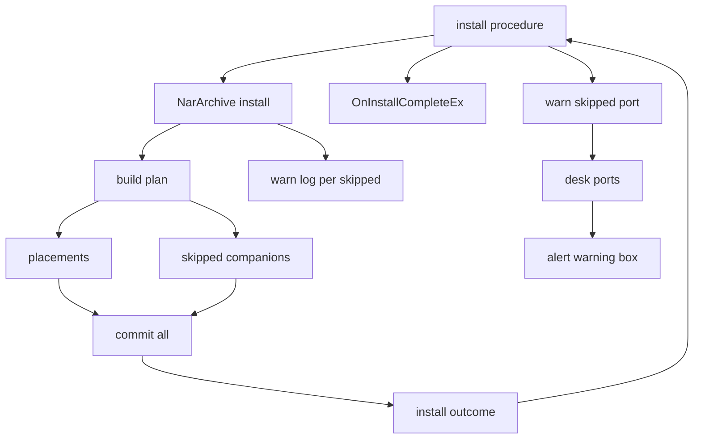
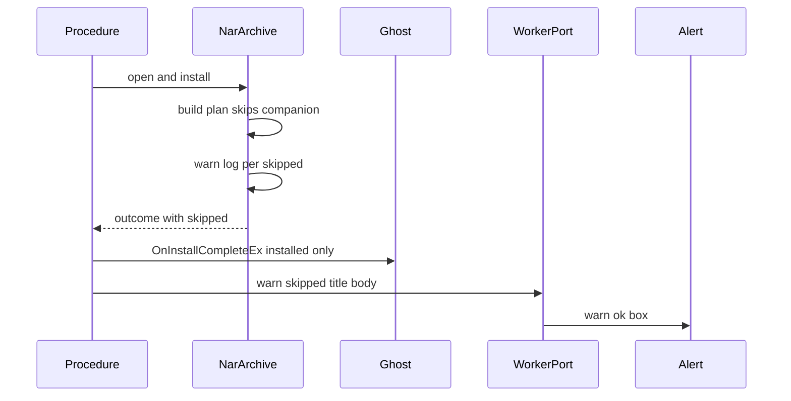

# 設計書: areka-P0-emily-ghost-verification

## Overview

**目的**: SSP から取り出した形のえみり（`emily4.nar`）を、areka へそのまま入れて「何とか動く」ところまで持っていく。入口は 3 つ。⑴ 書庫に取り出し元の無い同梱のバルーンを、その 1 つだけ飛ばしてゴーストを入れる。⑵ えみりを検体として登記する。⑶ えみりを実機で起こし、崩れた所を記録し、「何とか動く」の線を妨げるものを根本で直す。

**利用者**: えみりの `.nar` を入れたい areka の利用者と、SSP 前提のゴーストで何が崩れるかを確かめたい areka の開発者。

**変わること**: 今は書庫ごと断っている「取り出し元フォルダが無い」を、断る理由から外す。拒否の閉じた語彙は 14 種から 13 種になる。インストールを終えた結果に「飛ばした同梱」の欄が増え、利用者へ警告のダイアログを 1 つ出す。あわせて、`char2` 以降の鍵を持つゴーストで 3 人目以降の窓を作らないようにして、debug 版の panic を避ける。

### Goals

- えみりの `.nar` が入り、ゴースト `emily4` だけが置かれ、記録に警告 1 件、利用者へ警告のダイアログ 1 つ（1.1〜1.12）。
- 検体の登記表が `emily4` を持ち、登記の数の主張が 8 になる（2.1〜2.8）。
- 実機で、起動・待ち・撫で・右クリックメニュー・終了が panic 0・致命 0 で通り、崩れた所が 1 件ずつ記録される（3〜5）。
- `char2` 以降の鍵を持つゴーストで panic しないことを、実機を待たずに決定論のテストで確かめる（6.7）。

### Non-Goals

- SSP との見た目の一致、`.pna`、オーナードローのメニュー、`replace` などの描画メソッド、着せ替えの残件。
- 3 人目以降のキャラクターの窓を正しく作ること（`areka-P0-extra-character-windows`）。
- えみりの辞書と書庫のバイト列の変更、SSP のバルーン `emily4` を検体へ足すこと、えみりを配布物へ入れること。

## Boundary Commitments

### This Spec Owns

- `areka-nar` の配置計画での「取り出し元の無い同梱のバルーン」の扱い（飛ばす・記録する・結果に載せる）と、そのための型 `SkippedCompanion`・`InstallOutcome.skipped`・`Companion.source_written`。
- 拒否の語彙から `CompanionSourceMissing` を外すこと（14 → 13）と、その写し（`judge.rs`）の追随。
- インストールの手続きが、飛ばした同梱があったときに警告のダイアログを 1 つ求めること（手続きの口 `warn_skipped`）と、`alert.rs` の「OK だけの警告」の口。
- `placement/config.rs` の `detect_scopes` で、scope を 0・1 に絞ること（3 人目以降の窓を作らない最小の直し）。
- 検体の登記表の `emily4` の 1 行と、登記の数の主張（7 → 8）。
- 実機の検証の手順と記録（この spec のフォルダの `verification.md`）。
- 実機の最初の走行で見つかった、要件 4.1〜4.5 を妨げる areka 側の不具合の根本の直し（6.1）。中身は走行の後に決まる。
- 文書: `doc/COMPAT_ARCHITECTURE.md` の該当の行・網羅台帳の該当の行・`vendors/sample_ghost/README.md`。

### Out of Boundary

- 取り出し元が在るときの置き方と、ほかの拒否の理由（1.8・1.9＝変更 0）。
- バルーンの決め方（完了 `areka-P0-ghost-standard-balloon` の `boot_resolve.rs`＝変更 0）。
- 起動の絵の側の scope（`emo2_boot` の `derive_scopes`＝変更 0）、2 か所の `debug_assert!(scope <= 1)`（`input_events/mod.rs`・`menu/captions.rs`＝変更 0）、3 人目以降の窓の作り方・位置の記憶・最初の面（すべて `areka-P0-extra-character-windows`）。
- 起動を止める告知（`alert::raise`）と、利用条件の画面（`alert::ask_yes_no`）の挙動（変更 0）。
- SHIORI へ渡すバイト列の形（`load` のパスなど）。変える必要が出たら直す前に開発者の決めを仰ぐ（6.3）。
- `crates/areka/src/main.rs`（1,000 行ちょうど）。本 spec は触らない。
- 配布物（`tools/package.ps1`）。

### Allowed Dependencies

- `areka-nar` は今の依存のまま（`encoding_rs`・`thiserror`・`tracing`・`windows`）。新しい外部の部品は 0。
- `areka` の `install/` は `areka-nar` の公開の型（`InstallOutcome`・`SkippedCompanion`）と `crate::alert` だけを新しく使う。
- `sample-ghost-kit` は `areka-nar` を今どおり使う。`areka-nar` は検体の在処を知らない（変えない）。
- テストの記録の捕まえは `log-capture-kit` を通す。
- 依存の向き: `areka-nar`（型・計画・展開）→ `areka/install/procedure.rs`（手続き・文面）→ `areka/install/worker.rs`（本物の口）→ `areka/alert.rs`（OS の画面）。逆向きの参照は作らない。`procedure.rs` は `alert.rs` の画面を直に呼ばない（口を通す）。

### Revalidation Triggers

- `InstallOutcome` の形（`skipped` の欄）が変わる: `areka/install/procedure.rs` と `sample-ghost-kit` の `devroot.rs` が読み直す。
- 拒否の語彙の数（13）が変わる: `judge.rs` の写し・`lib_vocabulary_tests.rs`・`doc/COMPAT_ARCHITECTURE.md` の写しの行。
- `detect_scopes` の絞りを外す（`areka-P0-extra-character-windows`）: 本 spec が期待を変えたテスト 3 本と、本 spec が足した「scope は 0・1 だけ」のテストを、その spec が作り直す。
- 検体の登記の数（8）が変わる: 後に続く `areka-P0-dot-sakura-specimen` → `areka-P0-default-balloon-selfmade` → `sample-url-fetch` が数を引き継ぐ。
- 警告のダイアログの出す時点（締めの知らせの後）が変わる: 手続きのテストの呼び出しの列。

## Architecture

### Existing Architecture Analysis

- `.nar` を入れる道は 1 本。メニュー・台本・窓への投げ込み・網から取ってくる・起動中のゴーストの上書きは、どれも `areka/install/procedure.rs` の `archive_steps` を通り、`areka-nar` の `NarArchive::open` → `install` を呼ぶ。`install` の中は `build_plan`（計画）→ `stage_placement`（組み上げ）→ `commit_all`（確定）の順で、判断は計画の段だけが持つ。
- 今「取り出し元フォルダが無い」で断っているのは `plan.rs` の `companion_placement`（167〜199 行）の 1 か所だけ。
- 記録は `areka-nar` の `lib.rs` の `install` の 1 か所が出す（下の層は値を返すだけ）。
- 手続きは World もスレッドも知らず、外とのやり取りは口 `InstallPorts`（今 7 つ）だけ。本物は背景のスレッドの `DeskPorts`、テストは偽の `FakePorts`（本物の `areka-nar` を一時の根へ走らせる）。利用条件の画面は背景のスレッドから `alert::ask_yes_no` で出している。
- キャラクターの窓の数は、配置の `build_placement_config` → `detect_scopes` が決める。その 3 か所の呼び手（起動とゴーストの切替の準備・シェルの切替の配り直し・切替の重なり順）は全部ここを通る。

### Architecture Pattern & Boundary Map



- 採る形: 今の 3 段（計画・組み上げ・確定）をそのまま使い、計画の段が「置く物」と「飛ばした物」の 2 つの列を返す。
- 新しい部品は 2 つだけ。`SkippedCompanion`（飛ばした事実を値で運ぶ）と、手続きの口 `warn_skipped`（ダイアログの求めをテストで数える継ぎ目）。
- steering との整合: 記録の無い失敗の道を作らない（飛ばしは `warn!`・ダイアログの失敗は `error!`）。利用者へのメッセージボックスは、インストールの警告に限った開発者の例外（2026-10-17）の内側だけで使う。

### Technology Stack

| 層 | 選ぶもの・版 | この spec での役目 | 備考 |
|----|-------------|--------------------|------|
| 書庫のエンジン | `areka-nar`（ワークスペースの今の版） | 飛ばす扱い・結果の欄・記録 | 依存の追加 0 |
| アプリ | `areka`・`windows` クレート（ワークスペースのピン） | 警告のダイアログ（`MessageBoxW`）・scope の絞り | `windows` の機能の追加 0（`MB_ICONWARNING` は今の `Win32_UI_WindowsAndMessaging` の内） |
| 開発の検体 | `sample-ghost-kit` | `emily4` の登記 | |
| 記録 | `tracing`・`log-capture-kit`（テスト） | 警告と画面の記録 | |

## File Structure Plan

### Directory Structure

```
crates/areka-nar/src/
├── manifest.rs              # Companion に source_written を足す
├── plan.rs                  # 取り出し元の無い同梱を飛ばし、飛ばした列を返す
├── install.rs               # SkippedCompanion・InstallOutcome.skipped・commit_all の引数
├── error.rs                 # CompanionSourceMissing を外す（13 種）
├── lib.rs                   # 公開・飛ばした 1 件ごとの warn!・兄弟テストの接続
└── lib_skip_tests.rs        # 新規: 要件 7.1 の 6 場面を open から install まで通す
crates/areka/src/
├── alert.rs                 # OK だけの警告の口 warn_ok を足す
├── install/
│   ├── procedure.rs         # 口 warn_skipped・文面 skipped_notice・出す時点
│   ├── procedure_test_support.rs  # 偽の口が Warn を記録する
│   ├── procedure_skip_tests.rs    # 新規: 6 場面のダイアログの求めの件数と中身
│   ├── worker.rs            # 本物の口が alert の警告の口を呼ぶ
│   └── judge.rs             # 失敗の語の写しから外した変種の腕を消す
└── placement/
    ├── config.rs            # detect_scopes を 0・1 に絞る・char_scope_of を消す
    ├── mod.rs               # 新しい兄弟テストの接続 1 行
    ├── placement_shared_test_support.rs  # char2 以降の鍵を持つ descript の固定入力
    └── placement_char_clamp_tests.rs     # 新規: 配置の準備で scope が 0・1 だけ
├── input_events/
│   ├── mod.rs               # 新しい兄弟テストの接続 1 行
│   └── input_events_char_clamp_tests.rs  # 新規: 全 scope の窓でマウスを動かしても panic しない
crates/areka-emo-compose/src/
├── fold.rs                  # タスク 6.1: 同じ番号の 2 つ目の surface*ブレスを前の定義へ足す（merge_brace・同じ名前の行は後勝ち）
├── fold_merge_tests.rs      # 新規（6.1）: えみりと同じ形の固定入力で足し合わせと後勝ちを判定
├── boxes.rs                 # 6.1: シェル内バルーンの置き場所も同じ規則で足す（distribute）
└── fold_tests.rs ほか       # 6.1: 全置換を期待していた 4 本を足し合わせの期待へ
crates/sample-ghost-kit/src/
├── lib.rs                   # 登記表に emily4 の 1 行
└── lib_tests.rs             # 数 7 → 8・emily4 の 1 本
doc/ukadoc-coverage/ledger/
├── assets.toml              # *.source.directory の行の注記
└── shiori.toml              # OnInstallFailure の備考「拒否の 14 種」→ 13 種
.kiro/specs/areka-P0-emily-ghost-verification/
└── verification.md          # 新規: 実機の検証の記録
```

### Modified Files

- `crates/areka-nar/src/manifest.rs` — `Companion` に `pub source_written: Option<String>` を足し、`collect_companions` が決める（書かれていた値を `bounded_value` で縛った物。書かれていない・空なら `None`）。
- `crates/areka-nar/src/plan.rs` — `build_plan` の戻りを `Result<(Vec<Placement>, Vec<SkippedCompanion>), RefuseReason>` へ。`companion_placement` は `Option<Placement>` を返し、`None` のとき `build_plan` が `SkippedCompanion` を積む。文書の注記を直す。
- `crates/areka-nar/src/install.rs` — `SkippedCompanion` を宣言し、`InstallOutcome` に `pub skipped: Vec<SkippedCompanion>` を足す。`commit_all` が `skipped` を受け取り、結果へ写す。
- `crates/areka-nar/src/error.rs` — `CompanionSourceMissing` を消し、「14 変種で閉じる」を「13 変種」へ。
- `crates/areka-nar/src/lib.rs` — `SkippedCompanion` を公開する。`install` の成功の枝で、飛ばした 1 件ごとに `warn!` を 1 件出す。`install` の `# Errors` の注記を直す。`lib_skip_tests.rs` の接続を足す。
- `crates/areka-nar/src/plan_tests.rs` — 助手 `planned` を新しい戻りに合わせ、`refuses_a_companion_whose_source_folder_is_empty`・`refuses_a_companion_whose_source_folder_is_absent` を「置く配置に入らず、飛ばした 1 件」の判定へ書き替える（名前も変える）。
- `crates/areka-nar/src/plan_source_path_tests.rs` — 305 行付近の 3 つの形（配下の外だけ・フォルダのエントリだけ・前方一致する兄弟だけ）を同じく飛ばしの判定へ。
- `crates/areka-nar/src/plan_roots_tests.rs` — `build_plan` の戻りの形に合わせる（中身の判定は変えない）。
- `crates/areka-nar/src/install_tests.rs`・`install_commit_tests.rs` — `commit_all` の新しい引数（空の列）を渡す。
- `crates/areka-nar/src/manifest_tests.rs`・`manifest_companion_tests.rs` — `Companion` の値の組みに `source_written` を足す（`Companion` を値で組むのはこの 2 つと `manifest.rs` だけ）。`manifest_companion_reading_tests.rs` は組みを変えず、`source.directory` が書かれた場面と書かれない場面で `source_written` の値を確かめる判定を足す。
- `crates/areka-nar/src/lib_vocabulary_tests.rs` — `CompanionSourceMissing` の固定入力を消し、数 14 を 13 へ。冒頭の注記を直す。
- `crates/areka-nar/src/error_tests.rs` — 69 行・289 行の `CompanionSourceMissing` を消す。79〜85 行の `all_kinds_has_fourteen_entries` を `all_kinds_has_thirteen_entries`（13 と比べる）へ。
- `crates/areka/src/install/judge.rs` — `failure_word` の `CompanionSourceMissing` の腕を消す。
- `crates/areka/src/install/judge_tests.rs` — 219 行の場面を消す。176 行の注釈「14 種」を 13 種へ。
- `crates/areka/src/install/procedure.rs` — 5 行の注釈「口の 7 つ」を 8 つへ。口 `warn_skipped`・純粋な文面の関数 `skipped_notice`・`archive_steps` の出す時点。兄弟 `procedure_skip_tests.rs` の接続。
- `crates/areka/src/install/procedure_test_support.rs` — `Call::Warn { title, body }` と、それを集める助手 `warned()`。
- `crates/areka/src/install/worker.rs` — `DeskPorts::warn_skipped` が `alert::warn_ok(title, body, alert::suppressed())` を呼ぶ。
- `crates/areka/src/alert.rs` — `warn_ok` を足す（`unsafe` は `MessageBoxW` 呼び出しに閉じる、の注記も直す）。
- `crates/areka/src/alert_tests.rs` — 抑えたときに画面を出さず記録 1 件だけ残すことの判定。
- `crates/areka/src/placement/config.rs` — `detect_scopes` の n ≥ 2 を足す繰り返しを消し、呼び手の無くなる `char_scope_of` を消す。中の `t_c3_char_n_prefix_adds_scope_n` を「`char{n}` の鍵（n ≥ 2）は scope を足さない」へ書き替える。
- `crates/areka/src/placement/config_limit_tests.rs` — 85 行の期待 `[0, 1, 2]` を `[0, 1]` へ。
- `crates/areka/src/placement/reseed_tests.rs` — 195 行のテストの「scope 2 の `reseed_scope_not_running` が 1 件」の期待を、絞った後の答え（0 件）へ直す。
- `crates/areka/src/placement/mod.rs` — `placement_char_clamp_tests.rs` の接続 1 行。
- `crates/areka/src/placement/placement_shared_test_support.rs` — えみりと同じ形の固定入力（ゴーストの descript に `char2.name`・シェルの descript に `char2.*`・`char3.*`・`char4.*`）を `pub(crate)` の定数で持つ。`placement/mod.rs` の接続（896 行の `mod shared_test_support;`）は今は非公開なので、`cfg(test)` のまま `pub(crate) mod` へ広げ、`input_events` と `menu` のテストから読めるようにする。
- `crates/areka/src/input_events/input_events_char_clamp_tests.rs`（新規）と `input_events/mod.rs` の接続 1 行 — その固定入力から組んだ配置の全 scope の窓でマウスを動かしても panic しない、の 1 本。`input_events_tests.rs` は 890 行で 1,000 行の目安に近いので、そこへは足さない。
- `crates/areka/src/menu/trigger_wired_tests.rs` — 同じく全 scope の窓で右クリックしても panic しない、の 1 本。
- `crates/sample-ghost-kit/src/lib.rs` — `SAMPLES` に `Sample { name: "emily4", kind: SampleKind::Ghost, balloons: &[] }`。
- `crates/sample-ghost-kit/src/lib_tests.rs` — 検体の数として直書きされた 7 を全部 8 へ（6 行の「既知の 7 つ」を含む数の主張 2・注釈 3・名前の一覧・関数名）。5 行の「主張は 7 本」は検体の数でなく主張の数で、`emily4` の 1 本（取り出し元の無い同梱を飛ばしてゴーストだけ入る）を主張に足すので 8 本へ直し、列挙に 1 つ足す。
- `vendors/sample_ghost/README.md` — `emily4.nar` の行と節の「未登記」を外し、取り出し元の無い同梱は飛ばして入ることを書く。
- `doc/COMPAT_ARCHITECTURE.md` — §8 に 1 行足し、287 行の写しから `CompanionSourceMissing` を外し「14 種」を「13 種」へ。
- `doc/ukadoc-coverage/ledger/assets.toml` — `*.source.directory` の行の注記。実機の後に、えみりが使う項目の行を記録と合わせる。
- `crates/areka-emo-compose/src/fold.rs` — タスク 6.1（崩れた所 1）。`fold_plain_surface` は既にある番号へ新しく作り直さず `merge_brace` で前の定義へ足す（element は element番号・collision は collision番号・animation は animation番号と pattern番号ごとに後勝ち。書き直した collision は末尾へ＝後の定義が手前）。重複の記録は `warn!` から `debug!` へ。`upsert_surface` は無い番号の新設だけになる。
- `crates/areka-emo-compose/src/fold_merge_tests.rs`（新規）と `fold.rs` の接続 3 行 — えみりと同じ形（面ごとのブレスの絵＋後の共有のブレスの当たり判定・着せ替え）で絵が残ること、同じ名前の行が後勝ちになることの 2 本（直す前に赤）。ファイル名は作り物。
- `crates/areka-emo-compose/src/boxes.rs` — `distribute` の `surface*`ブレスの腕を、丸ごと置き換えから「前の行へ足す・同じ element番号は後勝ち」へ（画像の畳み込みと規則を割らない）。
- `crates/areka-emo-compose/src/fold_tests.rs`・`base_image_tests.rs`・`log_firing_tests.rs`・`boxes_tests.rs` — 全置換を期待していたテストを足し合わせの期待へ直し、名前も変える（`duplicate_id_same_layer_line_is_last_wins`・`brace_after_append_merges_into_the_image_only_face`・`duplicate_surface_id_merge_logs_debug_not_warn`・`later_surface_brace_adds_to_the_placements`）。
- `doc/COMPAT_ARCHITECTURE.md` — §8 に「同じ番号が 2 つ以上の `surface*`ブレスに出たとき」の【上書き】の行（`areka-P0-emo-compose` 要件 2.1 を上書き）を足し、追記の後の波括弧の行を【上書き】（`areka-P0-shell-implicit-surface` の設計の行を上書き）へ直す。
- `doc/ukadoc-coverage/ledger/shiori.toml` — 3445 行の `OnInstallFailure` の備考「areka-nar の拒否の 14 種」を 13 種へ（どのテストも気付かないので手で直す）。
- 数の洗い出しの締め: 上の直しの後に、`14 種`・`14 変種`・`fourteen`・`7 つ`・`7 本`・`seven` をソースと文書の全体で検索し、出た行を全部「直した」か「この数とは別の数（理由つき）」に片付ける（1.7・2.3・7.4・8.2・8.4）。

## System Flows

### インストールの流れ（飛ばした同梱があるとき）



- 飛ばしたものが 0 件なら、口 `warn_skipped` を呼ばない（ダイアログ 0）。
- 締めの知らせが「閉じた」で返っても、口 `warn_skipped` は呼んでから手続きを止める（入った事実は変わらない）。
- 1 つの `.nar` で複数を飛ばしても、口は 1 回だけ呼ぶ（本文に 1 件ずつ並べる）。
- 依頼に書庫が複数あれば、飛ばした同梱を持つ書庫ごとに 1 回。

## Requirements Traceability

| 要件 | 要約 | 部品 | 契約・道 | 流れ |
|------|------|------|----------|------|
| 1.1 | 取り出し元の無い同梱だけを飛ばす | 配置計画 | `build_plan`・`companion_placement` | インストールの流れ |
| 1.2 | 「無い」は今の判定と同じ（フォルダのエントリだけも含む） | 配置計画 | `collect_tree` の結果が空 | |
| 1.3 | 一部だけ無い | 配置計画 | 同梱ごとに判定 | |
| 1.4 | 警告 1 件（`.nar`・鍵・値） | 書庫の入口の記録・`SkippedCompanion` | `lib.rs` の `warn!` | |
| 1.5 | 成功として今の形で伝える | 手続き | `complete_ex_refs`（入った物だけ） | インストールの流れ |
| 1.6 | 飛ばした置き場に触れない | 配置計画 | 計画に入れない | |
| 1.7 | 断らない・語彙 14 → 13 | 拒否の語彙・写し | `RefuseReason`・`failure_word` | |
| 1.8 | 在るときは今と同じ | 配置計画 | 既存の道 | |
| 1.9 | ほかの拒否は今と同じ | 拒否の語彙 | 既存の道 | |
| 1.10 | えみりはゴーストだけ・警告 1 件 | 配置計画・検体 | `lib_tests.rs` の emily4 の 1 本 | |
| 1.11 | バルーンは既定の決まりのまま | （変更 0） | `boot_resolve.rs` の今の段 | 実機の手順 |
| 1.12 | 警告のダイアログ 1 つ | 手続き・本物の口・告知 | `warn_skipped`・`skipped_notice`・`warn_ok` | インストールの流れ |
| 2.1 | 登記表に 1 行 | 検体の登記 | `SAMPLES` | |
| 2.2 | 窓口で取り出せる | 検体の登記 | `SampleRoot::acquire` | |
| 2.3 | 数 8・直書きの 7 を 0 か所 | 検体の登記のテスト | `lib_tests.rs` | |
| 2.4 | 往復の 2 本が緑 | 検体の登記のテスト | 既存の 2 本 | |
| 2.5 | README の注記 | 文書 | `vendors/sample_ghost/README.md` | |
| 2.6 | バイト列のまま | （変更 0） | sha256 を記録で確かめる | |
| 2.7 | 配布物に含めない | （変更 0） | `tools/package.ps1` の許可表 | |
| 2.8 | パスの綴りの検査が緑 | 検体の登記 | `sample_path_guard_test.rs` を回す | |
| 3.1 | debug 版・`target\` の下の根・絶対パス | 実機の検証の手順 | 根の組み方・起動の条件 | 実機の手順 |
| 3.2 | 配布物と同じ形の根にインストールの操作で入れる | 実機の検証の手順 | 根の組み方・走行 2 | 実機の手順 |
| 3.3 | i686 の補助プログラムを確かめる | 実機の検証の手順 | 前提の確かめ 2 | |
| 3.4 | 記録の水準と自動終了の安全弁 | 実機の検証の手順 | 起動の条件 | |
| 3.5 | 他の spec の実機・負荷と時間を分ける | 実機の検証の手順 | 前提の確かめ 3 | |
| 3.6 | 面・バルーン・記録を撮る | 実機の検証の手順 | 撮るもの | |
| 3.7 | 自分が起こしたプロセスだけ止める | 実機の検証の手順 | 止め方 | |
| 3.8 | 操作は AI・SendInput は許可を得て | 実機の検証の手順 | 走行の操作 | |
| 4.1 | 起動して 1・2 人目に面と台詞 | 実機の検証の手順 | 走行 5 | 実機の手順 |
| 4.2 | 待っても台詞が出続け落ちない | 実機の検証の手順 | 走行 5 | 実機の手順 |
| 4.3 | 撫でが SHIORI へ届く | 実機の検証の手順 | 走行 6 | 実機の手順 |
| 4.4 | 右クリックメニューと選んだ働き | 実機の検証の手順・scope の絞り | 走行 6 | 実機の手順 |
| 4.5 | 終了の台詞の後にきれいに終わる | 実機の検証の手順 | 走行 6・終了コード 0 | 実機の手順 |
| 4.6 | panic と致命 0 | 実機の検証の手順・scope の絞り | 判定 | |
| 4.7 | 3 人目以降の窓が出なくても妨げにしない | scope の絞り | `detect_scopes` | |
| 4.8 | 目視の項目は開発者が決める | 実機の検証の手順 | 判定 | |
| 4.9 | 見た目の違いだけで不合格にしない | 実機の検証の手順 | 判定 | |
| 5.1 | 記録の置き場と冒頭の項目 | 検証の記録 | `verification.md` の冒頭・走行ごと | |
| 5.2 | 崩れた所を症状・根拠・原因・扱いで | 検証の記録 | 崩れた所の表 | |
| 5.3 | 「方針で受けない」に裁定を書く | 検証の記録 | 崩れた所の表の最後の列 | |
| 5.4 | 範囲外も含めて全部を起票か受けないに | 検証の記録・直しの進め方 | `/kiro-discovery` | |
| 5.5 | えみりの中身から出る ERROR・WARN を外す | 検証の記録 | ERROR と WARN の数 | |
| 5.6 | 直した後に回し直す | 実機の検証の手順 | きっかけ | |
| 6.1 | 線を妨げる不具合は本 spec で直す | 直しの進め方 | 「直しの進め方」の節 | |
| 6.2 | 妨げないものは起票か受けない | 直しの進め方 | `/kiro-discovery` | |
| 6.3 | SHIORI へのバイト列を変えるなら聞く | 直しの進め方 | | |
| 6.4 | 20 タスクを超えそうなら聞く | 直しの進め方 | 最初の走行の後に測る | |
| 6.5 | 上書きした完了要件を書く | 文書 | `COMPAT_ARCHITECTURE.md` | |
| 6.6 | えみりの辞書・書庫を変えない | 直しの進め方 | | |
| 6.7 | `char2` 以降で panic しない | scope の絞り | `detect_scopes`・3 本のテスト・会話が止まらないテスト | |
| 7.1 | 6 場面の決定論のテスト | `lib_skip_tests.rs`・`procedure_skip_tests.rs` | | |
| 7.2 | 入った物・置かれない物・成否・記録・ダイアログの求め | 同上 | `log-capture-kit`・`Call::Warn` | |
| 7.3 | `emily4.nar` はゴーストだけ | 検体の登記のテスト | `lib_tests.rs` | |
| 7.4 | 語彙のテストが 13 種 | `lib_vocabulary_tests.rs` | | |
| 7.5 | 直した不具合ごとに赤 → 緑のテスト | 直しの進め方 | | |
| 8.1・8.2 | `COMPAT_ARCHITECTURE.md` | 文書 | §8 の行 | |
| 8.3・8.4 | 網羅台帳 | 文書 | `assets.toml`・`shiori.toml` | |

## Components and Interfaces

| 部品 | 層 | 役目 | 要件 | 主な依存 | 契約 |
|------|----|------|------|----------|------|
| 配置計画 | `areka-nar` | 取り出し元の無い同梱を飛ばして列で返す | 1.1〜1.3・1.6・1.8・1.10 | マニフェスト（P0） | Service |
| 結果の欄 `SkippedCompanion` | `areka-nar` | 飛ばした事実を値で運ぶ | 1.4・1.12 | 配置計画（P0） | State |
| 書庫の入口の記録 | `areka-nar` | 飛ばした 1 件ごとに `warn!` | 1.4 | `tracing`（P0） | Event |
| 拒否の語彙と写し | `areka-nar`・`areka` | `CompanionSourceMissing` を外す | 1.7・1.9・7.4 | | State |
| 手続きの警告 | `areka/install` | 飛ばした同梱があればダイアログを 1 つ求める | 1.5・1.12・7.2 | 口 `InstallPorts`（P0） | Service |
| 告知の警告の口 | `areka/alert` | OK だけの警告の画面 | 1.12 | `MessageBoxW`（P1） | Service |
| scope の絞り | `areka/placement` | 3 人目以降の窓を作らない | 4.7・6.7 | | Service |
| 検体の登記 | `sample-ghost-kit` | `emily4` を 1 行で持つ | 2.1〜2.8・7.3 | `areka-nar`（P0） | State |
| 実機の検証の手順と記録 | spec の文書 | 回し方と記録の型 | 3・4・5・6 | debug 版 `areka.exe`（P0） | Batch |

### areka-nar

#### 配置計画（`plan.rs`）と結果の欄（`install.rs`・`manifest.rs`）

| 項 | 内容 |
|----|------|
| 役目 | 同梱のバルーンごとに「置く」か「飛ばす」かを決め、置く配置の列と飛ばした列を返す |
| 要件 | 1.1・1.2・1.3・1.4・1.6・1.8・1.10 |

**責務と制約**
- 判定は今と同じ一言（`collect_tree` で取り出し元の配下を集めた結果が、ファイルもフォルダも 0 件）。フォルダのエントリだけが在って配下が空の書庫も「無い」に入る。
- 飛ばした同梱は配置の列に入れない。だから組み上げ・確定・巻き戻しは、その置き場に 1 バイトも触れない（フォルダも作らない・在る中身も変えない）。
- 本体の配置は今どおり、全部の同梱（飛ばしたものも含む）の取り出し元を本体の側から除く。飛ばした同梱の取り出し元には書庫の中にエントリが無いので、本体の木は今と同じになる。
- 配置の列の並び（本体が先・同梱は探索の順）は今と同じ。飛ばした列も探索の順。
- 本体の配置の失敗（宛先のゴーストが無い）は今どおり `Err`。同梱のせいで `Err` になる道は無くなる。

**契約**: Service [x] / State [x]

```rust
// install.rs（lib.rs から公開）
/// 取り出し元が書庫に無いので置かなかった同梱のバルーン 1 つ。
#[derive(Clone, Debug, PartialEq, Eq)]
pub struct SkippedCompanion {
    /// `*.directory` の値（置くはずだった `<根>/balloon/<directory>/` の名前）。
    pub directory: String,
    /// 取り出し元を決めた鍵。`*.source.directory` が書かれていればその鍵、無ければ `*.directory` の鍵。
    pub key: String,
    /// その鍵に書かれていた値（`..` を取り除く前・`bounded_value` で縛った物）。
    pub source: String,
}

pub struct InstallOutcome {
    // 既存の欄は変えない（name・accept・installed・warnings・leftovers）
    /// 飛ばした同梱のバルーン。探索の順。飛ばしていなければ空。
    pub skipped: Vec<SkippedCompanion>,
}

// manifest.rs
pub struct Companion {
    // 既存の欄は変えない（key・directory・source_directory・existing）
    /// `*.source.directory` に書かれていた値（`bounded_value` で縛った物）。書かれていない・空なら None。
    pub source_written: Option<String>,
}

// plan.rs（crate の中だけ）
pub(crate) fn build_plan(
    manifest: &InstallManifest,
    names: &[EntryName],
    request: &InstallRequest<'_>,
) -> Result<(Vec<Placement>, Vec<SkippedCompanion>), RefuseReason>;

fn companion_placement(
    companion: &Companion,
    names: &[EntryName],
    request: &InstallRequest<'_>,
) -> Option<Placement>; // None＝取り出し元が書庫に無い

// install.rs（crate の中だけ）
pub(crate) fn commit_all(
    areas: &[WorkArea],
    manifest: &InstallManifest,
    plan: &[Placement],
    skipped: Vec<SkippedCompanion>,
    states: &[ExistingState],
) -> Result<InstallOutcome, CommitError>;
```

- 事前条件: `manifest.companions` は探索の順。
- 事後条件: `placements.len() + skipped.len() == 1 + manifest.companions.len()`。`skipped` の各要素は、配置の列に同じ `directory` の同梱を持たない。
- 鍵と値の決め方: `source_written` が `Some(v)` なら鍵 `<接頭辞>.source.directory`・値 `v`。`None` なら鍵 `<接頭辞>.directory`・値は `directory`。
- `Companion` の欄を足すのは公開の型の変更だが、`Companion` を値で組むのは `areka-nar` の中だけ（全ワークスペースを検索して確かめた）。

#### 書庫の入口の記録（`lib.rs`）

- `install` の成功の枝で、`outcome.skipped` の 1 件ごとに `warn!` を 1 件出す。欄は `archive`（`.nar` のパス・ファイル名を含む）・`key`・`source`・`directory`。文言は `[areka_nar] companion balloon skipped: its source folder is not in the archive`。今の `[areka_nar] manifest entry skipped`（読み飛ばした鍵）とは別の行にする。
- 続く `info!`（`[areka_nar] installed`）に `skipped` の件数の欄を足す。
- 失敗の記録（`log_failure`）は変えない。

**契約**: Event [x]
- 出す時点: `install` が `Ok` を返す直前、1 件につき 1 回。
- 飛ばしていなければ 0 件（今の記録と同じ）。

#### 拒否の語彙と写し（`error.rs`・`judge.rs`）

- `RefuseReason::CompanionSourceMissing` を消す。`refuse_reasons!` が `ALL_KINDS` を宣言から組むので、語彙は自動で 13 になる。
- `judge.rs` の `failure_word` はワイルドカードの腕を持たないので、腕を消し忘れるとビルドが止まる。
- 上書きする完了 spec の要件: `areka-P0-nar-install` 5.4・9.2 と 9.3 の該当部分、`areka-P0-install-companion-reading` 2.5、`areka-P0-install-companion-canon` 2.5。

### areka / install

#### 手続きの警告（`procedure.rs`）

| 項 | 内容 |
|----|------|
| 役目 | 書庫を入れ終えて飛ばした同梱があれば、警告のダイアログを 1 つ求める |
| 要件 | 1.5・1.12・7.1・7.2 |

**責務と制約**
- ゴーストへの知らせは今と同じ（`OnInstallCompleteEx` の Reference は入った物だけ・応えが無ければ `OnInstallComplete`）。新しいイベントも失敗の語も作らない。
- 出す時点は締めの知らせの後。締めの知らせが「閉じた」で返っても、求めてから止まる。
- 文面は純粋な関数が組む（テストで固定する）。

**契約**: Service [x]

```rust
pub(crate) trait InstallPorts {
    // 既存の 7 つは変えない
    /// 飛ばした同梱があったことを利用者へ警告する（OK だけの画面）。答えは持たない。
    fn warn_skipped(&mut self, title: &str, body: &str);
}

/// 警告のダイアログの題名と本文（純粋）。`skipped` は空でない。
fn skipped_notice(
    archive: &Path,
    manifest_name: &str,
    items: &[InstalledItem],
    skipped: &[SkippedCompanion],
) -> (String, String);
```

- 題名: `インストールの警告 - <install.txt の name>`。
- 本文の行（上から）:
  1. `書庫: <.nar のファイル名>`（パスでなくファイル名だけ）
  2. 入った物 1 つにつき `入った物: <種類の語> <名前>`（種類の語は ゴースト／シェル／バルーン／追加ファイル。名前は `OnInstallCompleteEx` に載せるのと同じ）
  3. 飛ばした 1 つにつき `入らなかったバルーン: <directory>（書庫に取り出し元 <source> が無かったため）`
  4. `入らなかったバルーンの代わりに、入っている別のバルーンが使われます。`
- `archive_steps` での手順: `install_done` の記録 → `record` → 締めの知らせ（結果を一度受ける）→ `outcome.skipped` が空でなければ `warn_skipped` を 1 回 → 締めの知らせの結果を返す（「閉じた」ならそこで止まる）。
- `installed_items` と `installed_record` は変えない（飛ばした同梱は `installed` に無い）。

#### 本物の口（`worker.rs`）と告知の警告の口（`alert.rs`）

- `DeskPorts::warn_skipped` は `alert::warn_ok(title, body, alert::suppressed())` を呼ぶだけ。インストールの背景のスレッドの上で出すので、UI スレッドとゴーストの会話は止まらない。このとき門（終了の待ち）は書き終えた時点で手放しているので、終了も待たせない。開いている間、同じ依頼の次の書庫は待つ（利用条件の画面と同じ）。

```rust
// alert.rs
/// OK だけの警告の画面を出す（インストールの警告・2026-10-17 開発者の例外）。
/// `warn!(event = "install_warning_dialog")` を必ず 1 件残し、`suppressed` が真なら画面を出さない。
/// 出せなかったら `error!(event = "warning_box_failed")` を 1 件足す。持ち主の窓は渡さない。
pub(crate) fn warn_ok(title: &str, body: &str, suppressed: bool);
```

- 画面の形: `MB_OK | MB_ICONWARNING | MB_SETFOREGROUND | MB_TOPMOST`（`ask_yes_no` と同じく手前に出す）。
- 記録の欄: `title`・`body`・`suppressed`。

**Implementation Notes**
- 決定論の継ぎ目は口 `warn_skipped`。偽の口 `FakePorts` は `Call::Warn { title, body }` を呼び出しの列に積む。テストは件数・題名・本文を見る。`alert::warn_ok` の画面そのものは自動テストで出さない（`suppressed` が真の道だけを `alert_tests.rs` で見る）。
- 実機の検証では `AREKA_NO_ALERT` を設定しない（ダイアログを見るため）。

### areka / placement

#### scope の絞り（`config.rs` の `detect_scopes`）

| 項 | 内容 |
|----|------|
| 役目 | キャラクターの窓の scope を 0・1 に絞る |
| 要件 | 4.7・6.7 |

**責務と制約**
- `detect_scopes` は 0 を必ず入れ、`kero.name`（ゴースト）か `kero.` で始まる鍵（シェル）があれば 1 を入れる。`char{n}.` の鍵（n ≥ 2）からは scope を足さない。呼び手の無くなる `char_scope_of` は消す。
- これで、`build_placement_config` を通る 3 つの呼び手（起動とゴーストの切替の準備・シェルの切替の配り直し・切替の重なり順）の全部で、scope 2 以上の窓が作られない。起動の絵の側（`derive_scopes` の `[0, 1]`）と答えがそろう。
- `char{n}.*` の鍵そのもの（`resolve_scope`・`scope_prefixes`・題名の `build_titles`）は変えない。scope が作られないので読まれないだけ。
- 2 か所の `debug_assert!(scope <= 1)` は残す（外すのは `areka-P0-extra-character-windows`）。scope 2 の窓が作られなくなるので、当たる道が無くなる。
- 「panic の道はこの 2 か所」は、scope 2 の窓が在る形で調べた結論。絞った後は「台本が `\p[2]` で scope 2 を指すが、窓もバルーンも無い」形になる（えみりの起動・終了の辞書に 50 回・メニューの辞書に 36 回）。この形で会話が止まらないことは、実機の前に決定論のテストで確かめる（設計の討議の議題 1・下の「会話が止まらないテスト」）。
- `examples/window-placement.rs` の `scope >= 2` の枝は消さない（来なくなるだけ・ビルドは通る）。

**契約**: Service [x]
- 事後条件: `build_placement_config(ghost_kv, shell_kv).scopes` の鍵は `{0}` か `{0, 1}`。
- 戻すとき: `areka-P0-extra-character-windows` が scope の導き方を 1 か所にまとめ直すときに、この絞りを外す。

### sample-ghost-kit

#### 検体の登記

- `SAMPLES` に `emily4`（ゴースト・同梱のバルーン 0）の 1 行を足す。窓口（`SampleRoot::acquire`・`nar-sample-path`）は今の道のままで、`areka-nar` が飛ばしを受けるので通る。
- 同梱のバルーンが 0 なので、検体のパスの綴りの番人が見張る語は増えない（2.8）。登記の後に番人を回して確かめ、赤なら対象を見直して理由を記録に書く。
- 検体 1 つ分（書庫 2.6 MB・展開すると約 3.8 MB・260 エントリ）だけ、登記のテストと `nar_sample_path_test.rs` の時間が延びる。

## 実機の検証の手順（要件 3・4）

**契約**: Batch [x]

- **きっかけ**: 自動テストの部分（インストールの扱い・登記・scope の絞り）が全部緑になった後に 1 回。直した件があれば、直した後にもう 1 回（5.6）。
- **前提の確かめ**:
  1. debug 版の `areka.exe` をビルドする。
  2. `tools/sync-i686-helper.ps1` を回し、終了コード 0 で i686 の補助プログラムが `areka.exe` の隣にあることを確かめる（3.3）。
  3. 机の仕組みで、他の spec の実機の窓を出す回・負荷の走行が無い時間を取る（3.5）。
- **根の組み方（3.1・3.2）**:
  1. `nar-sample-path emo2` と `nar-sample-path StayseeBalloon` で検体を開く。
  2. ワークツリーの `target\emily-verify\root\` に、`ghost\emo2`・`balloon\emo2-kakukaku`・`balloon\StayseeBalloon` を写す（配布物と同じ形）。
  3. 記憶の置き場は `target\emily-verify\profile\`（空）にする。
  4. えみりの `.nar` は `vendors\sample_ghost\emily4.nar` の絶対パスから入れる。根には写さない。
- **起動の条件（3.1・3.4）**:
  - `AREKA_ROOT` に根の絶対パスを渡す。
  - `RUST_LOG` は `info,areka::install=debug,areka::boot_resolve=debug,areka_nar=debug` 以上。判定に使う分岐の記録が出る水準まで開ける。
  - `AREKA_APP_SMOKE_EXIT_MS` は 1 回の走行の所要より長い上限（例 1,800,000）で、安全弁としてだけ置く。
  - `AREKA_NO_ALERT` は設定しない。
  - `areka.exe` は絶対パスで起動する。
- **走行（4.1〜4.5）**:
  1. emo2 で起動する。
  2. 右クリックメニューの「インストール…」で、ファイルを選ぶ画面に `emily4.nar` の絶対パスを入れる（使った操作を記録に書く）。
  3. 警告のダイアログを撮って、閉じる。
  4. えみりへ切り替える（メニューの「ゴースト」か、えみりの完了の台詞の指示）。
  5. 起動の台詞を確かめる。何もせず待ち、時間で出る話を 1 回以上見る。
  6. 撫でる。右クリックメニューの「説明書」と「終了」を選ぶ。
  - 操作は AI が行う。クリック透過で道具が効かないときは、開発者の許可を得て SendInput で行う（3.8）。
- **撮るもの（3.6）**: MCP の `dump_surface`・`dump_balloon`・`get_log`。`dump_balloon` が時間切れで答えないときは、`dump_surface` と記録に寄せ、そのことを記録に書く。
- **止め方（3.7）**: 外から止めるのは、その走行で自分が起こしたと確かめた pid だけ。
- **判定（4.6〜4.9）**:
  - panic 0 と致命 0 は、記録の検索で AI が数える。
  - 目視の項目は、AI が撮った物と記録を開発者へ渡し、開発者が決める。
  - SSP との見た目の違いは、それだけでは不合格にしない。

### 検証の記録（`verification.md`・要件 5）

- **冒頭**: 同定（コミット・debug 版・`emily4.nar` の sha256）、機械の構成（OS の版・画面の拡大率）、環境変数と記録の水準。
- **走行ごと**: 日時（日本時間）と、要件 4.1〜4.9 の項目ごとの結果（合否・判定した者＝AI の数えか開発者の目視）。
- **崩れた所の表**: 列は「番号・症状・根拠（時刻つきの記録の逐語か撮った物）・原因（file:line か裁定）・扱い（直した／方針で受けない／起票した）・起票した spec の名前か裁定」。
- **ERROR と WARN の数**: えみりの中身から出るもの（段 3・段 4 のバルーンの「見つからない」など）を、理由を書いて数から外した残り（5.5）。
- **見立ての照合**: 研究の記録 5 節の見立て 1〜9 が当たったか外れたか。

### 直しの進め方（要件 6）

- 最初の走行の後に、崩れた所の一覧と直しの見積もりをそろえる。決まった部分のタスク（約 9）と合わせて 20 を超える見込みなら、直しを進める前に一覧を添えて開発者の決めを仰ぐ（6.4）。
- 要件 4.1〜4.5 を妨げる areka 側の不具合は、本 spec のタスクとして根本で直す（6.1）。テストは直す前に赤・直した後に緑のものを少なくとも 1 本添える（7.5）。直す場所は研究の記録の file:line から決め、直した後に本設計の「ファイルの計画」へ足して記録する。
- SHIORI へ渡すバイト列を全部のゴーストで変える直しは、直す前に開発者の決めを仰ぐ（6.3）。
- 妨げないもの（見た目・一部の機能の欠け）は直さない。`/kiro-discovery` で起票するか「方針で受けない」とする（6.2・5.4）。
- えみりの辞書と書庫は書き換えない（6.6）。完了 spec の要件を上書きしたら、番号を文書に書く（6.5）。

## Error Handling

### Error Strategy

- 飛ばしは失敗ではない。`areka-nar` は `Ok` を返し、`warn!` を 1 件ずつ残す（黙って通さない）。
- 警告のダイアログを出せなかった（対話のデスクトップが無いなど）ときは、`error!(event = "warning_box_failed")` を 1 件残して手続きを続ける。インストールは成功のまま。
- 抑えられているとき（`AREKA_NO_ALERT`）は、`warn!(event = "install_warning_dialog", suppressed = true)` の 1 件だけ残す。
- 宛先のゴーストが無い・壊れた書庫・安全でないパスなどの拒否は今と同じ（`error!` の `[areka_nar] refused or failed` と `OnInstallFailure`）。
- scope の絞りに失敗の道は無い（純粋な関数）。

### Monitoring

| 記録 | 水準 | 出す所 | 件数 |
|------|------|--------|------|
| `[areka_nar] companion balloon skipped: its source folder is not in the archive` | warn | `areka-nar` の `lib.rs` | 飛ばした 1 件につき 1 |
| `[areka_nar] installed`（`skipped` の欄） | info | 同上 | インストール 1 回につき 1 |
| `install_warning_dialog` | warn | `alert.rs` | ダイアログの求め 1 回につき 1 |
| `warning_box_failed` | error | `alert.rs` | 画面を出せなかったときだけ |

## Testing Strategy

### 単体のテスト（`areka-nar`）

- `plan_tests.rs` の書き替えた 2 本: 取り出し元が空・無いとき、置く配置は本体の 1 つだけで、飛ばした列に 1 件（鍵・値・`directory`）。
- `plan_source_path_tests.rs` の書き替えた 3 つの形: 配下の外だけ・フォルダのエントリだけ・前方一致する兄弟だけのとき、どれも飛ばして 1 件（1.2）。
- マニフェストのテスト: `source_written` が、`*.source.directory` が書かれたとき `Some(書かれた値)`・`..` を含むとき取り除く前の値・書かれない／空のとき `None`。
- `lib_vocabulary_tests.rs`: 語彙の集合が 13 種で `ALL_KINDS` と完全一致し、ほかの 13 の固定入力は今どおり拒否される（7.4）。

### 結合のテスト（`areka-nar` の `lib_skip_tests.rs`・`open` → `install` を通す）

要件 7.1 の 6 場面ごとに、入った物（`installed`）・置かれなかった物（`<根>/balloon/<directory>/` が無い）・成否・`skipped` の中身・`[areka_nar] companion balloon skipped` の記録の件数と欄を見る（記録は `log-capture-kit`）。

1. 無印の同梱の取り出し元が無い → ゴーストが入り、バルーンは置かれず、警告 1 件（鍵 `balloon.source.directory`）。
2. 番号付き（`balloon0`）の同梱の取り出し元が無い → 同上（鍵 `balloon0.source.directory`）。
3. 同梱が 2 つで片方だけ無い → 在るほうは置かれ、警告 1 件。
4. 取り出し元のフォルダのエントリだけが在り、配下が空 → 無いのと同じ扱い。
5. シェルの `.nar`（宛先のゴーストあり）で同梱の取り出し元が無い → シェルが入り、警告 1 件。
6. 同梱の取り出し元が全部在る → 置き方・結果・記録が今と同じ（`skipped` は空・警告 0 件）。

あわせて次を見る。
- `*.source.directory` を書かない同梱で取り出し元が無い → 鍵は `balloon.directory`・値は `directory`（1.4）。
- 飛ばした同梱の置き場に先に在った中身が、入れた後も変わらない（1.6）。

### 結合のテスト（`areka` の `procedure_skip_tests.rs`・偽の口と本物の `areka-nar`）

- 上の 6 場面を手続きで通し、口 `warn_skipped` の呼び出しの件数（場面 1〜5 は 1・場面 6 は 0）と、題名・本文（書庫のファイル名・入った物・飛ばした `directory` と取り出し元・代わりの行）を見る（7.2・1.12）。
- 同じ 1 本の書庫で同梱を 2 つ飛ばす → 呼び出しは 1 回で、本文に 2 行並ぶ（1.12）。
- 送ったイベントの列が今の成功と同じ形（`OnInstallBegin` → `OnInstallCompleteEx`。Reference は入った物だけ）で、`warn_skipped` はその後ろ（1.5）。
- 締めの知らせが「閉じた」で返っても、`warn_skipped` は 1 回呼ばれる。
- `alert_tests.rs`: `warn_ok(…, suppressed = true)` は画面を出さず、`install_warning_dialog` の記録を 1 件だけ残す。

### 検体のテスト（`sample-ghost-kit` の `lib_tests.rs`）

- 登記の数が 8。直書きの 7 は 0 か所（2.3）。
- 「登記した検体はどれも登記の行のとおりの位置に入る」と「どの検体の `.nar` も登記の行が述べる物だけを入れる」が `emily4` を含めて緑（2.4）。
- `emily4.nar` を一時の根へ入れる → `installed` はゴースト `emily4` だけ。`<根>/balloon/emily4/` は無い。`skipped` は 1 件（鍵 `balloon.source.directory`・値 `balloon`・`directory` `emily4`）（1.10・7.3）。
- `crates/log-capture-kit/tests/sample_path_guard_test.rs` が緑のまま（2.8）。

### panic を避けるテスト（6.7）

固定入力はえみりと同じ形にする。ゴーストの descript は `kero.name` と `char2.name`、シェルの descript は `char2.balloon.offsetx`・`char3.seriko.alignmenttodesktop`・`char4.seriko.alignmenttodesktop` を持つ。どれも直す前に赤・直した後に緑。

- `placement_char_clamp_tests.rs`: `build_placement_config` の scope が `{0, 1}`。`prepare_ghost_windows_for_shell`（一時のゴースト・シェル・バルーン）の配置の scope が `[0, 1]`。
- 窓（`CharWindowMarker`）の scope は手で書かず、固定入力から `build_placement_config` が返した scope の全部で作る（今の `input_events_tests.rs`・`trigger_wired_tests.rs` は scope を手で書いて窓を作っているので、その形のままだと直す前に赤にならない）。
- `input_events_char_clamp_tests.rs`: 上の固定入力から組んだ配置の全 scope の窓で `on_char_pointer_moved` を通しても panic しない。直す前は scope 2 の窓が作られ、debug 版の検査で落ちる。
- `trigger_wired_tests.rs`: 同じ全 scope の窓で右クリックの道（押して離す → メニューの組み立て）を通しても panic しない。
- 期待を直す既存の 3 本: `config.rs` の `t_c3_char_n_prefix_adds_scope_n`（`[0, 1]`・scope 3 の設定は無い）、`config_limit_tests.rs` の `t_l2_…`（`[0, 1]`）、`reseed_tests.rs` の `t_rs01_…`（scope 2 の `reseed_scope_not_running` は 0 件）。

### 会話が止まらないテスト（設計の討議の議題 1・4.1・4.2・4.5・6.7）

- scope を `{0, 1}` に絞った配置で、`\p[2]` を含む台本を流す。会話が最後まで進み（待つ側が止まらない）、終了のイベントの台詞（`\p[2]` を含み `\-` で終わる）の後に終わることを確かめる。
- 固定入力は上の panic を避けるテストと同じえみりの形。会話を流す既存の固定入力があればそれを使い、無ければ台本を組んで再生する層（sakura → cue の再生）で「最後まで進む」を確かめる形に留める。置き場（兄弟のテストのファイル）はタスクの段で、その固定入力の在る所に決める。
- 止まると分かったら、それは 6.1 の「線を妨げる不具合」として本 spec で直す（直す前に赤・直した後に緑）。実機の最初の走行を待たない。

### 実機（E2E）

- 「実機の検証の手順」の節の走行。利用者の報告の再現（`.nar` が入る）・警告のダイアログ・既定のバルーン（`StayseeBalloon`）・起動・待ち・撫で・右クリックメニュー・終了（終了コード 0）を、同じ走行で確かめる。

## Security Considerations

- 飛ばしは「書かない」方向の変更で、宛先の外へ書く道は増えない。宛先の組み方（検証済みの名前を継ぎ足すだけ）は変えない。
- ダイアログの本文に載せる値（`directory`・取り出し元の値）は、今の拒否の理由と同じく長さを縛った値（`bounded_value`）に限る。
- えみりは CC BY-NC 4.0。配布物と自動テストの固定入力には含めない。自動テストは窓口から検体を読むだけで、リポジトリへ写しを置かない。実機の根は `target\` の下だけ。
