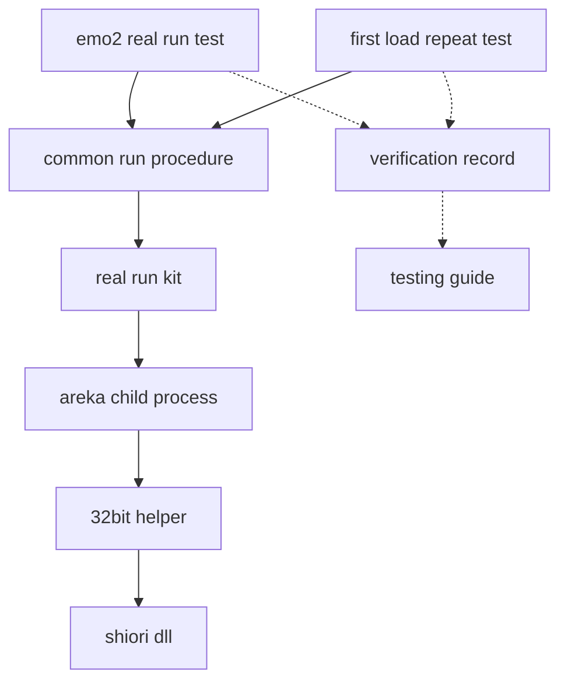
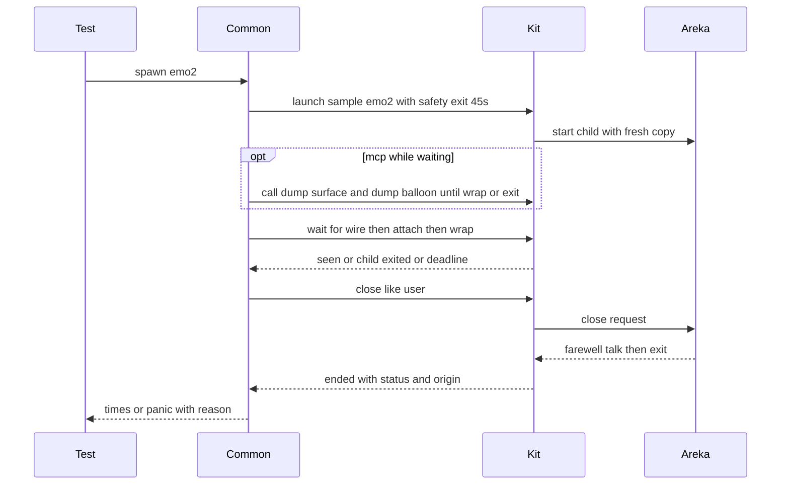
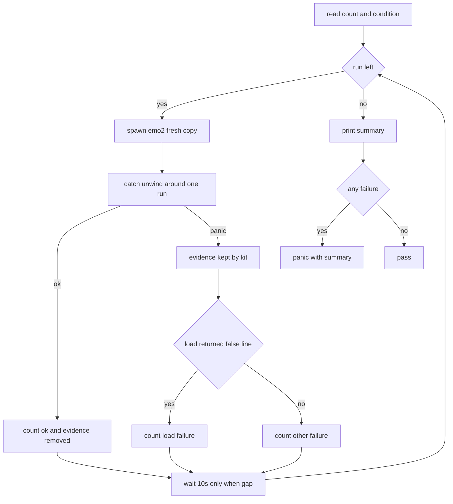

# 設計: areka-P0-emo2-real-run-stability

## Overview

**目的**: emo2 の実機の走行を、理由の分からない赤を混ぜない自動の試験の土台にする。件 1 では、明示したときだけ走る試験 `emo2_real_run` を「印を見てから利用者と同じ閉じ方で閉じる」形に直し、保険の自動終了の残り時間に頼らないようにする。件 2 では、件 1 で安定した 1 回の走りをくり返す試験を足し、新しい写しからの最初の LOAD の失敗の割合を数え、失敗した回の証拠を残し、原因を切り分けて閉じる。

**使う人**: 実機の確認を回す開発者と AI のエージェント。件 1 の試験は 1 本のコマンドで、くり返しは環境変数で回数と比べの条件を渡して 1 本のコマンドで回す。結果は試験が出す ASCII の 1 行と、この spec の記録の文書 `verification.md` に残る。

**変わること**: 試験の側（`crates/areka/tests/` の 2 本と共通の手続き 1 つ）・32bit の仲介の失敗の型 1 つ・試験用の DLL の失敗の注入・手引き `doc/testing.md` の節。実機の試験の窓口 `crates/real-run-kit/` には手を入れない。areka の本番の振る舞いは、調べの結果で要件 2.3 か 6.2 が掛かったときだけ変わる。

### Goals

- `emo2_real_run` が 200% の画面の debug 版でも、pasta の読み込みが遅い回でも、印の観測で待って利用者と同じ閉じ方で終わり、緑になる（要件 1・3）。
- 起動から各印までの時間と閉じるまでの時間を数字で残し、遅さが待ち方か装着そのものかを決める規則で切り分ける（要件 2）。
- 新しい写しからの最初の起動を 1 本のコマンドで N 回回し、成功・LOAD の失敗・ほかの失敗の数を出し、落ちた回の証拠だけを残す（要件 4・5.1〜5.3）。
- 仲介の LOAD の失敗の行に OS の最後のエラーを足す（要件 5.4・5.5）。
- 件 2 をどの閉じ方で閉じたかを根拠とともに残し、次に同じ赤が出たときの読み方を手引きに書く（要件 6・7）。

### Non-Goals

- 窓口 `real-run-kit` の部品を足すこと（「残す」の明示の呼び口・待つ間に呼ぶ待ち・くり返しの手続き）。
- 2 本の試験を常時のテスト（ふだんの `cargo test`・`tools/test-all.ps1`）で走らせること。
- pasta.dll の中の直し・emo2 の台本（別れの台詞の長さを含む）・折り返しの振る舞い。
- areka が LOAD を試し直すこと（要件 6.3 で禁じる）。
- 起動の引数で渡したゴーストの LOAD の失敗の伝え方（メッセージボックス・完了 `shiori-fault-notice`）。
- ウイルス対策・OS のセキュリティの設定・表示の拡大率を AI が変えること。

## Boundary Commitments

### This Spec Owns

- 件 1 の試験 `crates/areka/tests/emo2_real_run.rs` の待ち方・閉じ方・確かめ・頭の説明と人の目視の手順。
- 1 回の走りの共通の手続き `crates/areka/tests/emo2_real_run/common.rs`（印の綴り・保険の自動終了と締切の値・時間の測り・ASCII の 1 行・失敗の分けの規則）。
- くり返しの試験 `crates/areka/tests/emo2_first_load_repeat.rs`（明示の環境変数・比べの条件・回ごとの受け止め・まとめ・全体の成否）。
- 試験の環境変数 4 つの約束: `AREKA_EMO2_REAL_RUN`（今のまま）・`AREKA_EMO2_REPEAT`・`AREKA_EMO2_REPEAT_DROP`・`AREKA_EMO2_COMPAT_LAYER`。
- 32bit の仲介の失敗の型 `ProxyError::LoadReturnedFalse` に OS の最後のエラーを持たせることと、その値を固定する i686 の試験・試験用の DLL の注入。
- 記録の文書 `.kiro/specs/areka-P0-emo2-real-run-stability/verification.md` と、手引き `doc/testing.md` の emo2 の節。
- 条件つき: 要件 2.3（装着そのものの遅さ）と 6.2（areka の側で防げる原因）が掛かったときの直し。

### Out of Boundary

- `crates/real-run-kit/` の中身（公開の部品をそのまま使う。変えるなら別の spec か、この設計の改訂）。
- `areka.exe` の本番の起動・終了の振る舞い（上の条件つきの直しを除く）・印を出す記録の行の綴り。
- 32bit の仲介の記録の行の綴り（`[helper] LOAD 失敗（観測・ack[0]）: {e:?}` はそのまま。型の Debug の形だけが変わる）。
- pasta.dll・emo2.nar・ukadoc の意味論・SHIORI の約束。
- SHIORI の `load` に渡すフォルダのパスの形（効いていると分かったら `shiori4-api` へ渡すだけ＝要件 6.6）。
- 負荷の下のテストの揺れ（`areka-test-binary-stability`）。

### Allowed Dependencies

- 試験から: `real-run-kit` の公開の部品（`RealRun`・`Launch::Sample`・`Launch::SampleRoot`・`Run::{wait_for, call, close, wait_exit, output, stdout_path, stderr_path, run_dir}`・`Staged`・`Ended`・`EndedBy`・`McpError`）と標準ライブラリ（`std::panic::catch_unwind`・`std::time`）。新しいクレートは足さない。
- 仲介から: 既に使っている `windows` クレートの `Win32::Foundation::GetLastError`。試験用の DLL から: 同じクレートの `SetLastError`（機能 `Win32_Foundation` は既に在る）。
- 依存の向き: 試験のファイル → 共通の手続き → 窓口 → areka の実行ファイル（子のプロセス）。共通の手続きは試験のファイルを引かない。仲介と試験用の DLL は試験のファイルを知らない（環境変数だけで繋がる）。

### Revalidation Triggers

- 印の綴りの変更: `emo2-boot: 実 sink 結線が成立しました（wire 成立）`・`emo2 attach: 装着計画を実行`・`wrap=BudouxWordWrap`・`event="boot_talk"`・`[helper] LOAD 失敗（観測・ack[0]）: LoadReturnedFalse`・`[initialize_layout_root] Creating Monitor entity` の行の `dpi=`・`is_primary=`。
- 窓口の公開の部品の形の変更（特に「破棄の時に panic の途中なら残す」決まり）。
- emo2 の別れの台詞が伸びて「印までの最大＋閉じるまでの最大」が 35 秒を超えたとき（保険の自動終了の値を決め直す）。
- `ProxyError` の形の変更（手引きの読み方が変わる）。
- 要件 2.3 か 6.2 の直しで areka の本番の振る舞いが変わるとき（`mcp-kanade-tools` ほか、実機の走行に乗る spec が確かめ直す）。

## Architecture

### Existing Architecture Analysis

- 窓口は 1 回の走りの取っ手 `Run` を返す。締切（`deadline`）は待ちごとに始まりから数え、保険の自動終了（`safety_exit`）は子の起動から数える（子へ `AREKA_APP_SMOKE_EXIT_MS` で渡す）。
- 窓口は取っ手を捨てる時に、`std::thread::panicking()` が真なら回の置き場と検体の写しを残し「落ちた回の証拠を残しました: <場所>」を 1 行出し、偽なら消す。
- 今の件 1 の試験は保険の自動終了 3 秒で子が自分で終わるのを待ち（`wait_exit`）、終わった後に 3 つの印を探す。終わり方（`EndedBy`）は見ていない。
- 閉じる知らせから `app_exit` までは emo2 の別れの台詞で約 22 秒かかる。その途中で保険の自動終了が来ると、最初の終わり方は `Smoke`（`EndedBy::SafetyExit`）になる。
- 仲介は初期化の入口が 0 を返すと `ProxyError::LoadReturnedFalse`（中身なし）を返し、`[helper] LOAD 失敗（観測・ack[0]）: LoadReturnedFalse` を標準エラーへ出す。仲介の標準エラーは子の標準エラーに入る。

### Architecture Pattern & Boundary Map



- **選んだ形**: 試験の側だけで書く（調べの案 A）。1 回の走りを共通の手続き 1 つにし、件 1 とくり返しの 2 本がそれを引く。くり返しは標準の `catch_unwind` で回ごとに受け止め、回の取っ手を受け止めの内側で捨てる。これで窓口の「panic の途中なら残す」決まりがそのまま効き、窓口に手を入れずに落ちた回だけが残る。
- **分け目**: 印の綴り・時間の値・失敗の分けの規則は共通の手続きだけが持つ。環境変数の読みは各試験のファイルが持つ（`AREKA_EMO2_COMPAT_LAYER` だけは 1 回の走りの起こし方なので共通の手続き）。
- **残す決まり**: 窓口の「試験は panic で落とす」（`doc/testing.md`）・実機の根と写しは `target\` の下だけ・自分の子だけ止める。
- **steering との合い方**: 統合テストの共通の部品は `tests/<領域>/` の下に置き `#[path]` で引く（`structure.md`）。時刻は正確に扱う原則に合わせ、時間は丸めずミリ秒で出す。

### Technology Stack

| 層 | 選んだもの | この機能での役 | 備考 |
|---|---|---|---|
| 試験 | Rust の統合テスト（`crates/areka/tests/`）＋ `real-run-kit`（ワークスペースの版） | 子の起こし方・印の待ち・閉じ方・証拠 | 新しい依存なし |
| 試験 | `std::panic::catch_unwind`・`std::time::Instant` | 回ごとの受け止め・時間の測り | 標準ライブラリ |
| 32bit の仲介 | `windows` 0.62 系（既存）の `GetLastError` | LOAD の失敗の直後の OS の最後のエラー | 既に `main.rs` が使う |
| 試験用の DLL | `windows` 0.62 系（既存）の `SetLastError` | 失敗の注入で最後のエラーに 5 を置く | 機能の追加なし |
| 実機 | 開発機の主モニタ（既定 200%）・`__COMPAT_LAYER` | 200% と 100% 相当の確かめ | 互換モードは子にだけ渡す |

## File Structure Plan

### Directory Structure

```
crates/areka/tests/
├── emo2_real_run.rs                 # 件 1 の試験（明示の門・1 回の走り・時間の 1 行）。頭の説明と目視の手順を書き直す
├── emo2_first_load_repeat.rs        # 新規: くり返しの試験（明示の門・回数と条件・回ごとの受け止め・まとめ・全体の成否）
└── emo2_real_run/
    ├── common.rs                    # 新規: 1 回の走りの共通の手続き（印・値・起こし方・待ち・閉じ方・時間・分けの規則・比べの条件の型）
    └── common_tests.rs              # 新規: 共通の手続きの純粋な関数の試験（子を起こさない）
.kiro/specs/areka-P0-emo2-real-run-stability/
└── verification.md                  # 新規: 実機の確かめの記録（測り・確かめ・くり返しの数・閉じ方と根拠）
```

- `emo2_real_run/common.rs` は `tests/` の直下に置かない（直下のファイルは cargo が別の試験として建てる）。2 本の試験が `#[allow(dead_code)] #[path = "emo2_real_run/common.rs"] mod common;` で引く（片方でだけ使う関数の警告を抑える）。
- `common_tests.rs` は `common.rs` の中の `#[cfg(test)] #[path = "common_tests.rs"] mod tests;` で繋ぐ（`#[path]` は引いたファイルのフォルダを基準に解く）。2 本の試験の両方で走るが、純粋で短いので構わない。

### Modified Files

- `crates/areka/tests/emo2_real_run.rs` — `wait_exit` で待つ形を、共通の手続き（印を待つ → 利用者と同じ閉じ方で閉じる → 終わり方と終了コードを見る）に替える。頭の説明（1〜49 行目）と目視の手順（63〜116 行目）を新しい終わり方に合わせて書き直し、「自動 close で exit 0」「自動終了で終わる」の書き方を消す（1.9）。
- `crates/shiori-host32-helper/src/shiori_proxy.rs` — `ProxyError::LoadReturnedFalse` を `LoadReturnedFalse { last_error: u32 }` にし、`encode_alloc_and_load` で入口が 0 を返した直後に `GetLastError` を読む。型の説明に「約束のない手がかり」と書く。
- `crates/shiori-host32-helper/src/main_load_ack_tests.rs` — 失敗の型の並びの 1 つを新しい形にする。
- `crates/shiori-host32-helper/src/shiori_proxy_loadu_tests.rs` — 偽の返しの試験で `last_error == 5` を確かめる（i686 でだけ走る）。
- `crates/shiori-host32-testdll-loadu/src/lib.rs` — `HOST32_TESTDLL_LOADU_FAIL=1` のとき、`loadu` が 0 を返す直前に `SetLastError(ERROR_ACCESS_DENIED)`（5）を置く。頭の説明の注入の一覧に書き足す。
- `doc/testing.md` — 「実機の試験」の下に emo2 の節を足す（回し方・所要時間・証拠の場所と読む順・件 2 の結論と記録の場所＝要件 7）。
- 条件つき（要件 2.3・6.2 が掛かったときだけ）: 直す場所は調べの結果で決める。触る前に、この設計へ「直す場所・振る舞いの変わり方・確かめ方」の追補を書く。

## System Flows

### 1 回の走り（件 1 の試験とくり返しの各回）



- 待つ順は wire 成立 → 装着 → `wrap=BudouxWordWrap`。どれも窓口の `wait_for` で、見えた時の経過時間を取る。
- 印の前に子が終われば（`Err(ChildExited)`）、`wait_exit` で終わり方を取ってから panic する（1.7）。締切なら窓口が「待っていた印・待った時間・ファイルの場所」で panic する（1.6）。どちらも panic の途中で取っ手が捨てられ、証拠が残る。
- MCP を呼ぶ形（くり返しの基本の条件）では、`wrap` が見えるまで `dump_surface` と `dump_balloon` を 1 回ずつ呼び、0.5 秒あけて繰り返す。呼び出しが `ChildExited` を返したら輪を抜け、後の `wait_for` が終わりを報告する。輪は締切 120 秒を過ぎても抜ける。

### くり返し



- 起こすこと（`spawn_emo2`）は受け止めの外で呼ぶ。検体の写しが取れない・仲介が揃わないのは道具の故障で、どの回でも同じになるので、くり返しごと赤にする（窓口の panic の文のまま）。
- 分けは、受け止めた後に、前もって写しておいた出力のファイルの場所から読む（落ちた回は残っているので読める）。

## Requirements Traceability

| 要件 | 要約 | 部品 | 約束 | 流れ |
|---|---|---|---|---|
| 1.1 | wrap まで待って利用者と同じ閉じ方 | 共通の手続き・件 1 の試験 | `boot_and_close` | 1 回の走り |
| 1.2 | 利用者と同じ閉じ方・終了コード 0 | 共通の手続き | `Ended.by == UserClose`・`status.success()` | 1 回の走り |
| 1.3 | 保険の自動終了なら赤・その旨を書く | 共通の手続き | `EndedBy::SafetyExit` の失敗の文 | 1 回の走り |
| 1.4 | 3 つの印を保つ | 共通の手続き | `WIRE`・`ATTACH`・`WRAP` を順に待つ | 1 回の走り |
| 1.5 | 保険の自動終了＞測った和・＜締切 | 共通の手続き・記録 | `SAFETY_EXIT`＝45 秒・`DEADLINE`＝120 秒・定数の比べ | — |
| 1.6 | 締切で赤・印・時間・場所・証拠 | 窓口（そのまま） | `Run::wait_for` の panic | 1 回の走り |
| 1.7 | 印の前に終われば赤・終了コードと終わり方 | 共通の手続き | `wait_exit` で `Ended` を取って panic | 1 回の走り |
| 1.8 | 明示が無ければ素通り | 件 1 の試験 | `AREKA_EMO2_REAL_RUN` の門（今のまま） | — |
| 1.9 | 頭の説明と目視の手順の書き直し | 件 1 の試験 | — | — |
| 2.1 | 再現の確かめと時間の測り | 件 1 の試験・記録 | 時間の 1 行 `Times::line` | 確かめの手順 |
| 2.2 | 時間と結論を文書に | 記録 | 切り分けの規則 | 確かめの手順 |
| 2.3 | 装着そのものが遅ければ直して測り直す | 条件つきの直し・記録 | 追補で決める | 確かめの手順 |
| 2.4 | 延ばすだけの直しを採らない | 共通の手続き・記録 | 待ち方の変更と同時の値の変更だけ | — |
| 3.1 | 200% で 3 回以上緑 | 件 1 の試験・記録 | — | 確かめの手順 |
| 3.2 | 100% 相当で 3 回以上緑 | 件 1 の試験・共通の手続き・記録 | `AREKA_EMO2_COMPAT_LAYER`・`primary_dpi` | 確かめの手順 |
| 3.3 | 拡大・版・回数・結果・時間を文書に | 記録 | 時間の 1 行 | — |
| 4.1 | 1 つのコマンドで N 回 | くり返しの試験 | `AREKA_EMO2_REPEAT` | くり返し |
| 4.2 | 明示のときだけ・常時は素通り | くり返しの試験 | 門 | — |
| 4.3 | 毎回新しい写しの絶対パス | 窓口（そのまま） | `Launch::Sample` | くり返し |
| 4.4 | 基本の条件に取り合いの相手を含める | くり返しの試験・共通の手続き | 写した直後・前の回の直後・待つ間の MCP | くり返し |
| 4.5 | 基本の条件で 20 回以上 | 手引き・記録 | 回数の指定 | 確かめの手順 |
| 4.6 | 3 つに分けて数を出す | くり返しの試験・共通の手続き | `Outcome`・まとめの行・`is_load_returned_false` | くり返し |
| 4.7 | 各回で件 1 の確かめ | 共通の手続き | `boot_and_close` を同じく使う | くり返し |
| 4.8 | 失敗でも残りを続ける | くり返しの試験 | `catch_unwind` | くり返し |
| 5.1 | 落ちた回の写しと出力を回ごとに残す | 窓口（そのまま）・くり返しの試験 | 受け止めの内側で取っ手を捨てる | くり返し |
| 5.2 | 残した場所を示す | 窓口・くり返しの試験 | 窓口の 1 行＋まとめの行の `kept=` | くり返し |
| 5.3 | 成功の回は消す | 窓口（そのまま） | 破棄の時に panic の途中でなければ消す | くり返し |
| 5.4 | 仲介で拾える手がかりを調べて書く | 記録 | — | 確かめの手順 |
| 5.5 | 拾えるなら記録の行に足す | 32bit の仲介・試験用の DLL | `LoadReturnedFalse { last_error }` | — |
| 6.1 | 1 つずつ外した比べ | くり返しの試験・記録 | `AREKA_EMO2_REPEAT_DROP` | くり返し |
| 6.2 | areka で防げるなら防ぎ 0 回を示す | 条件つきの直し・くり返しの試験 | 追補で決める | 確かめの手順 |
| 6.3 | 外の原因なら根拠と申し送り | 記録 | 試し直しを入れない | 確かめの手順 |
| 6.4 | 切り替えで落ちて既定へ戻る場面の伝わり | 条件つきの試験・記録 | 切り替えの失敗の試験 | 確かめの手順 |
| 6.5 | 出なければ回数と条件を書いて閉じる | 記録 | — | 確かめの手順 |
| 6.6 | パスの形が効くなら `shiori4-api` へ | 記録 | — | 確かめの手順 |
| 6.7 | 閉じ方と根拠を書く | 記録 | — | 確かめの手順 |
| 7.1 | 回し方・回数・所要時間 | 手引き | — | — |
| 7.2 | 証拠の場所と読む順 | 手引き | — | — |
| 7.3 | 件 2 の結論と記録の場所 | 手引き | — | — |
| 8.1 | 置き場は `target\` の下だけ | 窓口（そのまま） | — | — |
| 8.2 | 絶対パスかつ短いパス | 窓口（そのまま） | — | — |
| 8.3 | 自分の子だけ止める | 窓口（そのまま） | — | — |
| 8.4 | 排他テストの机で 1 本ずつ | 確かめの手順・手引き | `doc/impl-watch.md` | 確かめの手順 |
| 8.5 | 回す前に回数と所要時間を示す | 確かめの手順・手引き | 所要時間の見込み | 確かめの手順 |
| 8.6 | セキュリティの設定を変えない | 確かめの手順・記録 | — | 確かめの手順 |

## Components and Interfaces

| 部品 | 層 | 役 | 要件 | 主な依存 | 約束 |
|---|---|---|---|---|---|
| 共通の手続き | 試験 | 1 回の走りを起こし、待ち、閉じ、確かめ、時間を返す | 1.1〜1.7・2.1・3.2・4.3・4.4・4.6・4.7 | 窓口（P0） | Service |
| 件 1 の試験 | 試験 | 明示のときだけ 1 回走り、時間の 1 行を出す | 1.8・1.9・2.1・3.1・3.2 | 共通の手続き（P0） | — |
| くり返しの試験 | 試験 | N 回を回し、分けて数え、まとめと全体の成否を出す | 4.1〜4.8・5.1〜5.3・6.1・6.2 | 共通の手続き（P0）・標準の受け止め（P0） | Batch |
| 仲介の手がかり | 32bit の仲介 | LOAD の失敗の行に OS の最後のエラーを載せる | 5.5 | `GetLastError`（P1） | State |
| 試験用の DLL の注入 | 試験用の DLL | 失敗の注入で最後のエラーを決まった値にする | 5.5 | `SetLastError`（P2） | — |
| 記録 | 文書 | 測り・確かめ・数・閉じ方と根拠 | 1.5・2.1〜2.4・3.3・4.5・5.4・6.1〜6.7・8.5・8.6 | 2 本の試験の出力（P0） | — |
| 手引き | 文書 | 回し方・証拠の読み方・結論の場所 | 7.1〜7.3・8.4・8.5 | 記録（P1） | — |
| 条件つきの切り替えの試験 | 試験 | 要件 6.4 が掛かったときだけ、切り替えで落ちて既定へ戻る場面を確かめる | 6.4 | 窓口（P0）・試験用の DLL（P0） | — |

### 試験の層

#### 共通の手続き（`crates/areka/tests/emo2_real_run/common.rs`）

| 項目 | 内容 |
|---|---|
| 役 | 新しい写しで emo2 を起こし、印を待ち、利用者と同じ閉じ方で閉じ、終わり方・終了コードを確かめ、時間を返す。失敗は panic |
| 要件 | 1.1〜1.7・2.1・3.2・4.3・4.4・4.6・4.7 |

**責務と制約**
- 印の綴り・保険の自動終了と締切の値・`RUST_LOG`・LOAD の失敗の綴りを、このファイルだけが持つ。
- 失敗は必ず panic で表す（`Result` を返して落とさない）。取っ手は `boot_and_close` の中で捨てるので、panic の途中で捨てられ、窓口が証拠を残す。
- 保険の自動終了は件 1 の直しでだけ変える。待ち方を変えずに値だけを延ばす変更はしない（2.4）。

**依存**
- Outbound: `real-run-kit` — 起こし方・待ち・呼び出し・閉じ方・証拠（P0）
- External: `areka.exe`（`env!("CARGO_BIN_EXE_areka")`）と i686 の仲介（窓口が揃える）（P0）

**Contracts**: Service [x]

##### Service Interface

```rust
/// 保険の自動終了。印までの最大（混んだ時間 6.82 秒）＋別れの台詞（約 22 秒）＝約 29 秒に余りを足した値（1.5）。
pub const SAFETY_EXIT: Duration = Duration::from_secs(45);
/// 締切（待ちごと）。
pub const DEADLINE: Duration = Duration::from_secs(120);
const _: () = assert!(SAFETY_EXIT.as_secs() < DEADLINE.as_secs());

pub const WIRE: &str = "emo2-boot: 実 sink 結線が成立しました（wire 成立）";
pub const ATTACH: &str = "emo2 attach: 装着計画を実行";
pub const WRAP: &str = "wrap=BudouxWordWrap";
/// 時間の切り分けにだけ使う（待たない）。
pub const BOOT_TALK: &str = "event=\"boot_talk\"";
pub const LOAD_RETURNED_FALSE: &str = "[helper] LOAD 失敗（観測・ack[0]）: LoadReturnedFalse";
/// `info,kanade=trace` に、主のモニタの DPI の行の出所の debug を足したもの。
pub const RUST_LOG: &str = "info,kanade=trace,wintf::ecs::layout::systems::monitor_systems=debug";
/// 子の `__COMPAT_LAYER` にだけ渡す値を受ける環境変数（100% 相当の確かめ）。
pub const COMPAT_LAYER_ENV: &str = "AREKA_EMO2_COMPAT_LAYER";

/// 起動から各印が見えるまで・閉じる知らせから終わるまでの時間。
pub struct Times {
    pub wire: Duration,
    pub attach: Duration,
    pub wrap: Duration,
    pub close: Duration,
    /// 記録の時刻で読んだ `BOOT_TALK` の行から `WRAP` の行まで。どちらかの行が無ければ None。
    pub talk_to_wrap: Option<Duration>,
    /// 主のモニタの DPI。行が無ければ None。
    pub primary_dpi: Option<u32>,
}

impl Times {
    /// ASCII の 1 行。例: `emo2: wire_ms=812 attach_ms=1540 wrap_ms=6260 close_ms=22104 talk_to_wrap_ms=310 primary_dpi=192`
    pub fn line(&self, who: &str) -> String;
}

/// 新しい写しで emo2 を起こす（`Launch::Sample { emo2, emo2-kakukaku }`・`SAFETY_EXIT`・`DEADLINE`・`RUST_LOG`）。
/// `COMPAT_LAYER_ENV` が空でなければ子にだけ `__COMPAT_LAYER` を渡す。`wait_after_copy` があれば
/// `before_spawn` の中でその時間だけ眠る。返す `Instant` は起こした直後。
pub fn spawn_emo2(wait_after_copy: Option<Duration>) -> (Run, Instant);

/// 印を順に待ち、利用者と同じ閉じ方で閉じ、終わり方と終了コードを確かめる。`run` はこの中で捨てる。
/// `mcp_while_waiting` が真なら、`WRAP` が見えるまで `dump_surface`・`dump_balloon` を呼び続ける。
///
/// # Panics
/// 印の前に子が終わった（終了コードと終わり方）・締切（窓口の文）・終わり方が利用者と同じ閉じ方でない
/// （保険の自動終了ならその旨）・終了コードが 0 でない・MCP の呼び出しが子の終わり以外で失敗した。
pub fn boot_and_close(run: Run, started: Instant, mcp_while_waiting: bool) -> Times;

/// 出力の中の `[initialize_layout_root] Creating Monitor entity` の行のうち `is_primary=true` の `dpi=` の値。
pub fn primary_dpi(output: &str) -> Option<u32>;
/// 2 つの綴りを含む最初の行どうしの、行頭の記録の時刻（`…THH:MM:SS.ffffff…`）の差。読めなければ None。
pub fn log_gap(output: &str, from: &str, to: &str) -> Option<Duration>;
/// 落ちた回の出力が「LOAD の失敗」か（`LOAD_RETURNED_FALSE` を含むか）。
pub fn is_load_returned_false(output: &str) -> bool;
```

- 事前条件: i686 の仲介が建ててある（無ければ窓口が建て方を添えて panic）。実表示のある機械。
- 事後条件: 戻れば、3 つの印が出て、利用者と同じ閉じ方で終了コード 0 で終わった。回の置き場は消えている。
- 不変条件: 待つ順は `WIRE` → `ATTACH` → `WRAP`。`BOOT_TALK` は待たない（行が無くても赤にしない）。

**Implementation Notes**
- 統合: `boot_and_close` の確かめの順は ⑴ 印を順に待つ（`Err(ChildExited)` なら `run.wait_exit()` の `Ended` を添えて panic）→ ⑵ `close()` の前後で時間を取る → ⑶ `by == EndedBy::UserClose`（`SafetyExit` なら「保険の自動終了（45 秒）で終わった」と書く）→ ⑷ `status.success()`。失敗の文には `run.output()` を添える。
- 検証: 純粋な関数 3 つ（`primary_dpi`・`log_gap`・`is_load_returned_false`）と条件の読み（`Condition::parse`・型はくり返しの試験の節に示すが、置き場はこのファイル）は `common_tests.rs` で固定する。
- 危うさ: MCP を呼ぶ形では、wire と装着の時間は呼び出しの間隔ぶん粗くなる（くり返しの時間は参考で、測りは件 1 の試験で取る）。

#### 件 1 の試験（`crates/areka/tests/emo2_real_run.rs`）

- 門: `AREKA_EMO2_REAL_RUN` が無い・空・空白だけ・UTF-8 でないなら、子を起こさず素通り（今のまま・1.8）。
- 本体: `let (run, started) = common::spawn_emo2(None); let times = common::boot_and_close(run, started, false); eprintln!("{}", times.line("emo2_real_run"));`
- 書き直す説明（1.9）: 「印 `wrap=BudouxWordWrap` を見てから利用者と同じ閉じ方で閉じ、別れの台詞の後に終了コード 0 で終わることを見る。保険の自動終了 45 秒は閉じ方が働かなかったときに子を残さないためだけ」。目視の手順は、直接起こすときの有界の自動終了（`AREKA_APP_SMOKE_EXIT_MS=180000`）と、窓を閉じて別れの台詞を見ることを残し、`SAFETY_EXIT` を「自動 close」と呼ぶ書き方を消す。時間の 1 行の読み方と 100% 相当の回し方（`AREKA_EMO2_COMPAT_LAYER`）を足す。

#### くり返しの試験（`crates/areka/tests/emo2_first_load_repeat.rs`）

| 項目 | 内容 |
|---|---|
| 役 | 新しい写しからの最初の起動を N 回回し、成功・LOAD の失敗・ほかの失敗を数え、まとめと全体の成否を出す |
| 要件 | 4.1〜4.8・5.1〜5.3・6.1・6.2 |

**Contracts**: Batch [x]

##### Batch / Job Contract

- **きっかけ**: `AREKA_EMO2_REPEAT=<回数>` を置いて `cargo test -p areka --test emo2_first_load_repeat -- --nocapture`。無い・空・空白だけなら子を起こさず素通り（4.2）。数でない・0 なら理由を書いて赤。
- **入力**:
  - `AREKA_EMO2_REPEAT_DROP`: 無い・空＝基本の条件。`gap`＝前の回の終わりから次の起動まで 10 秒あける。`copy-wait`＝写しを取った後 10 秒待ってから起こす。`no-mcp`＝待つ間の MCP の呼び出しを止める。ほかの値は理由を書いて赤。
  - `AREKA_EMO2_COMPAT_LAYER`: 共通の手続きが読む（くり返しでは普通は使わない）。

次の 2 つの型と値は、純粋な試験から引けるように共通の手続き（`common.rs`）に置く。くり返しの試験のファイルは読んで使うだけ。

```rust
pub enum Condition { Basic, Gap, CopyWait, NoMcp }
impl Condition {
    /// 空・空白だけ＝Basic。知らない値は Err（理由の文）。
    pub fn parse(value: &str) -> Result<Condition, String>;
}
/// 比べの条件の待つ長さ（固定）。
pub const DROP_WAIT: Duration = Duration::from_secs(10);
pub enum Outcome { Ok, LoadFailed, OtherFailed }
```

- 基本の条件（4.4）: 写しを取った直後に起こす（待たない）・前の回の子が終わった直後に次の回を起こす（あけない）・待つ間に試験のプロセス（子と別のプロセス）から MCP で面とバルーンを読む。
- **1 回の処理**: `spawn_emo2`（`CopyWait` なら `Some(DROP_WAIT)`）→ 出力の 2 つのファイルの場所と回の置き場の場所を写しておく → `catch_unwind(AssertUnwindSafe(move || boot_and_close(run, started, condition != NoMcp)))` → `Ok` なら成功、`Err` なら写しておいたファイルを読んで `is_load_returned_false` で分ける → `Gap` なら 10 秒あける。
- **出力**（ASCII・標準エラー）: 各回 `run=<i>/<N> outcome=<ok|load_failed|other_failed>` と、成功の回は `Times::line`、落ちた回は `kept=<回の置き場>`。最後に `emo2_first_load_repeat: condition=<basic|gap|copy-wait|no-mcp> runs=<N> ok=<a> load_failed=<b> other_failed=<c>`（4.6・5.2）。
- **全体の成否**: 全部の回を回した後、落ちた回が 1 回でもあれば、まとめの行と落ちた回の一覧を失敗の文にして panic（赤）。無ければ緑。
- **冪等と立ち直り**: 回ごとに新しい写しと新しい置き場（窓口）。成功の回は消え、落ちた回は `target\test-roots\areka-rr-<番号>-<連番>\` に残る（5.1・5.3）。回し直しは前の結果を消さない。

**Implementation Notes**
- 統合: `spawn_emo2` は受け止めの外で呼ぶ（道具の故障はくり返しごと赤）。
- 検証: 純粋な部分は `common_tests.rs`。実機の振る舞いは確かめの手順で回す（常時のテストでは素通り）。
- 危うさ: 既定の panic の知らせが各回の失敗の文を標準エラーへ出す。cargo の取り込みで隠れるので `-- --nocapture` を付ける。

### 32bit の仲介の層

#### 仲介の手がかり（`crates/shiori-host32-helper/src/shiori_proxy.rs`）

| 項目 | 内容 |
|---|---|
| 役 | 初期化の入口が 0 を返したとき、その直後の OS の最後のエラーを失敗の型に載せる |
| 要件 | 5.5 |

**Contracts**: State [x]

##### State Management

```rust
pub enum ProxyError {
    LoadLibraryFailed(windows::core::Error),
    EntryNotFound(&'static str),
    EncodingFailed,
    /// 初期化の入口（`loadu`／`load`）が 0 を返した。`last_error` は返った直後に読んだ OS の最後のエラー。
    /// SHIORI の約束に「失敗したら最後のエラーを置く」は無いので、DLL の中の最後の呼び出しの結果が
    /// 残っていれば読める、という約束のない手がかり（0 や無関係の値もありうる）。
    LoadReturnedFalse { last_error: u32 },
    RequestFailed,
}
```

- 読む時: `entry.func()(hdir, len)` が返った直後、`ret == 0` を見てすぐ、ほかの関数（`eprintln!`・`FreeLibrary`）より前。
- 記録の行: `main.rs` の `[helper] LOAD 失敗（観測・ack[0]）: {e:?}` は変えない。出る形は `LoadReturnedFalse { last_error: 5 }`。
- 影響: `load_result_to_ack` は形に依らず ack 0（変わらない）。`main_load_ack_tests.rs` の並び・`shiori_proxy_loadu_tests.rs` の照合を新しい形にする。

#### 試験用の DLL の注入（`crates/shiori-host32-testdll-loadu/src/lib.rs`）

- `HOST32_TESTDLL_LOADU_FAIL=1` のとき、`loadu` は記録を書いた後、0 を返す直前に `SetLastError(ERROR_ACCESS_DENIED)` を置く。本番の仲介は読まない注入の一覧（頭の説明）に書き足す。
- `shiori_proxy_loadu_tests.rs` の偽の返しの試験が `Err(ProxyError::LoadReturnedFalse { last_error: 5 })` を確かめる（i686 でだけ走る・x64 では今の試験と同じく外す）。

### 文書の層

#### 記録（`.kiro/specs/areka-P0-emo2-real-run-stability/verification.md`）

節の並び（日本語・平易な語）:

1. **件 1 の再現**: 直す前の試験を 200% の debug 版で回した回数と結果（2.1）。
2. **件 1 の測りと切り分け**: 時間の 1 行の値（各回）・最大・結論（2.2）。切り分けの規則は下の「確かめの手順」。2.3 が掛かったら直した後の値も同じ節に（2.3）。
3. **保険の自動終了の値の確かめ**: 「印までの最大＋閉じるまでの最大」と 45 秒の比べ（1.5）。
4. **200% と 100% 相当の確かめ**: 拡大・作り方（互換モードの値か、開発者が拡大率を替えたか）・版（debug）・回数・結果・`wrap_ms`・`primary_dpi`（3.1〜3.3）。
5. **仲介で拾える手がかり**: 調べた結果（`LoadReturnedFalse` だけだったこと・`HRESULT(0x80004005)` は areka.exe の終了コード 1 の決まった値で仲介の手がかりでないこと・OS の最後のエラーを足したこととその限り）（5.4）。
6. **くり返しの結果**: 条件ごとの回数・各々の数・落ちた回の置き場と読んだこと（4.5・6.1）。回す前に示した回数と所要時間の見込み（8.5）。
7. **閉じ方と根拠**: 防いだ・外の原因として記録した・再現しないとして記録した、のどれか（6.2・6.3・6.5・6.7）。外の原因で DLL の中なら申し送り（起きた順・OS のエラー・直す場所の見立て）。パスの形が効いていれば `shiori4-api` へ渡したこと（6.6）。6.4 が掛かればその確かめ。セキュリティの設定を変えていないこと（8.6）。

#### 手引き（`doc/testing.md` の「emo2 の実機の試験とくり返し」の節）

- 回し方（7.1）: 件 1 の試験のコマンド・3 回続けて回す形・100% 相当（`AREKA_EMO2_COMPAT_LAYER`）・くり返しのコマンド（基本の条件は 20 回以上・比べの条件の 3 つ）・`-- --nocapture` を付けること・所要時間の見込み（1 回 約 30 秒・20 回 約 10〜12 分・`gap` は 1 回あたり 10 秒ずつ増える）・排他テストの机を借りること（`doc/impl-watch.md`）。
- 証拠の場所と読む順（7.2）: ⑴ まとめの行の `kept=` か「落ちた回の証拠を残しました」の場所 → ⑵ `stderr.log` の `[helper]` の行（`SHIORI 初期化の入口`・`LOAD 失敗` と `last_error` の値。値は約束のない手がかりで、5＝アクセス拒否・32＝共有違反なら取り合いを疑う）→ ⑶ `stdout.log` の `event="connect_failed"` と前後 → ⑷ `sample\ghost\emo2\ghost\master\profile\pasta\logs\` の SHIORI 自身の記録。「落ちた回の検体の写しを複写できませんでした」の行が出ていれば ⑷ は欠けている。
- 件 2 の結論と記録の場所（7.3）: 閉じ方の 1 文と `verification.md` の場所（spec を `completed/` へ移すときは完了の手順が場所を直す）。

### 条件つきの部品

- **装着そのものの遅さの直し（2.3）**: 切り分けの規則で「装着そのもの」と出たときだけ。直す場所を決めて設計の追補を書いてから直し、同じ条件で測り直して記録に書く。
- **areka の側で防ぐ直し（6.2）**: 比べで原因が areka の側と分かったときだけ。設計の追補を書いてから直し、失敗が再現した条件で同じ回数くり返して LOAD の失敗 0 回を示す。LOAD の試し直しは入れない（6.3）。
- **切り替えの失敗の試験（6.4）**: 原因が areka の外で、入れたばかりのゴーストの最初の LOAD の失敗が残るときだけ。くり返しの試験のファイルに、別の環境変数で明示したときだけ走る試験を 1 本足す。形: `Launch::SampleRoot { name: "emo2" }` で起こし、`before_spawn` で emo2 のゴーストのフォルダを別の名前で写し、その SHIORI を `shiori_loadu.dll`（`staged.ensure_i686`）に替え、子に `HOST32_TESTDLL_LOADU_FAIL=1` を渡す → MCP の `sakurascript` でそのゴーストへ切り替える → 既定ゴーストへ戻って OnBoot（Reference6＝`halt`）の台詞が流れたことを記録の行と `dump_balloon` で確かめる → 利用者と同じ閉じ方で閉じる。起動の引数で渡したゴーストの伝え方（メッセージボックス）には触らない。

## Data Models

### Domain Model

- **走り**: 1 回の起動から終わりまで。結果は `Outcome`（成功・LOAD の失敗・ほかの失敗）と、成功なら `Times`。
- **くり返し**: 条件（`Condition`）1 つと回数 N。結果は各々の数と落ちた回の置き場の一覧。
- **規則**:
  - 成功＝3 つの印が出て、利用者と同じ閉じ方で、終了コード 0。
  - LOAD の失敗＝落ちた回で、出力に `LOAD_RETURNED_FALSE` の綴りが在る。ほかの落ちた回はすべてほかの失敗（`event="connect_failed"` だけ・`LoadLibraryFailed` などはほかの失敗）。
  - 保険の自動終了 45 秒 ＜ 締切 120 秒（定数の比べで固定）。

### Data Contracts & Integration

時間の 1 行とまとめの行は ASCII の `名前=値` を空白で並べる形（読み手が grep で拾える）。時間はミリ秒の整数（丸めない）。値が無いものは `none`。

## Error Handling

### Error Strategy

| 起きること | 扱い | 文に書くこと |
|---|---|---|
| 締切までに印が出ない | 窓口の `wait_for` が panic（1.6） | 待っていた印・待った時間・出力のファイルの場所と末尾 |
| 印の前に子が終わった | `wait_exit` で終わり方を取って panic（1.7） | 待っていた印・終了コード・終わり方 |
| 保険の自動終了で終わった | panic（1.3） | 「保険の自動終了（45 秒）で終わった」・出力 |
| 利用者と同じ閉じ方で終わったが終了コードが 0 でない | panic（1.2） | 終了コード・出力 |
| MCP の呼び出しが子の終わり以外で失敗 | panic（ほかの失敗） | 窓口の `McpError` の文・出力 |
| 閉じる知らせで締切までに終わらない | 窓口の `close` が子を止めて panic | 窓口の文 |
| 環境変数の値が読めない | 子を起こさずに panic | 変数の名前・値・受ける値の一覧 |
| 写しが取れない・仲介が揃わない | 窓口の panic（くり返しごと赤） | 窓口の文 |
| 落ちた回の写しの複写の失敗 | 窓口が 1 行出し、置き場は残す（今のまま） | 窓口の文 |

### Monitoring

- 走りごとの時間の 1 行と、くり返しのまとめの行が標準エラーに出る。数字は `verification.md` へ写す。
- 仲介の `LOAD 失敗` の行に `last_error` が乗る。

## Testing Strategy

### 純粋な関数の試験（常時のテストで走る・子を起こさない・`common_tests.rs`）

- `primary_dpi`: 主と主でないモニタの 2 行から主の `dpi=192` を取る。行が無ければ None。
- `log_gap`: 2 行の時刻の差を取る（例 `…T13:18:16.000100Z` → `…T13:18:16.310100Z` で 310 ミリ秒）。片方の行が無い・時刻が読めなければ None。
- `is_load_returned_false`: `LoadReturnedFalse { last_error: 5 }` の行で真。`LoadLibraryFailed(..)` の `LOAD 失敗` の行と `event="connect_failed"` だけの出力で偽。
- `Condition::parse`: 空・空白＝Basic、3 つの値、知らない値は Err。

### 仲介の試験（i686 でだけ走る）

- 偽の返しの注入で `Err(ProxyError::LoadReturnedFalse { last_error: 5 })`、記録は `loadu` の 1 行だけ（今の確かめを保つ）。
- `main_load_ack_tests.rs`: 新しい形の `LoadReturnedFalse` も ack 0。

### 明示したときだけ走る実機の試験（確かめの手順で回す）

- 件 1: 200% の debug 版で 3 回以上緑・100% 相当で 3 回以上緑。時間の 1 行で `primary_dpi` と `wrap_ms` を見る。
- くり返し: 基本の条件で 20 回以上。LOAD の失敗が出たら比べの 3 条件を同じ回数ずつ。
- 常時のテストで素通りすること: 環境変数の無い `cargo test -p areka` で 2 本とも子を起こさずに終わる（今の件 1 の門と同じ形）。

## 確かめの手順（実装の段で回す順）

1. **机**: 実機の走行の間は排他テストの机を借りる（`doc/impl-watch.md`）。負荷の走行と重ねない（8.4）。
2. **件 1 の再現（2.1）**: 直す前の試験（保険の自動終了 3 秒の形）を 200% の debug 版で回し、赤が出るかを記録する。
3. **件 1 の直しと測り（2.1・2.2）**: 新しい形の試験を 200% の debug 版で回し、時間の 1 行を取る（混んだ時間の値も含める）。旧い形では閉じるまでの時間が取れないので、測りは新しい形で取る。
4. **切り分けの規則（2.2）**: 「areka 自身の時間」＝ `attach_ms` ＋ `talk_to_wrap_ms`、「SHIORI の読み込みの待ち」＝ `wrap_ms` − areka 自身の時間。areka 自身の時間が旧い保険の自動終了 3 秒を超えた回が在れば「装着そのもの」（2.3 へ）。超えなければ「待ち方」で、直しは待ち方の変更で足りる。
5. **値の確かめ（1.5）**: 「`wrap_ms` の最大＋`close_ms` の最大」が 35 秒以下なら 45 秒のまま。超えたら、その和＋10 秒以上・120 秒未満へ上げ、記録に書く。
6. **200% と 100% 相当（3.1〜3.3）**: 200% で 3 回続けて回す。続いて `AREKA_EMO2_COMPAT_LAYER` に互換モードの値（まず `DPIUNAWARE`、効かなければ `GDIDPISCALING DPIUNAWARE`）を置いて 3 回回し、`primary_dpi=96` を確かめる。96 にならなければ、確かめの間だけ開発者に表示の拡大率を 100% へ替えてもらって回す（AI は替えない）。
7. **くり返し（4.5・8.5）**: 回す前に回数と所要時間の見込みを示す。基本の条件で 20 回以上。
8. **比べ（6.1）**: LOAD の失敗が 1 回以上出たら、`gap`・`copy-wait`・`no-mcp` を基本と同じ回数ずつ回し、失敗の数を比べる。落ちた回の証拠を手引きの順で読む。
9. **閉じる（6.2〜6.7）**: 結果に応じて条件つきの部品を足すか、記録に根拠を書いて閉じる。ウイルス対策・OS のセキュリティの設定は変えない（8.6）。

## Performance & Scalability

- 1 回の走り: 印まで 約 3〜7 秒＋別れの台詞 約 22 秒＋写しと後片付け ＝ 約 30 秒。
- くり返し: 基本の条件 20 回で 約 10〜12 分。`gap` は 1 回あたり 10 秒・`copy-wait` も 10 秒ずつ増える。比べの 3 条件 × 20 回で さらに 約 35〜40 分。
- 件 1 の確かめ: 200% と 100% 相当で 3 回ずつ 約 3 分。
- MCP を呼ぶ形は `dump_surface` の画像の組み立てで CPU を使う（取り合いの相手として狙った負荷）。呼ぶ間隔は 0.5 秒。
