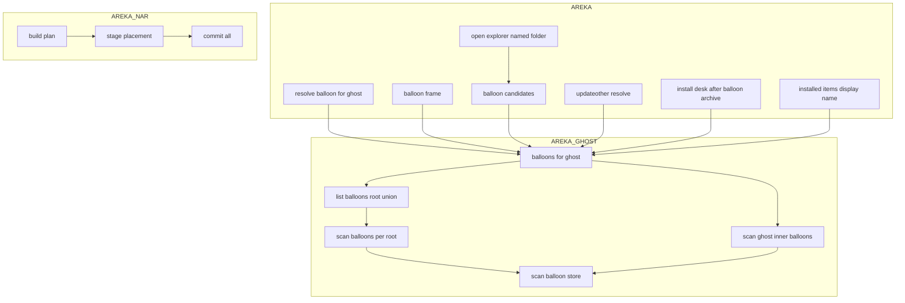
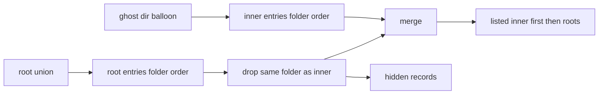
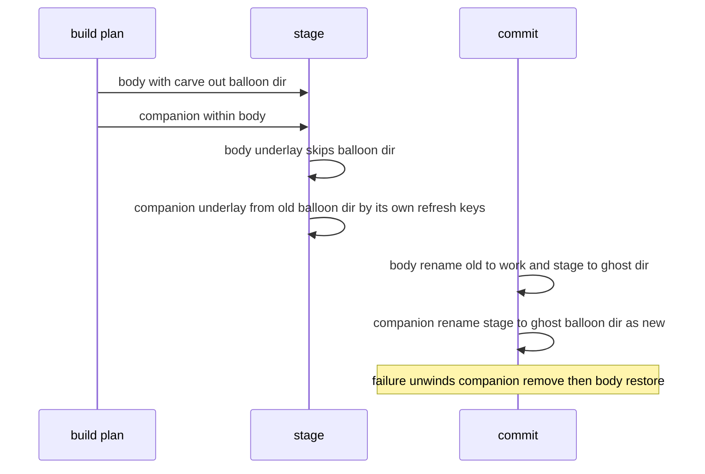

# 設計: areka-P0-ghost-inner-balloon

## Overview

**目的**: ゴーストのフォルダの中の `balloon\<フォルダ名>\` に置いたバルーンを、そのゴーストが根の置き場のバルーンと同じように使える（選べる・覚えられる・戻れる）ようにする。ゴーストの書庫とシェルの書庫の同梱のバルーンは、根の置き場でなく、入れるゴーストの中の `balloon\` へ入れる。

**使う人**: ゴーストの作者は、専用のバルーンを 1 つの書庫でゴーストと一体で配れる。利用者は、ゴーストの中のバルーンをメニュー・`\![change,balloon,バルーン名]`・記憶で根の置き場のバルーンと同じに扱え、他のゴーストのメニューは散らからない。

**変わること**: バルーンの候補の一覧を「今のゴーストの中の `balloon\` → 根の置き場の和」の順に合わせる口を 1 つ足し、一覧を引く 6 か所をこの口へ替える。インストールでは、同梱のバルーンの宛先を `<ゴースト>\balloon\<balloon.directory の値>` へ替え、本体（ゴースト）の入れ替えとの順を直す。ukadoc に無い areka 独自の決まりなので、`doc/COMPAT_ARCHITECTURE.md` §8 と `dist/README.txt` に書く。

### Goals

- ゴーストの中の `balloon\` の直下のバルーンが、起動・ゴースト切替・メニュー・`\![change,balloon,…]`・その他の更新・`\![open,explorer,…]`・記憶・読み直しのすべてで、そのゴーストにだけ候補として見える。
- 同じフォルダ名・同じ `name` は、ゴーストの中が勝つ。根の置き場のものはそのゴーストでだけ隠れ、隠れたことが記録に残る。
- 同梱のバルーンがゴーストの中へ入り、根の置き場の同じフォルダ名には一切触らない。`refresh,1` のゴーストを上書きしても巻き戻らない。
- 今のゴーストの中にバルーンが無いとき、答えは本 spec の前と 1 つも変わらない。

### Non-Goals

- 根の置き場のバルーンの扱い・バルーンだけの書庫の入れ先・記憶の形・段の並び・引数で渡したバルーンの扱い（どれも変更 0）。
- ゴーストのフォルダの直下や `balloon\<名>\` のさらに下を探すこと。シェルのフォルダの中のバルーン。
- 以前に根の置き場へ入れた同梱のバルーンを移す・消すこと。ゴーストを削除する操作を作ること。
- 使用中のファイルへの上書きの扱い（`areka-P0-install-live-target-hazards`）。シェルに紐づくバルーン（`areka-P0-shell-companion-balloon`）。

## Boundary Commitments

### This Spec Owns

- ゴーストの中の `balloon\` の走査と、根の置き場の和との合わせ方（並び・同じフォルダ名の隠れ・隠れの控え）＝`areka-ghost` の 1 つの口 `balloons_for`。
- バルーンの候補の一覧を引く 6 か所（起動とゴースト切替の 1 か所・メニュー・切替の候補・`\![open,explorer,…]`・その他の更新・インストールの後の表示名）を、この口へ替えること。
- 「ゴーストの中が根を隠した」記録（起動とゴースト切替のとき）と、「バルーンだけの書庫で入れたものが今のゴーストで隠れる」記録。
- 同梱のバルーンの宛先（ゴーストの書庫・シェルの書庫）と、ゴーストの書庫で本体と同梱が入れ子になったときの組み上げと確定の順（`areka-nar`）。
- §8 の新しい行・古くなった記述の直し・`dist/README.txt` の作者向けの説明。

### Out of Boundary

- 根の置き場の一覧（`list_balloons`・`find_balloon`・`survey`・`install_root`）の答え。どれも変えない。インストールの宛先の判断と根どうしの隠れの記録は、今どおり根だけの口を使う。
- 段の並び・各段の突き合わせ方（`resolve_balloon` の本体）・「当たらなかった」記録の形・`NoBalloon` の告知。
- 記憶（`areka.last.balloon`）の形と読み書き。
- `install.txt` の鍵の意味（`balloon.directory`・`balloon.source.directory`・`balloon.refresh`・`balloon.refreshundeletemask` と番号付きの形）。
- ネットワーク更新の仕組み（`areka-update`）。ゴーストの中の `balloon\` は、ゴーストの他のファイルと同じに更新の一覧で替わる。
- 使用中のゴーストの中のバルーンへの上書きの安全（`install-live-target-hazards`）。

### Allowed Dependencies

- `areka-ghost`（`catalog.rs`・`catalog_roots.rs`）は、今どおり `areka-parsers` だけに依る。記憶・解決順・`areka-nar` を知らない。
- `areka`（起動・切替・メニュー・開く・更新・インストールの側）は `areka-ghost` の `balloons_for` を呼ぶ。一覧を自前で走査しない。
- `areka-nar` は `areka-ghost` に依らない（今どおり）。同梱の宛先は計画の中で本体の宛先から組み、`InstallRoots::balloon_root` を同梱のために呼ばない。
- 依存の向き: `areka-parsers` → `areka-ghost` → `areka`、`areka-nar` → `areka`。逆向きの依存を足さない。新しい外部の依存は 0。

### Revalidation Triggers

- `BalloonEntry` の `root` 欄の意味が広がる（ゴーストの中の項目ではゴーストのフォルダ）。`root` を「根」として読む新しい呼び手を足すときは確かめ直す。
- `balloons_for` の並び（ゴーストの中が先）を変えると、名前の同着（要件 3.3）とメニューの並び（要件 2.5）が変わる。
- `areka-nar` の `Placement` に 2 つの欄が足される。`install-live-target-hazards` は同じ `plan.rs`・`install.rs` を触るので、入れ子の配置（`within_body`）の確定の手を前提に組む。
- `shell-companion-balloon` は、シェルに紐づくバルーンを `balloons_for` の一覧と突き合わせる形で組む（ゴーストの中を指せるかはそちらで決める）。

## Architecture

### Existing Architecture Analysis

- 一覧: `catalog_roots::list_balloons(roots)` が根の並びを上から走査し（`union`）、同じフォルダ名（`fold_key`＝大文字小文字を区別しない）は上を残し、フォルダ名のバイト順に並べる。1 根の走査 `catalog::scan_balloons` は crate の中だけ。
- 決め方: `boot_resolve::resolve_balloon` は渡された一覧の項目の場所（`entry.dir`）をそのまま使う純粋な関数。`name` の引き方（`find_balloon_by_name`・`resolve_skin_target`・`skin_by_name`・`updateother`）はどれも「一覧の並びで最初」。
- 一覧を引く所は、起動とゴースト切替（`boot_config::resolve_balloon_for_ghost`）・メニュー・切替の候補（`balloon_candidates`）・`\![open,explorer,…]`・`updateother`・インストールの後の表示名の 6 か所。どこも今のゴーストのフォルダを手元に持つ。
- インストール: `areka-nar` は配置を全部組み上げ（宛先の在る・無いと下敷きをこの時に決める）、その後に配置の順で `rename` で入れ替え、途中の失敗は逆順に戻す。同梱は今 `request.roots.balloon_root(dir)` で根を尋ね、`<根>\balloon\<dir>` へ置く。`areka` の `CatalogDestinations::balloon_root` は、実行ファイルの隣の根の同じフォルダ名のバルーンを書ける根へ写す（`copied_root`）＝今は同梱が根の同名に触りうる。

### Architecture Pattern & Boundary Map



**決めたこと**:
- 形は gap 分析の案 C（走査は `catalog.rs` で根の走査と本体を共有し、合わせ方は `catalog_roots.rs` に 1 つの口として足す）。新しいファイルは 0（テストの兄弟ファイルを除く）。根の口は 1 行も変えない。
- 項目の出どころの欄は足さない。出どころを読む呼び手が無いため（並び・隠れの控えは合わせる口の中で済み、呼び手は場所 `dir` を使うだけ）。`root` 欄に、ゴーストの中の項目ではそのゴーストのフォルダを入れ、欄の説明を「走査した基のフォルダ」に直す。
- 名前の同着は「並びで最初」の今の決まりをそのまま使い、並びを「ゴーストの中が先」にするだけで要件 3.3 を満たす。`name` を引く 4 か所は変えない。
- インストールは gap 分析の形 A（本体の組み上げから同梱の宛先を外し、同梱は「無い所へ置く」1 手で確定）。

### Technology Stack

| 層 | 使うもの | この spec での役目 | 備考 |
|---|---|---|---|
| 目録 | `areka-ghost`（Rust 2024・既存） | ゴーストの中の走査と根の和との合わせ方 | 新しい依存 0 |
| 起動・実行中 | `areka`（既存） | 6 か所の一覧の差し替え・2 つの記録 | `tracing` の既存の形 |
| インストール | `areka-nar`（既存） | 同梱の宛先と入れ子の確定の順 | `std::fs::rename` の既存の手 |
| テスト | `temp-path-kit` の `TempPath::under_target`（既存） | 検体と一時フォルダをワークツリーの `target\` の下へ | 要件 10.2 |

## File Structure Plan

### Modified Files

**`crates/areka-ghost`**
- `src/catalog.rs` — `scan_balloons` の本体を `scan_balloon_store(store, base)` へ切り出し、`scan_ghost_balloons(ghost_dir)` を足す（`<ゴースト>\balloon\` を同じ判定で走査）。`BalloonEntry.root` の説明と頭の説明（走査する場所に `<ゴースト>\balloon\` を足す）を直す。
- `src/catalog_roots.rs` — `GhostBalloons` と `balloons_for(roots, ghost_dir)` を足す。頭の説明に「ゴーストの中との合わせ方もここ」を足す。
- `src/lib.rs` — `GhostBalloons` を `catalog_roots` の再輸出に並べる。
- `src/catalog_roots_ghost_balloon_tests.rs`（新・`catalog_roots.rs` の兄弟テスト・`#[cfg(test)] #[path]` で接続）— 走査と合わせ方の分かれ目。

**`crates/areka`（起動・切替）**
- `src/boot_config.rs` — `resolve_balloon_for_ghost` の一覧を `balloons_for` へ替え、`hidden` を `ghost_balloon_hides_root` で記録する。説明の「ゴーストのフォルダの中の `balloon/` は読まない」を直す。
- `src/boot_resolve.rs` — 説明と記録の文だけ直す（`BalloonInputs.listed`・`find_balloon_by_name` の「フォルダ名の昇順」→「ゴーストの中が先、それぞれフォルダ名の昇順」）。判断のコードは変えない。
- `src/boot_config_balloon_tests.rs` — `default_balloon_path_does_not_see_ghost_inner_balloon` を逆の答え（当たる）へ書き換え、起動の分かれ目を足す。
- `src/boot_resolve_balloon_tests.rs` — 名前の同着でゴーストの中が当たること（一覧の並びの約束）を足す。
- `src/emo2_boot/ghost_switch_balloon_tests.rs`・`src/emo2_boot/reload_skin_tests.rs`（または `ghost_switch_reload_tests.rs`）— 切替で入れ替わる・記憶する・読み直しで保たれることを足す。

**`crates/areka`（実行中の呼び手）**
- `src/emo2_boot/shell_balloon_resolve.rs` — `balloon_candidates(roots, ghost_dir)` に引数を足し `balloons_for` を使う。頭の説明の「フォルダ名（大文字小文字を区別）」と「バルーンは根の目録」を直す。
- `src/emo2_boot/shell_balloon_switch.rs` — 呼び出しに `&ctx.ghost_dir` を渡す（1 行）。
- `src/readme/opener.rs` — `named_folder` のバルーンの引き方に `&ctx.ghost_dir` を渡す（1 行）。
- `src/menu/balloon_frame.rs` — `balloons_for(&ctx.roots, &ctx.current.ghost.dir).listed` を並べる。頭の説明を直す。
- `src/update/desk.rs` — `updateother` のバルーンを `balloons_for(&here.roots, &here.ghost_dir).listed` で引く。説明を直す。
- 兄弟テスト: `shell_balloon_resolve_tests.rs`・`shell_balloon_switch_tests.rs`・`readme/opener_tests.rs`・`menu/balloon_frame_tests.rs`・`update/desk_resolve_tests.rs` に足す。

**`crates/areka-update`**
- `src/manifest_tests.rs` — コードは変えない。ゴーストの中の `balloon\<名>\` のパスが更新の一覧で通ることが固まっていなければ 1 本足す。

**`crates/areka`（インストールの側）**
- `src/install/procedure.rs` — `installed_items` の同梱の表示名を、入れた場所のゴースト（`element.path` の 2 段上）の `balloons_for` から引く。
- `src/install/desk.rs` — バルーンだけの書庫を入れた後、今のゴーストで `balloons_for` の `hidden` に入れたフォルダ名が在れば `installed_balloon_hidden_by_ghost` を記録する。
- 兄弟テスト: `install/procedure_tests.rs`・`procedure_skip_tests.rs`・`destination_tests.rs`・`desk_record_tests.rs` を直す・足す。

**`crates/areka-nar`**
- `src/plan.rs` — `companion_placement` の宛先を本体のゴーストのフォルダの下 `balloon\<dir>` へ替え、`root` を本体の根にする。ゴーストの書庫では、置く同梱の宛先を本体の下敷きから外す一覧（`carve_out`）を本体の配置に持たせ、本体の書庫の項目のうち同じ `balloon\<dir>\` の下のものを本体から除く。頭の説明の宛先の形の約束を直す。
- `src/install.rs` — `Placement` の 2 つの欄を読む: 本体の組み上げで `carve_out` を下敷きから外し、`within_body` の配置は確定で「無い所へ置く」1 手にする。
- 兄弟テスト: `plan_tests.rs`・`plan_roots_tests.rs`・`plan_source_path_tests.rs`・`install_commit_tests.rs`・`install_tests.rs`・`lib_tests.rs`・`lib_skip_tests.rs` を直し、入れ子の確定のテストを足す。

**文書**
- `doc/COMPAT_ARCHITECTURE.md` §8 — 370 行の行の書き直し（ゴーストの中を探す・古い「区別する」とテスト名の直し）・343 行の飛ばした同梱の置き場の綴り・新しい行（ゴーストの中のバルーン）・376 行の目録の説明への一言。
- `dist/README.txt` — メニューの「バルーン」の説明・「■ 置き場」・「■ .nar の入れ方」に作者向けの説明を足す。

## System Flows

### 一覧の合わせ方



- ゴーストの中どうしの同名は起きない（同じフォルダの直下）。根どうしの隠れは今の `union` の答えのまま（`hidden` には入れない）。
- `hidden` に入るのは「ゴーストの中が根を隠した」ものだけ。根どうしの隠れは今どおり起動時の `survey` が記録する。

### 同梱のバルーンが本体の中に入るときの確定（ゴーストの書庫）



- 本体の入れ替えの後、`<ゴースト>\balloon\<dir>` は必ず無い（下敷きからも書庫の項目からも外したため）。だから同梱は組み上げのときの在る・無いに関わらず「無い所へ置く」1 手で確定する。在ったら `rename` が失敗し、全体が今どおり巻き戻る（記録の無い失敗にならない）。
- 戻しは今の逆順のまま: 同梱を消す → 本体を戻す（戻した古い木には古い同梱が入っている）。
- シェルの書庫では、同梱の宛先 `<ゴースト>\balloon\<dir>` は本体 `<ゴースト>\shell\<名>` の下に無いので入れ子にならず、今の入れ替え（自分の在る・無い・下敷き）をそのまま使う。

## Requirements Traceability

| 要件 | 中身 | 部品 | 口 | 流れ |
|---|---|---|---|---|
| 1.1 | `balloon\` の直下を同じ決まりで数える | GhostBalloonScan | `scan_ghost_balloons` | 一覧の合わせ方 |
| 1.2 | それ以外の場所は数えない | GhostBalloonScan | `subdirs(<ゴースト>\balloon)` の 1 段だけ | — |
| 1.3 | 決まりを満たさないフォルダの記録 | GhostBalloonScan | `scan_balloon_store` の `catalog_type_not_balloon` | — |
| 1.4 | 引数で渡したゴースト | BootSwitchList | `resolve_balloon_for_ghost(.., ghost.dir, ..)` | — |
| 1.5 | ゴーストの中が無いときは今どおり | BalloonsFor | 内側 0 件なら `listed`＝`list_balloons` | — |
| 2.1 | すべての候補に入れる | BalloonsFor・RuntimeCallers | `balloons_for` を 6 か所で | — |
| 2.2 | 他のゴーストの候補に入れない | BalloonsFor | 引くたびに今のゴーストのフォルダで作る | — |
| 2.3 | 切替で入れ替える | BootSwitchList | 切替先の `ghost_dir` | — |
| 2.4 | 同じ一覧に並べて印 | RuntimeCallers（メニュー） | `skin_frame(.., listed, current.balloon.folder)` | — |
| 2.5 | ゴーストの中が先 | BalloonsFor | `listed` の並び | 一覧の合わせ方 |
| 3.1 | 同じフォルダ名はゴーストの中が勝つ | BalloonsFor | `fold_key` で根の項目を外す | 一覧の合わせ方 |
| 3.2 | 隠したことの記録 | BalloonsFor・BootSwitchList | `hidden`・`ghost_balloon_hides_root` | — |
| 3.3 | 同じ `name` はゴーストの中 | BalloonsFor | 並びで最初（4 つの引き方は変えない） | — |
| 3.4 | 別のゴーストでは根のものが見える | BalloonsFor | ゴーストごとに作る | — |
| 3.5 | バルーンだけの書庫が隠れる記録 | InstallDeskNotice | `installed_balloon_hidden_by_ghost` | — |
| 4.1 | 段の並びを変えず各段に含める | BootSwitchList | `BalloonInputs.listed` | — |
| 4.2 | `default.balloon.path` がゴーストの中に当たる | BootSwitchList | `find_balloon(listed, ..)` | — |
| 4.3 | 区切り入りの値は当たらない | BootSwitchList | フォルダ名の完全一致（変更 0） | — |
| 4.4 | 同梱の段も両方から探す | BootSwitchList | `find_balloon(listed, companion)` | — |
| 4.5 | 根が空でもゴーストの中から | BootSwitchList | `listed` が空でない | — |
| 4.6 | 切替も同じ並び | BootSwitchList | `ghost_switch` → `resolve_balloon_for_ghost` | — |
| 4.7 | 当たらなかった記録は今の形 | BootSwitchList | 事象名・欄・`balloon_store` は変えない | — |
| 5.1 | メニュー・タグで選んだら記憶 | RuntimeCallers | 今の切替の記憶（フォルダ名） | — |
| 5.2 | 起動・切替の成功で記憶 | BootSwitchList | 今の `record_last_balloon` | — |
| 5.3 | 記憶の形を変えない | — | 変更 0 | — |
| 5.4 | 記憶から同じバルーンへ | BootSwitchList | 記憶の段の `find_balloon` | — |
| 5.5 | どこにも無ければ記録して次へ | BootSwitchList | `last_balloon_not_found`（変更 0） | — |
| 5.6 | 前の記憶をそのまま読む | — | 変更 0 | — |
| 5.7 | 読み直しでゴーストの中のまま | ReloadCheck | `current_skin`（場所）・自分への切替（記憶） | — |
| 6.1 | 中が無ければ前と同じ | BalloonsFor | 内側 0 件なら根の答えそのまま | — |
| 6.2 | 根どうしの隠れと順 | BalloonsFor | `list_balloons` を中で呼ぶだけ | — |
| 6.3 | 引数のバルーン | — | 段 1 は変更 0 | — |
| 6.4 | 以前に根へ入れた同梱 | BalloonsFor・CompanionPlan | 根の一覧のまま・同梱は根を尋ねない | — |
| 7.1 | 同梱をゴーストの中へ | CompanionPlan | `companion_placement` の宛先 | 同梱の確定 |
| 7.2 | 鍵の意味を変えない | — | `manifest.rs` 変更 0 | — |
| 7.3 | 根の同名に触らない | CompanionPlan | `balloon_root` を同梱で呼ばない | — |
| 7.4 | バルーンだけの書庫は根へ | — | `body_placement` の `Balloon` 変更 0 | — |
| 7.5 | 名指しされない `balloon\<名>\` | CompanionPlan | 本体の項目（変更 0・ただし置く同梱と同じ名前の下は除く） | — |
| 7.6 | 入れた後の表示名 | InstalledItemsName | `balloons_for(.., ゴースト).listed` | — |
| 7.7 | 入れられないときは今と同じ | NestedCommit | 確定の失敗は全体の巻き戻し | 同梱の確定 |
| 7.8 | シェルの書庫の同梱 | CompanionPlan | 宛先 `<対象ゴースト>\balloon\<dir>` | — |
| 8.1 | 更新・上書きで一緒に替わる | NestedCommit | 本体の決まり・同梱は自分の `balloon.refresh` | 同梱の確定 |
| 8.2 | 以前のゴーストの上書き・更新 | CompanionPlan | 根を尋ねない・更新は一覧のファイルだけ | — |
| 8.3 | 今のゴーストの中のバルーンの更新 | — | `Here.balloon_dir`（場所・変更 0） | — |
| 8.4 | ゴーストが消えたら残らない | BalloonsFor | 走査するたびに作る | — |
| 8.5 | 更新で無くなったら次の段 | BootSwitchList | 記憶の段の記録（変更 0） | — |
| 9.1〜9.3 | §8 の書き直しと新しい行 | Docs | `doc/COMPAT_ARCHITECTURE.md` | — |
| 9.4・9.5 | README | Docs | `dist/README.txt` | — |
| 10.1 | 決定論のテスト | 全部品 | Testing Strategy | — |
| 10.2 | 検体は `target\` の下 | 全テスト | `TempPath::under_target` | — |
| 10.3 | 記録の無い失敗を作らない | GhostBalloonScan・NestedCommit | 既存の `warn!`・失敗の記録 | — |

## Components and Interfaces

| 部品 | 層 | 役目 | 要件 | 主な依存 | 契約 |
|---|---|---|---|---|---|
| GhostBalloonScan | areka-ghost catalog | ゴーストの中の `balloon\` を根と同じ判定で走査 | 1.1〜1.3・10.3 | `subdirs`・`read_descript`（P0） | Service |
| BalloonsFor | areka-ghost catalog_roots | ゴーストの中 → 根の和の順に合わせ、隠れを控える | 1.5・2.1〜2.5・3.1〜3.4・6.1・6.2・6.4・8.4 | GhostBalloonScan・`list_balloons`（P0） | Service |
| BootSwitchList | areka boot_config | 起動と切替の候補を `balloons_for` で作り、隠れを記録 | 1.4・2.3・3.2・4.1〜4.7・5.2・5.4・5.5・8.5 | BalloonsFor（P0）・`resolve_balloon`（P0） | Service |
| RuntimeCallers | areka（メニュー・切替・開く・更新） | 実行中の候補を今のゴーストで引く | 2.1・2.4・2.5・5.1 | BalloonsFor（P0） | Service |
| ReloadCheck | areka emo2_boot reload | 読み直しで同じバルーンのまま（変更 0・確かめだけ） | 5.7 | `current_skin`（P1） | — |
| InstallDeskNotice | areka install desk | バルーンだけの書庫が隠れることの記録 | 3.5 | BalloonsFor（P1） | Event |
| InstalledItemsName | areka install procedure | 同梱の表示名をゴーストの中から引く | 7.6 | BalloonsFor（P1） | Service |
| CompanionPlan | areka-nar plan | 同梱の宛先をゴーストの中へ・本体から外す | 6.4・7.1・7.3・7.5・7.8・8.2 | `existing_target_ghost`（P0） | Service |
| NestedCommit | areka-nar install | 入れ子の組み上げと確定の順 | 7.7・8.1・10.3 | `copy_existing`・`commit_one`（P0） | State |
| Docs | doc・dist | §8 と README | 9.1〜9.5 | — | — |

### areka-ghost

#### GhostBalloonScan

| 項目 | 中身 |
|---|---|
| 役目 | `<ゴースト>\balloon\` の直下を、根の `<根>\balloon\` と同じ判定で `BalloonEntry` にする |
| 要件 | 1.1・1.2・1.3・10.3 |

**責務と制約**
- 判定（descript.txt が読める・`type` が無いか `balloon`）・素性の作り方・記録（`catalog_type_not_balloon`・`subdirs` の読めない警告）は、根の走査と同じ 1 つの関数を通す。探す場所だけが違う。
- 直下 1 段だけ（`subdirs`）。`<ゴースト>\balloon\` そのもの・ゴーストのフォルダの直下・`balloon\<名>\` のさらに下は数えない。
- `<ゴースト>\balloon\` が無ければ 0 件（記録 0 件）。一時の置き場の印（`RootMark::Temporary`）は見ない（ゴーストのフォルダを直接受けるため、`--ghost` で渡したゴーストでも数える）。
- 作る項目の `root` は、そのゴーストのフォルダ。

**契約**: Service

```rust
// catalog.rs（crate の中だけ）
fn scan_balloon_store(store: &Path, base: &Path) -> Vec<BalloonEntry>; // 今の scan_balloons の本体
pub(crate) fn scan_balloons(root: &BasewareRoot) -> Vec<BalloonEntry>; // 一時の置き場は 0 件のまま・本体は scan_balloon_store(root.balloon_store(), root.dir())
pub(crate) fn scan_ghost_balloons(ghost_dir: &Path) -> Vec<BalloonEntry>; // scan_balloon_store(&ghost_dir.join("balloon"), ghost_dir)
```
- 事後条件: 返す項目はフォルダ名のバイト順。どの項目の `dir` も `<ghost_dir>\balloon\<フォルダ名>`。

#### BalloonsFor

| 項目 | 中身 |
|---|---|
| 役目 | 今のゴーストの候補の一覧と、ゴーストの中が根を隠した控えを返す 1 つの口 |
| 要件 | 1.5・2.1・2.2・2.3・2.5・3.1・3.3・3.4・6.1・6.2・6.4・8.4 |

**責務と制約**
- `listed` ＝ ゴーストの中の項目（フォルダ名のバイト順）→ 根の和 `list_balloons(roots)` のうち、ゴーストの中と `fold_key` が同じものを除いた残り（今の並びのまま）。
- `hidden` ＝ 除いた根の項目 1 つごとに `Hidden { kind: StoreKind::Balloon, folder: 根の項目のフォルダ名, hidden: 根の項目の dir, by: ゴーストの中の項目の dir }`。根どうしの隠れは入れない。
- 記録は残さない（呼び手が場面に合わせて残す）。メニューを出すたびに呼ばれても記録が増えない。
- ゴーストの中が 0 件なら `listed` は `list_balloons(roots)` と同じ・`hidden` は空（要件 6.1）。
- 保存しない。呼ぶたびに今のファイルの状態から作る（他のゴースト・消えたゴーストの物が残らない）。

**契約**: Service

```rust
// catalog_roots.rs
#[derive(Clone, Debug, PartialEq, Eq)]
pub struct GhostBalloons {
    /// ゴーストの中が先・根の和が後（それぞれフォルダ名のバイト順）。
    pub listed: Vec<BalloonEntry>,
    /// ゴーストの中が隠した根の項目だけ。
    pub hidden: Vec<Hidden>,
}

/// `ghost_dir` はゴーストのフォルダ（`ghost\master\descript.txt` を持つフォルダ）。
pub fn balloons_for(roots: &BasewareRoots, ghost_dir: &Path) -> GhostBalloons;
```
- 不変条件: `listed` にフォルダ名（`fold_key`）の重複は無い。`listed` の先頭からゴーストの中の項目が続き、その後に根の項目が続く。
- 根だけの口（`list_balloons`・`find_balloon`・`survey`・`install_root`）は変えない。インストールの宛先とバルーンだけの書庫の扱いはこちらを使い続ける。

### areka（起動と切替）

#### BootSwitchList

| 項目 | 中身 |
|---|---|
| 役目 | 起動・ゴースト切替（読み直しの自分への切替を含む）の候補を作り、ゴーストの中が根を隠したことを記録する |
| 要件 | 1.4・2.3・3.2・4.1〜4.7・5.2・5.4・5.5・8.5 |

**責務と制約**
- `resolve_balloon_for_ghost(roots, ghost_dir, pick)` の `listed` を `balloons_for(roots, ghost_dir).listed` に替える。記憶・descript の 2 鍵・同梱の読み方と `resolve_balloon` の段は変えない。
- `hidden` の 1 件ごとに info `ghost_balloon_hides_root`（`folder`・`hidden`＝外した根の場所・`by`＝ゴーストの中の場所）を残す。この関数は起動と切替でだけ呼ばれるので、記録はゴーストを起こすたびに 1 回になる。メニュー・タグ・開く・更新では残さない。
- 「当たらなかった」記録（`last_balloon_not_found`・`descript_balloon_not_found`・`companion_balloon_not_found`）と `NoBalloon` の告知の `balloon_store`／`balloon_stores` は、今どおり根の置き場の列だけを載せる（要件 4.7 の「今と同じ形」を欄の綴りまで守る）。ゴーストの中の置き場は、ゴーストのフォルダ（起動と切替の記録に出る）から一意に決まる。告知に載せないのは、利用者がバルーンを置く先は根の置き場で、ゴーストの中は作者の置き場だから。`NoBalloon` はゴーストの中も 0 件のときだけ起きる。
- `--ghost`・位置の引数のゴーストも同じ道（`ghost.dir` を渡す）を通る（要件 1.4）。引数のバルーン（段 1）は一覧を読まない（変更 0）。
- 説明と記録の文の直し: `boot_config.rs` の「ゴーストのフォルダの中の `balloon/` は読まない」・`boot_resolve.rs` の `BalloonInputs.listed`・`find_balloon_by_name` の「フォルダ名の昇順」。記録の文の「根に見つからない」は事象名と欄を変えずに「根にもゴーストの中にも見つからない」へ直す（文は形に入らない・事象名と欄が形）。

**契約**: Service（`resolve_balloon_for_ghost` の引数と戻りは変えない）

```rust
info!(event = "ghost_balloon_hides_root", folder, hidden = %path, by = %path,
      "[boot_config] ゴーストの中のバルーンが根の同じフォルダ名を隠した");
```

### areka（実行中の呼び手）

#### RuntimeCallers

| 項目 | 中身 |
|---|---|
| 役目 | 実行中に一覧を引く 4 か所を、今のゴーストのフォルダで `balloons_for` を呼ぶ形へ替える |
| 要件 | 2.1・2.4・2.5・5.1 |

| 呼び手 | 今 | 替えた後 | 今のゴーストのフォルダ |
|---|---|---|---|
| `emo2_boot/shell_balloon_resolve.rs` `balloon_candidates` | `list_balloons(roots)` | `balloon_candidates(roots, ghost_dir)` → `balloons_for(..).listed` | 引数 |
| `emo2_boot/shell_balloon_switch.rs`（`\![change,balloon,…]`・`random`・`lastinstalled`・メニューの選択） | `balloon_candidates(&ctx.roots)` | `balloon_candidates(&ctx.roots, &ctx.ghost_dir)` | `SwitchContext.ghost_dir` |
| `readme/opener.rs` `named_folder` | `balloon_candidates(root)` | `balloon_candidates(root, &ctx.ghost_dir)` | `OpenContext.ghost_dir` |
| `menu/balloon_frame.rs` | `list_balloons(&ctx.roots)` | `balloons_for(&ctx.roots, &ctx.current.ghost.dir).listed` | `BootContext.current.ghost.dir` |
| `update/desk.rs` `resolve`（`updateother`） | `list_balloons(&here.roots)` | `balloons_for(&here.roots, &here.ghost_dir).listed` | `Here.ghost_dir` |

- `name` の引き方（`resolve_skin_target`・`skin_by_name`・`updateother` の `find`）と今のものの印（`current.balloon.folder`）は変えない。並びで最初が当たるので、同じ `name` はゴーストの中が当たる（要件 3.3）。
- 切替の記憶（要件 5.1）は今の切替の道がフォルダ名を書くので、変更 0。
- `shell_balloon_resolve.rs` の頭の説明の「フォルダ名（大文字小文字を区別）」を「フォルダ名（`same_folder_name`＝区別しない・`name` は区別する）」へ、「バルーンは根の目録」を「今のゴーストの中と根の目録」へ直す（要件 9.2）。

#### ReloadCheck

- コードの変更は 0。`\![reload,balloon]`・MCP の読み直しは `reload.rs` の `current_skin` が今のバルーンの場所（`ctx.balloon_dir`）で組むので、ゴーストの中の場所のまま読み直す。ゴーストの読み直しは自分への切替で、記憶（フォルダ名）がゴーストの中の項目に当たる。両方をテストで確かめる（要件 5.7）。

### areka（インストールの側）

#### InstallDeskNotice

| 項目 | 中身 |
|---|---|
| 役目 | バルーンだけの書庫を根へ入れた直後、今のゴーストの中の同じフォルダ名に隠れるなら記録する |
| 要件 | 3.5 |

- `install/desk.rs` の `InstallKind::Balloon` の枝（今は `find_balloon(roots, &record.folder)` で引いて控えと記憶に書く所）の後に、`balloons_for(roots, &ctx.current.ghost.dir).hidden` から `same_folder_name(h.folder, record.folder)` のものを探し、在れば info `installed_balloon_hidden_by_ghost`（`folder`・`installed`＝`h.hidden`・`by`＝`h.by`）を 1 件残す。
- 控え（`lastinstalled`）と記憶（`remember_balloon`）の書き方は変えない（要件の討議の決め 1）。
- 起動の文脈が無いとき（根が無いとき）は今どおり何もしない。

**契約**: Event（記録 1 行）

#### InstalledItemsName

- `installed_items` の同梱（先頭より後のバルーン）の名前を、`element.path` の 2 段上（`<ゴースト>\balloon\<dir>` → `<ゴースト>`）を `ghost_dir` として `balloons_for(&facts.roots, ghost_dir).listed` からフォルダ名で引く。ゴーストの中が先なので、根の同じフォルダ名（別の版）の `name` を取らない。見つからない・`name` が無いときは今どおり `areka-nar` の名前（フォルダ名）（要件 7.6）。
- `OnInstallCompleteEx` の Reference2（入れた場所）は `element.path` のままで、ゴーストの中の場所になる（意図どおり）。`skipped_notice` と `installed_record` は変えない。

### areka-nar

#### CompanionPlan

| 項目 | 中身 |
|---|---|
| 役目 | 同梱のバルーンの宛先を、入れるゴーストの中の `balloon\<dir>` にする |
| 要件 | 6.4・7.1・7.3・7.5・7.8・8.2 |

**責務と制約**
- ゴーストの書庫: ゴーストのフォルダ＝本体の宛先 `<根>\ghost\<manifest.directory>`。シェルの書庫: ゴーストのフォルダ＝`existing_target_ghost` が確かめた `<根>\ghost\<対象>`。同梱の宛先＝`<ゴーストのフォルダ>\balloon\<companion.directory>`、`root`＝本体の根（作業の場所 `.nar-work` が同じ根になり、`rename` が同じボリュームで済む）。
- 同梱のために `request.roots.balloon_root` を呼ばない。これで `CatalogDestinations::copied_root` が根の同じフォルダ名のバルーンを写す道が無くなる（要件 7.3・8.2）。`balloon_root` はバルーンだけの書庫のために残す。
- ゴーストの書庫で置く同梱（飛ばした同梱は含めない）ごとに:
  - 本体の `accept` は、今の「取り出し元の中」に加えて、書庫の `balloon/<companion.directory>/` の下の項目も除く（名指しされた同梱が名指しされないフォルダより先＝同じ宛先の取り合いを起こさない）。warn `companion_overrides_archive_folder`（`directory`）は、この追加の除外で除いた項目のうち、**どの同梱の取り出し元の中にも無い**ものが 1 つでも在るときだけ 1 件残す。取り出し元がその `balloon/<dir>/` 自身の書庫（例 `balloon.source.directory,balloon/kaku`＋`balloon.directory,kaku`）は、項目が今の決まりで既に除かれているので警告しない。
  - 本体の配置の `carve_out` に `balloon\<companion.directory>` を足す。
  - 同梱の配置の `within_body` を真にする。
- 名指しされない `balloon\<名>\` は今どおり本体の項目としてゴーストの中へ入る（要件 7.5）。
- `companion.directory` は今どおり検証済みの 1 段の名前なので、宛先は根の外へ出ない。`plan.rs` の頭の説明の宛先の形の約束を「`root.join("ghost"|"balloon").join(名)`、またはそのゴーストの宛先の下の `shell\<名>`・`balloon\<名>`」へ直す。「全ての宛先が根の下」の兄弟テストはそのまま通る。

**契約**: Service

```rust
pub(crate) struct Placement {
    // 既存: kind, name, root, destination, target_ghost, existing,
    //       skip_top_level_install_txt, files, dirs
    /// 本体の下敷きから外す相対のフォルダ（ゴーストの書庫の本体だけ・例 "balloon\\kaku"）。
    pub carve_out: Vec<String>,
    /// 宛先が先に確定する本体の宛先の下に在る（ゴーストの書庫の同梱）。
    pub within_body: bool,
}
fn companion_placement(companion: &Companion, names: &[EntryName], body: &Placement, ghost_dir: &Path)
    -> Option<Placement>;
```

#### NestedCommit

| 項目 | 中身 |
|---|---|
| 役目 | 入れ子の配置を、`refresh,1` でも巻き戻さずに入れ、失敗は今どおり全体を戻す |
| 要件 | 7.7・8.1・10.3 |

**状態の扱い**
- 組み上げ: 本体の下敷き（`Overlay`＝古い木を丸ごと・`Replace{keep}`＝残す名前だけ）を写すとき、`carve_out` の相対のフォルダの下は写さない。比べ方は今の残す名前の比べ方と同じ（ASCII の大文字小文字を区別しない）。同梱の組み上げは今どおり、古い `<ゴースト>\balloon\<dir>` を見て自分の `balloon.refresh`・`balloon.refreshundeletemask` で下敷きを作り、`ExistingState`（新しい・重ねた・入れ替えた）を決める。
- 確定: `within_body` の配置は、組み上げのときの `ExistingState` に関わらず「無い所へ置く」1 手（親を作る → `rename(stage, dest)` → 戻しの手は「消す」）。`ExistingState` は入れた物の報告にそのまま使う。
- 戻し: 今の逆順のまま。同梱を消す → 本体を戻す。退避は今どおり根の作業の場所（`<根>\.nar-work\…\old-<k>`）で、ゴーストの木に漏れない。
- 本体の `refresh` と同梱の `balloon.refresh` の関係: 名指しされない `<ゴースト>\balloon\<名>\` は本体の `refresh`・`refreshundeletemask` で替わる。名指しされた同梱は、本体の `refresh` に関わらず自分の `balloon.refresh`・`balloon.refreshundeletemask` で替わる（ukadoc の鍵の意味のまま・要件 7.2）。
- シェルの書庫は入れ子にならないので `carve_out` は空・`within_body` は偽で、今の確定のまま。

**決めた理由**: 本体に同梱を混ぜる形（gap 分析の形 B）は、木の一部ごとに違う `refresh` と在る・無いを持つ組み上げと、入れた物の数え方の変更が要り、シェルの書庫は別の道が残る。確定の直前に在る・無いを見直す形（形 C）は、組み上げと確定の間に作られた木を消さない今の約束とぶつかる。形 A は欄 2 つと分かれ 2 つで済む。

**実装の注意**
- 置く同梱の宛先と同じ名前のフォルダが書庫の本体に在る場合（上の除外）を含めないと、本体の確定の後に宛先が在り、同梱の `rename` が失敗して全体が巻き戻る。除外はこれを防ぐ。
- 比べ方が ASCII だけなので、古いフォルダ名と `balloon.directory` が ASCII の外の字の大文字小文字だけ違うと外せない。そのときは同梱の `rename` が失敗し、全体が今どおり巻き戻って記録が残る（壊れた木は残らない）。

### 文書

#### Docs

- `doc/COMPAT_ARCHITECTURE.md` §8
  - 370 行（`balloon`・`default.balloon.path` の読み方）: 突き合わせ先を「今のゴーストの中の `balloon\` と根の置き場の和（ゴーストの中が先）」に、「ゴーストのフォルダの中は探さない」を新しい行への参照に、「大文字と小文字を区別する完全一致」を「フォルダ名は `same_folder_name`（区別しない）・`name` は区別する」に、無いテスト名 `descript_match_is_case_sensitive` を `descript_folder_match_ignores_case_but_name_match_does_not` に、`default_balloon_path_does_not_see_ghost_inner_balloon` を書き換えた後のテスト名に直す（要件 9.2）。
  - 343 行: 飛ばした同梱の置き場の綴り `<根>/balloon/<*.directory>/` を `<ゴースト>/balloon/<*.directory>/` に直す。
  - 新しい行「【areka 独自】ゴーストのフォルダの中のバルーン」: 要件 9.1 の 8 項目・根拠の SSP 2.9 の実測（2026-10-22・SSP はゴーストのフォルダの中を探さず、同梱は全ゴーストで共有）と、SSP に合わせない理由（SSP のバルーンの扱いが一貫していない・作者が版まで決めた専用のバルーンを他のゴーストの同名に替えさせない）（要件 9.3）・定義点（`balloons_for`・`scan_ghost_balloons`・`companion_placement`・`within_body`）・判定のテスト名。
  - 376 行（根の並び）: 目録の説明に「バルーンの候補は今のゴーストの中が先に加わる（新しい行を参照）」を一言足す。
- `dist/README.txt`
  - 83 行のメニューの「バルーン」: 「今のゴーストのフォルダの balloon フォルダのバルーンを先に、置き場の balloon フォルダのバルーンを後に並べた一覧」へ（要件 9.5）。
  - 「■ 置き場」か「■ .nar の入れ方」の後に作者向けの節: ゴーストのフォルダの `balloon\<フォルダ名>\` に置けること・そのゴーストにだけ見えること・同じフォルダ名なら置き場のものより先に使われること・ゴーストとシェルの .nar の同梱のバルーンはゴーストの中へ入ること・バルーンだけの .nar は今どおり置き場へ入ること・ukadoc に無い areka 独自の決まりで SSP では違う動きになること（要件 9.4）。

## Data Models

- 変える型は 2 つだけ。
  - `areka_ghost::catalog::BalloonEntry` の `root` 欄の意味: 「走査した基のフォルダ（根の項目は根・ゴーストの中の項目はそのゴーストのフォルダ）」。形は変えない。
  - `areka_nar` の `Placement` に `carve_out: Vec<String>` と `within_body: bool` を足す（crate の中だけ）。
- 新しい型: `areka_ghost::catalog_roots::GhostBalloons { listed, hidden }`。`Hidden` は既存の型をそのまま使う。
- 記憶（`areka.last.balloon`・ゴーストごと・フォルダ名 1 つ）は変えない。本 spec の前の記憶はそのまま読める（要件 5.3・5.6）。

## Error Handling

- 走査: 失敗は今の目録の決まり（`warn!`＋除外・列挙は `Result` を返さない）。`<ゴースト>\balloon\` が読めない＝`subdirs` の警告＋0 件。`type` が違う＝`catalog_type_not_balloon`。descript.txt が無い＝根と同じく黙って除く（要件 1.3 の「根と同じ記録」）。
- 決め方: 当たらなかった段の記録と `NoBalloon` は変えない。
- インストール: 同梱をゴーストの中へ入れられないときは、今の配置の失敗と同じく全体を巻き戻し、`[areka_nar] refused or failed`・`install_failed`・`OnInstallFailure` の道を通る。根の置き場へ入れ直す道は作らない（要件 7.7）。飛ばした同梱（取り出し元が書庫に無い）は今どおりの警告と記録。
- 新しい記録は 3 つ: info `ghost_balloon_hides_root`（起動と切替）・info `installed_balloon_hidden_by_ghost`（バルーンだけの書庫の後）・warn `companion_overrides_archive_folder`（本体の項目を同梱が除いたとき）。どれも `.kiro/steering/logging.md` の事象名の形に従う。

## Testing Strategy

検体と一時フォルダはすべて `TempPath::under_target`（ワークツリーの `target\test-roots\` の下）に作る（要件 10.2）。テストは実装の兄弟ファイルに置く。

### 単体（`areka-ghost`・`catalog_roots_ghost_balloon_tests.rs`）
- ゴーストの中だけに在る・根だけに在る・両方に同じフォルダ名（大文字小文字だけ違う綴りを含む）で、`listed` の中身と並び（ゴーストの中が先）と `hidden` の中身（外した場所・隠した場所）が決まる（1.1・2.5・3.1・3.2・6.4）。
- ゴーストのフォルダの直下の `type,balloon` のフォルダ・`balloon\` そのものの descript.txt・`balloon\<名>\<下>\` を数えない。`type,shell` のフォルダは除いて `catalog_type_not_balloon` を 1 件残す（1.2・1.3）。
- ゴーストの中が無い・`balloon\` が空なら、`listed` が `list_balloons` と同じで `hidden` が空。根どうしの隠れの答えは変わらない（1.5・6.1・6.2）。
- 2 つのゴーストで呼び分けると、他方の中のバルーンが出ず、隠れた根のものが出る。ゴーストのフォルダを消した後は出ない（2.2・3.4・8.4）。

### 起動と切替（`areka`）
- `boot_config_balloon_tests.rs`: `default.balloon.path` がゴーストの中に当たる（書き換え）・`balloon/claudia` は `<ゴースト>\balloon\claudia` が在っても当たらず `descript_balloon_not_found` が今の欄で 1 件・同梱の段がゴーストの中に当たる・根が空でもゴーストの中から決まる・引数で渡したゴーストのフォルダでも数える・`ghost_balloon_hides_root` が隠れ 1 件ごとに 1 件（1.4・3.2・4.2〜4.5・4.7）。
- `boot_resolve_balloon_tests.rs`: 同じ `name` がゴーストの中と根に在る一覧で、descript の `balloon` がゴーストの中に当たる（3.3）。
- `ghost_switch_balloon_tests.rs`: 切替先のゴーストの中のバルーンで決まり、記憶にフォルダ名が書かれ、次の切替で記憶の段から同じものが出る。記憶のバルーンが消えたら `last_balloon_not_found` で次の段へ（2.3・4.6・5.2・5.4・5.5・8.5）。
- 読み直し（`reload_skin_tests.rs`／`ghost_switch_reload_tests.rs`）: ゴーストの中のバルーンを使っているときの `\![reload,balloon]` とゴーストの読み直しで、同じ `<ゴースト>\balloon\<名>` のまま（5.7）。

### 実行中の呼び手（`areka`）
- `shell_balloon_resolve_tests.rs`・`shell_balloon_switch_tests.rs`: `\![change,balloon,名前]`・フォルダ名・`random`・`lastinstalled` の候補にゴーストの中が入り、同じ `name` はゴーストの中が当たり、切り替えたら記憶する（2.1・3.3・5.1）。
- `menu/balloon_frame_tests.rs`: ゴーストの中が先に並び、今のものに印（2.4・2.5）。
- `readme/opener_tests.rs`・`update/desk_resolve_tests.rs`: `\![open,explorer,balloon,名前]` と `updateother --balloon=名前` がゴーストの中に当たる（2.1・3.3）。今のバルーンがゴーストの中のものなら、今のバルーンの更新の対象がその `<ゴースト>\balloon\<名>` になる（8.3）。

### ネットワーク更新（`areka-update`）
- `manifest_tests.rs`: ゴーストの更新の一覧の `balloon/<名>/descript.txt` のような下の段のパスを拒まない（8.1・8.2）。今のテストで固まっていれば足さない。
- 書く先（`areka` の `update/worker.rs` の `prepare_targets` と `roots/user_root.rs` の `plan_copy` の兄弟テスト）: ゴーストの中のバルーン（親が `<実行ファイルの隣>\balloon` でない）の更新で `plan_copy` が写さずそのまま（`AsIs`）を返すこと、起動のときのゴーストが実行ファイルの隣の根に在るとき書ける根へ写されてから動くか（写されるなら、その中のバルーンの更新は写しの中を書く）を、テストで固める（8.1・8.3）。写されない道が見つかったら、その道で書く先を記録に残すことを実装の段で足す（記録の無い失敗を作らない・10.3）。

### インストール（`areka-nar`・`areka`）
- `plan_tests.rs`・`plan_roots_tests.rs`・`plan_source_path_tests.rs`: ゴーストの書庫とシェルの書庫の同梱の宛先が `<ゴースト>\balloon\<dir>`、`root` が本体の根、`balloon_root` が同梱で呼ばれない、書庫の `balloon/<dir>/` の項目は本体から除かれ警告 1 件・取り出し元がその `balloon/<dir>/` 自身の書庫は警告 0 件、名指しされない `balloon\<名>\` は本体に残る、全ての宛先が根の下（7.1・7.5・7.8）。
- `install_commit_tests.rs`・`install_tests.rs`: 本体 `refresh,1`＋古い同梱在り・本体 `Overlay`＋同梱 `balloon.refresh,1`・初めてのゴースト・2 回目の失敗で全体が戻る（同梱を消してから本体を戻し、古い同梱が元のまま）・同梱の確定の失敗で根の置き場へ何も入らない（7.7・8.1・8.2）。`lib_tests.rs` の「2 つ目の根で失敗したら 1 つ目を戻す」は、同梱が別の根へ行かなくなるので、入れ子の戻しのテストへ置き換える（陳腐化したテストは置き換える方針）。
- `destination_tests.rs`: 実行ファイルの隣の根に同じフォルダ名のバルーンが在っても写されず・上書きされない（7.3・8.2）。以前に根へ入れた同梱は根のまま候補に出る（6.4）。
- `procedure_tests.rs`・`procedure_skip_tests.rs`: 同梱の表示名がゴーストの中の `name` で、根の同じフォルダ名の別の `name` を取らない（7.6）。
- `desk_record_tests.rs`: バルーンだけの書庫は根へ入り（7.4）、今のゴーストの中に同じフォルダ名が在れば `installed_balloon_hidden_by_ghost` が 1 件、無ければ 0 件（3.5）。

### 実機
- 決定論の自動テストで足りる（新しい窓・描画の道は無い）。`/kiro-validate-impl` の通しで、ゴーストの中にバルーンを置いた検体のゴーストで起動して `balloon_resolved` の `dir` がゴーストの中を指すことを 1 回確かめる。

## Migration Strategy

- 移すデータは無い。以前に根へ入れた同梱のバルーンは根のまま残り、根のバルーンとして使える（要件 6.4）。そのゴーストの次の上書きインストールから、同梱はゴーストの中へ入り、同じフォルダ名なら記憶もゴーストの中のものに当たる（§8 と README に書く）。
- ネットワーク更新は更新の一覧に載ったファイルだけを替えるので、根の古い同梱は動かない（要件 8.2）。
