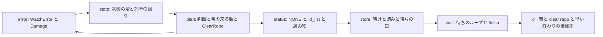
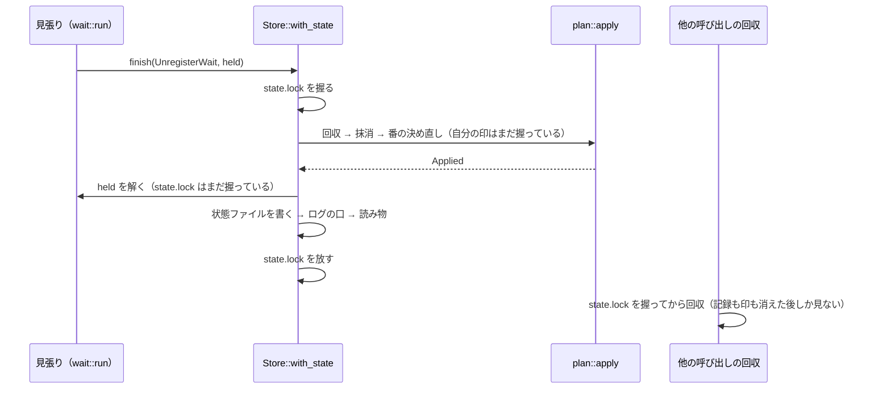
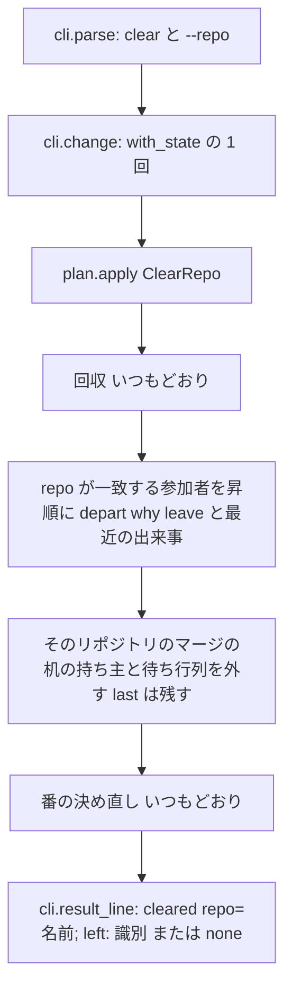

# 設計: areka-P0-impl-watch-residue

## Overview

**目的**: `areka-impl-watch`（並んで走る実装セッションに「マージの机」と「負荷テストの机」を 1 人ずつ貸し出すコンソールアプリ）に、完了した `areka-P0-impl-watch` が「知っていて開けてある」と残した小さな残り (a)〜(i) を片づけ、棚卸の始まりに呼ぶ「リポジトリの分だけ記録を消す」形 `clear --repo <名前>` を足す。

**使う人**: このクレートへ次に手を入れる開発者と、`/kiro-next`（`areka-P0-impl-watch-skills` の要件 12）。前者は、壊れた状態ファイルの訳をログから読め、重複の無いコードを直せる。後者は、落ちたセッションの残りを 1 回の呼び出しで消せる。

**変わること**: 端末へ出す文・終了コード・判断の核の規則・状態ファイルの版は変えない。変わるのは、ログの行に載る訳、内側のまとめ方（時計・番の順・綴り・最後の抹消の順）、`clear` の新しい形、`--help` に足す 1 行、テスト。

### Goals
- 壊れた状態ファイルの訳（種類と行と列）がログに 1 行で残る（要件 1）。
- 時計・番の来る順・`none` の綴り・止まった者の列の作り方が、それぞれ 1 か所になる（要件 2〜4）。
- 殺された前の待ちの記録が残らず、裁定 4 の窓が閉じる（要件 5・6）。
- 「失敗にしない」例外が 4 つだけになり、黙って値を代える道が無くなる（要件 7）。
- 実機テストだけが見ていた 1 秒の眠りを常時テストへ移し、テストの穴 8 件を埋める（要件 8・9）。
- `clear --repo <名前>` を足す（要件 11）。

### Non-Goals
- 判断の核の規則（番の決め方・回収・停止要請・再開）の変更。
- 端末へ出す今の文と終了コードの変更、`--help` の今ある行の変更。
- 手順書 `doc/impl-watch.md`・スキル・完了した spec の文書の書き替え。
- 依存の追加、`Cargo.toml`・`Cargo.lock` の変更、状態ファイルの版の変更。

## Boundary Commitments

### This Spec Owns
- `crates/areka-impl-watch/src/` の本番ファイルと兄弟のテストファイル、`crates/areka-impl-watch/tests/real.rs`・`tests/real/mod.rs` の変更。
- `clear --repo <名前>` の振る舞い・結果の 1 行の字面・終了コード・`--help` の 1 行（下の「`clear --repo` の約束」）。
- 壊れた訳の型（`Damage`）と、それを載せるログの行。
- 「失敗にしない」例外 4 つの一覧（完了した spec の要件 10.2 を引き継ぐ。要件 7.4）。
- この設計書の末尾の「移さない・直さない理由」の行。

### Out of Boundary
- `doc/impl-watch.md` の書き替え（古くなる一文の削除と `clear --repo` の書き込みは `areka-P0-impl-watch-skills` の要件 9.4・9.5）。
- `/kiro-next` から `clear --repo` を呼ぶこと（`areka-P0-impl-watch-skills` の要件 12）。
- `crates/log-capture-kit/` と、ワークスペースの「共有の捕捉の仕組みの迂回」の見張りの例外表。
- 完了した spec `completed/areka-P0-impl-watch/` の文書。

### Allowed Dependencies
- 今の依存だけ: `serde`・`serde_json`・`thiserror`・`tracing`・`tracing-subscriber`、開発用に `temp-path-kit`。
- クレートの中の読み込みの向きは今のまま: `error` → `state` → `plan` → `home`／`presence`／`status` → `store` → `wait` → `cli` → `main`。新しく生まれる読み込みは `plan` → `error`（`Damage`）だけで、向きに沿う。
- `plan.rs` は今どおり `std::fs`・時計・プロセス・`tracing` を綴らない。

### Revalidation Triggers
- `clear --repo` の結果の 1 行・終了コード・`--help` の 1 行を変えたら、`areka-P0-impl-watch-skills`（`/kiro-next` と手順書 4 節）を見直す。
- `Event` の綴り（`Debug`）を変えたら、`tests/real.rs` のログの行の判定を見直す。
- 状態ファイルに新しい綴り（列挙の値・欄）を足す変更は、古い実行ファイルが読めなくなるので、版を上げる別の spec にする（この spec は足さない。`clear --repo` の「最近の出来事」も今ある `cleared` の綴りで書く）。

## `clear --repo` の約束（`areka-P0-impl-watch-skills` へ渡す字面）

| 項目 | 中身 |
|---|---|
| 呼び方 | `areka-impl-watch.exe clear --repo <名前>`。`<名前>` は他のコマンドの `--repo` と同じ形（`A-Z a-z 0-9 . _ -` の 1〜100 字。例 `areka`）。パスは形に合わないので受けない |
| 結果の 1 行（標準出力・終了コード 0） | `cleared repo=<名前>; left: <識別>, <識別>`。外した者が居なければ `cleared repo=<名前>; left: none` |
| 識別の並び | 外した参加者の識別を昇順（バイト順）で `, `（コンマと空白）でつなぐ。識別は小文字に寄った形 |
| `left:` に入らない者 | 同じ呼び出しの初めの回収（見張りの居ない作業中の参加者。どのコマンドでも行う）で消えた者。ログと読み物の最近の出来事に `reclaimed` で残る |
| 終了コード | 0＝済んだ（消すものが無くても 0。3 にはならない）／1＝失敗（置き場所・ロック・書き・版の違いなど、ほかのコマンドと同じ）／2＝使い方の誤り（`--repo` の値が無い・形に合わない・2 度・ほかの引数・余計な語）。正しい呼び方は 2 にならない |
| 古い実行ファイル | `clear: --repo is not accepted` で 2（呼ぶ側は 2 を「まだ無い」と読んで飛ばす） |
| `--help` に足す 1 行 | `      clear --repo <repo>: leave everyone of the repo and empty its merge desk (the last merge stays). prints "cleared repo=<repo>; left: <ids or none>". 0=done`（字下げは空白 6 つ。`clear` の説明の行の直後） |

## Architecture

### Existing Architecture Analysis

- 状態を変える呼び出しは全部 `Store::with_state`（`state.lock` の排他の中で 読む → 判断 → 書く → ログの口 → 読み物）を通る。判断（`plan::apply`）を呼ぶのは `with_state` へ渡す閉じた関数の中だけで、状態を変える生死の確認（回収）は必ず `state.lock` の中で走る（読み物の `mark` と端末の要約 `summary` の探りは排他の外で走るが、状態を変えない）。この不変を、裁定 4 の窓を閉じる根拠に使う（要件 6）。
- 判断の核 `plan.rs` は純粋（ファイル・時計・プロセス・ログを持たない）。出来事（`Event`）を返し、ログへ書くのは口の層。
- `cli.rs` はコマンドの表 1 本（14 行）と `--help` を同じ表から組む。コマンドごとの手書きの分岐を持たない。
- 待ちのループ `wait::run` は口（`WaitPort`）越しに時計・読み・状態を変える 1 回・眠りを頼む。本物の口は `Store` の上に在る。

### Architecture Pattern & Boundary Map

今の層の形を保ち、新しい層・新しい本番ファイルは作らない。直しはそれぞれの責任の持ち主の 1 か所に置く。



- **選んだ形**: 今の層の延長（新しいファイルはテストの兄弟 1 本だけ）。
- **守る形**: 判断は全部 `plan::apply` の中・口の層は判断を持たない・表 1 本から引数と `--help` を組む・端末の文は ASCII。
- **steering との合致**: ログの無い失敗の道を無くす（`logging.md`）・時刻は丸めない・テストの置き場所は `target\` の下。

### Technology Stack

| 層 | 使うもの | この spec での役目 | 備考 |
|---|---|---|---|
| CLI | 自前の表（`cli.rs`） | `clear` の別の形 `--repo` | 依存の追加なし |
| データ | `serde_json` 1 | 壊れた訳の行と列（`Error::line`・`column`） | `Value` から写した失敗は位置が 0 なので、元のバイト列を読み直す |
| ログ | `tracing`・`tracing-subscriber` | 訳の欄を足す | 受け手の据え方は変えない |
| テスト | `temp-path-kit` | 置き場所を `target\test-roots\` の下に | 変えない |

## File Structure Plan

### Directory Structure
```
crates/areka-impl-watch/
├── src/
│   ├── error.rs                 # Damage を足し、Broken に持たせる
│   ├── state.rs                 # ParticipantStatus と RecentKind に as_str
│   ├── plan.rs                  # Recovered の damage 欄・ClearRepo・merge_order／load_order
│   ├── plan_clear_tests.rs      # 新規: ClearRepo の判断のテスト（要件 11）
│   ├── status.rs                # NONE を crate の中へ・id_list・並べ方と spelling を外す
│   ├── store.rs                 # 読み直しで位置を取る parse・時計を失敗しうる形に・time・pause_for
│   ├── wait.rs                  # WaitPort::now を失敗しうる形に・finish・眠りは pause_for
│   └── cli.rs                   # clear の別の形・早い終わりの後始末・pos= は plan の並べ方
└── tests/
    ├── real.rs                  # ログの行の判定を damage つきに
    └── real/mod.rs              # Desk::settle の試し直しを「握られている」だけに
```

### Modified Files
- `src/error.rs` — `Damage` を足し、`WatchError::Broken` を `Broken(Damage)` にする（端末の文は同じ）。
- `src/state.rs` — `ParticipantStatus::as_str`・`RecentKind::as_str`（状態ファイルと同じ綴り）。
- `src/plan.rs` — `Event::Recovered` に `damage` 欄、`Command::ClearRepo`、番の来る順の関数 2 つ（`replan`・`plan_load` もそれを使う）。モジュールの末尾に `plan_clear_tests.rs` を読む 1 塊。
- `src/status.rs` — `NONE` を `pub(crate)`、`id_list` を足す。`merge_order`・`load_order`・`spelling` を外し、`plan` の並べ方と `as_str` を使う。
- `src/store.rs` — `parse` を「読めない／版が無い／版違い／形が合わない」に分け、形の失敗は元のバイト列を読み直して位置を取る。時計を `Result` にし、`time`・`pause_for` を足す。`NO_BACKUP` を外す。本物の待ちに、テストのプロセスだけの安全網の呼び出し。
- `src/wait.rs` — `WaitPort::now` を `Result` に、`WaitPort::finish` を足す。本物の口の `now` は `Store::time`、`sleep` は `Store::pause_for(POLL)`。`#[cfg(test)]` の `panic!` を外す。`judge` の `stopped:` の列は `status::id_list`。
- `src/cli.rs` — 表の行に `variant`（名前の行に出さない別の形）を足し、`clear` に `--repo` の形。`result_line`・`subject` に `ClearRepo`。`waiting` の早い終わりで同じ排他の中の抹消。`pos=` は `plan` の並べ方。`clear` の `none` は `status::NONE`。
- テスト（兄弟のファイル）: `error_tests.rs`・`state_tests.rs`・`plan_desk_tests.rs`（`Recovered` を組む所があれば）・`status_tests.rs`・`store_test_support.rs`・`store_tests.rs`・`store_ports_tests.rs`・`wait_loop_tests.rs`・`cli_tests.rs`・`cli_commands_tests.rs`・`cli_wait_tests.rs`・`main_layering_tests.rs`。どれも 1,000 行以下に収まる見込み（いちばん大きくなるのは `cli_tests.rs` の約 840 行）。
- 実機テスト: `tests/real.rs`（⑦ のログの判定）・`tests/real/mod.rs`（`Desk::settle`）。

触らないファイル: `src/main.rs`・`src/home.rs`・`src/presence.rs`・`Cargo.toml`・`Cargo.lock`・`doc/impl-watch.md`。

## System Flows

### 最後の抹消と居る印の解き方（要件 6）



- 状態を変える生死の確認（回収）は `state.lock` の中でしか走らないので、「記録は消えたが印は握られている」状態を見て状態を変える呼び出しは無い。読み物の `mark` と `summary` の探りは排他の外だが、状態を変えないので窓にならない。
- 状態ファイルの書きが失敗したときは、印はすでに解けていて記録は残る。次の回収が「居ない」として記録を消す（要件 6.3。今の「残った記録は回収に任せる」と同じ結末）。参加者は再開の後なら見張り待ちの印を持っているので回収されない。

### `clear --repo` の流れ（要件 11）



## Requirements Traceability

| 要件 | 要約 | 部品 | 口・型 | 流れ |
|---|---|---|---|---|
| 1.1, 1.2 | 退避の行に訳の種類と行と列 | store・plan・error | `Damage`・`Event::Recovered.damage` | 読み → 退避 |
| 1.3 | `status`・待ちの読みの失敗の行にも訳 | store | `WatchError::Broken(Damage)`・`read_only` の `error!` | 読むだけ |
| 1.4 | 訳は ASCII で値を写さない | error | `Damage` は種類の名前と数だけ | — |
| 1.5 | 端末の文・終了コード・退避は今のまま | error・store | `Broken` の `Display` は同じ | — |
| 1.6 | 行が載ることを判定 | テスト | 偽のログの口（常時）＋ ⑦（実機） | — |
| 2.1, 2.2 | 待ちの記録の時刻も同じ時計 | store・wait | `Store::time`・`WaitPort::now` | — |
| 2.3 | 常時テスト | テスト | `store_ports_tests.rs` | — |
| 3.1 | 番の来る順を 1 か所 | plan | `merge_order`・`load_order` | — |
| 3.2 | 番・`pos=`・読み物の一致を直に判定 | テスト | `cli_commands_tests.rs` | — |
| 3.3 | 規則と文の形は変えない | plan・status・cli | 同じ鍵・同じ同点の扱い | — |
| 4.1 | `none` を 1 か所 | status | `status::NONE` | — |
| 4.2 | 止まった者の列を 1 か所 | status・wait | `status::id_list` | — |
| 4.3 | 字面を変えない | テスト | 今のテストがそのまま緑 | — |
| 5.1, 5.2 | 早い終わりで前の記録を同じ排他で消す | cli | `waiting` の 2 回目の `apply(UnregisterWait)` | — |
| 5.3 | 文と終了コードは今のまま | cli | 終わりの 1 行は 1 回目の判定のまま | — |
| 5.4, 5.5 | 常時テスト・直す前に赤 | テスト | `cli_wait_tests.rs` | — |
| 6.1, 6.2 | 窓を閉じる・判断の核は変えない | wait・store | `WaitPort::finish` | 最後の抹消 |
| 6.3 | 抹消の失敗は答えを変えない | wait | `run` の `warn!` | 最後の抹消 |
| 6.4 | 常時テスト・判定できない部分の理由 | テスト | `store_ports_tests.rs`・末尾の理由 | — |
| 6.5 | 手順書の古くなる一文を申し送る | 文書 | 「申し送り」節 | — |
| 7.1, 7.2, 7.3 | 例外は 4 つだけ・今のまま・状態の書きは失敗 | store・wait・presence | 「失敗にしないもの」表 | — |
| 7.4 | 完了した spec の要件 10.2 を引き継ぐ | 文書 | 「失敗にしないもの」表 | — |
| 7.5 | 黙って値を代える道を無くす | state・status・store | `as_str`・`unix_seconds` | — |
| 8.1 | 1 秒の眠りを常時テストで | store・wait | `Store::pause_for`・支えの安全網 | — |
| 8.2 | 移さない 2 つの理由 | 文書 | 末尾の理由 | — |
| 8.3, 8.4, 8.5 | 依存・例外表を増やさない・実機は ignore のまま | 全体 | — | — |
| 9.1, 9.2, 9.3, 9.4, 9.5 | 穴 8 件と変異の確かめ | テスト | 「テストの穴」表・変異の手順 | — |
| 10.1, 10.2, 10.3, 10.4 | 変えないもの | 全体 | 今の構造テスト（走査を広げる） | — |
| 10.5, 10.6, 10.7 | 1,000 行・置き場所・文書 | 全体 | File Structure Plan・テストの決まり | — |
| 11.1, 11.2, 11.3 | リポジトリの全員を leave・机を空に・ほかは触らない | plan | `Command::ClearRepo` | `clear --repo` |
| 11.4, 11.6, 11.8 | `--repo` の形・2 の条件・引数無しの `clear` は今のまま | cli | 表の `variant` | — |
| 11.5 | 結果の 1 行と 0 | cli・status | `result_line`・`id_list` | — |
| 11.7 | 出来事をログと最近の出来事に・退避しない | plan・store | `Event::Left`・`Recent(Cleared)` | — |
| 11.9 | 常時テスト | テスト | `plan_clear_tests.rs`・`cli_commands_tests.rs` | — |
| 11.10 | `--help` に 1 行だけ | cli | 表の `variant` | — |

## Components and Interfaces

| 部品 | 層 | 役目 | 要件 | 主な依存 |
|---|---|---|---|---|
| `Damage`（error.rs） | 型 | 壊れた訳 | 1 | なし |
| `as_str`（state.rs） | 型 | 列挙の綴りを失敗なしで | 7.5 | serde の綴りと同じ |
| 判断の核（plan.rs） | 判断 | 番の来る順・`ClearRepo`・`Recovered` の欄 | 1, 3, 11 | state・error |
| 綴り（status.rs） | 表示 | `NONE`・`id_list` | 4, 11.5 | plan |
| 状態ファイルの口（store.rs） | 口 | 訳の取り出し・時計・待ち | 1, 2, 7.5, 8.1 | plan・status |
| 待ち（wait.rs） | 口 | 最後の抹消と印の解き方 | 2, 6, 8.1 | store |
| 入口（cli.rs） | 入口 | `clear --repo`・早い終わりの後始末・`pos=` | 3, 5, 11 | 全部 |

### 型

#### `Damage`（error.rs）

| 項目 | 中身 |
|---|---|
| 役目 | 状態ファイルが読めなかった訳を、種類と位置だけで持つ（値は持たない） |
| 要件 | 1.1, 1.2, 1.3, 1.4, 1.5 |

```rust
/// 状態ファイルが壊れていた訳。ログにだけ載り、端末の文には出ない。中身は種類の名前と数だけ。
#[derive(Debug, Clone, Copy, PartialEq, Eq)]
pub enum Damage {
    /// JSON として読めない（途中で切れた・BOM 付きを含む）。行と列は serde_json の示す位置。
    NotJson { line: usize, column: usize },
    /// 版は 1 だが欄の形が合わない。行と列は元のバイト列を読み直して得た位置。
    WrongShape { line: usize, column: usize },
    /// 版の数字が無い・数でない・一番外が表でない。
    NoVersion,
}

// WatchError の 1 行だけ変わる（文は同じ）。
#[error("state file is broken; see impl-watch.log")]
Broken(Damage),
```

- `serde_json::Error` の文は入力の値（`invalid type: string "…"`）を含むので使わない。使うのは `line()`・`column()` だけ（要件 1.4）。
- ログでは `Debug`（例 `NotJson { line: 1, column: 2 }`）で載る。ASCII だけ。

#### 列挙の綴り（state.rs）

```rust
impl ParticipantStatus { pub const fn as_str(self) -> &'static str } // "working" | "stop-requested" | "stopped"
impl RecentKind        { pub const fn as_str(self) -> &'static str } // "reclaimed" | "recovered" | "cleared"
```
- `WaitKind::as_str` と同じ作り。serde の `kebab-case` の綴りと同じであることを `state_tests.rs` が全部の値で判定する（綴りの表が 2 つに割れても赤になる）。
- これで `status::spelling` の「作れなければ `?`」の道が無くなる（要件 7.5）。

### 判断の核（plan.rs）

| 項目 | 中身 |
|---|---|
| 役目 | 番の来る順の 1 か所・`ClearRepo` の判断・`Recovered` の訳の欄 |
| 要件 | 1.1, 3.1, 3.3, 6.2, 10.3, 11.1, 11.2, 11.3, 11.7 |

```rust
pub enum Event {
    // …
    /// `damage` は退避した訳（ファイルが無くて作ったときは None）。
    Recovered { backup: Option<String>, damage: Option<Damage> },
}

pub enum Command {
    // …
    /// そのリポジトリの記録を消す（`clear --repo`）。
    ClearRepo { repo: String },
}

/// マージの待ち行列の、番の来る順の添字: バグ優先 → 申し込みの早い順・同点は行列の前。
pub fn merge_order(queue: &[MergeRequest]) -> Vec<usize>;
/// 負荷テストの待ち行列の、番の来る順の添字: 申し込みの早い順・同点は行列の前。
pub fn load_order(queue: &[LoadRequest]) -> Vec<usize>;
```

**番の来る順**
- 2 つの関数は添字を安定な並べ替えで並べる。`replan` は `merge_order(&desk.queue)` の先頭を、`plan_load` は `load_order(&load.queue)` の先頭を取る（今の `min_by_key` は同点の最初を返すので、結果は今と同じ。要件 3.3）。
- `status` の読み物と端末の要約、`cli` の `pos=` は同じ関数で並べる（要件 3.1）。鍵（`(!bug, requested)`・`requested`）はこの 2 つの関数の中にしか書かない。

**`ClearRepo { repo }` の判断**（回収 → これ → 番の決め直し、の順は今の `apply` のまま）
1. `participants` のうち `repo` が一致する者の識別を昇順で集める。
2. 1 人ずつ `depart(state, id, "leave", events)`（`Leave` と同じ関数・同じ `Event::Left { why: "leave" }`）を通し、`push_recent(Recent { at: now, kind: Cleared, id: Some(id), detail: "repo=<repo>" })` を足す。
3. `merge.get_mut(repo)` が在れば、持ち主と待ち行列に残る申し込み（参加者の記録の無い者・ほかのリポジトリの参加者のもの）を外し、外した 1 件ごとに `Event::Cancelled { id }` を出す。`last` は残す。机が無ければ作らない。
4. 判定は必ず `Verdict::Applied`。
- 規則は足さない（要件 10.3）: 外し方は `depart` のまま、空いた机の番と再開は続く `replan` が今の決まりで行う。
- 1 で選ぶのは参加者の記録の `repo`（`join` が最後に使ったリポジトリ）。そのリポジトリの参加者がほかのリポジトリの机に並んでいれば、`leave` と同じくそれも外れる（要件 11.1 の「1 人ずつ leave したのと同じ」）。ほかのリポジトリの参加者の記録・ほかのリポジトリの机の持ち主と待ち行列・その参加者の負荷テストの番と待ち行列と待ちの記録は残る（要件 11.3）。
- 最近の出来事は、今ある綴り `cleared` に識別を付けて書く。`leave` そのものは最近の出来事を残さないが、要件 11.7 が読み物に残すことを求めるため、全部を消す `clear`（識別なし）と見分けられる形で足す。新しい綴りを足さないので、古い実行ファイルもこの状態ファイルを読める。

### 綴り（status.rs）

```rust
/// 「居ない・無い」の綴り（読み物・端末の文・`clear` の退避先の記録）。
pub(crate) const NONE: &str = "none";
/// 識別の並び: 空なら `none`、あれば `", "` でつなぐ（負荷テストの机の `stopped:`・`clear --repo` の `left:`）。
pub(crate) fn id_list(ids: &[String]) -> String;
```
- `store.rs` の `NO_BACKUP` と `wait.rs` の裸の `"none"` は `NONE` へ、読み物と `wait::judge` の `stopped:` の式は `id_list` へ替える（要件 4.1, 4.2）。端末の要約の負荷テストの待ち行列（`queue=a,b`）は区切りが違う別の物で、まとめない。
- 字面は 1 字も変わらない。今のテストを書き替えずに通ることが確かめになる（要件 4.3）。

### 状態ファイルの口（store.rs）

| 項目 | 中身 |
|---|---|
| 役目 | 訳を取り出して運ぶ・時計を 1 つに・眠りを口へ |
| 要件 | 1.1, 1.2, 1.3, 1.5, 2.1, 7.1, 7.3, 7.5, 8.1 |

```rust
pub struct Store {
    clock: Box<dyn Fn() -> Result<u64, WatchError>>, // 失敗しうる形に（要件 7.5）
    // home・presence・pause・log は今のまま
}
impl Store {
    /// いまの時刻。失敗はここで `error!` を 1 行残して返す。`with_state`・`clear`・`summary`・待ちの口が使う。
    pub(crate) fn time(&self) -> Result<u64, WatchError>;
    /// 試しの間の待ちの口へ頼む（待ちのループの 1 秒の眠りもここを通る）。
    pub(crate) fn pause_for(&self, length: Duration);
}
/// 本物の時計の芯。1970 年より前なら `WatchError::io("read the clock", &io::Error::other("before 1970"))`。
fn unix_seconds(at: SystemTime) -> Result<u64, WatchError>;
/// 状態ファイルを読む: 読めない・版が無い・形が合わない → Err(Broken(Damage))、知らない版 → Err(VersionMismatch)。
fn parse(bytes: &[u8]) -> Result<State, WatchError>;
```

**`parse` の段**
1. `from_slice::<Value>` が失敗 → `Broken(NotJson { line, column })`。
2. `version` が数でない・無い → `Broken(NoVersion)`。
3. 版が 1 でない → `VersionMismatch`（今のまま）。
4. `from_value::<State>(value)` で形へ写す（今の読み方。通るファイルは今と同じ）。失敗したときだけ、元のバイト列を `from_slice::<State>` で読み直す。読み直しが通ればその状態を使い、失敗すればその失敗の行と列で `Broken(WrongShape { line, column })`。`Value` から写した失敗は位置が 0 なので、位置は読み直しからしか取れない。読み直しが通る場合も値を作り話で埋めないので、黙った置き換えにならない。

**訳の運び方**
- `load`: `Err(Broken(damage))` なら退避し、`Event::Recovered { backup, damage: Some(damage) }` を作る（ファイルが無かったときは `damage: None`）。本物のログの口 `write_line` は今どおり `backup: Some(_)` で `warn!`、`event = ?event` の綴りに `damage` が載る（要件 1.1, 1.2）。`Recovered { backup: Some(_) }` を照らす今の型の照合は、欄が増えるので `Recovered { backup: Some(_), .. }` に直す。
- `read_only`: `Broken(damage)` のときだけ `tracing::error!(error = %err, damage = ?damage, "[store] read failed")`、ほかの失敗は今の行のまま。`status` と走っている待ち・見張りの読みは全部ここを通る（要件 1.3）。
- 端末の文（`state file is broken; see impl-watch.log`）・終了コード・退避の振る舞いは変えない（要件 1.5）。

**時計**（要件 2.1, 7.5）
- `open` は `clock: Box::new(|| unix_seconds(SystemTime::now()))`。`change`・`wipe`・`summary` は `self.time()?` で時刻を取る。
- 1970 年より前の時計は、値を 0 に代えずに失敗（終了コード 1・`io read the clock: Other (os error 0)`）。文の形は今ある `io …` のまま。ログは `time` が `[store] clock failed` を 1 行残す（`with_state`・`clear` はさらに今の出口の行を残す）。

**待ちと安全網**（要件 8.1）
- `open` の `pause` は本物の眠りの前に、テストのプロセスでだけ `test_support::refuse_poll(length)` を呼ぶ（`#[cfg(test)]` の 1 行）。`refuse_poll` は `store_test_support.rs` に置き、1 秒以上を頼まれたら `panic!("a test reached the real 1-second sleep")`（今と同じ字。`cli_wait_tests.rs` の `call_until_first_sleep` がこの字で眠りを見分ける）。
- `store_test_support::store_in` の `pause` も `refuse_poll` にする（眠らない偽の待ちで終わらない回り方をしない）。書き留める `store_noting_pauses` は書き留めるだけ。

### 待ち（wait.rs）

| 項目 | 中身 |
|---|---|
| 役目 | 時計を口から・最後の抹消を印の解きと同じ排他で・眠りを口へ |
| 要件 | 2.1, 2.2, 4.2, 6.1, 6.2, 6.3, 7.1, 8.1 |

```rust
pub trait WaitPort {
    /// いまの時刻（UNIX 秒）。待ちの記録の「始めた時刻」に載せる。
    fn now(&self) -> Result<u64, WatchError>;
    fn pid(&self) -> u32;
    fn fingerprint(&self) -> Result<Option<(SystemTime, u64)>, WatchError>;
    fn read(&self) -> Result<Option<State>, WatchError>;
    fn change(&self, cmd: &Command, caller: &str) -> Result<Applied, WatchError>;
    /// 最後の抹消。判断に通した後、状態の排他を放す前に `held` を解く。
    fn finish(&self, cmd: &Command, caller: &str, held: Held) -> Result<Applied, WatchError>;
    fn sleep(&self);
}
```

- 本物の口（`impl WaitPort for Store`）:
  - `now` = `self.time()`。失敗は `time` がログに残す（要件 2.1）。
  - `finish` = `self.with_state(|state, now, alive| { let applied = plan::apply(state, cmd, Some(caller), now, alive); drop(held); (applied.clone(), applied) })`。判断が生死を尋ね終えてから印を解き、排他は状態ファイルの書きとログの口と読み物の後に放す（要件 6.1）。`plan.rs` には触らない（要件 6.2）。排他を取れずに閉じた関数が走らなかったときも、`held` は閉じた関数と一緒に落ちて解ける。
  - `sleep` = `self.pause_for(POLL)`。`#[cfg(test)]` の `panic!` は外す（安全網は `refuse_poll` へ移る）。
- `run`: 登録は `spec.register(port.pid(), port.now()?)`。最後は `port.finish(&unregister, id, held)`、失敗は今の `warn!`（`[wait] wait record not removed; left to be reclaimed`）を残して答えを返す（要件 6.3）。`drop(held)` の行は無くなる。途中の失敗で返るときは、今どおり `held` が落ちて解ける。
- 不変（モジュールの説明に書く）: `plan::apply` を呼ぶのは `with_state` へ渡す閉じた関数の中だけ（`cli::change`・`cli::waiting`・`wait` の `change` と `finish`）。待ちの居る印は、最後の抹消の `state.lock` の中で解く。状態を変える生死の確認（回収）は `state.lock` の中でしか走らない（読み物の `mark`・`summary` の探りは排他の外だが状態を変えない）。
- 偽の口（`wait_loop_tests.rs`）の `now` は `Ok(T0 + 眠った回数)`。`finish`: 跡に `U` を残し、居る印が握られていたかを書き留め、判断に通し、`held` を落とす。失敗の差し込みでも `held` は落ちる。

### 入口（cli.rs）

| 項目 | 中身 |
|---|---|
| 役目 | `clear --repo`・`--help` の 1 行・早い終わりの後始末・`pos=` |
| 要件 | 3.1, 5.1, 5.2, 5.3, 10.1, 11.4, 11.5, 11.6, 11.8, 11.10 |

**表の行の「別の形」**
```rust
pub(crate) struct Spec {
    // name・required・optional・wait・note・build は今のまま
    /// 名前の行には出さず、`note` の次の 1 行で示す別の形（今は `clear --repo` だけ）。
    pub(crate) variant: Option<Variant>,
}
pub(crate) struct Variant {
    pub(crate) opt: Opt,          // Opt::Repo
    pub(crate) note: &'static str, // 下の字
}
```
- `clear` の行: `variant: Some(Variant { opt: Opt::Repo, note: "leave everyone of the repo and empty its merge desk (the last merge stays). prints \"cleared repo=<repo>; left: <ids or none>\". 0=done" })`、`build: |f| match f.take(Opt::Repo) { Some(repo) => Command::Change(plan::Command::ClearRepo { repo }), None => Command::Clear }`。ほかの 13 行と `--help` の行は `variant: None`。
- `parse`: 受ける引数は「要る・任意・`--wait`」に `variant` の引数を足したもの。今の `Spec::accepted()` は引数の読みと `--help` の名前の行の両方に使われているので、読みの側だけが `variant` の引数を受けるように分ける。形の検査・2 度の断り・余計な語の断りは今の道のまま（要件 11.4, 11.6）。
- `usage`: 名前の行は今どおり「要る・任意・`--wait`」だけで組む（`  clear` のまま）。`note` の行の次に、`variant` があれば `format!("      {} {}: {}\n", spec.name, variant.opt.shown(), variant.note)` を足す。これが `--help` に足す唯一の行（要件 11.10）。
- 引数の無い `clear` は今の `Command::Clear` の道のまま（要件 11.8）。

**`clear --repo` の道**: `Command::Change(ClearRepo)` は今の `change` を通る（`with_state` の 1 回・`subject` は `None`・判定は必ず当てはまる）。`result_line` の `ClearRepo` の枝は、出来事のうち `Event::Left` の識別を順に集め、`escape_path(&format!("cleared repo={repo}; left: {}", status::id_list(&left)))` を返す（要件 11.5）。退避は行わない（要件 11.7）。

**早い終わりの後始末**（`waiting`）
```rust
Some(command) => store.with_state(|state, now, alive| {
    let mut applied = plan::apply(state, command, Some(id), now, alive);
    let end = wait::judge(spec, Some(state));
    if end.is_some() {
        // 殺された前の待ち（同じ識別・同じ種類）の記録を、答えを決めたのと同じ排他の中で消す。
        let unregister = plan::Command::UnregisterWait { id: id.to_owned(), kind };
        let cleanup = plan::apply(state, &unregister, Some(id), now, alive);
        applied.changed |= cleanup.changed;
        applied.events.extend(cleanup.events);
    }
    (applied, end)
})?,
```
- 2 回目の `apply` も回収と番の決め直しを行うが、どちらも何度呼んでも同じ結果になる。終わりの 1 行は 1 回目の後の判定のままなので、端末の文と終了コードは変わらない（要件 5.3）。前の記録が無ければ何も変わらない。
- 当てはまるのは `merge --wait`・`loadtest --wait`・`stopped --wait`（種類は `merge`・`load`・`resume`）。見張りと `resume` は必ず `run` を通り、`finish` が消す。

**`pos=`**: `plan::merge_order(queue)`・`plan::load_order(&state.load.queue)` の添字の列で、自分より前の数を数える（要件 3.1）。

## Data Models

- 状態ファイルの形と版（1）は変えない。足すのはメモリの中の型（`Damage`・`Event::Recovered.damage`・`Command::ClearRepo`）だけで、どれも状態ファイルに書かれない。
- `clear --repo` が書く最近の出来事は `{ "kind": "cleared", "id": "<識別>", "detail": "repo=<名前>" }`。今ある綴りと欄だけなので、古い実行ファイルも読める。

## Error Handling

### 失敗にしないもの（要件 7.1〜7.4。完了した spec の要件 10.2 を引き継ぐ）

| 例外 | 所 | ログの行（警告・ASCII の 1 行） | 結果 |
|---|---|---|---|
| 読み物の書き出しの失敗 | `store::write_status`（状態を変えるコマンド・`clear`・`status`） | `[store] status.md not written; the result stands` | 結果と終了コードは変えない |
| 待ちの周期の一回りの失敗 | `wait::run` | `[wait] periodic round failed; still waiting` | 待ちを続ける |
| 答えが出た後の最後の抹消の失敗 | `wait::run`（`finish` の失敗） | `[wait] wait record not removed; left to be reclaimed` | 答えは変えない・残った記録は回収に任せる |
| 居る印の探りの思わぬ失敗 | `presence::unsure` | `[presence] probe failed; treated as present` | 「居る」と答える |

- この 4 つの外の失敗は、ログを残して終了コード非 0（今のまま）。状態ファイルの書き出しの失敗は失敗のまま（元のファイルは無傷。要件 7.3）。
- 4 つの振る舞いは今のまま保つ（要件 7.2）。

### 黙って値を代える道の棚卸（要件 7.5）

| 所 | 今 | この spec の後 |
|---|---|---|
| `status::spelling` の `?` | 列挙の綴りを serde で作れなければ `?` | 道を無くす（`as_str`） |
| `store::unix_now` の 0 | 1970 年より前なら 0 | 失敗にする（`unix_seconds`・`time` がログを残す） |
| `parse` の位置 | — | 位置が取れないときに 0 を入れる道を作らない（読み直しの失敗の位置だけを使う） |

次は失敗の代わりの値ではないので残す（どれも処理を誤った値で先へ進めない）: 無いことを表す表示（読み物の `-`・`none`・停止要請の主が空のときの `?`。状態ファイルが許す値の表し方）、失敗で終わる道の中の後始末（ロックの解除・一時ファイルの消去・標準エラーへ失敗の文を書けないこと・ログの受け手が 2 度目に据わらないこと）、引数の読みの不変で起きない既定（`Found::need`）。

## Testing Strategy

決まり: 常時テストは決定論で、置き場所は `TempPath::under_target` の下だけ。実行ファイルを子プロセスに立てるのは `#[ignore]` の実機テストだけで、どの子にも `AREKA_IMPL_WATCH_HOME` を `target\` の下の Windows 形の絶対パスで明示する（要件 10.6）。新しいテストは本番ファイルに書かず兄弟のファイルへ置く（要件 10.5）。

### 常時テスト（要件ごと）

| 要件 | 置き場所 | 確かめること |
|---|---|---|
| 1.1, 1.2, 1.6 | `store_tests.rs`・`store_ports_tests.rs` | 3 種の壊れたファイル（例 `not json`・`{"version": 1,` の後で欄の型が違う 2 行目・`{"x": 1}`）を状態を変える 1 回が退避し、ログの口へ `Recovered { damage: Some(NotJson { line, column }) }`・`WrongShape { line ≥ 1, column ≥ 1 }`・`NoVersion` が渡る。`WrongShape` の位置が 0 でないことは、読み直しを外す変異で赤になる |
| 1.3, 1.5 | `store_ports_tests.rs`・`wait_loop_tests.rs` | `read_only` が 3 種で `Err(Broken(damage))` を返し、退避しない。`Display` は `state file is broken; see impl-watch.log` のまま |
| 2.2, 2.3 | `store_ports_tests.rs` | 時計を `T0` に止めた `Store` を本物の口として `wait::run` に渡す（停止要請中の参加者の `resume` の待ち＝最初の判定で終わり、眠らない）。ログの口の中で `WaitRegistered` を受けたときに状態ファイルを読み、置かれた待ちの記録の `since` が `T0`（直す前は本物の時刻で赤） |
| 3.2 | `cli_commands_tests.rs` | バグと通常が混ざり時刻の同点も入ったマージの待ち行列の状態と、同点入りの負荷テストの待ち行列の状態（負荷テストの待ちが在るとマージの番が出ないので別々の状態）で、(1) 持ち主を空けて `Tick` を繰り返したときの番の順、(2) 別の持ち主が居る間の `result_line` の `pos=` の順、(3) `render_markdown` の待ち行列の順、の 3 つが同じで、書き下した期待の順とも同じ |
| 4.3 | 今のテスト全部 | 書き替えずに緑 |
| 5.1, 5.2, 5.4, 5.5 | `cli_wait_tests.rs` | `a` がすでに `areka` の机の持ち主で、殺された前の `(a, merge)` の記録が状態ファイルに在る。`merge --wait` が直ちに番で終わった後、状態ファイルの `waits` に `(a, merge)` が無い。直す前の実物で赤になることを先に確かめて記録する |
| 6.1, 6.4 | `store_ports_tests.rs` | 見張りの記録と握った居る印を用意し、ログの口の中（`state.lock` の中）で、居る印の探りが「居ない」かつ `state.lock` が握られていることを書き留める。`WaitPort::finish` の後に `[(居ない, 握られている)]`。印を排他の後で解く変異で赤 |
| 6.3 | `wait_loop_tests.rs` | 今の `a_failed_unregister_does_not_change_the_answer` が `finish` の失敗で緑のまま（印は解ける） |
| 7.5 | `state_tests.rs`・`store_tests.rs` | `as_str` が全部の値で serde の綴りと同じ。`unix_seconds(UNIX_EPOCH - 1 s)` が `Io { op: "read the clock", .. }`、`UNIX_EPOCH + 5 s` が `Ok(5)`。時計が失敗する `Store` の `with_state` は失敗し、何も書かない |
| 8.1 | `store_ports_tests.rs` | `store_noting_pauses` の `Store` で `WaitPort::sleep(&store)` が `[1 s]` を頼む。`refuse_poll` が 1 秒で `panic!`・20 ms では何もしない |
| 11.1, 11.2, 11.3, 11.7, 11.9 | `plan_clear_tests.rs` | 2 つのリポジトリの参加者が混ざり、消すリポジトリの `x` が負荷テストの机を持ってほかのリポジトリの `y` を止めている。`ClearRepo` の後: そのリポジトリの参加者・申し込み・机・待ちの記録が無い／`Left { why: "leave" }` が昇順で 1 人 1 件／最近の出来事に `cleared`＋識別＋`repo=<名前>`／そのリポジトリのマージの机に残っていた参加者の記録の無い持ち主と待ち行列が外れ `Cancelled` が出て `last` は残る／`y` が `Resumed { why: "no-load" }` で作業中へ戻る（待ち行列にほかのリポジトリの者が居れば番が来る）／ほかのリポジトリの机・参加者・待ちの記録はそのまま |
| 11.4, 11.5, 11.6, 11.8, 11.9 | `cli_commands_tests.rs`・`cli_tests.rs` | `clear --repo areka` が `cleared repo=areka; left: a, b` で 0、誰も居なければ `left: none` で 0。`--repo` の値なし・`a/b`・`C:\x`・2 度・`--id` を足す・余計な語・`--wait` は 2 で何も作らない。引数無しの `clear` は今の出力 |
| 11.10 | `cli_tests.rs` | `--help` の `  clear` の行の次が今の説明の行、その次が上の 1 行で、ほかのテストが見ている行はそのまま |

### テストの穴（要件 9。8 件とも採る）

| 穴 | 置き場所 | 足す・直すもの | 当てる変異（要件 9.2） |
|---|---|---|---|
| (h1) | `status_tests.rs` | 2 つのリポジトリの机に持ち主が居る状態で、端末の要約の 1 行目が `merging=2` | 先頭の机だけを数える |
| (h2) | `wait_loop_tests.rs` | 登録の直後（眠り 0 回）の更新時刻の取得の失敗で、待ちがその失敗で終わり、跡が `Rf` | `wait.rs` の最初の `port.fingerprint()?` を「無い」に畳む |
| (h3) | `cli_commands_tests.rs` | `a` が 2 つのリポジトリの机を持ったまま `merged` → 2 行（`merged repo=…` がリポジトリの昇順） | 最初の 1 行だけを出す |
| (h4) | `cli_wait_tests.rs` | 負荷テストの机の持ち主 `h`（作業中・見張りなし）・待ち行列の `c`（見張りの印を握る）・作業中の `a`。`a` の `stopped --wait` が同じ呼び出しの回収と番の決め直しで `stop requested again by c` で 0 | `judge` の再開の待ちの `StopRequested` の枝を壊す |
| (h5) | `tests/real/mod.rs` | `Desk::settle` は `WouldBlock` だけを試し直し、ほかの失敗は直ちに赤 | 求めない。実機テストを短い形で 1 回走らせて緑（要件 9.3） |
| (h6) | `main_layering_tests.rs` | ASCII の走査の対象を本番ファイル全部（リテラルの無い `main.rs` を除く 9 本: `cli`・`status`・`wait`・`error`・`store`・`home`・`presence`・`plan`・`state`）に広げる | 広げた各ファイルへ ASCII の外の字の文を 1 つ置く |
| (h7) | `main_layering_tests.rs` | 判断の核の赤の文に「`std` からは 1 行に 1 つずつ読み込む（`std::{…}`・`std::*` は何を読み込んだかが見えないので禁じる）」を添える | 求めない |
| (h8) | `status_tests.rs` | 見本の識別を小文字へ | 求めない |

(h6) で `plan.rs`・`state.rs` も入れるのは、`plan` の「当てはまらなかった」の文と `state` の列挙の綴りも端末へそのまま出るため。

### 変異を当てる手順（要件 9.4, 9.5, 5.5）
1. 当てるファイルの控えを `target\mutation-backup\<ファイル名>` に取り、sha256 を記録する。
2. 変異を当て、新しいテストだけを走らせて赤を確かめる。
3. 控えを素のコピーで戻し、sha256 が控えと同じことを確かめる（`git checkout` は使わない）。
4. 新しいテストが緑に戻ることを確かめる。
5. 当てた変異と赤になったテストを `tasks.md` の記録に残す。要件 5.5 は、直す前の実物でテストが赤になることを同じ形で記録する。

### 実機テスト（`#[ignore]` のまま。要件 8.5）
- ⑦ `the_log_keeps_event_lines_and_failure_lines_across_processes`: `Recovered { backup: None }` の判定を `Recovered { backup: None, damage: None }` に直す。壊れたファイルの退避の `WARN` の行に `damage: Some(NotJson { line: 1, column: ` が載ること、壊れたファイルを `status` が読んだ `ERROR` の行に `damage=NotJson { line: 1, column: ` が載ることを足す（要件 1.6 の本物のファイルの側）。
- (h5) の後に短い形（`--skip a_waiter_reclaims`）を 1 回走らせる。

### 手で確かめること
- 直す前と後の実行ファイルの `--help` を並べ、差が `clear --repo` の 1 行の足しだけであることを記録する（要件 10.1, 11.10）。置き場所は `target\` の下の絶対パスで上書きする。

## 申し送り（要件 6.5・11 と `areka-P0-impl-watch-skills`）

- 手順書 `doc/impl-watch.md` の「見張りが停止要請で終わるのと同時に再開が入り…ごくまれに起きる」の一文は、要件 6 で窓が閉じるので古くなる（害は無い）。削除は `areka-P0-impl-watch-skills` の要件 9.4 に申し送る。
- `clear --repo` の呼び方・結果の 1 行・終了コードは上の「`clear --repo` の約束」のとおりで、`areka-P0-impl-watch-skills` の研究記録 17 の「1 行の字面は設計で決まり次第知らせる」に、この節を渡す。

## 移さない・直さない理由（要件 6.4, 8.2, 9.1）

- 要件 6.4: 他のプロセスがまさにその瞬間に探る並走そのものは常時テストで作れないので、「印は `state.lock` の中で解かれ、状態を変える生死の確認は `state.lock` の中でしか走らない」という順の不変を常時テストで判定し、並走の再現はしない。
- 要件 8.2（読み物の警告の行）: `[store] status.md not written; the result stands` の行を常時テストで捕まえる手は、記録の捕捉の道具を開発用の依存に足す（`Cargo.toml`・`Cargo.lock` が変わる）・受け手をスレッドに差す（迂回の見張りの例外表が増える）・本物の受け手を使う（プロセスに 1 つで最初に開いた置き場所へ行き、判定の足場にならない）の 3 つとも塞がっているので、実機テスト ⑪ に残す。
- 要件 8.2（ログの実ファイルの項目）: `command=`・`event=` の字面を作るのは `tracing-subscriber` で、上と同じ 3 つの塞がりにより常時テストで捕まえられないので、実機テストに残す。
- 要件 9.1: (h1)〜(h8) は 8 件とも採るので、採らない理由の行は無い。
- `parse` の段 4 の「読み直しが通ればその状態を使う」枝: 2 つの読み方の結果が分かれる入力は同じ欄が 2 度書かれたファイルだけで、そのときは先の `from_value` が通る側なので、この枝に入る入力は無い。テストで通せないが、初めから `from_slice` だけで読むと同じ欄が 2 度ある手書きのファイルを退避するようになり、読めるファイルの範囲が変わる（要件 1.5）ので、形はこのまま残してテストしない（2026-10-16 の設計の討議で確定）。
