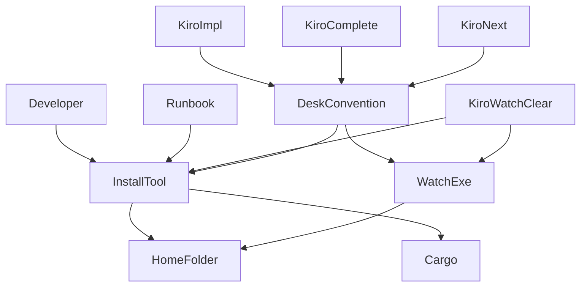
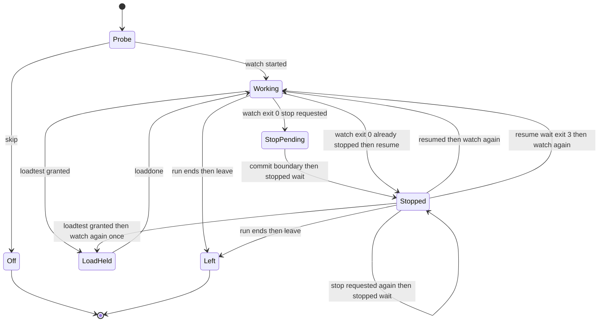
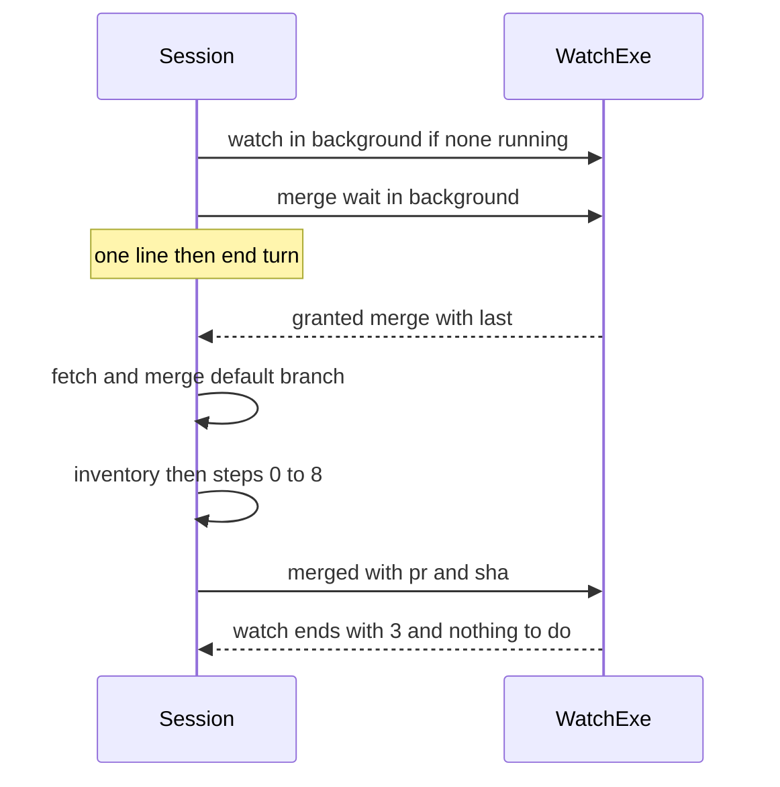

# 設計書: areka-P0-impl-watch-skills

## Overview

**目的**: 机の貸し出しのアプリ `areka-impl-watch`（完了した spec `areka-P0-impl-watch`）を、実装のスキル `kiro-impl`・完了のスキル `kiro-complete`・棚卸のスキル `kiro-next` から呼ぶ形にし、2026-10-10 から止まっている机の調停を戻す。調停役のセッション（スキル `kiro-watch`）は退役させ、実行ファイルを置き場所へ置く手順を道具 1 本にまとめる。

**使う人**: 同じマシンで実装の Claude セッションを何本も並べる開発者と、その並走するセッション。セッションは Bash から実行ファイルを直に呼び、待ちは「番が来たら終わるコマンド」をバックグラウンドで走らせることで表す。セッションが起きるのは、そのコマンドが終わったときの 1 回だけである。

**変わること**: スキルの机の段から、調停役へメッセージを送る文と「一時停止中」の注記が消え、アプリを呼ぶ決まった形の Bash の 1 行に替わる。手打ちのビルドとコピーの手順は `tools/impl-watch-install.ps1` の 1 本に替わる。アプリのソースは 1 字も変えない。

### Goals
- `kiro-impl` が見張り・停止要請・再開・負荷テストの机を、`kiro-complete` がマージの机を、アプリのコマンドで回す（要件 1〜5）。
- 机が使えない機械でも、スキルは 1 行知らせて作業を続ける（要件 6）。
- 実行ファイルの置き方・入れ替え・後始末が 1 つのコマンドで済み、スキルと手順書が同じコマンドを指す（要件 7）。
- 調停役のスキルが無くなり、今使う文書がそれを指さない（要件 8）。
- 手順書がスキルの動きと一致する（要件 9・12）。
- セッションを起こすのは待つコマンドの終わりだけで、読むのは終了コードと ASCII の数行だけ（要件 10）。

### Non-Goals
- アプリ `crates/areka-impl-watch` のソース・`--help` の文・出力の文・終了コード・規則 7 つの変更（`areka-P0-impl-watch-residue` が受け持つ）。
- 開発者の機械の環境変数の設定。本物の置き場所へ実行ファイルを置く運用の操作。
- `kiro-next` の Requirement 12 の段のほか（`status` を読む・参加する・「静かな机」の文の書き替え）。
- `/release`・`kiro-validate-impl`・`kiro-debug` など、机を使うスキル以外の参加。
- 置き方の道具の常時の自分の検査（`-SelfTest`）と全体テストへの組み込み。走っている実行ファイルの入れ替えは偽の実行ファイルで再現できず、本物のビルドを全体テストへ入れると重い。確かめは要件 11.2 の 4 つの場合の記録で行う。
- `kiro-spec-tasks` がタスクへ「負荷テストの机が要る」印を付けること。

## Boundary Commitments

### This Spec Owns
- 机を使う 2 つのスキルの机の段の文: `kiro-impl` の「Desk coordination」節（参加・見張り・停止要請・再開・負荷テストの机・抜ける）と、`kiro-complete` の前置きステップ（マージの机）・ステップ8 のマージの記録・完了チェックリストの机の項目。
- 机の呼び方の約束（下の「机の呼び方の約束」）: 識別とリポジトリ名の求め方、呼ぶ形、出力の読み方、バックグラウンドで走らせるコマンド、立て直しの上限。2 つのスキルに同じ字で書く。
- `kiro-next` の Step 0 に足す 1 つの段（`clear --repo` を 1 回）。
- 置き方の道具 `tools/impl-watch-install.ps1`（新規）。
- 調停役のスキル `.claude/skills/kiro-watch/` の削除。
- `kiro-watch-clear` の説明と「実行ファイルが無い」の案内の書き替え。
- 手順書 `doc/impl-watch.md` の 1 節〜5 節と 7 節の追い書き。
- `.kiro/steering/structure.md` の Impl Watch の節の Location の 1 行（呼ぶスキルと置き方の道具を足す）。
- 確かめの記録 `.kiro/specs/areka-P0-impl-watch-skills/verification.md`。

### Out of Boundary
- `crates/areka-impl-watch/` の全部と `Cargo.lock`（読むだけ）。アプリの断りの文（`error.rs` の「exe をそこへコピーせよ」）が置き方の道具とずれる件は、完了のときに `areka-P0-impl-watch-residue` の brief へ申し送る。
- `clear --repo` の実装と `--help` の 1 行（`areka-P0-impl-watch-residue`）。こちらは呼ぶ側と手順書だけを持つ。
- 環境変数 `AREKA_IMPL_WATCH_HOME` の値（読むだけ）。
- `kiro-next` の「Respect quiet-desk holds」の文と Step 8 の注記（調停役の名前を出さない、セッション同士の頼みの決まり。要件の範囲の外）。
- `.kiro/steering/workflow.md`（机の段を書かない）・`CLAUDE.md`（`kiro-watch` を載せていないので変えない）。
- 過去の記録: 完了した spec・roadmap の履歴の行・`tools/release-notes-fixture/`・`doc/roadmap-overview-*.html`・roadmap.md の本 spec の行（完了のときに `kiro-complete` が書き替える）。
- Claude のメモリーに残る調停役の呼び名（完了のときに主の会話が直す）。

### Allowed Dependencies
- アプリ `areka-impl-watch.exe` の今のコマンド・引数・終了コード 0/1/2/3・出力の文（手順書 4 節〜6 節のとおり）。`clear --repo` は、在れば 0、無ければ使い方の誤りの 2 で終わることだけに頼り、出力の 1 行の字面には頼らない。
- Claude Code の Bash のバックグラウンド実行（ターンをまたいで走り続け、終わるとセッションを 1 回起こす）。
- Git Bash（`[[ =~ ]]`・`basename`・`dirname`）、`git rev-parse`、`gh pr view`。
- 置き方の道具は pwsh 7・cargo・`tools/` の道具の決まり（端末へ出す文は ASCII・端末の文字コードを書き替えない・`tools/encoding-check.ps1` の検査に入る）。
- 依存の向き: スキル → 実行ファイル（呼ぶだけ）。置き方の道具 → cargo とアプリのソース（ビルドするだけ）。アプリ → スキル・道具の向きは無い。

### Revalidation Triggers
- `areka-P0-impl-watch-residue` が出力の文・`--help`・終了コードを変える、または `clear --repo` の終わり方（0／2）を変える → スキルの読み方の表と手順書 4 節・5 節を見直す。
- 同じ spec が「見張りが停止要請で終わるのと同時に再開が入る」窓を閉じない形で着地した → 手順書 6 節で消した一文を戻す。
- 状態ファイルの版が上がる → 置き方の道具の後に `clear` が要る旨を手順書 3 節で確かめる。
- Claude Code のバックグラウンド実行のふるまい（終わりの知らせ・出力の読み方）が変わる → 机の呼び方の約束を見直す。
- 机を使うスキルが増える（`/release` が机を取る など）→ 机の呼び方の約束をそのスキルにも同じ字で写す。

## Architecture

### Existing Architecture Analysis
- アプリは「各セッションが Bash から呼ぶ・待ちはバックグラウンドで走るコマンドの終わり」で動く。メッセージは使わない。状態はマシン共通の置き場所に在る。
- 今アプリを呼ぶのは `kiro-watch-clear` だけで、その「環境変数が空 → 実行ファイルが無い → 呼ぶ」を 1 回の Bash で判定する形を、机の呼び方の約束の手本にする。
- `kiro-impl` の「コミットの切れ目まで進めてから止まる」の言い方（実装係 → レビュー → 確かめ → `[x]` → コミット・Step 4 に入らない）と、`kiro-complete` の「番が来たら既定の枝を取り込む・やめるときは取り下げる」の骨組みは、そのまま残して送り先だけを替える。
- `kiro-impl`・`kiro-complete`・`kiro-next`・`kiro-watch-clear`・手順書・`structure.md` は CRLF。書き替えで行末を保つ。スキルの文はそのファイルの今の言葉で書く（`kiro-impl`・`kiro-next`・`kiro-watch-clear` は英語、`kiro-complete` は日本語）。

### Architecture Pattern & Boundary Map



- **採る形**: 「同じ字で写す短い約束」（gap 分析の案 C）。包みのスクリプトを足さず、決まった Bash の 1 行を 2 つのスキルに同じ字で書く。食い違いは確かめの静的な突き合わせ（下の Testing Strategy）で見つける。
- **分け方**: いつ何を呼ぶか（時機）はスキルごと、どう呼びどう読むか（約束）は共通、どう置くか（道具）は 1 本。アプリは呼ばれるだけ。
- **新しいもの**: 置き方の道具 1 本だけ（要件 7.1 の「1 つのコマンド」は手打ちの例では満たせない）。
- **steering との合い方**: トークンの負荷を先に抑える（起きるのは待ちの終わりだけ）・端末へ出す文は ASCII・試しはワークツリーの `target\` の下・開発者へ渡すコマンドは絶対パス。

### Technology Stack

| 層 | 選んだもの | この機能での役 | 注 |
|---|---|---|---|
| CLI（呼ぶ側） | Git Bash（Claude Code の Bash ツール） | 机のコマンドを呼ぶ・バックグラウンドで待つ | 新しい依存なし |
| CLI（置き方） | pwsh 7・cargo | ビルドして置き場所へ置く・入れ替える | `cargo install` は `bin\` の下へ置き、走っている実行ファイルを置き換えられないので採らない |
| 状態 | アプリの置き場所（`AREKA_IMPL_WATCH_HOME`） | 机の状態の正本 | 読み書きはアプリだけ。スキルと道具は状態のファイルに触らない |
| 外部 | `gh pr view` | マージ後のコミットを取る | `kiro-complete` がすでに使う |

## File Structure Plan

### Directory Structure
```
tools/
└── impl-watch-install.ps1        # 新規。置き方の道具（ビルド → 置く・入れ替える → 後始末 → 動くかの確かめ）
.kiro/specs/areka-P0-impl-watch-skills/
└── verification.md               # 新規。要件 11 の確かめの記録（終了コードと出力）
```

### Modified Files
- `.claude/skills/kiro-impl/SKILL.md` — 「Coordination with kiro-watch」節（SUSPENDED の注記とメッセージの文）を消し、「Desk coordination (areka-impl-watch)」節に置き替える。Preflight に「机の前置き」の 1 項、Step 3 の各タスクの前と後に止まる確かめ・負荷テストの机の確かめ、Step 4 の前に「止まっていない」の確かめ、実行の終わりに `leave` を書く。実装係とデバッグ係へ渡す決まった 2 文（下の kiro-impl の机の段）もこの節に置く（テンプレートは変えない）。
- `.claude/skills/kiro-complete/SKILL.md` — 前置きステップを書き替え（注記とメッセージを消す）、ステップ8 の squash マージの成功の後に `merged` を、フォールバック（PR 不可時）と中断条件に机の外し方を足し、完了チェックリストの机の 1 行を書き替える。
- `.claude/skills/kiro-next/SKILL.md` — Step 0 の最後に「このリポジトリの机の記録を消す」の 1 項を足す。ほかは変えない。
- `.claude/skills/kiro-watch-clear/SKILL.md` — 説明の文から調停役の状態への言及を消し、「入れ方・更新」の案内を置き方の道具へ向ける（Stopped without clearing と失敗時の案内）。
- `doc/impl-watch.md` — 1 節の末尾の一文、2 節の手順 2・3、3 節の (a)(b)、4 節に「スキルからの呼び方」の小節、5 節の終了コードごとの表と終了コード 1 の表の行、`clear` の行、6 節の一文の削除、7 節の古い実行ファイルの行。
- `.kiro/steering/structure.md` — Impl Watch の節の Location の 1 行に、呼ぶスキル（`kiro-impl`・`kiro-complete`・`kiro-next`）と置き方の道具を足す。

### Deleted Files
- `.claude/skills/kiro-watch/SKILL.md`・`.claude/skills/kiro-watch/kiro-watch.ps1`・`.claude/skills/kiro-watch/messages.json`（フォルダごと。ほかからの参照は無いことを gap 分析で確かめ済み）。

## System Flows

### kiro-impl の 1 回の実行での机の状態



- `Off` は要件 6 の「その回だけ飛ばす」。`Off` の間は机のコマンドを 1 つも呼ばない。
- `StopPending` の間は今のタスクをコミットまで進め、次のタスクと Step 4 に入らない（3.1・3.4）。
- 停止要請と負荷テストの申し込みが重なったら、先に `stopped --wait` を走らせてから `loadtest --wait` を申し込む（3.9）。止まったまま番を受けたら、見張りを 1 回だけ立て直してから計測へ進む（4.4）。

### kiro-complete のマージの机



- 番の中に完了の手順の全部が入る（5.1）。番を持つ間に見張りが 3 で終わったら、ステップ8 の PR のマージへ進まずに見張りを立て直して申し込み直し、番が来てから既定の枝を取り込み直す（5.8）。

## Requirements Traceability

| 要件 | 要約 | 部品 | 約束・形 | 流れ |
|---|---|---|---|---|
| 1.1, 1.2, 1.3, 1.4, 1.5 | 識別・リポジトリ・名前の求め方と形の検査 | 机の呼び方の約束 | 机の前置きの 1 行 | — |
| 1.6, 1.7 | 主の会話だけが呼ぶ・1 作業木に 1 セッション | 机の呼び方の約束・kiro-impl の机の段 | 実装係とデバッグ係へ渡す 2 文 | — |
| 2.1, 2.5 | kiro-impl の参加の始まりと終わり | kiro-impl の机の段 | `watch`・`leave` | 状態図 |
| 2.2, 2.4 | kiro-complete の参加の区間 | kiro-complete のマージの机 | `watch`・`merged` | 順序図 |
| 2.3, 2.6, 2.7, 2.8, 2.9, 2.10 | 見張りを重ねない・立て直しの規則 | 机の呼び方の約束 | 終わり方の表（見張り） | 状態図 |
| 3.1, 3.2, 3.3, 3.4, 3.5, 3.6, 3.7, 3.8, 3.9, 3.10 | 停止要請と再開 | 机の呼び方の約束・両スキルの机の段 | 終わり方の表（再開の待ち） | 状態図 |
| 4.1, 4.2, 4.3, 4.4, 4.5, 4.6, 4.7 | 負荷テストの机 | kiro-impl の机の段 | `loadtest --wait`・`loaddone`・`loadrunning` | 状態図 |
| 5.1, 5.2, 5.3, 5.4, 5.5, 5.6, 5.7, 5.8, 5.9, 5.10 | マージの机 | kiro-complete のマージの机 | `merge --wait`・`merged`・`cancel`・`status` | 順序図 |
| 6.1, 6.2, 6.3, 6.4, 6.5, 6.6, 6.7 | 机が使えないとき・してはいけないこと | 机の呼び方の約束 | 机の前置きの `skip` の行・終了コード 1 の表 | 状態図の Off |
| 7.1, 7.2, 7.3, 7.4, 7.5, 7.6, 7.7, 7.8, 7.9 | 置き方の道具 | 置き方の道具・kiro-watch-clear の案内・手順書 2 節 3 節 | 道具の出力の行と終了コード | 置き方の順 |
| 8.1, 8.2, 8.3, 8.4, 8.5, 8.6 | 調停役の退役と呼び名の掃除 | 調停役の退役・kiro-watch-clear・手順書 1 節 | 削除・書き替えの一覧 | — |
| 9.1, 9.2, 9.3, 9.4, 9.5 | 手順書の追い書き | 手順書 | 4 節の小節・5 節の表・6 節の削除 | — |
| 10.1, 10.2, 10.3 | トークンの負荷 | 机の呼び方の約束 | 起きる機会・読む行・知らせの 1 行 | — |
| 11.1, 11.2, 11.3, 11.4 | 確かめ | 確かめの記録 | 一時の置き場所・4 つの場合・コマンドの並び・差分なし | — |
| 12.1, 12.2, 12.3, 12.4, 12.5, 12.6 | 棚卸の始まりのリポジトリの掃除 | kiro-next の掃除の段 | `clear --repo` の 1 行 | — |

## Components and Interfaces

| 部品 | 層 | 役 | 要件 | 主な依存 | 約束 |
|---|---|---|---|---|---|
| 机の呼び方の約束 | スキルの文（共通） | 識別・呼ぶ形・読み方・立て直しの上限 | 1, 2, 3, 6, 10 | 実行ファイル (P0) | Service, State |
| kiro-impl の机の段 | スキルの文 | 実装の回の参加・停止・負荷テストの机 | 1.6, 1.7, 2.1, 2.5, 3, 4 | 机の呼び方の約束 (P0) | State |
| kiro-complete のマージの机 | スキルの文 | 完了の手順をマージの番の中に入れる | 2.2, 2.4, 3.3, 3.4, 5 | 机の呼び方の約束 (P0)・`gh` (P1) | State |
| kiro-next の掃除の段 | スキルの文 | 棚卸の始まりにリポジトリの記録を消す | 12 | 実行ファイルの `clear --repo` (P1) | Batch |
| 置き方の道具 | 道具（pwsh） | ビルド・置く・入れ替え・後始末 | 7 | cargo (P0) | Batch |
| kiro-watch-clear の案内 | スキルの文 | 説明と案内の言い替え | 7.9, 8.5 | 置き方の道具 (P2) | — |
| 手順書 | 文書 | スキルの呼び方と置き方を書く | 8.6, 9 | 全部品 (P2) | — |
| 調停役の退役 | 削除 | 古い形を無くす | 8.1, 8.2, 8.3, 8.4 | — | — |
| 確かめの記録 | spec の文書 | 試しの終了コードと出力 | 11 | 一時の置き場所 (P0) | — |

### スキルの文（共通）

#### 机の呼び方の約束

| 項目 | 内容 |
|---|---|
| 役 | 机を使うスキルが、同じ求め方・同じ呼び方・同じ読み方で机を使うための決まり |
| 要件 | 1.1, 1.2, 1.3, 1.4, 1.5, 1.6, 2.3, 2.6, 2.7, 2.8, 2.9, 2.10, 3.10, 6.1, 6.2, 6.3, 6.4, 6.5, 6.6, 6.7, 10.1, 10.2, 10.3 |

**責務と縛り**
- 机のコマンドを呼ぶのは主の会話だけ（1.6）。1 つの作業木で机を使うセッションは 1 つ（1.7）。
- 受け継いだ環境変数をそのまま使う。値を設定・変更・書き替えしない。`/c/…` の形へ直さない・`cd` しない・コマンドの前へ `AREKA_IMPL_WATCH_HOME=…` を置かない（6.5）。
- 机の段の中で実行ファイルをビルド・コピー・置き換えしない。置き場所の下のファイルを手で書き替え・消さない。ほかのセッションの見張りや待ちのプロセスを止めない。`clear`（全部）を呼ばない（6.6・6.7）。
- 見回り・時間を決めた繰り返し・定期の `status` をしない。ふだんの流れでは `status` も `status.md` も読まない（10.1・10.2）。
- 机について開発者へ伝えるのは、1 つの出来事につき 1 行（10.3）。

**机の前置き（1 回の Bash・前景）**: 実行の初めに 1 回呼ぶ。2 つのスキルに同じ字で書く。

```bash
ID=$(basename "$(git rev-parse --show-toplevel)"); R=$(basename "$(dirname "$(git rev-parse --path-format=absolute --git-common-dir)")")
if [ -z "$AREKA_IMPL_WATCH_HOME" ]; then echo "desk: skip no-home"
elif [ ! -f "$AREKA_IMPL_WATCH_HOME/areka-impl-watch.exe" ]; then echo "desk: skip no-exe"
elif ! [[ "$ID" =~ ^[A-Za-z0-9._-]{1,100}$ && "$R" =~ ^[A-Za-z0-9._-]{1,100}$ ]]; then echo "desk: skip bad-name $ID $R"
else echo "desk: id=$ID repo=$R"; fi
```

- 識別 `<ID>` は作業木の最上位のフォルダの名前（1.1）。作業木の名前から求めるので、Claude のセッションが替わっても同じ値になる（1.2）。
- リポジトリ `<R>` は共通の git フォルダ（`.git`）の親の名前で、どの作業木から呼んでも同じ（1.3）。`origin` の URL は資格情報つきなので使わない。
- 名前 `--name` には spec の名前を渡す（1.4）。`merge` の `--spec` にも同じ名前を渡す。
- 形に合わなければ別の値をこしらえず `skip`（1.5）。
- 出力の `id=`・`repo=` の値を覚え、以後のコマンドへ字のまま書く（Bash の変数はコマンドをまたいで残らないため）。会話の圧縮で忘れたら、前置きをもう 1 度呼ぶ（同じ値が出る）。

**呼ぶ形**（どのコマンドも同じ）:

```bash
"$AREKA_IMPL_WATCH_HOME/areka-impl-watch.exe" <コマンド> <引数> 2>&1; echo "exit=$?"
```

- `2>&1` で標準エラーの 1 行（`gone:`・`not applied:`・`already running`・断りの文）も同じ出力に入れる。読むのは最後の `exit=<n>` とその前の 1〜2 行だけ。
- **バックグラウンド**（Bash の `run_in_background`）: `watch`・`merge --wait`・`loadtest --wait`・`stopped --wait`・`resume`。走らせたら、その種類と実行の番号を会話に覚える（「自分の待ち」）。
- **前景**: `leave`・`merged`・`loaddone`・`cancel`・`loadrunning`、それに 5.7 と訳を調べるときの `status`。

##### 終わり方の表（どちらのスキルでも同じ）

| 終わったもの | 出力 | すること | 要件 |
|---|---|---|---|
| 見張り | `exit=0`・`stop requested by <X>` | 停止要請。各スキルの「止まる切れ目」で `stopped --wait` | 3.1, 3.3 |
| 見張り | `exit=0`・`already stopped; …` | 「止まった」を記録し直さず `resume` をバックグラウンドで | 3.7 |
| 見張り | `exit=1`・`AREKA_IMPL_WATCH_HOME …` | その回の机の段を止めて 1 行（標準エラーの行をそのまま）・最後の報告にも残す | 6.3 |
| 見張り | `exit=1`・`a watch wait for <ID> is already running` | 自分の見張りが走っていれば何もしない。覚えが無ければ、下の「残りの見張りの外し方」の 1 本をバックグラウンドで走らせ、1 行で伝える。抜けたので持っていた申し込みがあれば、その 1 本が終わる前に申し込み直す | 2.3, 2.7, 2.8 |
| 見張り | `exit=1`・上のほか | 直ちに 1 回だけ立て直す。立て直しも同じ文の 1 なら終了コード 1 の表の行に従い、直らなければその回の机の段を止めて最後の報告に残す | 2.6, 6.4 |
| 見張り | `exit=3` | 今の見張り（最後に走らせた見張りの実行）でなければ何もしない。今の見張りで、参加を終えた（実行の終わりの `leave`・`merged`）後なら何もしない。それ以外は 1 行伝えて立て直し、持っていた申し込みを申し込み直す（机を持っていたら各スキルの 4.7・5.8） | 2.9, 2.10 |
| 再開の待ち（`stopped --wait`・`resume`） | `exit=0`・`resumed` | 見張りを立て直してから、止まった所の次へ | 3.5 |
| 再開の待ち | `exit=0`・`stop requested again by <X>` | 作業に戻らず、もう一度 `stopped --wait` | 3.6 |
| 再開の待ち | `exit=3` | 見張りを立て直して続ける | 3.8 |
| 再開の待ち | `exit=1`・`a resume wait for <ID> is already running` | 前の再開の待ちが走っている。何もしない（6.4 の失敗に数えない） | 3.10 |
| `merge --wait`・`loadtest --wait` | `exit=1`・`a merge wait …`／`a load wait … is already running` | 自分の待ちが走っていれば何もしない。覚えが無ければ `cancel --id <ID>` → 申し込み直す → 1 行 | 6.4 |
| `loaddone` | `exit=3`・`not applied: not the load-test holder` | 机はすでに自分のものでない（記録が消えた など）。返し直さず、1 行伝えて続ける | 4.5, 6.4 |
| `loadrunning` | `exit=3`・`not applied: the load-test desk already has a holder` | 持ち主にならない。1 行伝え、その計測を記録しないまま開発者の指示を待つ | 4.6 |
| `leave`・`merged`・`loaddone`・`cancel`・`loadrunning` | `exit=1`・下の 2 行のほか | 標準エラーの 1 行をそのまま伝え、手順書 5 節の終了コード 1 の表に従う。直らなければその回の机の段を止めて最後の報告に残す | 6.3, 6.4 |
| どれでも | `exit=1`・`state.lock is busy …` | 間を置かずに 1 回だけ呼び直す（実行ファイルが自分で 10 秒待ってから断るので、スキルの側で待たない）。続けば 6.4 | 6.4 |
| どれでも | `exit=2` | 呼び方の誤り。スキルの文の誤りなので、その回の机の段を止めて最後の報告に残す | 6.4 |

- 立て直し・申し込み直しは、同じ出来事で 2 つの待ちが続けて終わっても、それぞれ 1 回だけ行う。2 度目が `already running` で終わっても害の無いものとして扱う（4.4 と同じ扱い）。
- 終わりの知らせは中身（出力の文）で読む。「自分の見張りか」の覚えに頼るのは `already running` の 2.7 と 2.8 の分かれ目だけ。
- **残りの見張りの外し方**（2.8）: 前のセッションの残りの見張りは、`leave` の後に記録の消えたことを次の見回り（実行ファイルの見回りは 1 秒ごと・`wait.rs` の `POLL`）で見つけて終わるまで、自分の識別の見張りの錠を持ち続ける。直ちに立て直すと、その錠にぶつかって `already running` になる。そこで、外す・待つ・立て直すを 1 本のバックグラウンドの Bash にまとめ、セッションを起こすのは終わりの 1 回だけにする:

```bash
"$AREKA_IMPL_WATCH_HOME/areka-impl-watch.exe" leave --id <ID> 2>&1; sleep 3; "$AREKA_IMPL_WATCH_HOME/areka-impl-watch.exe" watch --id <ID> --repo <R> --name <feature> 2>&1; echo "exit=$?"
```

  - `sleep 3` は見回りの間隔 1 秒の 3 回分。読むのは最後の `exit=` と見張りの行だけ（`leave` の行は読まない）。この 1 本を「今の見張り」として覚える。
  - この `leave` は参加を終えたことに数えない（参加を終えるのは実行の終わりの `leave` と `merged` だけ）。
  - この 1 本がまた `already running` で終わったら、2.8 をもう 1 度は行わず 6.4 に従う。

##### State Management
- 会話が覚えるもの: 机の段が `on`（`id`・`repo`）か `off`（訳）／見張りの実行の番号／停止の状態（無し・停止要請を受けた・止まった）／負荷テストの机（無し・待っている・持っている）／マージの机（無し・待っている・持っている・自分で外した）／参加を終えたか（実行の終わりの `leave`・`merged` の後。2.8 の外し方の `leave` は数えない）。
- 「今の見張り」は最後に走らせた見張り（2.8 の 1 本を含む）の実行の番号。終わった見張りの 3 は、それが今の見張りのときだけ扱う。立て直す前の古い見張りの終わりは読み流す。
- 正本はアプリの状態である。会話の覚えが消えても、前置きと終わり方の表だけで元へ戻れる（失うのは 2.7／2.8 の見分けだけで、そのときは 2.8 に倒す）。

### スキルの文（スキルごと）

#### kiro-impl の机の段

| 項目 | 内容 |
|---|---|
| 役 | 1 回の `kiro-impl` の実行の間だけ参加し、停止要請で止まり、機械を独り占めする段の前に負荷テストの机を取る |
| 要件 | 1.6, 1.7, 2.1, 2.4, 2.5, 3.1, 3.2, 3.4, 3.5, 3.9, 4.1, 4.2, 4.3, 4.4, 4.5, 4.6, 4.7 |

**時機**（Autonomous と Manual の両方）
1. **Preflight の最後**: 机の前置き。`skip` なら訳を覚え、開発者へ 1 行（`no-exe` のときは置き方の道具のコマンドを添える。下の「実行ファイルが無いときの案内」）、最後の報告にも残し、机の段を飛ばして進む（6.1・6.2）。`id=` なら、最初のタスクに取りかかる前に `watch --id <ID> --repo <R> --name <feature>` をバックグラウンドで（2.1）。
2. **各タスクに取りかかる前**:
   - 停止要請を受けていれば、次のタスクに入らない（3.4）。
   - タスクが機械を独り占めする段（静かな CPU での計測・わざと CPU に負荷をかけた再現・時間を測る比べ）を含むかを、タスクの文・`_Boundary:_`・design の確かめ方の記述で見る。含むなら `loadtest --id <ID> --repo <R> --purpose "<何を・およそ何分>" --wait` をバックグラウンドで申し込み、番が来るまでそのタスクを任せない（4.1）。ふだんのテスト（クレートのテスト・clippy・`tools/test-all.ps1`）は含むに数えない（4.2）。
   - 番を待つ間は、依存の済んだ机の要らないタスクを続ける。残りが無ければ「負荷テストの机の番待ち」と 1 行伝えてターンを終える（4.3）。
3. **番が来たら**（`granted load; stopped: …`）: 止まっている間に受けたなら、見張りを 1 回だけ立て直す（4.4）。そのタスクを任せる。済んだら（実装係が返ったら、成否を問わず）直ちに `loaddone`（4.5）。レビューや直しでもう一度測るなら、もう一度申し込む。
4. **停止要請**（見張りの `stop requested by <X>`）: 今のタスクを、実装係 → レビュー → 確かめ → `[x]` → コミットまで進める。走っているテストやサブエージェントを途中で切らない（3.1）。コミットの切れ目で `stopped --id <ID> --wait` をバックグラウンドで走らせ、「負荷テストのために止まった（停止要請: <X>）」と 1 行伝えてターンを終える（3.2）。次にしたいことが負荷テストの申し込みなら、先に `stopped --wait` を走らせてから申し込む（3.9）。作業の途中でないとき（負荷テストの番待ちでターンを終えていた など）は、すでに切れ目に居るので直ちに `stopped --wait` を走らせる。
5. **再開**: 終わり方の表のとおり。`resumed` なら見張りを立て直してから、開発者の入力を待たずに次のタスクへ（3.5）。
6. **Step 4（最終の検証）の前**: 止まっていないこと・負荷テストの机を持っていないことを確かめる（3.4）。
7. **実行の終わり**（GO・BLOCKED・開発者の取りやめ・タスクがすべて BLOCKED のどれでも）: `leave --id <ID>`（2.5）。その後に終わる見張り・待ちの 3 は何もしない（2.10）。完了の承認を待つ間は参加者でない（2.4）。
8. **負荷テストの机を持つ間に見張りか番の待ちが 3**: 次の計測を始めず、見張りを立ててから申し込み直し、番が来てから計測を続ける（4.7）。
9. **開発者が「すでに走っている負荷テストを記録せよ」と言ったときだけ**: `loadrunning --id <ID> --repo <R> --purpose "<内容>"`（前景）、済んだら `loaddone`（4.6）。

**実装係とデバッグ係へ渡す 2 文**（任せる度に、プロンプトの終わりへ字のまま足す。テンプレートは変えない）:
- `Do not run areka-impl-watch.exe; the controller owns the desk commands.`（1.6）
- `Do not run a machine-exclusive step (quiet-CPU measurement, deliberate CPU-load reproduction, timing comparison) unless this prompt says the load-test desk is held. If the task needs one, stop before it and report NEEDS_CONTEXT with "MISSING: load-test desk: <what and roughly how long>".`
- 実装係がこの `MISSING: load-test desk` で返したら、主の会話が `loadtest --wait` を申し込み、番が来てから「load-test desk is held」を添えて任せ直す。この任せ直しは NEEDS_CONTEXT の「1 回だけ」にも、効き目の引き上げにも数えない（4.1 を、前もって見分けられなかったタスクにも効かせるため）。

**実装メモ**
- 決まりの文として「1 つの作業木で机を使うセッションは 1 つ（同じ作業木の 2 つのセッションは識別が同じになり、互いの見張りを外し合う）」を節の頭に書く（1.7）。
- 節の名前は `Desk coordination (areka-impl-watch)`。英語で書く（ファイルの言葉）。開発者へ伝える 1 行は日本語。

#### kiro-complete のマージの机

| 項目 | 内容 |
|---|---|
| 役 | 完了の手順の全部をリポジトリのマージの番の中に入れ、マージの後に記録して参加を終える |
| 要件 | 2.2, 2.4, 3.3, 3.4, 5.1, 5.2, 5.3, 5.4, 5.5, 5.6, 5.7, 5.8, 5.9, 5.10 |

**前置きステップの手順**（日本語で書く）
1. 机の前置き。`skip` なら訳を記録し、開発者へ 1 行（`no-exe` は置き方の道具のコマンドを添える）、チェックリストと最後の報告に「飛ばした・訳」を残して冒頭ステップへ（6.1〜6.3）。
2. このセッションが立てた見張りが走っていなければ、`watch --id <ID> --repo <R> --name <feature>` をバックグラウンドで（2.2・2.3）。ここから `merged` までが参加の区間（2.4）。
3. ここまでに停止要請が来ていたら、直ちに `stopped --id <ID> --wait` をバックグラウンドで（3.3）。止まっている間も、次の 4・5 の申し込みと番の待ちだけはしてよい（3.4）。
4. バグの印: `brief.md` の「優先度の区分」を含む行のうち最後の行の値が `B` で始まるなら `--bug` を付ける（区分が後の再測定で書き直されるので最後の行を読む）。見つからなければ付けない（5.2）。
5. `merge --id <ID> --repo <R> --spec <feature> [--bug] --wait` をバックグラウンドで申し込み、「マージの机の番待ち」と 1 行伝えてターンを終える。番が来るまで完了の手順のどの段にも入らない（5.1・5.3）。
6. **番が来たら**（`granted merge repo=<R>; last: …`）: ステップ0 の 1・2 の決め方で `{remote}`・`{default-branch}` を決め、`git fetch -q {remote} {default-branch}` → `git merge --no-edit {remote}/{default-branch}` で取り込む（ハーネスの同期の道具は資格情報つきの URL を断るので使わない。出力に URL を出さない）。ぶつかったら直してから続ける（番は持ったまま）。`last:` の 1 行を報告に添えて冒頭ステップへ（5.4）。
7. **ステップ8 の squash マージが成功した後**: `gh pr view <PR 番号> --json mergeCommit -q .mergeCommit.oid` でマージ後のコミットを取り、`merged --id <ID> --pr <PR 番号> --sha <コミット>`（前景）。繰り返しの spec でも同じ（5.5）。見張りが 3 で終わっても何もしない（2.10）。
   - `merged` が `exit=3`（`not applied: not the merge holder`）: `status` を 1 回呼び、`merge <R>:` の行の `last=` に自分の PR が載っているかを見る。載っていなければ開発者へ 1 行（5.7）。

**途中でやめる・外す**
- 中断条件（PR の作成・マージの API の失敗）と開発者の取りやめ: やめると決めた時点で `cancel --id <ID>`（前景）。参加は続ける。直してすぐ続けるだけなら外さない（5.6）。自分で外した後の `merge --wait` の 3 は何もしない（5.9）。
- フォールバック（PR 不可時）: マージが無いまま手順が終わるので、`leave --id <ID>` で机を空けて参加を終える（`merged` を呼べる PR が無いため）。

**番の待ち・番の中の 3**
- `merge --wait` が `exit=3` で、自分の `cancel` の後でない: 1 行伝え、見張りを立ててから申し込み直す（5.9）。
- 番を持っている間に見張りが `exit=3`: ステップ8 の PR のマージへ進まない。見張りを立て直して申し込み直し、番が来てから既定の枝を取り込み直して続ける（5.8）。知らせが手順の途中に来たら覚えておき、ステップ8 の前で番を持っていることを確かめる。

**完了チェックリストの机の 1 行**（5.10）:
`- [ ] 前置きステップ: マージの机を申し込み（merge --wait）→ 番（last: を報告に添えた）→ ステップ8 の後に merged（PR 番号とマージ後のコミット）。机が使えずに飛ばしたときは、その訳（環境変数が無い・実行ファイルが無い・値が断られた・失敗の 1 行）を記録`

#### kiro-next の掃除の段

| 項目 | 内容 |
|---|---|
| 役 | 棚卸の始まりに、そのリポジトリの机の記録だけを 1 回消す |
| 要件 | 12.1, 12.2, 12.3, 12.4, 12.5, 12.6 |

**Batch Contract**
- 起きる時: `kiro-next` の Step 0 の最後（棚卸の段より前・Step 1 の同期より前）。1 回だけ（12.1）。
- 呼ぶもの（1 回の Bash・前景・英語の文で書く）:

```bash
R=$(basename "$(dirname "$(git rev-parse --path-format=absolute --git-common-dir)")")
if [ -z "$AREKA_IMPL_WATCH_HOME" ]; then echo "desk: skip no-home"
elif [ ! -f "$AREKA_IMPL_WATCH_HOME/areka-impl-watch.exe" ]; then echo "desk: skip no-exe"
elif ! [[ "$R" =~ ^[A-Za-z0-9._-]{1,100}$ ]]; then echo "desk: skip bad-name $R"
else "$AREKA_IMPL_WATCH_HOME/areka-impl-watch.exe" clear --repo "$R" 2>&1; echo "exit=$?"; fi
```

- 結果の読み方: `exit=0` → 出力の 1 行（外した識別の並び、または `none`）をそのまま 1 行で伝える。`skip …`・`exit=1`（環境変数・置き場所の断りを含む）→ 1 行伝えて棚卸を続ける（12.3）。`exit=2`（リポジトリの分だけ消す形がまだ無い実行ファイル）→ 1 行伝えて棚卸を続ける（12.4）。どの場合も棚卸を止めない。
- 全部を消す `clear`（引数なし）を呼ばない。ほかのリポジトリに触らない（12.2）。`watch` を立てず、`status` を読まない（12.5）。
- 消された記録の持ち主が実は動いていたときは、そのセッションの終わり方の表（2.9・5.8）が立て直す。この段のための別の決まりは足さない（12.6）。
- リポジトリ名の式は、机の前置きの `R=` と同じ字（12.1 の「Requirement 1.3 と同じ名前」）。

### 道具

#### 置き方の道具（`tools/impl-watch-install.ps1`）

| 項目 | 内容 |
|---|---|
| 役 | 作業木のソースから実行ファイルを release でビルドし、置き場所へ置き（走っていれば入れ替え）、古いものを後始末し、動くことを確かめる |
| 要件 | 7.1, 7.2, 7.3, 7.4, 7.5, 7.6, 7.7, 7.8 |

**Batch Contract**
- 呼び方: `pwsh -NoProfile -File <リポジトリの絶対パス>\tools\impl-watch-install.ps1`（引数なし）。スクリプトの在る作業木（`$PSScriptRoot` の親）のソースを使い、今のフォルダに依らない・今のフォルダを変えない（7.2）。
- 順と出力（端末へ出す文は ASCII の数行・端末の文字コードを読みも書きもしない・環境変数の値は出さない。7.7）:

| 順 | すること | 出る行 | 終わり |
|---|---|---|---|
| 1 | 環境変数を読む。空・空白だけ／絶対パスでない（`[System.IO.Path]::IsPathFullyQualified` が偽。`\foo`・`C:foo`・`/c/…` を含む）なら何もせず終わる。値を設定・変更しない | `FAIL home: AREKA_IMPL_WATCH_HOME is not set` ／ `FAIL home: AREKA_IMPL_WATCH_HOME is not an absolute path` | 1（7.5） |
| 2 | `cargo build --release -q -p areka-impl-watch --manifest-path <作業木>\Cargo.toml --message-format=json-render-diagnostics`。作った実行ファイルの道筋は cargo の報せの `executable` から取る（`CARGO_TARGET_DIR` に依らない）。cargo の JSON は `tools/utf8-child.ps1` の `Invoke-Utf8Child` で UTF-8 のバイトとして読む（steering の道具の決まり・`tools/roadmap-overview.ps1` の前例） | 失敗なら `FAIL build: cargo exit <n>`（置き場所に触らない） | 1（7.6） |
| 3 | 置き場所のフォルダが無ければ作る。新しい実行ファイルを `areka-impl-watch.new.exe` として写す | `FAIL place: copy` | 1（今のものに触っていない） |
| 4 | 今の `areka-impl-watch.exe` が在れば `areka-impl-watch.old-<UTC>.exe`（`<UTC>` は `20261016T020500Z` の形）へ改名する（走っていても改名はできる）。続けて `.new.exe` を `areka-impl-watch.exe` へ改名する | `OK placed areka-impl-watch.exe`（前のものが在れば `OK renamed previous to areka-impl-watch.old-<UTC>.exe` も） | 改名に失敗したら、改名した古いものを元へ戻し `.new.exe` を消して `FAIL place: rename` で 1（7.3） |
| 5 | `areka-impl-watch.old*.exe`（前の形の `areka-impl-watch.old.exe` も含む）をそれぞれ消してみる | 消せた `OK removed <名前>`／走っていて消せない `KEEP <名前> (in use; run again later)` | 続ける（7.4） |
| 6 | 置いた実行ファイルの `--help` を呼ぶ（置き場所の状態に触らない） | `OK check: --help exit 0`／`FAIL check: --help exit <n>` | 0／1（7.1） |

- 触るのは置き場所の `areka-impl-watch.exe`・`areka-impl-watch.new.exe`・`areka-impl-watch.old*.exe` だけ。`state.json`・ロック・居る印・ログ・`status.md`・退避のファイルを消さず、`clear` を呼ばない（7.8）。
- 冒頭の注釈に、使い方・出る行・終了コードを書く（`tools/roadmap-overview.ps1` の前例。注釈は日本語でよい・注釈の外は ASCII）。`tools/encoding-check.ps1` の検査に自動で入る。

**実装メモ**
- 確かめに `status` でなく `--help` を使う: `status` は状態ファイルが壊れていると 1 で終わり、置けたのに失敗に見える。置き場所の値の正しさは順 1 で道具自身が見る（アプリと同じ線: 空白だけを空に数え、絶対パスでない値を断る）。
- 状態ファイルの版が上がる更新では、置いた後に `clear` が要る（手順書 3 節）。道具は `clear` を呼ばず、その旨は手順書だけが持つ。

#### 実行ファイルが無いときの案内（スキル 3 つと手順書で同じ）
- 案内するコマンドは、メインの作業コピー（共通の git フォルダ `.git` の親）の道具の絶対パスで書く: `pwsh -NoProfile -File <git rev-parse --path-format=absolute --git-common-dir の親を C:\… の形にしたもの>\tools\impl-watch-install.ps1`。既定の枝の最新を取り込んだ作業コピーで走らせる旨を添える（7.2・7.9）。
- スキルはこのコマンドを案内するだけで、自分では走らせない（6.6）。

#### kiro-watch-clear の案内
- 説明の文の DO NOT USE FOR から「the coordinator session of the kiro-watch skill (its state lives elsewhere)」を消し、「installing or updating the exe (see doc/impl-watch.md)」を「installing or updating the exe (use tools/impl-watch-install.ps1; doc/impl-watch.md 2-3)」へ（8.5・7.9）。
- 「Stopped without clearing」の `no-exe` の案内と、失敗時の「2. 入れ方」の案内を、上の案内のコマンドへ向ける。手打ちのビルドとコピーの説明を消す（7.9）。

### 文書

#### 手順書（`doc/impl-watch.md`）

| 節 | 変えること | 要件 |
|---|---|---|
| 1 節 | 末尾の「スキルが書き替わるまでは、完了の手順は今の調停役の机を使う」を「実装・完了・棚卸のスキル（`kiro-impl`・`kiro-complete`・`kiro-next`）がこのアプリを呼ぶ。呼び方は 4 節の『スキルからの呼び方』」に書き直す。調停役との違いの表は経緯として残す | 8.6 |
| 2 節 | 手順 2（ビルドとコピー）を置き方の道具のコマンドに替える。手順 3 の確かめは道具の最後の行で済む旨にする | 9.2, 7.9 |
| 3 節 | (a)(b) の 2 通りの手打ちを、道具の 1 本（いつも同じ道で入れ替え、古いものは消せなければ残して次に消す）に替える。「版が上がる更新」の段落は残す | 9.2, 7.9 |
| 4 節 | 小節「スキルからの呼び方」を足す: 識別・リポジトリ・名前の求め方（机の前置き）／呼ぶ形（`2>&1; echo "exit=$?"`）／どのスキルのどの時点で `watch`・`loadtest --wait`・`stopped --wait`・`loaddone`・`merge --wait`・`merged`・`cancel`・`leave`・`clear --repo` を呼ぶか（kiro-impl・kiro-complete・kiro-next の時機の表）／立て直しは 1 回まで／1 作業木に 1 セッション | 9.1, 9.5 |
| 5 節 | コマンドの表の `clear` の行に任意の `--repo` と「そのリポジトリの参加者を全員外し、マージの机と待ち行列を空にする（直前のマージは残す）・外した識別の 1 行（居なければ `none`）」を足す。「終了コードごとにセッションがすること」の `merge --wait`・`loadtest --wait` の 3 を、スキルの扱い（自分の `cancel` の後なら何もしない・それ以外は 1 行伝えて見張りを立ててから申し込み直す・`status` は訳を調べるときだけ）に合わせる。`watch` の 3 の行を「覚えが無ければ `status` で見て」から、終わり方の表（2.9・2.10）の言い方に合わせる。終了コード 1 の表に `a resume wait …`・`a merge wait …`・`a load wait … is already running` の行を足す | 9.3 |
| 6 節 | 「生きているのに外された」の「見張りが停止要請で終わるのと同時に再開が入り、その一瞬に別の呼び出しまで重なったときにも、ごくまれに起きる。」の一文を消す | 9.4 |
| 7 節 | `areka-impl-watch.old.exe` の行を `areka-impl-watch.old-<UTC>.exe`（前の形の `.old.exe` も）と `areka-impl-watch.new.exe`（置き方の途中で止まったときだけ残る）に替え、「手で消してよいか」を「置き方の道具が次に消す」にする | 9.2 |

- 書き替えの後に、手順書の中にスキルの終わり方の表と食い違う記述（立て直しの仕方・終了コードごとの扱い）が残っていないことを、終わり方の表の行ごとに突き合わせる（9.3）。

#### 調停役の退役
- `.claude/skills/kiro-watch/` のフォルダを消す（8.1）。
- `kiro-impl` と `kiro-complete` から「一時停止中」の注記と `【kiro-watch】…` の文・セッションの一覧から調停役を探す手順を消す（8.2）。
- 今使う文書（`.claude/skills/`・`CLAUDE.md`・`.kiro/steering/` の今の規則・手順書）に調停役のセッションを今使うものとして指す文が残らないことを確かめる。roadmap.md の本 spec の行と履歴の行、完了した spec、`tools/release-notes-fixture/`、`doc/roadmap-overview-*.html` は書き替えない（8.3・8.4）。

#### 確かめの記録（`verification.md`）
- 一時の置き場所: `<作業木>\target\impl-watch-skills-trial\home`（Windows 形の絶対パス）。本物の置き場所へ書かない・本物の置き場所で `clear` しない（11.1）。
- Bash・PowerShell のツールは呼ぶ度に新しい端末で、本物の置き場所の値を受け継ぐ。そのため試しのコマンドは 1 本ごとに次を守る:
  - コマンドの頭で環境変数を一時の置き場所へ向ける（Bash は `export AREKA_IMPL_WATCH_HOME='<作業木>\target\impl-watch-skills-trial\home'`、PowerShell は `$env:AREKA_IMPL_WATCH_HOME = '…'`）。
  - 同じコマンドの中で、値が `<作業木>\target\` で始まることを確かめ、違えば何もせず止まる。
  - 試しの前と後に本物の置き場所の中身の一覧を取り、同じであることと、`C:\c\` のフォルダができていないことを記録する。
- 記録する中身は Testing Strategy の「確かめ」の項目。各項目に、走らせたコマンド・終了コード・出力の行を載せる。

## Error Handling

### Error Strategy
- 机は作業の補助であり、机が使えないことで実装と完了を止めない。机の段だけをその回だけ止めて 1 行で知らせ、最後の報告に残す（要件 6）。
- 立て直し・申し込み直し・呼び直しは、どれも同じ文の失敗に対して 1 回まで。2 度目は 6.4 に倒し、止まらない繰り返しを作らない。
- 置き方の道具は、置き場所の実行ファイルを壊さない順（新しいものを先に写す → 改名 → 改名・失敗したら戻す）で動き、失敗は `FAIL <段>: <訳>` の 1 行と終了コード 1。

### Error Categories and Responses
- **用意が無い**（環境変数が空・実行ファイルが無い・識別の形に合わない）: 前置きの `skip` の行 → 机の段を飛ばす。`no-exe` は置き方の道具のコマンドを添える。
- **値の断り**（`AREKA_IMPL_WATCH_HOME must be …`・`cannot be created`）: 最初の呼び出しの 1 → 机の段を止める。値は直さない。
- **ぶつかり**（`already running`）: 終わり方の表の行どおり。自分のものなら害なし。
- **一時の混み**（`state.lock is busy`）: 1 回だけ呼び直す。
- **記録が消えた**（3）: 参加の区間の中なら立て直して申し込み直す。区間の外なら何もしない。
- **呼び方の誤り**（2）: `kiro-next` の `clear --repo` だけは「形がまだ無い」として飛ばす。机を使うスキルでは文の誤りとして机の段を止め、報告に残す。

### Monitoring
- 机の出来事はアプリの `status.md`・`impl-watch.log` が正本。スキルはそれを読みに行かず、開発者への 1 行と最後の報告に机の段の結果（飛ばした訳・番待ちの回数・止まった回数）を残す。

## Testing Strategy

この spec は Rust のコードを書かないので、単体テストを足さない。確かめは一時の置き場所での実走と、文書の静的な突き合わせで行い、`verification.md` に記録する（要件 11）。

### 置き方の道具の実走（11.2）
1. 空の一時の置き場所への初めての置き方: `OK placed …`・`OK check: --help exit 0`・終了コード 0。置き場所に `areka-impl-watch.exe` だけがあり、状態のファイルが無いこと。
2. 見張りが走っている間の入れ替え: 一時の置き場所の実行ファイルで `watch` をバックグラウンドに立てたまま道具を走らせ、`OK renamed previous to areka-impl-watch.old-<UTC>.exe`・`KEEP … (in use …)`・終了コード 0。見張りは走り続けていること。
3. 残った古い実行ファイルの後始末: 2 の見張りを `leave` で終わらせてから道具をもう 1 度走らせ、`OK removed areka-impl-watch.old-<UTC>.exe`。状態ファイル（`state.json`・`alive\`・`status.md`・`impl-watch.log`）が残っていること（7.8）。
4. 環境変数の断り: 空と相対の値（`foo`・`/c/…`）で走らせ、`FAIL home: …`・終了コード 1・置き場所に何もできていないこと。

### スキルの書き方どおりのコマンドの並び（11.3）
識別 `trial-a`（実装の側）と `trial-b`（負荷テストの側）、リポジトリ `trial` で、スキルに書いた字のままの呼ぶ形（`2>&1; echo "exit=$?"`）を一時の置き場所で走らせ、終了コードと出力の行が終わり方の表と合うことを記録する。
1. 見張り → 負荷テストの番 → 停止要請 → 止まった → 再開 → 立て直し: a の `watch`、b の `watch` と `loadtest --wait` → a の見張りが `stop requested by trial-b` で 0 → a の `stopped --wait` → b の番 `granted load; stopped: trial-a` → b の `loaddone` → a の待ちが `resumed` → a の `watch` の立て直し。
2. 止まっている間の負荷テストの番と見張りの 1 回の立て直し: a が止まったまま `loadtest --wait` を申し込み、番が来たときに `stopped --wait` の `resumed` と `granted load; …` が両方 0 で終わり、`watch` の立て直しを 2 度呼ぶと 2 度目が `a watch wait for trial-a is already running` で 1。
3. マージの番 → マージの記録 → 見張りの終わり: `merge --spec trial-spec --wait` → `granted merge repo=trial; last: none` → `merged --pr 1 --sha 0123456` → 見張りが `gone: removed` で 3。
4. `already running`: 同じ識別で 2 本目の `watch`、2 本目の `stopped --wait`（再開の待ちの種類）がそれぞれ 1 と文。
5. 記録が消えたときの立て直し: `leave --id trial-a` で a の見張りと待ちが 3 → 立て直しの `watch` が 0 のまま走る。
6. `clear --repo`: 実行ファイルが受けるなら 0 と 1 行、受けないなら 2（どちらも記録し、`kiro-next` の読み方と合うこと）。
7. 前置きの判定: 環境変数が空・実行ファイルの無いフォルダ・形に合わない識別で、前置きの 1 行がそれぞれ `desk: skip no-home`・`no-exe`・`bad-name` になること。
8. 残りの見張りの外し方: a の見張りを走らせたまま、別の端末から「残りの見張りの外し方」の 1 本を字のまま走らせ、古い見張りが 3 で終わり、新しい見張りが `already running` にならずに走り続けること。

### 文書の静的な確かめ
1. 机の前置きの Bash が `kiro-impl` と `kiro-complete` で 1 字違わず同じで、`kiro-next` の `R=` の式とも同じであること（`git grep -F` で行を数える）。
2. `.claude/skills/kiro-watch/` が無く、`.claude/skills/`・`CLAUDE.md`・`.kiro/steering/`（`roadmap.md`・`roadmap-history.md` を除く）・`doc/impl-watch.md` に `【kiro-watch】`・`SUSPENDED`・`一時停止中`・`list_sessions` で調停役を探す文が無いこと（8.2・8.3）。
3. 終わり方の表の各行が手順書 4 節・5 節の記述と食い違わないこと（9.3）。
4. `pwsh -NoProfile -File tools/encoding-check.ps1` が通ること（新しい道具が ASCII の決まりを守る）。
5. 書き替えたファイルが CRLF のままであること（`\r\r` が 0・CR の無い改行が 0）。
6. `git diff --stat {default-branch}... -- crates/areka-impl-watch Cargo.lock` が空であること（11.4）。

## Security Considerations
- `origin` の URL は資格情報を含みうるので、識別・リポジトリ名の求め方に使わず、既定の枝の取り込みは `git fetch -q` で URL を端末へ出さない。
- 置き方の道具は環境変数の値を端末へ出さない（断りの文に値を載せない）。
- スキルは他のセッションのプロセスを止めない（推測で `kill` しない）。前のセッションの残りは `leave`・`cancel` で記録から外し、プロセスが自分で終わるのに任せる。

## Supporting References
- 調べた事実（アプリの出力の文とソースの行・識別とリポジトリ名の求め方・道具の前例）と、設計で決めたこと 1〜17 の結論は `research.md` の 1 節・8 節。

## Open Questions / Risks
- **バックグラウンド実行のふるまい**: 終わりの知らせが会話の圧縮やサブエージェントの実行中にもいつ届くかは、Claude Code に依る。設計は「知らせを中身で読む・覚えが消えたら 2.8 に倒す・切れ目で止まる」で、届く時機が遅れても壊れない形にしてある。確かめ（11.3）はコマンドの並びまでで、本物のセッションでの届き方は最初の実運用で見る。
- **負荷テストの段の見分け**: タスクの文から前もって見分けられないタスクは、実装係の `MISSING: load-test desk` の返しで拾う。実装係が見落として計測を始めると机を取らずに測ってしまう（今と同じ危うさで、悪くはならない）。
- **手順書 6 節の一文の削除**: `areka-P0-impl-watch-residue` の窓の閉じ方（あちらの要件 6）に頼る。あちらが閉じずに着地したら戻す（Revalidation Triggers）。
