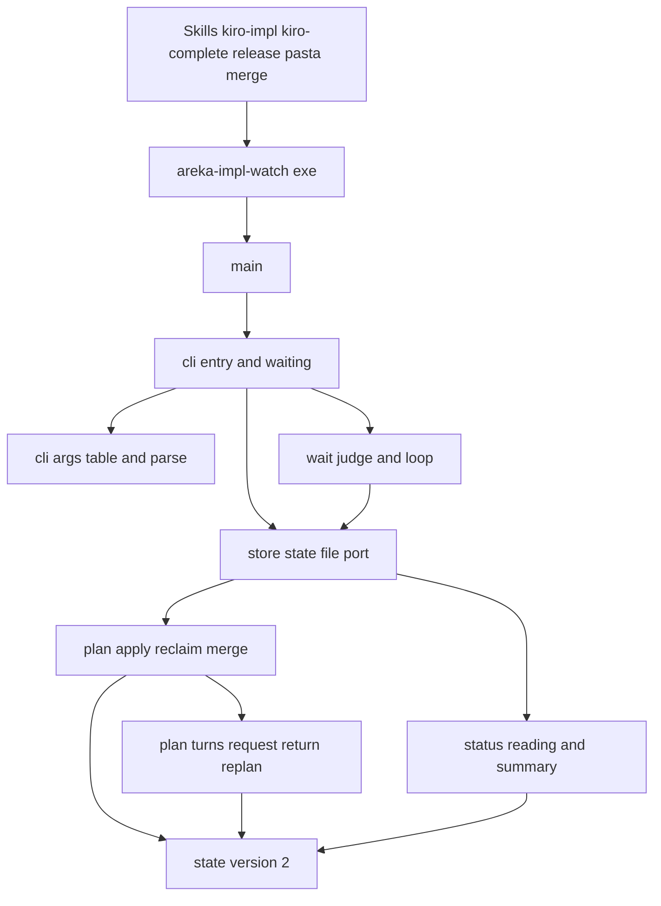
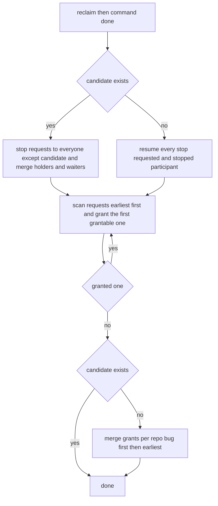
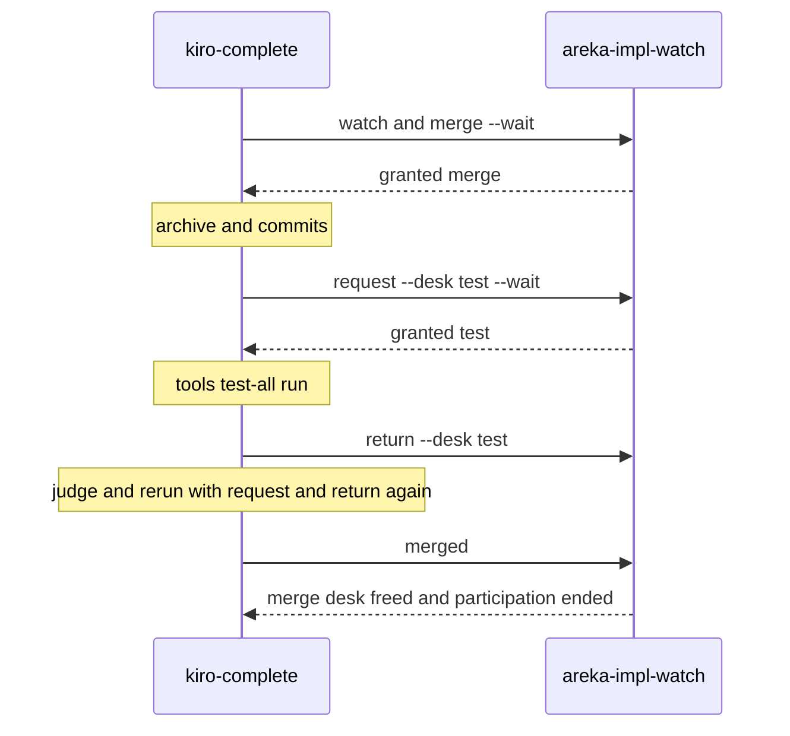
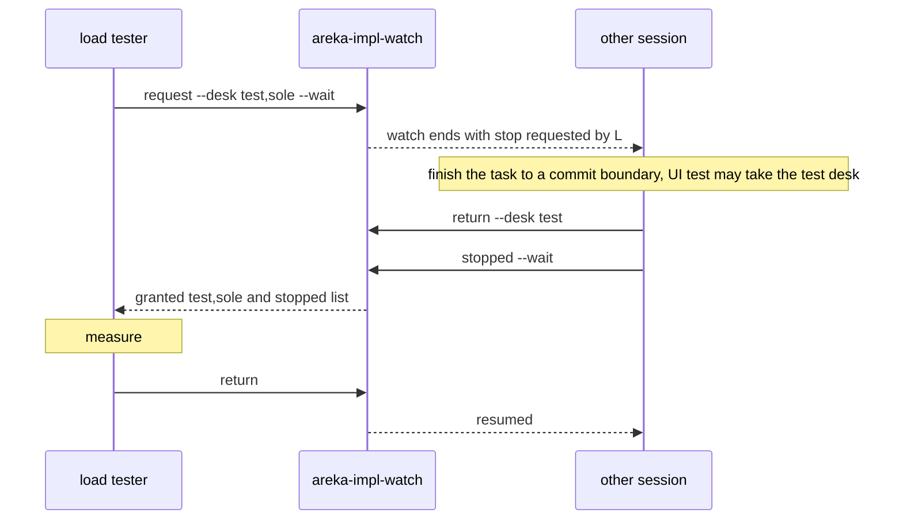

# 設計: areka-P0-impl-watch-test-desk

> 2026-10-18・要件（`requirements.md`・要件の討議で全議題を推奨案で確定）とギャップ分析（`research.md`）から作った。調べの記録と採らなかった案は `research.md` の「設計の段」に在る。この文書だけで判断と約束が読めるように、結論はここにも書く。

## Overview

**目的**: 同じマシンで並んで走る実装セッションに、机の貸し出しのアプリ `areka-impl-watch.exe` が「実装の机」「排他テストの机」「マージの机」の 3 種類を貸し出す。全体テストと実機の UI テストは排他テストの机で 1 本ずつになり、ほかのセッションの実装は止まらない。負荷テストは「排他テストの机＋実装の机のひとり占め」として今どおり全員を止める。

**使う人**: 机を使うスキル（`kiro-impl`・`kiro-complete`・`release`・pasta のマージの手順）を回す Claude のセッションと、`status` で番待ちの訳を読む開発者。

**変わること**: 今の「負荷テストの机」（取ると全員に停止要請）を、停止要請を出さない 1 人用の「排他テストの机」と、停止要請の仕組みをそのまま持つ「実装の机のひとり占め」の 2 つに分ける。2 つの机は 1 本の申し込みの待ち行列で、並べた机が全部そろったときに一度に渡す。マージの机と `merge`・`merged` の呼び方は今のまま残す。状態ファイルの版は 2 へ上がる。

### Goals

- 3 つの机と排他の決まり（要件の机の表）を、アプリの状態・番の決め方・呼び方・表示に落とす。
- 1 回の申し込みで並べた机を一度に渡し、一部だけ渡さず、渡せない申し込みが後ろを止めない（追い越し）。
- 2 つ以上の机を持つ・待つ者どうしが互いに待って止まらないことを、常時テストの小さな全探索で確かめる。
- スキル `kiro-impl`・`kiro-complete`・`release` が、全体テスト・UI テストの間だけ排他テストの机を持つ。

### Non-Goals

- 全体テストのスクリプト `tools/test-all.ps1` の中身・実機の UI テストそのものの直し。
- マージの机をほかの机と 1 回で並べる申し込み（要件の討議で外した）。
- 古い形の状態ファイルを新しい形へ移す仕組み（今どおり `clear` でやり直す）。
- 机の種類を 3 つより増やすこと。リポジトリごとの決まり。

## Boundary Commitments

### This Spec Owns

- `crates/areka-impl-watch/` の全部: 状態の型と版 2・番の決め直し・新しい呼び方 `request`／`return`・`loadtest`／`loaddone` の撤去・`loadrunning` の読み替え・待ちの種類 `request`・`status` と `status.md` の机ごとの表示・常時テストと実機テスト・`Cargo.toml` の説明文。
- 手順書 `doc/impl-watch.md` の机の表・決まり・呼び方・終わり方・スキルからの呼び方・判定の基準・版上げの手順。
- スキルの机の段: `.claude/skills/kiro-impl/SKILL.md` の「Desk coordination」節と、それを指す本文の行（タイミングの参照・決まり文句・最後の検証・審査係へのテストのコマンド）、`.claude/skills/kiro-complete/SKILL.md` の机の前置きと全体テストの前後、`.claude/skills/release/procedure.md` の新しい机の段と `SKILL.md` の 1 行の指し、`.claude/skills/kiro-watch-clear/SKILL.md` の机の語（説明文と、`clear` の後に見える要約の行の書き方。呼び方は変えない）。
- 「全体テスト・UI テスト」と「負荷テスト」の判定の基準（正本は手順書・`kiro-impl` は写しを持つ）。

### Out of Boundary

- `tools/test-all.ps1`・`tools/impl-watch-install.ps1`（変えない。版が上がったら入れ直すだけ）。
- スキル `kiro-validate-impl`・`kiro-review`・`kiro-next` の文（`kiro-impl` の側で覆う。`kiro-next` の `clear --repo` は新しい机も外すので直さない）。
- pasta のリポジトリのスキル（`merge`・`merged` と参加・離脱の呼び方が今のまま動く）。
- steering の `structure.md` の Impl Watch Crate の節（完了の手順の文書の同期で合わせる）。
- 実機の UI テストの中で areka を 1 つに限る仕組み、areka の実行時のコード。

### Allowed Dependencies

- 今の依存（`serde`・`serde_json`・`thiserror`・`tracing`・`tracing-subscriber`、テストの `temp-path-kit`）だけ。新しい依存は足さない。
- 判断の中核（`plan.rs` と子の `plan_turns.rs`）は `state` と `error` だけを読み込む。ファイル・時計・プロセス・ログを綴らない（構造テストが見張る）。
- モジュールの読み込みの向き: `error` → `state` → `plan`（子 `turns`）→ `home`／`presence`／`status` → `store` → `wait` → `cli`（子 `args`）→ `main`。逆向きは誤り。
- スキルはアプリを Bash から実行ファイルとして呼ぶだけ（今の呼び方の約束: 主の会話だけが呼ぶ・1 つの作業木で 1 セッション・使えなければ飛ばす）。

### Revalidation Triggers

- コマンドの名前・引数・出力の 1 行・終了コードの意味を変える → 手順書・`kiro-impl`・`kiro-complete`・`release` の終わり方の表と呼び方を合わせ直す。
- `status` の端末の要約の鍵の名前を変える → 手順書 6 節と `kiro-watch-clear` の要約の行を合わせ直す。
- 状態ファイルの項目の意味を変える → 版を上げ、手順書 3 節の手順（入れ直し → `clear` → 申し込み直し）を通す。
- 待ちの種類の綴り（居る印のファイル名）を変える → 手順書 5 節・7 節。
- 判定の基準（要件 9）を変える → 手順書と `kiro-impl` の写しを同時に直す。
- 負荷テストや実機の走行を使うこれからの spec の brief が机の古い呼び方を書いていれば合わせる（2026-10-18 の時点で 0 件）。

## Architecture

### Existing Architecture Analysis

- 形は「純粋な判断の核（`plan::apply` = 回収 → コマンド → 番の決め直し）＋薄い口（置き場所・居る印・状態ファイル・読み物・ログ）」。この形を保つ。
- 今の机は `merge: BTreeMap<リポジトリ, MergeDesk>` と `load: LoadDesk { holder, queue }`。今の `replan` は「負荷テストの段（停止要請 → 番）が在れば早く戻る → 再開 → マージの番」。
- 回収・離脱・取り下げ・マージ済み・`clear --repo` は全部 `remove_from` の 1 か所を通る。新しい机もここで外せば、全部の道で外れる。
- 端末へ出す文は ASCII だけで、本番ファイルのリテラルを構造テスト `main_layering_tests.rs` が一覧で見張る。新しい本番ファイルはこの一覧へ足す。
- `cli.rs`（893 行）は足す前に割る。`plan.rs`（750 行）は番の決め直しを子のファイルへ出す。

### Architecture Pattern & Boundary Map



- **選んだ形**: 今の「判断の核＋薄い口」を保ち、判断の核の中に「申し込み 1 本の待ち行列と、渡せるものが無くなるまで渡す 1 つの見回し」を足す（ギャップ分析の案 C＝マージの待ち行列は今のまま）。
- **境目**: 判断（どの机を誰に渡すか）は `plan`／`plan_turns` だけ。待ちの終わりの 1 行は `wait::judge` だけ。引数の形は `cli_args` だけ。表示は `status` だけ。
- **保つもの**: 回収の決まり・停止要請／止まった／再開の仕組み・`merge_order`（バグ優先）・終了コード 4 通り・待ちは「番が来たら終わるコマンド」1 本・ASCII の出力。
- **新しい部品の訳**: `plan_turns.rs`＝`plan.rs` を 1,000 行の内に保ちつつ、番の決め方を 1 か所に集める。`cli_args.rs`＝`cli.rs` を割る（引数の表と読み／手順）。

### Technology Stack

| 層 | 選んだもの / 版 | この spec での役目 | メモ |
|---|---|---|---|
| CLI | Rust（ワークスペースの版）・標準ライブラリだけの引数の読み | `request`／`return` と `--desk` の読み | 新しい依存なし |
| 状態 | `serde`／`serde_json` 1 | `state.json` 版 2 | 項目の形が変わるので版を上げる |
| ログ | `tracing`・`tracing-subscriber`（ワークスペースの版） | 出来事 1 件 1 行（`Debug` の綴り） | 新しい出来事の種類が増えるだけ |
| テスト | `temp-path-kit`（dev） | 実機テストの置き場所を `target\` の下へ | 今のまま |

## 設計の決定（ギャップ分析の論点への答え）

| 論点 | 決定 |
|---|---|
| 状態の持ち方 | マージの待ち行列は今のまま。排他テストの机・ひとり占めの申し込みは新しい 1 本の待ち行列 `requests`。持ち主は `test`（排他テストの机）と `sole`（ひとり占め）の 2 つ |
| 呼び方 | 新しく `request`（申し込み）と `return`（返す）。机は `--desk` に `test`・`sole`・`test,sole` で並べる。`merge`・`merged` と参加・停止・取り下げ・離脱・`tick`・`status`・`clear` は今のまま |
| 今の負荷テストの呼び方 | `loadtest` と `loaddone` は消す（読み替え: `request --desk test,sole`・`return`）。`loadrunning` は名前・引数・出力を残し、排他テストの机とひとり占めの両方の「走っている持ち主」の記録にする |
| 番の出力 | `granted test`・`granted sole; stopped: <識別>, …`・`granted test,sole; stopped: …`。並んだら `queued <机> pos=<順番>` |
| 端末の要約 | 1 行目の鍵を `participants= sole= test= requests= merging= merge-queued= not-working= waits=` にする。机ごとに `impl:`・`test:`・`merge <R>:` の行 |
| 排他テストの机を空けた訳 | 「最近の出来事」に種類 `test-freed` を足し、訳（`returned`・`stopped`・`reclaimed`・`cancelled`・`left`・`merged`）を残す |
| 行き詰まりの無さ | 名前のある場面のテストに加えて、参加者 3 人の小さな全探索のテスト（深さは固定の定数・到達したすべての状態で不変の決まりと固定点を確かめ、どの状態からも協力的な進め方で全部の申し込みが渡る） |
| `kiro-impl` の最後の検証 | `/kiro-validate-impl` を呼ぶ前に排他テストの机を取り、終わるまで持ち、終わったら返す |
| 審査係のテスト | `kiro-impl` が審査係へ渡すテストのコマンドに、机の要る段は主の会話が排他テストの机を持つときだけ入れる |
| `release` の机の段の置き場所 | 正本の `procedure.md` に新しい節を置き、`SKILL.md` は 1 行で指す。全体テスト（3.1）と起動の確かめ（3.3）で 1 回ずつ取って返す |
| `kiro-watch-clear` | 説明文の机の語と、`clear` の後に見える要約の行を合わせる（呼び方は同じ） |
| 机を持つ者の `merge`・マージを待つ者の `request` | どちらも状態を変えずに当てはまらない（3）で断る（要件 4.7・4.8。設計の討議で確定）。待ちの向きが「マージの持ち主 → 排他テストの机」だけになり、輪はアプリの形で生まれない（下の「行き詰まりが無い訳」）。スキルの約束どおりなら断られる場面は無く、pasta の呼び方も変わらない |
| ファイルの割り方 | `cli.rs` → `cli.rs`（手順）＋`cli_args.rs`（引数の表と読み）。`plan.rs` → `plan.rs`＋`plan_turns.rs`（申し込み・返し・番の決め直し） |

## コマンドの表（変わる行だけ。ほかは今のまま）

| コマンド | 要る引数 | 任意の引数 | `--wait` | すること | 0 | 3 |
|---|---|---|---|---|---|---|
| `request` | `--id` `--repo` `--desk` `--purpose` | `--name` | 取る | 並べた机の申し込み 1 つ（参加を兼ねる） | 並んだ・番が来た（`--wait` なら番が来た） | 当てはまらない（`--wait` なら、加えて申し込みが消えた） |
| `return` | `--id` | `--desk` | 取らない | 名指しした机、名指しが無ければマージの机のほかの全部を返す | 返した | 持っていない机 |
| `loadrunning` | `--id` `--repo` `--purpose` | `--name` | 取らない | 走っている負荷テストを、排他テストの机とひとり占めの両方の持ち主として記録する | 記録した | どちらかの机に持ち主が居る |
| `loadtest`・`loaddone` | — | — | — | 消す（手順書に読み替えを書く） | — | — |

- コマンドの数は 14 のまま（`loadtest`・`loaddone` を消し、`request`・`return` を足す）。`--help` は表から組むので自動で合う。
- `--id` がほかの参加者を名指してよいコマンドに `return` が入る（今の `loaddone` と同じ。開発者が代わりに返せる）。

### `--desk` の値の形

- 値は `test`・`sole` を `,` でつないだ 1 つの値（`test`・`sole`・`test,sole`・`sole,test`）。
- 次は使い方の誤り（終了コード 2・何も読み書きしない。要件 2.5）: 空・同じ名前を 2 度・知らない名前・`merge`。誤りの文は ASCII の 1 行 `request: --desk must be test, sole or test,sole (the merge desk is requested with merge)`（形の決まりの綴りは `--help` の `options:` と同じ）。
- `--desk` を 2 度書くのは今の読みどおり `--desk given twice` で断る。

### 出力の 1 行（ASCII・名前と内容は出さない）

| 呼び出し | 0 の標準出力 | 3 の標準エラー |
|---|---|---|
| `request`（番が来ている） | `granted <机>`、ひとり占めを含むなら `granted <机>; stopped: <識別>, … ｜ none` | `not applied: a different desk request is already waiting` ／ `not applied: desks are held; only a merge holder may add the test desk` ／ `not applied: a merge request is waiting; request desks after the merge desk is granted` |
| `merge`（排他テストの机かひとり占めを持つ者） | — | `not applied: return the test and sole desks before merge` |
| `request`（並んだ） | `queued <机> pos=<順番>` | 同上 |
| `request --wait` | 番が来た 1 行（上と同じ） | 上の `not applied: …`、または `gone: request gone` |
| `return` | `returned <机>` | `not applied: not the holder of that desk` ／ `not applied: holds no desk to return` |
| `loadrunning` | `recorded running load` | `not applied: the test desk or the sole desk already has a holder` |

- `<机>` は `test`・`sole`・`test,sole` のどれか（並べた順に依らず、この綴りに揃える）。
- `pos=` は申し込みの早い順で数えた、自分より前の申し込みの数＋1（追い越しが在るので目安）。
- `--wait` 付きの申し込みが当てはまらなかったときは、待ちに入らず、待ちの記録も置かずに 3 で終わる。この決まりは `stopped --wait` には掛けない（今どおり、停止要請中でなければ再開の待ちだけになる）。

## 番の決め方

### 決まり（判断の核が守る）

1. **一度に渡す**: 申し込みに並べた机が全部渡せるときだけ、同じ呼び出しの中で全部を渡す。一部だけ渡さない（2.2・2.3）。
2. **早い順に見て、渡せる最初の申し込みに渡す**を、渡せるものが無くなるまで繰り返す。渡せない申し込みのために机を取っておかない（3.1・3.3）。
3. **排他テストの机が渡せる**: 持ち主が居ない、かつ（ひとり占めを含む申し込みが待たれていない、または申し込んだ者が「停止要請中」、またはどこかのリポジトリのマージの持ち主）（1.3・3.4）。ひとり占めを含む申し込み自身の排他テストの机には、この但し書きを掛けない（ひとり占めの条件で一緒に渡る）。
4. **ひとり占めが渡せる**: 持ち主が居ない、かつその申し込みが候補（ひとり占めを含む申し込みのうち最も早いもの）、かつ止まる必要のある全員が「止まった」、かつどのリポジトリにもマージの持ち主が居ない（5.2）。
5. **「止まった」の者には渡さない**: ひとり占めを含まない申し込みは、申し込んだ者が「止まった」なら渡さない（3.5）。ひとり占めを含む申し込みは今の負荷テストと同じく渡し、そのとき「作業中」へ戻す。
6. **マージの番**: 候補（ひとり占めの持ち主か、ひとり占めを含む申し込み）が在る間は出さない。無ければ今どおりリポジトリごとに「バグ優先 → 申し込みの早い順」（3.2・5.3）。

### 番の決め直しの段（毎回の呼び出しの最後に 1 回）



- 候補の有無は見回しの前後で変わらない（見回しは机を渡すだけで、ひとり占めを含む申し込みを渡さずに消すことは無い。ひとり占めを渡せば、候補は同じ識別のまま持ち主になる）。だから再開を見回しの前に置ける。再開を先に置くので、ひとり占めが終わった呼び出しの中で、再開した者の排他テストの申し込みも同じ呼び出しで渡る。
- 見回しの繰り返しは、渡すたびに机が埋まるか申し込みが減るので、申し込みの数を超えて回らない。同じ状態でもう一度呼んでも何も変わらない（固定点）。
- 停止要請の相手と除く者は今の負荷テストと同じ（申し込んだ本人・どこかのリポジトリでマージの机を持つ・待つ者を除く「作業中」の全員。後から参加した者を含む。走っている印のひとり占めなら出さない。5.1・5.4）。

### 行き詰まりが無い訳（3.6）

- 待ちの向きは次だけ: 排他テストの机の申し込み → 排他テストの机の持ち主／候補 → 止まる必要のある者（その者は今のタスクの切れ目まで進めるので、排他テストの机の持ち主を待つことがある）とマージの持ち主（排他テストの机を受けられるので済んで空く）／マージの待ち → マージの持ち主。
- 排他テストの机とひとり占めの持ち主は、ほかのどの番も待たずに、走行が終わったら返す（スキルの約束。10.2・11.3・12.1。アプリも止まった報告で排他テストの机を空ける＝6.2）。だから待ちの向きは、出口の無い輪を作らない。
- 持ちながら別の机を待てるのは「マージの持ち主の排他テストの申し込み」だけ（4.1・4.2）で、その間ひとり占めの候補はマージの持ち主へ排他テストの机を譲る（決まり 3）ので、マージは済んで空き、候補の番が来る。
- 排他テストの机かひとり占めを持つ者の `merge` と、マージを待つ（まだ持たない）者の `request` は断る（4.7・4.8）。だから排他テストの机とひとり占めの持ち主は何も待たず、待ちの輪はスキルの約束に頼らずアプリの形で生まれない。スキルの約束（走行の後で返す）が要るのは、待ちが有限の時間で終わることだけ。全探索は、この形を不変の決まりとしてすべての到達した状態で確かめる。

## File Structure Plan

### Directory Structure

```
crates/areka-impl-watch/
├── Cargo.toml                  # 説明文の机の語を 3 つの机へ
├── src/
│   ├── main.rs                 # モジュールの宣言と読み込みの向きのコメント（cli の子 args を書き足す）
│   ├── state.rs                # 版 2・DeskSet・DeskRequest・TestHolder・SoleHolder・WaitKind::Request・RecentKind::TestFreed
│   ├── plan.rs                 # apply・Command／Event／Verdict・回収・マージ・参加・remove_from（机を外す 1 か所）
│   ├── plan_turns.rs           # 新: plan の子。request／return／loadrunning／止まった報告での空け・free_test・replan・request_order
│   ├── wait.rs                 # WaitSpec::Request と judge の番の 1 行
│   ├── cli.rs                  # 入口・dispatch・waiting（当てはまらない申し込みは待たずに 3）・change・result_line・status・clear
│   ├── cli_args.rs             # 新: cli の子。Opt（--desk を足す）・Shape::Desks・COMMANDS 14 行・--help・parse
│   ├── status.rs               # 机ごとの読み物の節と端末の要約
│   ├── store.rs presence.rs home.rs error.rs  # 変えない（版の定数・待ちの種類の綴りが増えるのは state 側）
│   ├── plan_turns_tests.rs     # 新: 一度に渡す・一部を渡さない・追い越し・3.4・3.5・持ちながら・返し方・2.7・2.8・loadrunning
│   ├── plan_liveness_tests.rs  # 新: 名前のある行き詰まりの場面と、参加者 3 人の小さな全探索
│   ├── cli_args_tests.rs       # cli_tests.rs から引数の読みと --help のテストを移した先（--desk の形を足す）
│   ├── cli_desk_tests.rs       # 新: request／return／loadrunning の往復の出力と終了コード・--wait の 3
│   └── （既存の兄弟テスト）     # 負荷テストの机の綴りを新しい机へ書き直す（下の Modified Files）
└── tests/
    ├── real.rs                 # 負荷テストの往復を request／return へ・2 プロセスの取り合いの 1 本を足す・版の文
    └── real/mod.rs             # 支えは今のまま（足すなら小さな関数だけ）
doc/impl-watch.md               # 1・3・4・5・6・7 節を 3 つの机へ・判定の基準を足す
.claude/skills/kiro-impl/SKILL.md
.claude/skills/kiro-complete/SKILL.md
.claude/skills/release/procedure.md     # 新しい節「机の段」と 3.1・3.3・4.2 の前後
.claude/skills/release/SKILL.md         # 机の段を指す 1 行
.claude/skills/kiro-watch-clear/SKILL.md
```

### Modified Files

- `src/plan_desk_tests.rs`・`src/plan_stop_tests.rs`・`src/plan_reclaim_tests.rs`・`src/plan_clear_tests.rs`・`src/plan_test_support.rs` — 負荷テストの机のテストを、`request --desk test,sole`／`return` の同じ振る舞いへ書き直す（停止要請・止まった・再開・取り消しの決まりは変えずに引き継ぐ＝5.4 の檻）。どれも 1,000 行を超えない（超えそうなら新しいテストは `plan_turns_tests.rs` へ置く）。
- `src/cli_tests.rs` — 引数の読みと `--help` のテストを `cli_args_tests.rs` へ移し、置き場所の失敗など入口のテストを残す。
- `src/cli_commands_tests.rs`・`src/cli_wait_tests.rs`・`src/cli_test_support.rs` — `loadtest` の往復と待ちのテストを `request` へ（新しい往復は `cli_desk_tests.rs`）。
- `src/status_tests.rs`・`src/state_tests.rs`・`src/store_tests.rs`・`src/store_ports_tests.rs`・`src/wait_tests.rs`・`src/wait_loop_tests.rs`・`src/presence_tests.rs` — 新しい型・綴り・版の文へ。
- `src/main_layering_tests.rs` — 純粋さの見張りを `plan.rs` と `plan_turns.rs` の 2 本へ広げ、ASCII の見張りの一覧に `cli_args.rs`・`plan_turns.rs` を足す（11 本）。足さないと見張りが空振りする。

## System Flows

### 完了の手順（areka のマージ）



- 排他テストの机の番待ちは開発者への 1 行の知らせ（`排他テストの机の番待ち`）だけで、承認の止まりにしない（11.5）。

### 負荷テストと停止要請



## Requirements Traceability

| 要件 | 要約 | 部品 | 約束 | 流れ |
|---|---|---|---|---|
| 1.1 | 3 つの机 | state | `State.test`・`State.sole`・`State.merge`（実装の机は参加者の集まり） | — |
| 1.2 | 作業中＝実装の机に乗る・上限なし | state・status | 参加者の状態（今のまま）・`impl: riding=` | — |
| 1.3 | 排他テストの机は 1 人 | plan_turns | 決まり 3（持ち主が居ない） | 番の決め直し |
| 1.4 | 排他テストの机は停止要請を出さない | plan_turns | 停止要請の候補はひとり占めだけ | 番の決め直し |
| 1.5 | リポジトリ名で決まりを変えない | plan・plan_turns | 判断にリポジトリ名の分岐を持たない | — |
| 1.6 | 負荷テスト＝排他テストの机＋ひとり占め | state・cli_args・手順書 | `DeskSet::TestSole`・`loadtest` の撤去と読み替え | 負荷テスト |
| 2.1 | 机を並べた 1 つの申し込み・参加を兼ねる・マージは並べない | cli_args・plan_turns | `request`・`Command::Request`・`--desk` | — |
| 2.2 | 一部だけ渡さない | plan_turns | 決まり 1 | 番の決め直し |
| 2.3 | 全部渡せたら同じ呼び出しで一度に | plan_turns | `grant_one` | 番の決め直し |
| 2.4 | 渡した机と止まった一覧を伝える | wait・cli | `granted <机>[; stopped: …]` | — |
| 2.5 | 同じ机 2 度・知らない名前・0 個・マージ → 使い方の誤り | cli_args | `Shape::Desks` | — |
| 2.6 | 内容を記録し status.md で読める | state・status | `DeskRequest.purpose`・`TestHolder.purpose` | — |
| 2.7 | 同じ組の再申し込みは二重にしない・持っていれば直ちに番 | plan_turns・wait | `Request` の分岐・`judge` | — |
| 2.8 | 待つ申し込みは 1 つ | plan_turns | `NotApplied("a different desk request is already waiting")` | — |
| 3.1 | 毎回の番の決め直し | plan | `apply` の最後の `replan` | 番の決め直し |
| 3.2 | マージはリポジトリの中でバグ優先 | plan・plan_turns | `merge_order`（今のまま） | — |
| 3.3 | 追い越し・取っておかない | plan_turns | 決まり 2 | 番の決め直し |
| 3.4 | ひとり占めが待たれる間、排他テストの机は停止要請中とマージの持ち主へ | plan_turns | 決まり 3 | 負荷テスト |
| 3.5 | 止まった者には渡さない | plan_turns | 決まり 5 | — |
| 3.6 | 行き詰まりが無い | plan_turns・plan_liveness_tests | 行き詰まりが無い訳・全探索 | — |
| 4.1 | マージの持ち主は排他テストの机を足して申し込める | plan_turns | `Request` の分岐 | 完了の手順 |
| 4.2 | ほかの持ちながらの申し込みは当てはまらない | plan_turns | `NotApplied("desks are held; …")` | — |
| 4.3 | 名指しした机だけ返す | plan_turns | `Return { desks: Some(_) }` | — |
| 4.4 | 名指しなしはマージの机のほかを全部 | plan_turns | `Return { desks: None }` | — |
| 4.5 | 持っていない机 → 当てはまらない | plan_turns | `NotApplied("not the holder of that desk")` ほか | — |
| 4.6 | ひとり占めを返すと再開 | plan_turns | 番の決め直しの再開の段 | 負荷テスト |
| 4.7 | 机を持つ者の `merge` は当てはまらない | plan | `NotApplied("return the test and sole desks before merge")` | — |
| 4.8 | マージを待つ者の申し込みは当てはまらない | plan_turns | `Request` の分岐 3a | — |
| 5.1 | 停止要請の相手 | plan_turns | 停止要請の段（今の `plan_load` の写し） | 負荷テスト |
| 5.2 | ひとり占めを渡す条件 | plan_turns | 決まり 4 | 負荷テスト |
| 5.3 | 候補が在る間は新しいマージの持ち主を作らない | plan_turns | 決まり 6 | 番の決め直し |
| 5.4 | 停止要請・止まった・再開・取り消しを変えずに引き継ぐ | plan・plan_turns | `Stopped`・`Unstop`・`resume`・`back_to_work`（今のまま） | — |
| 5.5 | 走っている負荷テストの記録 | plan_turns・cli_args | `loadrunning` → 両方の持ち主・`running` | — |
| 5.6 | どちらかに持ち主が居れば当てはまらない | plan_turns | `NotApplied("the test desk or the sole desk already has a holder")` | — |
| 6.1 | 回収で排他テストの机と申し込みも外す | plan | `reclaim` → `erase` → `remove_from` | — |
| 6.2 | 止まった報告で排他テストの机を空け、記録する | plan_turns・state・status | `free_test(why="stopped")`・`RecentKind::TestFreed` | 負荷テスト |
| 6.3 | 取り下げは申し込みと机を全部外し、参加者は残す | plan | `Cancel` → `remove_from` | — |
| 6.4 | 離脱・マージ済み・リポジトリの記録の消し | plan | `depart` → `erase` → `remove_from` | — |
| 7.1 | `merge`・`merged` は今のまま | cli_args・plan | 表の行と出力を変えない | 完了の手順 |
| 7.2 | ほかの今の呼び方も今のまま | cli_args | 表の行を変えない | — |
| 7.3 | 負荷テストの呼び方の扱い | cli_args・手順書 | `loadtest`・`loaddone` を消して読み替えを書く・`loadrunning` を残す | — |
| 7.4 | 版を上げ、知らない版は読まずに 1 で終わる | state・store | `VERSION = 2`・今の版の先見 | — |
| 7.5 | 移さない・`clear` は通す | store | 今のまま | — |
| 8.1 | 机ごとの端末の要約 | status | `render_terminal` | — |
| 8.2 | status.md の申し込み・空けた訳 | status | `render_markdown` の節 | — |
| 8.3 | 端末は ASCII・名前と内容は出さない | status・cli・wait | 今の逃がし・構造テスト | — |
| 8.4 | 終了コード 4 通り・`--help` と手順書 | cli・cli_args・手順書 | `exit_code`・表の `note` | — |
| 8.5 | 待ちは 1 本のコマンド | wait | `WaitSpec::Request`（ループは今のまま） | — |
| 9.1 | 排他テストの机を取る段の基準 | 手順書・kiro-impl | 判定の基準の表 | — |
| 9.2 | 数えないもの | 手順書・kiro-impl | 判定の基準の表 | — |
| 9.3 | 負荷テストの基準 | 手順書・kiro-impl | 判定の基準の表 | — |
| 9.4 | タスクの文から決める | kiro-impl | 机のタイミング 2 | — |
| 10.1 | 段の前に申し込み、番まで入らない | kiro-impl | 決まり文句と `MISSING` の流れ | — |
| 10.2 | 走行の後で直ちに返す・直しの間は持たない | kiro-impl | 机のタイミング 3 | — |
| 10.3 | 負荷テストは 2 つを並べて 1 回で | kiro-impl | `request --desk test,sole` | 負荷テスト |
| 10.4 | サブエージェントは知らせたときだけ回す | kiro-impl | 決まり文句 | — |
| 10.5 | 停止要請の切れ目で返してから止まった | kiro-impl | 机のタイミング 4 | 負荷テスト |
| 10.6 | 今の約束を保つ | kiro-impl | 呼び方の約束の節（今のまま） | — |
| 10.7 | `/kiro-validate-impl` の間は持つ | kiro-impl | Step 4 の前後 | — |
| 10.8 | 審査係のテストのコマンド | kiro-impl | 検証のコマンドの渡し方 | — |
| 11.1 | マージの机は手順の全部で持つ | kiro-complete | 前置き（今のまま） | 完了の手順 |
| 11.2 | 全体テストの前にマージを持ったまま申し込む | kiro-complete | 5-2・7-1 の回し直し・7-4 の前 | 完了の手順 |
| 11.3 | 走行の後で排他テストの机だけ返す | kiro-complete | `return --desk test` | 完了の手順 |
| 11.4 | やめる・済んだで空ける | kiro-complete・plan | `cancel`・`merged`・`leave` → `remove_from` | 完了の手順 |
| 11.5 | 番待ちは 1 行・承認の止まりにしない | kiro-complete | 知らせの文 | — |
| 12.1 | 3.1・3.3・4.2 の回し直しの前後 | release | 机の段 | — |
| 12.2 | マージの机を取らない | release | 机の段 | — |
| 12.3 | 使う間だけ参加 | release | `watch` → … → `leave` | — |
| 12.4 | 停止要請の切れ目 | release | 机の段 | — |
| 12.5 | 止まり方の決まりに数えない | release | 「止まり方の決まり」に 1 行 | — |
| 12.6 | 使えなければ飛ばす | release | 前置きの判定 | — |
| 13.1 | 手順書の中身 | 手順書 | 下の「手順書の中身」 | — |
| 13.2 | 版上げの更新の手順 | 手順書 | 3 節 | — |
| 13.3 | 常時テスト | plan_turns_tests・plan_liveness_tests・cli_desk_tests | Testing Strategy | — |
| 13.4 | 実機テスト | tests/real.rs | 2 プロセスの取り合い | — |
| 13.5 | 全体テストは常時だけ拾う | tests/real.rs | `#[ignore]` を保つ | — |

## Components and Interfaces

| 部品 | 層 | 役目 | 要件 | 主な依存 | 約束 |
|---|---|---|---|---|---|
| `state.rs` | 中核の型 | 版 2 の状態 | 1.1, 1.6, 2.6, 6.2, 7.4 | serde (P0) | State |
| `plan.rs` | 中核 | 入口・回収・マージ・机を外す 1 か所 | 1.5, 3.1, 3.2, 5.4, 6.1, 6.3, 6.4, 7.1, 11.4 | state (P0) | Service |
| `plan_turns.rs` | 中核 | 申し込み・返し・番の決め直し | 1.3, 1.4, 2.1〜2.3, 2.7, 2.8, 3.3〜3.6, 4.1〜4.6, 5.1〜5.6, 6.2 | plan (P0)・state (P0) | Service |
| `wait.rs` | 流れ | 申し込みの待ちの終わり | 2.4, 2.7, 8.5 | plan (P0)・status (P1) | Service |
| `cli_args.rs` | 入口 | 引数の表と読み | 2.1, 2.5, 7.1〜7.3, 8.4 | plan (P0) | API |
| `cli.rs` | 入口 | 手順と出力 | 2.4, 8.3, 8.4 | cli_args・wait・store (P0) | API |
| `status.rs` | 表示 | 机ごとの読み物と要約 | 1.2, 2.6, 6.2, 8.1〜8.3 | state (P0) | — |
| 手順書・スキル | 文書 | 呼び方と机の段 | 9.x, 10.x, 11.x, 12.x, 13.1, 13.2 | アプリの呼び方 (P0) | — |

### 中核

#### `state.rs`

| 項目 | 内容 |
|---|---|
| 役目 | 版 2 の状態の型・空の状態・列挙の ASCII の綴り |
| 要件 | 1.1, 1.6, 2.6, 6.2, 7.4 |

**責務と制約**
- `VERSION = 2`。今の `load: LoadDesk`・`LoadRequest`・`LoadHolder`・`WaitKind::Load` を消す。
- 不変（守るのは判断の核）: 1 つの識別は `requests` に高々 1 回。`requests` に居る識別は `test`・`sole` を持たない。`sole` が走っている印つきなら `test` も同じ識別が持つ。`waits` は `(id, kind)` で高々 1 件（今のまま）。

```rust
pub const VERSION: u32 = 2;

pub struct State {
    pub version: u32,
    pub participants: BTreeMap<String, Participant>,
    pub merge: BTreeMap<String, MergeDesk>,      // 今のまま
    pub test: Option<TestHolder>,                // 排他テストの机の持ち主
    pub sole: Option<SoleHolder>,                // 実装の机のひとり占めの持ち主
    pub requests: Vec<DeskRequest>,              // 排他テストの机・ひとり占めの申し込み（1 本）
    pub waits: Vec<WaitRecord>,
    pub recent: Vec<Recent>,
}

/// 申し込みに並べる机の組。空の組は作れない。綴りは "test" / "sole" / "test,sole"。
#[serde(...)] pub enum DeskSet { Test, Sole, TestSole }
impl DeskSet {
    pub const fn has_test(self) -> bool;
    pub const fn has_sole(self) -> bool;
    pub const fn as_str(self) -> &'static str;
    pub const fn from_parts(test: bool, sole: bool) -> Option<DeskSet>;
}

pub struct DeskRequest { pub id: String, pub desks: DeskSet, pub purpose: String, pub requested: u64 }
pub struct TestHolder  { pub id: String, pub purpose: String, pub requested: u64, pub granted: u64 }
pub struct SoleHolder  { pub id: String, pub purpose: String, pub requested: u64, pub granted: u64,
                         pub running: bool, pub stopped: Vec<String> }

pub enum WaitKind { Watch, Merge, Request, Resume }            // "request" は居る印のファイル名にも使う
pub enum RecentKind { Reclaimed, Recovered, Cleared, TestFreed } // "test-freed"
```

#### `plan.rs`

| 項目 | 内容 |
|---|---|
| 役目 | 判断の入口 `apply`・コマンドと出来事の型・回収・マージの机・参加の出入り・机を外す 1 か所 |
| 要件 | 1.5, 3.1, 5.4, 6.1, 6.3, 6.4, 7.1, 11.4 |

**責務と制約**
- `apply` の順は今のまま「回収 → コマンド → `turns::replan`」。
- `remove_from(state, id, why, now, events)` が、マージの机（全リポジトリ）・`requests`・`test`・`sole` からその識別を外す唯一の場所。排他テストの机を外すときは `turns::free_test` を通して訳を残す。訳は呼び手が渡す: 取り下げ `cancelled`・離脱 `left`・マージ済み `merged`・回収 `reclaimed`・`clear --repo` は `left`。
- マージの申し込み（`Merge`）・`Merged`・参加の決まりは、今ある状態では変えない（7.1・7.2）。足すのは 1 つだけ: `Merge` の申し込み手が `test` か `sole` を持てば、状態を変えずに `NotApplied("return the test and sole desks before merge")`（4.7。今は無い状態なので互換を崩さない）。判断はリポジトリの名前で分岐しない（1.5）。

**約束**: Service

```rust
pub enum Command {
    Watch { id: String, name: Option<String>, repo: String, pid: u32 },
    Merge { id: String, name: Option<String>, repo: String, spec: String, bug: bool },
    Merged { id: String, pr: String, sha: String },
    /// 新: 排他テストの机・ひとり占めの申し込み。参加を兼ねる。
    Request { id: String, name: Option<String>, repo: String, desks: DeskSet, purpose: String },
    /// 新: 返す。None はマージの机のほかの全部。
    Return { id: String, desks: Option<DeskSet> },
    /// 走っている負荷テストの記録（排他テストの机とひとり占めの両方）。
    LoadRunning { id: String, name: Option<String>, repo: String, purpose: String },
    Stopped { id: String },
    Unstop { id: Option<String> },
    Cancel { id: String },
    Leave { id: String },
    RegisterWait { record: WaitRecord },
    UnregisterWait { id: String, kind: WaitKind },
    Tick,
    ClearRepo { repo: String },
}

pub enum Event {
    // 今の Joined・Left・Cancelled・MergeRequested・MergeGranted・Merged・StopRequested・Stopped・
    // Resumed・Unstopped・Reclaimed・WaitRegistered・WaitRemoved・Recovered・Cleared・LoadRunning は残す。
    DeskRequested { id: String, desks: DeskSet },
    /// stopped はひとり占めを含むときだけ中身が在る。
    DeskGranted { id: String, desks: DeskSet, stopped: Vec<String> },
    DeskReturned { id: String, desks: DeskSet },
    /// 排他テストの机が空いた。why は returned / stopped / reclaimed / cancelled / left / merged。
    TestFreed { id: String, why: &'static str },
}

pub fn apply(state: &mut State, cmd: &Command, caller: Option<&str>, now: u64,
             alive: &dyn Presence) -> Applied;
pub use turns::request_order;   // 読み物と pos= も同じ順で並べる
pub fn merge_order(queue: &[MergeRequest]) -> Vec<usize>;   // 今のまま
```

- 消すもの: `Command::LoadTest`・`Command::LoadDone`・`Event::LoadRequested`・`Event::LoadGranted`・`Event::LoadDone`・`load_order`・`plan_load`。

#### `plan_turns.rs`（`plan` の子モジュール `turns`）

| 項目 | 内容 |
|---|---|
| 役目 | 申し込み・返し・走っている負荷テストの記録・止まった報告での空け・番の決め直し |
| 要件 | 1.3, 1.4, 2.1〜2.3, 2.7, 2.8, 3.3〜3.6, 4.1〜4.6, 5.1〜5.6, 6.2 |

**責務と制約**
- 親の私的な手助け（`join`・`resume`・`back_to_work`・`drop_where`）を `super::` で使う。ファイル・時計・プロセス・ログを綴らない（構造テストの純粋さの見張りの対象）。
- `Request` の分岐（状態を変えない断りは参加より先に見る）:
  1. 自分の申し込みが `requests` に在る: 同じ組なら何も変えず `Applied`（2.7）。違う組なら `NotApplied("a different desk request is already waiting")`（2.8）。
  2. `test` か `sole` を持つ: 持つ組が同じ組なら `Applied`（直ちに番。2.7）。違えば `NotApplied("desks are held; only a merge holder may add the test desk")`（4.2）。
  3. どこかのリポジトリでマージの机を持つ: 組が `Test` だけなら次へ（4.1）。ほかは 2 と同じ断り（4.2）。
  3a. どこかのリポジトリでマージの机を待つ（持ってはいない）: `NotApplied("a merge request is waiting; request desks after the merge desk is granted")`（4.8）。
  4. 参加（無ければ作業中で登録・名前とリポジトリを更新）→ `requests` の末尾へ `DeskRequest { requested: now }` を足し、`DeskRequested` を出す（2.1・2.6）。申し込んだ者の状態（作業中・停止要請中・止まった）は変えない。
- `Return`: 持つ組を「`test` の持ち主か」「`sole` の持ち主か」で求める。名指しありは名指しの全部を持つときだけ全部を空ける（`not the holder of that desk`）。名指しなしは持つ全部を空ける（何も持たなければ `holds no desk to return`）。排他テストの机は `free_test(why="returned")`、ひとり占めは外して `DeskReturned` を出す（4.3〜4.5）。再開は番の決め直しの段が行う（4.6）。
- `LoadRunning`: `test` か `sole` に持ち主が居れば断る（5.6）。居なければ参加 → 「作業中」へ戻す → 自分の申し込みを `requests` から外す → 両方の持ち主にする（`sole.running = true`・`stopped` は空。5.5）。
- 止まった報告の後段: `Stopped` が当てはまり、その者が `test` を持っていれば `free_test(why="stopped")`（6.2）。
- `free_test(state, why, now, events)`: `test` を外し、`TestFreed` を出し、最近の出来事に `TestFreed`（`detail` = 訳）を足す。排他テストの机を空ける道は全部ここを通る。
- `replan`: 上の「番の決め直しの段」。候補 = `sole` の持ち主、無ければ `request_order` で最も早いひとり占めを含む申し込み。`grant_one` を渡せなくなるまで繰り返す。

```rust
pub(super) fn request(state: &mut State, id: &str, name: Option<&str>, repo: &str, desks: DeskSet,
                      purpose: &str, now: u64, events: &mut Vec<Event>) -> Verdict;
pub(super) fn give_back(state: &mut State, id: &str, desks: Option<DeskSet>, now: u64,
                        events: &mut Vec<Event>) -> Verdict;
pub(super) fn load_running(state: &mut State, id: &str, name: Option<&str>, repo: &str,
                           purpose: &str, now: u64, events: &mut Vec<Event>) -> Verdict;
pub(super) fn free_test(state: &mut State, why: &'static str, now: u64, events: &mut Vec<Event>);
pub(super) fn replan(state: &mut State, now: u64, events: &mut Vec<Event>);
/// 申し込みの来る順の添字: 申し込みの早い順・同点は行列の前。
pub fn request_order(requests: &[DeskRequest]) -> Vec<usize>;
/// その識別が持つ排他テストの机・ひとり占めの組（持っていなければ None）。wait と cli も使う。
pub fn held(state: &State, id: &str) -> Option<DeskSet>;
```

- 事前条件: `DeskSet` は空でない（型で保つ）。
- 事後条件: `replan` の後、もう一度 `replan` を呼んでも状態も出来事も変わらない。`requests` に居る識別は `test`・`sole` を持たない。

### 流れ

#### `wait.rs`

| 項目 | 内容 |
|---|---|
| 役目 | 申し込みの待ちの終わりの判定（ループは今のまま） |
| 要件 | 2.4, 2.7, 8.5 |

- `WaitSpec::Load` を `WaitSpec::Request { id }` に替える（種類 `WaitKind::Request`・登録は待ちの記録）。
- `judge(Request)`: 参加者の記録が無い → `Gone("request gone")`。`requests` に自分が在る → まだ待つ。`plan::held` が組を返す → `Done("granted <組>")`、組がひとり占めを含むなら `; stopped: <sole.stopped>` を足す。どれでもない → `Gone("request gone")`。
- 番の 1 行の綴りは `judge` の 1 か所だけに置き、`cli::result_line` の「すでに番が来ている」も `judge` を通す（今の形）。

#### `cli_args.rs`（`cli` の子モジュール `args`）

| 項目 | 内容 |
|---|---|
| 役目 | 引数の種類・値の形・コマンドの表 14 行・`--help` の本文・`parse` |
| 要件 | 2.1, 2.5, 7.1〜7.3, 8.4 |

- 今の `cli.rs` の `Opt`・`OPTIONS`・`Shape`・`Command`（読んだコマンド）・`Invocation`・`UsageError`・`Found`・`Spec`・`Variant`・`COMMANDS`・`HELP`・`FOOT`・`usage`・`parse` をそのまま移す。
- `Opt::Desk`（`--desk`）と `Shape::Desks` を足す。`Shape::Desks` の `accepts` は上の「`--desk` の値の形」、`rule` は `test, sole or test,sole (the merge desk is requested with merge)`。読んだ値は表の `build` で `DeskSet` にする（`accepts` を通った値だけが来る）。
- 表の行: `watch`・`merge`・`merged`・`request`（要る `--id --repo --desk --purpose`・任意 `--name`・`--wait`）・`return`（要る `--id`・任意 `--desk`）・`loadrunning`・`stopped`・`resume`・`unstop`・`cancel`・`leave`・`tick`・`status`・`clear`。
- 行の `note`（`--help` に出る 1 行）:
  - `request`: `queue one request for the listed desks; all are granted at once. 0=queued or granted 3=not applied; with --wait 0=granted 3=request gone or not applied`
  - `return`: `return the named desks, or every desk but the merge desk. 0=returned 3=not the holder`
  - `loadrunning`: `record an already running load test as the holder of the test and sole desks. 0=recorded 3=either desk has a holder`
  - `stopped`: 今の 1 行に `the test desk held is freed` を足す。
  - `cancel`: 今のまま（`drop the requests and desks of the id`）。

#### `cli.rs`

| 項目 | 内容 |
|---|---|
| 役目 | 入口・置き場所の解決・待つコマンドと直ちに終わるコマンドの手順・結果の 1 行・終了コード |
| 要件 | 2.4, 8.3, 8.4 |

- `wait_after`: `Request` → `WaitSpec::Request`（`Merge`・`Stopped` は今のまま）。
- `waiting` の前半: 判断の結果が当てはまらなかったら、`stopped` のほかは待ちに入らず、残っていれば自分の待ちの記録を消し（今の早い終わりと同じ排他の中）、標準エラーへ `not applied: <訳>` を出して 3。
- `result_line`: `Request` は `judge` の番の 1 行、まだなら `queued <組> pos=<n>`。`Return` は `returned <組>`（出来事 `DeskReturned` と `TestFreed{why="returned"}` から組む）。`LoadRunning` は `recorded running load`（今のまま）。
- `subject`（呼んだ識別）に `Request`・`Return` を足す。
- 終了コードの写像 `exit_code` は今のまま 4 通り（8.4）。

#### `status.rs`

| 項目 | 内容 |
|---|---|
| 役目 | 机ごとの読み物 `status.md` と端末の ASCII の要約 |
| 要件 | 1.2, 2.6, 6.2, 8.1〜8.3 |

端末の要約（名前と内容は出さない）:

```
participants=3 sole=none test=b requests=1 merging=1 merge-queued=0 not-working=0 waits=4
a areka working
b areka working
c pasta working
merge areka: holder=a queue=0 last=none
impl: riding=3 sole=none queue=none
test: holder=b queue=a
status: <置き場所>\status.md
```

- 1 行目の数: `sole`・`test`＝持ち主（居なければ `none`）／`requests`＝申し込みの待ち行列の数／ほかは今のまま。
- `impl:` の行: `riding`＝「作業中」の参加者の数・`sole`＝ひとり占めの持ち主・`queue`＝ひとり占めを含む申し込みの識別（来る順）。
- `test:` の行: `holder`＝排他テストの机の持ち主・`queue`＝排他テストの机を含む申し込みの識別（来る順）。

読み物の節（見出しは ASCII）: `Participants`（今のまま）→ `Implementation desk`（乗っている人数・ひとり占めの持ち主の申し込みと番の時刻・走っている印・止まった一覧・内容）→ `Exclusive-test desk`（持ち主の申し込みと番の時刻・内容）→ `Desk requests`（来る順の番号つき: 識別・並べた机・申し込みの時刻・内容）→ `Merge desks`（今のまま）→ `Waits and watches`（今のまま）→ `Recent events`（今の 3 種に `test-freed` と訳）。

### 文書

#### 手順書の中身（`doc/impl-watch.md`）

| 節 | 中身 |
|---|---|
| 1 | 机は 3 種類の表（机・数・乗り方）と、する事ごとに取る机の表（要件の表と同じ）。決まりの一覧を新しく: 実装の机は大勢が乗る／排他テストの机は 1 人・停止要請を出さない／ひとり占めは今の停止要請の仕組み／並べた机は一度に渡る／渡せない申し込みは後ろを止めない／ひとり占めが待たれる間、排他テストの机は停止要請中の者とマージの持ち主へ／止まった者には渡さない・止まった報告で排他テストの机が空く／候補が在る間は新しいマージを始めない／マージの持ち主・待つ者は止めない／走っている負荷テストの記録／排他テストの机とひとり占めは、ほかの番を待たずに走行の後で返す |
| 1（新しい小節） | 判定の基準（要件 9）: 排他テストの机を取る段・数えない段・負荷テストの段の表。開発者が `/kiro-validate-impl` を単独で呼ぶときは机を取らない、要るなら先に `request --desk test` を取る |
| 3 | 版が上がる更新: 例の文 `file has 1, this exe knows 2` のまま使える。入れ直した後で 1 度 `clear` を呼び、各セッションが見張りを立ててから申し込み直す（13.2） |
| 4 | 流れのコマンドを `request`／`return` へ。往復のコマンド数の表。スキルからの呼び方の表に `kiro-impl`・`kiro-complete`・`release`・pasta のマージの手順の行。`loadtest`／`loaddone` の読み替えの表 |
| 5 | コマンドの表・引数の形（`--desk`）・終了コードと出力・終了コードごとにすること・待ちの種類 `request` |
| 6 | 状態を見る（新しい要約の例と鍵の意味）・`loadrunning` の後の節を新しい語へ・排他テストの机の番が来ない訳の読み方 |
| 7 | 居る印の種類 `watch`・`merge`・`request`・`resume` |

#### 判定の基準（手順書が正本・`kiro-impl` が写しを持つ）

| 段 | 取る机 |
|---|---|
| 全体テストのスクリプトを回す（どの引数でも）・ワークスペース全体の `cargo test`・`/kiro-validate-impl` が回す全体テスト・`#[ignore]` の実機テストを `--ignored` で回す（例外なし）・spec ごとの実機の走行の道具・areka／ゴースト／窓を実際のデスクトップに立てる確かめ（配布物の起動の確かめを含む）・`SendInput` や computer-use でデスクトップを操作する確かめ | 排他テストの机（`--desk test`） |
| 静かな CPU での計測・わざと負荷をかける再現・時間の比べ | 排他テストの机とひとり占め（`--desk test,sole`） |
| `--ignored` を付けない `cargo test -p <クレート>`・clippy・整形（`cargo fmt --all -- --check` を含む）・ビルド | 取らない（実装の机の上で回す） |

#### `kiro-impl`（Desk coordination 節）の約束

- 会話が覚えるもの: 負荷テストの机の代わりに「排他テストの机・ひとり占め（なし／待ち／持つ）」。
- 呼び方の裏・表: 裏は `watch`・`merge --wait`・`request --wait`・`stopped --wait`・`resume`。表は `leave`・`merged`・`return`・`cancel`・`loadrunning`・調べるときの `status`。
- タイミング 2（各タスクの前）: 判定の基準で、タスクが負荷テストを含むかを決める。含めば今どおり、渡す前に `request --desk test,sole --purpose "<内容とおよその分>" --wait` を裏で回し、番まで渡さない（10.3）。全体テスト・UI テストを含むだけなら申し込まずに渡す（実装の間は机を持たない。10.2）。待つ間は机の要らないタスクを進め、無ければ 1 行 `排他テストの机の番待ち`／`負荷テストの机の番待ち` で手番を終える（10.1）。
- 決まり文句（実装係と直し係へ毎回）: 1 文目は今のまま。2 文目を「全体テスト・UI テスト（判定の基準の表の 1 行目）は、この依頼が排他テストの机を持つと言うときだけ回す。負荷テストは、排他テストの机とひとり占めを持つと言うときだけ回す。要るのに無ければ、その手前で止まり `MISSING: exclusive-test desk: <何を>` か `MISSING: load-test desks: <何を・およその分>` で NEEDS_CONTEXT を返す。机を持つと言われた走行は、要る段を 1 回だけ回し、成否によらず直ちに戻る。赤でも机を持ったまま直して回し直さず、`DESK_RUN_DONE: <結果の要点>` で NEEDS_CONTEXT を返す」へ替える（10.2・10.4）。
- `MISSING: exclusive-test desk` を受けたら `request --desk test --purpose "<何を>" --wait` を裏で回し、番が来たら `The exclusive-test desk is held.` を足して同じ実装係を続けさせる（続けられなければ渡し直す）。`DESK_RUN_DONE` か、ほかの答えで返ってきたら（成否によらず）直ちに `return --id <ID>` を表で回す。`DESK_RUN_DONE` が赤なら、机なしで同じ実装係に直しを続けさせ、回し直しはまた `MISSING` の流れで取り直す（10.1・10.2）。この渡し直しと続けさせは NEEDS_CONTEXT の 1 回にも、力の引き上げにも数えない（今の負荷テストと同じ）。往復は赤 1 回につき 2 往復。
- 手で回す形（タスク番号つき・主の会話がタスクを回す）では、主の会話が判定の基準の段に入る前に同じく申し込み、番が来てから回し、走行の後で直ちに返す。検証係（`/kiro-validate-impl` の中で動くサブエージェント）は、主の会話が排他テストの机を持つ最後の検証の間だけ走る。
- タイミング 3（番が来た）: 負荷テストの番 `granted test,sole; stopped: …` は今の流れ（`The exclusive-test desk and the sole desk are held.` を足して渡し、済んだら `return`）。
- タイミング 4（停止要請）: 今のタスクをコミットの切れ目まで進める（その途中の全体テスト・UI テストは上の流れで排他テストの机を取ってよい）。排他テストの机を持っていれば返してから `stopped --wait`（10.5）。
- タイミング 6（Step 4 の前）: 止まっていない・どの机も持っていない。
- Step 4（最後の検証）: `/kiro-validate-impl` を呼ぶ前に `request --desk test --purpose "kiro-validate-impl <feature>" --wait`、番が来てから呼び、終わったら（成否によらず）直ちに `return`（10.7）。`kiro-validate-impl` の文は直さない。
- 審査係へ渡すテストのコマンド（`TEST_COMMANDS`・`SMOKE_COMMANDS` の部分集合）: 判定の基準で机の要る段は、主の会話がその渡しの時点で排他テストの机を持つときだけ入れる。ふだんは入れず、審査は実装係の机つきの走行の証跡を読む（10.8）。
- タイミング 8: 排他テストの机やひとり占めを持つ間に見張りか番の待ちが 3 で終わったら、次の走行を始めず、見張りを立て直して申し込み直す。タイミング 9: `loadrunning` の後は `return`。
- 終わり方の表: `loadtest --wait`・`loaddone` の行を `request --wait`（`exit=3` `not applied:` は申し込みの形の誤りか持ちながら＝状態を `status` で読まずに、持つ机を `return` してから申し込み直す、1 行で知らせる）・`return`（`exit=3`＝もう持っていない、返し直さない）へ替える。

#### `kiro-complete` の約束

- 前置き（`watch`・`merge --wait`）は今のまま（11.1）。
- 5-2 の全体テストの前に、マージの机を持ったまま `request --id <ID> --repo <R> --desk test --purpose "kiro-complete full test" --wait` を裏で回す。番待ちの間は 1 行 `排他テストの机の番待ち` で、承認の止まりにしない。ステップ 6 の並行レーンは番を待つ間も進めてよい（11.2・11.5）。
- 全体テストの終わりの知らせ（成否によらず）を受けたら、7-1 の判定より先に `return --id <ID> --desk test` を表で回す（11.3）。
- 7-1 の「メモリ不足の回し直し」・7-4 の回し直し・そのほか開発者の裁定で全体テストを回し直すときは、どれも回す前に申し込み直し、走行の後で返す（11.2・11.3）。
- 取りやめ・中断・マージ済みは今どおり `cancel`・`merged`・`leave`（持っていれば排他テストの机も空く。11.4）。
- 終わり方の表（「どちらのスキルでも同じ」）を `kiro-impl` と同じ行へそろえる。会話が覚えるものに排他テストの机を足す。

#### `release` の約束（`procedure.md` に新しい節「机の段」）

- 前置き: 段 3 に入る前に、`kiro-impl` と同じ机の前置きの Bash（`desk: id=… repo=…`）を 1 回。`desk: skip …` なら机の段を飛ばして続け、訳を最後の報告に書く（12.6）。
- 参加: 3.1 の前に `watch` を裏で立てる（12.3）。マージの机は取らない（12.2）。
- 3.1 の全体テストと 3.3 の起動の確かめのそれぞれの前に `request --desk test --purpose "release <版> <3.1|3.3>" --wait`、番が来てから回し、走行が終わったら（成否によらず）直ちに `return`（12.1）。3.2 の読みは机を持たずに行う。
- 段 3 を終えて机を返したら `leave`。4.2 の 4 で回し直すときは、そのときにまた `watch` → `request` → 走行 → `return` → `leave`（12.3）。
- 停止要請（見張りが `stop requested by <X>` で終わる）: 走っている確かめを終えて机を返した切れ目で `stopped --wait`、`resumed` を待って見張りを立て直し、次の項目へ（12.4）。
- 「止まり方の決まり」に 1 行: 机の番待ちと再開待ちは止まりに数えず、開発者に承認を求めない（12.5）。
- `SKILL.md` には「段 3 の全体テストと起動の確かめは、`procedure.md` の机の段のとおり排他テストの机を取って回す」の 1 行を置く。

#### `kiro-watch-clear` の約束

- 説明文の `load-test desk and queue` を `exclusive-test desk, sole desk and desk requests` へ。`clear` の後に見える要約の行を新しい 1 行目（`participants=0 sole=none test=none requests=0 merging=0 merge-queued=0 not-working=0 waits=0`）と `impl:`・`test:` の行へ。呼ぶコマンド（`clear` と `status`）は変えない。

## Data Models

### 状態ファイル `state.json`（版 2）

```json
{
  "version": 2,
  "participants": { "a": { "id": "a", "name": "spec-x", "repo": "areka", "status": "working", "since": 0,
                           "stop_reason": null, "watch": { "pid": 1, "since": 0 }, "awaiting_watch_since": null } },
  "merge": { "areka": { "holder": { "id": "a", "spec": "spec-x", "bug": false, "requested": 0, "granted": 0 },
                        "queue": [], "last": null } },
  "test": { "id": "a", "purpose": "kiro-complete full test", "requested": 0, "granted": 0 },
  "sole": null,
  "requests": [ { "id": "b", "desks": "test,sole", "purpose": "...", "requested": 0 } ],
  "waits": [ { "id": "b", "kind": "request", "repo": null, "pid": 2, "since": 0 } ],
  "recent": [ { "at": 0, "kind": "test-freed", "id": "c", "detail": "stopped" } ]
}
```

- 今どおり項目には `#[serde(default)]` を付け、記録の種類（`WaitRecord::kind`・`Recent::kind`）と `DeskRequest::desks` は欠けたら形の合わないファイルとして読まない（中立の値が無い）。
- 版の扱い（7.4・7.5）: 口の `parse` は今どおり版の数字だけを先に見る。新しい実行ファイルは版 1 のファイルを `file has 1, this exe knows 2` で、古い実行ファイルは版 2 のファイルを `file has 2, this exe knows 1` で断り、読まず書き替えず 1 で終わる。`clear` は読まずに退避する。

## Error Handling

- 終了コードは今どおり 0 できた・1 失敗・2 使い方の誤り・3 当てはまらなかった（8.4）。
- 使い方の誤り（2）: `--desk` の形（空・2 度・知らない名前・`merge`）・要る引数の欠け。何も読み書きしない（2.5）。
- 当てはまらない（3）: 申し込みの 2.8・4.2・4.8、机を持つ者の `merge` の 4.7、返しの 4.5、`loadrunning` の 5.6。状態を変えない（回収の分は今どおり書かれる）。`--wait` 付きでも待たずに 3。
- 失敗（1）: 今のまま。待ちの二重は `a request wait for <id> is already running`。
- ログ: 出来事は 1 件 1 行（今の口のまま）。排他テストの机が空いた訳はログの `TestFreed` と読み物の最近の出来事の両方に残る（6.2）。

## Testing Strategy

### 常時テスト（判断の核・決定論）

- `plan_turns_tests.rs`:
  - 一度に渡す: 両方が空けば `test,sole` を 1 回の呼び出しで渡し、出来事 `DeskGranted` は 1 件（2.3）。
  - 一部を渡さない: 排他テストの机が空いていても、ひとり占めが渡せない間は `test,sole` の申し込みに何も渡さない（2.2）。
  - 追い越し: 先の `test,sole` が止まりを待つ間、後のマージの持ち主の `test` が渡る。先のために取っておかない（3.3・3.4）。
  - 3.4: ひとり占めが待たれる間、「作業中」の参加者（マージの待ちを含む）の `test` は渡らず、「停止要請中」とマージの持ち主の `test` は渡る。
  - 3.5: 「止まった」の者の `test` は渡らず、再開した同じ呼び出しで渡る。
  - 止まった報告で排他テストの机が空き、`TestFreed{why="stopped"}` と最近の出来事が 1 件ずつ（6.2）。
  - 持ちながらの申し込み: マージの持ち主の `test` は加わる。`test` の持ち主の `test,sole`・マージの持ち主の `sole` は断られ状態は同じ（4.1・4.2）。
  - 2.7・2.8: 同じ組の再申し込みは 1 件のまま、持っていれば直ちに番。違う組は断る。マージの申し込みは別の行列なので断られない。
  - 返し方: 名指しの一部だけを返す・名指しなしで全部・持っていない机は断る（4.3〜4.5）。ひとり占めを返すと止まった者が同じ呼び出しで再開（4.6）。
  - `loadrunning`: 両方が空なら停止要請なしで両方の持ち主・どちらかに持ち主が居れば断る（5.5・5.6）。
  - 固定点: どの場面でも `replan` を 2 度続けて呼んだ 2 度目は何も変えない。
- 書き直す既存のテスト（`plan_stop_tests.rs` ほか）: 停止要請の相手・止まった・再開・取り消しと出し直し・後から参加した者・マージの持ち主と待つ者を止めない・候補の間はマージの番を出さない、を `request --desk test,sole` で同じ答えに（5.1〜5.4）。回収・取り下げ・離脱・マージ済み・`clear --repo` で排他テストの机と申し込みが外れ、`TestFreed` の訳がそれぞれの綴りになる（6.1・6.3・6.4）。
- `plan_liveness_tests.rs`（3.6・13.3）:
  - 名前のある場面: マージの持ち主の排他テストの申し込み＋負荷テストの待ち＋停止要請中の参加者の UI テストの申し込みが重なる組と、その並びを入れ替えた組で、協力的な進め方で全部が渡る。排他テストの机の持ち主の `merge` と、マージを待つ者の `request` が 3 で断られ、状態が 1 バイトも変わらない（4.7・4.8）。
  - 小さな全探索: 参加者 3 人・リポジトリ 2 つ・字母（`merge`・`request` の 3 つの組・名前なしの `return`・名指しの `return`（`test`・`sole`）・`loadrunning`・`merged`・`stopped`・`cancel`）で、時刻を固定し、直列化した状態で重複を除いて到達できる状態を深さの上限まで全部たどる。深さはテストに書いた固定の定数（6〜8 の間で、実装で 1 秒に収まることを確かめた値。機械の速さで変えない）。
    - 到達したすべての状態で確かめる不変の決まり: `requests` に居る識別は `test`・`sole` を持たない・1 つの識別は `requests` に高々 1 回・`sole` が走っている印つきなら `test` も同じ識別が持つ・`test`・`sole` の持ち主と `requests` に居る識別はどのマージの待ち行列にも居ない（待ちの輪が生まれない形・4.7・4.8）・`replan` を 2 度続けて呼んだ 2 度目は何も変えない（固定点）。
    - どの到達した状態からも、協力的な進め方を決まった上限の手数まで進めると、申し込みとマージの待ちが全部渡って空になる。協力的な進め方: 排他テストの机とひとり占めの持ち主は返す・マージの持ち主は完了の手順の本筋どおり `request --desk test` を申し込み、受けたら返し、そのあと `merged`・申し込みの無い停止要請中の者は `stopped`・止まった者は待つ。
    - 生死の口は全員「居る」（回収は別のテストで見る）。
- `cli_args_tests.rs`: 表が 14 行・`--desk` の形の受け／断り（2.5）・`request` と `return` の引数・`--help` に新しい行と 3 の意味が出る（8.4）。
- `cli_desk_tests.rs`: `request` の `queued`／`granted` の 1 行・`return` の 1 行・断りの 1 行と 3・`--wait` 付きの断りは待ちの記録を残さず 3・出力が ASCII（2.4・8.3）。
- `status_tests.rs`: 新しい 1 行目と `impl:`・`test:` の行・読み物の 4 つの机の節と `Desk requests` の来る順・`test-freed` の訳・日本語の内容は読み物にだけ（8.1〜8.3）。
- `wait_tests.rs`: `judge(Request)` の 3 つの終わり方と、ひとり占めを含むときの `stopped:`（2.4・2.7）。
- `store_tests.rs`: 版 1 のファイルを `file has 1, this exe knows 2` で断り、ファイルは 1 バイトも変わらない（7.4）。`clear` は版が合わなくても通る（7.5）。
- `main_layering_tests.rs`: 純粋さの見張りが `plan_turns.rs` も見る・ASCII の見張りが 11 本。

### 実機テスト（`#[ignore]`・明示したときだけ）

- 新しい 1 本（13.4）: 置き場所はワークツリーの `target\test-roots\` の下（`Desk` の支え＝`TempPath::under_target`）。2 つの識別が見張りを立て、本物の実行ファイルの 2 つの子プロセスが `request --desk test --wait` で取り合う。1 つだけが `granted test` で 0 で終わり、もう 1 つは黙って待ち続ける。勝った方の `return` の後、もう 1 つが `granted test` で終わる。
- 今の負荷テストの往復の 1 本を `request --desk test,sole`／`return` へ書き直す。`MISMATCH` の定数を `file has 1, this exe knows 2` の形へ。
- 全体テストは常時テストだけを拾い、実機テストは拾わない今の形を保つ（13.5）。設計の段では重いテスト・実機テストを回していない。

## 移し方（版上げ）

1. この spec のマージの後、各マシンで `tools/impl-watch-install.ps1` で入れ直す（道具は変えない）。
2. 1 度 `clear` を呼ぶ（版 1 の状態ファイルは新しい実行ファイルが読まない）。
3. 各セッションは見張りを立ててから申し込み直す。古い実行ファイルの待ちは、`clear` で記録が消えて 3 で終わる。
4. 混ざった間は、どちらの実行ファイルも相手の版のファイルを読まず書き替えず 1 で終わる（スキルは机の段を飛ばして続ける）。
