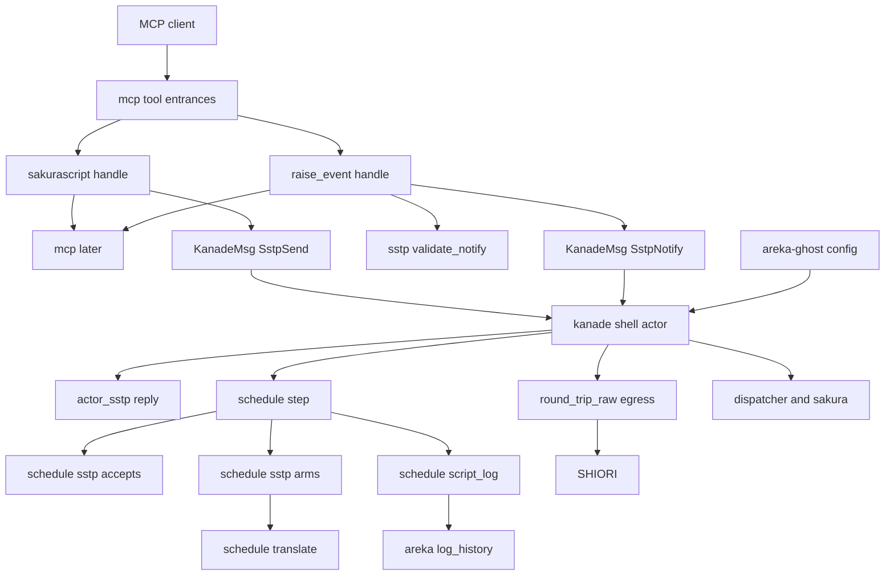
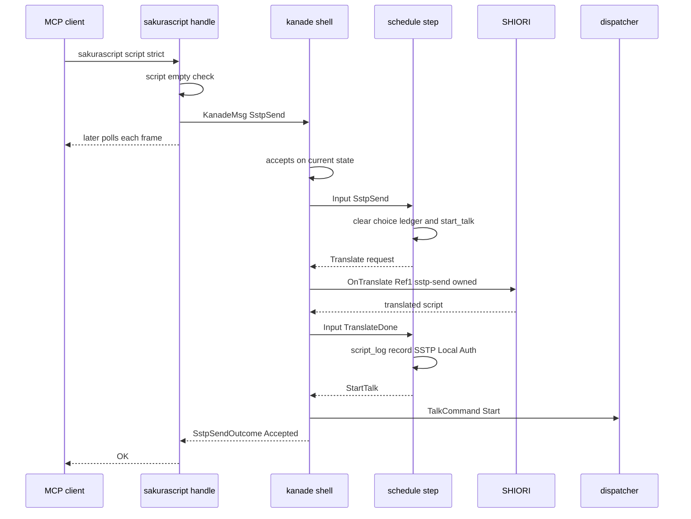
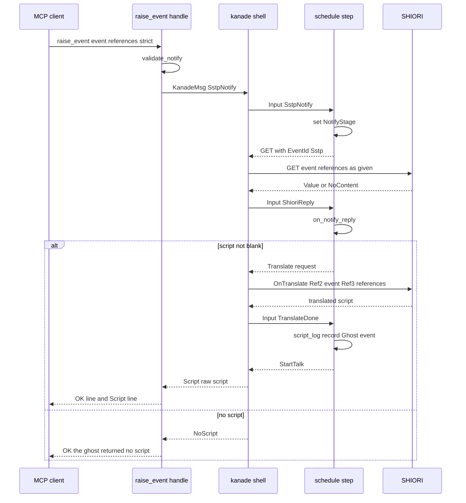
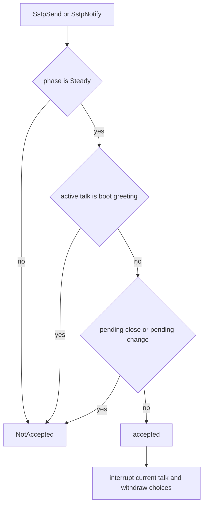

# 設計書: areka-P0-mcp-kanade-tools

> 本書の実測は **2026-10-18・本ブランチ**（main `e2370df8` を取り込んだ上に spec のコミット）。コードは「何の定義か」（関数名・型名・定数名＋ファイルパス）で指す。調べた記録と比べた案は [research.md](research.md)（前半＝ギャップ分析・後半＝設計の段の調べ）。SSP には何も送っていない・実機も動かしていない。

## Overview

**目的**: AI エージェントでゴーストを作る人・操らせる人が、areka でも SSP と同じ呼び方で「台本を流して見る」（`sakurascript`）と「イベントを起こして返った台本を見る」（`raise_event`）を使えるようにする。今の 2 本は `NG:not implemented yet` を返すダミーである。

**利用者**: Claude Code などの MCP クライアント（ゴーストの作者・試験を回す人）と、後続の spec（`mcp-strict-errors`・`property-query-channels`・`mcp-shiori-query` ほか）の実装者。

**変えること**: kanade（台本の実行と SHIORI の往復を受け持つ部分）に「外から来た台本」「外から頼まれた任意の名前のイベント」の 2 つの入口を足し、SSP の SSTP SEND（Owned）・SSTP NOTIFY と同じ扱いで再生する。あわせて、再生を始めたトークを全部 script 種別のログへ 1 件ずつ出す（`get_log` の `script` が今は常に空）。

### Goals

- `sakurascript` が台本をゴースト自身の台本と同じ扱いで再生し `OK` を返す（要件 1）。
- `raise_event` が許可の表を通さずに任意の名前のイベントを SHIORI へ送り、返った台本を再生して結果に含める（要件 2）。
- 再生中・選択肢の最中・中断の無効化モードは割り込み、起動・終了・切替の手順の途中は断る（要件 3）。
- 再生を始めたトークを、SSP と同じ表示の語で script 種別のログへ出し、MCP の台本の出どころを翻訳の Reference1 に伝える（要件 4）。
- `strict` を再生する側（kanade）まで運び、後続の spec が答えの経路を作り直さずに足せる形にする（要件 5）。
- 既存のゴーストの動きと既存の決定論テストを 1 本も壊さない（要件 6・7）。

### Non-Goals

- strict の検出・記録・strict のときの答えの文言（`mcp-strict-errors`）。
- `reload`（`mcp-reload`）・`get_status`（着地済み）。
- `\t`（タイムクリティカル）そのもの（`sakura-time-critical`）。
- SSTP の SEND・NOTIFY の受け口そのもの、`\![raise]`・`\![embed]` などのタグ。
- ツールの定義・引数の型・`ghost_name` の解決の規則・10 秒の待ちの上限（`mcp-tool-entrances` のまま）。

## Boundary Commitments

### This Spec Owns

- MCP の `sakurascript`・`raise_event` の本物の答え（`crates/areka/src/mcp/{sakurascript,raise_event}.rs` の `handle`）。
- kanade の外向けの契約 **「SSTP の入口」**: `KanadeMsg::SstpSend`・`KanadeMsg::SstpNotify`、その結果の型 `SstpSendOutcome`・`SstpNotifyOutcome`、イベントの名前と Reference の検査 `validate_notify`（`crates/areka-kanade/src/sstp.rs`）。
- 出所カテゴリ `EventId::Sstp`（外から頼まれた任意の名前）と、送出の檻での受理の規則。
- 外からの台本を受け付けるかの判定（`schedule::sstp::accepts`）と、受け付けたときの再生の始め方（今の台本の中断・選択肢の取り下げ・採番）。
- 翻訳の出どころ `ScriptSource`（イベント／SSTP SEND）と、SSTP SEND の台本の `OnTranslate`（Reference1＝`sstp-send,owned`）。
- script 種別のログの行（target `areka::log::script`・欄 `ghost`・`label`）を、再生を始めたトーク 1 つにつき 1 回出すこと。表示の語の決め方の正本。
- kanade の起動の設定のゴーストの名前（`KanadeConfig::ghost_name`）と、それを入れる所（`crates/areka-ghost/src/config.rs` の `resolve_kanade_config`）。
- `strict` の運び先（kanade の状態に、そのトークの番号と結んで持つ `StrictNote`）。
- SSP との差の一覧 `doc/ssp-mcp/kanade-tools-diff-areka.md`・`doc/COMPAT_ARCHITECTURE.md` の `OnTranslate` の Reference1 の行。

### Out of Boundary

- strict の値を使った検出・記録・答えの文言（`mcp-strict-errors`。本 spec は値を運ぶだけで、使わない）。
- 台本の出どころの印を再生の側（`areka-talk` の `StartTalk`・dispatcher・sakura）へ運ぶこと（`script-security-level`・`mcp-strict-errors` の案 ⑵ の持ち物）。本 spec は `StartTalk` と `TalkCommand` を変えない。
- 既存の汎用の通知の入口 `KanadeMsg::RaiseEvent` と `RaiseOutcome`（`src/change.rs`）の形と振る舞い。
- 宛先の解決（`crates/areka/src/mcp/resolve.rs`）・振り分け（`crates/areka/src/mcp/mod.rs`）・プロトコル側（`crates/areka-mcp/**`）。
- 切替・終了・起動の手順そのもの（`schedule/boot.rs`・`schedule/close.rs`・`schedule/change.rs` の遷移）。本 spec はそれらの相を**読むだけ**で、腕を足さない。
- 運行表の定常の腕（`schedule/steady.rs`）。本 spec は触らない。
- 実走の 3 本のテスト・`doc/ssp-mcp/areka-tools.md`（同じウェーブの約束）。

### Allowed Dependencies

- `areka`（MCP の側）→ `areka-kanade` の公開面（`KanadeMsg`・`sstp::*`・`script_log::*`）・`areka-actor`（`reply_channel`）・`areka-mcp` の `outcome`・`ReplyTo`（読むだけ）・`crate::mcp::later`・`resolve`（読むだけ）・`GhostSlot`。
- `areka-ghost` の `config.rs` → `areka-kanade::KanadeConfig`・`areka-parsers` の `MountModel`（読むだけ）。
- kanade の中: `msg.rs` → `sstp.rs`（型だけ）。`actor.rs` → `actor_sstp.rs` → `schedule::sstp::accepts`。`schedule::sstp` → `schedule::{events, translate}`・`mod.rs` の共通の手（`start_talk`・`clear_choice_ledger`・`on_shiori_reply`）。`schedule::script_log` → `schedule::translate::ScriptSource`。
- `sstp.rs` は `std` だけに依存する（MCP の側からも読む検査の正本）。
- 新しい外部のクレートは足さない。

依存の向き（左へだけ import する。逆向きは誤り）:
`sstp.rs`（型・検査） → `msg.rs`（inbox） → `schedule::{types, events, translate, script_log, sstp}`（純粋な判断） → `actor_sstp.rs`・`actor.rs`（殻） → `areka-ghost`（結線） → `areka` の `mcp`（呼び手）

### Revalidation Triggers

- `SstpSendOutcome`・`SstpNotifyOutcome`・`validate_notify` の値や規則が変わる → `mcp-strict-errors`・`property-query-channels`・`mcp-shiori-query` が確かめ直す。
- 受け付けの判定（`accepts`）の条件が変わる → 差の一覧の ⑴・⑵ と `get_status` の説明を見直す。
- 表示の語（`SSTP(Local,Auth)`・`Ghost:<名前>`・`Ghost`）や target 名が変わる → `doc/ssp-mcp/log-convention.md`・`get_log` の利用者。
- `StrictNote` の持ち方を変える（再生の側へ運ぶ形にする）→ `mcp-strict-errors`・`script-security-level`。
- `EventId` に変種が増える／送出の檻の規則が変わる → kanade の送出の檻のテスト。
- `KanadeConfig` の欄の追加 → 構造体の字面で組む呼び手（今は 0 か所・全部 `KanadeConfig::new` か `..KanadeConfig::new(..)`）。

## Architecture

### Existing Architecture Analysis

- **MCP の側**は「置き場から kanade の送り口を引く → 返信端つきの知らせを送る → `mcp::later` で毎フレーム覗く → 返信端が落ちたら宛先の解決の失敗と同じ文言」の形が `get_status.rs` の `handle` にある。本 spec はこの形にそろえる。
- **kanade** は「純粋な運行表（`schedule/`）＋殻（`actor.rs`）」の 2 層。殻は 1 通の知らせを `Input` に写して `step` を呼び、返った行動を順に実行し、往復の最後の結果だけを入れ直す（DD-2）。SHIORI との往復の間はほかの知らせを処理しない（＝要件 3.7 は作りのまま満たす）。
- 台本は `Action::StartTalk` からしか始まらない。再生中に台本が来たときの置き換えは、dispatcher の「閉じてから起こす」と、運行表の採番・枠の差し替え・選択肢の帳簿の掃除で成り立つ（`schedule/steady.rs` の `on_reply` の置き換えの腕）。中断の無効化モードは置き換えに効かない（dispatcher・sakura は見ない）。
- SHIORI の台詞は再生の前に `OnTranslate` を通る（`schedule/translate.rs` の `capture`・`on_done`、殻の `actor_translate.rs`）。
- 送出の檻（`actor.rs` の `round_trip_raw`）は出所カテゴリ（`EventId::Static`・`EventId::Choice`）ごとの受理の規則を持つ。受理されない名前は送らずに内部の失敗にし、ゴーストを終了系列へ倒す。
- 上限の近いファイル: `msg.rs` 930 行・`actor.rs` 901 行・`schedule/mod.rs` 969 行・`schedule/steady.rs` 957 行・`schedule/events.rs` 850 行。

### Architecture Pattern & Boundary Map



**Architecture Integration**:
- 採った形: **新しい入口を足す**（既存の `RaiseEvent` を広げない）。既存の呼び手 7 ファイル・`RaiseOutcome`（`src/change.rs`）を 1 行も変えずに済み、要件 6.1・6.2 が型の上で守られる（research「5.1 案 B」）。
- 名前は SSTP 寄り（brief の Out of Boundary「将来 SSTP が同じ変種を使える」）。`sakurascript` は SSP の説明どおり Owned SSTP の SEND、`raise_event` は SSTP NOTIFY の Event 相当なので `SstpSend`・`SstpNotify`。
- script 種別のログは**運行表の出口**（`schedule::step` の最後）で出す。元のイベントと最終の台本が両方手元にあり、`step` を呼んだスレッドで捕まえられる（決定論テスト ⑽）。殻（`execute_batch`）ではイベント名が `&'static str` の `origin` に潰れ、`StartTalk` に欄を足すと `schedule/boot.rs` に当たる（research「5.2」）。
- 新しい部品はどれも兄弟の新しいファイルに置き、上限の近いファイルには振り分けの数行だけを足す。`schedule/mod.rs` は先に型の塊を兄弟へ出し、`msg.rs` は先にファイルの中のテストを兄弟へ出す。

### Technology Stack

| 層 | 選んだもの / 版 | 本 spec での役目 | 備考 |
|---|---|---|---|
| アプリ（MCP の側） | Rust 2024・`bevy_ecs` 0.19（World・NonSend） | `handle` が置き場から kanade の送り口を引き、`later` に預ける | 新しい依存なし |
| kanade | `areka-actor`（`ReplySender`・`reply_channel`）・`tracing` | 2 つの入口・受け付けの判定・返事・script 種別のログ | 新しい依存なし |
| ログ | `tracing`（target `areka::log::script`）→ `crates/areka/src/log_history.rs` | `get_log` の `script` | 取り決めは `doc/ssp-mcp/log-convention.md` |
| テスト | `log-capture-kit`（kanade は `schedule/log_capture.rs` 経由） | 呼んだスレッドの記録を捕まえる | 迂回しない |

## File Structure Plan

### Directory Structure（新しいファイル）

```
crates/areka-kanade/src/
├── sstp.rs                    # SSTP の入口の外向けの型と検査（結果 2 種・NotifyArgError・validate_notify）。std だけ
├── sstp_tests.rs              # validate_notify の決定論テスト（空・空白だけ・CR・LF・NUL・バイト値 1 は通す）
├── msg_tests.rs               # msg.rs の中のテストの塊（約 418 行）をそのまま移す＋新しい変種の名前の腕
├── actor_sstp.rs              # 殻: 返事の控え（SstpReply）・最初の往復の写し（FirstReply）・返事の組み立てと送り
├── actor_sstp_tests.rs        # 本物の殻＋偽の shiori で 2 つの入口の返事・再生・送出を固定（actor_raise_reply_tests の形）
├── actor_stop.rs              # actor.rs から先に出す停止と通知の手（stop_cause_of・handoff_of・notify_stop・send_notice）。中身は変えない
└── schedule/
    ├── types.rs               # mod.rs から出す型の塊（Input・Phase・ActiveTalk・ChoiceState・ChoicePhase・CascadeNext・State・TermCause・Action）
    ├── sstp.rs                # 運行表: 受け付けの判定・外からの台本の開始・任意の名前の GET・その応答の腕・StrictNote・NotifyStage
    ├── sstp_tests.rs          # step を直に呼ぶ決定論テスト（要件 7.1 ⑴〜⑼・5.3）
    ├── script_log.rs          # script 種別のログ: 表示の語の決め方・出口での記録・公開の出し口と語の定数
    └── script_log_tests.rs    # step を直に呼び、トーク 1 つにつき 1 件・表示の語・本文（要件 7.1 ⑽）

crates/areka/src/mcp/
└── sakurascript_log_tests.rs  # kanade の出し口の行を log_history::draft で読む（要件 7.3）。sakurascript.rs が接続する

doc/ssp-mcp/
└── kanade-tools-diff-areka.md # SSP との差の一覧（要件 7.5）

.kiro/specs/areka-P0-mcp-kanade-tools/verification/
└── signoff.md                 # 実機の確認の記録（要件 7.6）
```

### Modified Files

- `crates/areka-kanade/src/msg.rs` — ⑴ 先にファイルの中のテストを `msg_tests.rs` へ出す（パス属性つきの接続宣言だけ残す）。⑵ `KanadeMsg::SstpSend`・`KanadeMsg::SstpNotify` を足す。⑶ `EventId::Sstp(String)` を足し `as_str` に腕を 1 つ。⑷ `KanadeConfig::ghost_name: String`（`new` の既定は空文字）。後の行数の見込み 約 560。
- `crates/areka-kanade/src/lib.rs` — `mod actor_sstp;`・`mod actor_stop;`・`pub mod sstp;` を足し、`script_log` の公開ファサード（`pub mod script_log { pub use crate::schedule::script_log::{…}; }`）を足す。
- `crates/areka-kanade/src/actor.rs` — ⑴ 先に停止と通知の手 4 つ（`stop_cause_of`・`handoff_of`・`notify_stop`・`send_notice`・約 95 行）を兄弟の `actor_stop.rs` へ出し、`actor.rs` は `use crate::actor_stop::{…}` で同じ名前のまま使う（`#[path]` で接続したテストの `use super::*` は書き換えない）。⑵ 振り分けに 2 つの腕（返事の控えを `actor_sstp` で作る）、一括の処理の後に `actor_sstp::answer` を 1 回。`drive_translating` の 2 つ目の返り値を `Option<FirstReply>` にし、`RaiseEvent` の返事は `FirstReply::raise_outcome` で今日と同じ値に写す（`raise_outcome_of` は `actor_sstp.rs` の `first_reply_of` に置き換えて消す）。`execute_batch` の `origin` の写しに `EventId::Sstp(_) => schedule::sstp::NOTIFY_ORIGIN`。`round_trip_raw` の受理の規則に `EventId::Sstp(name) => sstp::validate_notify(name, references).is_ok()`。テスト用の包み `drive` は返り値を `Option<RaiseOutcome>` のまま保つ（既存の呼び手 1 か所を変えない）。後の行数の見込み 約 815（⑴ で約 95 行減り、⑵ で約 10 行増える）。
- `crates/areka-kanade/src/actor_translate.rs` — 依頼の出どころ（`ScriptSource`）で `OnTranslate` の組み立てを選ぶ（イベント→`events::on_translate`・SSTP SEND→`events::on_translate_sstp`）。MAKOTO の口の 2 つ目は `ScriptSource::makoto_id`。
- `crates/areka-kanade/src/schedule/mod.rs` — ⑴ 先に型の塊を `types.rs` へ出し、`pub(crate) use types::{Action, ActiveTalk, CascadeNext, ChoicePhase, ChoiceState, Input, Phase, State, TermCause};` で同じ名前で見せる（`schedule/boot.rs` の `use super::{Action, ActiveTalk, Input, Phase, State, events, resources}` が変わらないことを割り方の条件にする）。⑵ `mod sstp;`・`pub mod script_log;` の宣言。⑶ `start_talk` を `steady_choice_script.rs` から移す（共通の手 `clear_choice_ledger` と並べる）。⑷ `route` に `Input::SstpSend`・`Input::SstpNotify` の腕と、`Input::ShioriReply` の前段の守り（`state.sstp_notify` が在れば `sstp::on_notify_reply`）。⑸ `step` に script 種別のログの 2 行（入力から出どころを控える・出口で記録）。後の行数の見込み 約 610。
- `crates/areka-kanade/src/schedule/translate.rs` — `ScriptSource` を足し、`TranslateRequest::source`・`TranslateWait::source` をこの型にする。`capture` の後半を `defer`（一括を預けて翻訳の行動 1 つに替える）に切り出し、外からの台本の腕からも使う。`Replied::talk_source`（出口の記録の材料）を足す。`read_reply` の記録の欄は `&ScriptSource` で受ける。
- `crates/areka-kanade/src/schedule/events.rs` — `sstp_notify`（GET・`EventId::Sstp`・渡された Reference をそのまま）・`on_translate_sstp`（Ref0＝展開済み・Ref1＝`sstp-send,owned`・Ref2 以降なし）・定数 `REF1_SSTP_SEND_OWNED`。`on_translate` は変えない（他のクレートの呼び手 2 か所を守る）。後の行数の見込み 約 890。
- `crates/areka-kanade/src/schedule/steady_choice_script.rs` — `start_talk` の定義を `mod.rs` へ移し、呼び出しを `super::super::start_talk` に替える（振る舞いは同じ）。
- `crates/areka-ghost/src/config.rs` — `resolve_kanade_config` が `KanadeConfig { ghost_name: listed_ghost_name(mount), ..KanadeConfig::new(..) }` を返す。`listed_ghost_name` を同じファイルに足し、同じファイルのテストで固定する。
- `crates/areka/src/mcp/sakurascript.rs` — 本物の `handle`。2 本で使う部品（宛先の kanade の送り口と「降りた」の文言を引く `script_target`、文言の定数）を `pub(super)` で置く（`mod.rs` に触らないため）。
- `crates/areka/src/mcp/raise_event.rs` — 本物の `handle`（部品は `super::sakurascript` から使う）。
- `crates/areka/src/mcp/sakurascript_tests.rs`・`raise_event_tests.rs` — ダミーを固定するテストを本 spec の振る舞いのテストへ書き換える（要件 7.4）。
- `doc/COMPAT_ARCHITECTURE.md` — `OnTranslate` の Reference1 の行（今は「常に欠番」）を「MCP の `sakurascript` の台本は `sstp-send,owned`、それ以外は欠番」へ改める。
- `crates/areka-seriko/tests/fixtures/trigger-intervals/README.md` — 「実機の確かめ」の 3 の読み替えの 1 文を `sakurascript` で送る本来の手順へ戻す（要件 7.7・要件 7.6 ⑴ が通った後）。

### 追随して直す既存のテスト（型の形が変わるため・主張は変えない）

- `crates/areka-kanade/src/schedule/translate_tests.rs`・`translate_path_tests.rs`・`balloon_events_done_tests.rs`・`crates/areka-kanade/src/actor_translate_tests.rs`・`actor_translate_batch_tests.rs` — `TranslateRequest::source`・`TranslateWait::source` が `ScriptSource::Event(..)` に包まれる。
- `crates/areka-kanade/src/schedule/schedule_variant_tests.rs` — `Input` の変種の網羅に 2 つ足す。
- `crates/areka-kanade/src/msg_tests.rs`（移した後）— `KanadeMsg` の変種の名前の網羅に 2 つ足す。

### 触らないファイル（同じウェーブの約束と brief の約束）

kanade の `src/change.rs`・`schedule/boot.rs`・`schedule/steady.rs`・`schedule/close.rs`・`schedule/change.rs`、`crates/areka-ghost/src/runtime.rs`、`crates/areka-mcp/**`、`crates/areka/src/main.rs`、`crates/areka/src/mcp/mod.rs`・`resolve.rs`・`get_status.rs`、`doc/ssp-mcp/areka-tools.md`、実走の 3 本のテスト、`crates/areka-talk/**`、`crates/areka-ghost/src/dispatcher.rs`。

## System Flows

### `sakurascript`（受け付けて再生する・再生中なら中断する）



- 答えは翻訳の往復が済み、再生の開始を送った後に 1 回返る（再生の終わりは待たない＝要件 1.3）。
- 翻訳の輸送路が失敗すると、運行表は今日どおり終了系列（Fault）へ進み、同じ一括の処理の中で殻が止まる。殻は止まる一括では `Failed` を返す（MCP は要件 3.5 の文言＝要件 1.7）。

### `raise_event`（任意の名前を送り、台本が返れば再生する）



- 結果に含める台本は SHIORI が返したそのまま（翻訳の前・要件 2.3）。殻は最初の一括の往復の結果を写して返す。

### 受け付けの判定（要件 3.1〜3.6）



- 断るのは「普段の状態でない」場面だけ: 相が `Steady` でない（`Idle`・`Boot*`・`Close*`・`Change*`・`Unloading`・`Stopped`）、起動の挨拶のトークが流れている、終了か切替が決まって今のトークの終わりを待っている。
- 起動の挨拶: 起動の相（`BootVersion`）は `basewareversion` の往復と同じ一括で `Steady` へ移るので、知らせの切れ目では挨拶はいつも `Steady{talk: Some}` で流れている。挨拶は `schedule/boot.rs` の `to_baseware_version` が `ActiveTalk::origin = "boot"` で控えるので、この控えで見分ける（`boot.rs` は変えない・綴りの一致は定数 `BOOT_GREETING_ORIGIN` で 1 か所に置き、テストで固定）。挨拶がマウスの反応などに置き換わった後は受け付ける。
- シェル・バルーンの切替の印の台詞（`talk_gap` の見張り）は手順の途中に数えない。外からの台本が印の台詞を置き換えたときは、今あるマウスの置き換えと同じく見張りが `MarkedEnd::Replaced` で決まる（`schedule/talk_gap.rs` の `decide`）。
- 選択肢の取り下げ・中断の無効化モードは、受け付けた後の始め方が今の置き換えの腕と同じ（帳簿を消す・`choice_prev_talk` を空にする・`no_user_break` を見ない）なので、特別な分岐は持たない。

### script 種別のログの表示の語（要件 4.1〜4.3）

`step` は `route` の前に「この入力で始まるトークの出どころ」を控え、出口で返す一括の `Action::StartTalk` ごとに 1 件出す。

| この `step` の入力 | 出どころ | 表示の語 |
|---|---|---|
| `ShioriReply` で結果が台詞（`Value`）・元のイベントが分かる | `ScriptSource::Event(元のイベント)` | `Ghost:<元のイベントの名前>`（例 `Ghost:OnBoot`・`Ghost:OnAiTalk`・`Ghost:OnChoiceSelect`） |
| `TranslateDone`（翻訳を通ったトーク） | 預けた帳簿の `TranslateWait::source` | イベントなら `Ghost:<名前>`、SSTP SEND なら `SSTP(Local,Auth)` |
| `SstpSend`（翻訳しない 0 文字の台本だけ） | `ScriptSource::SstpSend` | `SSTP(Local,Auth)` |
| それ以外（選択肢の `script:`・台本でない応答の後の後ろ書きだけのトークなど） | なし | `Ghost` |

- 翻訳に預けた一括は出口に `StartTalk` が無いので、その `step` では出さない。翻訳の輸送路が失敗すると預けた一括は捨てられ、出口に `StartTalk` が出ない＝記録も出ない（要件 4.3）。
- 本文は出口の `StartTalk::script`＝翻訳の後の、実際に再生する台本。
- `raise_event` の名前は殻が固定のラベル（`NOTIFY_ORIGIN`）を `origin` に載せるが、表示の語は `reply_source`（`EventId::Sstp(名前)`）から作るので本当の名前になる。

## Requirements Traceability

| 要件 | 要旨 | 部品 | 契約 | 流れ |
|---|---|---|---|---|
| 1.1 | 普段の状態で台本を新しいトークとして再生・`OK` | SakurascriptHandler・SstpShell・ScheduleSstp | `KanadeMsg::SstpSend`・`SstpSendOutcome::Accepted` | sakurascript |
| 1.2 | ゴースト自身の台本と同じ扱い | ScheduleSstp | 同じ `Action::StartTalk`・同じ `start_talk` | sakurascript |
| 1.3 | 受け付けた時点で答える | SstpShell | 一括の処理の後に 1 回送る | sakurascript |
| 1.4 | 空の `script` は `NG:script is empty` | SakurascriptHandler | `handle` の先頭の検査 | — |
| 1.5 | 長さで断らない | SakurascriptHandler・ScheduleSstp | UI スレッドは文字列を渡すだけ | — |
| 1.6 | ダミーを残さない | SakurascriptHandler | — | — |
| 1.7 | 翻訳の輸送路の失敗は 3.5 の文言 | SstpShell・SakurascriptHandler | 止まる一括は `Failed` | sakurascript |
| 2.1 | 任意の名前を 1 回送る・止めない・警告しない | ScheduleSstp・SstpEgress | `EventId::Sstp`・`validate_notify` | raise_event |
| 2.2 | 許可の表に在る名前でも Reference を補わない | ScheduleSstp | `events::sstp_notify` は渡された列のまま | raise_event |
| 2.3 | 返った台本を再生し 2 行で答える | ScheduleSstp・SstpShell・RaiseEventHandler | `SstpNotifyOutcome::Script(String)` | raise_event |
| 2.4 | 返らなければ `OK:the ghost returned no script.` | ScheduleSstp・SstpShell・RaiseEventHandler | `SstpNotifyOutcome::NoScript` | raise_event |
| 2.5 | SHIORI の答えの時点で答える | SstpShell | 一括の処理の後に 1 回送る | raise_event |
| 2.6 | 空・空白だけの `event` は `NG:event is empty` | SstpContract・RaiseEventHandler | `NotifyArgError::EmptyEvent` | — |
| 2.7 | CR・LF・NUL は `NG:event or reference contains a control character` | SstpContract・RaiseEventHandler・SstpEgress | `NotifyArgError::ControlCharacter` | — |
| 2.8 | 往復の失敗は 3.5 の文言 | SstpShell・RaiseEventHandler | `SstpNotifyOutcome::Failed` | raise_event |
| 2.9 | ダミーを残さない | RaiseEventHandler | — | — |
| 3.1 | 再生中の `sakurascript` は中断して再生 | ScheduleSstp | `start_talk`（枠の差し替え）＋dispatcher の閉じてから起こす | 受け付けの判定 |
| 3.2 | 再生中の `raise_event` | ScheduleSstp | `on_notify_reply` | raise_event |
| 3.3 | 選択肢を取り下げ・選択や時間切れのイベントを送らない | ScheduleSstp | `clear_choice_ledger`・`choice_prev_talk = None` | 受け付けの判定 |
| 3.4 | 中断の無効化モードでも割り込む | ScheduleSstp | `no_user_break` を見ない | 受け付けの判定 |
| 3.5 | 降りた・置き場が空は宛先が居ないときの文言 | SakurascriptHandler・RaiseEventHandler | `script_target` の `gone`・`ReplyError::Dropped` | — |
| 3.6 | 起動・終了・切替の途中は `NG:the ghost cannot accept a script now` | ScheduleSstp・SstpShell・両 Handler | `accepts`・`NotAccepted` | 受け付けの判定 |
| 3.7 | SHIORI との往復の最中は後で処理 | SstpShell | inbox の直列（作りのまま） | — |
| 3.8 | 上限で先に答えた後の台本は普段どおり再生 | SstpShell | 受け手が居なくても `debug!` で続ける | — |
| 3.9 | 3.5・3.6 の答えで warn 以上を出さない | ScheduleSstp・SstpShell・両 Handler | `debug!` まで | — |
| 4.1 | 再生を始めたトーク全部を 1 件ずつ記録 | ScriptLog・GhostConfig | `script_log::record`・`KanadeConfig::ghost_name` | 表示の語 |
| 4.2 | 表示の語 | ScriptLog | 表示の語の表 | 表示の語 |
| 4.3 | 始まらなかったトークは記録しない | ScriptLog | 出口の `StartTalk` だけを見る | 表示の語 |
| 4.4 | `sakurascript` の翻訳の Reference1＝`sstp-send,owned` | ScheduleTranslate | `events::on_translate_sstp`（殻の `actor_translate.rs` が出どころで選ぶ） | sakurascript |
| 4.5 | `raise_event` の台本はゴースト自身の台詞と同じ翻訳 | ScheduleTranslate | `capture` が `EventId::Sstp` の元のイベントで預ける | raise_event |
| 4.6 | MCP 以外の翻訳の Reference を変えない | ScheduleTranslate | `events::on_translate` は無変更 | — |
| 5.1 | `strict` を台本と結びついた形で運ぶ | 両 Handler・ScheduleSstp | `KanadeMsg::*::strict`・`StrictNote` | — |
| 5.2 | 本 spec では `strict` で振る舞いを変えない | ScheduleSstp | 読むのは記録の欄だけ | — |
| 5.3 | 受け取った `strict` を決定論テストで固定 | ScheduleSstp | `State::sstp_strict` | — |
| 6.1 | MCP 以外は許可の表のまま | SstpEgress | 新しい出所カテゴリ・既存の規則は無変更 | — |
| 6.2 | 既存の `RaiseEvent` の呼び手を変えない | SstpShell | `RaiseEvent` の型と返事は無変更 | — |
| 6.3 | 採番と枠を同じ規則に | ScheduleSstp | 共通の `start_talk` | — |
| 6.4 | UI を塞がない | 両 Handler | `mcp::later` | — |
| 6.5 | 成功の答えで warn 以上を出さない（エラー応答の記録は例外） | 全部品 | 成功の枝は記録なしか `debug!`・`info!` | — |
| 7.1 | kanade の決定論テスト ⑴〜⑽ | テスト | `schedule/sstp_tests.rs`・`script_log_tests.rs`・`actor_sstp_tests.rs` | — |
| 7.2 | MCP の側の答えの決定論テスト | テスト | `sakurascript_tests.rs`・`raise_event_tests.rs` | — |
| 7.3 | `get_log` で読めることの決定論テスト | テスト | `sakurascript_log_tests.rs` | — |
| 7.4 | ダミーのテストの書き換え | テスト | 同上 | — |
| 7.5 | SSP との差の一覧 | DiffDoc | `doc/ssp-mcp/kanade-tools-diff-areka.md` | — |
| 7.6 | 実機の確認 | Signoff | `verification/signoff.md` | — |
| 7.7 | 検体の README を戻す | Readme | `trigger-intervals/README.md` | — |

## Components and Interfaces

| 部品 | 層 | 役目 | 要件 | 主な依存（重さ） | 契約 |
|---|---|---|---|---|---|
| SakurascriptHandler | areka mcp | `sakurascript` の検査・送信・答え | 1.1, 1.3〜1.7, 3.5, 3.6, 3.9, 5.1, 6.4, 6.5 | kanade の送り口（P0）・`later`（P0） | Service |
| RaiseEventHandler | areka mcp | `raise_event` の検査・送信・2 行の答え | 2.1, 2.3〜2.9, 3.5, 3.6, 3.9, 5.1 | SstpContract（P0）・`later`（P0） | Service |
| SstpContract | kanade 公開 | 結果の型・引数の検査の正本 | 2.6, 2.7 | std だけ | Service |
| SstpShell | kanade 殻 | 受け付けの控え・最初の往復の写し・返事 | 1.3, 1.7, 2.3, 2.5, 2.8, 3.6〜3.8, 6.2 | ScheduleSstp::accepts（P0） | Service |
| SstpEgress | kanade 殻 | 送出の檻の `EventId::Sstp` の受理 | 2.1, 2.7, 6.1 | SstpContract（P0） | Service |
| ScheduleSstp | kanade 運行表 | 判定・開始・任意の名前の GET・応答の腕・strict の控え | 1.1, 1.2, 2.1〜2.4, 3.1〜3.6, 3.9, 5.1〜5.3, 6.3 | events・translate・mod の共通の手（P0） | Service, State |
| ScheduleTranslate | kanade 運行表 | 出どころの型・預け方・SSTP の `OnTranslate` | 4.4〜4.6 | events（P0） | Service |
| ScriptLog | kanade 運行表＋公開 | 表示の語・出口の記録・公開の出し口 | 4.1〜4.3, 7.3 | ScheduleTranslate（P1）・KanadeConfig（P0） | Event |
| ScheduleTypesSplit | kanade 運行表・殻・inbox | 上限の近い 3 ファイルを先に割る（`schedule/types.rs`・`actor_stop.rs`・`msg_tests.rs`。同じ名前で見せる） | 6.3（前提） | — | — |
| GhostConfig | areka-ghost | `KanadeConfig::ghost_name` を入れる | 4.1 | `MountModel`（P0） | — |
| DiffDoc・Signoff・Readme | 文書 | 差の一覧・実機の記録・README の 1 文 | 7.5〜7.7 | — | — |

### areka（MCP の側）

#### SakurascriptHandler

| 欄 | 中身 |
|---|---|
| 役目 | `sakurascript` の引数を検査し、kanade へ `SstpSend` を送り、返事を `later` で覗いて答える |
| 要件 | 1.1, 1.3, 1.4, 1.5, 1.6, 1.7, 3.5, 3.6, 3.9, 5.1, 6.4, 6.5 |

**責務と制約**
- 先頭で `script.is_empty()` なら kanade へ送らず `NG:script is empty`（空白だけの台本は空と数えない＝SSP の実測 4 は空文字だけ）。
- 宛先の解決は振り分け（`mod.rs` の `resolved!`）が済ませている。置き場が空（切替の途中）は解決の段で `NG:` になる（要件 3.5 の前半）。
- 2 本で使う部品を `pub(super)` で持つ（`mod.rs` に宣言を足さないため）:
  - `script_target(world, ghost_name) -> ScriptTarget { kanade: Option<Sender<KanadeMsg>>, gone: &'static str }`（`gone` は `resolve::resolve(None, ghost_name, Omitted::UseActive)` の失敗の理由＝`get_status.rs` と同じ求め方）
  - `NOT_NOW: &str = "the ghost cannot accept a script now"`
  - `UNAVAILABLE: &str = "Script is not available"`（置き場に kanade の送り口が無い・本番では起きない内部の食い違い。`get_status` の `Status is not available` と同じ扱いで `warn!` 1 件）
- 成功の枝では記録を出さない（橋が `debug!` を 1 行残す）。`NotAccepted`・`Failed`・返信端の落ち・送れなかったは `debug!` 1 件ずつ。

**Contracts**: Service [x]

```rust
pub(super) fn handle(world: &mut World, ghost: &ActiveGhost, args: Args, reply: ReplyTo);
pub(super) struct ScriptTarget { pub kanade: Option<Sender<KanadeMsg>>, pub gone: &'static str }
pub(super) fn script_target(world: &World, ghost_name: Option<&str>) -> ScriptTarget;
```

| kanade の返事 | 答え（本文・`isError`） |
|---|---|
| `SstpSendOutcome::Accepted` | `OK`・false（`outcome::ok("")`） |
| `SstpSendOutcome::NotAccepted` | `NG:the ghost cannot accept a script now`・true |
| `SstpSendOutcome::Failed` | `NG:<gone>`・true |
| 返信端が落ちた（`ReplyError::Dropped`）・送れなかった | `NG:<gone>`・true |
| 置き場に送り口が無い | `NG:Script is not available`・true（`warn!` 1 件） |

#### RaiseEventHandler

| 欄 | 中身 |
|---|---|
| 役目 | `raise_event` の引数を検査し、kanade へ `SstpNotify` を送り、2 行の答えか「台本なし」で答える |
| 要件 | 2.1, 2.3, 2.4, 2.5, 2.6, 2.7, 2.8, 2.9, 3.5, 3.6, 3.9, 5.1 |

**責務と制約**
- 先頭で `areka_kanade::sstp::validate_notify(&args.event, &args.references)` を呼び、`EmptyEvent` → `NG:event is empty`、`ControlCharacter` → `NG:event or reference contains a control character`（どちらも SHIORI を呼ばない）。
- 部品（`script_target`・`NOT_NOW`・`UNAVAILABLE`）は `super::sakurascript` から使う。
- 2 行の区切りの字は定数 `SCRIPT_LINE_BREAK` 1 か所に置き、`"\r\n"` とする（2026-10-18 設計の討議で SSP 2.9.05 の `POST /api/mcp/v1` へ `raise_event`（`OnAiTalk`）を直に当て、生の JSON の本文が `…being played.\r\nScript: …` であることを確かめた）。

**Contracts**: Service [x]

```rust
pub(super) fn handle(world: &mut World, ghost: &ActiveGhost, args: Args, reply: ReplyTo);
const SCRIPT_RETURNED: &str = "OK:the ghost returned a script and it is being played.";
const SCRIPT_LINE_BREAK: &str = "\r\n";
const NO_SCRIPT: &str = "the ghost returned no script.";
```

| kanade の返事 | 答え（本文・`isError`） |
|---|---|
| `SstpNotifyOutcome::Script(s)` | `OK:the ghost returned a script and it is being played.` ＋ `SCRIPT_LINE_BREAK` ＋ `Script: ` ＋ `s`・false（`outcome::value`） |
| `SstpNotifyOutcome::NoScript` | `OK:the ghost returned no script.`・false |
| `NotAccepted` / `Failed` / 返信端の落ち / 送り口なし | SakurascriptHandler と同じ |

### kanade の公開面

#### SstpContract（`crates/areka-kanade/src/sstp.rs`）

| 欄 | 中身 |
|---|---|
| 役目 | SSTP の入口の結果の型と、イベントの名前・Reference の検査の正本（MCP の側の答えと送出の檻の両方が使う） |
| 要件 | 2.6, 2.7 |

**Contracts**: Service [x]

```rust
/// 外からの台本（`KanadeMsg::SstpSend`）の結果。
#[derive(Debug, Clone, Copy, PartialEq, Eq)]
pub enum SstpSendOutcome {
    /// 新しいトークとして再生を始めた（翻訳を済ませ、再生の開始を送った）。
    Accepted,
    /// 起動・終了・切替の手順の途中で受け付けなかった（何もしていない）。
    NotAccepted,
    /// この依頼の処理の中で kanade が終了系列へ進み止まった（翻訳の輸送路の失敗など）。
    Failed,
}

/// 外から頼まれたイベント（`KanadeMsg::SstpNotify`）の結果。
#[derive(Debug, Clone, PartialEq, Eq)]
pub enum SstpNotifyOutcome {
    /// SHIORI が空でない台本を返し、再生を始めた。中身は SHIORI が返したまま（翻訳の前）。
    Script(String),
    /// 返り値なし・空か空白だけ・エラー応答（何も再生していない・今の再生に触れていない）。
    NoScript,
    /// 起動・終了・切替の手順の途中で送らなかった。
    NotAccepted,
    /// 往復が失敗した、またはこの依頼の処理の中で kanade が止まった。
    Failed,
}

#[derive(Debug, Clone, Copy, PartialEq, Eq)]
pub enum NotifyArgError {
    /// イベントの名前が空か空白だけ。
    EmptyEvent,
    /// イベントの名前か Reference のどれかに CR・LF・NUL が在る。
    ControlCharacter,
}

/// 名前が空か空白だけ（`str::trim` が空）なら `EmptyEvent`、名前か Reference に `'\r'`・`'\n'`・`'\0'`
/// が在れば `ControlCharacter`。それ以外（バイト値 1 などほかの制御文字を含む）は `Ok`。判定は EmptyEvent が先。
pub fn validate_notify(event: &str, references: &[String]) -> Result<(), NotifyArgError>;
```

- 事前条件なし（純粋）。事後条件: `Ok` の組は SHIORI/3.0 の 1 行 1 見出しを割らず、欠番の印（NUL）と紛れない。

#### KanadeMsg の 2 変種・EventId::Sstp・KanadeConfig::ghost_name（`msg.rs`）

```rust
pub enum KanadeMsg {
    // …既存の変種は無変更…
    /// 外からの台本（Owned SSTP の SEND 相当）。普段の状態なら新しいトークとして再生し、
    /// 処理の後に結果をちょうど 1 回返す（kanade が落ちれば受け手には `ReplyError::Dropped`）。
    SstpSend {
        script: String,
        /// 呼び手の strict（真・偽・省略）。始めたトークの番号と結んで運行状態に控える。
        strict: Option<bool>,
        reply: areka_actor::ReplySender<crate::sstp::SstpSendOutcome>,
    },
    /// 外から頼まれた任意の名前のイベント（SSTP NOTIFY の Event 相当・GET）。許可の表を通さない。
    /// 名前と Reference は呼び手が `sstp::validate_notify` で検査しておく（運行表の腕も同じ検査をもう一度行い、破れていれば送らない）。
    SstpNotify {
        event: String,
        references: Vec<String>,
        strict: Option<bool>,
        reply: areka_actor::ReplySender<crate::sstp::SstpNotifyOutcome>,
    },
}

pub enum EventId {
    Static(&'static str),
    Choice(String),
    /// 外から頼まれた任意の名前（`schedule::events::sstp_notify` だけが作る・逐語）。
    Sstp(String),
}

pub struct KanadeConfig {
    // …既存の欄は無変更…
    /// script 種別の記録の名（`get_active_ghost_list` と同じ値）。既定は空文字。結線は
    /// `areka-ghost` の `resolve_kanade_config` が入れる。
    pub ghost_name: String,
}
```

- 不変条件: `EventId::Sstp` を作るのは `schedule/events.rs` の `sstp_notify` の 1 か所だけ（`Choice` を作るのが `on_choice_named` だけなのと同じ）。
- 返信端は必須（`Option` にしない）。今の呼び手は MCP だけで、必ず答えを待つ。

#### ScriptLog の公開面（`lib.rs` のファサード `areka_kanade::script_log`）

```rust
/// 取り決めの target（`crates/areka/src/log_history.rs` の `TARGET_SCRIPT` と同じ字・areka のテストで一致を固定）。
pub const TARGET: &str = "areka::log::script";
pub const SSTP_SEND_LABEL: &str = "SSTP(Local,Auth)";
pub const PLAIN_LABEL: &str = "Ghost";
/// `Ghost:<名前>`。
pub fn event_label(name: &str) -> String;
/// 1 件を出す: `info!(target: TARGET, ghost = %ghost, label = %label, "{script}")`。
pub fn emit(ghost: &str, label: &str, script: &str);
```

- 運行表の出口（下の ScriptLog）と、MCP の側のテスト（要件 7.3）が同じ `emit` を通る（記録の形の正本は 1 つ）。

### kanade の殻

#### SstpShell（`actor_sstp.rs`）と `actor.rs` の変更

| 欄 | 中身 |
|---|---|
| 役目 | 2 つの入口の返信端と受け付けの判定を控え、一括の処理の後に結果を組んで 1 回送る |
| 要件 | 1.3, 1.7, 2.3, 2.5, 2.8, 3.6, 3.7, 3.8, 6.2 |

**責務と制約**
- 振り分けの腕は、`step` へ渡す**前の**状態で `schedule::sstp::accepts(&state)` を呼んで控える（運行表の腕も同じ関数で判断する。`RaiseEvent` の許可の表の照合と同じ形）。
- 一括の処理（`drive_translating`）が `Drive::Stop` で終わったら、どちらの入口も `Failed`。
- `SstpNotify` は最初の一括の往復の結果（`FirstReply`）から写す。受け付けたのに往復が無いのは構造上起きない（起きたら `warn!` の上で `NotAccepted`）。
- 返信端の受け手が居ない（待ちの上限で先に答えた）は `debug!`（`event="sstp_reply_dropped"`）だけで運行を続ける（要件 3.8）。

**Contracts**: Service [x]

```rust
/// 最初の一括の往復の結果（`ShioriOutcome` は複製できないので殻が写す）。
pub(crate) enum FirstReply { Script(String), NoReply, Failed }
/// 空でない（trim して 1 文字以上の）`Value` → Script、空・空白だけの `Value`・`NoContent`・`Notified`・`Unloaded` → NoReply、`Failed` → Failed。
pub(crate) fn first_reply_of(outcome: &ShioriOutcome) -> FirstReply;
impl FirstReply {
    /// `RaiseEvent` の返事への写し（今日の `raise_outcome_of` と同じ値）。
    pub(crate) fn raise_outcome(&self) -> RaiseOutcome;
}
/// 返事の控え。
pub(crate) enum SstpReply {
    Send { reply: ReplySender<SstpSendOutcome>, accepted: bool },
    Notify { reply: ReplySender<SstpNotifyOutcome>, accepted: bool },
}
pub(crate) fn answer(pending: SstpReply, stopped: bool, first: Option<&FirstReply>);
```

| 控え | `stopped` | `accepted` | 最初の往復 | 返す値 |
|---|---|---|---|---|
| Send | 真 | — | — | `Failed` |
| Send | 偽 | 真 | — | `Accepted` |
| Send | 偽 | 偽 | — | `NotAccepted` |
| Notify | 真 | — | — | `Failed` |
| Notify | 偽 | 偽 | — | `NotAccepted` |
| Notify | 偽 | 真 | `Script(s)` | `Script(s)` |
| Notify | 偽 | 真 | `NoReply` | `NoScript` |
| Notify | 偽 | 真 | `Failed` | `Failed` |

- `actor.rs` の `drive_translating` は 2 つ目の返り値を `Option<FirstReply>` にする。`RaiseEvent` の返事は `first.map(|f| f.raise_outcome())` で今日と同じ値になる（要件 6.2）。`#[cfg(test)]` の包み `drive` は `Option<RaiseOutcome>` を返し続ける。

#### SstpEgress（`actor.rs` の `round_trip_raw`・`execute_batch`）

- 受理の規則に 1 行: `EventId::Sstp(name) => crate::sstp::validate_notify(name, references).is_ok()`。許可の表・リソースの表・`OnTalk`／`OnHour` の恒久禁止は効かせない（禁止の根拠はベースウェアの自発の周期発火で、呼び手が 1 回ずつ頼むものには当たらない＝選択起源と同じ理屈・`schedule/events.rs` の `is_allowed_choice_event` の説明）。破れていたら今日の檻と同じく `error!`（`event_id_not_allowed`）＋`Failed(Internal)`（入口で検査済みなので構造上は起きない）。
- `Static`・`Choice` の規則は 1 字も変えない（要件 6.1）。
- `execute_batch` の `origin` の写しに `EventId::Sstp(_) => schedule::sstp::NOTIFY_ORIGIN`（`"SstpNotify"`。`OnSecondChange` ではないので `value_replaces_active_talk` は真・`talk_gap` の印の名前とも一致しない）。
- 送出の記録は今日どおり `trace!`（`shiori_request`）だけで、警告は出さない（要件 2.1）。ゴーストの SHIORI のエラー応答の `warn!`（`shiori_error_response`）は今日どおり出す（要件 6.5 の例外）。

### kanade の運行表

#### ScheduleSstp（`schedule/sstp.rs`）

| 欄 | 中身 |
|---|---|
| 役目 | 受け付けの判定、外からの台本の開始、任意の名前の GET、その応答の腕、strict の控え |
| 要件 | 1.1, 1.2, 2.1, 2.2, 2.3, 2.4, 3.1, 3.2, 3.3, 3.4, 3.5, 3.6, 3.9, 5.1, 5.2, 5.3, 6.3 |

**Contracts**: Service [x] / State [x]

```rust
/// SSTP SEND のトークの `ActiveTalk::origin`（記録用）。
pub(crate) const SEND_ORIGIN: &str = "SstpSend";
/// SSTP NOTIFY の応答の `origin`（殻が `EventId::Sstp` の往復に載せる固定のラベル）。
pub(crate) const NOTIFY_ORIGIN: &str = "SstpNotify";
/// 起動の挨拶のトークの `ActiveTalk::origin`（`schedule/boot.rs` の `to_baseware_version` が置く綴り）。
const BOOT_GREETING_ORIGIN: &str = "boot";

/// 普段の状態か: 相が `Steady`・流れているトークが起動の挨拶でない・保留の終了も保留の切替も無い。
pub(crate) fn accepts(state: &State) -> bool;

/// `Input::SstpSend` の腕。受け付けないなら状態を変えず `debug!`（`sstp_not_accepted`）だけで空の一括。
/// 受け付けたら: 選択肢の帳簿を消し（`clear_choice_ledger(state, "sstp_send")`）、`choice_prev_talk = None`、
/// `start_talk(state, SEND_ORIGIN, script)` で採番・枠の差し替え、`sstp_strict = Some(StrictNote{talk_id, strict})`、
/// `info!`（`sstp_send_started`・talk_id・strict）、`translate::defer(state, talk_id, ScriptSource::SstpSend, script, [StartTalk])`
/// で翻訳へ預ける（0 文字なら預けずにそのまま返す）。
pub(super) fn on_send(state: State, script: String, strict: Option<bool>) -> (State, Vec<Action>);

/// `Input::SstpNotify` の腕。受け付けないなら同上。名前か Reference が `sstp::validate_notify` を破っていれば
/// （呼び手の不具合）送らずに状態を変えず、`warn!`（`sstp_notify_invalid`）を 1 件残して空の一括を返し、殻は `NotAccepted` を返す
/// （送出の檻で `Failed(Internal)` になりゴーストが倒れる道へ入れない）。受け付けたら `sstp_notify = Some(NotifyStage{strict})` を置き、
/// `events::sstp_notify(event, references, &state.snapshot())` の GET 1 つを返す（`debug!` `sstp_notify_sent`）。
pub(super) fn on_notify(state: State, event: String, references: Vec<String>, strict: Option<bool>) -> (State, Vec<Action>);

/// `sstp_notify` の控えが在るときの `Input::ShioriReply` の腕（`route` が `on_shiori_reply` より先に呼ぶ）。
/// 控えを取り出し、相が `Steady` で結果が空でない台本なら on_send と同じ掃除・採番で新しいトークを始め
/// （`origin = NOTIFY_ORIGIN`）、`sstp_strict` を控え、`info!`（`sstp_notify_talk`）。空・空白だけ・204 は
/// 何もせず `debug!`（`sstp_notify_no_script`）。それ以外（失敗など）は `super::on_shiori_reply` へ渡す（今日の道）。
pub(super) fn on_notify_reply(state: State, outcome: ShioriOutcome, origin: &'static str, config: &KanadeConfig) -> (State, Vec<Action>);

/// 最後に始めた外からの台本のトークの strict（`State::sstp_strict`）。
pub(crate) struct StrictNote { pub talk_id: TalkId, pub strict: Option<bool> }
/// 任意の名前の GET の応答待ちの控え（`State::sstp_notify`・送る直前に置き、応答で必ず取り出す）。
pub(crate) struct NotifyStage { pub strict: Option<bool> }
```

**State Management**
- `State` に 2 欄を足す: `sstp_notify: Option<NotifyStage>`（往復は殻の 1 つの一括の中で閉じるので、知らせの切れ目では常に `None`）・`sstp_strict: Option<StrictNote>`（次の外からの台本のトークで上書き。読むのは記録の欄とテストだけ＝要件 5.2）。
- 翻訳は `step` の出口の規則（`translate::after` の `capture`）が今日どおり預ける: 応答の元のイベントは `reply_source`（`SourceEvent{ id: EventId::Sstp(名前), references }`）なので、`OnTranslate` の Ref2＝名前・Ref3＝Reference をバイト値 1 で連ねたもの・Ref1＝欠番（要件 4.5）。名前が `OnTranslate` の頼みは今日の規則で再び翻訳しない。
- 置き換えたトークの後始末（旧トークを閉じる・遅れた完了を捨てる・バルーンの控えの掃除）は今日の dispatcher と `balloon_events::settle` に任せる（マウスの置き換えと同じ）。

**Implementation Notes**
- 起動の挨拶の見分けは `ActiveTalk::origin` の綴りの一致に頼る。`boot.rs` の綴りが変わったら赤になるテスト（起動の挨拶の最中は断る）を置く。
- `accepts` は殻と運行表の両方から呼ぶ純粋な関数で、2 か所の判断が食い違わない。

#### ScheduleTranslate（`schedule/translate.rs`・`schedule/events.rs`・`actor_translate.rs`）

```rust
/// 台本の出どころ（翻訳の組み立てと script 種別の記録の表示の語の素）。
#[derive(Debug, Clone, PartialEq, Eq)]
pub(crate) enum ScriptSource {
    /// SHIORI のイベントへの応答（元の GET の ID と Reference）。
    Event(SourceEvent),
    /// 外からの台本（Owned SSTP の SEND 相当）。
    SstpSend,
}
impl ScriptSource {
    /// MAKOTO の口の 2 つ目（元のイベントの ID）。SSTP SEND は元のイベントが無いので空文字。
    pub(crate) fn makoto_id(&self) -> &str;
}
impl std::fmt::Display for ScriptSource { /* 記録の欄: Event はイベントの ID、SstpSend は "sstp-send" */ }

pub(crate) struct TranslateRequest { pub script: String, pub source: ScriptSource, pub status: ExecutionStatus }
pub(crate) struct TranslateWait { pub talk_id: TalkId, pub source: ScriptSource, pub deferred: Vec<Action> }

/// 一括を帳簿へ預け、翻訳の行動 1 つに替える（`capture` と外からの台本の腕が使う）。Status は預ける時点の状態から導く。
pub(super) fn defer(state: &mut State, talk_id: TalkId, source: ScriptSource, script: String, actions: Vec<Action>) -> Vec<Action>;

impl Replied {
    /// 入力が台詞の応答で元のイベントが分かるときの出どころ（script 種別の記録の材料）。
    pub(super) fn talk_source(&self) -> Option<ScriptSource>;
}

// schedule/events.rs
pub const REF1_SSTP_SEND_OWNED: &str = "sstp-send,owned";
/// 外から頼まれた任意の名前の GET（渡された列のまま・補わない・`EventId::Sstp`）。
pub fn sstp_notify(id: String, references: Vec<String>, snapshot: &ExecutionSnapshot) -> ShioriCall;
/// SSTP SEND の台本の `OnTranslate`（GET・Ref0＝展開済み・Ref1＝`sstp-send,owned`・Ref2 以降なし）。
pub fn on_translate_sstp(expanded: &str, status: ExecutionStatus) -> ShioriCall;
```

- Reference2・3 の欠番は列を Ref1 で止めて表す（末尾の欠番は行が無いのと同じ・欠番の印は使わない・`replace_absent_markers` は変えない）。
- `on_translate`（他のクレートの 2 か所が使う）は変えない＝MCP 以外の翻訳は今日のまま（要件 4.6）。
- `on_done` の記録の欄 `source` は `ScriptSource` の表示（イベントの ID か `sstp-send`）。輸送路の失敗の振る舞いは今日のまま。

#### ScriptLog（`schedule/script_log.rs`）

| 欄 | 中身 |
|---|---|
| 役目 | `step` ごとに、始まるトークの出どころを決め、出口の `StartTalk` ごとに 1 件出す |
| 要件 | 4.1, 4.2, 4.3 |

**Contracts**: Event [x]

```rust
/// `route` の前に呼ぶ（入力が消費される前に出どころを控える）。
/// ShioriReply → replied.talk_source()、TranslateDone → state.translate の source の複製、
/// SstpSend → Some(ScriptSource::SstpSend)、それ以外 → None。
pub(super) fn source_of(state: &State, input: &Input, replied: &Replied) -> Option<ScriptSource>;
/// 出口で呼ぶ。返す一括の `Action::StartTalk` のうち台本が 0 文字でないものごとに `emit(&config.ghost_name, &label, &start.script)` を 1 回。
pub(super) fn record(config: &KanadeConfig, actions: &[Action], source: Option<&ScriptSource>);
```

- 出す出来事: target `areka::log::script`・レベル info・欄 `ghost`（`%`）・`label`（`%`）・本文＝台本。
- 0 文字の台本のトーク（200 の空の応答で始まったトーク・初回起動の後ろ書きだけのトークなど）は記録しない。毎秒の `OnSecondChange` に空の応答を返す SHIORI で、空の記録が種別ごとの上限（`log_history` の `PER_KIND_CAP`）を埋めて本物の台本を押し出すのを防ぐ。
- 1 件ずつ・重複なし: 同じトークの `StartTalk` は 1 つの `step` の出口に 1 回しか現れない（翻訳に預けた一括は出口に出ない）。
- 「指示を返した」と「殻が再生の側へ送れた」の間で再生の側が落ちていた（`talk_command_send_failed` の `error!`）ときも 1 件残る。再生の側が落ちるのはゴーストが倒れる途中だけで、`error!` の記録が同じ時に残るので許す（research の決定「ログの置き場」）。

#### ScheduleTypesSplit（`schedule/types.rs`）

- `Input`・`Phase`・`ActiveTalk`・`ChoiceState`・`ChoicePhase`・`CascadeNext`・`State`（`impl` と `initial`・`snapshot*` ごと）・`choice_phase_active`・`TermCause`・`Action` を移す。`talk_active_of`・`current_talk_id`・`phase_label`・`clear_choice_ledger`・遷移の関数は `mod.rs` に残す。
- `mod.rs` は `pub(crate) use types::{…}` で同じ名前で見せる。子のモジュールの `use super::{…}` と `#[cfg(test)]` のテストの `use super::*` は書き換えない。
- `Input` に 2 変種を足す: `SstpSend { script: String, strict: Option<bool> }`・`SstpNotify { event: String, references: Vec<String>, strict: Option<bool> }`。
- 同じ「先に割る」の仕事として、`msg.rs` のファイルの中のテストを `msg_tests.rs` へ、`actor.rs` の停止と通知の手を `actor_stop.rs` へ出す（どちらも中身を変えずに移すだけ）。`schedule/steady.rs` は触らないので割らない。

### areka-ghost

#### GhostConfig（`crates/areka-ghost/src/config.rs`）

- `resolve_kanade_config` が `ghost_name` を入れる: descript の `name` が空でなければそれ、無いか空なら `mount.shiori.dir`（`ghost_root/ghost/master`）の 2 つ上を `std::path::absolute` で絶対にし、末尾の区切りを除いた字（MCP の `resolve::listed_value` と同じ作り）。
- `runtime.rs` は変えない（`runtime.rs` の `boot_with_origin` は `resolve_kanade_config` の返り値の起動の記録・起動の由来・シェルのフォルダの欄を書き換えるだけで、`ghost_name` には触れない）。
- 名前の無いゴーストで、MCP の宛先の値（`absolute(GhostSession::ghost_dir())`）と字が一致するかは、根から `ghost/master` を組んだ道（`areka-parsers` の `resolve`）を 2 つ戻すので一致する。同じファイルのテストで「名前あり」「名前なし（絶対パス・末尾の区切りなし）」「名前が空文字」を固定する。

## Data Models

### Domain Model

- **外からの台本の依頼**（`SstpSend`）: 台本・strict・返信端。受け付けたら 1 つのトークになる。
- **外から頼まれたイベント**（`SstpNotify`）: 名前・Reference の列・strict・返信端。受け付けたら GET 1 回。台本が返れば 1 つのトークになる。
- **StrictNote**: 「このトークの番号は、この strict の値の外からの台本だった」。最後の 1 件だけを持つ。
- **ScriptSource**: トークの台本がどこから来たか（イベントへの応答／SSTP SEND）。翻訳の組み立てと記録の表示の語の両方の素。

不変条件:
- `State::sstp_notify` は知らせの切れ目で常に `None`（GET と応答の入れ直しは殻の 1 つの一括の中）。
- `EventId::Sstp` の名前は `validate_notify` を満たす（入口で検査・送出の檻でもう一度）。
- 受け付けたら必ず 1 つの新しい番号を採る（`start_talk`）。受け付けなければ状態を 1 つも変えない。

## Error Handling

### Error Strategy

| 場面 | 振る舞い | 記録 | 答え |
|---|---|---|---|
| `script` が空文字 | kanade へ送らない | なし | `NG:script is empty` |
| `event` が空・空白だけ | 送らない | なし | `NG:event is empty` |
| 名前か Reference に CR・LF・NUL | 送らない | なし | `NG:event or reference contains a control character` |
| 置き場が空（切替の途中） | 解決の段で断る（既存） | なし | 宛先が居ないときの `NG:` |
| 起動・終了・切替の手順の途中 | 運行表は状態を変えない | `debug!`（`sstp_not_accepted`） | `NG:the ghost cannot accept a script now` |
| kanade へ送れない・返事の前に返信端が落ちた | — | `debug!` | 宛先が居ないときの `NG:` |
| SHIORI の往復の失敗 | 今日どおり終了系列（Fault）・殻は同じ一括で止まる | 既存の `error!`（`shiori_failed` ほか） | 宛先が居ないときの `NG:`（`Failed`） |
| 翻訳の輸送路の失敗 | 今日どおり預けた一括を捨てて Fault | 既存の `error!`（`translate_failed`） | 同上 |
| SHIORI のエラー応答 | 返事なしと同じ（台本なし） | 既存の `warn!`（`shiori_error_response`・要件 6.5 の例外） | `OK:the ghost returned no script.` |
| `OnTranslate` のエラー応答 | 展開済みの元の台詞で再生 | 既存の `warn!`（`translate_reply`・同じくゴーストの不具合の知らせ） | 成功の答え |
| 待ちの上限の後に返事 | 運行は続け、台本は再生する | `debug!`（`sstp_reply_dropped`） | 橋が既に `NG:areka did not respond within 10 seconds` |
| 置き場に kanade の送り口が無い | 送らない | `warn!`（内部の食い違い） | `NG:Script is not available` |
| 送出の檻で `EventId::Sstp` の規則が破れている | 送らない・内部の失敗（構造上起きない） | `error!`（`event_id_not_allowed`） | `Failed` → 宛先が居ないときの `NG:` |

- 沈黙の失敗の道は作らない。要件 3.5・3.6 の答えは「普通の出来事」なので `debug!` までにする（要件 3.9）。

### Monitoring

- script 種別のログ（`get_log` の `script`）に、MCP で送った台本・`raise_event` で返った台本・ゴーストの自発の台本がそろって出る。
- 標準出力の層（`RUST_LOG` 既定 info）にも全部のトークの台本が info で出る。長い台本の起動の記録が増えるのは、警告ではないので要件 6.5・7.6 ⑺ には当たらない（`real-run-log-noise` の見張りへの申し送りに書く）。

## Testing Strategy

決定論テストは兄弟のファイル。kanade の運行表のテストは `step` を呼んだスレッドで `schedule/log_capture.rs` 経由で記録を捕まえる。殻のテストは本物の殻＋偽の shiori で、待ちは受信端の受け取りで揃える（実時間に依らない）。

### kanade 運行表（`schedule/sstp_tests.rs`・`schedule/script_log_tests.rs`）

1. ⑴ `Steady{None}` に `SstpSend` → 新しい番号の `StartTalk` が翻訳に預けられ、`TranslateDone(Ok)` で最終の台本の `StartTalk` が返る（`ActiveTalk::origin = "SstpSend"`）。
2. ⑵ `Steady{Some}` に `SstpSend` → 今のトークの番号の次の番号で枠が差し替わる（積まない・断らない）。中断の無効化の写し（`external.no_user_break = true`）でも同じ（要件 3.4）。`SstpNotify` の台本の応答でも同じ。
3. ⑶ 選択肢の帳簿（`Waiting`）があるトークに `SstpSend`／台本の返る `SstpNotify` → 帳簿が消え、その後の `Tick` で期限を過ぎても `OnChoiceTimeout` が出ない・選択の入力は帳簿なしで捨てられる（送るイベント 0 回）。
4. ⑷ `Idle`・`BootMain`・`ClosePending`・`CloseTalkWait`・`ChangeTalkWait`・`ChangeCloseTalkWait`・`Steady` で起動の挨拶（`origin = "boot"`）が流れている・`Steady` で保留の終了・保留の切替 → どの入口も空の一括で状態が変わらない（相・番号・帳簿）。記録は `debug!` だけで warn 以上 0 件（要件 3.9）。挨拶が終わった後（`TalkDone`）は受け付ける。
5. ⑸ 許可の表に無い名前の `SstpNotify` → `EventId::Sstp(名前)` の GET が渡された Reference のまま出る。応答の台本で `StartTalk`。
6. ⑹ 返り値なし（204）・空・空白だけ → 一括が空で、今のトーク（`Steady{Some}`）が残る。
7. ⑺ 許可の表に在る名前（`OnBalloonTimeout`・`OnAnchorSelect`）の `SstpNotify` → Reference を補わず渡された列のまま（0 個なら 0 個）。
8. ⑼ `OnTranslate` の Reference: `SstpSend` の翻訳の依頼が Ref0＝展開済み・Ref1＝`sstp-send,owned`・Ref2 以降なし（`events::on_translate_sstp` の組み立て）。`SstpNotify` の台本の翻訳の依頼は Ref1＝欠番・Ref2＝名前・Ref3＝Reference をバイト値 1 で連ねたもの。
9. 要件 5.3: `strict` が真・偽・省略の 3 通りで、`State::sstp_strict` の番号が始めたトークの番号と一致し、値が渡した値と一致する（`SstpNotify` は台本で始まったトークの番号）。
10. ⑽ 起動の挨拶（`Ghost:OnBoot`）・定常の自発の台本（`Ghost:OnSecondChange`）・マウスの反応・選択肢の `script:`（`Ghost`）・`SstpSend`（`SSTP(Local,Auth)`）・`SstpNotify`（`Ghost:<名前>`）・終了の挨拶（`Ghost:OnClose`）・翻訳の輸送路の失敗（0 件）・0 文字の台本のトーク（0 件）の各道で、`target = "areka::log::script"` の info がトーク 1 つにつき 1 件、欄 `ghost` が `KanadeConfig::ghost_name`、`label` が表のとおり、本文が翻訳の後の台本。

### kanade 殻（`actor_sstp_tests.rs`・既存の殻のテスト）

1. 本物の殻で `SstpSend` → `Accepted`、再生の側に `TalkCommand::Start` が 1 つ、偽の shiori に `GET OnTranslate`。
2. `SstpNotify` → 偽の shiori に `GET <名前>`（許可の表に無い名前）。台本 → `Script(SHIORI が返したまま)`（翻訳の偽の答えと違う字で、翻訳の前であることを見分ける）。204・空白だけ・エラー応答 → `NoScript`。
3. 起動の途中は知らせを 1 通ずつ処理する作り（要件 3.7）に合わせて 3 場面で見る: ⑴ `Boot` を送る前 → `NotAccepted` ⑵ 起動の挨拶が流れている間（`Steady{talk: Some(origin = "boot")}`）→ `NotAccepted` ⑶ 挨拶の `TalkDone` の後 → `Accepted`。
3b. 呼び手の検査を破った `SstpNotify`（名前に LF）を殻へ直に送る → 偽の shiori に何も届かず `NotAccepted`、`warn!` 1 件、ゴーストは止まらない（後続の呼び手の不具合でゴーストを倒さない）。
4. 往復の失敗（偽の shiori が `Failed(Ipc)`）・翻訳の輸送路の失敗 → `Failed`、続けて停止の通知。
5. 返事の受け手を落としてから送る → 再生の側に `Start` が届き、殻は止まらない（要件 3.8）。
6. ⑻ 同じ許可の表に無い名前を `RaiseEvent` で送ると今日どおり `NotAllowed`（送られない）。既存の `actor_raise_reply_tests.rs` の 5 値がそのまま緑（要件 6.1・6.2）。
7. `sstp_tests.rs`（公開の型）: `validate_notify` の空・空白だけ・CR・LF・NUL（名前と Reference それぞれ）・バイト値 1 は通す・TAB は通す。

### MCP の側（`sakurascript_tests.rs`・`raise_event_tests.rs`・`sakurascript_log_tests.rs`）

1. 要件 7.2: 偽の kanade の送り口（`GhostSession::for_test`）で、`Accepted`→`OK`、`NotAccepted`→`NG:the ghost cannot accept a script now`、`Failed`・返信端の落ち→`ghost_name` の有無で 2 通りの `NG:`、`script` 空→`NG:script is empty`（kanade に何も届かない）。`raise_event` は `Script(s)`→2 行の本文（区切りは `SCRIPT_LINE_BREAK`）、`NoScript`→`OK:the ghost returned no script.`、空・空白だけの `event`・CR・LF・NUL→各 `NG:`。全部で `isError` を確かめ、成功の答えで warn 以上 0 件（要件 6.5）、3.5・3.6 の答えで warn 以上 0 件（要件 3.9）。
2. 要件 5.1: 偽の kanade が受けた `KanadeMsg::SstpSend::strict`・`SstpNotify::strict` が渡した値（真・偽・省略）と一致する。
3. 要件 7.3: `areka_kanade::script_log::emit` を 3 つの表示の語で呼び、捕まえた出来事を `log_history::draft` に通すと、種別 `script`・名・表示の語・本文が取れる。`areka_kanade::script_log::TARGET == log_history::TARGET_SCRIPT`。
4. `UI を塞がない`（要件 6.4）は `handle` がその場で返り、答えが `drain` の後に届くことで見る（`get_status_tests.rs` と同じ形）。

### areka-ghost（`config.rs` の中のテスト）

1. 名前あり → `ghost_name` が descript の `name`。名前なし・空 → 根の絶対パス（末尾の区切りなし）。

### 回帰

- kanade の全テスト（型の分割・`start_talk` の移動・`ScriptSource` の包みの後）・areka の MCP のテスト・`file_length_guard_test.rs`（1,000 行の番人）が緑。

### 実機の確認（要件 7.6・`verification/signoff.md`）

- Claude Code から既定のゴースト（emo2）へ ⑴〜⑺ を手で行う（実走のテストには場面を足さない）。根・検体・一時フォルダはワークツリーの `target\` の下。⑴ が通ったら要件 7.7 の README を戻す。

## Security Considerations

- 信頼の境界は MCP の引数。イベントの名前と Reference の CR・LF は SHIORI/3.0 の見出しを割って別の見出しを送れてしまうので、入口（`validate_notify`）と送出の檻の 2 か所で断る。NUL は areka の欠番の印と紛れるので断る。バイト値 1 などほかの制御文字は通す（`OnGhostBoot` の Reference0 のような形を試せるように）。
- `sakurascript` の台本はゴースト自身の台本と同じ権限（SSP の説明どおり）。権限の段を分けるのは `script-security-level` の持ち物。

## Performance & Scalability

- UI スレッドは文字列を kanade へ渡すだけ（展開・翻訳・記録は kanade のスレッド）。台本の長さで断らない（要件 1.5）。
- 答えを待つ間は `later` が毎フレーム `try_recv` を 1 回するだけ。

## 実装の段で測ること・申し送り

- **測ったこと（R1・設計の討議で済み）**: `raise_event` の 2 行の区切りの字は `\r\n`（SSP 2.9.05 へ `curl` で直に当てた生の JSON）。差の一覧には「SSP と同じ（実測）」と書く。
- **`mcp-reload` へ**: 本 spec は `crates/areka-ghost/src/runtime.rs`・kanade の `src/change.rs`・`schedule/boot.rs` に触らない。ゴーストの名前は `config.rs` の中で入れる。`schedule/mod.rs` を割った後も `boot.rs` の `use super::{…}` は同じ名前で解ける。
- **`mcp-strict-errors` へ**: strict は `KanadeMsg::SstpSend`／`SstpNotify` の `strict` から運行状態の `StrictNote{talk_id, strict}` まで届く。入口で診断する案 ⑴ なら MCP の側の値をそのまま使え、再生の各所まで運ぶ案 ⑵ なら `StrictNote` から `StartTalk` 側へ運ぶ形に広げる（`script-security-level` の入れ物と合わせる）。
- **`property-query-channels`・`mcp-shiori-query` へ**: 許可の表を通さずに任意の名前を送る口は `KanadeMsg::SstpNotify`＋`sstp::validate_notify`。返った台本は再生される（再生させずに値だけ欲しい用途は、その spec で入口を足す）。
- **`sakura-time-critical` へ**: `\t` を持つときは、外からの台本は Owned SSTP として「割り込み禁止状態でも割り込み再生」に従う（ukadoc SSTP）。`accepts` に `\t` の条件を足さない。
- **`real-run-log-noise` へ**: 全部のトークの台本が info で標準出力にも出る。
- **ウェーブの後に `schedule/boot.rs` を触る spec へ**: 起動の挨拶の印の綴り `"boot"` を、`schedule/sstp.rs` の `BOOT_GREETING_ORIGIN` と同じ定数から取る 1 行に替える（本 spec は同じウェーブの約束で `boot.rs` に触らないため、綴りが 2 か所にあり、テストで一致を縛っている）。
- **ウェーブを組む人へ**: `schedule/steady_choice_script.rs`（`start_talk` を `mod.rs` へ移す）は `script-security-level` と同じファイル。

## 設計の討議で確定したこと（2026-10-18・開発者「承認」）

1. 起動の挨拶の見分けは `ActiveTalk::origin` の綴り `"boot"` の照合で行い、「挨拶の最中は断る」テストで綴りを縛る。`boot.rs` を共通の定数へ替えるのはウェーブの後（上の申し送り）。
2. script 種別のログは運行表の出口（`schedule::step` の最後）で出す（棚卸㉗の brief が推した殻の `execute_batch` ではない。表示の語に元のイベント名が要り、決定論テストが呼んだスレッドで捕まえられるため）。
3. `strict` は kanade の状態の `StrictNote{talk_id, strict}`（最後の 1 件）まで運ぶ。`TalkCommand`・`StartTalk` へ運ぶかは `mcp-strict-errors` が決める。
