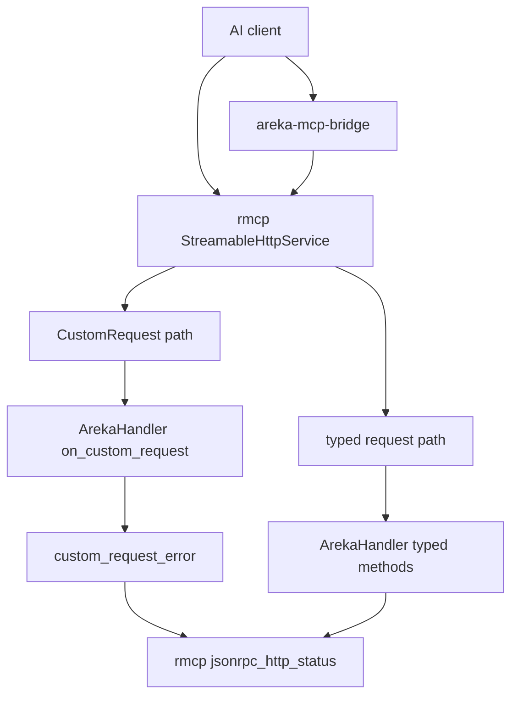
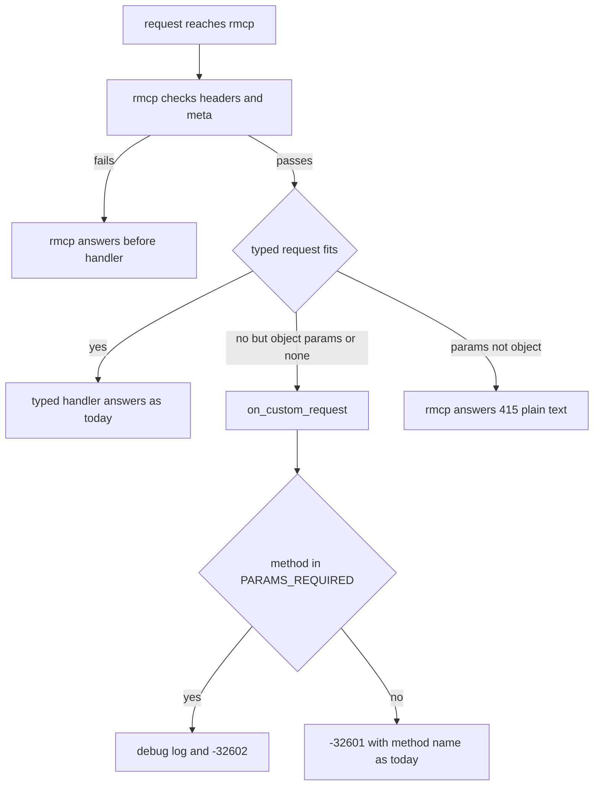
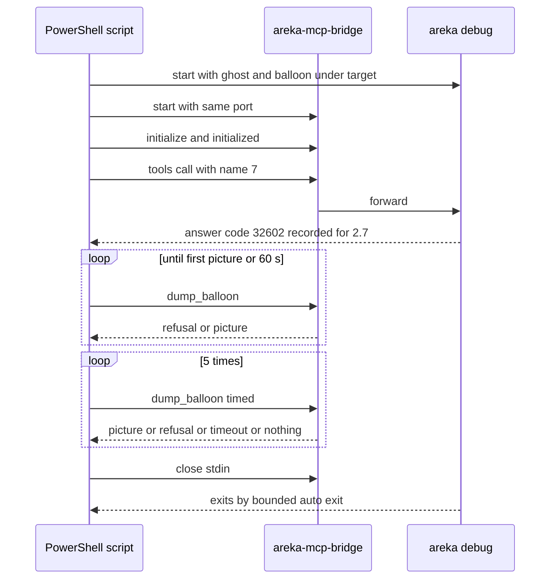

# 設計: areka-P0-mcp-receiver-bugs

## Overview

本 spec は、areka の MCP の受け口が AI のクライアント（Claude Code・Claude Desktop など）へ返す答えの 2 つの穴を埋める。

- **件 1**: `params` が欠かせないメソッド（`tools/call`・`initialize`・`completion/complete`）に形の合わない `params` が届くと、今は rmcp の既定のまま `-32601`（メソッドが無い）で答えている。rmcp 3.5.0 は型の合わない要求を「型のない要求」（`CustomRequest`）として読み、`ServerHandler::on_custom_request` に渡す。`ArekaHandler` はこれを上書きしていない。上書きを 1 つ足し、3 つのメソッドだけを `-32602`（引数が正しくない）で答えるようにする。ほかのメソッドへの答えは rmcp の既定と同じ値のまま返す。
- **件 2**: 今の main から作った debug 版で、`dump_balloon` が答えを返すことを、claudia と emo2 で 5 回ずつ実機で確かめる。確かめは PowerShell の小さな台本で手で回し、結果を spec の記録に残す。返らなかったときだけ、記録で止まった場所を突き止めて根本を直し、決定論のテストを 1 本足す。

利用者は AI のクライアント（件 1 の答えを読む）と、実機の確かめをするエージェント（件 2 の `dump_balloon` の絵を使う）である。件 1 は答えの番号を 1 つ変えるだけで、ツールの中身・中継の作り・待ちの上限は変えない。

### Goals

- 3 つのメソッドの形の違う `params` に、5 つの版のどれでも、中継ごしでも `-32602` で答える（1.1〜1.4・2.1・2.2）。
- 受け付けないメソッドへの答え（`-32601`・文はメソッドの名前）と、ほかのすべての答えを今のまま保つ（1.3・1.6・2.6）。
- 新しい答えを、受け口の決定論テスト・中継の比較テスト・差の記録の 3 か所に固定する（2.3〜2.5）。
- debug 版の `dump_balloon` が 10 回とも答えを返すことを、条件と結果つきで記録に残す（3.1〜3.3・2.7）。

### Non-Goals

- `tools/list` など、rmcp が形の違う `params` を受け流すメソッド（今のまま成功で答える）。
- `params` がオブジェクトでない要求（`7`・`[1]`・`"x"`）。受け口は HTTP 415 の平文、中継は自分で `-32600` を返す既知の限界のまま。
- `arguments` がツールの定義に合わないときの検査・未登録のツール名への答え（どちらも今の `-32602` のまま）。
- 通知・`id` の形の違う要求への答え。
- SSP がこの形にどう答えるかを測ること・`doc/ssp-mcp/transport-diff-areka.md` に行を足すこと。
- 件 2 の確かめを回し直せる実走のテストとして残すこと（並走の `real-run-mcp-kit` が実走の起こし方を道具にまとめる）。
- 待ちの上限（受け口の 10 秒）・中継の応答の上限（30 秒）・バルーンの描き方・装着の待ちの段数の変更。

## Boundary Commitments

### This Spec Owns

- `ArekaHandler` の `on_custom_request` と、その答えを決める純粋な関数 `custom_request_error`（`crates/areka-mcp/src/handler.rs`）。「`params` が欠かせない 3 つのメソッド」の表もここだけに持つ。
- `-32602` の答えの文（`invalid params for <メソッドの名前>`）と、そのときに残す `debug` の記録 1 件。
- 受け口の決定論テストのうち、形の違う `params` の答えを 5 つの版で固定する部分（`server_protocol_tests.rs` への追記と、新しい兄弟 `handler_tests.rs`）。
- 中継の比較テスト `crates/areka-mcp-bridge/tests/real_receiver_test.rs` の `id` が 8 の行の期待と、その行の上の説明。
- 差の記録 `doc/ssp-mcp/bridge-diff-areka.md` の「形の違う `params` の `tools/call`」の行の areka の欄。
- 件 2 の確かめの台本と記録（`.kiro/specs/areka-P0-mcp-receiver-bugs/verification/` の下）。
- 件 2 が再現したときに限り、`dump_balloon`（と、原因を分け合うなら `dump_surface`）の待ちの直しと、その決定論テスト 1 本。

### Out of Boundary

- rmcp が型の道で先に決める答え（`ping` の版ごとの扱い・`tools/list` などの受け流し・415 の平文・`_meta`／ヘッダの検査）。areka はこの手前で JSON-RPC を読み直さない。
- HTTP の状態の決め方（rmcp の `jsonrpc_http_status`。`-32602` は `2026-07-28` で 400、旧式の 4 版で 200）。`dispatch.rs` は変えない。
- 中継のコード（`crates/areka-mcp-bridge/src/**`）。型のない要求をそのまま届け、本文をそのまま返す今の作りで足りる。
- `doc/ssp-mcp/transport-diff-areka.md`（受け口と SSP の差の一覧）。
- 実走のテストのファイル（特に `real-run-mcp-kit` の持ち物の `crates/areka/tests/{emo2_real_run,mcp_get_log_real_run,smoke_boot_loop_exit}.rs`）。
- `crates/areka/src/mcp/` のほかのツールのファイル（`sakurascript.rs`・`raise_event.rs`・`get_status.rs` ほか）。
- 依存の追加（`Cargo.toml` は変えない）。

### Allowed Dependencies

- rmcp `=3.5.0` の公開面: `ServerHandler::on_custom_request`・`model::{CustomRequest, CustomResult, ErrorCode, ConstString, CallToolRequestMethod, InitializeResultMethod, CompleteRequestMethod}`・`ErrorData::{invalid_params, new}`。
- `tracing` の `debug!`（今の `arguments` の検査と同じ段）。
- テストは `log-capture-kit` の `capture`（`[dev-dependencies]` のまま）と、`testkit.rs` の部品。
- 件 2 の台本は、ワークスペースで作れる実行ファイル（debug 版の `areka.exe`・`areka-mcp-bridge.exe`・i686 版の `shiori-host32-helper.exe`）と、検体の置き場を印字するコマンド `nar-sample-path`（`sample-ghost-kit`）だけを使う。

### Revalidation Triggers

- rmcp の版を上げるとき: 型のない要求へ落ちる道・`on_custom_request` の署名・メソッドの名前の定数・HTTP の状態の決め方が変わりうる。`server_*tests.rs` と `real_receiver_test.rs` を全部通す（`Cargo.toml` の注記の決まり）。
- areka が新しい能力（`prompts`・`resources`・`completions` の本物の答え）を持つとき・rmcp の既定の答えを上書きするメソッドを足すとき: 3 つの表を見直す。
- `-32602` の文を変えるとき: `handler_tests.rs`・`server_protocol_tests.rs` の逐語の期待と `bridge-diff-areka.md` の行を一緒に直す。
- 同じ `handler.rs` を触る `mcp-strict-errors`・`mcp-user-response`・`mcp-shiori-query`: 同時に走らせるなら触る行を照合する。
- `real-run-mcp-kit` が着地した後: 件 2 の台本を実走の道具へ寄せるかは、その spec か後の spec が決める（本 spec の記録は寄せる元として使える）。

## Architecture

### Existing Architecture Analysis

- 受け口は `crates/areka-mcp`。JSON-RPC の解釈は rmcp に任せ、`ArekaHandler`（`handler.rs`）が rmcp の `ServerHandler` を実装する。rmcp の `ServerHandler` を綴るのは `handler.rs` だけ（`structure.md` の規律）。
- rmcp 3.5.0 の `ClientRequest` は `#[serde(untagged)]` の列で、型の合う変種が無いと最後の `CustomRequest` として読む。`params` が必須の型（`tools/call`・`initialize`・`completion/complete` など）は、`params` が無い・中の型が合わないと `CustomRequest` に落ちる。`params` が任意の型（`tools/list` など）は黙って「`params` なし」として受け流し、`ping` は `params` を読まない。
- `CustomRequest` は `_meta` を `params` から分けて持つので、`2026-07-28` の `_meta` とヘッダの検査は handler より前に効く。handler に届いた要求の答えの HTTP の状態は rmcp が決める。
- 中継（`crates/areka-mcp-bridge`）は標準入力の行を rmcp の型で読み、型のない要求も `method` と `params` のまま受け口へ届け、HTTP の状態に関わらず本文をそのまま返す。

### Architecture Pattern & Boundary Map



- 選んだ形: rmcp が用意している拡張の口（`on_custom_request`）を 1 つ上書きする。答えの判断は純粋な関数 1 つに出し、上書きはそれを呼ぶだけにする。
- 触る所は `Custom` の道の先だけ。`Typed` の道・中継・HTTP の状態の決め方は変えない。
- 依存の向き: `handler.rs` → rmcp の公開面・`tracing`。テストは `handler_tests.rs`（純粋な関数）と `server_protocol_tests.rs`（実ソケット）→ `testkit.rs`。逆向きの依存は作らない。
- 守る規律: プロトコルは公式 SDK に任せる（本文を自分で読み直さない）・rmcp の型は公開面に出さない・`log-capture-kit` は `[dev-dependencies]` だけ・テストは兄弟のファイル。

### Technology Stack

| Layer | Choice / Version | Role in Feature | Notes |
|-------|------------------|-----------------|-------|
| MCP の SDK | rmcp `=3.5.0`（変えない） | 型のない要求を `on_custom_request` へ渡す・`-32602` の HTTP の状態を決める | 依存の追加なし |
| 記録 | `tracing`（ワークスペースの版） | `-32602` で答えたときの `debug` 1 件 | 今の `arguments` の検査と同じ段 |
| テスト | `log-capture-kit`（dev）・`testkit.rs` | 記録の件数・実ソケットの答え | 既存の部品だけ |
| 実機の確かめ | PowerShell 7（`pwsh`） | debug 版の areka と中継を起こし、`dump_balloon` を呼んで時間を測る | 台本は spec の記録に添える。Claude アプリの Bash からは起こさない（`%LOCALAPPDATA%` が箱へ逸れる） |

## File Structure Plan

### Directory Structure

```
crates/areka-mcp/src/
├── handler.rs                 # 変更: on_custom_request と custom_request_error・3 つの表・頭の説明・テストの接続宣言
├── handler_tests.rs           # 新規: custom_request_error の答えと debug の記録 1 件（テストのスレッドで capture）
└── server_protocol_tests.rs   # 変更: 5 つの版で形の違う params の答えを固定するテストを追記
crates/areka-mcp-bridge/tests/
└── real_receiver_test.rs      # 変更: id が 8 の行の期待を -32602 に・その上の説明を新しい答えに
doc/ssp-mcp/
└── bridge-diff-areka.md       # 変更: 「形の違う params の tools/call」の行の areka の欄
.kiro/specs/areka-P0-mcp-receiver-bugs/verification/
├── debug-dump-balloon.ps1     # 新規: 件 2 と要件 2.7 の確かめの台本（areka のコードでもテストでもない）
└── debug-dump-balloon.md      # 新規: 確かめの条件と各回の結果の記録
```

### Modified Files

- `crates/areka-mcp/src/handler.rs` — `on_custom_request` の上書き・`custom_request_error`・表 `PARAMS_REQUIRED` を足す。頭の説明に「`params` の形が合わない 3 つのメソッドは `-32602`、ほかの型のない要求は rmcp の既定と同じ `-32601`」を 1 文足す。末尾に `#[cfg(test)] #[path = "handler_tests.rs"] mod handler_tests;`。144 行から 190 行ほど。
- `crates/areka-mcp/src/server_protocol_tests.rs` — 版ごとの話し方で要求を組む小さな部品 1 つと、テスト 2 本を足す（446 行から 560 行ほど。1,000 行の目安の内）。今の `LEGACY_VERSIONS`・`SUPPORTED_VERSIONS`・`stateless_meta` を使い回す。
- `crates/areka-mcp-bridge/tests/real_receiver_test.rs` — 195〜196 行目の説明と 208 行目の `"is": -32601` だけ。ほかの行の期待は変えない（2.6）。
- `doc/ssp-mcp/bridge-diff-areka.md` — 93 行目の areka の欄。
- 完了の段で `/kiro-complete` が文書を揃えるとき: `.kiro/steering/structure.md` 357 行目の `handler.rs` の説明に「形の合わない `params` を `-32602` に」を 1 句足す（本 spec の実装のタスクでは触らない）。

### 再現したときだけ触るファイル（3.4〜3.6）

- `crates/areka/src/mcp/dump_balloon.rs`・`dump_surface.rs`（`start` と段の機械 `Wait`）・`mod.rs`（`later`／`poll_later`）のうち、止まった場所を持つファイルと、その兄弟のテストのファイル 1 つ（`dump_balloon_tests.rs`・`dump_surface_tests.rs`・`mcp_tests.rs`・GPU を通すなら `dump_balloon_gpu_tests.rs`／`dump_surface_gpu_tests.rs`）。
- 段の移りの記録が足りなければ、同じファイルに `trace!` を足すことも直しに含める。
- 再現しなければ、areka のコードは 1 行も変えない（3.3）。

### 変えないファイル（明示）

- `crates/areka-mcp/src/dispatch.rs`・`crates/areka-mcp-bridge/src/**`・すべての `Cargo.toml`・`doc/ssp-mcp/transport-diff-areka.md`・`crates/areka/tests/**`。

## System Flows

### 型のない要求への答え（件 1）



- `PreErr`・`Plain`・`Typed` の道は本 spec の外（今のまま）。`Invalid` と `NotFound` だけが本 spec の答え。
- `NotFound` は rmcp の既定（`ErrorData::new(METHOD_NOT_FOUND, method, None)`）と同じ値で、記録も残さない（今と同じ）。

### 件 2 の確かめ（ゴースト 1 体ぶん）



- 「バルーンを出した状態」は、起動の台詞（`OnBoot` など）でバルーンが出た後の状態で作る。MCP の `sakurascript`・`raise_event` はまだ `NG:not implemented yet` なので使えない。
- 「出た」の見分けは、`dump_balloon` が初めて絵（`content` に `image`）を返したこととする。`dump_balloon` の背景は「最後に表示した絵」なので、一度出たバルーンは隠れても絵が残り、以後の 5 回の条件が揃う。それより前の断り（`the balloon of this scope is not ready`）は「まだ出ていない」と読む。
- 待ちの間の呼び出しも記録に残す。待ちの間でも 1 回でも上限の答え（`NG:areka did not respond within 10 seconds`）や返らない回があれば、それは 3.4 の場合として扱う。60 秒たっても絵が出なければ、その走行は「条件を満たせなかった」と記録し、10 回に数えない（手順を見直してやり直す）。

## Requirements Traceability

| Requirement | Summary | Components | Interfaces | Flows |
|-------------|---------|------------|------------|-------|
| 1.1 | 3 つのメソッドの形の違いは `-32602` | ParamsAnswer | `custom_request_error`・`on_custom_request`・`PARAMS_REQUIRED` | 件 1 の流れ `Invalid` |
| 1.2 | `{"name":7}`・`name` なしを `-32602` | ParamsAnswer・ReceiverTests | `server_protocol_tests.rs` の追記 | 件 1 の流れ |
| 1.3 | 受け付けないメソッドは `-32601`（文は名前） | ParamsAnswer・ReceiverTests | `custom_request_error` の表の外の枝 | 件 1 の流れ `NotFound` |
| 1.4 | 未登録の名前と同じ HTTP の状態と欄の組 | ParamsAnswer（`ErrorData::invalid_params(文, None)`）・rmcp の状態の決め方・ReceiverTests | 欄は `code`・`message` だけ | 件 1 の流れ |
| 1.5 | `debug` の記録 1 件・メソッドの名前つき | ParamsAnswer・HandlerTests | `debug!(method, …)`・`capture` | 件 1 の流れ `Invalid` |
| 1.6 | ほかの答えは今のまま | ParamsAnswer（表の外は rmcp の既定と同じ値）・既存のテスト・ReceiverTests（`tools/list` の `{"cursor":7}`） | — | 件 1 の流れ `Typed`・`NotFound` |
| 2.1 | 5 つの版で同じ | ReceiverTests | 版ごとの話し方の部品 | — |
| 2.2 | 中継ごしでも `-32602` | 中継（変更なし）・BridgeCompare | 型のない要求をそのまま届ける今の作り | — |
| 2.3 | 受け口の決定論テストで 1.1・1.2・1.3 を 5 つの版で | ReceiverTests・HandlerTests | — | — |
| 2.4 | 中継の比較テストの 1 行と説明 | BridgeCompare | `id` が 8 の行 | — |
| 2.5 | 差の記録の 1 行 | DiffRecord | 93 行目 | — |
| 2.6 | 既存のテストは 2.4 のほか期待を変えずに緑 | ParamsAnswer の枝の分け方・全テストの実行 | — | — |
| 2.7 | 同じ起動で中継ごしに 1 回 `-32602` を記録 | ManualRun | 台本の手順 3 | 件 2 の流れ |
| 3.1 | claudia と emo2 で 5 回ずつ答えが返る | ManualRun | 台本の手順 5 | 件 2 の流れ |
| 3.2 | 条件と各回の結果・所要時間を記録・台本を添える・コードを足さない | ManualRun・RunRecord | `verification/` の 2 ファイル | — |
| 3.3 | 10 回とも返れば「再現しない」で閉じる | RunRecord | — | — |
| 3.4 | 返らなければ記録で止まった場所を突き止め根本を直す | ConditionalFix・ManualRun（`RUST_LOG` を開けて起こす） | — | 件 2 の流れ |
| 3.5 | 直したら赤→緑の決定論テスト 1 本・10 回やり直し | ConditionalFix | 兄弟のテストのファイル 1 つ | — |
| 3.6 | `dump_surface` と分け合う所なら両方直す | ConditionalFix・ManualRun（`-Tool dump_surface`） | — | — |
| 3.7 | 上限・描き方・装着の段数を変えない | ConditionalFix の縛り | — | — |
| 3.8 | 根・検体・一時フォルダは `target\` の下・i686 の helper | ManualRun | 台本の手順 1・2 | — |

## Components and Interfaces

| Component | Domain/Layer | Intent | Req Coverage | Key Dependencies (P0/P1) | Contracts |
|-----------|--------------|--------|--------------|--------------------------|-----------|
| ParamsAnswer | 受け口（`handler.rs`） | 型のない要求に `-32602` か `-32601` で答える | 1.1〜1.6・2.1・2.2 | rmcp `on_custom_request`（P0）・`tracing`（P1） | Service |
| HandlerTests | 受け口のテスト（`handler_tests.rs`） | 表の中と外の答えと記録の件数を純粋に確かめる | 1.1・1.3・1.4・1.5・2.3 | `log-capture-kit`（P1） | — |
| ReceiverTests | 受け口のテスト（`server_protocol_tests.rs`） | 5 つの版の実ソケットで答えを固定する | 1.1〜1.4・1.6・2.1・2.3 | `testkit.rs`（P1） | — |
| BridgeCompare | 中継のテスト（`real_receiver_test.rs`） | 直接と中継ごしの答えが同じで `-32602` | 2.2・2.4・2.6 | 本物の受け口（P0） | — |
| DiffRecord | 文書（`bridge-diff-areka.md`） | 差の記録を事実に合わせる | 2.5 | — | — |
| ManualRun | 実機の確かめ（`debug-dump-balloon.ps1`） | debug 版を起こし、2.7 の 1 回と `dump_balloon` の回を送って測る | 2.7・3.1・3.2・3.4・3.6・3.8 | debug 版の exe 3 本（P0）・`nar-sample-path`（P0） | Batch |
| RunRecord | 実機の記録（`debug-dump-balloon.md`） | 条件と各回の結果と結論を残す | 3.2・3.3 | ManualRun（P0） | — |
| ConditionalFix | areka 本体（`crates/areka/src/mcp/`） | 再現したときだけ、待ちの根本を直す | 3.4〜3.7 | 段の機械（P0） | State |

### 受け口

#### ParamsAnswer

| Field | Detail |
|-------|--------|
| Intent | rmcp が型のない要求として渡したものに、表の 3 つのメソッドなら `-32602`、ほかは今と同じ `-32601` で答える |
| Requirements | 1.1, 1.2, 1.3, 1.4, 1.5, 1.6, 2.1, 2.2 |

**Responsibilities & Constraints**

- 判断はメソッドの名前だけで決める。`params` の中身は見ない（rmcp が型に合わないと判断した後に呼ばれるので、ここで読み直す理由が無い）。版も見ない（下の「設計で決めたこと」の 3）。
- 表の外の答えは、rmcp の既定の `on_custom_request` と同じ値（`code` は `-32601`・`message` はメソッドの名前・`data` なし）で、記録も残さない。これで 1.3・1.6 の「今のまま」が保たれる。
- 通知（`id` の無い要求・`id` の形の違う要求）は rmcp が `on_custom_notification` の道へ回すので、ここへは来ない（今の答え＝本文なしの 202 のまま・1.6）。
- `ErrorData` に `data` を付けない（未登録のツール名の答え `{"code":-32602,"message":"tool not found"}` と同じ欄の組＝1.4）。
- HTTP の状態は決めない。rmcp が `-32602` を、`_meta` に版を持つ要求（`2026-07-28`）では 400、旧式の 4 版では 200 にする。未登録のツール名の答えと同じ道なので、1.4 の「同じ HTTP の状態」は rmcp が満たす。

**Dependencies**

- Inbound: rmcp の無状態の経路 — ヘッダと `_meta` の検査を通った型のない要求を渡す（P0）
- Outbound: なし
- External: rmcp `=3.5.0` — `ServerHandler::on_custom_request`・名前の定数・`ErrorData`（P0）。`tracing` — `debug!`（P1）

**Contracts**: Service [x]

##### Service Interface

```rust
use rmcp::model::{
    CallToolRequestMethod, CompleteRequestMethod, ConstString, CustomRequest, CustomResult,
    ErrorCode, InitializeResultMethod,
};

/// `params` が欠かせないメソッド。形の正しい要求なら -32601 以外で答え、
/// 形の合わない要求は rmcp が型のない要求として渡してくる（版を問わない）。
const PARAMS_REQUIRED: [&str; 3] = [
    CallToolRequestMethod::VALUE,   // "tools/call"
    InitializeResultMethod::VALUE,  // "initialize"
    CompleteRequestMethod::VALUE,   // "completion/complete"
];

/// 型のない要求への答え（純粋・記録は表の中のときだけ debug を 1 件）。
pub(crate) fn custom_request_error(method: &str) -> ErrorData;

impl ServerHandler for ArekaHandler {
    async fn on_custom_request(
        &self,
        request: CustomRequest,
        _context: RequestContext<RoleServer>,
    ) -> Result<CustomResult, ErrorData>; // 常に Err(custom_request_error(&request.method))
}
```

- 事前条件: `method` は rmcp が型のない要求として読んだもののメソッドの名前（通知ではない＝`id` を持つ）。
- 事後条件（表の中）: `ErrorData { code: -32602, message: "invalid params for <method>", data: None }` を返し、`debug` の記録をちょうど 1 件残す。記録の欄は `method`、文は `MCP: params の形がメソッドに合わない`。
- 事後条件（表の外）: `ErrorData { code: -32601, message: <method>, data: None }` を返し、記録を残さない。
- 不変条件: 成功の答えは返さない。`params` の中身を記録に載せない（台本や長い文字列が入りうるため）。

**Implementation Notes**

- Integration: rmcp の `ServerHandler` を綴るのは今どおり `handler.rs` だけ。`dispatch.rs` は変えない。
- Validation: `handler_tests.rs`（純粋な答えと記録）と `server_protocol_tests.rs`（5 つの版の実ソケット）。
- Risks: rmcp を上げて型のない要求へ落ちる道が変わると、表の 3 つが届かなくなる・別のメソッドが届くようになる。どちらも追記したテストが赤になって気付く。

#### HandlerTests（`handler_tests.rs`・新規）

- 表の 3 つそれぞれで `capture(|| custom_request_error(m))` を呼び、答えが `code` `-32602`・`message` `invalid params for <m>`・`data` なしで、記録が `DEBUG` ちょうど 1 件・欄 `method` が `m` であることを確かめる（1.1・1.4・1.5）。
- 表の外（`no/such`・`ping`・`tools/list`・`prompts/get`）で、答えが `{-32601, <名前>, data なし}`・記録 0 件であることを確かめる（1.3・1.6。rmcp の既定と同じ値）。
- 記録はテストのスレッドで呼ぶ純粋な関数から出るので、`capture`（呼んだスレッドだけを拾う）で数えられる。`install_global_capture_all` は使わない（同じテストバイナリの全スレッドの既定を変えてしまう）。

#### ReceiverTests（`server_protocol_tests.rs` への追記）

- 部品 `speak(addr, version, id, method, params) -> Response` を 1 つ足す。旧式の 4 版は `MCP-Protocol-Version: <版>` を付ける（`initialize` だけは付けない＝クライアントの送り方どおり）。`2026-07-28` は `MCP-Protocol-Version`・`Mcp-Method` を付け、`params` に `stateless_meta()` を入れる（`name` が文字列なら `Mcp-Name` も付ける）。中継の比較テストの `post`／`request` と同じ札の付け方。
- テスト 1 `malformed_params_of_params_required_methods_are_invalid_params_in_every_version`（1.1・1.2・1.4・2.1・2.3）: 5 つの版それぞれで、比べる相手として未登録の名前の `tools/call` を先に送って状態を控え、次の形をそれぞれ送る。
  - `tools/call` の `{"name":7}`・`{}`（`name` なし）・`{"name":"get_status","arguments":7}`・`params` なし（旧式の 4 版だけ。下の注）
  - `initialize` の `{"protocolVersion":7}`
  - `completion/complete` の `{"ref":7}`
  - 期待: 本文の `error` が `{"code":-32602,"message":"invalid params for <メソッド>"}` に等しい（`data` の欄なし・`result` なし）。HTTP の状態が比べる相手と同じ（旧式 200・`2026-07-28` 400 になることも値で書く）。
  - 注: `2026-07-28` の話し方では `_meta` を `params` に入れるので「`params` なし」は送れない（`_meta` だけの `params` は `{}` の場合と同じものとして handler に届く）。`params` を本当に省くと、rmcp が handler より前に `_meta` の欠落で `-32602` を返す（今の `unknown_protocol_version_header_is_rejected` が固定している答え）。
- テスト 2 `methods_not_accepted_keep_method_not_found_and_list_methods_keep_passing_in_every_version`（1.3・1.6・2.1・2.3）: 5 つの版それぞれで、`nope/unknown` の `{"name":7}` が `{"code":-32601,"message":"nope/unknown"}`、`2026-07-28` だけ `ping` が `{"code":-32601,"message":"ping"}`（状態 404）、`tools/list` の `{"cursor":7}` が成功（受け流した答え）のままであること。
- 登録はテスト 1 の比べる相手のため `ToolRegistry::default()`（未登録の名前は登録 0 本でも `-32602 "tool not found"`）。`arguments` が 7 の行は名前が登録に無くても型のない要求として落ちるので、登録は要らない。

### 中継と文書

#### BridgeCompare（`real_receiver_test.rs`）

- `id` が 8 の行を `{"id": 8, "method": "tools/call", "params": {"name": 7}, "at": "/error/code", "is": -32602}` に替える。説明（195〜196 行目）は「形の違う `params`（`name` が文字列でない）の `tools/call` は、受け口が `-32602` で答える。中継も型のない要求として届けるので、同じ答えになる」に替える。
- 比べ方（直接の答えと中継ごしの答えの全体が等しいこと・5 つの版）はそのまま。中継のコードは変えない（2.2）。`2026-07-28` の 400 の本文も、`id` が 7 の行（未登録の名前・400）と同じ道で中継が返すことを今のテストが示している。

#### DiffRecord（`bridge-diff-areka.md` 93 行目）

- areka の欄を「areka の受け口が `-32602`（`message` は `invalid params for tools/call`・`data` なし）で答え、中継ごしでも同じ答え（中継は型の合わない要求も中身のまま届ける）」に替え、「spec `areka-P0-mcp-receiver-bugs` の件 1 で直す。直すときは…」の 2 文を外す。テストの欄（`id` が 8 の行）はそのまま。

### 実機の確かめ

#### ManualRun（`verification/debug-dump-balloon.ps1`）

| Field | Detail |
|-------|--------|
| Intent | 今の main から作った debug 版で、要件 2.7 の 1 回と `dump_balloon` の回を中継ごしに送り、答えと時間を書き出す |
| Requirements | 2.7, 3.1, 3.2, 3.4, 3.6, 3.8 |

**Contracts**: Batch [x]

##### Batch / Job Contract

- 起こし方: 開発者かエージェントが PowerShell（`pwsh`）から `pwsh -File <ワークツリー>\.kiro\specs\areka-P0-mcp-receiver-bugs\verification\debug-dump-balloon.ps1 [-Ghost claudia,emo2] [-Calls 5] [-Tool dump_balloon]` で起こす（絶対パス・どのフォルダからでも動く）。`-Tool dump_surface` は 3.6 のときだけ使う。
- 入力と前提: ワークツリーの根は台本の場所から `git rev-parse --show-toplevel` で決める。i686 の target が入っていること。件 1 の直しが入った後のコードで回す（2.7 が `-32602` を期待するため）。
- 手順:
  1. 建てる: `cargo build -p areka -p areka-mcp-bridge`（debug）、続けて `cargo build -p shiori-host32-helper --target i686-pc-windows-msvc`。i686 版の helper を `target\debug\areka.exe` の隣へ写し、PE の機械種別が i386（`0x014c`）であることを確かめる（x64 版が隣に残る罠を避けるため、写すのは建てた後の最後）。
  2. 検体: `cargo run -p sample-ghost-kit --bin nar-sample-path -- <ゴースト>` の `folder=` と `balloon.<名>=` の行を読む（置き場は `target\nar-samples\manual\<名>\`）。バルーンは claudia が `claudia`、emo2 が `emo2-kakukaku`。
  3. 作業の置き場: `target\mcp-receiver-bugs\<ゴースト>\`（毎回作り直す）。ここに `profile\`（areka の記憶）・`bridge-profile\`（中継の控え）・標準出力と標準エラーの写し・結果を置く。
  4. areka を起こす: 空きポートを OS に選ばせ、`areka.exe <ゴーストのフォルダ> <バルーンのフォルダ>` を起こす。環境は `AREKA_MCP_PORT=<番号>`・`AREKA_PROFILE_DIR=<作業の置き場>\profile`・`RUST_LOG=warn,areka::mcp=debug,areka_mcp=debug`（3.4 の分岐の `debug` の記録を最初の走行から残す）・`NO_COLOR=1`・`AREKA_NO_ALERT=1`・`AREKA_APP_SMOKE_EXIT_MS=360000`（有界の自動終了。待ち 60 秒と測る回 5 回×40 秒の最悪の場合でも、話し終える前に終わらない長さ）。`AREKA_ROOT`・`AREKA_USER_ROOT` は消す。`target\debug` は書けて winget の控えも無いので、書ける根は実行ファイルのフォルダ（`target\` の下）になる。
  5. 中継を起こす: `target\debug\areka-mcp-bridge.exe` を標準入出力をつないで起こす。環境は `AREKA_MCP_PORT=<同じ番号>`・`AREKA_PROFILE_DIR=<作業の置き場>\bridge-profile`、`AREKA_ROOT`・`AREKA_USER_ROOT` は消す。標準エラーはファイルへ写す。
  6. 話す（1 行 1 要求・答えの行は 40 秒まで待つ。中継の応答の上限 30 秒より長くし、中継の時間切れの答えも受け取れるようにする）:
     1. `initialize`（`2025-06-18`）と `notifications/initialized`。
     2. 要件 2.7: `tools/call` の `{"name":7}` を 1 回。答えの `error.code` と `message` を書き出す（期待は `-32602`・`invalid params for tools/call`）。
     3. バルーンが出るのを待つ: `dump_balloon`（`scope` 0）を 1 秒おきに、絵が返るか 60 秒たつまで送る。各回の答えを書き出す。
     4. 時間を測る回: `dump_balloon`（`scope` 0）を `-Calls` 回（既定 5）。各回の送ってから答えの行を読むまでの時間を測る。
  7. 畳む: 中継の標準入力を閉じて終わりを待ち、areka は自動終了を待つ（外から止めると helper と検体の後始末が飛ぶので、止めるのは締切を過ぎたときだけ）。締切（自動終了の 360 秒＋60 秒）を過ぎたら、台本が自分で起こした子だけを止める（ほかのプロセスに触らない）。
- 所要時間: 自動終了を待つので、ゴースト 1 体あたり約 6〜7 分、2 体で約 13 分（初回の建てる時間は別）。回す前にこの時間を伝える。
- 出力: 各回を `<作業の置き場>\results.json` に書く（回の番号・段〔待ち／測る回／2.7〕・所要のミリ秒・分類）。分類は ⑴ 絵（`content[0].type` が `image`。データの長さも書く）⑵ 断り（`isError: true` と理由の文）⑶ 上限の答え（`NG:areka did not respond within 10 seconds`）⑷ 中継の時間切れ（中継の返すエラーの行）⑸ 返らなかった（40 秒で行が来ない）。端末へは 1 回 1 行の ASCII の要約だけを出す。
- 終了コード: 測る回がすべて ⑴ か ⑵ なら 0、⑶〜⑸ が 1 回でもあれば 1、条件を満たせなかった（60 秒で絵が出ない・起動に失敗）なら 2。
- 冪等と回し直し: 作業の置き場は毎回作り直し、検体も `nar-sample-path` が毎回作り直すので、何度回しても同じ条件で始まる。ゴーストは 1 体ずつ順に起こす（同時に 2 つの areka を起こさない）。

**Implementation Notes**

- Integration: 台本は areka のコードでもテストでもなく、全体テストにも配布にも入らない（3.2）。`real-run-mcp-kit` の持ち物の 3 ファイルは読まない・写さない。
- Validation: 台本の動作そのものは、2.7 の答えと絵の回が記録に出ることで確かめる。
- Risks: 起動の台詞でバルーンが出ないゴーストだと、条件が作れない（終了コード 2 で分かる）。他のセッションが重いビルドを回していると debug 版のフレームが遅れうる（3.4 の調べで記録から読み分ける）。負荷テストの机は使わない（性能の数を測るのではなく、10 秒・30 秒の上限より前に答えが返るかを見る確かめのため）。

#### RunRecord（`verification/debug-dump-balloon.md`）

- 書くこと（3.2）: areka の版（`Cargo.toml` の版）と元のコミット（`git rev-parse HEAD`）・main との分かれ目（`git merge-base HEAD origin/main`）と、その間の差が件 1 の直し（`crates/areka-mcp/**`・テスト・文書）だけで `crates/areka/src/mcp/` に触れていないことを示す `git diff --stat <分かれ目> HEAD`（要件 3.1 の「今の main から作った」を辿れるようにする）・debug 版であること・ゴーストとバルーン・呼び方（中継ごし・`scope` 0・`2025-06-18`）・2 つの上限の値（受け口 10 秒・中継 30 秒・台本の読み 40 秒）・2.7 の答え・各回の分類と所要時間（待ちの回も含める）・結論。
- 結論の書き方: 10 回（各ゴースト 5 回）がどれも ⑴ か ⑵ なら「件 2 は再現しない」と書いて閉じる（3.3）。そうでなければ 3.4 へ進み、直した後の 10 回をこの記録に足す（3.5）。

### 再現したときの直し

#### ConditionalFix

| Field | Detail |
|-------|--------|
| Intent | 件 2 が再現したときだけ、待ちが止まる根本を直す |
| Requirements | 3.4, 3.5, 3.6, 3.7 |

**Contracts**: State [x]

##### State Management

- 今の状態の機械（`dump_surface.rs` の `start`／`Wait`・2 本のツールが分け合う）: `Attaching`（装着の相を毎フレーム確かめる）→ `Reading`（`try_finish` を 1 フレーム 1 回・待たない）→ `Encoding`（別のスレッドの答えを `try_recv` で覗く）。`mod.rs` の `drain` が Input の段で毎フレーム `poll_later` を回す。
- 止まりうる場所の候補（どれも受け口の 10 秒で上限の答えになる）: ⑴ `Attaching` のまま ⑵ `Reading` のまま（GPU の写しが終わらない）⑶ `poll_later` が回らない（フレームが進まない）。
- 突き止め方: 再現した走行の `debug` の記録（`[mcp] 撮れない`・`[mcp] 絵を返す` など）で足りなければ、段の移りに `trace!` を足し、`RUST_LOG` の `areka::mcp` を `trace` に開けて同じ条件で起こし直す。
- 直し方の縛り（3.7）: 受け口の 10 秒・中継の 30 秒・バルーンの描き方・装着の待ちの段数は変えない。1 フレーム遅らせる解は取らず、状態の持ち方を直す。原因が段の機械（`dump_surface.rs` の `start`／`Wait`）にあれば `dump_surface` にも同じ直しが効き、台本の `-Tool dump_surface` で同じ条件の 10 回を確かめる（3.6）。
- テスト（3.5）: 直したファイルの兄弟のテストのファイルに 1 本。直す前の形で赤、直した後で緑になることを実装の記録に残す。GPU を通す必要があれば本物の GPU のテスト（`*_gpu_tests.rs`・x64）に置く。

## Error Handling

### Error Strategy

- 件 1 は答えを返すことそのものが仕事で、新しい失敗の道は無い。`custom_request_error` は失敗しない純粋な関数。
- 件 2 の台本の失敗は終了コードで分ける（0＝全部返った・1＝返らない回がある・2＝条件を作れなかった）。建てる・検体を取る・起こすのどれかが失敗したら、その理由を端末に ASCII で 1 行出して 2 で終わる。

### Monitoring

- `-32602` で答えたときの `debug` 1 件（欄 `method`）。今の `arguments` の検査の記録と同じ段なので、既定の絞りでは出ず、`RUST_LOG` で開ければ見える。
- 件 2 の走行は `areka::mcp` と `areka_mcp` を `debug` まで開けた areka の標準エラーを作業の置き場に残す。

## Testing Strategy

### Unit Tests（`handler_tests.rs`）

1. 表の 3 つのメソッドで、答えが `{-32602, "invalid params for <m>", data なし}`（1.1・1.4）。
2. 表の 3 つのメソッドで、`DEBUG` の記録がちょうど 1 件・欄 `method` が `m`（1.5）。
3. 表の外（`no/such`・`ping`・`tools/list`・`prompts/get`）で、答えが `{-32601, <名前>, data なし}`・記録 0 件（1.3・1.6）。

### Integration Tests（実ソケット・`server_protocol_tests.rs`）

1. 5 つの版それぞれで、`tools/call` の `{"name":7}`・`{}`・`"arguments":7`・`params` なし（旧式のみ）、`initialize` の `{"protocolVersion":7}`、`completion/complete` の `{"ref":7}` が `{-32602, "invalid params for <m>"}` で、HTTP の状態が同じ版の未登録の名前の答えと同じ（1.1・1.2・1.4・2.1・2.3）。`2026-07-28` の `initialize` が handler まで届くことも、この行で固定する（設計の段の調べで測った）。
2. 5 つの版それぞれで、`nope/unknown` の `{"name":7}` が `{-32601, "nope/unknown"}`、`2026-07-28` の `ping` が `{-32601, "ping"}`・404、`tools/list` の `{"cursor":7}` が成功のまま（1.3・1.6・2.1・2.3）。
3. 既存の `tools_call_any_name_is_invalid_params`・`unknown_method_is_jsonrpc_error_from_rmcp`・`unknown_protocol_version_header_is_rejected` ほか全部が、期待を変えずに緑（1.6・2.6）。

### 中継の比較テスト（`real_receiver_test.rs`）

1. 5 つの版それぞれで、`id` が 8 の行の直接の答えの `error.code` が `-32602`、中継ごしの答えが直接の答えと等しい（2.2・2.4）。
2. ほかの 7 行は期待を変えずに緑（2.6）。

### 実機の確かめ（手で回す・記録に残す）

1. 件 1 の直しの後のコードで台本を claudia と emo2 の順に回し、2.7 の `-32602` と 5 回ずつの `dump_balloon` の分類と時間を記録する（2.7・3.1・3.2）。
2. 10 回とも ⑴ か ⑵ なら「再現しない」で閉じる（3.3）。そうでなければ ConditionalFix の手順へ（3.4〜3.7）。
3. 置き場がすべて `target\` の下であること（作業の置き場・検体・記憶・控え）と、i686 の helper が隣にあることを記録の条件に書く（3.8）。

## 設計で決めたこと（要件の段から預かった議題）

| 議題 | 決めたこと | 理由 |
|---|---|---|
| 3. 表が版を見るか | 見ない。表は 3 つの名前だけ | 3 つとも 5 つの版のどれでも形の正しい要求に `-32601` 以外で答える（`2026-07-28` の `initialize` も `2025-11-25` へ倒れて成功）。版で答えが変わる唯一のメソッド `ping` は rmcp の型の道で決まり、`on_custom_request` に届かない。版の分け方を持つのは今の要件に無い備えで、rmcp を上げたときの変化は追記したテストが 5 つの版で赤にする |
| 5. `-32602` の文と、テストで逐語に固定するか | 文は `invalid params for <メソッドの名前>`。テストは答えの全体（`code`・`message`・`data` なし）を逐語に固定する | areka が自分で決めた決まった文なので、rmcp や serde を上げても変わらず、逐語に固定しても手間が増えない。serde の理由の文（案 C）は版で変わり、読み直しの型を 3 つ引く分だけ長い。番号 `-32602` だけで「送り方を直す」ことは伝わり、文にメソッドの名前が入るのでどの要求かも分かる |
| 6. 1.5 の記録の確かめ方 | 判断と記録を純粋な関数 `custom_request_error` に置き、テストのスレッドで呼んで `capture` で数える | handler は `mcp` スレッドで動き、`capture` は呼んだスレッドしか拾わない。`install_global_capture_all` は同じテストバイナリ全体の既定を変えるので使わない。上書き側は関数を呼ぶだけなので、配線は実ソケットのテストの答えで確かめられる |
| 7. テストの置き場 | 実ソケットは `server_protocol_tests.rs` に追記（版の部品を使い回す・560 行ほど）。純粋な関数は新しい兄弟 `handler_tests.rs`。中継の比較テストに行は足さない | 版ごとの話し方の部品が `server_protocol_tests.rs` に在り、新しいファイルに写すと重複する。1,000 行の目安まで余裕がある。純粋な関数のテストは本番のファイルの兄弟に置く決まり。中継の比較は要件どおり 1 行の差し替えだけ（`name` なしは受け口のテストで固定する） |
| 8. `transport-diff-areka.md` に行を足すか | 足さない | この文書は受け口と SSP の差の一覧で、SSP がこの形にどう答えるかは測らない（範囲外）ので、SSP の欄が埋まらない。要件も求めていない。今の 21 行目（未知のツール名・必須引数の欠落の `-32602`）は事実と食い違わない |
| 10. 「バルーンを出した状態」の作り方と見分け方 | 起動の台詞でバルーンが出るのを待ち、`dump_balloon` が初めて絵を返したことで「出た」と見る（60 秒まで 1 秒おき） | `sakurascript`・`raise_event` は未実装で使えない。`dump_balloon` の背景は最後に表示した絵なので、一度絵が返れば以後の回の条件が揃う。別の見分け方（記録の行・`get_log`）を足すより、確かめる当のツールの答えで見る方が短く、条件の取り違えが起きない |
| 調べもの: `2026-07-28` の札と `_meta` を揃えた形の違う `initialize` | 届く（測った）。今は 404・`-32601` `"initialize"`、直した後は 400・`-32602` になる | `target\gap-probe` で `MCP-Protocol-Version: 2026-07-28`・`Mcp-Method: initialize`・`_meta` を揃えて `{"protocolVersion":7}` と `{}` を送り、rmcp の既定の `on_custom_request` の答え（`-32601` `"initialize"`）が 404 で返ることを見た。形の正しいものは 200・成功（`2025-11-25`） |
