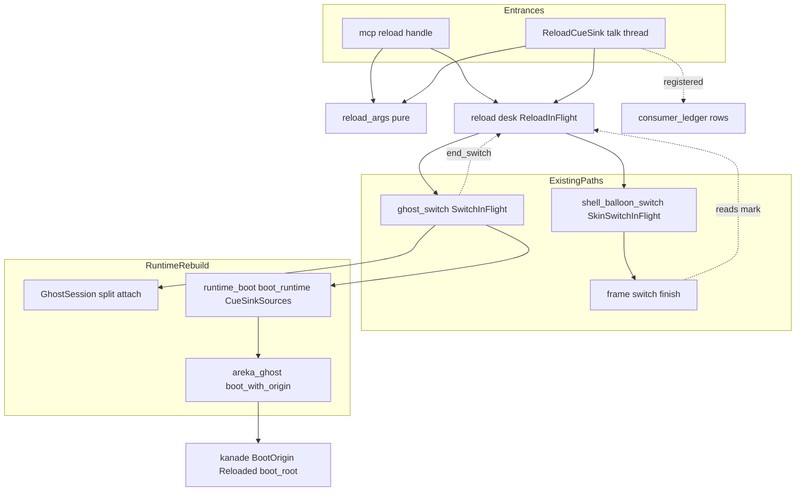
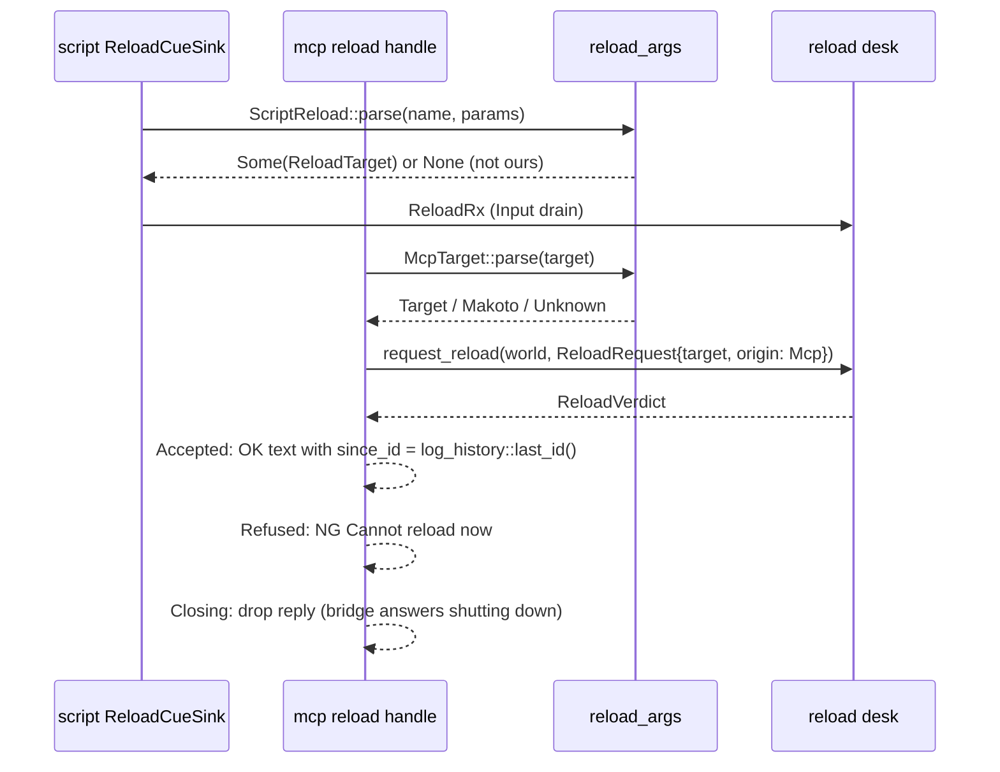
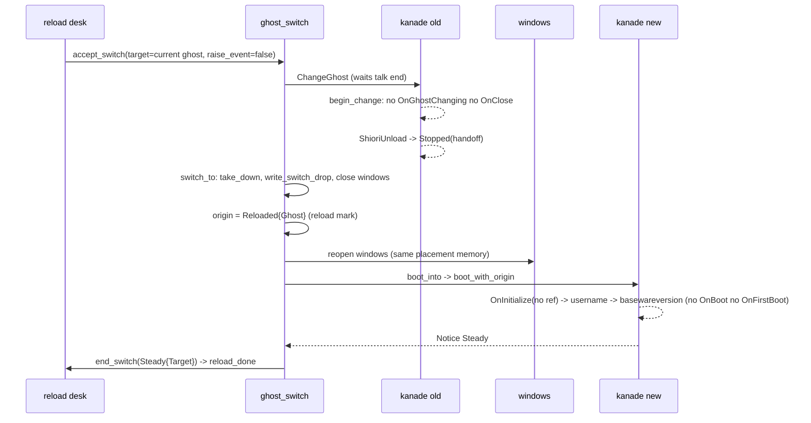
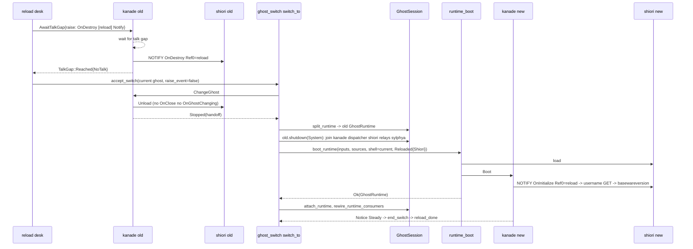
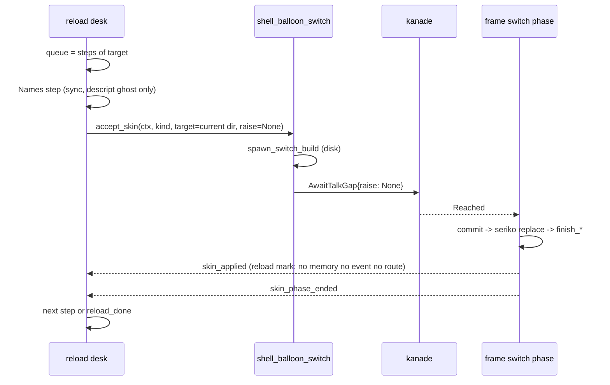
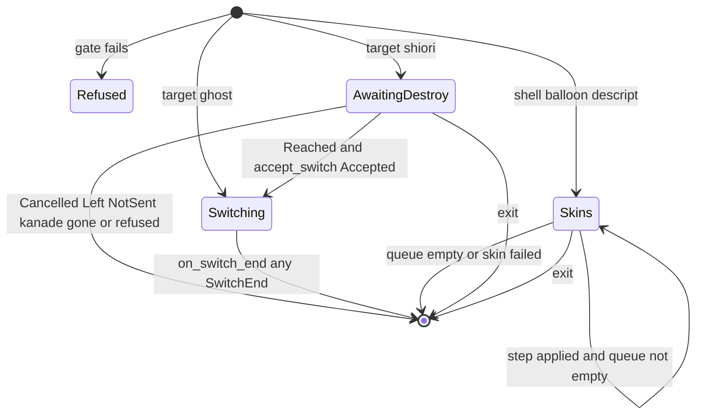

# Design Document: areka-P0-mcp-reload

> 2026-10-18・本ブランチ（main `e2370df8` の上）で、requirements.md（13 要件・議題はすべて確定）と research.md（1〜10 節）を入力に書いた。コードは「何の定義か」（関数名・型名＋ファイル）で指す。research.md 9 節の「設計の段で決める」10 項目への答えは、末尾の「持ち越し項目への答え」の表にまとめ、本文の各節がその根拠になる。

## Overview

**Purpose**: ゴーストの作者と AI エージェントが、辞書・シェル・バルーン・descript.txt を書き換えた結果を、areka を終了して起動し直さずに確かめられるようにする。SSP の `reload`（MCP）と台本の `\![reload,…]` と同じ 5 対象（ghost／shiori／shell／balloon／descript）を、**1 つの読み直しの窓口**から、既存の 2 つの載せ替えの道（ゴースト切替 `request_ghost_switch`・シェル／バルーン切替 `request_skin_switch`）に乗せて行う。

**Users**: ぱすたさんを作る開発者（辞書を書き換える → `reload` → 確かめる）、MCP 越しに作業する AI エージェント（`reload` → `get_status` → `get_log`）、台本で `\![reload,…]` を使う既存ゴースト。

**Impact**: ⑴ MCP の `reload` のダミー（`NG:not implemented yet`）が本物になる。⑵ `\![reload,…]`・`\![reloadsurface]` の受け取り手が台帳に載る。⑶ 起動の由来 `BootOrigin` に「読み直し（知らせを送らない）」が 1 種増える。⑷ **起動の結線 `wire_emo2_boot` が「窓の側」と「実行系の側」の 2 段に分かれ**、実行系（`GhostRuntime`）だけを窓を残したまま組み直せるようになる（要件 4 の本質）。既存の切替・終了・ネットワーク更新の振る舞いは 1 つも変えない。

### Goals

- 5 対象の読み直しを、台本と MCP のどちらからでも同じ操作として呼べる（要件 1）。
- ghost の読み直しで起動の知らせ（台詞を求める GET）を 1 つも送らず、情報の通知は送る（要件 3）。
- shiori の読み直しで窓とシェル・バルーンを残し、`OnDestroy(reload)` → unload → load → `OnInitialize(reload)` の順で SHIORI だけを組み直す（要件 4）。
- shell／balloon／descript の読み直しで SHIORI イベントと記憶の書き込みを止める（要件 5〜7）。
- MCP の答えは SSP と同じ文ですぐ返し、成否はエラーログで確かめられる（要件 8・9）。
- 判断の分岐はすべて決定論テストで固定し、既存のテストを 1 本も落とさない（要件 12）。

### Non-Goals

- makoto の本体・台本の `\![reload,makoto]`（`makoto-reload-directives`・`makoto-dll-host`）。MCP の `target: "makoto"` は縮退の `NG:` だけ（要件 10）。
- `\![reload,aigraph]`、別のゴースト／シェル／バルーンへの切替、ファイルの変更を見張る自動の読み直し。
- ふつうの終了・切替・ghost の読み直しで送る `OnDestroy`（Reference0 空）（裁定 11・完了のときに起票）。
- 窓のタイトル（`sakura.name` など）の動作中の書き換え（下の「descript の読み直しで替える値」で理由を述べる）。
- MCP の案内文の「not implemented yet」の 1 文、橋の `REPLY_WAIT`、右クリックメニューの「読み直し」項目、`doc/ssp-mcp/areka-tools.md`。

## Boundary Commitments

### This Spec Owns

- **読み直しの窓口**（新 `crates/areka/src/emo2_boot/reload.rs`）: 対象の振り分け・重なりの判定・進行中の印 `ReloadInFlight`・始めと終わりの記録・終了の門。台本と MCP の 2 つの入口はここの `request_reload` 1 本だけを通る。
- **純粋な振り分け**（新 `emo2_boot/reload_args.rs`）: MCP の `target` の 6 語の照合、台本の綴り（`reloadsurface` を含む）から対象への写し、`\![reload,descript,パラメータ]` の語の仕分け。
- **台本の受け口**（新 `emo2_boot/reload_cue.rs`）と台帳の行（`consumer_ledger.rs`・網羅台帳 `sakura-script.toml`）。
- **実行系だけの組み直し**: `wire_emo2_boot` の実行系の側（新 `emo2_boot/runtime_boot.rs` の `boot_runtime`）と、`GhostSession` の「実行系を外して付け直す」口（`ghost_session.rs`）、実行系に結びつく窓側の結線のやり直し（`rewire_runtime_consumers`）。
- **起動の由来 `BootOrigin::Reloaded { scope }`** と、kanade の起動系列でそれを受ける腕（`change.rs`・`schedule/boot.rs`）。
- **既存の 2 つの切替の道に開ける小さな口**: `ghost_switch.rs` の「予約の終わりの 1 か所」（`end_switch`）と `switch_to` の分かれ目、`shell_balloon_switch.rs` の受理の後半の切り出し、`frame/switch.rs` の後始末の分かれ目。
- MCP の `reload` の中身（`mcp/reload.rs`）と `GhostRuntime::set_names`（`crates/areka-ghost/src/runtime.rs`）。

### Out of Boundary

- `mcp/mod.rs` の振り分け（`dispatch`）・`resolve.rs`・`crates/areka-mcp/**`（`mcp-receiver-bugs`）。宛先の解決と返事の運搬は今のまま使う。
- kanade の `msg.rs`・`actor.rs`・`schedule/mod.rs`・`schedule/change.rs`（`mcp-kanade-tools`）。切替の要求 `ChangeGhost`・台詞の切れ目 `AwaitTalkGap`・汎用の通知 `RaiseEvent` は**今ある形のまま**使い、新しいメッセージは足さない。
- 既存の切替（`request_ghost_switch`・`request_skin_switch`）の判定・差し替え・失敗の扱いの意味（roadmap の保存義務）。本 spec はそれらの**関数の形を切り出す**（純移動）だけで、判断は変えない。
- `update/desk.rs`・`install/overwrite.rs`・`menu/ghost_frame.rs`（`SwitchRequest`・`SwitchInFlight` の形を変えないので触らない）。
- `Emo2Wiring`（`frame.rs`）の形。受信端を抱える 4 本の線（表示・move・lifecycle・zorder）は窓の側に残し、送出端の複製を実行系の側へ渡す。

### Allowed Dependencies

- `areka_kanade`: `KanadeMsg::{ChangeGhost, AwaitTalkGap, RaiseEvent}`・`GapRaise`・`TalkGap`・`BootOrigin`・`KanadeNotice`（読むだけ・形を変えない）。
- `areka_ghost::boot_with_origin`・`GhostRuntime::{mount, sylphya_publisher, set_shell_dir}`・`areka_parsers::package::resolve_with_shell`（descript の読み直しで名前と `readme` を引き直す）。
- `crate::mcp::{later は使わない}`・`areka_mcp::tools::{ReplyTo, outcome}`・`crate::log_history::{last_id, TARGET_ERROR}`。
- `crate::exit_wait::{register_gate, WorkGate}`・`crate::update::desk::is_busy`・`crate::install::desk::is_busy`（新・下の 13.1 の補正）。
- 依存の向き（左は右を import しない）: `reload_args`（純粋・std）→ `reload_cue`（dola の `CueSink`）→ `reload`（World・kanade・既存の切替の入口）→ `ghost_switch`／`shell_balloon_switch`／`frame/switch`（口を開ける側）→ `ghost_session`／`runtime_boot`（実行系の組み直し）→ `mcp/reload.rs`（入口）。

### 要件 13.1 の一覧の補正（設計で照合した結果・ウェーブの調整の種）

本質の形で設計すると、要件 13.1 の一覧に無い次の 4 ファイルに**小さな口**が要る。どれも**ほかの並走 spec の持ち物ではない**（要件 13.3 の禁止には触れない）が、13.1 の「ほかを触る要が出たら止めて報告する」に当たるので、設計ディスカッションで一覧へ足す承認を得る。

| ファイル | 足すもの | 大きさ | 要る要件 | 避ける形とその代償 |
|---|---|---|---|---|
| `crates/areka-kanade/src/schedule/events.rs` | 送出許可表 `ALLOWED_EVENT_IDS` に `"OnDestroy"` の 1 行（＋`events_tests.rs` の件数） | 2 行 | 4.1（`OnDestroy` NOTIFY は許可表を通る `AwaitTalkGap` の印で送る） | kanade に新しいメッセージを足す＝`msg.rs`（禁止）。許可表なしで送る道は無い |
| `crates/areka/src/install/desk.rs` | `pub(crate) fn is_busy(world) -> bool`（`busy \|\| !queue.is_empty() \|\| overwrite.is_some()`） | 約 6 行 | 2.1（インストールの実行中を見る）・12.1 ⑶ | 窓口の欄は `pub(super)`＝外から読めない。要件ディスカッションで足した項目に 13.1 が追随していなかった |
| `crates/areka/src/readme.rs` | `pub(crate) fn set_path(world, PathBuf)`（`ReadmeWiring.path` の差し替え） | 約 8 行 | 7.3（`readme` は動作中に使い続ける値） | 受信端を抱えた `ReadmeWiring` を作り直すには受信端が要り、送出端は走っている dispatcher の中＝作り直せない |
| `crates/areka-seriko/src/lib.rs` | `pub use actor::BIND_COMMAND;`（13.5 の定数の再輸出） | 1 行 | 13.5 | seriko の公開面は `lib.rs` の `pub use` だけ（structure.md）。`actor` は私有 mod |

ほかの並走 spec（`mcp-kanade-tools`・`mcp-receiver-bugs`）の持ち物に触る箇所は **0**。`mcp-kanade-tools` が `crates/areka-ghost/src/runtime.rs` に 1 行足す予定とは、本 spec の `set_names`（`set_shell_dir` の隣に置く 1 メソッド）が別の場所なので衝突しない見込み（マージ時に照合）。

### Revalidation Triggers

- `BootOrigin` に変種を足す／`boot_root` の表を変える spec（`script-security-level`・`mouse-click-wheel-events` は `schedule/boot.rs` に触る）。
- `SwitchInFlight`／`SkinSwitchInFlight` の寿命を変える spec（`ReloadInFlight` の寿命はそれに従う）。
- `Emo2Wiring` の受信端の線を増やす spec（線を増やしたら `CueSinkSources` にも送出端の複製を足す）。
- `GhostSession` の欄を増やす spec（`multi-ghost-runtime`）: 実行系の側か窓の側かを決めて `split_runtime`／`attach_runtime` に載せる。
- `makoto-reload-directives`: 台帳の `("reload", Some("makoto"))` と、MCP の縮退の口（`mcp/reload.rs` の `McpTarget::Makoto` の腕）を本物の操作へつなぐ。

## Architecture

### Existing Architecture Analysis

- **同じゴーストへの載せ替えの道は既にある**: `update/desk.rs::reload` → `request_ghost_switch(SwitchRequest{ghost: Folder(同じ), raise_event: false, …})` → kanade `begin_change`（`OnGhostChanging`・`OnClose` を送らずに unload）→ 停止通知（`ChangeHandoff`）→ `switch_to`（`take_down` → `close_windows_for_restart` → `boot_into`）。`same_folder_pin::pin_to_current` が同じフォルダ名の切替先を今のゴーストのフォルダに固定する。
- **起動の知らせの選び方は kanade の `boot_root` の 1 か所**（`BootOrigin` を網羅する `match` はここだけ）。`Plain`／`Halted` は根なし＝`OnBoot` へ直行する。`OnInitialize` は `boot_start` が `events::on_initialize`（References なし）で作る。
- **実行系と窓の境は既に半分ある**: `GhostSession` は実行系（`GhostRuntime`）・seriko・loop ticker・seriko の送り手を 1 つの単位として持ち、降ろす順（① ticker と送り手 → ② 実行系 → ③ seriko の join）が決まっている。`GhostRuntime` は kanade・dispatcher・shiori・relay 2 本・ticker・sylphya を持ち、`boot_with_origin` で何度でも作れる。窓・seriko・アトラス・文字の層（`Emo2Wiring`）は World に残る。
- **実行系に結びつく窓側の状態**（実行系を替えたら差し替えが要るもの）: `MouseWiring`（kanade の送出端）・`MenuWiring`（同）・`UserBreakWiring`（同＋受信端）・`ChoiceForwarder`（dispatcher の送出端）・`PersistWiring`（sylphya の書き手）・`ReadmeWiring`／`ChangeRx`／`SwitchRx`（受信端・送出端は dispatcher の sink の中）・置換語の載せ直し（`install::names::reseed`）・`LastInstallNames`。`BalloonWiring`／`ChoiceSelectionInbox` は窓の側（窓のハンドラが使う）。
- **台詞の切れ目の口** `KanadeMsg::AwaitTalkGap { raise: Option<GapRaise>, reply }` は、切れ目に達してから印のイベントを送って返事する。印は許可表 `ALLOWED_EVENT_IDS` を通り、NOTIFY なら `Reached { marked: NoTalk }` で返る。
- **MCP の返事**: `mcp::later` は要らない（裁定 6＝すぐ答える）。`log_history::last_id()` が既にあり（`#[allow(dead_code)]`・本 spec が最初の呼び手）、`get_log` の `since_id` は「その番号より大きい」で絞る。
- **エラーログの取り決め**: `tracing::error!(target: TARGET_ERROR, ghost = %名, …)` で記録の名前がゴーストになる（先例 `readme/opener.rs`）。既存の切替の失敗の記録は `[SYSTEM]` のまま変えない。

### Architecture Pattern & Boundary Map



**Architecture Integration**:

- Selected pattern: **窓口＋印（desk and in-flight mark）**。インストール・更新の窓口と同じ型で、新しい操作は 1 つの窓口（`reload.rs`）に閉じ、既存の 2 つの切替の道へは「印を読む分かれ目」と「終わりの合図」だけを開ける（research.md 5 節のハイブリッド A1+A3・B1・C1）。
- Domain boundaries: **読み直しの意味**（どの対象で何を送らないか）は窓口と印が持つ。**降ろして起こす手順**は今までどおり `ghost_switch.rs`、**差し替える手順**は `frame/switch.rs` が持つ。**実行系だけの組み直し**は `ghost_session.rs`＋`runtime_boot.rs` が持ち、`ghost_switch::switch_to` はそれを「窓を閉じずに起こす腕」として呼ぶだけ。
- Existing patterns preserved: `*_cue.rs` の受け口の型（自己選別＋送り出し）、`SwitchInFlight`／`SkinSwitchInFlight` の寿命、終了の待ちの門（`register_gate`）、ログの取り決め（`TARGET_ERROR`＋`ghost`）。
- New components rationale: `CueSinkSources`（受け口の送出端の束）が無いと、実行系を組み直すたびに `Emo2Wiring` の受信端を作り直すことになり、窓の側に手を入れる羽目になる。`BootOrigin::Reloaded` が無いと UI 側では送られる GET を止められない（research.md 5 節 B2）。
- Steering compliance: 新しい依存 0・`Cargo.toml` 不変、`unsafe` 0、判断の分岐は純粋関数（`reload_args`）と小さな状態（`ReloadInFlight`）に集め、配線は再テストしない。

### Technology Stack

既存のスタックの中で閉じる（新しいクレート・機能フラグ 0）。使うのは `bevy_ecs`（NonSend の印・Input 段の系）、`std::sync::mpsc`（受け口の線）、`areka_actor::reply_channel`（切れ目の返事）、`tracing`（記録）だけ。

## File Structure Plan

### 新しいファイル（`crates/areka/src/emo2_boot/`）

```
emo2_boot/
├── reload_args.rs              # 純粋: McpTarget::parse（6 語・ASCII 大小無視）・ScriptReload::parse（綴り→対象）・DescriptParams::parse（語の仕分け）
├── reload_args_tests.rs        # 12.1 ⑴⑵⑸
├── reload_cue.rs               # ReloadCueSink（\![reload,…]・\![reloadsurface] の受け口）・ReloadRx・wire_reload_rx
├── reload_cue_tests.rs
├── reload.rs                   # 窓口: ReloadRequest・ReloadTarget・ReloadOrigin・ReloadInFlight・request_reload・drain・終了の門・
│                               #   ghost_switch/frame/switch からの合図（on_switch_end・skin_applied・skin_phase_ended）・終わりの記録
├── reload_tests.rs             # 12.1 ⑶⑹・記録
├── reload_skin_tests.rs        # shell/balloon/descript の列の進み方
├── runtime_boot.rs             # 実行系の側: CueSinkSources・RuntimeBootInputs・boot_runtime（sink の束→boot_with_origin→受信端の据え付け）
├── runtime_boot_tests.rs
├── special_name.rs             # ghost_switch.rs から純移動: resolve_special_name・NameResolution・UnresolvedReason・LastInstalledGhost（行数の確保）
├── consumer_ledger_tests.rs    # consumer_ledger.rs の中のテストの塊を純移動（最初のタスク）
├── ghost_switch_reload_tests.rs    # switch_to の読み直しの分かれ目・shiori だけの組み直し（SwitchRig）
└── frame/switch_reload_tests.rs    # finish_shell/finish_balloon の読み直しの分かれ目
```

`crates/areka-kanade/src/schedule/boot_reload_tests.rs`（12.2）・`crates/areka/src/ghost_session_reload_tests.rs`（実行系の外し付け）・`crates/areka-ghost/src/runtime_names_tests.rs`（`set_names`）も新しい兄弟のテスト。

### Modified Files

| ファイル | 変更 | 要件 |
|---|---|---|
| `crates/areka/src/mcp/reload.rs`・`reload_tests.rs` | ダミーを本物に: `McpTarget::parse` → 窓口 → 返事（OK／NG の 3 文）・makoto の縮退 | 1.1〜1.3・8・10.1・10.2・12.6 |
| `emo2_boot/mod.rs` | `mod` 宣言 4 つ（`reload_args`・`reload_cue`・`reload`・`runtime_boot`・`special_name`）、`wire_emo2_boot` の手順 5〜6 の後半（sink の束と boot・受信端の据え付け）を `runtime_boot::boot_runtime` へ移す結線、`CueSinkSources` を組んで `Emo2BootOutcome` に載せる | 4・13.4 |
| `emo2_boot/ghost_switch.rs` | ⑴ 特別な名前の解決を `special_name.rs` へ純移動（約 100 行減）⑵ 受理の後半 `accept_switch(world, target, req)`（`PrevGhost` の組み立て〜`SwitchInFlight` の挿入）を `pub(crate)` に切り出す ⑶ `SwitchInFlight` を下ろす 6 か所を `end_switch(world, SwitchEnd)` に通し、そこから `reload::on_switch_end` を呼ぶ ⑷ `switch_to`: 由来を `reload::boot_origin_override` で上書き・shiori だけの読み直しなら `rebuild_runtime_in_place` を `boot_into` の代わりに呼ぶ ⑸ `set_stage` を `pub(super)` に | 3・4・13.4 |
| `emo2_boot/shell_balloon_switch.rs` | 受理の後半（`spawn_switch_build` → `AwaitTalkGap` → `SkinSwitchInFlight` 挿入）を `accept_skin(world, ctx, kind, target, raise: Option<GapRaise>)` に切り出し、`SwitchContext::read` を `pub(super)` に。判定の順・文言は不変 | 5・6・7 |
| `emo2_boot/frame/switch.rs` | `finish_shell`／`finish_balloon` に読み直しの分かれ目（記憶・イベント・`BalloonRoute::Memory` の書き換えを飛ばし `reload::skin_applied` を呼ぶ）、`run_switch_phase` の末尾に `reload::skin_phase_ended`（印が消えたときだけ） | 5.3・6.3・8.4 |
| `emo2_boot/consumer_ledger.rs`・`consumer_ledger_agreement_tests.rs` | テストの塊を兄弟へ出す → `("reload", Some(ghost\|shiori\|shell\|balloon\|descript))` 5 行＋`("reloadsurface", None)`・`bind` の名前を `areka_seriko::BIND_COMMAND` から引く・一致のテストに見本 | 11.1〜11.3・13.5 |
| `crates/areka/src/ghost_session.rs` | `GhostSession` に `sinks: Option<CueSinkSources>` を足し、`shutdown` の ① で落とす。`split_runtime(&mut self) -> Option<GhostRuntime>`・`attach_runtime(&mut self, GhostRuntime)`・`set_names`・`rewire_runtime_consumers(world, &session, ghost, balloon)`（`boot_wired` の boot 後の塊を関数に切り出し、`boot_wired` と読み直しの両方が呼ぶ）。`register_systems` に `reload::register`。 | 4・7.3 |
| `crates/areka-ghost/src/runtime.rs` | `GhostRuntime::set_names(&mut self, names: GhostNames)`（`mount.names` の差し替え＋`publish_ghost_statics` の呼び直し・`set_shell_dir` と同じ形） | 7.3 |
| `crates/areka-kanade/src/change.rs` | `BootOrigin::Reloaded { scope: ReloadScope }`・`pub enum ReloadScope { Ghost, Shiori }` | 3.3・4.3 |
| `crates/areka-kanade/src/schedule/boot.rs` | `boot_start(state, config)`: `Reloaded{Shiori}` なら `OnInitialize` を Ref0＝`reload` で（`events::raise("OnInitialize", vec!["reload"], Notify, …)`）。`on_prefetch_reply`: `Reloaded{..}` なら `boot_root` を見ずに `to_baseware_version(state, None, config)` へ直行（`info!(boot_reload_silent)`）。`boot_root` の `match` に `Reloaded { .. } => None` の腕（網羅のため・到達しない） | 3.3・3.4・4.3・12.2・12.3 |
| `crates/areka-seriko/src/actor.rs` | `pub const BIND_COMMAND: &str = "bind";` を置き、比較をそれに替える | 13.5 |
| `doc/ukadoc-coverage/ledger/sakura-script.toml` | `reload,ghost`・`reload,shell`・`reload,balloon`・`reload,descript,パラメータ`・`reload,shiori` の状態と `owner`。別名の行は写像先と同じ。`reload,makoto`・`reload,aigraph` は不変 | 11.4・11.5 |
| （13.1 の補正）`schedule/events.rs`・`install/desk.rs`・`readme.rs`・`areka-seriko/src/lib.rs` | 上の表のとおり | 4.1・2.1・7.3・13.5 |

行数（目安 1,000）: `consumer_ledger.rs` 960 → 約 450（テストを出す）＋6 行。`ghost_switch.rs` 948 → 約 850（特別な名前を出す）＋約 30 行。`emo2_boot/mod.rs` 916 → 約 800（sink の束と boot を `runtime_boot.rs` へ）＋約 20 行。`ghost_session.rs` 885 → 約 870（boot 後の塊を関数へ）＋約 80 行＝約 950。`frame/switch.rs` 636＋約 25。`shell_balloon_switch.rs` 442＋約 15。

## System Flows

### Flow 1: 入口から窓口へ（台本・MCP 共通）



- 窓口の判定の順（要件 2.1・2.2・12.1 ⑶）: 終了の途中（門 `is_closing`）→ 別の読み直し（`ReloadInFlight`）→ ゴースト切替（`SwitchInFlight`）→ シェル／バルーン切替（`SkinSwitchInFlight`）→ ネットワーク更新（`update::desk::is_busy`）→ インストール（`install::desk::is_busy`）→ 文脈（`GhostSlot`・`BootContext`・kanade の送出端）。断りはどれも `warn!(event = "reload_refused", reason, target, origin, ghost)` を 1 件。
- 受理したら `info!(event = "reload_started", target, origin, ghost)`（要件 1.6）→ 対象ごとの始め方（Flow 2〜4）→ `ReloadInFlight` を置く。

### Flow 2: ghost の読み直し（既存のゴースト切替の道・由来だけ上書き）



- 切替先は目録を引かず `BootContext.current.ghost`（`dir`・`folder`）と `GhostSession::names()` から組む（要件 3.1・argv で起こしたゴーストも同じ）。`switch_copy::start` は既存の規則のまま（今のゴーストのフォルダは `plan_copy` が `AsIs` と判じるのが常の形）。
- `switch_to` の中で読み直しは `BootOrigin::Reloaded { scope: Ghost }` を選ぶ。`boot_event` が `Some` の既存の経路（ネットワーク更新）と `ChangedFrom` の経路は 1 行も変わらない（要件 3.6）。
- 失敗は既存のまま: `boot_into` が偽なら `switch_to_default`（由来 `Halted`）、既定も起きなければ `fatal`（要件 3.7）。終わりは `end_switch` が全部の出口で `reload::on_switch_end` へ渡す。

### Flow 3: shiori だけの読み直し（窓を残して実行系を組み直す・要件 4）



**何が残り、何が組み直されるか（要件 4.2）**

| 残る（窓の側） | 組み直す（実行系の側） |
|---|---|
| キャラ窓・バルーン窓（`GhostWindows`・位置・DPI）、`Emo2Wiring`（presenter・アトラス・文字の層 `TextLayerRuntime`・`TalkClock`・4 本の受信端・バルーンの可視性）、seriko アクター・loop ticker・`SerikoSink`、`BalloonWiring`／`ChoiceSelectionInbox`、`BootContext`、`SwitchInFlight`（予約）、`CueSinkSources` | `GhostRuntime` 一式＝SHIORI アクター・kanade・dispatcher・relay 2 本・ticker・sylphya（ゴーストの記憶は flush して閉じ、新しい実行系が同じ置き場から読み直す） |
| | 実行系に結びつく窓側の結線（`rewire_runtime_consumers`）: `MouseWiring`・`MenuWiring`＋8 枠の登記・`ChoiceForwarder`・`PersistWiring`（`on_boot_ok`）・置換語の載せ直し・`ReadmeWiring`／`ChangeRx`／`SwitchRx`／`ReloadRx`／`UserBreakWiring`（受信端ごと新品＝送出端は新しい dispatcher の sink が持つ） |

- **所有の境**: `GhostSession` が両側を持つ単位のまま、`split_runtime` で実行系だけを外し、`attach_runtime` で付け直す。外している間も `GhostSlot` に（実行系の無い）単位を戻しておく＝失敗して `switch_to_default` → `take_down` が走っても seriko・ticker は正しく降りる。
- **イベントの順**: `OnDestroy(reload)`（切れ目で）→ unload（ChangeGhost の相・kanade は新しいトークが始まっていればその終わりを待つ）→ load → `OnInitialize(reload)` → `username` → `basewareversion` → Steady。台詞を求める GET は 0（要件 4.3）。SSP と違い、`OnDestroy` と unload の間に 1 往復の隙間がある（切れ目の返事を受けてから `ChangeGhost` を送るまでに Tick が割り込んで台詞が始まれば、その台詞の後に unload する）。順序は保たれるので受け入れる。
- **シェル**: 新しい実行系は `shell = GhostSession::current_shell_folder()` でマウントする（差し替え後のシェルに合わせる）。
- **失敗（要件 4.4）**: `boot_runtime` が `Err` なら、実行系の無い単位を `GhostSlot` へ戻したまま `switch_to_default(world, &target.name)`（既定も起きなければ既存どおり `fatal`）。失敗の理由は `boot_runtime` が `error!` で残し、`end_switch` の出口で読み直しの失敗の記録（`TARGET_ERROR`＋`ghost`）を 1 件足す。
- **切れ目の返事が `Reached` でない**（`CancelledByUser`・`Left{..}`・`NotSent{NotAllowed}`・kanade が止まった）: 読み直しを始めずに `warn!`／`error!` を残して印を下ろす（`NotSent{NotAllowed}` は許可表の整備漏れ＝`error!`）。
- `switch_to` の `write_switch_drop`（降ろした直後の記憶）はこの道でも書く（実行系が 1 つも無い間の保護・同じ意味）。`install::desk::run_overwrite_between` と `close_windows_for_restart` は呼ばない。

### Flow 4: shell／balloon／descript の読み直し（既存のシェル・バルーン切替の道・後始末だけ分ける）



- 対象ごとの列: `shell`・`reloadsurface` → `[Shell]`、`balloon` → `[Balloon]`、`descript`（全部）→ `[Names, Shell, Balloon]`、`descript,<語>` → 語の集合から `ghost` → `Names`＋`Shell`、`shell` → `Shell`、`balloon` → `Balloon`（重複は 1 度）。`SkinSwitchInFlight` は 1 度に 1 つなので列は直列に進める。
- 切替先は候補の目録を引かず、`SkinCandidate { dir: 今のフォルダ, folder, name: None, hidden: false }` を直接組む（要件 5.1・6.1。バルーンは `BootContext.current.balloon.dir`、シェルは `GhostSession` のマウントの `shell.dir`）。
- `finish_shell`（読み直し）: 箱の束・窓寸の照合・配置の値の入れ直し・重なりの基底・`set_shell_dir`（同じ値）は今までどおり行い、`record_last_shell`・`OnShellChanged` を飛ばす（要件 5.3）。`finish_balloon`（読み直し）: 文字の模型・背景色・可視の記憶の忘れは行い、`BootContext.current.balloon`（決め方）・`record_last_balloon`・`OnBalloonChange` を飛ばす（要件 6.3）。
- 失敗は差し替えの相の既存の記録（`skin_switch_failed`・`skin_switch_dropped` ほか）のまま元の表示を保つ（要件 5.4・6.4）。`skin_phase_ended` が `applied` 無しで届いたら、窓口が `TARGET_ERROR`＋`ghost` の失敗の記録を 1 件足して列を止める。

## Requirements Traceability

| 要件 | 要約 | Components | Interfaces | Flows |
|---|---|---|---|---|
| 1.1 | MCP と台本で同じ操作 | McpReload・ReloadCueSink・ReloadDesk | `request_reload` | 1 |
| 1.2 | `target` は ASCII 大小無視・空白は削らない | ReloadArgs | `McpTarget::parse` | 1 |
| 1.3 | 知らない `target` は `NG:Unknown target (…)` | ReloadArgs・McpReload | `McpTarget::Unknown` | 1 |
| 1.4 | 台本の 7 綴り → 同じ操作 | ReloadArgs・ReloadCueSink | `ScriptReload::parse` | 1 |
| 1.5 | ほかの第 1 引数は拾わない | ReloadCueSink | `parse` が `None` | 1 |
| 1.6 | 始めの `info!` | ReloadDesk | `reload_started` | 1 |
| 2.1 | 重なりで断り `warn!` | ReloadDesk | 判定の順 6 つ・`install::desk::is_busy` | 1 |
| 2.2 | 終了の途中は始めない | ReloadDesk | 門 `is_closing`・返事を落とす | 1 |
| 2.3 | MCP の断りの文 | McpReload | `NG:Cannot reload now (…)` | 1 |
| 2.4 | ghost／shiori はトークの後 | GhostSwitch 経路（kanade の `change_pending`）・shiori は切れ目の待ち | `ChangeGhost`・`AwaitTalkGap` | 2・3 |
| 2.5 | shell／balloon／descript は切れ目 | SkinSwitch 経路 | `AwaitTalkGap{raise: None}` | 4 |
| 3.1 | 同じフォルダで降ろして起こす・argv も | ReloadDesk→`accept_switch`（目録を引かない） | `SwitchTarget` from current | 2 |
| 3.2 | `OnGhostChanging`・`OnClose` を送らない | 既存 `raise_event: false` | `ChangeRequest` | 2 |
| 3.3 | 起動の知らせ 0 | KanadeBootOrigin | `Reloaded{Ghost}`・`on_prefetch_reply` | 2 |
| 3.4 | 情報の通知は送る・`OnInitialize` の Ref0 なし | KanadeBootOrigin | `boot_start`（Ghost は References なし） | 2 |
| 3.5 | 窓の位置の記憶 | 既存 `reopen_ghost_windows` | — | 2 |
| 3.6 | 既存の知らせを保つ | `switch_to` の由来の上書きは印があるときだけ | `boot_origin_override` | 2 |
| 3.7 | 起きなければ既定へ・`error!` | 既存 `switch_to_default`・ReloadDesk の失敗の記録 | `end_switch` | 2 |
| 4.1 | `OnDestroy(reload)` → unload → load | ReloadDesk（切れ目の印）・GhostSwitch・RuntimeBoot | `GapRaise{OnDestroy, Notify}`・`ALLOWED_EVENT_IDS` | 3 |
| 4.2 | 窓とシェル・バルーンを残す | GhostSession split/attach・RuntimeBoot | `split_runtime`・`attach_runtime`・`CueSinkSources` | 3 |
| 4.3 | GET 0・情報の通知・`OnInitialize(reload)` | KanadeBootOrigin | `Reloaded{Shiori}`・`boot_start` | 3 |
| 4.4 | load し直しの失敗は既定へ | GhostSwitch `switch_to` の腕 | `rebuild_runtime_in_place` 偽 → `switch_to_default` | 3 |
| 5.1 | 同じシェルを読み直して差し替え | ReloadDesk→`accept_skin` | `SkinCandidate` from current | 4 |
| 5.2 | SHIORI と状態を保つ | 既存の差し替え | — | 4 |
| 5.3 | `OnShellChang*`・`LastShell` なし | SwitchPhase の分かれ目 | `reload::skin_is_reload` | 4 |
| 5.4 | 組めなければ保つ・`error!` | 既存 `skin_switch_failed`＋窓口のまとめ | `skin_phase_ended` | 4 |
| 6.1 | 同じバルーン・選び直さない・一覧の外も | ReloadDesk→`accept_skin` | `current.balloon.dir` | 4 |
| 6.2 | SHIORI と状態を保つ | 既存 | — | 4 |
| 6.3 | `OnBalloonChange`・`LastBalloon`・決め方なし | SwitchPhase の分かれ目 | `finish_balloon` | 4 |
| 6.4 | 組めなければ保つ・`error!` | 同 5.4 | — | 4 |
| 7.1 | 全部の descript を読み直す | ReloadDesk の列 `[Names, Shell, Balloon]` | `DescriptParams` | 4 |
| 7.2 | パラメータの語だけ・重複 1 度・第 3 引数以降は見ない | ReloadArgs | `DescriptParams::parse` | 4 |
| 7.3 | 動作中の値を 1 つ残らず替える | 「descript の読み直しで替える値」の表・`set_names`・`readme::set_path`・Shell／Balloon の後始末 | `GhostSession::set_names` | 4 |
| 7.4 | areka に無い種類は `warn!` して飛ばす | ReloadArgs・ReloadDesk | `DescriptParams.unsupported` | 4 |
| 7.5 | 知らない語・語なしは `warn!` | 同上 | `DescriptParams.unknown`・空 | 4 |
| 7.6 | 読めなければ保つ・`error!` | Names step（`resolve_with_shell` の失敗）・差し替えの相 | — | 4 |
| 8.1 | すぐ `OK:reload requested… since_id=<N>` | McpReload | `log_history::last_id()` | 1 |
| 8.2 | 成否は返事に載せない | McpReload | — | 1 |
| 8.3 | ほかのツールを止めない | 窓口は UI を待たない・`later` 不使用 | — | 1 |
| 8.4 | 終わりの記録（対象・ゴースト・成否） | ReloadDesk | `on_switch_end`・`skin_phase_ended` | 2〜4 |
| 8.5 | panic しない | ReloadArgs は `Option`／構造体・窓口は `unwrap` 無し | — | — |
| 9.1 | 失敗と断りは `warn` 以上 | ReloadDesk | `reload_refused`・`reload_failed` | 1〜4 |
| 9.2 | ゴースト名で引ける記録 | ReloadDesk | `TARGET_ERROR`＋`ghost` | — |
| 9.3 | 黙って終えない | 全出口が `end_switch`／`skin_phase_ended` を通る | — | — |
| 10.1 | makoto は `NG:Reloading makoto is not supported yet` | McpReload | `McpTarget::Makoto` | 1 |
| 10.2 | `warn!` 1 件 | McpReload | `reload_makoto_unsupported` | 1 |
| 10.3 | 台本の makoto は拾わない | ReloadCueSink | `parse` が `None` | 1 |
| 10.4 | 完了時の申し送り | 完了の手順（spec 文書） | — | — |
| 11.1 | 台帳の 6 行・一致のテスト | Ledger | `try_register` | — |
| 11.2 | `("reload", Some("makoto"))` を塞がない | Ledger（選別子つきで登記） | — | — |
| 11.3 | `check_script` の答え | Ledger（既存の `check_script` が台帳を引く） | テストで確かめる | — |
| 11.4・11.5 | 網羅台帳の行 | `sakura-script.toml` | — | — |
| 12.1〜12.6 | 決定論テスト | Testing Strategy | — | — |
| 12.7 | 実機の確かめ | Testing Strategy（`verification/`） | — | — |
| 13.1 | 変更するファイルの一覧 | File Structure Plan（13.1 の補正の表＝4 ファイルの追加を設計ディスカッションへ） | — | — |
| 13.2 | 要件 4 を kanade の 13.3 のファイルに触らずに作る | 要件 4 は `ghost_session.rs`（`split_runtime`・`attach_runtime`・`rebuild_runtime_in_place`）＋新しい `runtime_boot.rs`＋`ghost_switch::switch_to` の分かれ目で閉じる。`runtime.rs` は要件 4 には不要（`set_names` は 7.3 のため）。kanade で触るのは `change.rs`・`schedule/boot.rs`・（補正）`events.rs` の許可表 1 行だけ | `boot_runtime`・`rebuild_runtime_in_place` | 3 |
| 13.3 | 変えないファイル（行 0） | `msg.rs`・`actor.rs`・`schedule/mod.rs`・`schedule/change.rs`・`crates/areka-mcp/**`・`mcp/mod.rs`・`mcp/resolve.rs`・`areka-tools.md`・`Cargo.toml` は触らない（既存のメッセージ `ChangeGhost`・`AwaitTalkGap`・`RaiseEvent` と `dispatch` をそのまま使う） | — | — |
| 13.4 | 1,000 行・先に分ける・`mod.rs` は結線だけ | File Structure Plan の行数の見積もり（`consumer_ledger_tests.rs`・`special_name.rs`・`runtime_boot.rs` への純移動が先） | — | — |
| 13.5 | `bind` の定数 | seriko `actor.rs` の `BIND_COMMAND`（＋`lib.rs` の再輸出 1 行＝補正）を台帳が引く | — | — |

## Components and Interfaces

| Component | Layer | Intent | Req | Key Dependencies | Contracts |
|---|---|---|---|---|---|
| ReloadArgs | 純粋 | 3 つの振り分け | 1.2〜1.5・7.2・7.4・7.5 | std | Service |
| ReloadCueSink | talk スレッド | `\![reload,…]` の自己選別と送り出し | 1.4・1.5・10.3 | dola `CueSink` | Event |
| ReloadDesk | UI（World） | 窓口・印・列・記録・門 | 1.1・1.6・2・8.4・9 | GhostSwitch・SkinSwitch・exit_wait・desks | Service・State |
| GhostSwitch の口 | UI | 受理の後半・終わりの合図・由来の上書き・shiori の腕 | 3・4.4 | kanade `ChangeGhost` | Service |
| SkinSwitch の口 | UI | 受理の後半・後始末の分かれ目 | 5・6・7 | kanade `AwaitTalkGap` | Service |
| RuntimeBoot／CueSinkSources | 結線 | 実行系の側の起動 | 4.2 | `areka_ghost::boot_with_origin` | Service |
| GhostSession の口 | 結線 | 実行系の外し付け・名前の差し替え・結線のやり直し | 4.2・7.3 | RuntimeBoot | State |
| KanadeBootOrigin | kanade | 知らせを送らない由来 | 3.3・3.4・4.3 | — | State |
| McpReload | MCP | 入口と返事 | 1.1〜1.3・8・10.1・10.2 | ReloadDesk・log_history | API |
| Ledger | 台帳 | 受け取り手の登記 | 11・13.5 | seriko の定数 | — |

### ReloadArgs（`emo2_boot/reload_args.rs`・純粋）

```rust
/// 読み直しの対象（窓口の語彙）。
pub(crate) enum ReloadTarget { Ghost, Shiori, Shell, Balloon, Descript(DescriptParts) }
/// descript の読み直しで読み直す部分（空は無い＝語が 1 つも無ければ呼び手が断る）。
pub(crate) struct DescriptParts { pub ghost: bool, pub shell: bool, pub balloon: bool }

/// MCP の `target` の照合結果。
pub(crate) enum McpTarget { Target(ReloadTarget), Makoto, Unknown }
impl McpTarget {
    /// ASCII の大小を区別せず 6 語と照らす。前後の空白は削らない（` shell` は Unknown）。
    pub(crate) fn parse(target: &str) -> McpTarget;   // descript は DescriptParts { ghost: true, shell: true, balloon: true }
}

/// 台本の綴りからの写し。`None` は「本 spec が拾わない」（名前違い・aigraph・makoto・引数なしの reload）。
pub(crate) fn parse_script(name: &str, params: &[String]) -> Option<ScriptReload>;
pub(crate) struct ScriptReload { pub target: ReloadTarget, pub notes: DescriptNotes }

/// `\![reload,descript,パラメータ]` の語の仕分け（半角スペース区切り・第 3 引数より後ろは見ない）。
pub(crate) struct DescriptNotes {
    pub unsupported: Vec<String>,   // headline・plugin・language・calendar.skin・calendar.plugin・"calendar skin"・"calendar plugin"
    pub unknown: Vec<String>,       // 上の語でも ghost/shell/balloon でもない語
    pub empty: bool,                // 読み直せる語が 1 つも無い
}
pub(crate) fn parse_descript_params(param: &str) -> (DescriptParts, DescriptNotes);
```

- 前提: 入力は `as_command_carrier()` が返す `(name, params)`（`params[0]` が第 1 引数）。
- 事後: `parse_script("reload", ["descript"])` と `McpTarget::parse("descript")` は同じ `DescriptParts`（全部）。`parse_script("reloadsurface", [])` は `Shell`。`params` が空の `reload` は `None`。
- 不変: fs・World・時計を読まない。panic しない。

### ReloadCueSink（`emo2_boot/reload_cue.rs`）

`change_cue.rs` と同型。`CueSink::emit` で `parse_script` が `Some` のときだけ `ReloadRaw { target, notes }` を `Sender` へ送る（送れなければ `warn!`・ゴーストが居ない場面）。受信端 `ReloadRx`（NonSend・ゴーストごとに新品）は `wire_reload_rx(world, rx)` で据え、`reload::drain` が毎フレーム取り出して `request_reload(origin: Script)` へ渡す。台帳の行は `("reload", Some("ghost"|"shiori"|"shell"|"balloon"|"descript"))` と `("reloadsurface", None)` で、`CommandConsumer::ReloadSink`（新しい変種）。

### ReloadDesk（`emo2_boot/reload.rs`）

```rust
pub(crate) enum ReloadOrigin { Script, Mcp }
pub(crate) struct ReloadRequest { pub target: ReloadTarget, pub origin: ReloadOrigin, pub notes: DescriptNotes }
pub(crate) enum ReloadVerdict { Accepted, Refused(RefusedReason), Closing }
pub(crate) enum RefusedReason { ReloadInFlight, GhostSwitching, SkinSwitching, Updating, Installing, NoContext, NoWords }

/// 唯一の入口。判定 → 始めの記録 → 対象ごとの始め方 → 印。
pub(crate) fn request_reload(world: &mut World, req: ReloadRequest) -> ReloadVerdict;

/// 進行中の印（World の NonSend・高々 1 つ）。
pub(crate) struct ReloadInFlight {
    pub target: ReloadTarget,
    pub origin: ReloadOrigin,
    /// 記録に添えるゴーストの名前（`get_active_ghost_list` と同じ綴り・`TARGET_ERROR` の `ghost` 欄）。
    pub ghost: String,
    pub stage: ReloadStage,
}
pub(crate) enum ReloadStage {
    /// shiori: 切れ目の印（OnDestroy）の返事を待っている。
    AwaitingDestroy { gap: ReplyReceiver<TalkGap> },
    /// ghost／shiori: ゴースト切替の予約に乗っている（終わりは `on_switch_end` が告げる）。
    Switching,
    /// shell／balloon／descript: 列を進めている。
    Skins { queue: VecDeque<SkinStep>, applied: bool },
}
pub(crate) enum SkinStep { Names, Shell, Balloon }

/// 入口の段の系（Input・`dispatch_pointer_events` の後）: 受信端の取り出し → `AwaitingDestroy` の返事の覗き。
pub(crate) fn drain(world: &mut World);
pub(crate) fn register(world: &mut World);   // drain の登録＋終了の門 "reload"（discard_for_exit）

// ── 既存の道からの合図 ──
/// `ghost_switch::end_switch` から（予約が下りる全部の出口）。印が Switching なら終わりの記録を残して下ろす。
pub(crate) fn on_switch_end(world: &mut World, end: SwitchEnd);
/// `switch_to` が由来を決めるとき。印が ghost／shiori の読み直しなら `Some(Reloaded{scope})`。
pub(crate) fn boot_origin_override(world: &World) -> Option<BootOrigin>;
/// `switch_to` の分かれ目。印が shiori の読み直しなら真（窓を閉じずに実行系だけ組み直す）。
pub(crate) fn wants_runtime_only(world: &World) -> bool;
/// 差し替えの相から: 後始末が読み直しとして済んだ／相が印を消した。
pub(crate) fn skin_is_reload(world: &World) -> bool;
pub(crate) fn skin_applied(world: &mut World);
pub(crate) fn skin_phase_ended(world: &mut World);
```

- **状態の遷移**: `Accepted` → （shiori）`AwaitingDestroy` → `Reached` で `accept_switch` → `Switching` → `on_switch_end` で終わり。（ghost）`accept_switch` → `Switching` → 終わり。（skins）`Names`（同期）→ `accept_skin(Shell)` → `skin_applied`／`skin_phase_ended` → 次の段 → 列が空で終わり。どの経路も終わりで印を下ろし、記録を 1 件残す。
- **終わりの記録**（要件 8.4・9.2）: 成功 `info!(event = "reload_done", target, origin, ghost)`。失敗 `error!(target: TARGET_ERROR, ghost = %ghost, event = "reload_failed", target, origin, reason)`。`reason` の語彙: `fell_back_to_default`・`cancelled`・`not_accepted`・`target_quit`・`fatal`・`gap_cancelled`・`gap_left`・`gap_not_sent`・`kanade_gone`・`skin_failed`・`names_failed`・`exit`。
- **shiori の始め方**: `kanade.send(AwaitTalkGap { raise: Some(GapRaise { id: "OnDestroy", references: vec!["reload"], method: Notify }), reply })`。送れなければ `NoContext`。`drain` が毎フレーム `try_recv` し、`Reached` なら `accept_switch`（`Accepted` でなければ失敗の記録・印を下ろす）。
- **Names の段**（descript の `ghost`）: `resolve_with_shell(ghost_root, Ansi, Some(current_shell))` → `GhostSession::set_names(mount.names)`・`readme::set_path(resolve_path(root, mount.readme))`。失敗は `error!(reload_descript_read_failed, file, reason)` で値を保ち（要件 7.6）、列の残りは続ける（画像・配置の読み直しとは独立）。`BootContext.current.ghost` は dir だけなので変えない。
- **`notes` の記録**（要件 7.4・7.5）: 受理の前に、`unsupported` の語ごとに `warn!(event = "reload_descript_unsupported", word)`、`unknown` の語ごとに `warn!(event = "reload_descript_unknown", word)`、`empty` なら `warn!(event = "reload_descript_no_words")` で `Refused(NoWords)`。
- **終了の門**: `register_gate("reload", WorkGate, discard_for_exit)`。`discard_for_exit` は印があれば `info!(reload_dropped, reason = "exit")` で下ろす。`request_reload` は最初に門の `is_closing` を見て `Closing` を返す（MCP は返事を落とす・台本は `debug!`）。

### GhostSwitch の口（`emo2_boot/ghost_switch.rs`）

```rust
/// 受理の後半（純移動）: 置き場のゴーストと `PrevGhost` → `sakura_name` → `ChangeGhost` 送出 → `switch_copy::start` → `SwitchInFlight`。
/// `request_ghost_switch_with` は目録の解決の後にこれを呼ぶ。読み直しは目録を引かずに `SwitchTarget` を組んでこれを呼ぶ。
pub(crate) fn accept_switch(world: &mut World, target: SwitchTarget, req: SwitchRequest) -> SwitchVerdict;

/// 予約の終わり（記録の語彙）。
pub(crate) enum SwitchEnd { Steady { attempt: WelcomeAttempt }, Cancelled, NotAccepted, TargetQuit, DefaultFault, Fatal, WriteFailure }
/// 予約を下ろす唯一の口。既存の 6 か所の `remove_non_send::<SwitchInFlight>()` をこれに通し、`reload::on_switch_end` へ渡す。
fn end_switch(world: &mut World, end: SwitchEnd);
```

- `switch_to` の変更点は 3 つ: ⑴ `write_switch_drop` の後、`if reload::wants_runtime_only(world) { if rebuild_runtime_in_place(world, &target) { set_stage(Target) } else if default { fatal } else { switch_to_default } return; }`。⑵ 由来 `let origin = reload::boot_origin_override(world).unwrap_or_else(|| 既存の match)`。⑶ それ以外は不変。
- `rebuild_runtime_in_place`（`ghost_session.rs` に置く・`pub(crate)`）: `GhostSlot` の単位から `split_runtime` → 古い実行系を `shutdown(System)`（所要 ms を `info!(ghost_switch_down_ms)` と同じ形で）→ `GhostBootInputsSource` で `inputs(cfg = ctx.current.cfg, Reloaded{Shiori})` → `runtime_boot::boot_runtime(world, inputs, &sources, shell)` → 成功なら `attach_runtime`・`rewire_runtime_consumers`・真。失敗なら実行系の無い単位を置き場に戻して偽。
- `session_end.rs` が予約を下ろす 1 か所（OS のセッションの終了）はそのまま（印は終了の門 `discard_for_exit` が下ろす）。

### SkinSwitch の口（`emo2_boot/shell_balloon_switch.rs`・`frame/switch.rs`）

```rust
/// 受理の後半（純移動）: `info!(skin_switch_requested)` → `spawn_switch_build` → `AwaitTalkGap{raise}` → `SkinSwitchInFlight`。
pub(crate) fn accept_skin(world: &mut World, ctx: &SwitchContext, kind: SkinKind, target: SkinCandidate, raise: Option<GapRaise>) -> SkinVerdict;
pub(super) struct SwitchContext { … }   // 既存・`read` を pub(super) に
```

- 読み直しは `SwitchContext::read` → `SkinCandidate` を今のフォルダから組む → `accept_skin(.., raise: None)`。既存の入口の判定の順・文言・`resolve_skin_target` は変わらない。
- `frame/switch.rs`: `finish_shell`／`finish_balloon` の末尾 3 手（記憶・決め方・イベント）を `if reload::skin_is_reload(world) { reload::skin_applied(world) } else { 既存 }` で分け、`run_switch_phase` の末尾で `if keep.is_none() { reload::skin_phase_ended(world) }`。`commit` の「ゴースト切替が進んでいれば取りやめ」はそのまま（読み直しの ghost と skin は窓口が重ねない）。

### RuntimeBoot と CueSinkSources（`emo2_boot/runtime_boot.rs`）

```rust
/// 受け口の送出端の束（窓の側が 1 度作り、実行系を起こすたびに複製して sink を組む）。
#[derive(Clone)]
pub(crate) struct CueSinkSources {
    pub surface: SerikoSink,                    // seriko の送り手（Clone）
    pub text: EmoTextSink,                      // 文字の層の送り手（Clone）
    pub clock: TalkClock,                       // ClockedTextSink／BalloonLifecycleSink が共有
    pub move_tx: Sender<PositionCue>,
    pub lifecycle_tx: Sender<TalkLifecycleSignal>,
    pub zorder_tx: Sender<ZOrderDirective>,
}

/// 実行系の側の起動: 受信端が窓の側に無い線（readme・no_user_break・change・switch・reload）を新しく張り、
/// 12 本の sink を束の複製から組んで `boot_with_origin` を呼び、成立したら受信端を World へ据える。
pub(crate) fn boot_runtime(
    world: &mut World,
    inputs: Emo2BootInputs,          // ghost_root・shiori・ticker・app_profile_dir・boot_origin
    sources: &CueSinkSources,
    kanade_stop: Sender<KanadeNotice>,
    shell: Option<&str>,
) -> Result<GhostRuntime, RuntimeBootError>;
pub(crate) enum RuntimeBootError { Boot(GhostBootError) }   // 分類と記録は呼び手（既存 is_benign_boot_error）
```

- `wire_emo2_boot` は手順 1〜4（資産・presenter・文字の層・seriko・loop ticker の前半）を行って `CueSinkSources` を組み、`boot_runtime` を呼び、成立したら `Emo2Wiring` を据えて（手順 6）`Emo2BootOutcome { ghost, seriko, loop_ticker, seriko_sink, sources: Some(sources), wired: true }` を返す。sink の並び（旗の順序の保証）は今の 11 本の順のまま、12 本目に `ReloadCueSink` を足す。
- 不変: `boot_runtime` が `Err` を返したとき World は変わっていない（受信端は成立後にだけ据える）。
- `UserBreakWiring` は受信端ごと新品になる（`lifecycle_tx` の複製と新しい kanade の送出端を渡す）＝新しい kanade に対して「最後に届けた旗」が初期値から始まるのは正しい。

### GhostSession の口（`crates/areka/src/ghost_session.rs`）

```rust
impl GhostSession {
    /// 実行系だけを外す（窓の側＝seriko・ticker・送り手・束は残る）。無ければ None。kanade の送出端も外す。
    pub(crate) fn split_runtime(&mut self) -> Option<GhostRuntime>;
    /// 新しい実行系を付け、kanade の送出端を写す。
    pub(crate) fn attach_runtime(&mut self, runtime: GhostRuntime);
    /// 受け口の送出端の束（結線ありの腕だけ Some）。
    pub(crate) fn sink_sources(&self) -> Option<&CueSinkSources>;
    /// ゴーストの名前を替える（実行系へ委ねる・無ければ偽）。
    pub(crate) fn set_names(&mut self, names: GhostNames) -> bool;
}
/// 実行系に結びつく窓側の結線をやり直す（`boot_wired` の boot 後の塊の純移動＋`ChoiceForwarder`）。
/// `wire_balloon_choice`（窓の側）は含めない。
pub(crate) fn rewire_runtime_consumers(world: &mut World, runtime: &GhostRuntime, ghost: &GhostDecision, balloon: &BalloonDecision);
/// shiori だけの読み直しの本体（`switch_to` から）。
pub(crate) fn rebuild_runtime_in_place(world: &mut World, target_name: &str) -> bool;
```

- `shutdown_impl` の ① で `sinks` を落とす（`seriko_sink` と同じ理由＝seriko の join が全送出端の drop を待つ）。
- `GhostRuntime::set_names(&mut self, names)`（`runtime.rs`）: `info!(target: "ghost-runtime", …, "ghost names replaced")` → `mount.names = names` → `publish_ghost_statics(&self.sylphya_publisher, ghost_asker_id(&self.mount.shiori.dir), &self.mount.names, CARGO_PKG_VERSION)`。

### KanadeBootOrigin（`crates/areka-kanade/src/change.rs`・`schedule/boot.rs`）

```rust
pub enum BootOrigin {
    Plain, ChangedFrom(ChangedFrom), Halted { ghost_name: String }, Updated { id: &'static str, references: Vec<String> },
    /// 読み直しで起こし直した。起動の知らせ（台詞を求める GET）を 1 つも送らない。
    Reloaded { scope: ReloadScope },
}
pub enum ReloadScope { Ghost, Shiori }
```

- `boot_start(state, config)`: `Reloaded { scope: Shiori }` なら `events::raise("OnInitialize", vec!["reload".into()], ShioriMethod::Notify, snapshot)`、それ以外は `events::on_initialize(snapshot)`（不変）。
- `on_prefetch_reply`: `boot_root` を見る前に `if matches!(config.boot_origin, BootOrigin::Reloaded { .. })` → `info!(event = "boot_reload_silent")` → `to_baseware_version(state, None, config)`（`sink` を先頭に積む）。`first_boot` は見ない（`OnFirstBoot` も送らない）。`first_boot_epilogue` は `to_baseware_version` の既存の腕に任せる（初回の記録が無ければ台詞無しの記録トークが流れる＝記録だけ書かれる・台詞は出ない）。
- `boot_root` の `match` に `Reloaded { .. } => None`（網羅のため）。`Plain`・`ChangedFrom`・`Halted`・`Updated` の腕は 1 文字も変えない（要件 12.3）。

### McpReload（`crates/areka/src/mcp/reload.rs`）

| 入力 | 答え | 記録 |
|---|---|---|
| `McpTarget::Unknown`（空・前後空白・6 語以外） | `NG:Unknown target (ghost / shiori / shell / balloon / makoto / descript)` | なし（引数の誤り） |
| `McpTarget::Makoto` | `NG:Reloading makoto is not supported yet` | `warn!(event = "reload_makoto_unsupported", ghost)` |
| `Target` → `Accepted` | `OK:reload requested. It runs asynchronously; errors while loading (dictionary errors etc.) will be recorded to the error log. Wait until get_status answers again, then check get_log tool (log_type=error, since_id=<N>)`・`<N>`＝受理の直後に読んだ `log_history::last_id()` | 窓口の `reload_started` |
| `Target` → `Refused(_)` | `NG:Cannot reload now (another switch, reload or update is in progress)` | 窓口の `reload_refused` |
| `Target` → `Closing` | 返事を送らずに落とす（橋が既存の "shutting down" で答える） | — |

`ghost_name` の解決・0 体・名前違いは `dispatch` が手前で終える（不変）。

## Data Models

### Domain Model

- **読み直し**は「同じものを読み込み直す操作」で、切替の特別な場合（切替先＝今のもの・知らせと記憶を書かない）。だから印 `ReloadInFlight` は既存の予約（`SwitchInFlight`／`SkinSwitchInFlight`）に**寄り添う印**で、寿命はそれに従う（印だけが残る状態は作らない: `on_switch_end`・`skin_phase_ended`・`discard_for_exit` が必ず下ろす。`AwaitingDestroy` の間だけは予約が無く、`drain` が返事の失敗と kanade の脱落で下ろす）。
- **実行系の側と窓の側**: `GhostSession` が 1 体の単位。実行系＝`GhostRuntime`（SHIORI・kanade・dispatcher・relay・ticker・sylphya）。窓の側＝seriko・loop ticker・`SerikoSink`・`CueSinkSources`・`ghost_dir`・（World の）窓・`Emo2Wiring`。実行系に結びつく窓側の結線は `rewire_runtime_consumers` が持ち主。
- 不変条件: ⑴ `ReloadInFlight` が在るとき、新しい読み直し・ゴースト切替（既存の入口は `SwitchInFlight` を見る＝ghost／shiori の読み直し中は塞がる。`AwaitingDestroy` の間と skin の列の間は `SwitchInFlight` が無いので、ゴースト切替は通りうる→ `commit` の既存の「ゴースト切替が勝つ」で skin の読み直しは取りやめになり、`AwaitingDestroy` は `Left{GhostChange}` で下りる）。⑵ 同時に走る `SkinSwitchInFlight` は 1 つ。⑶ `GhostSlot` が空なのは `switch_to` の `take_down` から `boot_into` までの間だけ（shiori の読み直しでは空にならない）。

### descript の読み直しで替える値（要件 7.3 の一覧・確定）

| 値 | 持ち主（動作中） | 替え方 | 列の段 |
|---|---|---|---|
| ゴーストの `name`・`sakura.name`・`kero.name` ほか（`GhostNames`） | `GhostRuntime.mount.names`（MCP の解決・`PrevGhost`・インストール／更新の窓口・説明書の記録） | `GhostSession::set_names` | Names |
| 同上の静的プロパティ（`selfname` ほか・`baseware.*`） | sylphya の静的構成 | `set_names` の中で `publish_ghost_statics` | Names |
| `readme` | `ReadmeWiring.path` | `readme::set_path`（13.1 の補正） | Names |
| ゴースト＋シェルの配置の値（`seriko.alignmenttodesktop`・`*.defaultx/y`・`seriko.zorder`・バルーンの offset ほか） | `DescriptSource` → `apply_shell_descript`・`DefaultPlacementBasis`・重なりの基底 | シェルの差し替えの後始末（`finish_shell`）が既に全部入れ直す | Shell |
| シェルの `seriko.dpi`・`seriko.use_self_alpha`・surfaces | 資産 | シェルの組み直し | Shell |
| バルーンの文字の模型・色・`dpi`・`windowposition.*`・`wordwrappoint.*`・`use_self_alpha` ほか | `BalloonModel`・背景色・資産 | バルーンの差し替えの後始末（`finish_balloon`） | Balloon |

**一覧に入れない値（起動のときにだけ読む＝次の起動で読み直される）**: `KanadeConfig.shell_name`（`OnBoot` の Ref0 だけ・要件ディスカッションで確定）、`homeurl`・`default.balloon.path`・`balloon`（使うときに読む）、**窓のタイトル**（`sakura.name`／`kero.name`／`char{n}.name`・`GhostTitles`）。窓のタイトルは `spawn_ghost_windows` が窓を作るときに 1 度だけ `Window.title` へ渡し、wintf は作るときに 1 度 `SetWindowTextW` するだけで、動作中に書き直す口が無い（areka にも wintf にも）。ゴーストの窓は枠の無い透過窓でタイトルは画面に出ず、areka が動作中にこの値を**読む**場所も無い。ghost の読み直しと切替では窓ごと作り直すので替わる。`descript` の読み直しで替えるには wintf に「`Window.title` の変化を書き戻す系」を足す必要があり、本 spec の範囲（`crates/areka`・kanade・ghost・seriko）の外になるので一覧から外し、要るなら完了のときに `/kiro-discovery` で起票する（設計ディスカッションの議題として明示）。

### State Management（ReloadInFlight）



## Error Handling

### Error Strategy

失敗は**すべて記録してから**縮退する。読み直しは既存の道に乗るので、道の失敗は道の記録（`[SYSTEM]` のまま）を変えず、窓口が**まとめの 1 件**を `TARGET_ERROR`＋`ghost` で足す（要件 9.2・既存の記録の名前を変えない）。

| 場面 | 振る舞い | 記録 | 返事（MCP） |
|---|---|---|---|
| `target` が 6 語以外 | 何もしない | なし | `NG:Unknown target (…)` |
| 重なり（2.1 の 5 つ）・文脈なし | 始めない | `warn!(reload_refused, reason)` | `NG:Cannot reload now (…)` |
| 終了の途中 | 始めない | `debug!` | 返事を落とす（橋の "shutting down"） |
| makoto | 何もしない | `warn!(reload_makoto_unsupported)` | `NG:Reloading makoto is not supported yet` |
| descript の無い種類・知らない語・語なし | 語を飛ばす／断る | `warn!` を語ごとに 1 件 | （台本）— |
| ghost: 起こせない | 既存の既定へ戻す・致命 | 既存 `error!`＋`reload_failed(fell_back_to_default|fatal)` | （受理済み）— |
| shiori: 切れ目の返事が `Reached` でない | 始めない・印を下ろす | `warn!`／`error!(reload_failed, gap_*)` | — |
| shiori: 実行系の組み直しに失敗 | 既定へ戻す（`switch_to_default`） | `boot_runtime` の `error!`＋`reload_failed` | — |
| shell／balloon: 資産が組めない・差し替えが済まない | 元のまま | 既存 `skin_switch_failed`＋`reload_failed(skin_failed)` | — |
| descript: `descript.txt` が読めない（Names） | 値を保ち列を続ける | `error!(TARGET_ERROR, reload_descript_read_failed, file, reason)` | — |
| 切替の中止・終了との競合 | 既存どおり | 既存＋`reload_failed(cancelled|not_accepted|target_quit)` | — |
| 10 秒を超える読み直し | 影響なし（返事は受理の時点で済んでいる） | — | — |

### Monitoring

- 記録の語彙（`event`）: `reload_started`・`reload_refused`・`reload_done`・`reload_failed`・`reload_dropped`・`reload_descript_unsupported`・`reload_descript_unknown`・`reload_descript_no_words`・`reload_descript_read_failed`・`reload_makoto_unsupported`・（kanade）`boot_reload_silent`。
- `get_log`（`log_type=error`・`ghost_name=<名>`・`since_id=<N>`）で、この読み直しの `warn!`／`error!` が時系列で読める。

## Testing Strategy

決定論テストは実装と同じディレクトリの兄弟ファイル。檻に入れるのは判断の分岐だけ（配線の再テストはしない）。

### Unit（純粋）

- `reload_args_tests.rs`: ⑴ `McpTarget::parse` の 6 語・`Shell`（大小）・` shell`（空白）・空・`aigraph`（12.1 ⑴）。⑵ `parse_script` の 7 綴り → 対象、`reload`（引数なし）・`reload,makoto`・`reload,aigraph`・`change` → `None`（12.1 ⑵・10.3）。⑶ `parse_descript_params` の `shell`・`shell balloon`・`ghost ghost`（1 度）・`headline`・`calendar.skin`・`calendar skin`（2 語で 1 つ）・`nosuchword`・空・`shell,balloon`（カンマ＝第 2 引数全体が 1 語＝知らない語）、`params[2..]` を見ない（12.1 ⑸）。
- `change_tests.rs` は変えない。`boot_reload_tests.rs`（新）: `Reloaded{Ghost}` → prefetch の後に `basewareversion` NOTIFY へ直行（`OnBoot`・`OnFirstBoot`・`OnGhostChanged` の GET 0・`first_boot = true` でも）／`Reloaded{Shiori}` → `boot_start` の `OnInitialize` が `Notify` で Ref0＝`reload`、`Reloaded{Ghost}` は References なし／既存の 4 種は `boot_root_tests.rs` が緑のまま（12.2・12.3）。
- `events_tests.rs`: `OnDestroy` が許可表にある。
- `install/desk_tests.rs`: `is_busy` の 3 条件。

### Integration（World・偽の SHIORI）

- `reload_tests.rs`: 判定の順と断りの記録（ゴースト切替中・シェル切替中・読み直し中・更新中・インストール中・終了の途中）（12.1 ⑶）／`reload_started` の 1 件／`on_switch_end` の各 `SwitchEnd` → `reload_done`／`reload_failed(reason)` と印の消え方／shiori の `AwaitingDestroy`: 返事 `Reached` → `accept_switch` が呼ばれ `SwitchInFlight` が立つ、`CancelledByUser`・`Left`・`NotSent`・送り手の脱落 → 記録と印の消え方／`discard_for_exit`。
- `reload_skin_tests.rs`: 列の組み立て（`descript` 全部＝`[Names, Shell, Balloon]`・`descript,ghost`＝`[Names, Shell]`・重複）／`skin_applied` → 次の段／`skin_phase_ended` が `applied` 無し → 失敗の記録と列の停止／Names の段の失敗で列が続く。
- `ghost_switch_reload_tests.rs`（`SwitchRig`）: 印があるとき `switch_to` が `Reloaded{Ghost}` で起こす（偽 SHIORI の受けた要求に `OnBoot`・`OnGhostChanged` が無く `OnInitialize`・`username`・`basewareversion` がある）／印が無ければ今までどおり `ChangedFrom`（既存のテストが固定）／**shiori だけ**: `wants_runtime_only` のとき `close_windows_for_restart` が呼ばれない（`WindowsEpoch` 不変・窓の実体が残る）、古い SHIORI に `OnDestroy(reload)` → unload、新しい SHIORI に load → `OnInitialize(reload)`、GET 0、`GhostSlot` の単位の seriko・ticker が同じもの（12.5）／組み直しの失敗で `switch_to_default` へ。
- `frame/switch_reload_tests.rs`: 読み直しの印の下で `finish_shell` が `OnShellChanged` を送らず `LastShell` を書かない、`finish_balloon` が `OnBalloonChange` を送らず `LastBalloon` と `BootContext.current.balloon.route` を変えない（印が無ければ既存のテストが今までどおりを固定）。
- `runtime_boot_tests.rs`: 束から 12 本の sink が組まれ、受信端が成立後にだけ据わる／失敗で World 不変。`ghost_session_reload_tests.rs`: `split_runtime`／`attach_runtime`、`shutdown` が束を ① で落とす（join が戻る）。
- `mcp/reload_tests.rs`（書き換え・12.6）: 空の World で `Unknown` → `NG:Unknown target (…)`／`makoto` → `NG:Reloading makoto…`＋`warn!`（12.1 ⑷）／受理 → `OK:reload requested…since_id=<N>`（`N`＝`last_id()`）がその場で返り印が立つ／断り → `NG:Cannot reload now (…)`（12.1 ⑹）。
- `consumer_ledger_agreement_tests.rs`: `\![reload,ghost]`…`\![reloadsurface]` の見本と `\![reload,makoto]`・`\![reload,aigraph]` が「誰も拾わない」（11.1・11.3）。`consumer_ledger_tests.rs`: 行数の更新。
- 既存の切替・終了・更新のテストは 1 本も変えない（12.4）。

### 実機（要件 12.7・`verification/`）

emo2（または複製したぱすたさん）を argv で起こし、⑴ 辞書を書き換えて `reload` `ghost` → 書き換えが効き挨拶が出ない、⑵ シェルの画像を差し替えて `shell` → 見える、⑶ 壊した辞書で `ghost` → `get_log` に失敗（pasta の load の返し方は実装の段で確かめ、areka が観測できなければ記録の出どころを `verification/` に書く）、⑷ `makoto` の縮退、⑸ `shiori` で窓が閉じずに辞書が効く（`hwnd` が同じ・`ssp_shiori_log.txt` 相当の要求の控えで `OnDestroy(reload)`・`OnInitialize(reload)`）。根・検体は `target\` の下。

## Risks

- **`ghost_session.rs` の行数**（885＋約 80）: 超えそうなら `rebuild_runtime_in_place`・`rewire_runtime_consumers` を新しい兄弟 `ghost_session_runtime.rs`（私有 mod）へ置く。
- **shiori の読み直しで `OnDestroy` と unload の間に台詞が挟まる**: 上の Flow 3 に記した 1 往復の隙間。実機で `OnSecondChange` の間隔より短いことを確かめる。
- **`switch_copy` が今のゴーストを写す判定をする場合**（同梱の根から直に起こしたゴースト）: 読み直しが写しのフォルダへ移る。`plan_copy` の `AsIs` の条件を実装の段で確かめ、写しになるなら `info!` で分かるようにする。
- **pasta の壊れた辞書で load が成功する**（research.md 7 節 8）: 要件 12.7 ⑶ の満たし方を実機で確かめて記す。
- **`mcp-kanade-tools` の `runtime.rs` の 1 行**: `set_names` と場所が違う見込み。マージで照合。

## 持ち越し項目への答え（research.md 9 節「設計の段で決める」）

| # | 項目 | 答え | 節 |
|---|---|---|---|
| 1 | 「知らせなし」の持ち方（A1／A2・A3） | **A1**（別の印 `ReloadInFlight`・`SwitchInFlight` の形は変えない）＋**A3 相当**（目録を引かず今のゴーストから `SwitchTarget` を組む `accept_switch`）。寿命は `end_switch` の 1 口で予約に合わせる | GhostSwitch の口・Data Models |
| 2 | kanade の変種と `first_boot` の順・初回起動の記録の epilogue | `BootOrigin::Reloaded { scope }`。`on_prefetch_reply` で `boot_root` より前に見る＝`first_boot` を無視して `OnFirstBoot` も送らない。epilogue は `to_baseware_version` の既存の腕に任せる（台詞は出ず記録だけ） | KanadeBootOrigin |
| 3 | シェル／バルーンの分かれ目（C1／C2） | **C1**（印を `finish_*` が読む・`SkinSwitchInFlight` の形は変えない＝兄弟のテストの構築点に触らない） | SkinSwitch の口 |
| 4 | descript の作り方（D1／D2）・`descript,shell` が画像まで読み直してよいか・窓のタイトル・`readme` | **D1**（シェル・バルーンの読み直しに乗せる＋名前・静的プロパティ・`readme` の差し替え）。`descript,shell` は画像も読み直す（要件より広いが漏れが出ない）。`readme` は `readme::set_path`。窓のタイトルは一覧から外す（理由は表の下） | 替える値の表 |
| 5 | MCP の終わりの知らせ方（E1／E2）・中止／既定へ戻ったときの答え | 裁定 6 で不要（すぐ答える）。終わりは記録（`reload_done`／`reload_failed(reason)`）。既定へ戻ったときは `fell_back_to_default` の失敗 | McpReload・Error Handling |
| 6 | `ghost_switch.rs` を先に削るか | 削る: 特別な名前の解決（約 100 行）を `special_name.rs` へ純移動（最初のタスク群） | File Structure Plan |
| 7 | まとめの失敗の記録（`TARGET_ERROR`＋`ghost`） | 窓口が終わりの出口で 1 件（既存の `[SYSTEM]` の記録は変えない） | Error Handling |
| 8 | 壊れた辞書を areka が観測できるか | 実装の段の実機で確かめ、観測できなければ `verification/` に記す（設計では決めない） | Testing Strategy |
| 9 | roadmap の C9 ④ の行の触るファイル | 完了の片付け（`update/desk.rs`・`areka-tools.md` は触らない形で確定） | — |
| 10 | 要件 13.1 の一覧との照合 | 4 ファイルの小さな口が要る（補正の表）。並走 spec の持ち物は 0 | Boundary Commitments |
