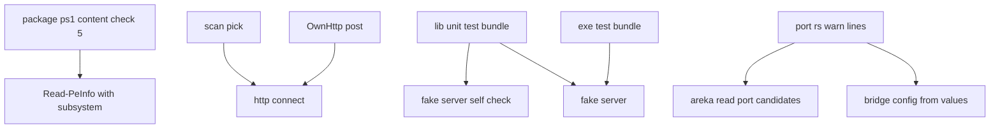

# 設計: areka-P0-mcp-stdio-bridge-residue

## Overview

**目的**: 完了した `areka-P0-mcp-stdio-bridge` の拾い残し（件 1〜8）を 1 本で片づける。配布の検査が `areka.exe` と中継の窓の作りを見て、違えば赤になる。同じ形の重複 2 つ（偽の受け口の自己確認が 2 回走る・上限つきの接続が 2 か所）を 1 つにする。テストの無い 2 つの枝（`id` を持つ要求への 202・標準入力が閉じた後の 5 秒）にテストを入れる。番号の指定が読めないときの記録の文を中継の事実に合わせる。端の動き 2 つ（件 7・8）は限界として差の記録に書く。

**使う人**: 中継 `areka-mcp-bridge` と配布スクリプト `tools/package.ps1` へ次に手を入れる開発者。

**変わること**: 中継の答えの形・振る舞いは変えない。変わるのは、配布の検査の項目 5 の中身（窓の作りの判定が増える）・中継のテストの束ね方・接続を開く関数の置き場・記録の 2 行の文・差の記録の 5 か所。

### Goals
- 窓の作りが GUI でない `areka.exe`／`areka-mcp-bridge.exe` を入れた zip で、配布の検査が赤になる（1 回の実走で確かめる）。
- 偽の受け口の自己確認が全体テストで 1 回だけ走る。上限つきの接続が 1 つの関数になる。
- 件 4・5 の枝が決定論テストで固定され、守る所を壊す変異で赤になることを確かめてある。
- 記録の文から「待ち受ける」が消え、areka 本体と中継のどちらの事実にも合う。
- 差の記録に件 7・8 の限界が書かれ、件 4・5 のテストの名前が載る。

### Non-Goals
- 件 7・8 の動きを直すこと（輸送と探索の並べ方を作り直すことになるため。限界として書くだけ）。
- 件 9（arm64 の機械での起動）。`/release` の `v0.0.3` の走りの記録へ申し送り済み。
- `crates/areka-mcp-bridge/src/config.rs` の変更（同じウェーブの `areka-P0-user-data-root` が持つ）。
- `dist/README.txt` の変更。`SCRIPT_VERSION` の変更（版の扱いは境界の外）。

## Boundary Commitments

### This Spec Owns
- `tools/package.ps1` の `Read-PeInfo`（窓の作りの欄を足す）と `Test-ZipContent` の項目 5（窓の作りの判定にかける 2 つの名前・判定・その端末の行・赤の文）。較正値・説明の一覧・段の並びは触らない。
- 偽の受け口の自己確認をどの束で走らせるか（`src/lib.rs` の宣言・`tests/common/fake_server.rs` の末尾・`tests/common/fake_server_tests.rs` の頭）。
- `127.0.0.1` の番号へ上限つきで接続を開く関数 `http::connect`（1 か所）と、その 2 つの使い手（`scan.rs` の探索・`http.rs` の `OwnHttp::post`）。
- 件 4 のテスト 1 本（`src/service_failure_tests.rs`）と、件 5 のテスト 2 本（`tests/exe_test.rs`）。
- `crates/areka-mcp/src/port.rs` の `warn!` の文 2 行と、その文を確かめる `crates/areka-mcp/src/port_tests.rs` の期待 3 か所（とその説明のコメント 1 行）。
- `doc/ssp-mcp/bridge-diff-areka.md` の頭の判定の数・1 節「終わり」・4 節「応答の上限を越えたときに受け口へ届くもの」「標準エラーの記録」「読まれない標準出力の見切りが効かない場合」・4 節の新しい行（件 8）・「残る縛り」の rmcp の行。
- 確かめの記録 `.kiro/specs/areka-P0-mcp-stdio-bridge-residue/verification/red-runs.md`（要件 1.7・8.2〜8.4）。

### Out of Boundary
- 中継の答えの形・組み込みの答え・送り直しの規則・SSE や取り消し・待ち時間の値（300 ms・3 秒・30 秒・6 秒）。
- `crates/areka-mcp-bridge/src/config.rs`・`src/stdio.rs`・`src/service.rs`・`src/main.rs`（どれも変えない。`main.rs` は要件 1.7 と 8.2 の一時的な変異だけで、必ず元のバイトへ戻す）。
- `src/service_tests.rs`（869 行。足さない）・`tests/real_receiver_test.rs`（`areka-P0-mcp-receiver-bugs` が触る）。
- `tools/package.ps1` の、項目 5 以外の中身の判定・段の並び・総括の行 `content checks 1-8 all passed`・既存の端末の行 `{名前}: machine 0x....., imports ...`・終了コード・`SCRIPT_VERSION`。
- `shiori-host32-helper.exe` と `pasta.dll` の窓の作り（判定にかけない）。
- areka 本体の `read_port_candidates` の振る舞い（文だけが変わる）。

### Allowed Dependencies
- 中継のクレートは今の依存だけを使う（`tokio`・`rmcp =3.5.0`・`temp-path-kit` など）。新しいクレートは開発用を含めて足さない（要件 8.6）。
- テストは今ある道具だけを使う: 偽の受け口の `Reply::Accepted`・`Reply::Delayed`、`service_tests.rs` の `Desk::start_with`・`ask`・`close`・`handshakes`、`service_failure_tests.rs` の `failed`・`patient`、`exe_test.rs` の `run_bridge`・`call`・`answer_lines`・`answer_to`・`called`。
- `port_tests.rs` は今使っている記録の捕まえ方（`capture`）のまま。
- 依存の向き: `scan.rs` → `http.rs`（今と同じ向き。探索は既に `http::verify` と `OwnHttp` を使う）。`http.rs` は `scan.rs` を使わない。

### Revalidation Triggers
- rmcp の版を上げるとき: 件 4 のテスト（202 で待ちが残る）と件 5 のテスト（閉じた後の 5 秒）が rmcp の決まりを固定している。赤になったら差の記録の 1 節「終わり」と 4 節の行を測り直す。
- `tools/package.ps1` の `Test-ZipContent` の項目 5 を触る spec（`areka-P0-release-code-signing`・`areka-P0-install-live-target-hazards`・`areka-P0-winget-release-automation`）: 項目 5 の繰り返しの中に窓の作りの判定が入る。項目 5 の形を変えるときはこの判定を残す。
- `areka.exe` か中継の入口から `windows_subsystem` の行を動かすとき: 配布の検査が赤になる（意図どおり）。
- `port.rs` の記録の文を読む道具（記録の grep など）を足すとき: 文は「既定の候補を使う」になっている。

## Architecture

### Existing Architecture Analysis
- 中継は「入口 `main.rs` → 判断 `service.rs` → 探索 `scan.rs`・送り手 `http.rs`」の層で、テストは実装の隣の `*_tests.rs` を `#[path]` で読む。建てた exe を起こすテストは `tests/exe_test.rs` にまとまり、番号と `AREKA_PROFILE_DIR`（`target` の下）を必ず渡す作法が頭に書いてある。
- 偽の受け口 `tests/common/fake_server.rs` は、部品のテストの束（`src/lib.rs` の `cfg(test)`）と通しのテストの束（`tests/exe_test.rs`）の両方が `#[path]` で読む。末尾の `mod tests` が両方の束で走るのが件 2。
- 配布スクリプトは `Read-PeInfo` が PE の機種と取り込みの DLL を読み、`Test-ZipContent` の項目 5・6 が 4 つの PE（本体・中継・helper・`pasta.dll`）に当てる。窓の作りを読む所は無い（件 1）。

### Architecture Pattern & Boundary Map
新しい部品・新しい境目は作らない。今ある形の延長だけで、触る所は互いに独立している（どの順でも、並べても実装できる）。ただし差の記録（件 7.4）はテストの名前を載せるので、件 4・5 のテストの名前（この設計で決める）に従う。



- 選んだ形: 今の関数・今のテストの道具・今の項目番号へ足す（新しいファイルはコードに 0 本。新しいのは確かめの記録 1 本だけ）。
- 守る今の作法: 兄弟のテストファイル・`#[path]`・exe ごしのテストの番号と置き場の渡し方・配布の検査の否の文の「番号＋理由」の形。

### Technology Stack

| 層 | 選んだもの・版 | この spec での役目 | 備考 |
|---|---|---|---|
| 配布の検査 | PowerShell 7（`tools/package.ps1` 2.1.0） | PE の Subsystem の 2 バイトを読む | 版は上げない |
| 中継 | Rust・tokio・rmcp `=3.5.0` | 接続の関数の付け替え・テストの追加 | 新しい依存なし |
| 共有の番号の読み | `crates/areka-mcp` | 記録の文 2 行 | 振る舞いは同じ |

## File Structure Plan

### Modified Files
- `tools/package.ps1` — `Read-PeInfo` が `Subsystem`（オプションヘッダーの先頭から 68 バイト目の 2 バイト）も返す（頭のコメントに「窓の作り」を足す）。`Test-ZipContent` の項目 5 の中に、窓の作りの判定にかける名前の並び（`areka.exe`・`areka-mcp-bridge.exe`）を置き、項目 5 の繰り返しの中でその名前の項目だけ窓の作りを判定する。較正値と説明の一覧は触らない（境界は PE を読む所と中身の判定だけ）。
- `crates/areka-mcp-bridge/src/lib.rs` — `#[cfg(test)] #[path = "../tests/common/fake_server_tests.rs"] mod fake_server_tests;` を足す（偽の受け口の自己確認を部品のテストの束でだけ走らせる）。
- `crates/areka-mcp-bridge/tests/common/fake_server.rs` — 末尾の `#[cfg(test)] #[path = "fake_server_tests.rs"] mod tests;` を消す。頭の説明に「自己確認は部品のテストの束でだけ走る」を足す。
- `crates/areka-mcp-bridge/tests/common/fake_server_tests.rs` — 頭の `use super::*;` を `use crate::fake_server::*;` と `use areka_mcp::{MCP_PATH, SERVER_NAME};` に替える。頭の説明（「それぞれの置き方で 1 回ずつ走る」）を「部品のテストの束（`src/lib.rs`）でだけ走る」に直す。テストの中身は変えない。
- `crates/areka-mcp-bridge/src/http.rs` — `pub(crate) async fn connect(port: u16, wait: Duration) -> io::Result<TcpStream>` を足し、`OwnHttp::post` の頭の接続をそれに替える（外れは `map_err(HttpError::Connect)`）。
- `crates/areka-mcp-bridge/src/scan.rs` — `open` を消し、`pick` が `http::connect` を使う。使わなくなった `use`（`io`・`Ipv4Addr`・`TcpStream` のうち残らないもの）を外す。
- `crates/areka-mcp-bridge/src/service_failure_tests.rs` — 件 4 のテスト 1 本（約 30 行・229 行 → 約 260 行）。
- `crates/areka-mcp-bridge/tests/exe_test.rs` — 件 5 のテスト 2 本（約 70 行・568 行 → 約 640 行）。
- `crates/areka-mcp/src/port.rs` — 46 行目と 67 行目の `warn!` の文。
- `crates/areka-mcp/src/port_tests.rs` — 82 行目のコメントと 97・113 行目の期待。
- `doc/ssp-mcp/bridge-diff-areka.md` — 9 行目の数・42 行目・90 行目・95 行目・96 行目の書き直し・4 節の行 1 つの追加・102 行目。

### New Files
- `.kiro/specs/areka-P0-mcp-stdio-bridge-residue/verification/red-runs.md` — 要件 1.7 の配布の検査の赤の出力と、要件 8.2 の変異の結果（当てた変異・赤になったテスト・戻した後の sha256 の一致）。前例は完了した `areka-P0-mcp-stdio-bridge` の `verification/package-red-runs.md`。

## Requirements Traceability

| 要件 | 要約 | 部品 | 中身 |
|---|---|---|---|
| 1.1 | 2 つの exe の窓の作りを読み 1 行ずつ示す | 配布の検査 | 項目 5 の繰り返しで `{名前}: subsystem {値}` |
| 1.2 | GUI でなければ赤・名前と値と期待 | 配布の検査 | `5 wrong subsystem: {名前} is {値} (expected 2 = windows gui)` |
| 1.3 | 読めなければ赤 | 配布の検査 | `Read-PeInfo` の失敗は今の `5 cannot read as PE: {名前} (...)` に入る |
| 1.4 | CPU 種別ごとの zip に当てる | 配布の検査 | `Test-ZipContent` は CPU 種別ごとに呼ばれる（今のまま） |
| 1.5 | helper と `pasta.dll` は判定しない | 配布の検査 | 項目 5 の窓の作りの名前の並びに入れない |
| 1.6 | ほかの項目・出力・終了コードを変えない | 配布の検査 | 項目番号は 5 のまま・既存の行は変えず別の行を足す・総括の行と終了コードは同じ |
| 1.7 | コンソールの作りの中継で 1 回赤を確かめる | 確かめの記録 | 確かめ A |
| 2.1 | 自己確認を 1 回だけ走らせる | 偽の受け口の束ね方 | `lib.rs` だけが自己確認を読む |
| 2.2 | 両方の束から偽の受け口を使える | 偽の受け口の束ね方 | `fake_server.rs` の 2 つの `#[path]` は今のまま |
| 2.3 | 関数の名前が全部少なくとも 1 回走る | 偽の受け口の束ね方 | 確かめ C（`--list` の前後比べ） |
| 2.4 | 振る舞いと判定を変えない | 偽の受け口の束ね方 | テストの本体は変えない |
| 3.1 | 接続の手順を 1 か所に | 上限つきの接続 | `http::connect` |
| 3.2 | 上限・扱い・記録・答えを保つ | 上限つきの接続 | 外れの値（`io::ErrorKind::TimedOut`）と包み方は今と同じ |
| 3.3 | 今のテストが弱めずに通る | 上限つきの接続 | テストは変えない |
| 4.1 | 202 の要求は上限まで待って timed out で 1 回答える | 件 4 のテスト | `a_request_answered_with_202_waits_for_the_bound_and_gets_the_timeout_error_once` |
| 4.2 | エラーの後も同じつなぐ先で答える | 件 4 のテスト | 同じテストの `ping` と握手の数 |
| 4.3 | 決定論テスト | 件 4 のテスト | 上限 300 ms のメモリ上の管 |
| 4.4 | 振る舞いを変えない | 件 4 のテスト | 実装は触らない |
| 5.1 | 閉じて 5 秒を越える応答は書かず 0 で終わる | 件 5 のテスト | `a_reply_coming_more_than_5s_after_stdin_closed_is_dropped_and_the_exit_code_is_0` |
| 5.2 | 5 秒以内の応答は書いてから 0 で終わる | 件 5 のテスト | `a_reply_coming_within_5s_after_stdin_closed_is_written_before_exit_code_0` |
| 5.3 | 5.1 を決定論テストで・5.2 も | 件 5 のテスト | 今のテストは「届けた要求が閉じた時点で途中」を決まって踏まないので 2 本とも足す |
| 5.4 | 振る舞いを変えない | 件 5 のテスト | 実装は触らない |
| 6.1 | UTF-8 でない値の記録に「待ち受ける」が無い | 記録の文 | 中継は `to_string_lossy` の後に 46 行目の文を出す |
| 6.2 | 読めない値の記録に値を添え「待ち受ける」が無い | 記録の文 | 46 行目の文 |
| 6.3 | 本体の記録が本体のしていることと食い違わない | 記録の文 | 46・67 行目の文 |
| 6.4 | 件数・段・欄・その後の振る舞いを保つ | 記録の文 | 文だけを替える・`port_tests.rs` の件数と欄の判定は今のまま |
| 7.1 | 件 7 を限界として書く | 差の記録 | 4 節 96 行目の書き直し |
| 7.2 | 件 8 を限界として書く | 差の記録 | 4 節の新しい行 |
| 7.3 | 件 7・8 の振る舞いを変えない | 差の記録 | `stdio.rs`・`scan.rs` の探索の並べ方は触らない（`scan.rs` は `open` の付け替えだけ） |
| 7.4 | 件 4・5 の所をテストに合わせる | 差の記録 | 1 節 42 行目・4 節 90 行目・102 行目 |
| 8.1 | exe ごしのテストは番号と置き場を渡す | 件 5 のテスト | `run_bridge(fake.port(), profile.path(), ..)`・`TempPath::under_target` |
| 8.2 | 変異で赤・戻して緑 | 確かめの記録 | 確かめ B |
| 8.3 | 控え・素のコピーで戻す・sha256 | 確かめの記録 | 確かめ A・B の手順 |
| 8.4 | 結果を文書に残す | 確かめの記録 | `verification/red-runs.md` |
| 8.5 | 兄弟のファイル・1,000 行以内・`service_tests.rs` へ足さない | 件 4・5 のテスト | `service_failure_tests.rs`・`exe_test.rs` |
| 8.6 | 新しいクレートを足さない | 全体 | `Cargo.toml` は変えない |

## Components and Interfaces

| 部品 | 層 | 役目 | 要件 | 触るファイル |
|---|---|---|---|---|
| 配布の検査の窓の作り | 配布スクリプト | zip の 2 つの exe の Subsystem を判定する | 1.1〜1.6 | `tools/package.ps1` |
| 偽の受け口の束ね方 | 中継のテスト | 自己確認を 1 つの束でだけ走らせる | 2.1〜2.4 | `src/lib.rs`・`tests/common/fake_server.rs`・`tests/common/fake_server_tests.rs` |
| 上限つきの接続 | 中継の送り手 | 接続を開く手順を 1 か所に | 3.1〜3.3・7.3 | `src/http.rs`・`src/scan.rs` |
| 件 4 のテスト | 中継のテスト | 202 の枝を固定する | 4.1〜4.4・8.5 | `src/service_failure_tests.rs` |
| 件 5 のテスト | 中継のテスト | 閉じた後の 5 秒の枝を固定する | 5.1〜5.4・8.1・8.5 | `tests/exe_test.rs` |
| 記録の文 | 共有の番号の読み | 「待ち受ける」を消す | 6.1〜6.4 | `crates/areka-mcp/src/port.rs`・`port_tests.rs` |
| 差の記録 | 文書 | 限界 2 つとテストの名前 | 7.1〜7.4 | `doc/ssp-mcp/bridge-diff-areka.md` |
| 確かめの記録 | spec の文書 | 赤の確かめと変異の結果 | 1.7・8.2〜8.4 | `verification/red-runs.md` |

### 配布スクリプト

#### 配布の検査の窓の作り

| 欄 | 中身 |
|---|---|
| 役目 | zip の最上位の `areka.exe` と `areka-mcp-bridge.exe` の窓の作りが GUI（値 2）であることを判定する |
| 要件 | 1.1, 1.2, 1.3, 1.4, 1.5, 1.6 |

**決めたこと**
- **項目番号は 5 のまま**（「PE を読む所」の判定の 1 つ）。新しい番号 9 にすると総括の行 `content checks 1-8 all passed` の字が変わり、要件 1.6 に当たる。赤の文は今の否の文と同じ「番号＋理由」の形。
- **端末の行は別の 1 行**。今の `{名前}: machine 0x....., imports ...` の行は変えず、その直後に `{名前}: subsystem {値}` を 1 行出す（2 つの exe だけ）。
- **`SCRIPT_VERSION` は上げない**（版の扱いは境界の外・要件 1.6）。
- 判定にかける名前は項目 5 の中に置く並び（`areka.exe`・`areka-mcp-bridge.exe`）。helper と `pasta.dll` は入れない（要件 1.5）。較正値の一覧へは出さない（境界の外の所を触らない。変える理由が出たときに移せばよい）。期待の値 2 は PE の書式の `IMAGE_SUBSYSTEM_WINDOWS_GUI`（3 はコンソール）。

**Contracts**: Batch [x]

##### Batch / Job Contract
- 契機: 段「`{arch} content check`」の `Test-ZipContent`（CPU 種別ごとに 1 回＝要件 1.4）。
- 入力: zip の項目のバイト列。`Read-PeInfo` が返す物に `Subsystem`（`[BitConverter]::ToUInt16($Bytes, $opt + 68)`。`$opt` は今求めているオプションヘッダーの位置。PE32 と PE32+ で同じ位置）を足す。
- 出力（端末）: 判定にかけた 2 つの exe ごとに `areka.exe: subsystem 2` の形の 1 行。
- 出力（否の文）: 値が 2 でなければ `5 wrong subsystem: areka-mcp-bridge.exe is 3 (expected 2 = windows gui)` の形を `$bad` へ足す。段は今のとおり `FAIL ...` を並べて throw（終了コード 1）。
- 読めないとき: `Read-PeInfo` が throw すれば、今の `5 cannot read as PE: {名前} ({理由})` が赤にする（窓の作りの欄も同じ関数の中で読むので、読めない場合はここへ必ず落ちる＝要件 1.3）。項目が無いときは今のとおり 1／4 が赤にする。
- 他への影響: `Read-PeInfo` を使う段「check static linking」は `Machine`・`Imports` だけを見るので、欄が 1 つ増えても振る舞いは同じ。

**Implementation Notes**
- 確かめ: 要件 1.7 の確かめ A（下の「確かめの手順」）。自動のテストは無い（配布スクリプトのテストの枠が今無い・要件も 1 回の実走を求める）。
- 危険: 並走の spec が項目 5 の繰り返しを触ると重なる（Revalidation Triggers）。

### 中継のテスト

#### 偽の受け口の束ね方

| 欄 | 中身 |
|---|---|
| 役目 | 偽の受け口の自己確認 2 本を、部品のテストの束でだけ走らせる |
| 要件 | 2.1, 2.2, 2.3, 2.4 |

**決めたこと**
- **残す束は部品のテストの束（`src/lib.rs`）**。自己確認は偽の受け口という部品のテストで、建てた exe を起こさない。通しのテストの束（`exe_test.rs`）は exe を起こすテストの置き場のまま。
- `lib.rs` に兄弟の宣言 `fake_server_tests` を足し、`fake_server.rs` の中の `mod tests` を消す。`fake_server.rs` は今のとおり両方の束が読む（要件 2.2）。
- 自己確認のテストが使う偽の受け口の項目は公開の型（`FakeServer`・`Script`・`Reply`・`Conn` など）だけなので、`use crate::fake_server::*;` で足りる。`MCP_PATH`・`SERVER_NAME` は `areka_mcp` から直接読む（今は `fake_server.rs` の `use` を `super::*` で借りている）。
- テストの道筋は `fake_server::tests::<関数名>`（2 つの束で各 1 回）から `fake_server_tests::<関数名>`（部品の束で 1 回）に変わる。関数の名前は変わらない（要件 2.3 は関数の名前で数える）。

#### 件 4 のテスト

| 欄 | 中身 |
|---|---|
| 役目 | 受け口が `id` を持つ要求に 202 で応えたときの今の振る舞いを固定する |
| 要件 | 4.1, 4.2, 4.3, 4.4, 8.5 |

- 名前: `a_request_answered_with_202_waits_for_the_bound_and_gets_the_timeout_error_once`（`src/service_failure_tests.rs`。同じファイルの `a_request_not_answered_within_the_bound_gets_the_timeout_error_once` と同じ形）。
- 台本: `Script::areka().on("tools/call", Reply::Accepted)`。待ち時間: `Timeouts { reply: 300 ms, ..patient() }` を `Desk::start_with` へ。
- 手順と判定:
  1. 先に `ping` を 1 つ（探索の時間を計りに入れない）。
  2. `tools/call`（`id` 1）を送り、答えが `failed(json!(1), "No response from server: timed out after 300ms")` と等しい。送ってから答えまでが 300 ms 以上・`WAIT` 未満（上限まで待った＝要件 4.1）。
  3. 次の `ping`（`id` 2）に `result(json!(2), json!({}))`（要件 4.2）。
  4. `desk.close()`（読んでいない行が残っていない＝`id` 1 への答えは 1 回だけ）。偽の受け口に届いた `tools/call` は 1 回・握手は 1 回（同じつなぐ先）。上限の後に rmcp が送る `notifications/cancelled` は方法の名前が違うので数に入らない。
- 根拠: rmcp 3.5.0 の `transport/streamable_http_client.rs` は、202（`StreamableHttpPostResponse::Accepted`）を受けた `id` を待ちのまま残す（1628〜1638 行目）。中継の `PeerRequestOptions::with_timeout(reply)` が上限で `ServiceError::Timeout` にし、`service.rs` の `classify` がこの文にする。

#### 件 5 のテスト

| 欄 | 中身 |
|---|---|
| 役目 | 標準入力が閉じたときに、受け口へ届けた途中の要求がどう扱われるかを固定する |
| 要件 | 5.1, 5.2, 5.3, 5.4, 8.1, 8.5 |

- 置き場は `tests/exe_test.rs`（終了コードと、待たずに終わること〔`shutdown_background`〕は建てた exe でしか見られない。今の終わり方のテストもここ＝要件 8.5）。
- 起こし方: 今の `run_bridge(fake.port(), profile.path(), input)`（番号は偽の受け口の番号・置き場は `TempPath::under_target("bridge-exe")`＝要件 8.1）。入力は `call(1)` の 1 行だけ（`initialize` は送らない。標準出力に出る行を件の応答だけにする）。
- **5.1** `a_reply_coming_more_than_5s_after_stdin_closed_is_dropped_and_the_exit_code_is_0`:
  - 台本: `tools/call` に `Reply::Delayed(12 秒, called())`（閉じてから 5 秒を越え、30 秒の上限より前に返る）。
  - 判定: 終了コード 0・標準出力が空（応答を書かない）・偽の受け口に `tools/call` が 1 回届いている（届けた要求だった）・閉じてから終わるまで（`Finished::waited`）が 5 秒以上 12 秒未満（rmcp の 5 秒は待ち、応答も 30 秒の上限も待たない）。
- **5.2** `a_reply_coming_within_5s_after_stdin_closed_is_written_before_exit_code_0`:
  - 台本: `tools/call` に `Reply::Delayed(1 秒, called())`。
  - 判定: 終了コード 0・応答の行がちょうど 1 行で `id` 1 の結果（`content[0].text` が `done`）・偽の受け口に `tools/call` が 1 回。
- 今のテストで 5.2 が判定されていない理由（要件 5.3）: `one_initialize_line_then_eof_gives_one_answer_line_and_exit_code_0` の `initialize` は受け口へ届けない。`several_lines_...` と `two_bridges_...` の `tools/call` は、閉じた時点で途中かどうかが決まっていない（遅れが 0〜30 ms）。
- 所要: 5.1 は約 5 秒、5.2 は約 1 秒（rmcp の決まりの 5 秒を実時間で待つ）。幅は今の `stdin_closed_while_stdout_is_never_read_exits_with_code_0_by_the_bound` と同じ考えで広めに取る。
- 根拠: rmcp 3.5.0 の `service.rs` 1762〜1803 行目。`QuitReason::Closed` のとき、途中の応答を `Duration::from_secs(5)` まで待って書く（外から変えられない）。

### 中継の送り手

#### 上限つきの接続

| 欄 | 中身 |
|---|---|
| 役目 | `127.0.0.1` の番号へ、上限つきで TCP の接続を開く手順を 1 か所に置く |
| 要件 | 3.1, 3.2, 3.3, 7.3 |

**Contracts**: Service [x]

##### Service Interface
```rust
/// `127.0.0.1` の番号へ接続を開く。上限 `wait` を過ぎたら `io::ErrorKind::TimedOut`。
pub(crate) async fn connect(port: u16, wait: Duration) -> io::Result<TcpStream>;
```
- 置き場: `src/http.rs`（下の層。探索 `scan.rs` は既に `http.rs` の `verify`・`OwnHttp` を使う）。
- 事前条件: なし。事後条件: 開けた接続か、OS の失敗をそのまま、または上限切れの `TimedOut`（今の `scan.rs::open` と `OwnHttp::post` の頭とまったく同じ値）。
- 使い手: `scan.rs` の `pick` は今の `open(port, timeouts.connect)` を `connect(port, timeouts.connect)` に替える（失敗の記録 `skipped a candidate: not open` は同じ）。`OwnHttp::post` は `connect(port, self.timeouts.connect).await.map_err(HttpError::Connect)?`（今の 2 つの枝と同じ `HttpError::Connect` の中身）。
- 探索の並べ方（`join_all` で全部開いてから順に確かめる＝件 8 の元）は変えない（要件 7.3）。

### 共有の番号の読み

#### 記録の文

| 欄 | 中身 |
|---|---|
| 役目 | `AREKA_MCP_PORT` が読めないときの `warn!` の文を、本体にも中継にも合う文にする |
| 要件 | 6.1, 6.2, 6.3, 6.4 |

**決めたこと**: 共有の 2 行を、本体と中継のどちらの事実にも合う文にする（案 (a)）。中継の側だけで文を分ける道は `config.rs` を通る（中継が共有の関数を呼ぶのは `config.rs` だけ）ので、この spec では取らない。

| 行 | 今 | 新しい文 |
|---|---|---|
| `port.rs` 46 行目（読めない値・`env` と `value` の欄） | `[mcp] ポートとして読めない値なので既定の候補で待ち受ける（1〜65535 か、待ち受けないなら 0）` | `[mcp] ポートとして読めない値なので、areka の MCP の口の番号に既定の候補を使う（1〜65535 か、MCP を使わないなら 0）` |
| `port.rs` 67 行目（UTF-8 でない値・`env` の欄） | `[mcp] ポートの指定が UTF-8 でないので既定の候補で待ち受ける` | `[mcp] ポートの指定が UTF-8 でないので、areka の MCP の口の番号に既定の候補を使う` |

- 中継では「areka の MCP の口の番号に既定の候補を使う」＝既定の候補で areka を探す（要件 6.1・6.2）。本体では既定の候補で待ち受けを試す（要件 6.3）。どちらにも「待ち受ける」は無い。`0` の意味（本体は待ち受けない・中継は探さない）は「MCP を使わない」でどちらにも合う。
- 中継は UTF-8 でない値を `config.rs` が `to_string_lossy` で置き換えてから共有の関数へ渡すので、中継で出るのは 46 行目の文（値の欄は置き換えた字）。67 行目を出すのは本体だけ。
- 段（`warn`）・件数（1）・欄（`env`・`value`）・その後の振る舞い（既定の 20 個）は変えない（要件 6.4）。
- `port_tests.rs`: 82 行目のコメントの「既定の候補で待ち受ける」を新しい文の言い方に、97・113 行目の `contains("既定の候補で待ち受ける")` を `contains("既定の候補を使う")` と `!contains("待ち受ける")` の 2 つの判定に替える（件数と値の欄の判定は今のまま）。中継の側には記録の文を確かめるテストを足さない（中継で出る文は同じ関数の同じ文で、要件 6 はテストを求めていない。足すと開発用の依存が増える）。

### 文書

#### 差の記録

| 欄 | 中身 |
|---|---|
| 役目 | 件 7・8 を限界として書き、件 4・5 の所を足したテストに合わせる |
| 要件 | 7.1, 7.2, 7.4（6 の行は文の言い換えに合わせて 1 か所） |

| 場所 | 直し方 |
|---|---|
| 9 行目「判定の数」 | 「areka の中継だけにある決まり 22 行（4 節）」→ 23 行 |
| 1 節 42 行目「終わり」のテストの欄 | 「（5 秒の上限そのものはテストなし＝rmcp の決まり）」を外し、`tests/exe_test.rs` の 2 本（5.1・5.2 の名前）を足す |
| 4 節 90 行目「応答の上限を越えたときに受け口へ届くもの」のテストの欄 | 「`id` を持つ要求の 202 は `service_failure_tests.rs` の `a_request_answered_with_202_waits_for_the_bound_and_gets_the_timeout_error_once`。`notifications/cancelled` の送信はテストなし（rmcp の決まり）」に |
| 4 節 95 行目「標準エラーの記録」 | 括弧の「日本語の文のまま」に、文が本体と中継のどちらにも合う言い方（「areka の MCP の口の番号に既定の候補を使う」）であることを添える |
| 4 節 96 行目（件 7） | 書き直す。条件: 相手が JSON でない行・要求の形でない行を送り、かつ標準出力を読まない。見え方: その行へのエラーの書きが詰まったまま中継が次の行を読まないので、標準入力が閉じても 1 節「終わり」の 6 秒の見切りが効かず、中継が終わらない。Desktop で起きない理由: Claude Desktop は壊れた行を送らない。判定の欄: 未実測・既知の限界（直すなら `stdio.rs`）。テストの欄: テストなし（既知の限界） |
| 4 節の新しい行（件 8・96 行目の後） | 場面: 候補の並びで areka より前に、接続を受けて名乗らない相手が 10 個以上並ぶ。中継: 探索は全部の接続を先に開き、候補の順に確かめるので、areka の接続は前の黙る相手 1 つにつき確かめの上限 3 秒を待たされる。待ちが 30 秒に届くと、areka の受け口が使っていない接続を閉じる（頭を読む上限 30 秒）ので、その回の探索は areka を見つけられず、2 節（受け口が居ないとき）と同じ答えになる。避け方: `AREKA_MCP_PORT` で areka の番号を 1 つに決める。SSP の欄: 対応物なし（SSP の受け口はすぐ名乗る）。判定の欄: 対応物なし・既知の限界（SSP はすぐ名乗るので実機では起きない。直すなら `scan.rs` の並べ方）。テストの欄: テストなし（既知の限界） |
| 「残る縛り」102 行目 | 「テストで固定していない」の並びから「標準入力が閉じた後の 5 秒」を外し、「標準入力が閉じた後の 5 秒と、`id` を持つ要求への 202 の待ちは、`tests/exe_test.rs` と `service_failure_tests.rs` のテストが固定しているので、版を上げて変われば赤になる」を足す |

## 確かめの手順

どれも結果を `verification/red-runs.md` に書く（要件 8.4）。変異を当てるときは、元のファイルをワークツリーの `target\mutation-backup\` へ写し、書き換え、確かめ、写しを素のコピーで戻し、戻した後の sha256 が写しと一致することを確かめる（`git checkout` で戻さない＝要件 8.3）。

- **確かめ A（要件 1.7）**: `crates/areka-mcp-bridge/src/main.rs` の 1 行目（`windows_subsystem` の行）を消した実物で、`pwsh -NoProfile -File <ワークツリー>\tools\package.ps1 -Arch x64`（`-Check` なし）を 1 回走らせる。期待: 段「x64 content check」が `FAIL 5 wrong subsystem: areka-mcp-bridge.exe is 3 (expected 2 = windows gui)` を出して終了コード 1。同じ出力に `areka.exe: subsystem 2` があり、`areka.exe` の否が無いこと（合格の道筋も同じ走りで見える＝もう 1 回の緑の走りは回さない）。注意: release の組み立て一式（i686 の helper・x64 の本体と中継）・ライセンスの検査・謝辞・検体の展開まで走り、時間が掛かる（走らせる前に開発者へ所要の見込みを伝える）。検体の展開はこのワークツリーの `target/nar-samples/manual/` を作り直すので、このワークツリーで実機を回している間は走らせない。
- **確かめ B（要件 8.2）**:
  - 件 4: `http.rs` の `classify` の 202 の枝を `Err(HttpError::NoResponse)` に替えると、件 4 のテストが赤（答えの文が `No response from server: empty body or connection closed` になる）。戻して緑。
  - 件 5: `main.rs` の `EXIT_WAIT` を `Duration::ZERO` に替えると、5.1（閉じてから 5 秒より前に終わる）と 5.2（1 秒後の応答を書く前に終わる）の両方が赤。戻して緑。5.1 のうち「30 秒の上限や応答を待たない」の側は rmcp 3.5.0 の決まった 5 秒が持ち、中継の側に当てられる変異が無い（`select` を外す・`shutdown_background` を替えても rmcp は 5 秒で戻る）。その旨と理由を記録する。
- **確かめ C（要件 2.3）**: `cargo test -p areka-mcp-bridge -- --list` を直しの前と後で取り、テストの関数の名前の集まりが同じ（自己確認の 2 本は前は 2 つの束に 1 回ずつ・後は部品の束に 1 回）であることを記録する。

## Error Handling
- 配布の検査: 窓の作りの否・読めない PE は、今の否の文の並びに入り、段の throw（終了コード 1）で止まる。新しい終了コードは作らない。
- 中継: 接続の失敗の値と記録は今と同じ（`connect` は値を作り変えない）。新しいエラーの文は作らない。
- 記録の文: 段と件数は今のまま。黙って通る経路は増えない。

## Testing Strategy

### 部品のテスト（中継・`cargo test -p areka-mcp-bridge --lib`）
- `service_failure_tests.rs` の件 4 のテスト: 202 の後に 300 ms の上限まで待ち、`timed out after 300ms` で 1 回だけ答え、次の `ping` に同じつなぐ先で答える。本当の要求は 1 回。
- `fake_server_tests` の自己確認 2 本: 部品の束でだけ走り、判定は今のまま。
- `scan_tests.rs`・`http_tests.rs` の今のテスト（開かない番号の見切り・並べて開く・接続の失敗）: `connect` へ付け替えた後も、判定を変えずに通る（要件 3.3）。

### 通しのテスト（中継・`tests/exe_test.rs`）
- 件 5.1: 閉じてから 12 秒後に返る要求は書かれず、5〜12 秒で終了コード 0。
- 件 5.2: 閉じてから 1 秒後に返る要求は書かれてから終了コード 0。
- 今の `stdin_closed_while_stdout_is_never_read_exits_with_code_0_by_the_bound` などは変えずに通る。

### 共有の番号の読み（`cargo test -p areka-mcp port_tests`）
- 読めない値・UTF-8 でない値の `warn!` が 1 件で、文に「既定の候補を使う」があり「待ち受ける」が無い。値の欄は今のまま。

### 配布の検査
- 確かめ A の 1 回の実走（自動のテストは無い）。

### 負荷
- 件 5 の 2 本は合わせて約 6 秒を実時間で待つ（計算はしない）。全体テストの負荷で偽の赤になりうるテストとして、この spec の `tasks.md` の Implementation Notes に申し送る（完了した spec の文書は直さない）。
