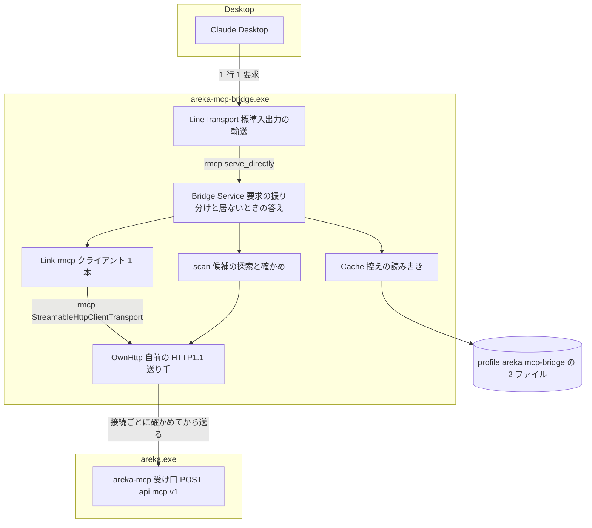
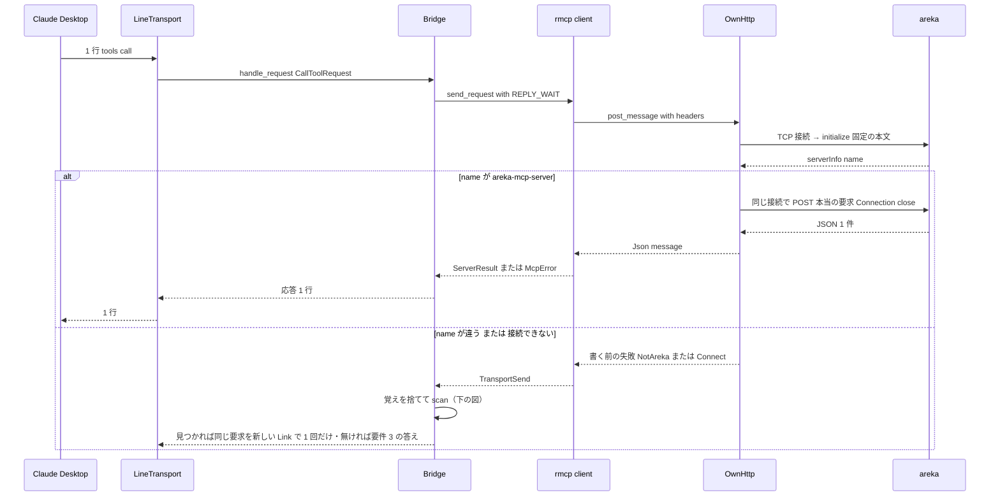
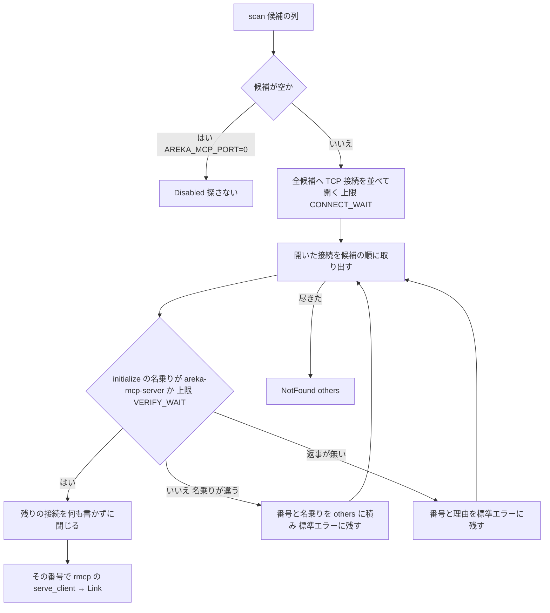

# Design Document: areka-P0-mcp-stdio-bridge

> 2026-10-10・本ブランチ（main `414d43eb` の上）。`requirements.md`（裁定 1〜3・細部 1〜15）と `research.md`（ギャップ分析＋要件ディスカッションの結果＋11 章の設計の段の確かめ）を入力に書いた。コードは「何の定義か」（関数名・定数名＋ファイル）で指す。rmcp の振る舞いは `Cargo.lock` が固定する版（rmcp 3.5.0）のソースで確かめ、組み方は試しのクレート（`target\mcp-stdio-bridge-design\probe\`・git の外）で実際に建てて動かした（`research.md` 11 章）。

## Overview

**Purpose**: Claude Desktop の設定に 1 つの実行ファイル（`areka-mcp-bridge.exe`）を書くだけで、areka の MCP ツールが Desktop から使えるようにする。中継は標準入力の 1 行 1 要求を areka の受け口（`POST /api/mcp/v1`）へ届け、応答を 1 行で標準出力へ返す。areka が居ないときは SSP の中継と同じく、前に受け取った答えの控えでツールの一覧を並べ、それ以外には理由の読める JSON-RPC のエラーを返す。

**Users**: Claude Desktop の利用者（Node.js などを入れずに areka のツールを使いたい人）と、areka を第三者に勧める人（zip を展開して設定を 1 つ写せば済む形にしたい人）。

**Impact**: 新しいクレート `crates/areka-mcp-bridge/` を 1 つ足し、配布 zip（x64・arm64）に `areka-mcp-bridge.exe` を入れる。areka 本体の受け口の振る舞いは変えない。help の Claude Desktop の節に設定例（中継の絶対パス入り）を載せ、その置き場は areka 本体が補助 exe に使っているのと同じ決まり（起動した exe の本当の場所）から渡す。

### Goals

- Desktop が話すどの版（`initialize` で始める 4 版・`server/discover` で始める `2026-07-28`）でも、areka へ HTTP で直接つないだときと同じ意味の結果を返す（1.1・1.2・1.10）。
- つなぐ先は「`areka-mcp-server` と名乗った相手」だけ。SSP など別の相手には Desktop の要求を 1 つも届けない（2.2・2.3・2.11）。
- areka が居ないときも中継は落ちず、控え・自前の `ping`・エラーで答え、areka が起動すれば Desktop を起動し直さずにつながる（3.x・4.6・2.10）。
- 配布物・help・説明書・差の記録・決定論テスト・実機確認まで揃える（6.x・7.x・8.x）。

### Non-Goals

- areka 本体の受け口とツールの変更（完了 `mcp-server-core` の約束に頼るだけ）。
- `127.0.0.1` 以外・認証・TLS・SSP へつなぐこと・`.mcpb` の包み・winget の別名・コード署名（要件の Out of scope のとおり）。
- サーバーからクライアントへ向かう要求・通知の中継（areka は出さない＝0 件）と、SSE の応答の読み取り（下の「残る縛り」）。
- Desktop が複数の要求を同時に送るときの順序の保証（JSON-RPC の `id` で対応づける前提・応答の行の順は要求の順と同じとは限らない）。

## Boundary Commitments

### This Spec Owns

- 中継の exe（新しいクレート `crates/areka-mcp-bridge/`）の全部: 標準入出力の輸送・自前の HTTP の送り手・つなぐ先の探し方と確かめ・控え・areka が居ないときの答え・エラーの文・記録の出し方。
- 控えの置き場と形（`profile\areka\mcp-bridge\`、中継の隣に `areka.exe` が居なければ `%LOCALAPPDATA%\areka\mcp-bridge\` の 2 ファイル・下の Data Models と D-7）。
- `GET /api/mcp/help` の Claude Desktop の節の文面と、中継の置き場を help へ渡す配線（`areka_mcp::start` の引数 1 つ・`main.rs` の 1 行）。
- 配布スクリプト `tools/package.ps1` の中継の分（5 か所）・`dist/README.txt` の MCP の節・`doc/ssp-mcp/` の差の記録 1 本と `survey.md` §6 の 1 行・`.kiro/steering/tech.md` の rmcp の項の追記。
- 中継の候補の並びと名乗りが areka 本体と食い違ったら赤になる検査（8.2）。

### Out of Boundary

- `crates/areka-mcp/` の受け口の判断（`gate.rs`・`dispatch.rs` の振り分け・`handler.rs` のツール）と、各ツールの振る舞い。本 spec が `areka-mcp` に足すのは「定数を外へ出す」と「help に中継の置き場を渡す」だけ。
- areka が後から起動したことを Desktop へ知らせること（中継から Desktop への通知 0 件）。
- Desktop の設定ファイルの実際の置き場の案内（版ごとに違いうるので、ファイルの名前と「Desktop の設定の画面から開く」だけを載せる）。
- 控えの中身の互換（rmcp の版を上げて形が変われば、読めない控えとして捨てて作り直す＝3.10 の経路）。

### Allowed Dependencies

- `crates/areka-mcp`（本番の依存・path）: 候補の並び（`DEFAULT_PORTS`・`FALLBACK_STEPS`・`PORT_ENV`・`candidates_from_env_value`）・名乗り（`SERVER_NAME`）・受け口のパス（`MCP_PATH`）・中継の exe の名前（`BRIDGE_EXE_FILE_NAME`）・ツールの上限の時間（`tools::REPLY_WAIT`）。**`start` など受け口の実行時の部品は呼ばない**（リンク時の最適化で落ちる＝試しのクレートで exe が 34,816 バイトしか増えないことを測った）。テストでは `areka_mcp::start(&[0], …)` で本物の受け口を空きポートに起こす。
- `rmcp`（=3.5.0・`default-features = false`・機能 `server`・`client`・`transport-streamable-http-client`）: 両側の JSON-RPC の解釈・版の交渉・HTTP の札（`MCP-Protocol-Version`・`Mcp-Method`・`Mcp-Name`・`Mcp-Param-*`）。
- `tokio`（`rt`・`net`・`time`・`io-std`・`io-util`・`sync`）: 中継の exe の中だけ（別のプロセスなので `main` が持ってよい。`crates/areka` へは出ない）。
- `Cargo.lock` に既にある版の `futures`・`http`・`httparse`・`sse-stream`・`serde_json`・`thiserror`・`tracing`・`tracing-subscriber`。**新しい外部のクレートは 0 個**（`cargo tree` の名前を `Cargo.lock` と比べて 0 個を確かめた・`research.md` 11.1）。`reqwest`・hyper の `client` 機能（`want` と `try-lock` を引く＝`Cargo.lock` に無い）は使わない。

### Revalidation Triggers

- `areka_mcp::start` の引数が変わる（help へ渡す値を足す）→ `start(&[0], …)` を呼ぶテスト（`server_tests.rs` 5 か所・`testkit.rs` 1 か所）を直す。
- areka の受け口が JSON の単発応答でなく SSE を返すようになる（ツールが途中で通知や要求を出す）→ 中継は「JSON でない本文」として 4.2 のエラーにする。先にこの設計の送り手を SSE 対応にする。
- `tools::REPLY_WAIT` より長く待つツールが足される → 中継の `REPLY_WAIT` も見直す（比べるテストが赤になる）。
- rmcp の版を上げる → 中継のテスト（本物の受け口を相手にしたもの）を全部通す（`tech.md` の rmcp の項に足す）。
- 候補の並び・名乗りの定数が変わる → 中継は同じ定数を読むので追随は自動。`SERVER_NAME` の綴りの変更は控えの照合には効かない（控えは名乗りを見ない）。

## Architecture

### Existing Architecture Analysis

- areka の受け口（`crates/areka-mcp/src/server.rs` の `start`）は hyper の `http1::Builder` で接続ごとに回し、rmcp の `StreamableHttpService` を無状態（セッション無し・JSON の単発応答）で呼ぶ。hyper の既定でヘッダを読む時間切れが 30 秒あり、**使っていない接続は 30 秒で閉じられる**（hyper 1.11.1 の `Conn` が次の要求の頭を待つときにも時間切れを走らせる）。中継はこれに頼らない作り（要求ごとに接続を開いて閉じる）にする。
- 候補の並びは `port.rs` の `candidates_from_env_value`（公開）が 1 か所で組む。名乗り `SERVER_NAME`（`handler.rs`）は `pub(crate)`、受け口のパス `MCP_PATH`（`dispatch.rs`）は素の `const`（私的）で、本 spec が両方を `pub` にして `lib.rs` から出す。
- help は `help.rs` の `help_html(port)` が番号だけで組み、呼び手は `dispatch.rs` の `help` の 1 か所。`State`（`dispatch.rs`）は `start` が 1 度だけ組む。中継の置き場を載せるには `State` に 1 欄足し、`start` の引数で受け取る。
- 起動した exe の本当の場所は `crates/areka/src/boot_config.rs` の `exe_location`（リンクを辿る・プロセスで 1 回）。補助 exe は `default_helper_exe_path` がこれから求める。中継の exe も同じ決まりで求める（`main.rs` の 1 行）。
- 配布は `tools/package.ps1`（743 行・`SCRIPT_VERSION` 2.0.0）。実行ファイルの許可表・建てる段・静的リンクの検査・zip の中身の判定・組み立ての写し、の 5 か所に中継を足す。

### Architecture Pattern & Boundary Map



**Architecture Integration**:

- Selected pattern: **公式 SDK（rmcp）で両側を終端し、HTTP を送る部分だけ自前**（裁定 3）。Desktop の側は rmcp の `Service<RoleServer>` を中継が直接実装し（`ServerHandler` の既定の振り分けは使わない）、rmcp の `serve_directly_with_ct` で回す。areka の側は rmcp の `serve_client`（旧式の `initialize` で始める既定の手順）を、自前の送り手 `OwnHttp` を差した `StreamableHttpClientTransport` の上で回す。
- Domain boundaries: ⑴ 輸送（`LineTransport`・`OwnHttp`）は JSON-RPC の意味を見ない。⑵ 判断（`Bridge`）は「つながっているか」「控えがあるか」「どの要求か」の 3 つで答えを決める。⑶ 探索（`scan`）は候補の列を受け取り、つなぐ先 1 つを返す。⑷ 控え（`Cache`）はファイルの読み書きだけ。
- Existing patterns preserved: 純粋な判断と I/O の口を分ける（`port.rs` の型）・記録は `tracing`・テストは兄弟ファイル・一時フォルダは `target` の下・`publish = false # 理由`。
- New components rationale: rmcp の stdio の輸送（`async_rw.rs`）は JSON でない行を**黙って捨てる**（`-32700` を返さない）ので、要件 1.6 のために輸送を自前で持つ。rmcp の `serve_server` は `initialize` が失敗するとループに入らずに終わるので、要件 4.6（どのエラーの後も続ける）のために `serve_directly_with_ct` を使い、最初の問い合わせも `handle_request` で扱う。
- Steering compliance: `tech.md` の「MCP は rmcp・tokio は閉じ込める」（中継は別の exe なので `main` が tokio を持つ・`crates/areka` には出ない）・「外部のクレートを増やさない」・`structure.md` のテストの置き方・`logging.md` の `tracing`。

### 設計の決めごと（要件が設計へ送った議題の答え）

| # | 議題 | 決めたこと | 理由（測った事実） |
|---|---|---|---|
| D-1 | 全体の作り | 新しいクレート `crates/areka-mcp-bridge/`＝ライブラリ（判断・輸送・探索・控え）＋薄い `main.rs`。本番の依存は上の Allowed Dependencies のとおり | 試しのクレートで同じ構成が建って動いた（`research.md` 11.1〜11.3） |
| D-2 | Desktop の側の受け方 | rmcp の `Service<RoleServer>` を `Bridge` が直接実装し、`serve_directly_with_ct` で回す。`initialize`・`server/discover`・`ping` も `handle_request` に届く。版の交渉は `Bridge` が行う: 要求の版が `initialize` を持つ 4 版（`2025-11-25`・`2025-06-18`・`2025-03-26`・`2024-11-05`）のどれかならその版、それ以外（`2026-07-28`・未知）は `2025-11-25`（areka の受け口と同じ答え） | `serve_server` は `initialize` の失敗で終わる（`serve_server_with_ct_inner` が `Err` を返す）。`serve_directly` なら失敗した後も次の行を読む（4.6） |
| D-3 | areka の側のつなぎ方 | rmcp の `serve_client`（既定＝旧式の `initialize` で始める）を `BridgeClient`（`ClientHandler`・名乗りは `areka-mcp-bridge`）で回す。`StreamableHttpClientTransportConfig` は既定（`allow_stateless: true`・同時 16）に URI だけ足す。つながった印は `RunningService<RoleClient, BridgeClient>` 1 本（`Link`）で、`peer_info()` が areka のサーバーの情報（名乗り・できること・説明の文）。**Desktop の要求の `_meta` は付け直して届ける**（`PeerRequestOptions::with_meta`・要件 1.10・実装で確かめた＝タスク 4.2）: rmcp の受け手（`serve_inner`）は要求の `_meta` を本文から外して `RequestContext.meta` へ移すので、付け直さないと areka に届かない。`2026-07-28` で話す Desktop は要求ごとに `_meta` に版・名乗り・できることを載せ、areka はその版で答えを変える（`tools/list` の `ttlMs`・`cacheScope`・`resultType`、`ping` は `-32601`）。rmcp のクライアント（`request_version_headers`）は、要求の `_meta` に版があればその版の札を、無ければ `Link` の今の版（旧式の `initialize` で決まった `2025-11-25`）の札を付ける。旧式の 4 版で話す Desktop の要求は `_meta` に版を持たないので、どの版でも `2025-11-25` の札で届く（areka は旧式の 4 版のどの札にも同じに答える）。通知の `_meta` は rmcp が `NotificationContext.extensions` に入れて渡すので、それを付け直す | 試しで `initialize` → `notifications/initialized` → 以降の要求が同じ transport で通った（11.3） |
| D-4 | 相手が areka かをどの要求で・いつ確かめるか（2.2・2.3・2.11・4.5） | **接続ごとに、その接続の最初の要求として**旧式の `initialize`（札なし・固定の本文）を送り、`result.serverInfo.name` が `areka_mcp::SERVER_NAME` と同じときだけ、**同じ接続で**本当の要求を送る。送る要求そのものが `initialize`（rmcp の手順の最初）なら、その答えの名乗りで確かめる（2 度送らない）。名乗りが違えば本当の要求は書かずに `NotAreka` で失敗する。接続は要求ごとに開き、`Connection: close` で閉じる（持ち越さない） | 確かめた相手と送る相手が同じ TCP 接続＝必ず同じプロセス。接続を持ち越さないので hyper の 30 秒の閉じ（上）に当たらず、「切れた接続に書いて届いたか分からない」が起きない。areka の `initialize` は無状態で安い。試しの 8 要求の往復が合計 0.44 秒（プロセスの起動込み）。**同じ接続で 2 要求が通る根拠**: areka の受け口（`server.rs` の `accept_loop`）は `http1::Builder::new()` を既定のまま使う（keep-alive は既定で有効・`keep_alive(false)` の指定なし）で、`dispatch.rs` の rmcp の設定は `with_json_response(true)`（JSON の単発応答・SSE にしない）。試しは偽の受け口だけだったので、本物の受け口を相手にした `http_tests.rs` の判定（Testing Strategy）で実装の最初に固定する。areka の debug の記録には Desktop の要求ごとに確かめの `initialize` が 1 行増える（差の記録と Monitoring に書く） |
| D-5 | 候補の探し方と見切り（2.1・2.4・2.9・2.10） | `scan`: 候補の列の全部へ TCP の接続を**並べて**開き（上限 `CONNECT_WAIT`）、開いた接続を**候補の順に** D-4 の確かめにかけ、最初に `areka-mcp-server` と名乗った 1 つで決める。あとの候補の接続は**何も書かずに**閉じる（SSP には `initialize` も届かない）。確かめの応答を待つ上限は `VERIFY_WAIT`。決めた番号は覚え、つながっている間はその番号へ直接つなぐ（先頭から当たり直さない）。覚えた番号への接続が失敗する・名乗りが違う、のどちらかで覚えを捨て、先頭から探し直す | **開発者の机では、誰も居ない `127.0.0.1` の番号への接続が断られるまで約 2 秒かかる**（.NET で 2,035 ms・Rust の std と tokio は 1 秒の上限で 20 回とも時間切れ＝11.4）。順に当たると 20 × 上限になるので、並べて開いて上限で見切る。areka が居ないときの 1 回の探索は約 `CONNECT_WAIT`（0.3 秒）＝SSP の中継の 0.1 秒に近い |
| D-6 | 届けた要求を送り直すか（4.5）と、接続の失敗の扱い | 送り手の失敗を「**書く前**」（`Connect`・`NotAreka`・`VerifyTimeout`）と「**書いた後**」（`NoResponse`・`NotJson`・`ReplyTimeout`）に分ける。書く前の失敗は要求が誰にも届いていないので、覚えを捨てて探し直し、見つかれば**同じ要求を初めて**送る（送り直しではない）。見つからなければ要件 3 の答え。書いた後の失敗は要件 4 のエラーで答え、送り直さない | 「送り直さない」は「届いたかもしれない要求を 2 回届けない」の意味。書く前の失敗を区別できるのは送り手が自前だから |
| D-7 | 控えの置き場と形（3.1〜3.3・3.10・3.11） | 置き場は 3 段: ⑴ `AREKA_PROFILE_DIR` があれば `<それ>\mcp-bridge\`。⑵ 無ければ、中継の exe（`std::env::current_exe()` の親。`canonicalize` は使わず、リンクも辿らない＝areka 本体の `resolve_root_from` の決まり「長いパスの接頭辞と失敗の口を持ち込まない」に合わせる）の隣に `areka.exe` が居れば `<その親>\profile\areka\mcp-bridge\`（配布 zip の形・areka 本体の記憶と同じ木）。⑶ 隣に `areka.exe` が居なければ `%LOCALAPPDATA%\areka\mcp-bridge\`（`cargo install --path` で `.cargo\bin` に入れた中継＝D-17。`LOCALAPPDATA` も無ければ控えなし）。help が載せる `command` は areka 本体の `exe_location` でリンクを解いた本当の場所なので、中継がリンクごしに起こされる前提は置かない。ファイルは 2 つ: `server-info.json`（rmcp の `ServerPeerInfo` をそのまま JSON に）・`tools.json`（rmcp の `ListToolsResult`）。書くときは同じフォルダに `<名前>.<プロセス番号>.tmp` で書いてから `rename` で置き換える。読めない・書けないときは標準エラーに 1 件残して無いものとして続ける | areka 本体の記憶と同じ木（`dist/README.txt` の「記憶の置き場」に 1 行足せる）。`AREKA_PROFILE_DIR` は areka 本体が使っている変数で、テストは環境変数だけで一時の置き場へ向けられる。`rename` は Windows でも既存を置き換えるので、2 つの中継が同時に書いても混ざらない（3.11） |
| D-8 | 控えに取るもの・返すもの（3.1・3.2・3.4・3.9） | サーバーの情報は `Link` ができるたび（`peer_info()`）に、ツールの一覧は areka が `tools/list` にエラーでない結果を返すたびに置き換える。areka が居ないとき: `initialize` → 控えのサーバーの情報で `InitializeResult`（版は D-2 の交渉）、`server/discover` → 控えで `DiscoverResult`（`supportedVersions` は rmcp の既知の 5 版・`_meta` の `serverInfo` 入り）、`tools/list` → 控えの `ListToolsResult` | 裁定 1・裁定 3・細部 15。`server/discover` にも控えで答える（SSP との差として記録）。つながっている間の最初の問い合わせは `Link` を作ったときの `peer_info()` で答える: Desktop が `initialize` を送るのは中継を起こした直後だけなので、areka が別の版で起動し直した後に古い情報で答える場面は実用上起きない（差の記録に一言）。旧式の話し方（`_meta` なし）の `server/discover` は、areka へ直接送ると `-32602` だが、中継は areka へ送らずに情報で答える（差の記録に 1 行。5.1 は `server/discover` を `2026-07-28` だけで比べる） |
| D-9 | 自前の `ping`・エラー・通知（3.6〜3.8・2.6） | areka が居ないとき: `ping` → `{}`、`id` を持つほかの要求 → 番号 `-1`・`Server not available: areka-mcp-server not found on 127.0.0.1 ports <候補>` に、areka でない相手が応えた番号と名乗りを `; port 9801 answered as "ssp-mcp-server"` の形で続ける。通知は何もしない。`AREKA_MCP_PORT=0` は候補が空＝探さず控えも使わず、`id` を持つ全部（`ping` も）に `-1`・`Server not available: AREKA_MCP_PORT=0 (areka does not listen)` | 細部 6・7・13 |
| D-10 | Desktop からの通知の扱い（1.3・3.8） | つながっているときは `notifications/initialized` と `notifications/cancelled` 以外を `peer().send_notification` で届ける（areka は 202 で受ける・標準出力には何も書かない）。`notifications/initialized` は rmcp の手順が自分の分を送っているので届けない。**`notifications/cancelled` も届けない**（実装で確かめた＝タスク 4.2）: 通知の `requestId` は Desktop が振った番号で、areka が見たのは中継のクライアント（`Link`）が振り直した番号なので、areka では何も指さない（areka の受け口は無状態で、通知は 202 で受けて捨てる＝直接送っても何も起きない）。型のまま `Link` へ渡すと、rmcp のクライアントがその番号を自分の番号として読み、同じ番号で待っている別の要求を取り消しで終わらせる。取り消された Desktop の要求の応答の行は rmcp の受け手（`serve_inner`）が出さない。中継は areka の応答を上限まで待って捨て、areka の仕事は止めない。居ないときは何もしない（通知のために探索しない） | 「意味を変えずに届ける」。areka は無状態なので通知で何も起きない。取り消しだけは、届けると意味が変わる（番号が別物）ので届けない |
| D-11 | 待つ時間（2.9・4.4） | `CONNECT_WAIT` 300 ms（並べて開く TCP の上限）・`VERIFY_WAIT` 3 秒（確かめの `initialize` の応答）・`REPLY_WAIT` 30 秒（Desktop の要求の応答・rmcp の `PeerRequestOptions.timeout`）。3 つとも `config.rs` の定数で、テストは `Timeouts` を差し替える。`REPLY_WAIT > areka_mcp::tools::REPLY_WAIT`（10 秒）を常設のテストで判定する | 2.9 の「設計で決めて記録する」。4.4 の「ツールが答えるまでの最も長い時間より長く」 |
| D-12 | 記録と窓（5.1〜5.3） | `tracing-subscriber` の `fmt` を**標準エラー**へ向けて据える（`RUST_LOG`・既定 `info`）。中継の記録の文は英語（ASCII）。共有の関数 `areka_mcp::candidates_from_env_value` が出す 2.5 の `warn!` は日本語のまま通す（Desktop の記録は UTF-8 で読める）。`main.rs` に `#![cfg_attr(not(debug_assertions), windows_subsystem = "windows")]`（areka 本体の `main.rs` と同じ形・debug では窓あり）で窓を持たない | 標準出力は応答の行だけ（5.1）。Desktop の記録ファイルは文字コードに左右されない |
| D-13 | 要求を 1 件ずつか並べてか | rmcp の受け手は要求ごとに仕事を起こす（`serve_inner` が `tokio::spawn`）ので並ぶ。中継は要求ごとに接続を持つ（D-4）ので、長いツールの間も `ping` が待たない。応答の行の順は要求の順と同じとは限らない（`id` で対応づける）。例外が 1 つ: `Link` の版と違う版を `_meta` に持つ最初の要求は、rmcp のクライアントがほかの POST の無いときに 1 つだけで送り（`is_ordering_barrier`）、その 1 件が終わるまでほかの要求は待つ。`2026-07-28` の Desktop では `Link` を作った直後の 1 件だけ（ふつうは `tools/list`）。その後 `Link` の版はその版に替わったままで、`_meta` に版の無い要求もその版の札で届く。1 つの中継は 1 つの Desktop としか話さず、Desktop は話し方を途中で替えないので、これで足りる。`_meta` の `progressToken` は rmcp のクライアントが自分の番号で上書きする（areka は途中経過を出さないので差は出ない） | 試しで JSON でない行のエラーが、先に届いた要求の応答より先に出た（11.3） |
| D-14 | help の置き場の渡し方（6.1・6.2） | **本質の形**: `crates/areka/src/main.rs` が `exe_location()` から `areka_mcp::BRIDGE_EXE_FILE_NAME` の隣のパスを求め、`areka_mcp::start(candidates, registry, bridge_exe: Option<PathBuf>)` へ渡す。`State` が持ち、`help_html(port, bridge_exe)` が JSON の文字列（`serde_json::to_string`）にしてから HTML の `&`・`<`・`>` を置き換えて載せる。`None`（場所が取れない）のときはファイル名だけを載せ、「areka.exe と同じフォルダの」と書く | 補助 exe（`default_helper_exe_path`）と同じ決まりを通る＝リンクごしに起こした areka でも本当の隣になる。`start` の引数が増えるので、約束の外のファイルに触る（下の表で諮る） |
| D-15 | `env` の有無（6.3・6.4） | `areka_mcp::candidates_from_env_value(None)` に実番号が入っていれば `env` を載せない。入っていなければ `"env": {"AREKA_MCP_PORT": "<番号>"}` を載せる | 既定の 20 個の判定を 1 か所から取る |
| D-17 | 開発者の机での使い方（Claude Code から・公開はしない） | クレートは crates.io に**出さない**（`publish = false # 配布の中継 exe・開発者は cargo install --path で入れる`）。開発者はどのワークツリーからでも `cargo install --path crates/areka-mcp-bridge` で `%USERPROFILE%\.cargo\bin\areka-mcp-bridge.exe` に入れ、`claude mcp add --scope user areka <そのパス>` で 1 度登録すれば、全ワークツリーで動いている areka に中継がつなぐ（SSP を飛ばす）。`areka-mcp` への path の依存はそのままで通る（`cargo install --path` は path 依存を解く）。手順は `tech.md` の rmcp の項に 1 行 | 開発者の裁定（議題 3・2026-10-10）: 公開は開発の都合ではなく、要るのは「パスの固定」だけ。公開するなら定数だけの小さな公開クレートを切り出す形（イ）と決めてあるが、本 spec では行わない |
| D-16 | SSE・`x-mcp-header` | 送り手は JSON 専用。`text/event-stream` の応答は 4.2 のエラー（`Invalid JSON response from server: HTTP <状態> content-type text/event-stream`＝`NotJson` の `head` に `content-type text/event-stream` を入れる。SSE の本文は終わらないことがあるので読まずに頭だけで決める）。`Mcp-Name`・`Mcp-Param-*` の札は rmcp のクライアントの `build_request_headers` が作る | areka のツールは今 SSE を返さない（0 件）。札は rmcp が持つので「後の spec への縛り ⑵」は消える。⑴（SSE）は残る |

### Technology Stack

| Layer | Choice / Version | Role in Feature | Notes |
|-------|------------------|-----------------|-------|
| 中継の exe | Rust 2024・新しいクレート `areka-mcp-bridge`（bin＋lib） | 本 spec の本体 | `publish = false # 配布の中継 exe・開発者は cargo install --path で入れる`（D-17） |
| MCP の両側 | rmcp =3.5.0（`server`・`client`・`transport-streamable-http-client`） | JSON-RPC の型・版の交渉・HTTP の札・クライアントの手順 | 既定機能（`macros`・`base64`）は切る。`transport-io` は使わない（輸送は自前） |
| 非同期の土台 | tokio 1（`rt`・`net`・`time`・`io-std`・`io-util`・`sync`） | `current_thread` 1 本を `main` が回す | 中継の exe の中だけ |
| HTTP の送り手 | 自前（tokio の `TcpStream`＋`httparse` 1.10.1＋`http` 1.5.0 の `HeaderName`／`HeaderValue`） | `POST /api/mcp/v1` 1 本と応答の読み取り（`Content-Length`・chunked・閉じるまで） | hyper の `client` 機能は `want`（`Cargo.lock` に無い）を引くので使わない |
| 控え | `serde_json`（rmcp の型をそのまま JSON に） | `server-info.json`・`tools.json` | 一時の名前で書いて `rename` |
| 記録 | tracing 0.1＋tracing-subscriber 0.3（`env-filter`） | 標準エラーへ | `RUST_LOG` で絞る |
| areka 本体との共有 | `areka-mcp`（path） | 候補・名乗り・パス・exe 名・ツールの上限 | 受け口の実行時の部品は呼ばない |

## File Structure Plan

### Directory Structure

```
crates/areka-mcp-bridge/
├── Cargo.toml                 # bin + lib・publish = false # 理由・依存は Allowed Dependencies のとおり
├── src/
│   ├── main.rs                # 記録を標準エラーへ据える → Config::from_env → tokio current_thread → run → 終了コード 0（窓なし）
│   ├── lib.rs                 # モジュールの一覧と run(config, stdin, stdout)（テストが呼ぶ入口）
│   ├── config.rs              # Config（候補の列・控えの置き場・Timeouts）と from_env（AREKA_MCP_PORT・AREKA_PROFILE_DIR・exe の場所と隣の areka.exe の有無・LOCALAPPDATA）・3 つの定数
│   ├── config_tests.rs
│   ├── stdio.rs               # LineTransport<R, W>: Transport<RoleServer>（1 行 1 要求・空行は飛ばす・-32700／-32600 を自分で書く・1 行で書く）
│   ├── stdio_tests.rs
│   ├── http.rs                # OwnHttp: StreamableHttpClient（接続ごとの確かめ → 同じ接続で送る・応答の読み取り・HttpError の書く前／後の区別）
│   ├── http_tests.rs
│   ├── scan.rs                # scan(candidates, timeouts) → Found { link, port } | NotFound { others: Vec<(u16, String)> }（並べて開き・順に確かめ・あとは何も書かずに閉じる）
│   ├── scan_tests.rs
│   ├── cache.rs               # Cache: load_server_info / save_server_info / load_tools / save_tools（一時の名前 → rename・読めない控えは None）
│   ├── cache_tests.rs
│   ├── service.rs             # Bridge: Service<RoleServer>（つながっている／居ない／AREKA_MCP_PORT=0 の 3 状態で答えを決める・Link の持ち主）・BridgeClient: ClientHandler（areka 側の名乗り）・run
│   ├── service_tests.rs
│   └── errors.rs              # 中継が作る JSON-RPC のエラー（番号 -1 の 3 つの書き出し・-32700・-32600）を作る関数だけ
└── tests/
    ├── real_receiver_test.rs  # areka_mcp::start(&[0], …) の本物の受け口を相手に、直接つないだ答えと中継ごしの答えを 5 版で比べる（1.10・8.2）
    ├── exe_test.rs            # CARGO_BIN_EXE_areka-mcp-bridge を起こす: 終了コード 0・標準出力に応答の行だけ・AREKA_MCP_PORT の 4 通り（番号は空きポート）
    └── common/
        └── fake_server.rs     # ループバックの偽の受け口（port 0・方法ごとの台本: 名乗り・壊れた本文・空の本文・途中で閉じる・返事をしない・202）
```

- `src/*_tests.rs` は `structure.md` の兄弟ファイルの規約（本番ファイルの末尾に `#[cfg(test)] #[path = "…"] mod …;`）。どのファイルも 1,000 行以下に収める（`file_length_guard_test.rs`）。
- `std::env::temp_dir` は本番でもテストでも呼ばない（`temp_path_guard_test.rs`）。テストの置き場は `CARGO_TARGET_TMPDIR` と `temp-path-kit` の `TempPath::under_target`。
- `log-capture-kit` は使わない（記録の件数は exe ごしの標準エラーで見る）＝`with_default_guard_test.rs` の表に足さない。

### Modified Files

| ファイル | 変えること |
|---|---|
| `crates/areka-mcp/src/handler.rs` | `SERVER_NAME` を `pub` に（綴りは変えない） |
| `crates/areka-mcp/src/dispatch.rs` | `MCP_PATH` を `pub` に。`State` に `bridge_exe: Option<PathBuf>` を足し、`help` が `help_html(state.port, state.bridge_exe.as_deref())` と呼ぶ |
| `crates/areka-mcp/src/server.rs` | `start(candidates, registry, bridge_exe: Option<PathBuf>)` に引数を 1 つ足し、`State::new` へ渡す |
| `crates/areka-mcp/src/lib.rs` | `pub use handler::SERVER_NAME; pub use dispatch::MCP_PATH; pub use help::BRIDGE_EXE_FILE_NAME;` |
| `crates/areka-mcp/src/help.rs` | `BRIDGE_EXE_FILE_NAME`（`areka-mcp-bridge.exe`）。`help_html(port, bridge_exe)`。Claude Desktop の節を設定例（`claude_desktop_config.json`・`mcpServers.areka.command`・`env` の有無・Desktop の起動し直し・控えで並ぶこと）に書き換え、「今後の版で用意します」を消す。注釈の「エスケープは要らない」を「パスは JSON と HTML の 2 段で置き換える」に直す |
| `crates/areka-mcp/src/help_tests.rs` | 「`claude_desktop_config` が無い」の期待を「設定例が JSON として読めて `command` が渡したパスと同じ・`env` の有無の 2 通り・『今後の版』の文が無い」に書き換える |
| `crates/areka-mcp/src/server_tests.rs`・`testkit.rs` | `start(&[…], …)` の 6 か所に `None` を足す |
| `crates/areka/src/main.rs` | `areka_mcp::start(&areka_mcp::read_port_candidates(), mcp_tools, exe_location().map(\|exe\| exe.with_file_name(areka_mcp::BRIDGE_EXE_FILE_NAME)))` の 1 行（`exe_location` は `boot_config.rs` の既存の `pub(crate)`） |
| `Cargo.lock` | 新しいクレートの行（作り直し） |
| `THIRD-PARTY-NOTICES.md` | `cargo about generate --workspace` の作り直し（ワークスペースのクレートとして 1 行増える・外部の依存は増えない） |
| `tools/package.ps1` | 5 か所（下の表）＋注釈 2 つ＋`SCRIPT_VERSION` を `2.1.0` に |
| `dist/README.txt` | 「◆ areka 本体」の見出しに `areka-mcp-bridge.exe` を足す。新しい節「■ Claude Desktop からつなぐ」（areka を起動して help の頁を開く・設定例を写す・Desktop を起動し直す・Desktop を先に起動していても前の答えの控えでツールが並ぶ）と「■ MCP のポート」（`AREKA_MCP_PORT` の番号の指定と `0`）。「■ 記憶の置き場」に「中継の控え: areka.exe の隣の profile\areka\mcp-bridge\（中継を別の場所に置いたときは %LOCALAPPDATA%\areka\mcp-bridge\）」の 1 行 |
| `doc/ssp-mcp/bridge-diff-areka.md`（新規） | SSP の中継と areka の中継が同じ入力に何を返すかの行ごとの記録（8.4）。要件の実測の表の行を全部含める |
| `doc/ssp-mcp/survey.md` | §6 に上の文書を指す 1 行 |
| `.kiro/steering/tech.md` | rmcp の項に「`areka-mcp-bridge` も使う（`client`・`transport-streamable-http-client`）・版を上げるときは中継のテストも通す」。`httparse`・`sse-stream` を直接の依存にした旨。開発者の机での登録（D-17: `cargo install --path crates/areka-mcp-bridge` → `claude mcp add --scope user areka <.cargo\bin のパス>`）の 1 行 |

#### `tools/package.ps1` の 5 か所（実物で確かめた）

| # | 定義 | 変えること |
|---|---|---|
| 1 | `$ALLOWED_EXECUTABLES` | `'areka-mcp-bridge.exe'` を足す（4 本に） |
| 2 | 段 `build $a areka`（`cargo build --locked --release -p areka --target $t`） | `-p areka-mcp-bridge` を足す（同じ `RUSTFLAGS`＝`+crt-static` で建つ） |
| 3 | 段 `check static linking` の `$exes` | CPU 種別ごとに `release/areka-mcp-bridge.exe` を `$ARCHS[$a].Machine` で足す |
| 4 | `Test-ZipContent` の 3 つの表（判定 1 の必須の項目・判定 2 の最上位の許可表・判定 5／6 の `$machines`） | 3 つとも `areka-mcp-bridge.exe` を足す（`$machines` は zip の CPU 種別・`*.exe` なので判定 6 の取り込みの検査も受ける＝7.3） |
| 5 | 段 `$a assemble` の `Copy-Item` | `release/areka-mcp-bridge.exe` を CPU 種別ごとに写す |

注釈「許可表の 3 本だけ」（判定 4）と「zip の中身の 9 行」（組み立て）は数を直す。`-Check` には中継の手を足さない（8.5 ⑹ は「`-Check` が緑」だけ・起動できることは実機確認で見る）。

### 他の spec と重なりうるファイル（設計ディスカッションで諮る）

本質の形（D-14）を選んだ結果、同じウェーブの約束（roadmap C5 ⑦「`crates/areka/src/main.rs`・`crates/areka-mcp/src/{dispatch,server,lib}.rs` に触らない」）の外のファイルに触る。開発者の方針（2026-10-05「設計は本質の形で」）に従い、ここに挙げて諮った。

**開発者の裁定（2026-10-10・設計ディスカッション議題 1）: 本質の形（ア）で進める。** 下の表のファイルに触ってよい。`main.rs` を同じウェーブで触りうる `baseware-root-list` は「新しいファイルへ足す」約束なので、競合しても `areka_mcp::start` の 1 行に限られる（完了のときの取り込みで手で合わせる）。

| ファイル | 本 spec が触る行 | 同じファイルを触りうる spec | 重なりの見立て |
|---|---|---|---|
| `crates/areka/src/main.rs` | `areka_mcp::start(…)` の 1 行（引数を 1 つ足す） | `baseware-root-list`（C5 ⑤・ただし約束で「`main.rs` へは足さず新しいファイルへ」） | 行は別。競合しても 1 行 |
| `crates/areka-mcp/src/dispatch.rs` | `MCP_PATH` の可視性・`State` の 1 欄・`help` の呼び出し | C5 に無し | 無し |
| `crates/areka-mcp/src/server.rs` | `start` の引数 1 つ・`State::new` へ渡す 1 行 | C5 に無し | 無し |
| `crates/areka-mcp/src/lib.rs` | `pub use` 3 行 | C5 に無し | 無し |
| `crates/areka-mcp/src/handler.rs` | `SERVER_NAME` の可視性 1 語 | roadmap の「MCP の 3 段目が触らない共有ファイル」（C5 には居ない） | 無し |
| `crates/areka-mcp/src/server_tests.rs`・`testkit.rs` | `start` の呼び出し 6 か所に `None` | C5 に無し | 無し |
| `Cargo.lock`・`THIRD-PARTY-NOTICES.md` | 作り直し | `release-cycle` の版上げ（`v0.0.3`） | roadmap の決まり（本 spec の PR が開いていないときに版上げ） |
| `dist/README.txt` | 自分の節 3 つと見出しの 1 行 | `baseware-root-list`（自分の行）・`winget-manifest-submission`（約束で触らない） | 節が別 |
| `.kiro/steering/tech.md` | rmcp の項の追記 | 依存を足す spec は 1 ウェーブに 1 本（本 spec） | 無し |

**退けた代案（記録のみ・採らない）**: `help.rs` の中で `std::env::current_exe()` の親フォルダに `BRIDGE_EXE_FILE_NAME` を結合する。`main.rs`・`dispatch.rs`・`server.rs` は 0 行。欠点はリンクごしに起こした areka で help に載るパスが本当の隣にならないこと（`research.md` 議題 6 のア）。`lib.rs`・`handler.rs` の `pub` 化は代案でも要る（定数の共有＝8.2）。

## System Flows

### つながっているときの要求 1 件（1.1・1.2・D-4）



- `ServiceError::McpError(e)` は areka の JSON-RPC のエラーなのでそのまま返す（4.3）。`TransportSend` の中身（`DynamicTransportError.error`）を `StreamableHttpError<HttpError>` へ戻して、書く前／後を読み分ける（D-6）。`Timeout` は `REPLY_WAIT`（4.4）。
- `initialize`・`server/discover` は areka へ送らず、`Link` の `peer_info()`（rmcp の手順で得た areka の今の情報）で答える（3.9「areka の今のサーバーの情報」。areka は無状態で、情報はプロセスの間変わらない）。`tools/list` の結果は返す前に控えへ書く（3.2）。

### 候補の探索（2.1〜2.4・2.9・D-5）



- `AREKA_MCP_PORT` に番号があれば候補は 1 つ（`candidates_from_env_value`）。読めない値は同じ関数が `warn!` を 1 件残して 20 個にする（2.5・中継の記録は標準エラーへ向いている）。
- rmcp の `serve_client` の `initialize` も `OwnHttp` を通るので、D-4 の確かめはそこでも効く（`Link` を作る接続も確かめ済み）。

### areka が居ないときの答え（3.x・D-8・D-9）

| 届いた要求 | 控えあり | 控えなし | `AREKA_MCP_PORT=0` |
|---|---|---|---|
| `initialize`／`server/discover` | 控えのサーバーの情報（版は D-2） | `-1` Server not available | `-1` Server not available（0 の文） |
| `tools/list` | 控えのツールの一覧 | `-1` Server not available | 同上 |
| `ping` | `{}` | `{}` | `-1` |
| ほかの `id` 付き | `-1` Server not available（＋areka でない相手の番号と名乗り） | 同左 | `-1` |
| 通知 | 何もしない | 何もしない | 何もしない |

「居ない」の判定は、その要求のために `scan` が `NotFound` を返したとき。見つかれば `Link` を作ってつながっている側の流れへ入る（3.9 の後半＝控えは新しい中身に置き換わる）。

## Requirements Traceability

| Requirement | Summary | Components | Interfaces | Flows |
|---|---|---|---|---|
| 1.1 | 1 行を届けて 1 行で返す | LineTransport・Bridge・OwnHttp | `Transport<RoleServer>`・`StreamableHttpClient` | つながっているとき |
| 1.2 | 直接つないだときと同じ意味 | Bridge（型の往復・エラーの素通し） | `Service<RoleServer>::handle_request` | 同上 |
| 1.3 | 通知は出力なし | Bridge（D-10）・LineTransport | `handle_notification` | — |
| 1.4 | 1 行で書く | LineTransport（`serde_json::to_vec`＋`\n`） | `send` | — |
| 1.5 | 空の行は飛ばす | LineTransport | `receive` | — |
| 1.6 | JSON でない行は `-32700` | LineTransport（自前の判定） | `receive`・errors | — |
| 1.7 | オブジェクトでない行は `-32600` | LineTransport | 同上 | — |
| 1.8 | 上限を設けない | LineTransport（`read_until` に上限なし）・OwnHttp（閉じるまで読む） | — | — |
| 1.9 | 標準入力が閉じたら終了コード 0 | main・LineTransport（EOF → `None`）・rmcp の 5 秒の掃き出し | `run` | — |
| 1.10 | 5 版で同じ意味 | Bridge（D-2）・rmcp の札 | `real_receiver_test.rs` | — |
| 2.1 | 既定 20 候補を同じ順 | Config（`candidates_from_env_value(None)`）・scan | `Config::from_env` | 探索 |
| 2.2 | 名乗った相手で決め、先頭から当たり直さない | scan・Bridge（覚えた番号） | `scan` | 探索 |
| 2.3 | 名乗らない相手へ届けず次へ | OwnHttp（D-4）・scan | `HttpError::NotAreka` | 探索 |
| 2.4 | `AREKA_MCP_PORT` の番号だけ | Config・scan | — | 探索 |
| 2.5 | 読めない値は 1 件残して既定 | Config（`candidates_from_env_value` の `warn!`＋標準エラーの記録） | — | — |
| 2.6 | `0` は控えも使わずエラー | Bridge（Disabled） | errors | 居ないときの表 |
| 2.7 | `127.0.0.1` だけ | OwnHttp（宛先は `127.0.0.1:<番号>` を組むだけ・設定 0 個） | — | — |
| 2.8 | 引数なし・手段は 1 つ | main（引数を読まない） | — | — |
| 2.9 | 返事をしない相手を見切る | OwnHttp（`VERIFY_WAIT`）・scan | `Timeouts` | 探索 |
| 2.10 | 起動し直した areka へ届く | Bridge（書く前の失敗 → 探し直し） | D-6 | つながっているときの else |
| 2.11 | 番号を取った別の相手へ届けない | OwnHttp（接続ごとの確かめ） | D-4 | 同上 |
| 3.1 | サーバーの情報を控える | Bridge・Cache | `save_server_info` | — |
| 3.2 | `tools/list` の結果を控える | Bridge・Cache | `save_tools` | — |
| 3.3 | 起動し直しても残る | Cache（ファイル） | Data Models | — |
| 3.4 | 最初の問い合わせと `tools/list` に控えで答える | Bridge（D-8） | `load_*` | 居ないときの表 |
| 3.5 | 控えが無ければ 3.6 のエラー | Bridge | errors | 同上 |
| 3.6 | ほかの要求は `-1`＋番号と名乗り | Bridge（D-9）・scan の `others` | errors | 同上 |
| 3.7 | 自前の `ping` | Bridge | — | 同上 |
| 3.8 | 通知は出力なし | Bridge | — | 同上 |
| 3.9 | つながっていれば控えで答えない | Bridge（状態の順＝Link が先） | — | — |
| 3.10 | 読めない・書けない控え | Cache（`None`＋`warn!`） | — | — |
| 3.11 | 同時に書いても混ざらない | Cache（一時の名前 → `rename`） | — | — |
| 4.1 | 本文なし・途中で閉じる → No response | OwnHttp（`NoResponse`）・errors | — | — |
| 4.2 | JSON でない本文 → Invalid JSON response＋標準エラー | OwnHttp（`NotJson{status, head}`）・errors | — | — |
| 4.3 | JSON なら状態に関わらず中身 | OwnHttp（状態を見ずに本文を読む）・Bridge（`McpError` を素通し） | — | — |
| 4.4 | 上限の時間 | Bridge（`REPLY_WAIT`） | `PeerRequestOptions.timeout` | — |
| 4.5 | 送り直さない | Bridge（書いた後の失敗は再送しない） | D-6 | — |
| 4.6 | エラーの後も続く | main（`serve_directly`） | D-2 | — |
| 5.1 | 標準出力は応答だけ | LineTransport・main（記録は標準エラー） | D-12 | — |
| 5.2 | 記録は標準エラー | main・各部品の `tracing` | — | — |
| 5.3 | 窓を出さない | main（`windows_subsystem`） | — | — |
| 5.4 | 2 つ同時に動く | 1 つしか動けない仕組み 0・控えは D-7 | — | — |
| 6.1 | 設定例と絶対パス | help（`help_html(port, bridge_exe)`）・main.rs の配線 | D-14 | — |
| 6.2 | 貼れば正しい JSON | help（JSON → HTML の 2 段） | — | — |
| 6.3 | 既定の候補なら `env` なし | help（D-15） | — | — |
| 6.4 | 既定の外なら `env` あり | help（D-15） | — | — |
| 6.5 | ファイル名・起動し直し・古い文を消す | help | — | — |
| 6.6 | ほかの節はそのまま | help（Desktop の節だけ書き換える） | `help_tests.rs` の既存の期待 | — |
| 7.1 | x64・arm64 の zip に同梱 | package.ps1 の 2・5 | — | — |
| 7.2 | 無い・種別違いは赤 | package.ps1 の 4 | — | — |
| 7.3 | 単体で動く | package.ps1 の 3・4（取り込みの検査） | — | — |
| 7.4 | 説明書 | `dist/README.txt` | — | — |
| 7.5 | 全体テストが緑 | `Cargo.toml` の `publish` 行・`Cargo.lock`・謝辞の作り直し | — | — |
| 8.1 | 決定論テスト | Testing Strategy | — | — |
| 8.2 | 候補・名乗りの食い違いで赤 | 定数の共有（依存）＋`real_receiver_test.rs` | — | — |
| 8.3 | help のテスト | `help_tests.rs` | — | — |
| 8.4 | 差の記録 | `doc/ssp-mcp/bridge-diff-areka.md` | — | — |
| 8.5 | 実機確認 | `verification/signoff.md`（実装の段） | — | — |

## Components and Interfaces

| Component | Domain/Layer | Intent | Req Coverage | Key Dependencies (P0/P1) | Contracts |
|-----------|--------------|--------|--------------|--------------------------|-----------|
| Config | 設定 | 環境と exe の場所から候補・置き場・時間を組む | 2.1, 2.4, 2.5, 2.8 | areka-mcp の `candidates_from_env_value`（P0） | Service |
| LineTransport | 輸送（Desktop 側） | 1 行 1 要求の読み書きと行の形のエラー | 1.1, 1.4〜1.9, 5.1 | rmcp `Transport<RoleServer>`（P0） | Service |
| OwnHttp | 輸送（areka 側） | 接続ごとに確かめてから送る HTTP/1.1 の送り手 | 1.1, 1.8, 2.3, 2.7, 2.9, 2.11, 4.1〜4.3, 4.5 | rmcp `StreamableHttpClient`（P0）・httparse（P1） | Service |
| scan | 探索 | 候補から areka を 1 つ選ぶ | 2.1〜2.4, 2.9, 3.6 | OwnHttp（P0）・rmcp `serve_client`（P0） | Service |
| Cache | 控え | 2 ファイルの読み書き | 3.1〜3.3, 3.10, 3.11 | serde_json（P0） | State |
| Bridge | 判断 | 3 状態で答えを決める・Link の持ち主 | 1.2, 1.3, 1.10, 2.2, 2.6, 2.10, 3.4〜3.9, 4.3〜4.6 | rmcp `Service<RoleServer>`・`Peer<RoleClient>`（P0） | Service |
| errors | 判断 | 中継が作る JSON-RPC のエラー | 1.6, 1.7, 2.6, 3.5, 3.6, 4.1, 4.2, 4.4 | rmcp `ErrorData`（P0） | Service |
| main | 入口 | 記録・設定・実行・終了 | 1.9, 4.6, 5.2, 5.3 | tokio（P0） | — |
| help（areka-mcp） | help | Desktop の設定例 | 6.1〜6.6, 8.3 | serde_json（P0） | Service |
| 配布・文書 | 配布 | zip・README・差の記録 | 7.1〜7.5, 8.4 | — | — |

### 中継のクレート

#### Config

| Field | Detail |
|-------|--------|
| Intent | 環境変数と exe の場所から、判断に要る値を 1 度だけ組む |
| Requirements | 2.1, 2.4, 2.5, 2.8 |

**Responsibilities & Constraints**
- 候補の列は `areka_mcp::candidates_from_env_value(std::env::var(PORT_ENV).ok().as_deref())` で組む（空＝`0`＝Disabled）。読めない値の `warn!` は同じ関数が出す。
- 控えの置き場は D-7 の 3 段: `AREKA_PROFILE_DIR` → 隣に `areka.exe` が居れば `<中継の exe の親>\profile\areka\mcp-bridge\` → `%LOCALAPPDATA%\areka\mcp-bridge\`。exe の場所は `std::env::current_exe()` そのもの（`canonicalize` は使わない・リンクは辿らない）。「隣に居るか」は `from_env` が `Path::is_file` で 1 度見て真偽で渡す（`from_values` は I/O をしない）。どの段も取れなければ `None`＝控えなしで動く・標準エラーに 1 件。
- 3 つの時間は定数で持ち、テストは `Timeouts` を差し替える。

##### Service Interface
```rust
pub struct Timeouts { pub connect: Duration, pub verify: Duration, pub reply: Duration }
pub const CONNECT_WAIT: Duration = Duration::from_millis(300);
pub const VERIFY_WAIT: Duration = Duration::from_secs(3);
pub const REPLY_WAIT: Duration = Duration::from_secs(30);

pub struct Config {
    pub candidates: Vec<u16>,        // 空 = AREKA_MCP_PORT=0
    pub cache_dir: Option<PathBuf>,  // None = 控えを持たない
    pub timeouts: Timeouts,
}
impl Config {
    pub fn from_env() -> Config;   // 環境（AREKA_MCP_PORT・AREKA_PROFILE_DIR・current_exe と隣の areka.exe の有無・LOCALAPPDATA）を読む唯一の口。読んだ値を from_values へ渡すだけ
    pub fn from_values(port_value: Option<&str>, profile_dir: Option<PathBuf>, exe: Option<PathBuf>, areka_beside: bool, local_app_data: Option<PathBuf>) -> Config; // 純粋な判断（テストはこちら）
    pub fn from_parts(candidates: Vec<u16>, cache_dir: Option<PathBuf>, timeouts: Timeouts) -> Config;        // 部品のテスト用
}
```
- Postconditions: `candidates` は `areka_mcp::candidates_from_env_value(port_value)` の結果そのもの（並びの共有＝8.2 の前半）。`cache_dir` は `profile_dir` があればその下の `mcp-bridge`、無ければ `areka_beside` のときだけ `exe` の親の `profile\areka\mcp-bridge`、それも違えば `local_app_data` の下の `areka\mcp-bridge`（`local_app_data` が絶対パスのときだけ。空・相対の値は取れない扱い＝起こされた場所の下へ黙って書かない）、どれも無ければ `None`（D-7 の 3 段）。

#### LineTransport

| Field | Detail |
|-------|--------|
| Intent | 標準入出力を rmcp の輸送にする（1 行 1 要求・行の形のエラーは自分で答える） |
| Requirements | 1.1, 1.4〜1.9, 5.1 |

**Responsibilities & Constraints**
- `receive`: `read_until(b'\n')`（上限なし）。末尾の `\r` と前後の空白を落とし、先頭の UTF-8 の BOM（最初の行に付くことがある）も落とす（rmcp の stdio の輸送と同じ）。空なら次へ。`serde_json::from_slice::<ClientJsonRpcMessage>` で読み、`Syntax`／`Eof` なら `-32700`・`id` は `null`、`Data`（配列・数・文字列・欄の形違い）なら `-32600` を**自分で標準出力へ 1 行書いて**次へ（rmcp の `AsyncRwTransport` は `Syntax` を黙って捨てるので使わない）。EOF で `None`。
- `send`: `serde_json::to_vec`（改行を含まない）＋`\n`。書き手は `Arc<Mutex<W>>`（rmcp は `send` の未来を同時に走らせる）。
- `R: AsyncRead + Unpin + Send`・`W: AsyncWrite + Unpin + Send + 'static` の総称（テストは `tokio::io::duplex` を差す）。
- **取り消しへの備え**（実装で確かめた・タスク 3.1）: rmcp の `serve_inner` は `receive` を `tokio::select!` の枝で回し、ほかの枝が先に済むたびに未来を捨てて呼び直す。そのため ⑴ 読みかけの行（`line`）は行が揃うまで消さず、捨てられた後に入力が終わった読みかけも最後の 1 行として届ける。⑵ 行の形のエラーの行は `receive` の中で直に書かず（捨てられると行が途中で切れる）、別の仕事（`tokio::spawn`）で書き、その手（`replying`）を次の行を読む前・入力の終わり・`close` で待つ。⑶ BOM を落とすのは最初の行だけ（`first`）。`close` は書きかけのエラーを待ってから書き手を `shutdown` する。欄は `reader`・`writer`・`line`・`first`・`replying` の 5 つ。

##### Service Interface
```rust
pub struct LineTransport<R, W> { /* reader: BufReader<R>, writer: Arc<Mutex<W>>, line: Vec<u8>, first: bool, replying: Option<JoinHandle<()>> */ }
impl<R, W> LineTransport<R, W> { pub fn new(reader: R, writer: W) -> Self; }
impl<R, W> rmcp::transport::Transport<RoleServer> for LineTransport<R, W> {
    type Error = std::io::Error;
    fn send(&mut self, item: ServerJsonRpcMessage) -> impl Future<Output = io::Result<()>> + Send + 'static;
    async fn receive(&mut self) -> Option<ClientJsonRpcMessage>;
    async fn close(&mut self) -> io::Result<()>;
}
```

#### OwnHttp

| Field | Detail |
|-------|--------|
| Intent | rmcp の HTTP の口（`StreamableHttpClient`）を、接続ごとに相手を確かめる自前の送り手で満たす |
| Requirements | 1.1, 1.8, 2.3, 2.7, 2.9, 2.11, 4.1〜4.3, 4.5 |

**Responsibilities & Constraints**
- `post_message`（rmcp が要求・通知ごとに呼ぶ）: ⑴ `127.0.0.1:<port>` へ接続（上限 `connect`）→ ⑵ 送る本文が `initialize` でなければ、固定の旧式の `initialize`（札なし・`clientInfo` は `areka-mcp-bridge`）を送って応答を読み（上限 `verify`）、`result.serverInfo.name` を `areka_mcp::SERVER_NAME` と比べる → ⑶ 同じ接続で本当の本文を `Connection: close` で送り、閉じるまで読む → ⑷ 202 なら `Accepted`、本文が空なら `NoResponse`、`Content-Type` が `application/json` でないなら `NotJson{status, head}`（頭 256 バイト）、読めれば `Json(message, None)`。HTTP の状態は見ない（4.3）。
- 札: `Host: 127.0.0.1:<port>`・`Content-Type: application/json`・`Accept: application/json, text/event-stream`・`Content-Length`・rmcp から渡る `custom_headers`（版・`Mcp-Method`・`Mcp-Name`・`Mcp-Param-*`）。`Origin` は付けない。
- 応答の読み取り: `httparse::Response` で頭を解き、`Content-Length`→その長さ、`Transfer-Encoding: chunked`→解く、どちらも無ければ閉じるまで。閉じるまで読むので大きさの上限は無い（1.8）。
- `delete_session`: `Ok(())`（無状態なので呼ばれない）。`get_stream`: `Err(ServerDoesNotSupportSse)`（セッション無しでは呼ばれない）。`*_with_max_sse_event_size` は既定のまま。
- 確かめが済む前（⑴⑵）の失敗は本当の本文を 1 バイトも書いていない＝書く前の失敗。⑶ 以降は書いた後。

##### Service Interface
```rust
#[derive(Clone)]
pub struct OwnHttp { pub port: u16, pub timeouts: Timeouts }

#[derive(Debug, thiserror::Error)]
pub enum HttpError {
    // 書く前（要求は誰にも届いていない）
    #[error("connect failed: {0}")] Connect(std::io::Error),
    #[error("peer on port {port} is {name:?}, not areka")] NotAreka { port: u16, name: String },
    #[error("no answer to the identity check within {0:?}")] VerifyTimeout(Duration),
    // 書いた後（届いたかもしれない）
    #[error("no response (empty body or connection closed)")] NoResponse,
    #[error("HTTP {status}, body is not JSON: {head}")] NotJson { status: u16, head: String },
}
impl HttpError { pub fn written(&self) -> bool; }   // 書いた後なら true

impl StreamableHttpClient for OwnHttp {
    type Error = HttpError;
    fn post_message(&self, uri: Arc<str>, message: ClientJsonRpcMessage, session_id: Option<Arc<str>>,
                    auth_header: Option<String>, custom_headers: HashMap<HeaderName, HeaderValue>)
        -> impl Future<Output = Result<StreamableHttpPostResponse, StreamableHttpError<HttpError>>> + Send + '_;
    fn delete_session(..) -> impl Future<Output = Result<(), StreamableHttpError<HttpError>>> + Send + '_;
    fn get_stream(..) -> impl Future<Output = Result<BoxStream<'static, Result<Sse, SseError>>, StreamableHttpError<HttpError>>> + Send + '_;
}
/// scan が使う素の確かめ（Link を作る前）。接続を開いて initialize を送り、名乗りを返す。
pub async fn verify(stream: TcpStream, port: u16, timeouts: &Timeouts) -> Result<String, HttpError>;
```
- Invariants: Desktop から届いた要求・通知の本文を書いた接続は、同じ接続で `areka-mcp-server` の名乗りを読んだ接続だけ。例外は rmcp の手順の `initialize`（`Link` を作るときに rmcp が自分で送るもので、Desktop の中身を持たない）で、これは確かめを兼ねるので名乗りを読む前に書き、名乗りが違えば `NotAreka`（書く前の扱い）にする（D-4）。この例外が成り立つのは、`Bridge` が Desktop の `initialize` を areka へ送らない（D-8）からで、`Bridge` は Desktop の `initialize` を `Link` へ流してはならない。

#### scan

| Field | Detail |
|-------|--------|
| Intent | 候補の列から areka を 1 つ選び、rmcp のクライアントを立てる |
| Requirements | 2.1〜2.4, 2.9, 3.6 |

##### Service Interface
```rust
pub enum Scan {
    Found { link: Link, port: u16 },
    NotFound { others: Vec<(u16, String)> },   // areka でない名乗りが応えた番号と名乗り（候補の順）
}
pub type Link = RunningService<RoleClient, BridgeClient>;
pub async fn scan(candidates: &[u16], timeouts: &Timeouts) -> Scan;
pub async fn connect_one(port: u16, timeouts: &Timeouts) -> Result<Link, HttpError>;  // 覚えた番号へ
```
- Preconditions: `candidates` は空でない（空は `Bridge` が Disabled として先に処理）。
- Postconditions: `Found` のとき、`port` より前の候補のどれにも本当の要求は届いていない。`port` より後の候補には接続を開いただけで 1 バイトも書いていない。
- `connect_one` は `scan(&[port], …)` と同じ手順を 1 つに対して行う。`Link` は `serve_client(BridgeClient, StreamableHttpClientTransport::with_client(OwnHttp{port, timeouts}, config))`。`serve_client` の失敗（`ClientInitializeError`）は `HttpError` に戻せるものは戻し、それ以外は `NoResponse` と同じ扱い（標準エラーに中身）。

#### Cache

| Field | Detail |
|-------|--------|
| Intent | 控え 2 つの読み書き |
| Requirements | 3.1〜3.3, 3.10, 3.11 |

##### Service Interface
```rust
pub struct Cache { dir: Option<PathBuf> }
impl Cache {
    pub fn new(dir: Option<PathBuf>) -> Cache;
    pub fn load_server_info(&self) -> Option<ServerPeerInfo>;   // 無い・読めない = None（読めないときは warn!）
    pub fn save_server_info(&self, info: &ServerPeerInfo);       // 書けないときは warn!・失敗しない
    pub fn load_tools(&self) -> Option<ListToolsResult>;
    pub fn save_tools(&self, tools: &ListToolsResult);
}
```
- State model: ファイル 2 つ（Data Models）。`dir` が `None` なら読まず書かず（標準エラーに 1 件は `Config` が出す）。
- Concurrency: 書きは `create_dir_all` → `<名前>.<pid>.tmp` へ全部書く → `rename` で置き換え。読みは丸ごと読んで JSON として解く。

#### Bridge

| Field | Detail |
|-------|--------|
| Intent | 届いた要求に、つながっている／居ない／Disabled の 3 状態で答えを決める |
| Requirements | 1.2, 1.3, 1.10, 2.2, 2.6, 2.10, 3.4〜3.9, 4.3〜4.6 |

**Responsibilities & Constraints**
- 状態: `Disabled`（候補が空）／`link: Option<Arc<Linked>>`（`Linked { link: Link, port: u16 }`・`tokio::sync::Mutex` で守る・`None` が「居ない」）。要求は `Arc` を写して使うので、欄を空にしても `Link` は使っている要求が全部終わるまで落ちない（rmcp の `RunningService` は落ちると `DropGuard` が働き手を取り消し、途中の要求が全部失敗する。並ぶ要求〔D-13〕の途中で別の要求が欄を空にしても、長い要求の応答は返る）。
- `handle_request` の順: ⑴ Disabled なら `-1`（`ping` も）。⑵ `ensure_link`: `link` があればそれ、無ければ `scan` → `Found` なら `Arc<Linked>` を欄に置き、`peer_info()` を控えに書く。⑶ `Link` がある: `initialize`／`server/discover` は `peer_info()` から組む（D-2・D-8）、それ以外は、`RequestContext.meta` を `with_meta` で付け直して `send_request_with_option(req, timeout = reply)`（D-3）。結果が `ListToolsResult` なら控えに書く。失敗が `McpError` ならそのまま `Err`。`TransportSend` の中身が「書く前」なら、欄が自分の使った `Arc` と同じもの（`Arc::ptr_eq`）のときだけ欄を空にして ⑵ からもう 1 度（1 回だけ）。別の要求が先に欄を入れ替えていれば、欄を空にせず、その新しい `Link` で同じ要求を 1 回だけ送る（2 つの要求が同時に失敗を見ても `Link` は 1 度しか作り直されない）。「書いた後」・`Timeout`・そのほかは要件 4 のエラー。⑷ `Link` が無い（`NotFound`）: 居ないときの表のとおり（控え・`ping`・`-1` に `others` を続ける）。
- `handle_notification`: `Link` があり `initialized`・`cancelled` でなければ `send_notification`（`extensions` を付け直す・D-10）（失敗は標準エラーだけ）。無ければ何もしない。
- `get_info`: `ServerConfig::new(ServerCapabilities::builder().enable_tools().build())` に名乗り `areka-mcp-bridge`（rmcp の `serve_directly` が `configure_direct_peer` に使うだけで、Desktop へは出ない）。
- 版の交渉（D-2）は `initialize` の答えを組むときに `requested_protocol_version` を見て決める。`DiscoverResult` の `supportedVersions` は `ProtocolVersion::KNOWN_VERSIONS`。

##### Service Interface
```rust
pub struct Linked { pub link: Link, pub port: u16 }   // `RunningService` は Clone でないので Clone は付けない（`Arc<Linked>` で持つ）
pub struct Bridge { /* config: Config, cache: Cache, link: Mutex<Option<Arc<Linked>>> */ }   // rmcp がサービスごと Arc に入れるので欄は包まない。ensure_link は Result<Arc<Linked>, Vec<(u16, String)>>（Err は others）
impl Bridge { pub fn new(config: Config) -> Bridge; }
impl rmcp::Service<RoleServer> for Bridge {
    async fn handle_request(&self, request: ClientRequest, context: RequestContext<RoleServer>) -> Result<ServerResult, ErrorData>;
    async fn handle_notification(&self, notification: ClientNotification, context: NotificationContext<RoleServer>) -> Result<(), ErrorData>;
    fn get_info(&self) -> ServerConfig;
}
pub struct BridgeClient;   // rmcp::ClientHandler・get_info は名乗り areka-mcp-bridge と版 CARGO_PKG_VERSION
pub async fn run<R, W>(config: Config, stdin: R, stdout: W) -> QuitReason;  // serve_directly_with_ct(Bridge, LineTransport) を回して waiting
```

#### errors

```rust
pub fn parse_error() -> serde_json::Value;                                     // -32700・`"id": null`（rmcp の型は `id` の欄を省くことしかできないので、行そのものを組む＝要件 1.6）
pub fn invalid_request() -> serde_json::Value;                                 // -32600・`"id": null`（同上＝要件 1.7）
pub fn server_not_available(reason: &str) -> ErrorData;                        // -1・"Server not available: <reason>"
pub fn no_response(reason: &str) -> ErrorData;                                 // -1・"No response from server: <reason>"
pub fn invalid_json_response(status: u16, head: &str) -> ErrorData;            // -1・"Invalid JSON response from server: HTTP <status> <head>"
```
- 文は英語（ASCII）で、SSP と同じ書き出しに理由を続ける（細部 6）。

### areka 本体（help）

#### help（`help_html(port, bridge_exe)`）

| Field | Detail |
|-------|--------|
| Intent | Claude Desktop の節に、貼れば正しい JSON になる設定例を載せる |
| Requirements | 6.1〜6.6, 8.3 |

- 節の中身: 設定ファイルの名前（`claude_desktop_config.json`）と「Desktop の設定の画面から開く」・設定例・Desktop を起動し直すこと・「Desktop を先に起動していても前の答えの控えでツールが並ぶ」こと。
- 設定例（`<pre><code>` の中）:
  ```json
  {
    "mcpServers": {
      "areka": {
        "command": "C:\\path\\to\\areka-mcp-bridge.exe"
      }
    }
  }
  ```
  `env` は D-15。`command` の値は `serde_json::to_string(&path_string)` の結果（`\` が重なる・`"` が逃がされる）を、さらに `&`→`&amp;`・`<`→`&lt;`・`>`→`&gt;` に置き換えて挟む。`bridge_exe` が `None` のときは値を `"areka-mcp-bridge.exe"` にして「areka.exe と同じフォルダにある中継の絶対パスに置き換えてください」の 1 文を添える。
- ほかの節は 1 字も変えない（6.6）。
- `help_tests.rs`: ⑴ `help_html(12345, Some(path))` の節から `<pre><code>…</code></pre>` を取り出し、HTML の置き換えを戻して `serde_json::from_str` で読み、`mcpServers.areka.command` が渡したパスと同じ・`env` が無い（12345 は既定の 20 個の外なので `env` が**ある**＝6.4 の側。6.3 は `help_html(9801, …)` で `env` が無いことを見る）。パスには `\`・空白・`&` を含める（6.2）。⑵ 「今後の版で用意します」が無い・「claude_desktop_config.json」がある。⑶ `None` の場合の文。

## Data Models

### Domain Model

- **控え（2 つ）**: サーバーの情報（名乗り・できること・説明の文・版）とツールの一覧。どちらも「最後に areka から受け取ったエラーでない答え」1 つずつ。版ごとに分けない（細部 11）。
- **Link**: rmcp のクライアント 1 本と、その番号。つながっている間の唯一の「つなぐ先」。壊れたら捨てて作り直す。

### Physical Data Model（控えのファイル）

| ファイル | 中身 | 書くとき | 読むとき |
|---|---|---|---|
| `<置き場>\server-info.json` | rmcp の `ServerPeerInfo` を `serde_json` で（`protocolVersion`・`capabilities`・`serverInfo`・`instructions`・`_meta`） | `Link` ができるたび（3.1） | areka が居ないときの最初の問い合わせ（3.4） |
| `<置き場>\tools.json` | rmcp の `ListToolsResult` を `serde_json` で（`tools` と、あれば `nextCursor`・`_meta`） | areka が `tools/list` にエラーでない結果を返すたび（3.2） | areka が居ないときの `tools/list`（3.4） |

- 置き場（D-7 の 3 段）: `AREKA_PROFILE_DIR` → `<それ>\mcp-bridge\`。無ければ、隣に `areka.exe` が居るとき `<中継の exe の親>\profile\areka\mcp-bridge\`（areka 本体の `default_app_profile_dir` と同じ木。`current_exe` のまま・リンクは辿らない）。居なければ `%LOCALAPPDATA%\areka\mcp-bridge\`（`cargo install --path` の形）。
- 形は rmcp の型そのものなので、rmcp の版上げで読めなくなった控えは 3.10 の経路（捨てて作り直す）。鍵や版の欄は持たない。
- SSP の控え（`data\profile\mcp_initialize.dat`・`mcp_tools.dat`）とは置き場も形も別で、互いに触らない（8.1 の「利用者の本物の控えを読み書きする回数 0」は SSP の分も含む）。

## Error Handling

### Error Strategy

| 起きること | 誰が | 答え | 記録（標準エラー） |
|---|---|---|---|
| JSON でない行 | LineTransport | `-32700`・`id` は `null`・次の行へ | `debug` |
| オブジェクトでない行・欄の形違い | LineTransport | `-32600`・`id` は `null` | `debug` |
| 候補に areka が居ない | Bridge（NotFound） | 控え／`ping`／`-1` Server not available（番号と名乗り付き） | `info` 番号ごとの理由（飛ばした候補・名乗り・返事なし） |
| `AREKA_MCP_PORT=0` | Bridge（Disabled） | `-1` Server not available（0 の文） | 起動時に `info` 1 件 |
| 覚えた番号に接続できない・名乗りが違う（書く前） | OwnHttp → Bridge | 覚えを捨てて探し直し、見つかれば同じ要求を 1 回だけ | `info` |
| 本文なし・途中で閉じた（書いた後） | OwnHttp → Bridge | `-1` No response from server | `warn` |
| JSON でない本文（415・500 の平文・SSE） | OwnHttp → Bridge | `-1` Invalid JSON response from server: HTTP <状態> <頭> | `warn` 状態と頭 256 バイト |
| 応答が `REPLY_WAIT` を越えた | rmcp（Timeout）→ Bridge | `-1` No response from server: timed out after 30s | `warn` |
| areka の JSON-RPC のエラー | Bridge（McpError） | そのまま（番号・文・`data`） | `debug` |
| 控えを読めない・書けない | Cache | 無いものとして続ける | `warn` 理由 |
| 標準入力が閉じた | LineTransport → rmcp | 書きかけの応答を 5 秒まで掃き出して終了コード 0 | `info` |

- どのエラーでも中継は終了しない（4.6）。終了するのは標準入力が閉じたときだけ（1.9）。
- 「書く前／後」の読み分けは `ServiceError::TransportSend(DynamicTransportError)` の `error`（`Box<dyn Error>`）を `StreamableHttpError<HttpError>` へ `downcast_ref` し、`Client(e)` の `e.written()` で行う。戻せない形（rmcp 自身の失敗）は書いた後として扱う（安全側＝送り直さない）。
- 1.9 の掃き出しは rmcp の `serve_inner` が `QuitReason::Closed` で持つ 5 秒の上限による（設定で変えられない）。`REPLY_WAIT`（30 秒）より短いので、標準入力が閉じた後に 5 秒を越えて続く要求の応答は書かれずに終わる（Desktop が標準入力を閉じるのは中継を畳むときで、読み手は居ない）。**開発者の裁定（議題 2・2026-10-10）: 要件 1.9 をこの事実に合わせた**（中継側で EOF を遅らせて 30 秒まで待つ形は、Desktop を畳む側を待たせるので採らない）。差の記録に載せる。

### Monitoring

- 記録は全部標準エラー（Desktop の `mcp-server-areka.log` に残る）。起動時に `info` で候補の列・控えの置き場・3 つの時間を 1 行ずつ出す。つないだ先の番号・飛ばした候補と理由・控えで答えたこと・エラーの中身を出す（5.2）。
- `RUST_LOG` で絞れる（既定 `info`）。
- areka 側の記録: Desktop の要求 1 件ごとに、areka の debug の記録（`dispatch::handle` の「要求に応えた」）に確かめの `initialize` が 1 行増える（D-4）。差の記録（8.4）にも書く。

## Testing Strategy

8.1 の 4 つの束を、`src/*_tests.rs`（部品ごと）と `tests/`（通し）に分ける。偽の受け口は `tests/common/fake_server.rs`（tokio の `TcpListener` を `127.0.0.1:0` に束ね、方法ごとに台本で答える・名乗りを変えられる・壊れた本文・空の本文・途中で閉じる・返事をしない・202）。本物の受け口は `areka_mcp::start(&[0], ToolRegistry)`（`McpServer::local_addr` で番号を取る）。控えの置き場は `TempPath::under_target`。机の本物の 9801〜9830 へつなぐテストは 0 本（候補の列はテストが差し込む）。

### Unit Tests（部品）

- `stdio_tests.rs`（1.4〜1.7・1.9・5.1）: `tokio::io::duplex` で、数と文字列の `id` の往復・改行入りの応答が 1 行・空の行・JSON でない行の `-32700` とその次の行が通ること・配列／数／文字列の `-32600`・EOF で `None`・大きな行（数 MiB）が欠けない・先頭に BOM の付いた最初の行が通る。
- `http_tests.rs`（2.3・2.9・2.11・4.1〜4.3・4.5）: 偽の受け口で、名乗りが違うと本当の本文が届かない（受け口が受けた要求の数 1＝確かめだけ）・名乗りが合えば同じ接続で 2 要求・返事をしない相手の `VerifyTimeout`・空の本文の `NoResponse`・平文の `NotJson`・状態 400 でも JSON なら中身・chunked の応答・`written()` の真偽。**本物の受け口**（`areka_mcp::start(&[0], …)`）でも「同じ接続で確かめの `initialize` と本当の要求の 2 つが通り、`Connection: close` の後に受け口が閉じる」を判定する（D-4 の根拠を固定する・実装の最初のタスク）。
- `scan_tests.rs`（2.1・2.2・2.4）: `[SSP 名乗り, areka 名乗り]` で 2 つ目に決まり、1 つ目に本当の要求が届いた数 0・`[areka, areka]` で 1 つ目に決まり 2 つ目には 1 バイトも届かない（接続だけ）・誰も居ない列（束ねずに閉じた番号）で `NotFound` と `others`・返事をしない相手を見切って次へ。
- `cache_tests.rs`（3.3・3.10・3.11）: 書いて読む・壊れた中身は `None`・書けない置き場（ファイルを置き場にする）で続く・2 つのスレッドが同時に書いても読める JSON のどちらか 1 つ。
- `config_tests.rs`（2.1・2.4〜2.6・D-7）: `Config::from_values` で `AREKA_MCP_PORT` の 4 通り（番号・`0`・読めない値・未設定）が候補の列に写ること（未設定と読めない値は `areka_mcp::candidates_from_env_value(None)` と同じ 20 個＝机へはつながない純粋な判定）・置き場の 4 通り（`AREKA_PROFILE_DIR`・隣に `areka.exe` あり・隣に無く `LOCALAPPDATA` あり・どれも無し）・`REPLY_WAIT > areka_mcp::tools::REPLY_WAIT`（4.4 の見張り）。
- `service_tests.rs`（3.x・4.x・2.10・2.11）: 偽の受け口と `run` を `duplex` で回し、居ないときの表の全部（控えあり／なし × 要求の種類・`initialize` で始める版と `server/discover` で始める版）・エラーの応答は控えに取られない・areka が見つかった後は控えが置き換わる・受け口を止めて同じ番号に別の名乗りを立てると要求が届かず探し直す・別の番号で起動し直した受け口へ届く・`AREKA_MCP_PORT=0` の全部エラー・エラーの後も次の行が通る・**長い要求の途中で別の要求が書く前の失敗を見ても、長い要求の応答が返る**（`Arc<Linked>` が落ちない）・2 つの要求が同時に書く前の失敗を見ても偽の受け口が受けた `initialize`（`Link` の作り直し）が 1 回。
- `help_tests.rs`（6.x・8.3）: 上の help の項。

### Integration Tests（通し）

- `real_receiver_test.rs`（1.2・1.10・8.2）: 本物の受け口（ツールを 1 本登録）に対し、5 版それぞれで「直接つないだ答え」と「中継ごしの答え」の `result`／`error` を `serde_json::Value` で比べる（`initialize`・`server/discover`・`tools/list`・`tools/call`・`ping`・未知のメソッド・`isError: true` の結果）。名乗りの一致は、この経路が通ること自体で判定される（受け口が名乗る値と中継が見なす値は同じ定数 `SERVER_NAME` を読むので、定数を変えても両側が一緒に動く。片方だけが定数から外れれば中継が受け口を飛ばして赤）。
- `exe_test.rs`（1.9・2.4・2.6・5.1・5.2）: 本物の exe を `AREKA_MCP_PORT=<偽の受け口の番号>`・`AREKA_PROFILE_DIR=<target の下>` で起こし、行を流して標準出力に応答の行だけが出ること（記録は標準エラーに出ること）・標準入力を閉じて終了コード 0・`AREKA_MCP_PORT=0` で全部エラー。読めない値と未設定は既定の 20 個へつなぎに行くので exe ごしには回さない（`config_tests.rs` の純粋な判定で固定）。

### 実機確認（8.5）

実装の段で `verification/signoff.md` に残す: zip の展開・Desktop の設定・ツールが並ぶ・Desktop が話した版・areka を止めたときのエラーと起動し直しの復帰・Desktop を先に起動したときの控え・SSP が 9801 の机で `get_active_ghost_list` が areka のゴーストを返す・`-Check` が緑。

## Security Considerations

- 宛先は `127.0.0.1` だけで、変える設定を持たない（2.7）。`Origin` を付けないので areka の `gate` を通る。
- 控えは利用者の机のファイルで、中身は areka が誰にでも返す公開の情報（名乗り・ツールの一覧）。
- 中継は Desktop 以外から起こされてもよい（標準入出力が無いときは EOF で終わる）。

## Performance & Scalability

- 要求 1 件の往復は接続 1 本＋`initialize` 1 回＋本当の要求 1 回（ループバック）。試しの 8 要求が合計 0.44 秒（プロセスの起動込み・`research.md` 11.3）。
- areka が居ないときの探索は約 `CONNECT_WAIT`（0.3 秒）で、Desktop の要求ごとに 1 回（覚えは持たない）。SSP の中継の 0.1 秒との差は差の記録に書く。
- 同時の要求は rmcp の受け手が並べる。接続は要求ごとなので互いに待たない。rmcp のクライアントの同時の上限は既定 16（超えた分は待つ）。

## 残る縛り（後の spec へ）

- ⑸ areka が取り消しを聞くようになったら（SSE・セッション）、Desktop の番号を `Link` の番号に直して届ける（rmcp の `RequestHandle::cancel`）。今は `notifications/cancelled` を届けない（D-10）。
- ⑴ areka のツールが途中で通知や要求を出して応答が SSE になると、中継は 4.2 のエラーにする。SSE を返す設計にする spec は、本 spec の `OwnHttp` を SSE 対応にすること（`StreamableHttpPostResponse::Sse` を返す形）。
- ⑶ `tools::REPLY_WAIT` より長く待つツールを足すときは中継の `REPLY_WAIT` も見直す（比べるテストが赤になる）。
- ⑷ rmcp の版を上げるときは中継のテストも通す（`tech.md`）。
- ⑵（`x-mcp-header` の札）は rmcp のクライアントが作るので消える。

## Supporting References

- rmcp 3.5.0 のソースで確かめたこと・試しのクレートの結果・接続の実測: `research.md` 11 章。
- SSP の中継の実測の表: `requirements.md`「SSP の中継 `mcp.exe` の実測」。
- areka の受け口の約束: `doc/ssp-mcp/transport-diff-areka.md`。
