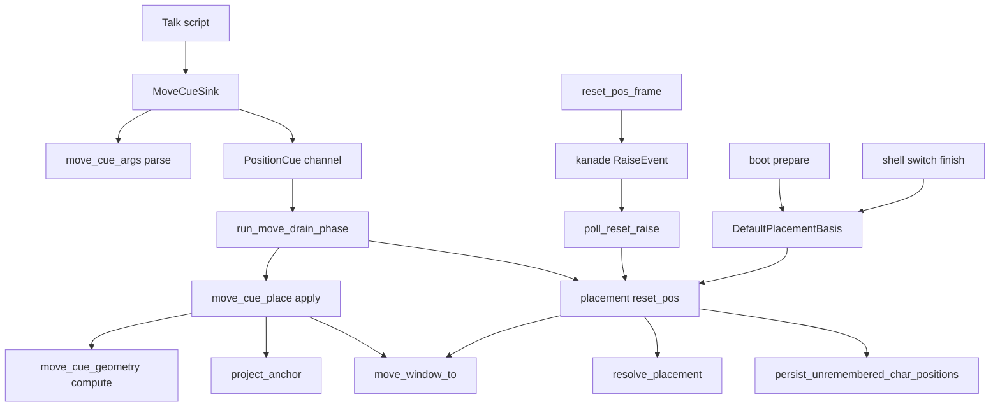
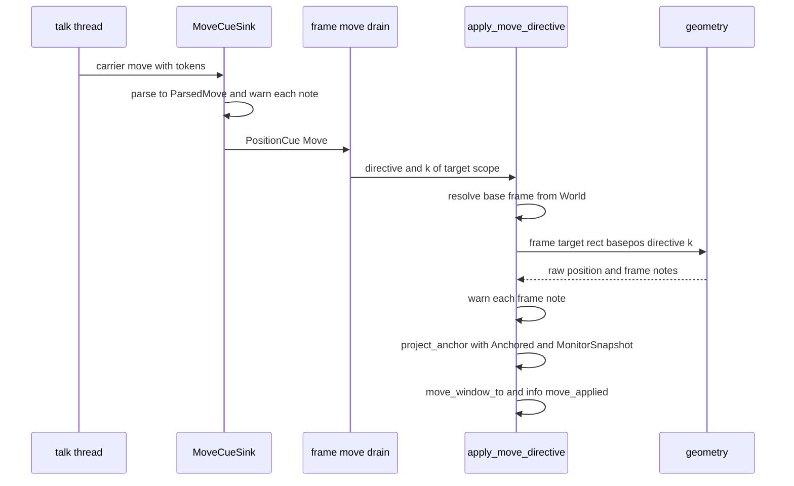
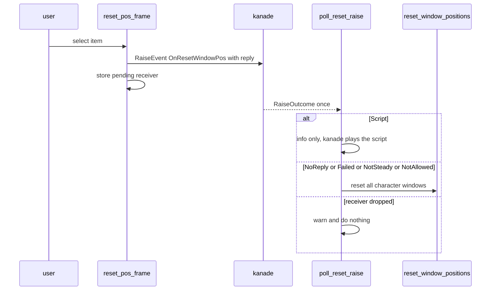

# 設計書: areka-P0-move-canon

## Overview

**目的**: ゴーストが台本の `\![move]` で自分のキャラクターの窓を、ukadoc の正典どおりに動かせるようにする。名前付きの形と旧い位置の形を同じ意味に読み、参照点 9 点＋`base` と基準 `screen`・`primaryscreen`・`global`・`me`・スコープの番号で位置を決め、画面の端への吸い付きを守る。あわせて `\![execute,resetwindowpos]` と右クリックのメニューの「シェル位置初期化」（`OnResetWindowPos`）で窓を既定の位置へ戻せるようにする。

**利用者**: ゴースト作者は正典の記述例そのままの `\![move]` を書ける。emo2 の利用者は、メニューの「エモの位置調整」でエモの窓をむらさきの窓の左にそろえられ、見失った窓を「シェル位置初期化」で戻せる。

**変わること**: 今の areka は旧い位置の形だけを読み、基準はスコープの番号だけを解き、参照点を読まずに「基準位置どうし」で計算し、吸い付きを通さずに窓を置く。本 spec の後は、読み・計算・基準の解決・吸い付きの当て直しが正典と SSP 2.9.18 の実測に合い、置き換えたことはすべて記録に残る。

### Goals

- emo2 の 2026-10-17 版の「エモの位置調整」で、エモの窓の右下がむらさきの窓の左下にそろう（拡大率 100%・200%）。
- 名前付きの形と旧い位置の形が同じ `MoveDirective` へ読まれ、どちらにも参照点と基準が効く。
- 正典で使えない組み合わせ・読めない値は SSP と同じ置き換えで動かし、置き換えを `warn!` で残す。
- `\![execute,resetwindowpos]` とメニューの項目で、すべてのキャラクターの窓を既定の位置へ並べ直せる。
- すべての判断の分岐を、実際の画面を使わない決定論のテストで確かめられる。

### Non-Goals

- `--time` の補間・時間に合わせて台本を待たせること・`\![moveasync]`（dola の改造の後）。
- 窓どうしの連携（sticky-window）・`\![set,alignmenttodesktop]`・`--option=ignore-sticky-window` の効き目（`areka-P0-window-link-directives`）。
- `\![execute,resetballoonpos]`・「バルーン位置初期化」・位置初期化のキーボードの近道（同上）。
- 窓の固定（`\![set,position]`／`\![reset,position]`）の働き（SSP 2.9.18 も持たない・受けない）。
- 面ごとの `point.basepos`（`areka-P0-surfaces-basepos`）・`check_script` の引数の診断（`areka-P0-check-script-arg-checks`）・他のゴーストの名前の基準の解決（`areka-P0-multi-ghost-runtime`）・3 人目以降の窓（`areka-P0-extra-character-windows`）。

## Boundary Commitments

### This Spec Owns

- `\![move]` の引数の読み（両方の形・既定・置き換え・記録）と、その結果の型 `MoveDirective`／`ParsedMove`／`MoveNote`。
- 基準の枠と参照点から移動先を求める純粋な計算（`move_cue_geometry`）。
- `\![move]` の UI スレッドでの適用: 基準の解決（スコープ・`me`・`screen`・`primaryscreen`・`global`）・吸い付きの当て直しの呼び出し・`move_window_to` への書込・記録。
- 台本から窓の位置の指令を UI へ運ぶ線の型 `PositionCue`（移動と並べ直し）と、その受け口 `MoveCueSink` の担当（`move` と `(execute,resetwindowpos)`）。
- 並べ直しの手続き `reset_window_positions` と、その材料の Resource `DefaultPlacementBasis`。
- メニューの枠 `Frame::ResetPosition`・`OnResetWindowPos` の送出と答えの待ち。
- kanade の許可表の 2 語（イベント `OnResetWindowPos`・リソース `switchmovetodefaultpositionbutton.caption`）。
- 互換の対応表（COMPAT §8）の `\![move]` と位置初期化の行、網羅台帳の該当の行。

### Out of Boundary

- 窓の書込口（`move_window_to`・`enqueue_window_set_pos`・`resize_window_to`）・吸い付きの射影（`project_anchor`・`Anchored`）・ドラッグ（`drag_follow.rs`）の中身。本 spec は呼ぶだけで変えない。
- 吸い付きの向きを変える指令（`\![set,alignmenttodesktop]`）と `Anchored` の書き換え。
- バルーンの位置のずらし（`BalloonFollow.offset`）の初期化と記憶。並べ直しはバルーンを今のずらしのまま付いて動かすだけ。
- 配置の規則（`resolve_placement` の P1〜P5）と起動の連鎖の確定（`finalize_chain`）。本 spec は規則を呼ぶだけで変えない。
- 位置の記憶の形と書き方（`persist_unremembered_char_positions`・`char_pos_entries`）。
- `\![set,position]`／`\![reset,position]` の受け口（作らない）。

### Allowed Dependencies

- `emo2_boot::move_cue*` → `placement::follow::{move_window_to, project_anchor, Anchored, MonitorSnapshot, work_area_for_window}`・`placement::spawn::GhostWindows`・`placement::scale_signed`・`placement::primary_monitor`（`pub(crate)` へ）・`placement::reset_pos::reset_window_positions`・`wintf::ecs::{WindowPos, Monitor}`・`areka_emo_compose::ScaleRatio`。
- `placement::reset_pos` → `placement::{resolver::resolve_placement, config::PlacementConfig, spawn::GhostWindows, persist::persist_unremembered_char_positions, follow::move_window_to, primary_monitor}`・`wintf::ecs::{WindowPos, Monitor, DPI}`。`emo2_boot` と `menu` には依存しない。
- `menu::reset_pos_frame` → `menu` の枠の部品・`placement::reset_pos`・`ghost_session::GhostSlot`・`areka_kanade::{KanadeMsg, RaiseOutcome}`・`areka_actor::reply_channel`。
- 依存の向き: 純粋な読み・計算（`move_cue_args`・`move_cue_geometry`）→ 型と受け口（`move_cue`）→ UI の適用（`move_cue_place`・`placement::reset_pos`）→ フレームの相・メニュー。逆向きの参照は禁止（純粋な 2 ファイルは `World`・`tracing` の記録・wintf の窓を綴らない）。

### Revalidation Triggers

- `MoveDirective` の欄・`parse_move_directive` の戻りの形が変わる → `areka-P0-check-script-arg-checks`（読み手を共有）・`areka-P0-window-link-directives`（`ignore_sticky_window` を読む）が確かめ直す。
- `PositionCue` に種類が増える・`MoveCueSink` の担当が変わる → 消費者台帳と一致の檻・`check_script` の答え。
- `DefaultPlacementBasis` を組む所（起動の準備・シェルの切替）が増える・減る → 並べ直しの材料が古くなる。
- `project_anchor` の契約・`Anchored` の持ち主（`window-link-directives` の吸い付きの指令）が変わる → `\![move]` の当て直し。
- `BaseposResolver` に宣言の basepos が差し込まれる（`surfaces-basepos`）→ 参照点 `base` の値。
- kanade の許可表の件数の見張り（他の spec が同時に語を足す）。

## Architecture

### Existing Architecture Analysis

- `\![move]` は台本 → `MoveCueSink`（talk スレッド・名前で自己選別）→ mpsc → `Emo2Wiring.move_rx` → フレームの `run_move_drain_phase` → `apply_move_directive` → `move_window_to` の道を通る。窓の書込口は `enqueue_window_set_pos` 1 つで、`WindowPos` の写しはその場で書き換わる。
- 吸い付きは `Anchored`（窓ごとの 5 値）を単一の真実源とし、ドラッグ（`policy_mapped_position`）と大きさの変化（`resize_window_to`）が同じ `project_anchor` を呼ぶ。`move_window_to` はこれを通らない。
- 既定の位置は起動の準備で `resolve_placement` が解き、連鎖の確定が `move_window_to`＋`set_default_char_pos`＋`persist_unremembered_char_positions` で仕上げる。`PlacementConfig` は走っている間残らない。
- メニューは OS ネイティブで、枠（`Frame`）ごとに葉を登記し、動作は閉じた後に UI スレッドで `&mut World` を持って呼ばれる。イベントは `KanadeMsg::RaiseEvent` で送り、答えは `ReplyReceiver::try_recv` で tick ごとに覗く前例がある。
- 1,000 行の決まり: `window_move.rs`（1,221・例外表）と `main.rs`（1,000 ちょうど）は触らない。`move_cue.rs`（683）は中身を兄弟へ出して痩せさせる。

### Architecture Pattern & Boundary Map



**Architecture Integration**:
- 採る形: 「純粋な核と薄い口」。読み（`move_cue_args`）と計算（`move_cue_geometry`）は純粋で、World を読むのは適用（`move_cue_place`）と並べ直し（`reset_pos`）だけ。
- 境界: 窓を書く口・吸い付きの射影・配置の規則・記憶の書き方は既存の持ち主のまま呼ぶだけ。
- 保つ前例: 名前による自己選別と消費者台帳、`move_window_to` の単一書込、連鎖の確定の「書いて既定位置を記し記憶へ書く」の 3 手、葉の枠、`try_recv` の待ち、`zorder_raw` の搬送の形。
- 新しい部品の理由: `move_cue_args`／`move_cue_geometry`／`move_cue_place` は `move_cue.rs` を 1,000 行に近づけずに責務で分けるため。`reset_pos` は既定の位置への並べ直しが placement の仕事だから。`reset_pos_frame` は葉の枠の前例どおり。
- steering: ログ優先（黙った失敗を作らない・panic しない）・時刻は正確（待ちを丸めない・上限の時間で打ち切らない）・1 フレーム遅らせない・決定論テストは兄弟ファイル。

### Technology Stack

| Layer | Choice / Version | Role in Feature | Notes |
|-------|------------------|-----------------|-------|
| アプリ（areka） | Rust 2024・bevy_ecs 0.19 | 適用・並べ直し・メニュー・フレームの相 | 新しい依存なし |
| UI 基盤 | wintf（`WindowPos`・`Monitor`） | 窓の矩形・モニタの作業領域と主の印 | 変更なし |
| 会話の層 | areka-kanade | `OnResetWindowPos` の送出と分類 `RaiseOutcome` | 許可表に 2 語 |
| 記憶 | areka-sylphya（`persist_put`） | 並べ直した位置の記憶 | 変更なし |
| ログ | tracing | 置き換え・移動・並べ直し・メニューの答えの記録 | 構造化欄・`event = "…"` |

## File Structure Plan

### Directory Structure

```
crates/areka/src/
├── emo2_boot/
│   ├── move_cue.rs                 # 型（MoveDirective・AxisSpec・MoveBase・RefPoint・PositionCue）と MoveCueSink。子モジュールを #[path] で持ち、公開面を再輸出する
│   ├── move_cue_args.rs            # 新: 引数の読み（両方の形）・ParsedMove・MoveNote（純粋）
│   ├── move_cue_args_tests.rs      # 新: 読みの全分岐の決定論テスト
│   ├── move_cue_geometry.rs        # 新: BaseFrame・参照点・移動先の計算（純粋）・BaseposResolver／CanonDefaultBasepos（move_cue.rs から移す）
│   ├── move_cue_geometry_tests.rs  # 新: 計算の全分岐の決定論テスト
│   ├── move_cue_place.rs           # 新: apply_move_directive（基準の解決・吸い付き・書込・記録）（move_cue.rs から移して書き直す）
│   ├── move_cue_place_tests.rs     # 新: headless World での適用の檻
│   └── frame_move_order_tests.rs   # 新: 相の順（D4）の檻＝同じフレームで面の大きさの変化と移動が届く場合
├── placement/
│   ├── reset_pos.rs                # 新: DefaultPlacementBasis（Resource）・reset_window_positions
│   └── reset_pos_tests.rs          # 新: 並べ直しの檻
└── menu/
    ├── reset_pos_frame.rs          # 新: 「シェル位置初期化」の葉・OnResetWindowPos の送出・答えの poll
    └── reset_pos_frame_tests.rs    # 新: 答えの分類ごとの檻
```

命名の確かめ（structure.md の最長 stem 規則）: 新しい本番ファイル `move_cue_args`・`move_cue_geometry`・`move_cue_place` は、既存のテストファイル `move_cue_tests`・`move_cue_move_sink_tests`・`move_cue_apply_move_tests`・`move_cue_move_severity_log_tests` のどれの前置きにもならない（`move_cue_apply.rs` は `move_cue_apply_move_tests.rs` を誤って引くので使わない）。

### Modified Files

**`\![move]` と線**
- `crates/areka/src/emo2_boot/move_cue.rs` — `MoveDirective` に `ignore_sticky_window: bool` を足す。`MoveDegradation`・`m1_degradations`・`is_m1_derived`・`parse_*`・`resolve_move_target_position`・`apply_move_directive` の本体を兄弟へ移し（`MoveDegradation` 系は廃止）、`PositionCue` を足す。`MoveCueSink` は `move` と `(execute,resetwindowpos)` を自己選別し、読みの記録を `warn!` で出して `PositionCue` を送る。子モジュール 3 つを `#[path]` で宣言し、`parse_move_directive`・`apply_move_directive` などを再輸出する。
- `crates/areka/src/emo2_boot/frame/drain_resnap.rs` — `run_move_drain_phase` が `PositionCue` を振り分け、`Move` は `apply_move_directive`、`ResetWindowPos` は `reset_window_positions` を呼ぶ。
- `crates/areka/src/emo2_boot/frame.rs` — `run_move_drain_phase` の呼び出しを `resnap_shell_targets` の後・`finalize_chain_once` の前へ移す（D4）と理由の注記。import を `PositionCue` へ。相の順の檻 `frame_move_order_tests.rs` の接続宣言（`#[cfg(all(test, target_pointer_width = "64"))]`・既存のハーネスの檻と同じ形）を足す。
- `crates/areka/src/emo2_boot/frame/wiring.rs` — `move_rx: Receiver<PositionCue>`、`drain_move_directives` の戻りを `Vec<PositionCue>` へ。
- `crates/areka/src/emo2_boot/mod.rs`・`crates/areka/src/emo2_boot/spine.rs` — 線の型名を `PositionCue` へ（各 1〜2 行）。
- `crates/areka/src/emo2_boot/frame/switch.rs` — `finish_shell` が新しいシェルの `PlacementConfig` を `DefaultPlacementBasis` として置き換える（既に組んでいる重なりの基底の `build_placement_config` を 1 度にまとめる）。

**台帳と許可表**
- `crates/areka/src/emo2_boot/consumer_ledger.rs` — `("execute", Some("resetwindowpos")) → CommandConsumer::MoveSink` を 1 行登記。件数 24 → 25（`canonical_builds_without_duplicate`）と doc の列挙・`MoveSink` の doc・`canonical_registers_only_execute_install_for_the_install_sink` の名と doc（「install の受け口は install だけ」へ）を直す。
- `crates/areka/src/emo2_boot/consumer_ledger_agreement_tests.rs` — `samples()` に `(execute,resetwindowpos)` の見本、`\![set,position,…]`・`\![reset,position]` がどの受け口にも届かない檻を足す（受け口の数 9 は変わらない）。
- `crates/areka-kanade/src/schedule/events.rs` — `ALLOWED_EVENT_IDS` に `OnResetWindowPos`（ukadoc の URL のコメント付き）。
- `crates/areka-kanade/src/schedule/events_change_tests.rs` — 件数 53 → 54 と履歴の注記。
- `crates/areka-kanade/src/schedule/resources.rs` — `ALLOWED_RESOURCE_IDS` に `switchmovetodefaultpositionbutton.caption`、件数の檻 12 → 13、doc の「メニュー 9 名」→ 10 名。

**配置とメニュー**
- `crates/areka/src/placement/mod.rs` — `mod reset_pos;` の宣言、`PreparedPlacement` に `default_basis: PlacementConfig` を足して `PreparedStages::resolve` で載せる、`primary_monitor` を `pub(crate)` へ。
- `crates/areka/src/placement/spawn.rs` — 「`PlacementConfig` は捨てる」の注記に、並べ直しだけが読む `DefaultPlacementBasis` の例外を 1 行足す（コードは変えない）。
- `crates/areka/src/ghost_session.rs` — 準備の後に `DefaultPlacementBasis` を置き（`zorder_raw` を取り出す所の隣）、枠の登記に `reset_pos_frame::register` を 1 行足す。
- `crates/areka/src/menu/mod.rs` — `Frame::ResetPosition`（`Balloon` の直後）・`Frame::ORDER` を 11 へ、`register_menu_poll` に `reset_pos_frame::poll_reset_raise` を足し、`mod reset_pos_frame;` を宣言。
- `crates/areka/src/menu/captions.rs` — `FRAME_CAPTIONS` に `(Some("switchmovetodefaultpositionbutton.caption"), Frame::ResetPosition, "シェル位置初期化")`。
- `crates/areka/src/menu/plan.rs` — `group_of` の組 0 に `Frame::ResetPosition`。

**テスト（型名と陳腐化）**
- `crates/areka/src/emo2_boot/move_cue_tests.rs` — 読みと計算の檻を新しい兄弟へ移し、`Err` を前提にした檻（`named_form_is_degraded_err`・`base_vocab_acceptance_and_classification`・`unparsable_axis_is_err` ほか）は置き換えの檻として書き改める。残すのは型の既定値の檻だけ（空になるなら接続宣言ごと外す）。
- `crates/areka/src/emo2_boot/move_cue_apply_move_tests.rs` — `apply_non_scope_base_returns_false` を「非スコープの基準でも動く」へ書き改める。旧い emo2 の着地の檻（要件 2.6）はそのまま残す。
- `crates/areka/src/emo2_boot/move_cue_move_sink_tests.rs`・`move_cue_move_severity_log_tests.rs` — 送り先の型を `PositionCue` へ、`(execute,resetwindowpos)` を受ける檻と、開けない `execute` を `warn!` にしない檻を足す。
- `crates/areka/src/emo2_boot/frame_drain_text_tests.rs`・`frame_attach_tests.rs`・`frame_test_support.rs`・`frame_visibility_integration_tests.rs`・`balloon_visibility_lifecycle_e2e_tests.rs`・`spine_move_cue_tests.rs`・`crates/areka/src/input_events/balloon_test_support.rs` — `mpsc::channel::<MoveDirective>()` を `PositionCue` へ（機械的な置き換え）。
- `crates/areka/src/menu/mod_registry_tests.rs`・`captions_tests.rs`・`plan_tests.rs` — 枠の並び・名前の表・計画（項目の数 10 → 11）を書き改める。

**文書**
- `doc/COMPAT_ARCHITECTURE.md` §8 — `\![move]` の 5 行（:131-135）を書き直し、要件 10.2 の行を足す（:155 の k 倍の行は保つ・位置の記憶の行 :344 に並べ直しの後の扱いを足す）。
- `doc/ukadoc-coverage/ledger/sakura-script.toml` — `move`（:1773）・`execute,resetwindowpos`（:1465）・`set,position`（:3150）・`reset,position`（:2798）。
- `doc/ukadoc-coverage/ledger/shiori.toml` — `OnResetWindowPos`（:5191）・`switchmovetodefaultpositionbutton.caption`（:14967）。
- `doc/ukadoc-coverage/report/`（生成物）— `cargo run -p ukadoc-survey -- report` と `report-summary` で作り直し、台帳と同じコミットに入れる。
- `.kiro/specs/areka-P0-move-canon/signoff.md`（実装の段で作る）— 実機の確かめの手順と結果。

注記だけ直すファイル: `placement/follow/window_move.rs` の `move_window_to` の doc（:38「唯一の消費者が `\![move]` cue」）。呼び手はすでに連鎖の確定もあり、本 spec で並べ直しも加わるので、「呼び手（`\![move]`・連鎖の確定・並べ直し）はどれも `MoveCue` を名乗る」へ書き改める。行数は増やさない（例外表のファイル）。

触らないファイル（明示）: `placement/follow/drag_follow.rs`・`placement/follow/anchor.rs`・`placement/resolver.rs`・`placement/persist.rs`・`placement/chain_finalize.rs`・`main.rs`・`zorder_cue.rs`・`install_cue.rs`。

## System Flows

### `\![move]` の 1 件



- 基準の解決は「スコープ → その窓。窓が無ければ `screen` へ置き換え」「`me` → 自分の今の矩形」「`screen` → 自分の中心が属する作業領域（最近傍あり）」「`primaryscreen` → 主モニタの作業領域」「`global` → 原点」。
- move drain は `resnap_shell_targets` の後に走るので、同じフレームで面の大きさが変わっても確定した大きさで計算する（D4）。

### メニューからの並べ直し



- `\![execute,resetwindowpos]` は `OnResetWindowPos` を送らず、move drain から直に `reset_window_positions` を呼ぶ（要件 8.7）。
- 待つ時間に上限は無い。待っている間は項目を灰色にして二重に送らない。

## Requirements Traceability

| Requirement | Summary | Components | Interfaces | Flows |
|-------------|---------|------------|------------|-------|
| 1.1 | 名前付きの形のキーを読む | MoveArgs | `parse_move_directive` | move の 1 件 |
| 1.2 | キーの大小・順を問わない | MoveArgs | 同上 | — |
| 1.3 | 省略の既定 | MoveArgs・MoveGeometry | `MoveDirective` の既定 | — |
| 1.4 | 旧い形にも同じ既定 | MoveArgs | 同上 | — |
| 1.5 | 省略・`fix` は今の座標 | MoveArgs・MoveGeometry | `AxisSpec::Fix` | — |
| 1.6 | 負の整数 | MoveArgs | `AxisSpec::Px(i32)` | — |
| 1.7 | 点の無い 1 語は両軸へ | MoveArgs | `parse_ref_point` | — |
| 1.8 | `--option` の繰り返し | MoveArgs | `MoveDirective.ignore_sticky_window`・`MoveNote::UnknownOption` | — |
| 1.9 | `ignore-sticky-window` は動きを変えない | MoveArgs・MovePlace | 同上（適用は読まない） | — |
| 1.10 | 知らないキー・値・形を無視して記録 | MoveArgs・PositionSink | `MoveNote::{UnknownKey, UnknownOption, MalformedArg}` | — |
| 1.11 | 重複は後勝ちで記録 | MoveArgs | `MoveNote::DuplicateKey` | — |
| 1.12 | 旧い形の欄の並びは今と同じ | MoveArgs | 位置の表 | — |
| 1.13 | `--` で始まる引数があれば名前付き | MoveArgs | 形の判定 | — |
| 2.1 | 参照点どうしを合わせる | MoveGeometry | `compute_move_target` | move の 1 件 |
| 2.2 | 横・縦の語の意味 | MoveGeometry | `point_on_frame`・`offset_in_window` | — |
| 2.3 | `base`＝既定の基準位置 | MoveGeometry・MovePlace | `CanonDefaultBasepos` | — |
| 2.4 | X・Y に拡大率を掛ける | MoveGeometry・MoveDrain | `scale_signed`・`applied_ratio` | — |
| 2.5 | 実際の大きさから求める | MovePlace・MoveDrain | `WindowPos.size`・相の順（D4） | move の 1 件 |
| 2.6 | 旧い emo2 の着地を保つ | MoveGeometry・MovePlace | 既存の檻 | — |
| 2.7 | バルーンが付いて動く | MovePlace | `move_window_to` | — |
| 2.8 | 画面の内へ寄せない | MovePlace | 寄せの処理を持たない | — |
| 2.9 | 位置の記憶に書かない | MovePlace | `move_window_to` だけを呼ぶ | — |
| 2.10 | 吸い付きの当て直し | MovePlace | `project_anchor`（D3） | move の 1 件 |
| 2.11 | `free` はそのまま | MovePlace | `project_anchor` の `Free` | — |
| 2.12 | 後の表情の切り替えで吸い戻されない | MovePlace・MoveDrain | D3・D4 | — |
| 3.1 | `screen`＝今のモニタの作業領域 | MovePlace | `BaseFrame::Area` | — |
| 3.2 | モニタは中心・最近傍で決める | MovePlace | `work_area_for_window` | — |
| 3.3 | `primaryscreen`＝主の作業領域 | MovePlace | `primary_monitor` | — |
| 3.4 | `global`＝原点 | MoveGeometry | `BaseFrame::Origin` | — |
| 3.5 | スコープの番号＝その窓 | MovePlace | `BaseFrame::Window` | — |
| 3.6 | `me`＝動かす前の自分 | MovePlace | 同上 | — |
| 3.7 | 無いスコープは `screen` へ | MovePlace | `FrameNote::MissingBaseScope` | — |
| 3.8 | 他のゴーストの名前はスコープ 0 へ | MoveArgs | `MoveNote::OtherGhostBase` | — |
| 4.1 | `screen`／`primaryscreen` の `base` → `center` | MoveGeometry | `FrameNote::AreaBaseToCenter` | — |
| 4.2 | `global` の参照点 → 原点 | MoveGeometry | `FrameNote::GlobalOffsetIgnored` | — |
| 4.3 | 置き換えは基準の参照点だけ | MoveGeometry | 動かす窓の参照点は置き換えない | — |
| 4.4 | 知らない参照点の語 → `left`／`top` | MoveArgs | `MoveNote::UnknownRefWord` | — |
| 4.5 | 読めない X・Y → `fix` | MoveArgs | `MoveNote::UnparsableAxis` | — |
| 4.6 | 読めない `time` → 0 | MoveArgs | `MoveNote::UnparsableDuration` | — |
| 4.7 | 止めずに続け、すべて記録 | PositionSink・MovePlace | `warn!` の 2 か所（D2） | — |
| 5.1 | time>0 は即時＋記録 | MoveArgs・PositionSink | `MoveNote::TimedMoveImmediate` | — |
| 5.2 | 台本の進みを変えない | PositionSink | `duration` に触れない（今のまま） | — |
| 6.1 | エモの右下＝むらさきの左下 | MoveArgs・MoveGeometry・MovePlace | 全体 | move の 1 件 |
| 6.2 | 100% と 200% の両方 | MoveGeometry・実機の確かめ | k に依らない式・signoff | — |
| 7.1 | `set,position`／`reset,position` を受けない | 消費者台帳（登記しない） | 一致の檻 | — |
| 7.2 | 台帳に受けない理由 | 台帳の文書 | `sakura-script.toml` | — |
| 8.1 | メニューの項目 | ResetPosFrame | `Frame::ResetPosition` | メニュー |
| 8.2 | 項目の名前 | ResetPosFrame | `FRAME_CAPTIONS`・許可表 | — |
| 8.3 | 選ぶと `OnResetWindowPos` | ResetPosFrame | `RaiseEvent` | メニュー |
| 8.4 | 台本が返れば並べ直さない | ResetPosFrame | `RaiseOutcome::Script` | メニュー |
| 8.5 | 返さなければ並べ直す | ResetPosFrame | 他の分類（D8） | メニュー |
| 8.6 | 既定の位置へ並べ直す | ResetPos | `reset_window_positions`（D7） | — |
| 8.7 | タグはイベントを送らない | PositionSink・MoveDrain | `PositionCue::ResetWindowPos` | — |
| 8.8 | 次の起動で既定の位置 | ResetPos | `persist_unremembered_char_positions` | — |
| 8.9 | バルーンが付いて動く | ResetPos | `move_window_to` | — |
| 9.1 | 移動の記録 | MovePlace | `info!(event="move_applied")` | — |
| 9.2 | 並べ直しの記録 | ResetPos | `info!(event="reset_window_pos")` | — |
| 9.3 | 決定論のテスト | 全部品 | Testing Strategy | — |
| 9.4 | 実機の証跡（100%・200%） | 実機の確かめ | signoff | — |
| 9.5 | 根と検体は `target\` の下 | 実機の確かめ | signoff | — |
| 10.1 | COMPAT §8 の `\![move]` の行 | 文書 | COMPAT | — |
| 10.2 | COMPAT §8 に決めた扱いの行 | 文書 | COMPAT | — |
| 10.3 | 台帳の `move` の持ち主 | 文書 | `sakura-script.toml` | — |
| 10.4 | 台帳の 5 行 | 文書 | `sakura-script.toml`・`shiori.toml` | — |

## Components and Interfaces

| Component | Domain/Layer | Intent | Req Coverage | Key Dependencies (P0/P1) | Contracts |
|-----------|--------------|--------|--------------|--------------------------|-----------|
| MoveArgs（`move_cue_args.rs`） | 純粋 | 引数を `MoveDirective` と置き換えの記録へ読む | 1.1〜1.13, 3.8, 4.4〜4.6, 5.1 | なし | Service |
| MoveGeometry（`move_cue_geometry.rs`） | 純粋 | 基準の枠と参照点から移動先を求める | 1.3, 1.5, 2.1〜2.4, 2.6, 3.4, 4.1〜4.3, 6.1, 6.2 | `scale_signed`（P0） | Service |
| PositionSink（`move_cue.rs` の `MoveCueSink`・`PositionCue`） | talk スレッド | 担当を選び、読みの記録を出し、指令を UI へ送る | 1.10, 4.7, 5.1, 5.2, 8.7 | MoveArgs（P0）・mpsc（P0） | Event |
| MovePlace（`move_cue_place.rs`） | UI | 基準を解き、計算し、吸い付きを当て、書く | 1.9, 2.5, 2.7〜2.12, 3.1〜3.3, 3.5〜3.7, 4.7, 9.1 | MoveGeometry（P0）・`project_anchor`（P0）・`move_window_to`（P0）・`primary_monitor`（P1） | Service |
| MoveDrain（`drain_resnap.rs` の `run_move_drain_phase`・`frame.rs` の相の順） | UI | 指令を振り分け、k を渡す | 2.4, 2.5, 2.12, 8.7 | MovePlace（P0）・ResetPos（P0） | Batch |
| ResetPos（`placement/reset_pos.rs`） | UI・placement | 既定の位置へ並べ直し、記憶へ書く | 8.6, 8.8, 8.9, 9.2 | `resolve_placement`（P0）・`DefaultPlacementBasis`（P0）・`persist_unremembered_char_positions`（P0） | Service, State |
| ResetPosFrame（`menu/reset_pos_frame.rs`） | UI・menu | 項目・イベントの送出・答えの分類 | 8.1〜8.5 | kanade（P0）・ResetPos（P0） | Service, State |
| 台帳・許可表（`consumer_ledger.rs`・`events.rs`・`resources.rs`） | 宣言 | 担当と許可の登記 | 7.1, 8.2, 8.3 | なし | — |

### 純粋の層

#### MoveArgs

| Field | Detail |
|-------|--------|
| Intent | `\![move]` の引数列を、両方の形で同じ `MoveDirective` へ読み、置き換えを列で返す |
| Requirements | 1.1〜1.13, 3.8, 4.4, 4.5, 4.6, 5.1 |

**Responsibilities & Constraints**
- 形の判定: 引数のどれかが `--` で始まれば名前付きの形、そうでなければ旧い位置の形（1.13）。`-353` は `--` で始まらないので旧い形。
- 名前付きの形: 各引数を `--キー=値` に分ける（最初の `=` で切る）。キーは小文字にそろえて引く（1.2）。正典のキーは `x`・`y`・`time`・`base`・`base-offset`・`move-offset`・`option`。値が空のキーは省略と同じ。
  - `--` で始まらない引数・`=` の無い引数 → 無視して `MalformedArg`（1.10）。
  - 正典に無いキー → 無視して `UnknownKey`（1.10）。
  - `option` 以外の同じキーの 2 回目以降 → 後の値を使い `DuplicateKey`（1.11）。
  - `option` は繰り返しを全部受ける（1.8）。値は小文字にそろえて `ignore-sticky-window` なら `ignore_sticky_window = true`、それ以外は `UnknownOption`（1.10）。
- 旧い位置の形: 欄の位置は今と同じ（X・Y・time・base・base-offset・move-offset・1.12）。7 欄目以降は今と同じく読まない。
- 欄ごとの読み（両方の形で共通・1.4）:
  - X・Y: 空か `fix`（大小を問わない）→ `Fix`、`i32` → `Px`（負も可・1.5・1.6）、それ以外 → `Fix` と `UnparsableAxis`（4.5）。
  - time: 空 → 0、`u32` → その値、それ以外 → 0 と `UnparsableDuration`（4.6）。0 より大きい値 → `TimedMoveImmediate`（5.1）。
  - base: 空 → `Screen`、`screen`・`primaryscreen`・`global`・`me`（大小を問わない）→ 各語、`u32` → `Scope`、それ以外 → `Scope(0)` と `OtherGhostBase`（3.8）。
  - 参照点: 空 → `left.top`（1.3）、点の無い 1 語 → 両軸へ同じ語（1.7）、軸ごとに知らない語 → 横は `left`・縦は `top` と `UnknownRefWord`（4.4）。
- 純粋（`World`・`tracing`・wintf の窓を綴らない）。panic しない。

**Contracts**: Service [x]

##### Service Interface
```rust
pub struct ParsedMove {
    pub directive: MoveDirective,
    /// 読みで置き換えた・無視した・記録すべき点（出現順）。空なら台本どおり。
    pub notes: Vec<MoveNote>,
}

pub enum OffsetSide { Base, Move }

pub enum MoveNote {
    MalformedArg { arg: String },
    UnknownKey { key: String },
    UnknownOption { value: String },
    DuplicateKey { key: String },
    UnparsableAxis { axis: Axis, token: String },
    UnparsableDuration { token: String },
    UnknownRefWord { side: OffsetSide, axis: Axis, word: String },
    OtherGhostBase { name: String },
    TimedMoveImmediate { duration_ms: u32 },
}

pub fn parse_move_directive(scope: u32, tokens: &[String]) -> ParsedMove;
```
- Preconditions: `tokens` はコマンド名を除いた引数列（キャリアの `params`）。
- Postconditions: 常に `MoveDirective` を返す。置き換えたものはすべて `notes` に 1 件ずつ現れる。
- Invariants: 同じ入力には同じ出力（決定論）。旧い形で正典どおりの値（emo2 の `-353,,,0,base,base`）は `notes` が空。

`MoveDirective`（`move_cue.rs`・欄を 1 つ足す）:
```rust
pub struct MoveDirective {
    pub scope: u32,
    pub x: AxisSpec,
    pub y: AxisSpec,
    pub duration_ms: u32,
    pub base: MoveBase,          // Scope(u32) | Screen | PrimaryScreen | Me | Global（今のまま）
    pub base_offset: RefPoint,
    pub move_offset: RefPoint,
    /// `--option=ignore-sticky-window`。今は誰も読まない（window-link-directives が意味を持たせる）。
    pub ignore_sticky_window: bool,
}
```

#### MoveGeometry

| Field | Detail |
|-------|--------|
| Intent | 基準の枠・動かす窓の矩形と基準位置・指令・k から、動かす窓の左上（吸い付きの前）を求める |
| Requirements | 1.3, 1.5, 2.1, 2.2, 2.3, 2.4, 2.6, 3.4, 4.1, 4.2, 4.3, 6.1, 6.2 |

**Responsibilities & Constraints**
- 基準の枠の 3 形:
  - `Window { rect, basepos }`（スコープ・`me`）: 4 語すべてが使える。`base` は `rect.left + basepos.x`／`rect.top + basepos.y`。
  - `Area(rect)`（`screen`・`primaryscreen`）: `base` の軸は `center` に置き換えて `AreaBaseToCenter { axis }`（4.1）。
  - `Origin`（`global`）: 基準の参照点が `left.top` 以外なら使わずに原点 (0,0) とし `GlobalOffsetIgnored { offset }`（4.2）。
- 枠の上の点: `left`＝`rect.left`、`right`＝`rect.right`（右端の外側の座標＝左端＋幅）、`center`＝`rect.left + 幅 / 2`、縦も同じ。幅・高さの半分は整数の割り算で切り捨てる（幅は 0 以上なので下へ丸める・今の basepos と resolver の P5 と同じ）。
- 動かす窓の中の点（左上からのずれ）: `left`＝0・`right`＝幅・`center`＝幅 / 2・`base`＝basepos.x、縦も同じ。置き換えは動かす窓の参照点には当てない（4.3）。
- 軸ごとに: `Fix` → 動かす窓の今の左端（上端）、`Px(d)` → `枠の上の点 + scale_signed(d, k) − 動かす窓の中の点`（2.1・2.4）。
- `saturating_*` で計算し panic しない。
- 検算: emo2 の位置調整（`--base=0,--base-offset=left.bottom,--move-offset=right.bottom`・X=Y=0）は `x1 = x0 − w1`・`y1 = y0 + h0 − h1`（k に依らない・6.1・6.2）。旧い emo2（`-353,,,0,base,base`・Y は `fix`）は `x1 = x0 + w0/2 + k·(−353) − w1/2`（今の式と同じ・2.6）。

**Contracts**: Service [x]

##### Service Interface
```rust
pub enum BaseFrame {
    Window { rect: RectPx, basepos: PointPx },
    Area(RectPx),
    Origin,
}

pub enum FrameNote {
    MissingBaseScope { scope: u32 },            // MovePlace が作る（3.7）
    AreaBaseToCenter { axis: Axis },            // 4.1
    GlobalOffsetIgnored { offset: RefPoint },   // 4.2
}

pub struct MoveTarget {
    pub position: PointPx,       // 吸い付きの前の左上（物理 px）
    pub base_offset_used: RefPoint, // 置き換えの後に実際に使った基準の参照点（記録用）
    pub notes: Vec<FrameNote>,
}

pub fn compute_move_target(
    frame: &BaseFrame,
    target_rect: RectPx,
    target_basepos: PointPx,
    directive: &MoveDirective,
    k: ScaleRatio,
) -> MoveTarget;

pub trait BaseposResolver { fn basepos(&self, window_size: SizeI) -> PointPx; } // move_cue.rs から移す・中身は今のまま
pub struct CanonDefaultBasepos; // 幅÷2・下端（今のまま）
```
- Preconditions: `target_rect` は正の大きさ（呼び手が確かめる）。
- Postconditions: 両軸 `Fix` なら `position` は `target_rect` の左上。
- Invariants: 純粋・決定論。`RectPx`・`PointPx` は `placement::resolver` の型を使う。

### talk スレッド

#### PositionSink（`MoveCueSink` と `PositionCue`）

| Field | Detail |
|-------|--------|
| Intent | 窓の位置の指令を名前で選び、読みの記録を出して UI へ送る |
| Requirements | 1.10, 4.7, 5.1, 5.2, 8.7 |

**Responsibilities & Constraints**
- 自己選別: キャリアの名前が `move` → 読んで `PositionCue::Move`。名前が `execute` で第 1 引数が `resetwindowpos` → `PositionCue::ResetWindowPos`（残りの引数は読まない）。それ以外は今どおり `debug!` で読み飛ばす（`\![set,position]`・`\![reset,position]` もここで読み飛ばされる＝7.1）。
- 開けない荷物: 宛名が `move` のときだけ `warn!`（今のまま）。`execute` 宛の開けない荷物の `warn!` は `InstallCueSink` が持つので、ここは `debug!`（同じ荷物に `warn!` を 2 行出さない）。
- 読みの記録: `ParsedMove.notes` を 1 件ずつ `warn!(event = "move_arg_substituted", scope, note = ?note, …)`（4.7・5.1）。
- `cue.actor` が数でないときは今どおり `warn!` で読み飛ばす。
- 送った後に `tick_wake::mark(PRESENT)` を立てる（今のまま）。envelope の `duration` には触れない（5.2）。

**Contracts**: Event [x]

##### Event Contract
- 送る: `PositionCue`（mpsc・talk スレッド → UI スレッド・`Emo2Wiring.move_rx`）
```rust
pub enum PositionCue {
    Move(MoveDirective),
    ResetWindowPos,
}
```
- 届け方: 送った順に UI が FIFO で取り出す。`GhostWindows` が無い間は線が保留の入れ物を兼ねる（今のまま）。
- 受け手が切れていれば `warn!` だけで台本は止めない。

### UI スレッド

#### MovePlace（`apply_move_directive`）

| Field | Detail |
|-------|--------|
| Intent | 基準を解き、移動先を求め、吸い付きを当て、窓へ書いて記録する |
| Requirements | 1.9, 2.5, 2.7, 2.8, 2.9, 2.10, 2.11, 2.12, 3.1, 3.2, 3.3, 3.5, 3.6, 3.7, 4.7, 9.1 |

**Responsibilities & Constraints**
- 手順:
  1. `GhostWindows` から対象の窓を引き、`WindowPos` の位置と正の大きさを読む（どれかが無ければ `warn!(event="move_skipped", reason)` で `false`）。
  2. 基準の枠を解く:
     - `Scope(n)`: その窓の `WindowPos` が揃えば `Window { rect, basepos: CanonDefaultBasepos }`（3.5）。窓が無い・位置か大きさが無いなら `FrameNote::MissingBaseScope` を足して `Screen` として解き直す（3.7）。
     - `Me`: 対象の窓の今の矩形で `Window`（3.6）。
     - `Screen`: `MonitorSnapshot` と対象の窓の今の矩形で `work_area_for_window`（中心・最近傍・3.1・3.2）→ `Area`。
     - `PrimaryScreen`: World の `Monitor` を集めて `primary_monitor`（主の印・無ければ先頭で代えて `warn!`）の `work_area` → `Area`（3.3）。
     - `Global`: `Origin`。
     - 作業領域が引けない（`MonitorSnapshot` が無い・空・`Monitor` が 0 台）→ `warn!(event="move_skipped")` で `false`。
  3. `compute_move_target` で吸い付きの前の位置を求め、`FrameNote` を 1 件ずつ `warn!(event = "move_frame_substituted")`（4.7）。
  4. 対象の窓の `Anchored` を読み、`project_anchor(anchor, position, size, MonitorSnapshot)` を通す（2.10・2.11）。`Anchored` が無いときは `warn!(event = "move_anchor_missing")` のうえで当て直さない（`Free` と同じ扱い）。
  5. `move_window_to` で書く（バルーンが付いて動く・記憶に書かない・画面の内へ寄せない＝2.7〜2.9）。
  6. 書けたら `info!(event = "move_applied", scope, base, base_offset, move_offset, anchor, base_left, base_top, base_right, base_bottom, from_x, from_y, script_x, script_y, to_x, to_y)`（9.1・`script_*` は吸い付きの前、`to_*` は後・`base_*` は解いた基準の枠の矩形で、`Origin` のときは 0）。実機の判定はこの 1 行で閉じる（議題 2）。
- `ignore_sticky_window` は読まない（1.9）。
- `Anchored` は読むだけで書かない（今の檻「適用前後で `Anchored` がビット同一」を保つ）。

**Dependencies**
- Inbound: MoveDrain — 指令と k を渡す（P0）
- Outbound: MoveGeometry（P0）・`project_anchor`（P0）・`move_window_to`（P0）・`work_area_for_window`（P0）・`primary_monitor`（P1）

**Contracts**: Service [x]

##### Service Interface
```rust
/// 書いたら true。動かせなかったときは warn! のうえ false（トークは止めない）。
pub fn apply_move_directive(world: &mut World, directive: &MoveDirective, k: ScaleRatio) -> bool;
```
- Preconditions: UI スレッド（`&mut World`）。
- Postconditions: true のとき、対象の窓は吸い付きの当て直しの後の位置にあり、バルーンは今のずらしのまま付いて動いている。位置の記憶・`Anchored`・`default_char_pos` は変わらない。

#### MoveDrain（`run_move_drain_phase` と相の順）

| Field | Detail |
|-------|--------|
| Intent | 線から指令を全部取り出し、種類ごとに適用する |
| Requirements | 2.4, 2.5, 2.12, 8.7 |

**Responsibilities & Constraints**
- `GhostWindows` が無い間は取り出さない（今のまま）。
- `Move(d)` → k＝対象のスコープのシェルに今かかっている拡大率（`presenter.applied_ratio`・無ければ 1・今のまま）で `apply_move_directive`。
- `ResetWindowPos` → `reset_window_positions(world)`（`OnResetWindowPos` は送らない・8.7）。
- 相の順（D4）: `emo2_frame_system` の中で `resnap_shell_targets` の**後**、`finalize_chain_once` の**前**に呼ぶ（今は `reconcile_reported_sizes` の後・zorder drain の前）。zorder drain の位置は変えない。

**Contracts**: Batch [x]

##### Batch / Job Contract
- Trigger: 毎フレーム 1 回（`emo2_frame_system`）。
- Input: その時点で線に溜まった `PositionCue` の全部（FIFO）。
- Output: 窓の位置の書込と記録。
- Idempotency & recovery: 1 件の失敗は `warn!` のうえ次へ進む。

#### ResetPos（`placement/reset_pos.rs`）

| Field | Detail |
|-------|--------|
| Intent | すべてのキャラクターの窓を、起動と同じ配置の規則で既定の位置へ並べ直し、記憶へ書く |
| Requirements | 8.6, 8.8, 8.9, 9.2 |

**Responsibilities & Constraints**
- 材料: `DefaultPlacementBasis`（descript から組んだ `PlacementConfig`）・主モニタの作業領域と DPI（`Monitor` を集めて `primary_monitor`）・各スコープの今の窓の大きさ（キャラクターの窓とバルーンの窓の `WindowPos.size`）。
- 手順:
  1. 材料が揃わない（Resource が無い・`GhostWindows` が無い・主モニタが無い）→ `warn!(event = "reset_window_pos_skipped", reason)` で `false`。大きさが揃わないスコープは `warn!` で外し、残りで解く。
  2. `GhostWindows.scopes()`（昇順）の `ScopeInput` で `resolve_placement(cfg, 主の作業領域, inputs, 主の DPI)` を 1 度解く。
  3. 各スコープ: `move_window_to(char_window, char_pos)`（バルーンは今のずらしで付いて動く・8.9）→ 書けたら `GhostWindows::set_default_char_pos(scope, char_pos)` → `info!(event = "reset_window_pos", scope, from_x, from_y, to_x, to_y)`（9.2）。
  4. 最後に `persist_unremembered_char_positions(world)` を 1 度呼ぶ（既定の位置にいる窓を記憶へ書く・8.8）。
- `Anchored`・`BalloonFollow.offset`・吸い付きの設定は変えない（SSP の実測 M9 と同じく、吸い付きの外しは戻さない）。
- 書込の経路語は `move_window_to` の `MoveCue`（起動の連鎖の確定と同じ前例・既定の位置は自分で記す）。

**Contracts**: Service [x] / State [x]

##### Service Interface
```rust
#[derive(Resource, Debug, Clone)]
pub struct DefaultPlacementBasis(pub PlacementConfig);

/// 並べ直した窓が 1 つでもあれば true。
pub fn reset_window_positions(world: &mut World) -> bool;
```
- Postconditions: true のとき、並べ直した各スコープは `WindowPos.position == default_char_pos == resolve_placement の char_pos`、位置の記憶に同じ位置（`char_pos_to_origin_x` の形）が送られている。

##### State Management
- `DefaultPlacementBasis` は窓の組ごとに 1 つ。置くのは (1) 起動の準備の後（`ghost_session::prepare_ghost_windows`・`PreparedPlacement.default_basis` から）と (2) シェルの切替の後始末（`finish_shell`・新しいシェルの descript から）。ゴーストの切替は (1) を通り直す。読むのは `reset_window_positions` だけ。

#### ResetPosFrame（`menu/reset_pos_frame.rs`）

| Field | Detail |
|-------|--------|
| Intent | 「シェル位置初期化」の項目を出し、`OnResetWindowPos` を送り、答えに応じて並べ直す |
| Requirements | 8.1, 8.2, 8.3, 8.4, 8.5 |

**Responsibilities & Constraints**
- 項目: 名前は `captions` の表（リソース `switchmovetodefaultpositionbutton.caption`・既定「シェル位置初期化」・8.2）。選べるのは `GhostWindows` が在り、答えを待っていないとき。
- 動作（UI スレッド・止めない）: `GhostSlot` → `GhostSession::kanade()` で送り口を取り、`reply_channel` を作って `KanadeMsg::RaiseEvent { id: "OnResetWindowPos", references: vec![], method: Get, reply: Some(tx) }` を送り、受け手を NonSend の Resource `PendingResetRaise` に置く（8.3）。送り口が無い・送れないときは「答えが無い」と同じく並べ直す（`warn!`）。
- 毎 tick の `poll_reset_raise`（`Input` の段・`poll_menu_query` の隣）: `PendingResetRaise` があれば `try_recv`:
  - まだ → 何もしない。
  - `Script` → `info!(event = "reset_pos_menu_outcome", outcome = "script")`。並べ直さない（台本は kanade が再生する・8.4）。
  - `NoReply` → `info!` のうえ `reset_window_positions`（8.5）。
  - `NotSteady`・`NotAllowed`・`Failed` → `warn!` のうえ `reset_window_positions`（8.5・D8）。
  - 受け手が切れた（`Err`）→ `warn!` だけで並べ直さない（会話が終わり、窓の組も入れ替わる）。
  - どの場合も `PendingResetRaise` を外す。
- 待つ時間に上限を設けない（kanade は答えを 1 回必ず返す・会話が終われば受け手が切れる）。

**Contracts**: Service [x] / State [x]

##### Service Interface
```rust
pub(super) fn register(world: &mut World);                 // menu::register(world, Frame::ResetPosition, …)
pub(crate) fn poll_reset_raise(world: &mut World);         // Input の段に足す排他の system
pub(crate) fn decide_reset(outcome: Result<Option<RaiseOutcome>, ReplyError>) -> ResetDecision; // 純粋・檻の的

pub enum ResetDecision { Wait, Reset, Leave }
```

##### State Management
- `PendingResetRaise(ReplyReceiver<RaiseOutcome>)`（NonSend）は高々 1 つ。在る間は項目が灰色。

## Data Models

### Domain Model

- `MoveDirective`（値）: 1 件の `\![move]` の意味。読みの後は置き換え済みで、どの欄も正典の語彙の中にある。
- `ParsedMove`（値）: `MoveDirective` と読みの記録 `Vec<MoveNote>`。
- `PositionCue`（値）: 線を流れる窓の位置の指令（移動・並べ直し）。
- `BaseFrame`（値）: 基準の枠の 3 形。`FrameNote` は基準を解いた後の置き換えの記録。
- `DefaultPlacementBasis`（Resource）: 窓の組の既定の位置の材料。窓の組と寿命が同じ。
- 不変条件: `\![move]` は位置の記憶・`Anchored`・`default_char_pos`・`BalloonFollow.offset` を変えない。並べ直しは `default_char_pos` と位置の記憶を新しい位置へそろえ、`Anchored`・`BalloonFollow.offset` を変えない。

## Error Handling

### Error Strategy

どの失敗も panic せず、トークを止めず、`warn!` 1 行を残して「その 1 件だけ」をあきらめる（steering の log-first）。`error!` は使わない（回復不能の失敗が無い）。

### Error Categories and Responses

| 場面 | 扱い | 水準・event |
|------|------|-------------|
| 台本の書き間違い（知らないキー・形の違う引数・知らない値・重複・読めない数・知らない参照点の語・他のゴーストの名前） | 置き換えて動かす | `warn!` `move_arg_substituted` |
| time>0 | 即時に置く | `warn!` `move_arg_substituted`（`TimedMoveImmediate`） |
| 基準の窓が無い・`screen`／`primaryscreen` の `base`・`global` の参照点 | 置き換えて動かす | `warn!` `move_frame_substituted` |
| 窓の組・対象の窓・位置・大きさ・作業領域・主モニタが無い | 動かさない | `warn!` `move_skipped`／`reset_window_pos_skipped` |
| `Anchored` が無い | 当て直さずに書く | `warn!` `move_anchor_missing` |
| 受け手が切れた（線・イベントの答え） | 何もしない | `warn!` |
| `OnResetWindowPos` の答えが `NotSteady`・`NotAllowed`・`Failed` | 並べ直す | `warn!` `reset_pos_menu_outcome` |

### Monitoring

- 成功の行: `move_applied`（移動の前後・吸い付きの前後・使った基準と参照点）・`reset_window_pos`（スコープごとの前後）・`reset_pos_menu_outcome`（答えの分類）。
- 窓の書込の記録（`placement::diag` の窓移動レコード）は既存のまま `MoveCue` を名乗る。

## Testing Strategy

すべて x64 の決定論テスト（実際の画面・GPU を使わない）で、実装の隣の兄弟ファイルに置く。ログの主張は `log-capture-kit` を通す。

### 単体（純粋）

- `move_cue_args_tests.rs`（1.1〜1.13・3.8・4.4〜4.6・5.1）:
  - 名前付きの形と旧い形で同じ値を書くと同じ `MoveDirective`（1.1・1.4）。キーの大小・順の入れ替え（1.2）。全キー省略の既定（1.3）。`fix` と負の数（1.5・1.6）。点の無い 1 語（1.7）。`--option` の繰り返しと `ignore-sticky-window`（1.8・1.9）。
  - 知らないキー・`=` の無い引数・`--` で始まらない引数・知らない `--option` の値が無視され記録されること（1.10）。重複の後勝ちと記録、`option` は重複と数えないこと（1.11）。旧い形の 7 欄目以降を読まないこと（1.12）。`-353` を名前付きと誤らないこと・`--` が 1 つでもあれば名前付き（1.13）。
  - 読めない X・Y → `Fix`（4.5）・読めない time → 0（4.6）・知らない参照点の語 → `left`／`top` を軸ごと（4.4）・他のゴーストの名前 → `Scope(0)`（3.8）・time>0 の記録（5.1）。emo2 の 2 つの台本の読みが記録 0 件であること。
- `move_cue_geometry_tests.rs`（2.1〜2.4・3.4・4.1〜4.3・6.1・6.2）:
  - 参照点 4×4 の全組の位置（窓の枠・作業領域の枠）（2.1・2.2）。`base` が `CanonDefaultBasepos` の値になること（2.3）。k=1・2 で X・Y が k 倍されること（2.4）。`Fix` の軸は今の左端（上端）（1.5）。
  - `Area` の `base` → `center` を軸ごとに・記録（4.1）。`Origin` の参照点が `left.top` 以外 → 原点・記録（4.2）。動かす窓の参照点は置き換えないこと（4.3）。
  - SSP の実測表（research.md §8.3）の M1-c・M1-e・M1-f・M2-a・M2-b・M3-b・M3-c・M3-d・M4-a〜f・M5・M6-a・M6-b を入力にした位置の一致（k=1・SSP は k を掛けないので k=1 で比べる）。
  - emo2 の位置調整が k=1 と k=2 で `x1 = x0 − w1`・`y1 = y0 + h0 − h1`（6.1・6.2）。旧い emo2 の式が今の式と同じ値（2.6）。奇数の幅・負の座標の丸め。

### 結合（headless World）

- `move_cue_place_tests.rs`（2.5・2.7〜2.12・3.1〜3.3・3.5〜3.7・9.1）:
  - 偽の `WindowHandle`・偽の `Monitor`（主・副）・`MonitorSnapshot` を置いた World で、`screen`（今のモニタ・どのモニタにもいない窓は最近傍）・`primaryscreen`（副にいても主）・`global`・`me`・スコープ・無いスコープ（`screen` へ倒れて記録）の位置（3.1〜3.3・3.5〜3.7）。
  - `Anchored::Bottom` で Y が台本の値でなく作業領域の下端 − h になること・`Free` で台本どおり（2.10・2.11）。適用の後に `resize_window_to` で大きさを変えても下端にそろったままで横の中央を保つこと（2.12）。
  - バルーンのずらしが保たれる・位置の記憶に何も送られない・画面の外へ出ても寄せない・`Anchored` がビット同一（2.7〜2.9）。`move_applied` の 1 行に基準と参照点の欄が出ること（9.1）。
  - 作業領域・主モニタ・`Anchored` が無いときの `warn!` と、トークを止めないこと（4.7）。
- `move_cue_move_sink_tests.rs`・`move_cue_move_severity_log_tests.rs`（1.10・4.7・5.2・8.7）: `move` → `PositionCue::Move`、`(execute,resetwindowpos)` → `PositionCue::ResetWindowPos`、`(execute,install)` と `(set,position)` は送らない、読みの記録が `warn!` で出る、開けない `execute` の荷物を `warn!` にしない。
- `frame_move_order_tests.rs`（新・`frame.rs` の兄弟・x64 の多フレームのハーネス・2.5・2.12・D4）: 同じフレームで表示の面の大きさが変わる指令と `\![move]` が届いたとき、移動が新しい大きさで計算されること（右下どうしがそろう）。`ResetWindowPos` が `reset_window_positions` へ届くこと。面の指令と `\![move]` は別々の線で届くので、2 つが別のフレームに割れて届くと移動は古い大きさで計算される。この隙間は今の作りにもあり、本 spec では扱わない（檻の注記に書く）。
- `consumer_ledger_agreement_tests.rs`（7.1）: `(execute,resetwindowpos)` の見本が `MoveSink` にだけ届く、`\![set,position,100,100,1]` と `\![reset,position]` がどの受け口にも届かない。
- `reset_pos_tests.rs`（8.6・8.8・8.9・9.2）: 2 スコープの World で、ずらした窓が `resolve_placement` の位置へ戻る・`default_char_pos` が書かれる・位置の記憶へ両スコープの位置が送られる（偽の発行口で受ける）・バルーンが付いて動く・`Anchored` と `BalloonFollow.offset` が変わらない・`DefaultPlacementBasis` や主モニタが無いときの `warn!`。記憶から戻した（`default_char_pos == None`）スコープも並べ直され `Some` になること。
- `reset_pos_frame_tests.rs`（8.1〜8.5）: `decide_reset` の 6 分類（まだ・`Script`・`NoReply`・`NotSteady`・`NotAllowed`・`Failed`・切れた）。項目が待っている間は灰色。送り口が無いときに並べ直すこと。
- `mod_registry_tests.rs`・`captions_tests.rs`・`plan_tests.rs`（8.1・8.2）: 枠の並び 11・名前の表・計画の項目数。
- `events_change_tests.rs`・`resources.rs` の檻（8.2・8.3）: 許可表の件数と語。

### 実機（9.4・9.5）

- emo2 の 2026-10-17 版（`vendors/sample_ghost/emo2.nar`）を、作業ツリーの `target\` の下の根へ絶対パスで展開して起こす。画面の拡大率 100% と 200% の 2 回（拡大率の切り替えは開発者の OS の設定）。
- areka の MCP は使わない（`raise_event` は `NG:not implemented yet` を返すだけ・`get_log` に tracing の行は入らない・設計の討議 議題 2）。今ある道具だけで閉じる:
  - 起こし方: `RUST_LOG` を `move_applied`・`move_arg_substituted`・`move_frame_substituted`・`reset_window_pos`・`reset_pos_menu_outcome` が出る水準まで開け、ログファイルを同じ `target\` の下へ書かせる。
  - 操作: 右クリックのメニューから「エモの位置調整」の選択肢と「シェル位置初期化」を選ぶ。areka の窓はクリックを透過して computer-use の右クリックが届かないので、その場で開発者の許可を得てから SendInput で選ぶ（`baseware-root-list` の実機と同じ手）。
  - 判定: ログファイルの `move_applied` の行（`scope=1`・`base=Scope(0)`）の `to_*` と基準の矩形の欄（`base_left`・`base_top`・`base_right`・`base_bottom`＝`\0` の窓の矩形）から「`\1` の右端＝`\0` の左端・`\1` の下端＝`\0` の下端」を判定する。
  - 並べ直し: 「シェル位置初期化」の後の `reset_pos_menu_outcome` と `reset_window_pos` の行を取り、終了して起こし直し、同じ位置に出ることを窓の位置の記録で確かめる。
- 結果と記録の抜粋を `.kiro/specs/areka-P0-move-canon/signoff.md` に残す。
- 調べてみて手間の大きい壁（SendInput が選択肢へ届かない等）に当たったら、そこで止めずに `/kiro-discovery` で申し送りの spec を起票し、signoff.md に申し送り先を書く（開発者の 2026-10-17 の指示）。

## Migration Strategy

- 振る舞いの変化（意図したもの）: 旧い位置の形で参照点を省いた `\![move,X,Y,…]` は、これまでの「基準位置どうし」でなく正典どおり `left.top` どうしで合わせる（SSP の実測 M2-a と同じ）。今まで飛ばしていた名前付きの形と非スコープの基準が動くようになる。今まで飛ばしていた読めない値も置き換えて動く。
- 実装の段で `vendors/sample_ghost/` の同梱の検体の辞書に `\![move]` の用法があるかを点検し、あれば COMPAT と台帳の note に書く。
- 文書の改め（要件 10）:
  - COMPAT §8: `\![move]` の 5 行を「両方の形を同じ意味に読む・参照点 9 点＋base・基準 5 種の解決・time>0 は即時（補間は後の spec）・basepos は既定の値（面ごとの宣言は surfaces-basepos）」へ。新しい行: `move-offset` の既定 `left.top`・`screen`／`primaryscreen` は作業領域・使えない組み合わせと読めない値の置き換え（SSP 2.9.18 の実測と同じ）・無いスコープ → `screen`・他のゴーストの名前 → スコープ 0・X・Y の k 倍（SSP との意図した差・既存 :155 を保つ）・吸い付いた軸は台本の値を使わない・`\![set,position]`／`\![reset,position]` は受けない・`\![execute,resetwindowpos]` は `OnResetWindowPos` を送らない・並べ直しの後の位置の記憶（並べ終えた位置を書く）・`OnResetWindowPos` に台本が無ければ並べ直す（`NotSteady`・`Failed` を含む）・並べ直しの位置は起動と同じ規則を今の窓の大きさで解く。「emo2 は位置の形だけを使う」を根拠にした記述は消す。
  - 台帳 `sakura-script.toml`: `move` を持ち主 `areka-P0-move-canon` へ付け替え、状態は時間の部分（補間・台本の進み・`moveasync`）が残りであることを note に書く。`execute,resetwindowpos` は実装済み・持ち主本 spec。`set,position`・`reset,position` は「SSP 2.9.18 も実装していない（unknown subcommand・2026-10-17 実測）ので受けない」。
  - 台帳 `shiori.toml`: `OnResetWindowPos` は実装済み（許可表・メニューから送る）・`switchmovetodefaultpositionbutton.caption` は実装済み（許可表・メニューの名前）。
  - 台帳を改めたら `cargo run -p ukadoc-survey -- report` と `report-summary`、`cargo test -p ukadoc-survey` を回し、生成物を同じコミットに入れる（`doc/ukadoc-coverage/README.md`）。新しい許可表の行と受け口には ukadoc の URL のコメントを添える（`check` が証拠に数える）。

## Open Questions / Risks

- **並べ直しの位置（D7）**: 起動の既定の位置は「採寸した面 0 の幅で解き、表示の幅で中央を保ち、連鎖を直す」2 段で決まる。本設計は同じ規則（P1〜P4）を今の窓の大きさで 1 度解く。採寸の面と表示の面の幅が同じなら起動と同じ位置、違う面を表示しているときは先頭のスコープが右端にそろう（起動は幅の差の半分だけ左右にずれる）。要件 8.6 の「起動で並べるのと同じ既定の位置」をこの読みで満たすとしたが、設計の討議で確かめる点である。
- **`OnResetWindowPos` の `NotSteady`（D8・設計の討議 議題 3 で確定）**: 起動中・切替中・終了中に選ばれたときも並べ直す（利用者が選んだ操作で、台本は来ない）。切替で窓の組が入れ替わる途中なら、受け手が切れて並べ直さない。
- **相の順の入れ替え（D4）**: move drain を再スナップの後へ移す。相の順を前提にした既存のテストがあれば書き改める。守れるのは面の指令と `\![move]` が同じフレームに届いたときだけで、別のフレームに割れた場合の隙間は扱わない（今の作りにもある）。
- **並走**: kanade の許可表の件数を他の spec が同時に動かしたら、後から着地した側が合わせ直す。
