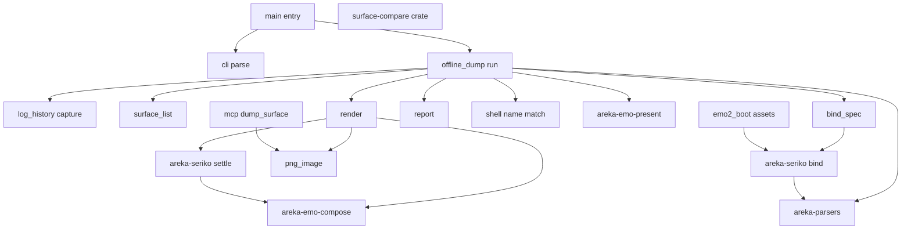
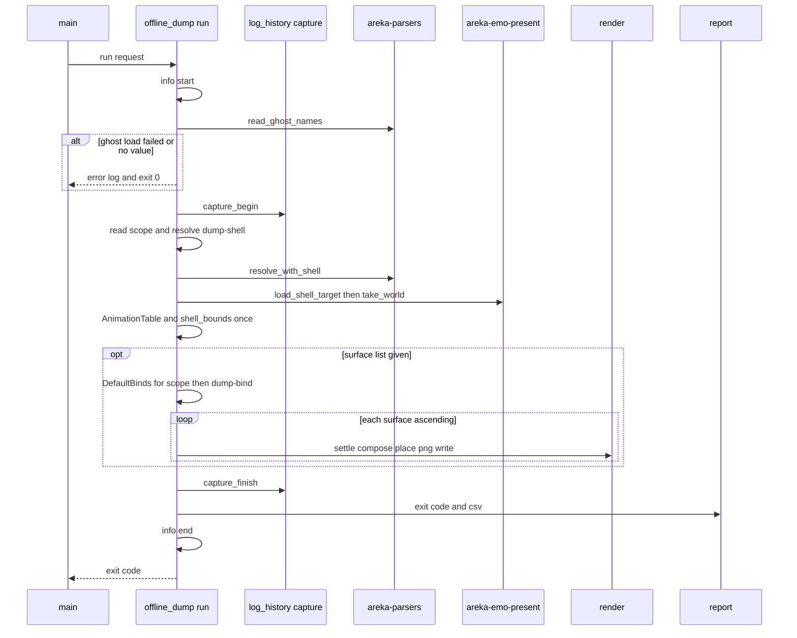

# 設計: areka-P0-offline-surface-dump

## Overview

**Purpose**: areka に SSP と同じ書き方のオフラインの書き出し（`--offline-dump` と `--dump-*`）を足す。窓・GPU・SHIORI・MCP の待受・areka の記憶のどれにも触れずに、シェルの面を α 付きの PNG に書き出し、書き出しのあいだの warn と error を SSP と同じ形の CSV と終了コード（0・1・2）で返して、すぐ終わる。

**Users**: シェルの作者・試験を書く開発者・AI のエージェントが、窓を出さずに 1 行の起動でシェルの絵と読み込みの誤りを確かめる。下流の `pasta-in-windows-verification` は、SSP の `--offline-dump` の絵と areka の絵を、新しい比べる道具（`surface-compare`）で画素どうし比べる。

**Impact**: `main.rs` に「オフラインなら走らせて、その終了コードで終える」の分岐を `--help` の直後に足す。シェルの読み込み・合成・SERIKO の進め方は今の部品をそのまま呼ぶ。合わせて、画面の初めの着せ替えと `\![bind]` の名前の表をスコープごと（`sakura.*`・`kero.*`・`char*.*`）に直し、画面と書き出しが同じ 1 つの決め方を使うようにする（要件 14）。

### Goals

- `areka.exe --offline-dump <ゴーストのフォルダ> --dump-surface-list ... --dump-output-dir ...` が、窓も GPU も SHIORI も MCP も使わずに PNG を書いて終わる。
- 書き出した絵の画素は、画面に出すために同じ合成（`Composer`）で組んだ絵を、シェル全体で 1 つの下地に置いたものと同じ（出す段の拡大・透明度を除く）。時点は「最も長い runonce の長さ T まで、画面と同じ道で進めた状態」。
- CSV（BOM 付き UTF-8・CRLF・`"時刻","ゴースト名","レベル","内容"`）と終了コード（記録なし 0・Warning 1・Error 2）が SSP と同じ形で返る。
- 画面と書き出しの既定の着せ替えと着せ替えの名前の表を、スコープごとの 1 つの決め方から作る。
- SSP と areka の書き出したフォルダを画素で比べる道具がある。

### Non-Goals

- `--dump-surface-option`（`offline-dump-overlays`）・`--dump-animation`（v0.2.0 の dola の作り直しの後）。受けて warn を 1 件残して無いものとして続ける。
- `--offline-tool`・`--target-dir`・`--output`・`--password`（今までどおり受けて記録だけ）。
- 合成そのものの直し: 負の座標の element を areka の合成が切り捨てる件（`extent-element-offset`）、1 枚目の待ちが 0 の APNG を画面が 2 枚目から出す件（要件の討議 1 で起票）。
- surfaces.txt の記録に定義元の行を付けること（`config-parse-diagnostics`）。
- `*.bindgroup*.addid`（areka のどこにも無い・画面でも効かない）。

## Boundary Commitments

### This Spec Owns

- 起動オプション `--offline-dump`・`--dump-shell`・`--dump-scope`・`--dump-surface-list`・`--dump-output-dir`・`--dump-output-prefix`・`--dump-error-log`・`--dump-bind` の欄（生の文字列）と、それに伴う起動オプションの記録の種類（効かせなかった・まだ扱わない・`--offline-dump` なしでは効かない）。
- オフラインの書き出しの走り（新モジュール `crates/areka/src/offline_dump/`）: ゴーストとシェルの決め方・面の指定の読みと展開・`--dump-bind` の読みと当て方・下地への置き方・PNG のファイルの書き出し・CSV・終了コード・始めと終わりの info。
- 書き出しのあいだの warn と error を写し取る窓（`log_history.rs` に足す写しの層）。
- PNG にする関数の共有の置き場（`crates/areka/src/png_image.rs`）。MCP の `dump_surface`／`dump_balloon` は同じ関数に base64 を重ねるだけにする。
- areka-seriko の「面を 1 つ、画面と同じ道で時点 T まで進めた `PatternState` を返す」同じスレッドの公開関数（`settle.rs`）。
- areka-emo-compose の「シェル全体の外形」を返す読むだけの公開関数（`plan_bounds.rs`）。
- areka-emo-present の `ShellTarget` が、読み込みのときに組んだ面の表を 1 度だけ渡す口（`take_world`）。
- スコープごとの既定の着せ替えと名前の表の決め方（要件 14）: areka-parsers の `BindGroupDefaults` の `char*` の読み・areka-seriko の `DefaultBinds`・`BindResolver::from_groups`・`apply_named_bind`・`BindNamespace::Char`、画面の結線（`emo2_boot`）の型の付け替え。
- 比べる道具の新クレート `crates/surface-compare/`。
- `dist/README.txt` の起動オプションの節。

### Out of Boundary

- シェルの読み方・合成・SERIKO の進め方そのもの（呼ぶだけ。直さない）。画面に出す段（アトラス・GPU・拡大・透明度）。
- 合成が負の座標を切り捨てること・動く絵の 1 枚目の待ちが 0 のときのコマの選び方（画面の側の扱い）。
- MCP の `dump_surface` の答え（PNG の中身）は変えない（要件 14 で画面のスコープ 1 以上の着せ替えが正典どおりになる分を除く）。
- SSP を起こすこと・SSP の設定やフォルダに触れること（比べる元の絵は人か AI のエージェントが別に作る）。
- areka の記憶・置き場の並び・起動中の印・利用者ごとの写し（オフラインの走りはこれらの部品を呼ばない）。

### Allowed Dependencies

- `offline_dump` が使ってよいもの: `cli`（`OfflineDumpRequest` の型だけ）・`log_history`（写しの窓）・`png_image`・`emo2_boot::shell_balloon_resolve`（純粋な名前の突き合わせだけ）・`areka-parsers`・`areka-emo-present`（`load_shell_target`・`ShellTarget`）・`areka-emo-atlas`（`WicDecoderArm`）・`areka-emo-compose`（`Composer`・`shell_bounds`・`BindSet`）・`areka-seriko`（`settle_surface`・`settle_time`・`AnimationTable`・`DefaultBinds`・`BindResolver`・`ScopeStates`・`apply_named_bind`）・`areka-sakura`（`ActorKey` の型だけ。`ScopeStates::current_binds`・`apply_named_bind` が要る）・`windows`（COM の初期化と現地時刻）・`std`。`emo2_boot::shell_balloon_resolve::shell_candidates` は中で `areka-ghost` の catalog を読むだけで使う（`offline_dump` が `areka-ghost` を直に使うのではない）。
- `offline_dump` が使ってはならないもの: `emo2_boot` のほかの部品（結線・`assets.rs`・`spine`）・`boot_resolve`・`boot_config`・`ghost_session`・`session_end`・`write_failure`・`mcp`・`install`・`update`・`areka-user-data`・`wintf`・`areka-kanade`・`areka-ghost`。これが要件 9（書かない）の構造の上の担保である。
- 外の依存は足さない。`surface-compare` の `image`（0.25.10・`png` の機能だけ）と、`areka` のテスト用の `image` は、ワークスペースに既に在る同じ版である。
- 層の向き: `areka-parsers` → `areka-emo-compose` → `areka-emo-present`／`areka-seriko` → `areka`（`png_image`・`log_history` → `offline_dump` → `main`）。逆向きの参照は作らない。

### Revalidation Triggers

- `areka_seriko::spawn_seriko_clocked`・`SerikoReplace::Shell`・`ScopeStates::new` の既定の着せ替えの型が `BindSet` から `DefaultBinds` に変わる（シェルの結線・着せ替えの持ち越し・読み直しに関わる並走の spec は確かめ直す）。
- `areka_parsers::BindGroupDefaults` に `char*` の欄、`BindScope::Char`、`BindGroupName::line` が足される。
- 画面のスコープ 1 以上の初めの着せ替えが、`sakura.*` から `kero.*`・`char*.*` に変わる（`kero.*` を書いていないシェルの相方は何も着ない＝正典どおり）。
- `cli::StartupOptions` に欄 `offline` が足される（`cli/` と `dist/README.txt` の同じ文を触る `readonly-mode`・`startup-install-option` とは同じウェーブに置かない）。
- `mcp/dump_surface_image.rs` の PNG の関数が `png_image.rs` へ移る。
- 書き出しの絵の大きさの決まり（シェル全体の外形）を変えるときは、`surface-compare` を使う下流の試験を確かめ直す。

## Architecture

### Existing Architecture Analysis

- `main.rs`（965 行）は「記録の初期化 → `cli::read()` → `--help` なら説明書を開いて戻る → 起動の解決（記憶を読む）→ 書けるかの確かめ → MCP → `WinApp`」の順。`--help` の直後に戻れば、記憶・MCP・窓・GPU のどれにも触れない。
- シェルは `load_shell_target`（WIC＋CPU）で窓なしに読め、`Composer::compose` は純粋。ただし読み込みの中で面の表を 1 度組んで捨て（`probe`）、`build_world` でもう 1 度組むので、畳み込みの warn が 2 度出る（要件 7.5 に当たる）。
- `Composer` の出す絵は原点 (0,0) 固定・負の座標は切り捨て・大きさは面ごと（`compute_extent`・`never`／`runonce` を数えない）。シェル全体の外形を返す口は無い。
- SERIKO の進行は `handle_message`（crate の中・同期）→ `LoopRuntime::on_tick` → `frame_at`。乱数は注入できる（`LoopRng`）。random と BindRandom は 1000ms の境で `rng(k)==0` のときだけ始まり、periodic・runonce・always は乱数を使わない。本番の刻みは 16ms（`areka-ghost/src/ticker.rs`）。
- 既定の着せ替えは `default_bind_ids`（`sakura.*` だけ）→ `build_static_bindset` の 1 組を全スコープで共有。名前の表 `BindResolver` は sakura と kero だけ（`scope_namespace` は 2 以上で `None`）。
- 記録は `log_history::init` が「標準出力の層＋履歴の層」を重ねたプロセスの受け口。履歴は分まで・1 種類 1,000 件・本文 4,096 字で切るので CSV の元には使えない。`with_default` などの差し替えは見張り（`with_default_guard_test.rs`）が本番で禁じている。

### Architecture Pattern & Boundary Map



**Architecture Integration**:
- 採る形: 新しいモジュール（案 B）を骨にし、既定の着せ替えと名前の表の決め方だけを画面と共有する（案 C）。runonce の時点は areka-seriko の中に同じスレッドの公開関数を足して `handle_message` を回す（R2）。
- 境: 書き出しの走りは `offline_dump` が持つ。シェルの部品は読むだけで、足すのは読むだけの口（`take_world`・`shell_bounds`・`settle_surface`）と共有の決め方（要件 14）。
- 守る今の形: 起動オプションの読み方（`startup-options-core` 要件 1）・兄弟の `*_tests.rs`・1 ファイル 1,000 行・失敗は `error!`＋`Err`・試験の根は `target\` の下。
- steering: 依存を足さない・窓を作らない走りはメッセージボックスを出さない・ログはスコープの前置き（`[offline_dump]`）と構造の欄。

### Technology Stack

| Layer | Choice / Version | Role in Feature | Notes |
|-------|------------------|-----------------|-------|
| CLI / 入口 | Rust 2024・`std::process::exit` | 終了コード 0・1・2 を返す | `main` の型は変えない |
| 画像の読み | WIC（`WicDecoderArm`・COM は MTA） | シェルの絵を読む | 今のまま |
| 合成 | `areka-emo-compose`（CPU） | 面を組む・シェル全体の外形 | 外形の口を足す |
| 動きの進め | `areka-seriko`（注入の時計・乱数） | 時点 T の `PatternState` | 同じスレッドの公開関数を足す |
| PNG | `miniz_oxide` 0.9（既存）＋`areka_nar::crc32` | 書き出し | MCP と共有 |
| 記録 | `tracing`・`tracing-subscriber`（既存） | 写しの層 | プロセスの受け口に 3 つ目の層 |
| 比べる道具 | `image` 0.25.10（`png`・ワークスペースに既在） | SSP と areka の PNG を RGBA で読む | 新クレート `surface-compare` |

## File Structure Plan

### Directory Structure

```
crates/areka/src/
├── offline_dump/
│   ├── mod.rs                 # 入口 run()・順番・ゴーストとシェルの決め方・スコープの読み・始めと終わりの info
│   ├── offline_dump_tests.rs  # mod.rs の分岐（ゴースト／シェルの失敗・面の指定なし・スコープの読み）を検体で
│   ├── surface_list.rs        # --dump-surface-list の読みと、シェルの面の番号への展開
│   ├── surface_list_tests.rs
│   ├── bind_spec.rs           # --dump-bind の読みと、スコープの着せ替えへの当て方
│   ├── bind_spec_tests.rs
│   ├── render.rs              # 面 1 つ: 時点 T まで進める → 合成 → 下地に置く → PNG → ファイル
│   ├── render_tests.rs        # 画素が画面の合成と同じ・下地の大きさと位置・2 度で同じ・ファイル名
│   ├── report.rs              # 写した記録 → CSV の中身・終了コード・CSV のファイル
│   ├── report_tests.rs
│   └── offline_dump_test_support.rs  # 検体のシェルを target\ の下に組む部品（テスト専用）
├── png_image.rs               # 乗算済み BGRA → PNG のバイト列（色の戻し＋PNG）。MCP と書き出しの共有
├── png_image_tests.rs         # dump_surface_image_tests.rs から色の戻しと PNG の形の検査を移す
└── log_history_capture_tests.rs  # 写しの窓の振る舞い（純粋な部分）

crates/areka/tests/
└── offline_dump_exe_test.rs   # 建った areka.exe を回す: CSV・終了コード・書かないこと・ファイル名・2 度で同じ

crates/areka-seriko/src/
├── settle.rs                  # settle_time・settle_surface（同じスレッドで handle_message を回す）
└── settle_tests.rs

crates/areka-emo-compose/src/
├── plan_bounds.rs             # shell_bounds（シェル全体の外形・負の座標と never を含む）
└── plan_bounds_tests.rs

crates/areka-parsers/src/package/
├── resolve_bind.rs            # resolve.rs から移す着せ替えの読み（read_bindgroup_defaults ほか）＋行の番号つきの読み＋char* の読み（約 340 行）
└── resolve_bind_tests.rs      # resolve.rs の中の試験 2 つ（.name の転記・bindoption の分解）を移し、char* と行の番号の分岐を足す（約 700 行）

crates/surface-compare/        # 新クレート（publish = false）
├── Cargo.toml                 # image（png のみ）・dev: temp-path-kit
└── src/
    ├── lib.rs                 # compare_dirs・Verdict
    ├── lib_tests.rs           # 同じ・大きさ違い・画素違い・片方だけ
    └── main.rs                # 引数 2 つ・ASCII の行で出す
```

### Modified Files

- `crates/areka/src/cli/mod.rs` — `StartupOptions.offline: Option<OfflineDumpRequest>` と型 `OfflineDumpRequest` を足す。
- `crates/areka/src/cli/parse.rs` — 表の `offline-dump` を効く行へ、`dump-*` の 7 つを値の欄へ、`dump-surface-option`・`dump-animation` を「まだ扱わない」へ。`ParseNote` に `OfflineIgnored`・`DumpPending`・`DumpWithoutOffline` を足し、`MissingValue` を `dump-*` の値なしで使う。
- `crates/areka/src/cli/parse_offline_tests.rs`（新・`parse.rs` の兄弟）— 要件 12.1 の読みの分岐（`parse_tests.rs` は 679 行なので別のファイル）。
- `crates/areka/src/main.rs` — `mod offline_dump; mod png_image;` と、`--help` の直後の分岐 3 行（965 → 約 970 行・1,000 行の内で余りは 30 行ほど）。分岐は数行に留め、中身はすべて `offline_dump/` に置く。
- `crates/areka/src/log_history.rs` — 本文を組む部分を切らない関数 `body_text` に分け、写しの層 `CaptureLayer`＋`CaptureFilter` と `capture_begin`／`capture_finish` を足し、`init` で 3 つ目の層として重ねる。窓は開けたスレッドの番号を覚え、ほかのスレッドの記録は写さない。
- `crates/areka/src/mcp/dump_surface_image.rs`・`dump_surface_image_tests.rs` — `unpremultiply`・`png` を `png_image.rs` へ移し、`png_base64` は `base64(png_image::encode_png(..))` だけにする。
- `crates/areka/src/emo2_boot/shell_balloon_resolve.rs` — 「名前の一致 → フォルダ名の一致」の段を `pub(crate) fn find_by_name_or_folder` に分け、`resolve_skin_target` は特別な名前の後にそれを呼ぶ（振る舞いは変えない）。
- `crates/areka/src/emo2_boot/assets.rs` — 既定の組と名前の表を `DefaultBinds::from_groups`・`BindResolver::from_groups` で作る。`default_bind_ids` とその検査を消す。`ShellAssets.static_binds` を `DefaultBinds` に。shell の descript.txt が読めないときの `BootWiringError::ShellRead` は今の起動の約束として残す（読めるかの確かめだけにする）。`take_world` は呼ばない（画面は今までどおり scope ごとに `build_world` で組む。絵と記録の数は変えない）。
- `crates/areka/src/emo2_boot/{mod.rs, spine.rs, shell_carry.rs, frame/attach.rs, frame/switch.rs, frame/wiring.rs}` — `static_binds` の型を `DefaultBinds` に付け替え、`BindSet` が要る所は `for_scope(scope)` で引く。
- 既定の組（`BindSet`）を `ScopeStates::new`・`spawn_seriko(_clocked)`・`SerikoReplace::Shell`・`static_binds` へ渡している試験のファイル（41 本）— `DefaultBinds::uniform(..)` で包むだけにする（期待は変えない）。
  - areka-seriko の `src/`（22 本）: `actor_bind_loop_tests.rs`・`actor_clock_tests.rs`・`actor_dispatch_tests.rs`・`actor_parts_tests.rs`・`actor_replace_tests.rs`・`actor_stage_tests.rs`・`actor_talk_tests.rs`・`actor_test_support.rs`・`actor_trigger_fixture_tests.rs`・`looper_always_tests.rs`・`looper_balloon_tests.rs`・`looper_film_count_tests.rs`・`looper_parts_emo2_tests.rs`・`looper_parts_tests.rs`・`looper_replace_tests.rs`・`looper_talk_tests.rs`・`looper_test_support.rs`・`looper_tests.rs`・`looper_trigger_tests.rs`・`state_bind_pattern_tests.rs`・`state_surface_tests.rs`・`state_test_support.rs`。
  - areka-seriko の `tests/`（5 本）: `balloon_face_e2e.rs`・`bind_e2e.rs`・`cue_sequence.rs`・`loop_integration.rs`・`regression.rs`。
  - areka の `src/emo2_boot/`（13 本）: `assets_tests.rs`・`balloon_visibility_lifecycle_e2e_tests.rs`・`balloon_visibility_phase_tests.rs`・`film_playback_e2e_tests.rs`・`frame/status_report_stage_tests.rs`・`frame/switch_tests.rs`・`frame_attach_carry_tests.rs`・`frame_test_support.rs`・`reload_skin_tests.rs`・`runtime_boot_tests.rs`・`shell_balloon_switch_tests.rs`・`shell_carry_tests.rs`・`spine_display_tests.rs`。
  - areka の `src/input_events/balloon_test_support.rs`（1 本）。
  - 数えた方: `ScopeStates::new(`・`spawn_seriko(`・`spawn_seriko_clocked(`・`SerikoReplace::Shell`・`static_binds`（`build_static_bindset` を除く）を含むファイルを grep で拾い、本番のファイル 9 本と、注記だけで触れている `emo2_boot/adapter.rs`・`crates/areka/tests/emo2_real_run.rs` を除いた。
- `crates/areka-seriko/src/bind.rs` — `BindNamespace::Char(u32)`・`scope_namespace` の 2 以上・`BindResolver` の `char*` の表と `from_groups`・`category_parts_in_order`・`DefaultBinds`（`from_groups`・`uniform`・`single`・`for_scope`）・`apply_named_bind`（375 → 約 575 行）。
- `crates/areka-seriko/src/bind_tests.rs` — `scope_namespace_maps_zero_one_only` を書き直す（2 以上が `Char(n)` になる＝期待の変更）。
- `crates/areka-seriko/src/state.rs` — `ScopeStates::new(DefaultBinds)`・`current_binds` は `DefaultBinds::for_scope` へ後退。
- `crates/areka-seriko/src/actor.rs` — `SerikoReplace::Shell.static_binds`・`spawn_seriko(_clocked)` の型を `DefaultBinds` に。`\![bind]` の名前の解決と当て方を `apply_named_bind` 経由に（記録の文は今のまま）。
- `crates/areka-seriko/src/lib.rs` — `settle_surface`・`settle_time`・`SETTLE_TICK_MS`・`DefaultBinds`・`apply_named_bind`・`NamedBindResult` を `pub use`。
- `crates/areka-parsers/src/package/model.rs` — `BindScope::Char(u32)`・`char*` の欄・`BindGroupName::line`（中の試験の組み立て `name(..)` にも `line` を足す）。
- `crates/areka-parsers/src/package/resolve.rs` — 着せ替えの読み（定数・`read_bindgroup_defaults`・`parse_bindoption_options`・`parse_bindgroup_id`・`parse_bindgroup_name`）と中の試験 2 つを `resolve_bind.rs`・`resolve_bind_tests.rs` へ移す（866 → 約 100 行）。
- `crates/areka-parsers/src/package/mod.rs` — `mod resolve_bind;`。
- `crates/areka-parsers/src/package/resolve_shell.rs` — `read_bindgroup_defaults` を `resolve_bind` から引く・`read_ghost_names` の切り出し。
- `crates/areka-emo-present/src/shell_target.rs` — 読み込みで組んだ面の表を `ShellTarget` に `Option<EmoWorld>` で持たせ、`take_world` で 1 度だけ渡す。`EmoWorld` は `Debug` を持たないので、`#[derive(Debug)]` をやめて `Debug` を手で書く（面の表は有無だけを出す）。
- `crates/areka-emo-compose/src/lib.rs` — `plan_bounds` と形の誤りを集める関数の `pub use`。
- `crates/areka-emo-compose/src/plan.rs`・`plan_extent.rs`・`blit.rs` — 面を組むたびの形の誤りの warn 6 か所を `debug!` に下げる（ShapeIssuesOnce）。形の誤りを集める純粋な関数は新しい兄弟のファイル（例 `plan_issues.rs`＋`plan_issues_tests.rs`）に置く。
- `crates/areka-emo-present/src/shell_target.rs`（上と同じファイル）— 集めた形の誤りを、読み込みの知らせと並べて 1 件ずつ warn で出す。シェルを焼く段で落ちた element の絵の行を warn から error に上げる。
- `crates/areka-parsers/src/shell/decode.rs`・`model.rs` — 知らない `animation-sort`／`collision-sort` を `SortOrder::Other(Box<str>)` として残す。
- `crates/areka-emo-compose/src/world.rs` — `SortOrder` が `Copy` でなくなったので複製して持つ。
- `crates/areka-emo-compose/src/nesting.rs`・`method.rs` — `move` を入れ子の辺にしない（`pattern_edge`・`is_move_name`）。
- `crates/areka-emo-compose/src/atlas_bind.rs` — 「atlas 未束縛 element」を warn から debug に下げる。
- `crates/areka/src/scope_bind_fixture_test_support.rs`（新・`#[cfg(test)]`）— スコープごとの既定と名前の検体を、画面の試験と書き出しの試験で共有する部品。
- `crates/areka/tests/offline_dump_exe_test.rs`（新）— `#[path]` の宣言だけ。試験の本体は `tests/offline_dump_exe_test/` の下のテーマごとのファイル（`*_test.rs`）、共有の部品は `tests/offline_dump_exe_test/common/mod.rs`。
- `crates/areka/Cargo.toml` — `[dev-dependencies]` に `image`（0.25.10・`png` のみ・ワークスペースに既在の版）。
- `dist/README.txt` — 「■ 起動オプション」の節（効く起動オプションに `--offline-dump`、`--dump-*` の働き・名前・CSV・終了コード・例・まだ扱わない 2 つ）。
- `.kiro/steering/structure.md` — 新クレート `surface-compare` の項と、`offline_dump` の許す依存。

## System Flows



- 写しを始めるのは、ゴーストの descript.txt が読めた後（要件 2.6 の失敗は CSV を作らず 0）で、起動オプションの名前の記録（`cli::read`）はそれより前に出終わっている（要件 7.3 の「入れない記録」は順番で外れる）。
- シェルが見つからない（要件 2.5）・読めない（要件 2.7）ときは、Error を 1 件残して面の段を飛ばし、写しを閉じる段へ進む。
- 面の指定が無い（要件 3.6）ときも SERIKO の表と下地は 1 度作り（表の warn を CSV に残す）、そこで写しを閉じる（`--dump-bind` も読まない）。
- 面ごとの失敗（合成・ファイル）は、その面を飛ばして次へ進む（要件 4.8・6.6）。

## Requirements Traceability

| Requirement | Summary | Components | Interfaces | Flows |
|-------------|---------|------------|------------|-------|
| 1.1 | 起こさず書き出して終わる | MainEntry, OfflineDumpRun | `offline_dump::run` | 全体 |
| 1.2, 1.3, 1.4 | 窓・SHIORI・MCP なし | MainEntry | `--help` の直後で `exit` | 全体 |
| 1.5 | GPU なし | OfflineDumpRun, SurfaceRenderer | WIC＋`Composer` | 面の段 |
| 1.6, 1.7 | 始めと終わりの info | OfflineDumpRun | `[offline_dump]` の 2 行 | 始め・終わり |
| 1.8 | `--offline-dump` に値なし | CliOfflineFields, OfflineDumpRun | `ghost_dir: None` | ゴーストの失敗 |
| 1.9 | 起動中の areka・SSP に任せない | MainEntry | 二重起動の確かめより前で戻る | 全体 |
| 2.1, 2.2 | ゴーストのフォルダ・相対パス | OfflineDumpRun | `std::path::absolute` | 始め |
| 2.3, 2.4, 2.5 | シェルの決め方 | OfflineDumpRun, SkinNameMatch | `find_by_name_or_folder` | シェルの決め |
| 2.6 | ゴーストの読み込みの失敗 | OfflineDumpRun, GhostNamesReader | `read_ghost_names` | ゴーストの失敗 |
| 2.7 | シェルの読み込みの失敗 | OfflineDumpRun | `MountError::ShellDirMissing`・`ShellLoadError` | シェルの失敗 |
| 3.1, 3.2, 3.3, 3.4, 3.5, 3.7 | 面の指定の読みと展開 | SurfaceListReader | `read_surface_list`・`SurfaceSelection::resolve` | 面の段 |
| 3.6 | 面の指定なし | OfflineDumpRun | 面の段を飛ばす | 面の指定なし |
| 3.8, 3.9, 3.10 | スコープ | OfflineDumpRun, ShellBindSetup | `read_scope`・`DefaultBinds::for_scope` | 始め |
| 4.1, 4.7, 4.9 | 時点 T・動く絵・決定論 | SettleSurface, SurfaceRenderer | `settle_time`・`settle_surface` | 面の段 |
| 4.2 | 利用者の着せ替えの記憶を使わない | ShellBindSetup, OfflineDumpRun | `DefaultBinds::from_groups` | 面の段 |
| 4.3 | シェル全体の下地 | ShellCanvasBounds, SurfaceRenderer | `shell_bounds`・`place_on_canvas` | 面の段 |
| 4.4, 4.6 | α 付き PNG・色の戻しを MCP と同じに | PngEncoder | `png_image::encode_png` | 面の段 |
| 4.5 | 画面の絵と同じ | SurfaceRenderer, ShellBindSetup | 同じ `Composer::compose` の入力 | 面の段 |
| 4.8 | 合成の失敗 | SurfaceRenderer | `RenderError::Compose` | 面の段 |
| 5.1, 5.2, 5.3, 5.4, 5.5, 5.6, 5.7, 5.8, 5.9 | `--dump-bind` | BindSpecApplier, ShellBindSetup | `read_bind_specs`・`apply_bind_specs`・`apply_named_bind` | 面の段の前 |
| 6.1, 6.2, 6.3, 6.4, 6.5, 6.6, 6.7, 6.8 | ファイル名と置き場 | SurfaceRenderer | `png_path`・`write_png` | 面の段 |
| 7.1, 7.2, 7.4, 7.6, 7.7, 7.8 | CSV の形と書き方 | DumpReport | `csv_bytes`・`write_csv` | 終わり |
| 7.3, 7.5 | 入れる記録・1 つの誤りは 1 行 | RecordCapture, ShellWorldOnce, ShapeIssuesOnce | `capture_begin`・`take_world`・形の誤りを集める関数 | 写しの間 |
| 8.1, 8.2, 8.3 | 終了コードの段 | DumpReport, RecordCapture | `exit_code` | 終わり |
| 8.4 | ゴーストの読み込みの失敗は 0 | OfflineDumpRun | 0 を返す | ゴーストの失敗 |
| 9.1, 9.2, 9.3, 9.4 | 書かない | MainEntry, OfflineDumpRun | Allowed Dependencies の禁止の一覧 | 全体 |
| 10.1, 10.3, 10.4 | ほかの起動オプション | CliOfflineFields | `OfflineIgnored`・`DumpPending`・`DumpWithoutOffline` | 読みの段 |
| 10.2 | `--help` が先 | MainEntry | `help` の判定が先 | 読みの段 |
| 11.1, 11.2, 11.3 | 説明書 | Readme | `dist/README.txt` | — |
| 12.1 | 読みのテスト | CliOfflineFields, SurfaceListReader, BindSpecApplier | `parse_offline_tests.rs` ほか | — |
| 12.2 | 絵のテスト | SurfaceRenderer, SettleSurface | `render_tests.rs`・`settle_tests.rs` | — |
| 12.3, 12.4 | CSV と終了コードのテスト | DumpReport, OfflineDumpExeTest | `report_tests.rs`・`offline_dump_exe_test.rs` | — |
| 12.5 | 書かないことのテスト | OfflineDumpExeTest | 前後の木の比べ | — |
| 12.6 | 試験の根は `target\` | 全テスト | `temp-path-kit` | — |
| 13.1, 13.2, 13.3, 13.4, 13.5 | 比べる道具 | SurfaceCompareTool | `compare_dirs`・`Verdict` | — |
| 14.1, 14.2, 14.3, 14.4 | スコープごとの既定と名前の表 | ShellBindSetup | `DefaultBinds`・`BindResolver::from_groups`・`BindNamespace::Char` | 画面と書き出し |

## Components and Interfaces

| Component | Domain/Layer | Intent | Req Coverage | Key Dependencies (P0/P1) | Contracts |
|-----------|--------------|--------|--------------|--------------------------|-----------|
| CliOfflineFields | areka `cli` | オフラインの欄を生の文字列で持ち、名前の記録を出す | 1.8, 10.1, 10.3, 10.4, 12.1 | parse 表 (P0) | State |
| MainEntry | areka `main.rs` | `--help` の直後でオフラインへ渡して終える | 1.1, 1.2, 1.3, 1.4, 1.9, 9.1, 9.2, 9.3, 10.2 | OfflineDumpRun (P0) | Service |
| OfflineDumpRun | areka `offline_dump/mod.rs` | 順番・ゴーストとシェル・スコープ・始めと終わり | 1.x, 2.x, 3.6, 3.8〜3.10, 8.4, 9.4 | 下の全部 (P0) | Service, Batch |
| SurfaceListReader | areka `offline_dump/surface_list.rs` | 面の指定の読みと展開 | 3.1〜3.5, 3.7 | なし | Service |
| BindSpecApplier | areka `offline_dump/bind_spec.rs` | `--dump-bind` の読みと当て方 | 5.1〜5.9 | ShellBindSetup (P0) | Service |
| SurfaceRenderer | areka `offline_dump/render.rs` | 面 1 つを PNG のファイルにする | 4.1, 4.3〜4.9, 6.1〜6.8 | SettleSurface, ShellCanvasBounds, PngEncoder (P0) | Service |
| DumpReport | areka `offline_dump/report.rs` | CSV と終了コード | 7.1, 7.2, 7.4〜7.8, 8.1〜8.3 | RecordCapture (P0) | Service |
| RecordCapture | areka `log_history.rs` | 写しの窓の warn・error を秒まで写す | 7.3, 7.4, 7.5, 8.3 | tracing (P0) | State |
| PngEncoder | areka `png_image.rs` | 乗算済み BGRA → PNG（MCP と共有） | 4.4, 4.6 | miniz_oxide (P0) | Service |
| SkinNameMatch | areka `emo2_boot/shell_balloon_resolve.rs` | 名前 → フォルダ名の突き合わせ | 2.4 | なし | Service |
| SettleSurface | areka-seriko `settle.rs` | 時点 T の `PatternState` を画面と同じ道で | 4.1, 4.7, 4.9 | handle_message (P0) | Service |
| ShellCanvasBounds | areka-emo-compose `plan_bounds.rs` | シェル全体の外形 | 4.3 | EmoWorld, AtlasTable (P0) | Service |
| ShellWorldOnce | areka-emo-present `shell_target.rs` | 読み込みで組んだ面の表を 1 度だけ渡す | 7.5 | なし | Service |
| GhostNamesReader | areka-parsers `resolve_shell.rs` | ゴーストの descript.txt だけを読む | 2.6, 7.2 | なし | Service |
| ShellBindSetup | areka-parsers・areka-seriko・areka `emo2_boot` | スコープごとの既定と名前の表を 1 つの決め方で | 3.9, 4.2, 4.5, 5.9, 14.1〜14.4 | BindGroupDefaults (P0) | Service, State |
| SurfaceCompareTool | 新クレート `surface-compare` | 2 つのフォルダの PNG を画素で比べる | 13.1〜13.5 | image (P0) | Service, Batch |
| Readme | `dist/README.txt` | 使い方の説明 | 11.1〜11.3 | — | — |
| OfflineDumpExeTest | areka `tests/offline_dump_exe_test.rs` | 建った exe での決定論の試験 | 12.3, 12.4, 12.5, 12.6 | areka.exe (P0) | — |

### areka: 入口と起動オプション

#### CliOfflineFields

| Field | Detail |
|-------|--------|
| Intent | `--offline-dump` と `--dump-*` を生の文字列の欄に入れ、名前の段の記録を出す |
| Requirements | 1.8, 10.1, 10.3, 10.4, 12.1 |

**Responsibilities & Constraints**
- 値は解釈しない（解釈と Warning は写しの中の `offline_dump` が行う＝要件 7.3）。読み方の決まり（`--名前 値`・`--名前=値`・大文字小文字・重なりは後勝ちと `Repeated`・空の値は値なし）は `startup-options-core` のまま。
- 表: `offline-dump`（`Arity::One`・新しい `Kind::OfflineDump`）、`dump-shell`・`dump-scope`・`dump-surface-list`・`dump-output-dir`・`dump-output-prefix`・`dump-error-log`・`dump-bind`（`Arity::Optional`・`Kind::DumpValue(DumpField)`）、`dump-surface-option`・`dump-animation`（`Arity::Optional`・`Kind::DumpPending`）。ほかの `dump-` で始まる名前は今までどおり `Unsupported`。
- 記録の種類（どれも warn・`[cli]`・CSV には入らない）:
  - `OfflineIgnored { name }`: `--offline-dump` があるときの `--ghost`・`--random`・`--option`・`--sstp-listen`・位置の引数（`name` は `positional`）を 1 件ずつ（10.1）。`--option` の語ごとの今の記録はそのまま出る。
  - `DumpPending { name }`: `--offline-dump` があるときの `--dump-surface-option`・`--dump-animation`（10.3）。
  - `DumpWithoutOffline { name }`: `--offline-dump` が無いときの `--dump-*`（`DumpPending` の 2 つも含む）を 1 件ずつ（10.4）。普段の起動は続く。
  - `MissingValue { name }`: `--offline-dump` があるときに値の無い `--dump-*` の 7 つ（今まで作られなかった口を使う）。`--offline-dump` の値なしは記録せず、`run` が error を出す（1.8）。
- `--offline-dump` の有無は列を読み終えてから決まるので、上の 3 種類は読み終えた後にまとめて作る。

**Contracts**: State [x]

##### State Management

```rust
// cli/mod.rs
pub(crate) struct StartupOptions {
    pub boot: BootRequest,
    pub listen: ListenPlan,
    pub modules: ModulePolicy,
    pub help: bool,
    /// `--offline-dump` が（値の有無に関わらず）渡されたら Some。
    pub offline: Option<OfflineDumpRequest>,
}

/// 生の値（空の値は None）。解釈は offline_dump が写しの中で行う。
#[derive(Debug, Default, Clone, PartialEq, Eq)]
pub(crate) struct OfflineDumpRequest {
    pub ghost_dir: Option<String>,
    pub shell: Option<String>,
    pub scope: Option<String>,
    pub surface_list: Option<String>,
    pub output_dir: Option<String>,
    pub output_prefix: Option<String>,
    pub error_log: Option<String>,
    pub bind: Option<String>,
}
```

**Implementation Notes**
- Integration: `parse.rs` は 459 行。足すのは表の 10 行・`Kind` の 3 つ・読み終えた後の記録の組み立て・`ParseNote` の 3 つとその記録で、600 行ほどに収まる（ファイルは分けない）。
- Validation: 値が `-` で始まると名前として読まれる（`--dump-scope -1`）。今の決まりのままで、テストの分岐に入れる。
- Risks: なし。

#### MainEntry

| Field | Detail |
|-------|--------|
| Intent | `--help` の直後で、オフラインなら走らせてその終了コードで終える |
| Requirements | 1.1, 1.2, 1.3, 1.4, 1.9, 9.1, 9.2, 9.3, 10.2 |

**Contracts**: Service [x]

##### Service Interface

```rust
// main.rs（cli::read と help の判定の直後）
if let Some(req) = &opts.offline {
    std::process::exit(offline_dump::run(req));
}
```
- Preconditions: `log_history::init()` と `cli::read()` の後。`thread_roles::install`・`perf_thread_report::start`・`resolve_boot`・`write_failure`・MCP・`WinApp` より前。
- Postconditions: プロセスは `run` の返す 0・1・2 で終わる。`std::process::exit` は標準出力を流してから終わる。
- Invariants: `help` が真ならオフラインは走らない（10.2）。

**Implementation Notes**
- Integration: `main.rs` は 965 行。足すのは `mod` 2 行と分岐 3 行で約 970 行（1,000 行の内・余りは 30 行ほど）。分岐は上の数行に留め、判断や記録はすべて `offline_dump/` に置く（`main.rs` にこれ以上足すなら先に分ける）。
- Risks: リリースの exe は GUI のサブシステムなので、コマンドプロンプトは終わりを待たない（説明書の例で `start "" /wait` を使う）。

### areka: オフラインの書き出し

#### OfflineDumpRun

| Field | Detail |
|-------|--------|
| Intent | オフラインの書き出しの順番を持つ唯一の入口 |
| Requirements | 1.1, 1.5, 1.6, 1.7, 1.8, 2.1, 2.2, 2.3, 2.4, 2.5, 2.6, 2.7, 3.6, 3.8, 3.9, 3.10, 4.2, 8.4, 9.4 |

**Responsibilities & Constraints**
- 順番（System Flows の図）: 始めの info → ゴーストの名前を読む（失敗は error・0）→ `capture_begin` → スコープの読み → `--dump-shell` の解決 → `resolve_with_shell` → COM の初期化（MTA）→ `load_shell_target` → `take_world` → `AnimationTable::from_world` と `shell_bounds`（下地）を 1 度だけ（面の指定が無くても作る）→ 面の指定が無ければここで閉じる → 既定の組と `--dump-bind` → 面の指定の展開 → 面ごとに `render` → `capture_finish` → 終了コード → CSV → 終わりの info。
- パスは `std::path::absolute` で起動したときの今のフォルダから絶対にする（2.2）。末尾の `\` は `Path` がそのまま扱う（2.1）。
- `--dump-shell`: 値があれば `shell_candidates(ghost_root)` に `find_by_name_or_folder` を当て、見つかったフォルダ名を `resolve_with_shell` へ渡す。見つからなければ Error を 1 件（`event = "offline_dump_shell_missing"`）残して面の段を飛ばす（2.4・2.5）。値が無ければ `None`（既定のシェル・記憶は読まない＝2.3）。
- `resolve_with_shell` の `ShellDirMissing`・`load_shell_target` の `Err`・COM の初期化の失敗は Error（`load_shell_target` の `Err` は関数自身が `error!` を出しているので、run は重ねて出さない＝1 つの誤りは 1 行）。`ShellDirMissing` と COM の失敗は run が `error!` を出す（2.7）。
- スコープ: `None` は 0。`u32` として読めなければ 0 と Warning（`offline_dump_scope_unreadable`・3.10）。
- 着せ替え: `DefaultBinds::from_groups(&model.bindgroups)` と `BindResolver::from_groups(&model.bindgroups)` を作り（画面と同じ決め方＝14.3）、`ScopeStates::new(defaults)` に `apply_bind_specs` を当てて、`current_binds(scope)` をその走りの着せ替えにする（4.2・3.9・5.8）。
- 面の指定が無ければ、SERIKO の表と下地を作った後で面の段を飛ばす（3.6）。
- ゴーストの名前: `GhostNames.name`、無ければ空（7.2）。

**Contracts**: Service [x] / Batch [x]

##### Service Interface

```rust
/// オフラインの書き出しを 1 回走らせ、終了コード（0・1・2）を返す。
pub(crate) fn run(req: &OfflineDumpRequest) -> i32;

/// 面の段の結果（終わりの info に使う）。
struct DumpTally { written: usize, failed: usize }
```
- Preconditions: プロセスの受け口が `log_history::init` で据わっている（写しの層がある）。
- Postconditions: 書くファイルは PNG と CSV だけ。ゴーストの読み込みの失敗（2.6・1.8）は CSV を作らず 0。
- Invariants: `capture_begin` と `capture_finish` は必ず対になる（途中の失敗も `capture_finish` へ流れる）。

##### Batch / Job Contract
- Trigger: `main` から 1 回。
- Input / validation: `OfflineDumpRequest`（生の文字列）。解釈の失敗はすべて Warning を残して続ける。
- Output / destination: `<出力先>\<頭の文字列><番号>.png`・`--dump-error-log` の CSV・終了コード。
- Idempotency & recovery: 同じ入力から同じ PNG（4.9）。同じ名前のファイルは置き換える（6.5）。

**Implementation Notes**
- Integration: COM は `CoInitializeEx(None, COINIT_MULTITHREADED)` を run の中で 1 度。プロセスはすぐ終わるので戻しは呼ばない。
- Validation: 始めの info（1.6）は欄 `ghost`・`shell`・`scope`・`surfaces`・`output_dir`・`error_log` を生の値で。終わりの info（1.7）は `written`・`failed`・`worst`（`none`／`Warning`／`Error`）・`exit_code`。
- Risks: 写しの窓はプロセス全体なので、書き出しのあいだに別のスレッドを起こさない（今の部品は呼んだスレッドの上だけで走る）。将来ほかの部品がスレッドを使っても CSV が汚れないよう、窓は開けたスレッドの記録だけを写す（RecordCapture）。

#### SurfaceListReader

| Field | Detail |
|-------|--------|
| Intent | `--dump-surface-list` を読み、シェルに在る面の番号の昇順の列に展開する |
| Requirements | 3.1, 3.2, 3.3, 3.4, 3.5, 3.7 |

**Responsibilities & Constraints**
- カンマで区切った各要素の前後の空白を除き、頭の `surface`（大文字小文字を区別しない）を 1 つ外してから、`N`・`a-b`・`!N`・`!a-b` として読む（surfaces.txt の面の番号の拡張の書き方と同じ意味＝包含を集め、除外を引く）。
- 読めない要素（空・数でない・`a > b`）はその要素だけ無視して Warning（`offline_dump_surface_list_unreadable`・3.5）。
- 単独の番号で、シェルに無い面は Warning（`offline_dump_surface_missing`・3.3）。範囲の中の欠番は記録しない（3.4）。重ねは 1 度（3.7）。順は番号の昇順。

**Contracts**: Service [x]

##### Service Interface

```rust
pub(crate) enum SurfacePick { Single(u32), Range(u32, u32), Exclude(u32), ExcludeRange(u32, u32) }
pub(crate) struct SurfaceSelection { picks: Vec<SurfacePick> }

/// 読めない要素は warn! を出して飛ばす。
pub(crate) fn read_surface_list(raw: &str) -> SurfaceSelection;

impl SurfaceSelection {
    /// シェルに在る番号へ展開する（昇順・重ねなし）。単独で指した無い面は warn!。
    pub(crate) fn resolve(&self, existing: &BTreeSet<u32>) -> Vec<u32>;
}
```
- Invariants: 返す番号はすべて `existing` に在る。

**Implementation Notes**
- Integration: `existing` は `EmoWorld::surface_ids()`。`areka-parsers` の `AppendTarget` は `#[non_exhaustive]` で使い回すと照合が回りくどくなるので、小さな型を持つ。
- Risks: なし。

#### BindSpecApplier

| Field | Detail |
|-------|--------|
| Intent | `--dump-bind` を読み、スコープの既定の着せ替えへ書かれた順に重ねる |
| Requirements | 5.1, 5.2, 5.3, 5.4, 5.5, 5.6, 5.7, 5.8, 5.9 |

**Responsibilities & Constraints**
- `;` で区切る。中身が空の区切り（末尾の `;` など）は指示でないので飛ばす。各指定を `,` で区切り 2 つか 3 つの欄として読む（`カテゴリ,パーツ[,ON/OFF]`）。欄の数がほかなら読めない Warning（5.7）。
- 名前の前後の空白は取らない（5.5）。パーツ名が空か `__ALL__` はカテゴリ全部（5.2）。ON/OFF は `1`・`true`・省略で ON（5.3）、`0`・`false` で OFF（5.4）、ほかは読めない Warning（5.7）。
- 当て方は `areka_seriko::apply_named_bind`（画面の `\![bind]` と同じ決め方）を 1 パーツずつ呼ぶ。カテゴリ全部は `BindResolver::category_parts_in_order` が返すパーツ名（シェルの descript.txt に書かれた順）で 1 つずつ呼ぶ（排他なら最後だけ残る＝5.2）。カテゴリが無ければ空の列なので、そのときは無いカテゴリの Warning を 1 件残す。
- 結果ごと: 無いカテゴリかパーツは Warning（`offline_dump_bind_missing`・5.6）。`mustselect` の OFF は外さず info（`offline_dump_bind_mustselect_kept`・CSV に入らない＝5.4）。スコープは `--dump-scope` の 1 つだけ（5.8）。名前の表はそのスコープのもの（5.9）。

**Contracts**: Service [x]

##### Service Interface

```rust
pub(crate) enum PartPick { One(String), All }
pub(crate) struct BindSpec { category: String, part: PartPick, on: bool }

/// 読めない指定は warn! を出して飛ばす。
pub(crate) fn read_bind_specs(raw: &str) -> Vec<BindSpec>;

/// 書かれた順に当てる。無い名前は warn!、mustselect の OFF は info!。
pub(crate) fn apply_bind_specs(
    specs: &[BindSpec],
    scope: u32,
    resolver: &BindResolver,
    states: &mut ScopeStates,
);
```

**Implementation Notes**
- Validation: SSP 2.9.23 の測り（research.md §10.4）の 13 通りをそのままテストの表にする。
- Risks: なし。

#### SurfaceRenderer

| Field | Detail |
|-------|--------|
| Intent | 面 1 つを、時点 T まで進め、合成し、シェル全体の下地に置き、PNG のファイルにする |
| Requirements | 4.1, 4.3, 4.4, 4.5, 4.6, 4.7, 4.8, 4.9, 6.1, 6.2, 6.3, 6.4, 6.5, 6.6, 6.7, 6.8 |

**Responsibilities & Constraints**
- `pattern = settle_surface(table, scope, &binds, id)` → `Composer::compose(world, atlas, id, &binds, &pattern)`（画面の `apply_show` と同じ入力の形＝4.5）→ `place_on_canvas` → `png_image::encode_png` → ファイル。
- 下地: 大きさ `(right - left) × (bottom - top)`、組んだ絵の原点を `(-left, -top)` に置く。ほかは `(0,0,0,0)`（4.3・4.4）。組んだ絵が下地からはみ出すことは無い（外形は合成の外形を含む）。はみ出したら作りの誤りとして Error（`offline_dump_canvas_overflow`）でその面を飛ばす。
- 合成の失敗は合成自身が `error!` を出しているので、ここは info（`offline_dump_surface_skipped`）だけ残して次へ（4.8・1 つの誤りは 1 行）。要件 4.8 の「面の組み立てに失敗した」は `Composer::compose` が `Err` を返すことと読む。element や面の画像が読めないことは読み込みの段で Error として残り、合成はその絵を除いて組めるので、その面は書き出す（画面に出す絵と同じ＝4.5。SSP 2.9.23 も Error を残して書き出す＝research.md §10.5）。
- ファイル名: `<頭の文字列><番号>.png`。頭の文字列は既定 `surface`、`--dump-output-prefix` で置き換え（6.1・6.2）。スコープは入れない（6.7）。出力先は既定で起動したときの今のフォルダ（6.3）。書く直前に出力先を `create_dir_all`（6.4）。頭の文字列の `\`・`/` は出力先からの相対の道として `join` し、その下のフォルダは作らない（6.8）。書けなければ Error（`offline_dump_png_write_failed`・6.6）で次へ。同じ名前は置き換える（6.5）。

**Contracts**: Service [x]

##### Service Interface

```rust
pub(crate) struct Canvas { left: i32, top: i32, width: u32, height: u32 } // ShellBounds から

pub(crate) enum RenderError { Compose, CanvasOverflow, Write(std::io::Error) }

/// 面 1 つを下地に置いた乗算済み BGRA（テストが画素を見る口）。
pub(crate) fn render_surface(
    composer: &mut Composer, world: &EmoWorld, atlas: &AtlasTable, table: &AnimationTable,
    binds: &BindSet, scope: u32, surface_id: u32, canvas: &Canvas,
) -> Result<Vec<u8>, RenderError>;

pub(crate) fn png_path(output_dir: &Path, prefix: &str, surface_id: u32) -> PathBuf;

/// 描いて書く（失敗の記録はここで 1 行）。
pub(crate) fn write_surface(/* render_surface の引数 */, output_dir: &Path, prefix: &str)
    -> Result<PathBuf, RenderError>;
```
- Postconditions: 同じ入力から同じバイト列（4.9。時計も乱数も外から持ち込まない）。

**Implementation Notes**
- Integration: `Composer` は 1 回の走りで 1 つを使い回す。`Composer::compose` の `Err` が記録なしで返る道を見つけたら、記録は合成の側（根）に足す（書き出しの側で `error!` を重ねない）。
- Validation: 合成が失敗する面で、CSV の Error がちょうど 1 行であることを exe の試験で確かめる。
- Risks: 合成が負の座標の element を切り捨てるので、そういう面では SSP の絵と左上の切れ端が違う（Out of Boundary・比べる試験は承知で使う）。

#### DumpReport

| Field | Detail |
|-------|--------|
| Intent | 写した記録から終了コードと CSV を作る |
| Requirements | 7.1, 7.2, 7.4, 7.5, 7.6, 7.7, 7.8, 8.1, 8.2, 8.3 |

**Responsibilities & Constraints**
- レベル: warn → `Warning`、error → `Error`。info は写しに入らない（7.4・8.3）。
- 終了コード: 写しが空 0・`Warning` だけ 1・`Error` があれば 2。CSV の有無に関わらない（8.1・8.2）。
- CSV: 先頭 `EF BB BF`・各行 `"HH:MM:SS","<ゴースト名>","<レベル>","<内容>"`＋CRLF・列の中の `"` は `""`。件数の上限は置かない（7.5・10,000 件を超えても間引かない）。
- 写しが空なら、ファイルを作らず、在るファイルに触れない（7.6）。`--dump-error-log` が無ければ書かない（7.8）。
- 書けなければ `error!`（写しは閉じた後なので終了コードは変わらない＝7.7）。

**Contracts**: Service [x]

##### Service Interface

```rust
pub(crate) fn exit_code(records: &[CapturedRecord]) -> i32;
pub(crate) fn worst(records: &[CapturedRecord]) -> Option<&'static str>; // "Warning" | "Error"
pub(crate) fn csv_bytes(ghost_name: &str, records: &[CapturedRecord]) -> Vec<u8>;
/// records が空なら何もしない。書けなければ error! を出して Err。
pub(crate) fn write_csv(path: &Path, ghost_name: &str, records: &[CapturedRecord]) -> std::io::Result<()>;
```

#### RecordCapture

| Field | Detail |
|-------|--------|
| Intent | 窓を開けたあいだの warn と error を、秒までの時刻と切らない本文で写す |
| Requirements | 7.3, 7.4, 7.5, 8.3 |

**Responsibilities & Constraints**
- `log_history::init` が重ねる 3 つ目の層。`CaptureFilter::callsite_enabled` は「出来事で warn 以上」だけ `always`、ほかは `never`。出来事でない問い合わせは `enabled` で通す（履歴の層と同じ理由＝`passes` の注記）。warn 以上は履歴の層が既に `always` なので、受け口の関心の判定は変わらない。
- 窓が閉じているあいだは何もしない（普段の起動の費用はロック 1 つの確かめだけ）。窓はプロセス全体で 1 つ。
- `capture_begin` は呼んだスレッドの番号（`std::thread::current().id()`）を窓に覚え、ほかのスレッドが出した記録は写さない。今の部品は書き出しのあいだにスレッドを起こさないが、将来 WIC やほかの部品がスレッドを使っても CSV と終了コードが汚れないための守りである。
- 本文は履歴と同じ組み方（`message` の後に ` 名前=値`）を切らずに使う（`body_text` を `draft` と共有し、`draft` だけが 4,096 字で切る）。時刻は `GetLocalTime` の時・分・秒。
- 本番で受け口を差し替えない（`with_default` などは使わない＝見張りの外に出ない）。

**Contracts**: State [x]

##### State Management

```rust
#[derive(Debug, Clone, Copy, PartialEq, Eq)]
pub(crate) struct Hms { pub hour: u8, pub minute: u8, pub second: u8 }

#[derive(Debug, Clone, PartialEq, Eq)]
pub(crate) struct CapturedRecord { pub at: Hms, pub level: tracing::Level, pub body: String }

/// 窓を開ける（開いていれば中身を空にして開け直す）。呼んだスレッドの番号を覚える。
pub(crate) fn capture_begin();
/// 窓を閉じて、写した記録を残した順に返す（開いていなければ空）。
pub(crate) fn capture_finish() -> Vec<CapturedRecord>;
```
- Persistence & consistency: プロセスに 1 つの `Mutex<Option<(ThreadId, Vec<CapturedRecord>)>>`（窓を開けたスレッドの番号と写した記録）。排他の中で tracing のマクロを呼ばない（履歴の置き場と同じ約束）。
- Concurrency strategy: 出したスレッドの上で同期に積む。出したスレッドの番号が窓の番号と違えば積まない。

**Implementation Notes**
- Integration: `log_history.rs` は 424 行。足すのは 90 行ほど（約 515 行）。層の `on_event` は本文を組んで積む口（窓とスレッドの番号を確かめて積む関数）を呼ぶだけにし、その口と純粋な部分（`body_text`・レベルの絞り）のテストは `log_history_capture_tests.rs`。窓はプロセスに 1 つなので、窓を触るテストはそのファイルの中の排他 1 つで順に回す。層を通った写しは exe の試験で確かめる（単体テストはプロセスの受け口を据えない）。
- Risks: 書き出しの間の 1 つの誤りが 2 行にならないことは、面の表を 1 度だけ組むこと（ShellWorldOnce）・`AnimationTable` を 1 度だけ作ること・形の誤りを読み込みのときに 1 度だけ出し、組むたびの知らせを debug に下げること（ShapeIssuesOnce）の 3 つで守る。写しの層では重なりを消さない（まとめる処理を置かない）。exe の試験で、入れ子を持つ検体でも同じ誤りの行が 1 行だけであることを確かめる。

#### PngEncoder

| Field | Detail |
|-------|--------|
| Intent | 乗算済み BGRA を α 付き PNG のバイト列にする唯一の場所 |
| Requirements | 4.4, 4.6 |

**Contracts**: Service [x]

##### Service Interface

```rust
// png_image.rs
/// 色の戻し（α 0 は (0,0,0,0)・min(255, round(色×255÷α))）＋PNG（RGBA 8 ビット・IDAT 1 つ）。
pub(crate) fn encode_png(premultiplied_bgra: &[u8], width: u32, height: u32) -> Vec<u8>;

// mcp/dump_surface_image.rs（振る舞いは今と同じ）
pub(in crate::mcp) fn png_base64(premultiplied_bgra: &[u8], width: u32, height: u32) -> String {
    base64(&png_image::encode_png(premultiplied_bgra, width, height))
}
```

**Implementation Notes**
- Integration: 今の `unpremultiply`・`png` を動かすだけ（中身は変えない）。今のテストの色の戻しと PNG の形の検査は `png_image_tests.rs` へ、base64 の検査は残す。

#### SkinNameMatch

| Field | Detail |
|-------|--------|
| Intent | `--dump-shell` を、名前でシェルを切り替えるときと同じ順（名前 → フォルダ名）で探す |
| Requirements | 2.4 |

**Contracts**: Service [x]

```rust
// emo2_boot/shell_balloon_resolve.rs
/// 特別な名前（random・lastinstalled）を解かない「名前の一致 → フォルダ名の一致」。
pub(crate) fn find_by_name_or_folder<'a>(candidates: &'a [SkinCandidate], value: &str)
    -> Option<&'a SkinCandidate>;
```
- `resolve_skin_target` の `SkinSpec::Name` は、特別な名前の判定の後にこの関数を呼ぶ形に組み替える（振る舞いは今と同じ・今のテストがそのまま通る）。

### 下の層のクレート

#### SettleSurface（areka-seriko）

| Field | Detail |
|-------|--------|
| Intent | 面 1 つを見せ始めてから時点 T まで、画面と同じ道で進めた `PatternState` を返す |
| Requirements | 4.1, 4.7, 4.9 |

**Responsibilities & Constraints**
- T（`settle_time`）: その面の surface*ブレスに書かれた animation のうち、`runonce` のものの pattern の待ちの合計の最大。無ければ 0（部品の runonce は T を決めないが、T までは同じ刻みで進む）。
- 進め方: crate の中で `ScopeStates::new(DefaultBinds::single(scope, binds))`・`LoopRuntime::new(SerikoLoopConfig { shell_table: table.clone(), balloon_tables: 空, rng: 抽選が当たらない列 })`・注入の時計を作り、`handle_message` に「時刻 0 の `Tick`」「`\s[N]` の合図（`Emote`）」「16ms ごとの `Tick`（T 未満）」「時刻 T の `Tick`」を順に渡す。最後に `states.current_pattern(scope, Slot::Shell)` を返す。
- 乱数は常に「当たらない」（`|_| 1`）ので random・BindRandom は始まらない。runonce・always・periodic・部品・動く絵の子は乱数を使わず、時計で進む（SSP 2.9.23 の測りと同じ）。
- 待ちは「出す前に待つ」（`frame_at`: コマ k は待ち 0〜k の合計の時刻に出る）。SSP の測り（research.md §10.1）と同じ数え方。
- 刻みを 16ms にするのは、periodic が 1 回の刻みで最後の周だけを鳴らすため、本番の刻み（`areka-ghost/src/ticker.rs`）と同じ間隔で進めないと絵が変わりうるからである。

**Contracts**: Service [x]

##### Service Interface

```rust
// areka-seriko/src/settle.rs
/// 本番の刻みと同じ間隔（ms）。
pub const SETTLE_TICK_MS: u64 = 16;

/// その面の runonce の待ちの合計の最大（無ければ 0）。
pub fn settle_time(table: &AnimationTable, surface_id: u32) -> u64;

/// 面を時刻 0 に見せ始め、settle_time まで画面と同じ道で進めた状態を返す（同じスレッド・決定論）。
pub fn settle_surface(table: &AnimationTable, scope: u32, binds: &BindSet, surface_id: u32) -> PatternState;
```
- Preconditions: `table` はその走りで 1 度だけ作ったもの（作り直すと表の warn が重なる）。
- Postconditions: 同じ入力から同じ `PatternState`（4.9）。スレッドを起こさない。
- Invariants: `handle_message`・`LoopRuntime` は crate の外へ出さない。

**Implementation Notes**
- Integration: `actor_test_support.rs` の `ClockRig` と同じ順で送る。`SurfaceResolver::new(BTreeMap::new())`（番号の合図は別名なしで解ける）と `BindResolver::empty()` を使う。出力は捨てる（`MockSurfaceOutput` か中の空の出力）。
- Validation: 測りの表（runonce が最後のコマを残す・`-1` で土台に戻る・always だけは T=0 で何も出ない・random は出ない（`random,1` でも出ない）・periodic は出る・runonce＋always は T の時点の always のコマ・2 本の runonce は長い方・動く絵の子は T の時点のコマで繰り返す）を `settle_tests.rs` に写す。
- 刻みの位相: 書き出しは `\s[N]` の合図の直後の刻みを位相 0（合図と同じ時刻 0 から 16ms ごと）に固定する。画面の刻みは絶対の格子（`BoundarySchedule`）に揃うので、合図から最初の刻みまでは 0〜16ms のどれかになる。runonce の最後のコマはどちらでも同じだが、periodic の鳴る刻みは画面とずれうる。`settle_tests.rs` の periodic の行は「書き出しの決め方」（位相 0）を固定するものとして書く。
- `random,1`: 画面では `random,1` は 1 秒ごとに必ず鳴るので、その面だけは画面の 1 秒後の絵と違う。書き出しは SSP 2.9.23 の測り（research.md §10.1 の面 3・random は出ない）に合わせて出さない。
- Risks: T がとても長い面（数分の runonce）は刻みの数が増えるが、1 刻みは軽いので数千回でも 1 秒に届かない。

#### ShellCanvasBounds（areka-emo-compose）

| Field | Detail |
|-------|--------|
| Intent | シェルのすべての面の土台・element・animation の pattern（`never` を含む）を土台の原点に重ねた外形を返す |
| Requirements | 4.3 |

**Contracts**: Service [x]

```rust
// areka-emo-compose/src/plan_bounds.rs
/// 土台の原点を (0,0) とする外形。(0,0) を必ず含む（left, top <= 0）。
#[derive(Debug, Clone, Copy, PartialEq, Eq)]
pub struct ShellBounds { pub left: i32, pub top: i32, pub right: i32, pub bottom: i32 }

pub fn shell_bounds(world: &EmoWorld, atlas: &AtlasTable) -> ShellBounds;
```
- 数えるもの: すべての面について、⑴ 土台の画像と各 element（アトラスの元の大きさ・置く座標は負も含む）、⑵ element定義が置くサーフェスはその面の ⑴ をその座標へずらしたもの、⑶ すべての animation（interval を問わない・`never`・`runonce` を含む）のすべての pattern のうち描くメソッドのものについて、pattern の面の ⑴⑵ を pattern の座標へずらしたもの。負の番号（`-1` など）と描かないメソッドは数えない。
- 着せ替えにも `PatternState` にもよらない（1 つのシェルで 1 つ）。記録を出さない（読み込みと合成が既に出した記録を重ねない）。
- Invariants: どの面の `Composer::compose` の絵の大きさも `(right, bottom)` を超えない。

**Implementation Notes**
- Integration: 今の `compute_extent`（`plan_extent.rs`）の辿り方（入れ子・循環の避け方）を写し、座標を符号つきで持つ。`compute_extent` は変えない。
- Validation: SSP の測り（research.md §10.6・面 20〜23 で 18×14、`never` を含む 12×14）と同じ形の検体で数を固める。

#### ShapeIssuesOnce（areka-emo-compose・areka-emo-present）

| Field | Detail |
|-------|--------|
| Intent | シェルの定義の形の誤りを、読み込みのときにシェルごとに 1 度だけ warn で出し、面を組むたびの同じ知らせを debug に下げる |
| Requirements | 7.5 |

**Responsibilities & Constraints**
- 対象は、面を組むたびに今 warn で出ている、定義だけで決まる形の誤り:
  - 入れ子の循環: `plan.rs` 360 行目・`plan_extent.rs` 78 行目。
  - 知らない `animation-sort`: `plan.rs` 433 行目。
  - 描かない method の pattern: `plan.rs` 465 行目・534 行目。
  - 描かない method の element: `blit.rs` 90 行目。
- 読み込みの知らせ（`shell_target.rs` の `log_nest_issue`・描かない element の行など）が既に同じ誤りを出しているものは、そのまま使う。出していないもの（少なくとも知らない sort と、描かない method の pattern）は、areka-emo-compose に足す純粋な関数で面の表から集め、`shell_target.rs` が読み込みの知らせと並べて 1 件ずつ warn で出す（`surface_id`・`animation_id` などの欄を付ける）。
- 知らない `animation-sort` は、転記層（areka-parsers の `shell/decode.rs`・`model.rs`）が `SortOrder::Other(Box<str>)` として残す（前は記録なしで捨てていた）。形の誤りを集める関数はこれを `UnknownAnimationSort { value }` としてシェル全体で 1 件だけ返す（面と animation の欄は付かない）。
- `move` は入れ子の辺にしない（`nesting.rs` の `pattern_edge`・入れ子の報告と共有。判定は `method.rs` の `is_move_name`）。
- 面を組むときの上の 6 か所は `debug!` に下げる（打ち切り・skip の振る舞いは変えない）。
- 欠けた element の絵（シェルを焼く段で落ちたもの）は、`shell_target.rs` が読み込みのときに error で 1 行出す（warn から上げた・画面の記録も error になる）。面を組むたびの `atlas_bind.rs` の「atlas 未束縛 element」は debug に下げる（1 つの誤りは 1 行＝要件 7.5）。
- 形の誤りでない知らせは warn のまま残す（`blit.rs` 106 行目の「転写元アトラス頁が存在しない」は内部の食い違いで、定義からは決まらない）。
- 画面にも効く。今は面を組むたびに同じ warn が積み重なっているが、直した後はシェルを読むときの 1 度だけになる。

**Implementation Notes**
- Integration: 足す関数は `plan.rs` の辿り方と同じ判定を使う（判定を写さず、同じ関数から引く）。読み込みの知らせとの重なりは、実装の段でどの誤りが既にどこで出ているかを突き合わせて決める（同じ誤りを 2 か所で warn にしない）。
- Validation: 入れ子の循環・知らない sort・描かない method を持つ検体で、⑴ 読み込みの warn がそれぞれ 1 件、⑵ 何面を組んでも合成の warn が増えない、⑶ exe の試験で CSV に同じ誤りの行が 1 行だけ、を確かめる。

#### ShellWorldOnce（areka-emo-present）

| Field | Detail |
|-------|--------|
| Intent | 読み込みで組んだ面の表を、組み直さずに 1 度だけ渡す |
| Requirements | 7.5 |

**Contracts**: Service [x]

```rust
impl ShellTarget {
    /// 1 度目は読み込みで組んだ面の表に atlas を装着して渡す。2 度目からは build_world と同じ。
    pub fn take_world(&mut self) -> EmoWorld;
}
```
- 読み込みで組む面の表（`probe`）は `build_world` と同じ入力（`shell`・`images`）から組んでいるので中身は同じ。`ShellTarget` に `Option<EmoWorld>` として持たせる。
- `ShellTarget` は今 `#[derive(Debug)]` だが、`EmoWorld` は `Debug` を持たない。`Debug` を手で書き、面の表は有無（`is_some()`）だけを出す（ほかの欄は今の derive と同じに出す）。
- 画面の `assets.rs` は `take_world` を呼ばず、面の表は今までどおり scope ごとに `build_world` で組む（画面の絵と記録の数は変えない）。読み込みの面の表は `ShellTarget` ごと `build_boot_assets` の終わりで捨てられるので、画面に手を足さない。

#### GhostNamesReader（areka-parsers）

| Field | Detail |
|-------|--------|
| Intent | ゴーストの descript.txt を読む段を `resolve_with_shell` から切り出す |
| Requirements | 2.6, 7.2 |

```rust
// areka-parsers/src/package/resolve_shell.rs
pub fn read_ghost_names(ghost_root: &Path, default_encoding: DefaultEncoding) -> Result<GhostNames, MountError>;
```
- 失敗は今と同じ `StartPointMissing`・`StartPointUnreadable`。`resolve_with_shell` はこの関数と同じ読みの部品を使う（振る舞いは今と同じ）。

#### ShellBindSetup（areka-parsers・areka-seriko・areka）

| Field | Detail |
|-------|--------|
| Intent | スコープごとの既定の着せ替えと名前の表を、画面と書き出しで同じ 1 つの決め方から作る |
| Requirements | 3.9, 4.2, 4.5, 5.9, 14.1, 14.2, 14.3, 14.4 |

**Responsibilities & Constraints**
- areka-parsers: `read_bindgroup_defaults` が `char{N}.bindgroup{M}.default`・`char{N}.bindgroup{M}.name`・`char{N}.bindoption{M}.group`（N は 2 以上）も読む。`BindScope::Char(u32)` を足し、今の照会（`resolve_name`・`category_ids`・`is_mustselect`・`is_multiple`）と新しい `default_on(scope)` が 3 種類のスコープを引く。`BindGroupName::line` に、その名前を決めた descript.txt の行の番号（後勝ちの行）を持つ。
  - 着せ替えの読みの置き場: `resolve.rs` は今 866 行で、`char*` の読みと行の番号を足すと 1,000 行の番人に近づくので、着せ替えの読み（定数・`read_bindgroup_defaults`・`parse_bindoption_options`・`parse_bindgroup_id`・`parse_bindgroup_name`）を兄弟の新しいファイル `crates/areka-parsers/src/package/resolve_bind.rs` に移してから `char*` を足す。`resolve.rs` の中の試験 2 つ（`bindgroup_name_transcription_tests`・`bindoption_options_tests`）は `resolve_bind_tests.rs` へ移す（中身は変えない）。`resolve.rs` は約 100 行・`resolve_bind.rs` は約 340 行・`resolve_bind_tests.rs` は約 700 行になる。
  - 行の番号の出どころ: 今の `read_bindgroup_defaults` は `parse_kv`（`BTreeMap`・キーの昇順）を回すので、行の番号は失われている。`parse_kv` は変えず（ほかの読み手すべてに効くため）、`resolve_bind.rs` の中だけで使う行の番号つきの読み（例 `parse_kv_with_line(text) -> BTreeMap<String, (String, usize)>`）を足す。切り方は `parse_kv` と同じ（`lines()`・最初の `,` で分ける・キーと値の前後の空白を取る・キーが空の行とカンマの無い行を飛ばす）で、値に 1 始まりの行の番号を添える。同じキーは後勝ちで、行の番号も後の行になる。回す順は今と同じキーの昇順なので、転記の順と後勝ちの振る舞いは変わらない。
  - 試験の分岐（`resolve_bind_tests.rs`）: 値の前後の空白を取ること・同じキーが 2 行あれば後の行の値と行の番号になること・CRLF でも行の番号がずれないこと。
- areka-seriko:
  - `BindNamespace::Char(u32)`。`scope_namespace` は `"0"` → Sakura・`"1"` → Kero・2 以上の数 → `Char(n)`・ほか `None`（14.2）。
  - `BindResolver::from_groups(&BindGroupDefaults)`: 3 種類のスコープの名前の表と `mustselect`／`multiple` を持つ。`category_parts_in_order(ns, category)` はそのカテゴリのパーツ名を、シェルの descript.txt に書かれた順（`line` の順・同じパーツ名は 1 度）で返す。今の `BindResolver::new` はテストのために残す。
  - `DefaultBinds`: スコープの番号 → `BindSet`。`from_groups` はスコープ 0 に `sakura.*`・1 に `kero.*`・2 以上に `char*.*` の既定を当て、書かれていないスコープは空（14.1。SSP 2.9.23 でスコープ 3 は何も着ない）。`uniform(BindSet)` はどのスコープにも同じ組を返す（今の振る舞い＝1 組を全スコープで共有）。今の試験はこれで移すので期待は変わらない（例 `tests/cue_sequence.rs` の「`"10"` @ scope "1" → `binds:<static>`」）。
  - `ScopeStates::new(DefaultBinds)`。`current_binds(scope)` は動的な組が無ければ `DefaultBinds::for_scope(scope)`。
  - `apply_named_bind`: 名前の解決 → 方針 → 当てる（排他・`multiple`・`mustselect` の OFF は外さない）を 1 か所に。画面の actor の `\![bind]` と書き出しの `--dump-bind` が同じ関数を呼ぶ（記録は呼び手が出す）。
- areka（画面）: `assets.rs` は `DefaultBinds::from_groups(&model.bindgroups)` と `BindResolver::from_groups(&model.bindgroups)` で作る（14.3）。`static_binds` を持ち回る所（`mod.rs`・`spine.rs`・`shell_carry.rs`・`frame/attach.rs`・`frame/switch.rs`・`frame/wiring.rs`）は `DefaultBinds` を持ち、`BindSet` が要る所でスコープを引く。

**Contracts**: Service [x] / State [x]

##### Service Interface

```rust
// areka-seriko/src/bind.rs
pub enum BindNamespace { Sakura, Kero, Char(u32) }

#[derive(Debug, Clone, Default, PartialEq, Eq)]
pub struct DefaultBinds { /* BTreeMap<u32, BindSet> */ }
impl DefaultBinds {
    pub fn from_groups(groups: &BindGroupDefaults) -> Self;
    /// どのスコープにも同じ組（今の振る舞い。今の試験の移し替えが使う）。
    pub fn uniform(binds: BindSet) -> Self;
    /// そのスコープだけに組を持つ（settle_surface とテストが使う）。
    pub fn single(scope: u32, binds: BindSet) -> Self;
    /// 書かれていないスコープ・数でないスコープは空の組。
    pub fn for_scope(&self, scope: &ActorKey) -> &BindSet;
}

impl BindResolver {
    pub fn from_groups(groups: &BindGroupDefaults) -> Self;
    /// パーツ名を descript.txt に書かれた順に（同じ名前は 1 度）。無いカテゴリは空。
    pub fn category_parts_in_order(&self, ns: BindNamespace, category: &str) -> Vec<String>;
}

pub enum NamedBindResult {
    /// `id` は解決した着せ替え ID（書き出しの記録の欄 `id` に使う）。
    Applied { id: u32, outcome: BindApplyOutcome },
    NoNamespace,
    NotFound,
    MustSelectKept { id: u32 },
}

/// 画面の \![bind] と --dump-bind が使う当て方（記録は出さない）。
pub fn apply_named_bind(
    states: &mut ScopeStates, resolver: &BindResolver, scope: &ActorKey,
    category: &str, part: &str, on: bool,
) -> NamedBindResult;
```
- Invariants: スコープ 0 と 1 の振る舞いは名前の表について今と同じ。既定の組だけがスコープ 1 で `kero.*` になる。

##### State Management
- `ScopeStates` が持つ既定の組は `DefaultBinds` 1 つ。シェルの切り替え（`SerikoReplace::Shell`）は新しいシェルの `DefaultBinds` に置き換える。

**Implementation Notes**
- Integration: 型の付け替えは機械的だが触るファイルが多い（本番 9 本・試験 41 本＝Modified Files）ので、areka-parsers → areka-seriko → areka（画面）→ 書き出しの順に段を分ける。実装は少なくとも次の 2 つのタスクに分ける。
  - (a) 型の付け替え: `DefaultBinds`（`uniform` を含む）を足し、`ScopeStates::new`・`spawn_seriko(_clocked)`・`SerikoReplace::Shell`・`static_binds` の型を替える。本番の `assets.rs` も試験もすべて `DefaultBinds::uniform(..)` で包む。振る舞いは変わらず、すべての試験がそのまま緑。
  - (b) 画面の既定をスコープごとにする: `assets.rs` を `DefaultBinds::from_groups`・`BindResolver::from_groups` に替え、`scope_namespace` の 2 以上を `Char(n)` にする。期待が意図して変わる試験はこのタスクで直す（`bind_tests.rs` の `scope_namespace_maps_zero_one_only` の書き直し・画面の資産を通る試験でスコープ 1 の組を見ているものは `kero.*` へ）と新しい試験（14.4 の検体・`assets_tests.rs` のスコープ 1 が `kero.*`）。
- Validation: 14.4 の検体（research.md §10.3 の `g_scope` と同じ形）で、画面の組（`ScopeStates` の `current_binds` と、スコープ 1・2 への `\![bind]`）と書き出しの組（`DefaultBinds`＋`apply_bind_specs`）の両方を確かめる。
- Risks: `kero.*` を書いていないシェルの相方は、画面で初めに何も着なくなる（正典どおり・Revalidation Triggers に書いた）。

#### SurfaceCompareTool（新クレート `surface-compare`）

| Field | Detail |
|-------|--------|
| Intent | SSP と areka が書き出した 2 つのフォルダの同じ名前の PNG を画素で比べ、違いの数を返す |
| Requirements | 13.1, 13.2, 13.3, 13.4, 13.5 |

**Responsibilities & Constraints**
- 両方のフォルダの直下の `*.png` を名前（大文字小文字を区別しない）で組にする。`image` で前もって乗算していない RGBA 8 ビットとして読む。
- 組ごとに `Same`・`SizeDiffers`・`PixelsDiffer { count, max_color, max_alpha }`（色は R・G・B の差の最大・α は差の最大）・`OnlyIn(Side)`。読めないファイルは `Unreadable { side, message }`（黙って落とさない）。
- 合否は決めない（13.4）。exe は 1 組 1 行の ASCII（`same surface0.png` など）と最後に件数のまとめ 1 行を出し、比べ終えたら 0、フォルダが読めなければ 2 で終える。SSP を起こさず、SSP のフォルダに書かない（読むだけ・13.3）。

**Contracts**: Service [x] / Batch [x]

##### Service Interface

```rust
pub enum Side { Ssp, Areka }
pub enum Verdict {
    Same,
    SizeDiffers { ssp: (u32, u32), areka: (u32, u32) },
    PixelsDiffer { count: u64, max_color: u8, max_alpha: u8 },
    OnlyIn(Side),
    Unreadable { side: Side, message: String },
}
pub struct FileVerdict { pub name: String, pub verdict: Verdict }

/// 名前の昇順。フォルダが読めなければ Err。
pub fn compare_dirs(ssp_dir: &Path, areka_dir: &Path) -> std::io::Result<Vec<FileVerdict>>;
```

**Implementation Notes**
- Integration: `publish = false`。依存は `image = { version = "0.25.10", default-features = false, features = ["png"] }`（`areka-emo-atlas` と同じ版）と dev の `temp-path-kit`。`log-capture-kit` の見張り（1,000 行・一時パス）の走査にそのまま入る。
- Validation: 13.5 の 4 通り（同じ・大きさ違い・画素違い・片方だけ）を `image` で書いた PNG の組で。
- Risks: なし。

#### Readme

- 「効く起動オプション」の数を 7 つにし、`--offline-dump <ゴーストのフォルダ>` と `--dump-*` の 7 つの働き、書き出す名前（`surface<番号>.png`・頭の文字列の置き換え）、CSV の形（BOM 付き UTF-8・CRLF・4 列・時刻は `HH:MM:SS`）、終了コード（0・1・2、3 は出ない）を書く（11.1）。
- 例（11.2）: リリースの `areka.exe` は窓の exe なので、コマンドプロンプトで終わりを待って終了コードを見る形にする。
  - `start "" /wait areka.exe --offline-dump C:\ghosts\myghost --dump-surface-list "0,10,100-110" --dump-output-dir C:\dump --dump-error-log C:\dump\log.csv`
  - `echo %ERRORLEVEL%`
- `--dump-surface-option`・`--dump-animation` はまだ扱わず、記録に残して無視すること（11.3）。「まだ扱わない」の文から `--offline-dump` を外す。

## Data Models

### Domain Model

- **OfflineDumpRequest**（生の値）→ **解釈**（スコープ・面の列・着せ替えの指定）→ **1 回の走り**（ゴースト・シェル・`EmoWorld`・`AtlasTable`・`AnimationTable`・`ShellBounds`・そのスコープの `BindSet`）→ 面ごとの **PNG** と、走り全体の **写した記録**（→ CSV・終了コード）。
- 不変条件: 1 回の走りで `EmoWorld` と `AnimationTable` は 1 度だけ作る。下地はシェルで 1 つ。着せ替えは走りで 1 つ（面ごとに変えない）。

### Data Contracts & Integration

**CSV（`--dump-error-log`）**

| 項目 | 内容 |
|------|------|
| 文字 | UTF-8・先頭に BOM `EF BB BF` |
| 改行 | CRLF（最後の行の後にも） |
| 列 | `"時刻","ゴースト名","レベル","内容"`。各列を `"` で囲み、列の中の `"` は `""` |
| 時刻 | 記録を残した現地時刻 `HH:MM:SS` |
| レベル | `Warning`・`Error` だけ |
| 内容 | areka の記録の本文（`message` の後に ` 名前=値`）。切らない |

**PNG**: RGBA 8 ビット（色の型 6）・前もって乗算していない色・透明は `(0,0,0,0)`・大きさはシェル全体の外形。

**終了コード**: 0（記録なし・ゴーストの読み込みの失敗）・1（Warning だけ）・2（Error あり）。

## Error Handling

### Error Strategy

失敗はすべて記録を伴う（`error!`／`warn!`）。写しの窓の中の記録はそのまま CSV と終了コードになる。1 つの誤りは 1 行（下の層が `error!` を出した失敗に、上の層は info しか重ねない）。

### Error Categories and Responses

| 場面 | 記録 | 写しに入るか | 続き |
|------|------|--------------|------|
| `--offline-dump` に値なし（1.8） | error `offline_dump_ghost_missing_value` | 入らない（窓の前） | 0 で終わる |
| ゴーストの descript.txt が無い・読めない（2.6） | error `offline_dump_ghost_unreadable` | 入らない | 0 で終わる |
| `--dump-scope` が読めない（3.10） | warn | 入る | スコープ 0 |
| `--dump-shell` が見つからない（2.5） | error | 入る | 面の段を飛ばす |
| シェルのフォルダが無い・COM の初期化の失敗（2.7） | error（run が出す） | 入る | 面の段を飛ばす |
| `load_shell_target` の失敗（2.7） | error（関数が出す） | 入る | 面の段を飛ばす |
| シェルの読み込みの warn・error（畳み込み・画像の欠け など） | 下の層が出す | 入る | 続ける |
| 面の指定の要素が読めない・単独の番号の面が無い（3.5・3.3） | warn | 入る | その要素を飛ばす |
| 着せ替えの指定が読めない・無い名前（5.7・5.6） | warn | 入る | その指定を飛ばす |
| `mustselect` の OFF（5.4） | info | 入らない | 外さない |
| 合成の失敗（4.8） | error（合成が出す）＋info | error だけ入る | 次の面 |
| 下地からのはみ出し | error | 入る | 次の面 |
| PNG を書けない（6.6・6.8） | error | 入る | 次の面 |
| CSV を書けない（7.7） | error | 入らない（窓の後） | 終了コードはそのまま |

### Monitoring

- 記録の前置きは `[offline_dump]`、欄 `event` に上の名前。始めと終わりの info（1.6・1.7）で 1 回の走りが分かる。
- 起動オプションの段の記録は今までどおり `[cli]`。

## Testing Strategy

### Unit Tests

- `cli/parse_offline_tests.rs`: `--offline-dump` の値の有無（1.8）・7 つの値の欄と `=` の形・空の値・重なり・`--dump-scope -1`・`--ghost`／`--random`／`--option`／`--sstp-listen`／位置の引数と一緒（10.1）・`--help` と一緒（10.2）・まだ扱わない 2 つ（10.3）・`--offline-dump` なしの `--dump-*`（10.4）・相対パスは生のまま運ぶこと（2.2 の前提）。
- `offline_dump/surface_list_tests.rs`: `surface` の頭の有無・範囲・除外・除外の範囲・読めない要素・単独の無い面と範囲の欠番・重ね・空白（3.1〜3.5・3.7）。記録は `log-capture-kit` で数える。
- `offline_dump/bind_spec_tests.rs`: research.md §10.4 の 13 通り（`__ALL__`・空のパーツ・省略・OFF・mustselect の OFF・`multiple`・`true`／`false`・`;`・前後の空白・無いカテゴリ・無いパーツ・読めない ON/OFF）とスコープ 0・1・2 の名前の表（5.1〜5.9）。
- `offline_dump/report_tests.rs`: 終了コードの段（空・Warning・Error・混ざり）・CSV の BOM・CRLF・`""`・4 列・レベルの語・ゴースト名が空・空なら作らず在るファイルを残す・10,001 件を間引かない・書けないときの error（7.1〜7.8・8.1〜8.3）。
- `areka-seriko/src/settle_tests.rs`: `settle_time` と、research.md §10.1・§10.2 の表（runonce の最後のコマ・`-1`・always だけ・`random,1` は出ない・periodic・runonce＋always・2 本の runonce・動く絵の子が T のコマで繰り返す）・2 度で同じ（4.1・4.7・4.9）。書き出しは `\s[N]` の後の刻みの位相を 0 に固定する（画面は絶対の格子に揃うので 0〜16ms のどれか）。runonce の最後のコマはどちらでも同じなので画面と同じ絵の確かめになるが、periodic の行は書き出しの決め方（位相 0）を固定するものである。
- `log_history_capture_tests.rs`: `body_text` が切らないこと・warn 以上だけ写すこと・窓を開けたスレッドと違うスレッドから積む口を呼んでも `capture_finish` に入らないこと（同じスレッドからなら入る）・閉じた窓には積まないこと（7.3・7.5）。
- `areka-emo-compose/src/plan_bounds_tests.rs`: 負の座標の element・`never` の pattern・runonce の pattern・入れ子・はみ出しの無いシェルは土台のまま（4.3）。
- `areka-seriko`（`bind_tests.rs`・`state_*_tests.rs` に足す）と `areka-parsers`（`resolve_bind_tests.rs` に足す）: `char*` の読み・行の番号つきの読み（空白・後勝ちの行・CRLF）・`DefaultBinds::uniform` がどのスコープにも同じ組・`DefaultBinds::from_groups`・`for_scope` の空・`scope_namespace` の 2 以上・`category_parts_in_order` が書かれた順・`apply_named_bind` の 4 つの結果（14.1・14.2・14.3）。

### Integration Tests

- `offline_dump/render_tests.rs`（検体は `offline_dump_test_support.rs` が `temp-path-kit` で `target\` の下に組む）: 書き出しの下地の画素が、同じ面・同じ着せ替え・同じ `PatternState` で `Composer::compose` した絵を `(-left,-top)` に置いたものと同じ（4.5）・下地の大きさと位置がどの面も同じ（4.3）・透明が `(0,0,0,0)`（4.4）・PNG のバイト列が MCP の `png_base64` の元と同じ関数から出る（4.6）・2 度で同じバイト列（4.9）・ファイル名と頭の文字列と出力先とその下の道（6.1〜6.8）。
- `offline_dump/offline_dump_tests.rs`: スコープ 0・1・2 で既定と名前が分かれる検体（research.md §10.3 の形）で、書き出しの組が `DefaultBinds`＋`--dump-bind` どおりで、画面の組（`ScopeStates::new(DefaultBinds::from_groups(..))` の `current_binds`）と同じであること（14.4・3.9・4.2）。
- `emo2_boot`（`assets` のテストに足す）: 画面の資産が `DefaultBinds::from_groups` と `BindResolver::from_groups` から作られ、スコープ 1 の初めの組が `kero.*` であること（14.1・14.3）。
- `surface-compare/src/lib_tests.rs`: 同じ・大きさ違い・画素違い（数と最大の差）・片方だけ・読めない（13.2・13.5）。

### E2E Tests（建った areka.exe・窓を出さない）

`crates/areka/tests/offline_dump_exe_test.rs`。根は `temp-path-kit` で `target\` の下（12.6）。`std::process::Command` で回し、終了コードを読む。
- 誤りの無い検体で面を書き出す: 終了コード 0・CSV を作らない・在った CSV を残す・PNG の名前と大きさ（2.1・3.1・6.1〜6.3・7.6・8.1）。
- 面の画像の欠け（Error）と無い単独の番号（Warning）: 終了コード 2・CSV の BOM・CRLF・行の数・レベル・同じ本文の行が無い・`[cli]` の記録が入らない（7.1〜7.5・8.1）。
- `--dump-error-log` なしでも同じ終了コード（8.2）・`--dump-shell` が無い名前（2.5）・ゴーストのフォルダが無い（2.6・8.4・終了コード 0・CSV なし）・面の指定なし（3.6）・`--offline-dump` に値なし（1.8）。
- 書かないこと: 回す前後でゴーストのフォルダの木（名前・大きさ・更新時刻）が同じで、`areka-user-data` が決める areka の記憶の置き場の木も同じ（起動中の印・最後のゴースト・窓の位置・着せ替え・置き場の並びを含む）。書かれたのは PNG と CSV だけ（9.1〜9.4・12.5）。
- 同じ指定で 2 度回すと PNG のバイト列が同じ（4.9）。
- 判定の材料は終了コードとファイル。窓を作らないので、入力の机・静かな机は要らない。

### Performance

- 1 回の走りは窓の起動を伴わない。検体（面 10 枚ほど）で 1 秒前後を目安とし、数値の門は置かない。
