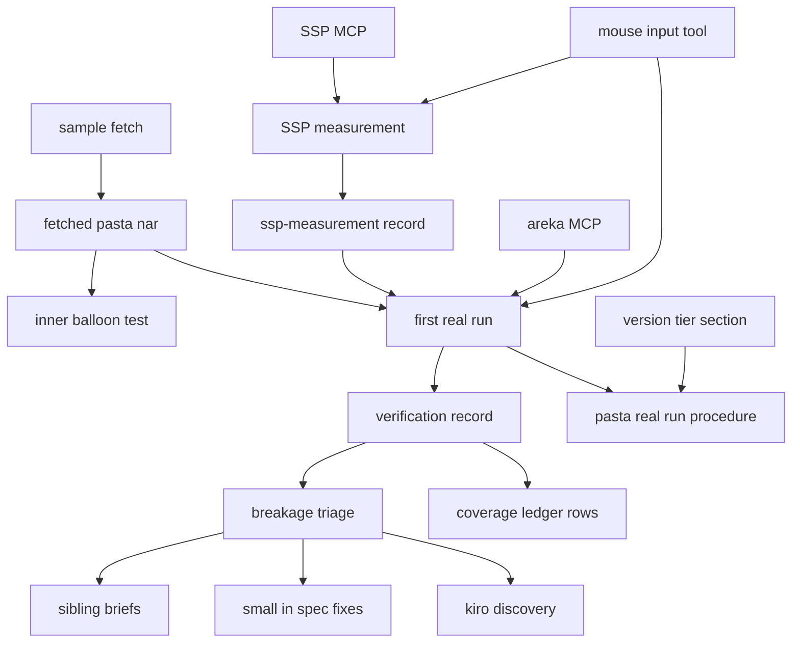
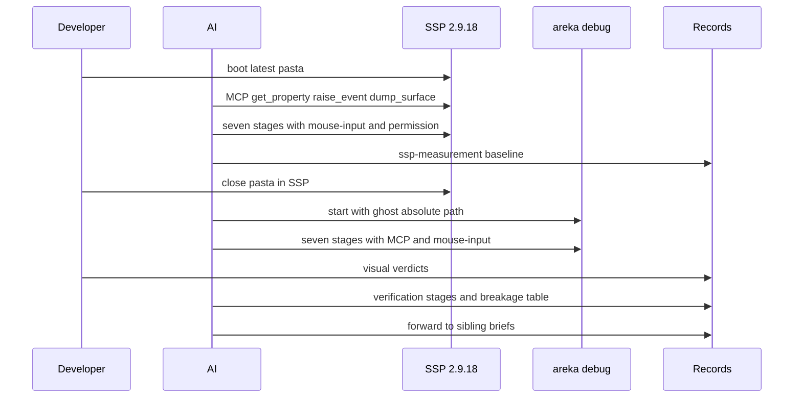

# 設計（areka-P0-pasta-in-windows-verification）

## Overview

**Purpose**: 本 spec は、ゴースト「窓際のぱすたさん」（以下ぱすた）を SSP 2.9.18 で測った基準と、areka で最初に動かした結果を同じ物差しで並べ、崩れた所を 1 件ずつ原因と扱いつきで残す。持ち主の居ない小さい崩れは本 spec の中で直し、兄弟の spec の着地の後に「SSP と同じレベル」を確かめ直せる実機の手順を、spec のフォルダの外に残す。

**Users**: areka の開発者と、実装・走行を受け持つ AI。AI は測り・走行・撮影・記録を行い、開発者は目視の判定と、SSP への書庫の入れ込み・読み直し・SendInput の許可を受け持つ。

**Impact**: コードの変更は小さい。必ず足すのは、取り寄せたぱすたの書庫の中身を見る自動テスト 1 本と、マウスの送り込みと画面の撮影をする道具 1 本だけ。α の当たりのしきい値は変えない（α が 0.5 以上の画素だけを当たりにする今の決まりを保ち、SSP には合わせない・コードの変更 0）。残りは文書（測りの記録・検証の記録・手順）と網羅台帳の行の直し。

### Goals

- SSP 2.9.18 で、ぱすたの全体の通しの基準を根拠つきで残す（1.1〜1.9）。
- 取り寄せた書庫が縦書きのバルーンをゴーストのフォルダの直下に入れることを、自動テストで見張る（2.1〜2.7）。
- 7 段の実機の最初の走行を回し、段ごとに「同じ」「違う」「回せなかった」を残す（3.1〜3.10・4.1〜4.9）。
- 崩れた所を全部、症状・根拠・原因・扱いで残し、引き取る spec か方針の裁定を必ずつける（5.1〜5.8）。
- α の当たりと描き方の今の決まりを保ち、ukadoc が黙る所の areka の決めとして記録と台帳に残す（7.1〜7.5・9.3）。
- 何度でも回せる手順を `doc/` に置き、v0.1.0 の版の門から辿れるようにする（8.1〜8.7）。
- 網羅台帳のぱすたが使う行を、記録と食い違わない形にする（9.1〜9.4）。

### Non-Goals

- 兄弟の spec が引き取る崩れの直し（Out of Boundary の一覧）。
- 「SSP と同じレベル」の最後の確かめ（兄弟の着地の後・本 spec の外）。
- α の描き方の変更（areka は α が 1 以上の画素をすべて描く。今のまま・7.2）。
- α の当たりのしきい値の変更と、SSP での α の当たりの線の測り（7.1・1.2）。
- 手順を自動の試験（`real-run-kit` の試験）にすること。7 段の多くは画面の操作と目視が要り、道具にしても人の手が残るため。
- ぱすたの辞書・書庫の書き換え、検体の登記の変更、`C:\home\maz\git\ghost_dev` への書き込み。

## Boundary Commitments

### This Spec Owns

- SSP 2.9.18 での全体の通しの測りと、その記録 `ssp-measurement.md`（本 spec のフォルダ）。
- 取り寄せたぱすたの書庫の中身の自動テスト `crates/sample-ghost-kit/tests/pasta_inner_balloon_test.rs`（判定 1 つ・本物の書庫に当てる 1 本・固定入力の較正 1 本）。
- 実機の走行と測りで使う、マウスの送り込みと画面の撮影の道具 `tools/mouse-input.ps1`。
- 実機の最初の走行と、その記録 `verification.md`（本 spec のフォルダ）。崩れた所の表と申し送りの記録を含む。
- α が小さい画素の当たりの決まり（α が 0.5 以上だけが当たる・変更 0）を、網羅台帳の行と `doc/COMPAT_ARCHITECTURE.md` §8 に書くこと（9.3）。
- 何度でも回せる実機の手順 `doc/pasta-real-run.md` と、版の段からその手順への 1 行の道しるべ。
- 網羅台帳の、ぱすたが使う項目の行のうち記録と食い違うもの。
- 走行で見つかった、引き取る spec の居ない areka 側の小さい崩れ（1 タスクで閉じるもの）の根本の直し（6.1）。

### Out of Boundary

- 兄弟の spec の持ち分（本 spec はこれらのコードを触らない）:
  - `mouse-click-wheel-events`: `OnMouseClick`・`OnMouseEnter`／`OnMouseLeave`
  - `stay-on-top-directives`: `\1\v`
  - `script-small-tags`: `\_u[0x3000]`・`\![bind-noevent]`・選択肢の前の `\![*]`
  - `descript-window-keys`: `sakura.seriko.defaultsurface`・`balloon.dontmove`
  - `ghost-inner-balloon`: ゴーストのフォルダの中のバルーンを名前で見つけること
  - `window-link-directives`: `seriko.sticky-window`・`--option=ignore-sticky-window`
  - `dpi-realign-remembered-chain`: 拡大率の違う画面をまたぐドラッグ
  - `shell-mouse-cursor`: 当たり判定ごとのマウスの形（`sakura.cursor` ブレス）
  - `popup-menu-shell-look`: 右クリックメニューの色と絵（`menu.*`）・`sakura.menu,auto`
  - 完了 `zorder-scope-inversion`: バルーン込みの重なりの指定（本 spec は着地した結果として確かめるだけ）
- 範囲の外の機能: `balloon.syncscale`・`OnShellScaling`／`OnBalloonScaling`・スクロールの矢印・`communicatebox`・`\![reload,shiori]`・禁則と縦中横・SSP の作りの癖の写し・ぱすたのデバッグの待受（127.0.0.1:9276）のぶつかりの直し。
- 検体の登記の行・登記の数（9）・取り寄せの段 `tools/sample-fetch.ps1`・窓口 `crates/sample-ghost-kit/src/`（変更 0）。
- α の描き方（`areka-emo-atlas` の正規化・合成。変更 0）と、当たりのしきい値（`alpha_mask.rs`・`hit_test/mod.rs`。変更 0）。
- 網羅台帳の、ぱすたが使わない項目の行（変更 0）。

### Allowed Dependencies

- `sample-ghost-kit` の公開の読み口: `SampleRoot::acquire`・`root`・`folder`・`WorkDir`・`NarBuilder`・`install_txt`。テストからは `areka-nar` の `NarArchive`・`InstallRequest`・`SingleRoot`（窓口の通常の依存）。
- 取り寄せの段 `tools/sample-fetch.ps1`・検体のパスを出すコマンド `nar-sample-path`・`tools/sync-i686-helper.ps1`・areka の起動オプション `--ghost`（絶対パス）。
- 机 `areka-impl-watch`（排他テストの机・`doc/impl-watch.md`）。
- SSP の MCP（`get_property`・`raise_event`・`sakurascript`・`dump_surface`・`get_log`・`reload`）と areka の MCP（`get_status`・`get_active_ghost_list`・`raise_event`・`dump_surface`・`dump_balloon`・`get_log`）。どちらもこのセッションの MCP から呼ぶ。
- Windows の user32（`SetProcessDpiAwarenessContext`・`SetCursorPos`・`GetCursorPos`・`SendInput`）と .NET の画面の写し（`System.Drawing.Graphics.CopyFromScreen`）。新しいクレートや外の道具は足さない。
- 依存の向き: 記録と手順 → 道具とテスト → 既存の部品。既存の部品から本 spec の文書や道具を読むことはしない。

### Revalidation Triggers

- 兄弟の spec が着地したとき: 手順の段ごとの「引き取る spec」の欄の段が変わるはず。最後の確かめで回し直す。
- 検体の登記の行・窓口の読み口・取り寄せの段の形が変わったとき: 中身の自動テストと手順の最初の段を読み直す。
- ぱすたの書庫の中身の形が変わったとき（縦書きのバルーンの置き場・名前）: 中身の自動テストが赤になる。登記の持ち主と「ぱすた開発」へ確かめる。
- 起動オプション・MCP の道具の名前や引数・記録の環境変数が変わったとき: 手順の命令を直す。

## Architecture

### Existing Architecture Analysis

- 検体は登記表 `SAMPLES`（設計の時点は 9 本。main の PR#359〔`b6a27e57`〕が `dot_sakura` を足して今は 10 本＝`crates/sample-ghost-kit/src/lib.rs` の `name` 10 行・`lib_tests.rs` の `assert_eq!(SAMPLES.len(), 10, "登記は検体 10 個")`）の URL の行として登記済みで、取り寄せの段が `target\nar-samples\fetched\` の置き場へ最新を取り寄せ、窓口が `.sha256` と照合してから空の根へ展開する。登記どおりに「ゴースト 1 つ・同梱のバルーン 0」が入ることは、既存の自動テストが見ている。本 spec はこの上に「縦書きのバルーンがゴーストのフォルダの直下に在る」の 1 点を足す。
- シェルとバルーンの当たりは、合成した絵の PBGRA の α から `AlphaMask::from_pbgra32` でマスクを作り、`pack_pbgra32_alpha` の 1 か所で `alpha >= 128` を当たりにする。ウィジェットの当たり（`HitTestMode::Bounds`）は、`hit_test/mod.rs` の 2 か所で「見た目の不透明度 × 塗りの α」を小数 `128/255` と比べる。今は同じ値を 3 回書いている。
- 実機の走行の型は、完了 `emily-ghost-verification` の記録（環境変数の表・起動の命令・流れの表・項目ごとの結果・ERROR と WARN の数・崩れた所の表）をそのまま使う。

### Architecture Pattern & Boundary Map



**Architecture Integration**:
- 選んだ形: 既存の部品に「足すだけ」（research.md の案 A）。α の当たりのしきい値は変えないので、3 か所を 1 つに集める案 B・C の手は要らなくなった。
- 境目: 測り（SSP 側）と走行（areka 側）は同じ時間に回さない。記録は spec のフォルダ、何度でも回す手順は `doc/`。コードの変更は `sample-ghost-kit/tests/`（新しいファイル）・`tools/`（新しいファイル）だけ。
- 守る既存の形: 検体の窓口の読み口・検体のパスの綴りの番人・えみりの記録の型・机の決まり・`target\` の下だけの根。
- 新しい部品の理由: 中身のテストは要件 2 そのもの。`mouse-input.ps1` は、毎回のシェルで同じ DPI の扱いと自己確かめをもって SendInput を送るため（ツールのシェルは呼び出しごとに状態を持たない）。
- ステアリング: ukadoc が黙る所は SSP を二次参照して areka が決め、記録に残す（沈黙ルール）。失敗はゴーストの台詞で伝え、記録の無い失敗を作らない。

### Technology Stack

| Layer | Choice / Version | Role in Feature | Notes |
|-------|------------------|-----------------|-------|
| テスト | Rust（ワークスペースの版）・`sample-ghost-kit`・`areka-nar` | 書庫の中身の自動テスト | 新しい依存なし |
| 道具 | PowerShell 7（`pwsh`）・user32・`System.Drawing` | マウスの送り込み・画面の撮影 | `tools/encoding-check.ps1` の静的な決まりに従う（端末へ出す文は ASCII だけ） |
| 実機 | debug 版 `areka.exe`・i686 の `shiori-host32-helper.exe`・SSP 2.9.18 | 走行と測り | 根・書庫・一時のフォルダはワークツリーの `target\` の下だけ |
| 文書 | Markdown・TOML（網羅台帳） | 記録・手順・台帳 | 台帳は `cargo test -p ukadoc-survey` と `report` で検査と作り直し |

## File Structure Plan

### Directory Structure

```
crates/sample-ghost-kit/tests/
└── pasta_inner_balloon_test.rs     # 新: 縦書きのバルーンの置き場と balloon/ が 0 件であることの判定・本物の書庫・較正
tools/
└── mouse-input.ps1                 # 新: 物理画素の座標で move/click/rightclick/drag を SendInput で送る・矩形を PNG に撮る
doc/
└── pasta-real-run.md               # 新: 何度でも回せる実機の手順（条件・7 段・SSP の基準・引き取る spec）
.kiro/specs/areka-P0-pasta-in-windows-verification/
├── ssp-measurement.md              # 新: SSP 2.9.18 の測りの記録（全体の通し）
└── verification.md                 # 新: 検証の記録（同定・構成・走行・崩れた所の表・申し送り・台帳の突き合わせ）
```

### Modified Files

- `.kiro/steering/roadmap.md` — 節「版の段」の表の直後に、v0.1.0 の版の門の最後の確かめとして `doc/pasta-real-run.md` を回す、の 1 行を足す（8.7）。表の行そのものは書き換えない。
- `doc/ukadoc-coverage/ledger/*.toml` — ぱすたが使う項目の行のうち、検証の記録と食い違う行の `owner`・`status`・`note`（9.1・9.2）。直した後に `cargo run -p ukadoc-survey -- report` と `report-summary` で `doc/ukadoc-coverage/report/` を作り直す（手で直さない）。
- 兄弟の spec の `brief.md`（`.kiro/specs/<兄弟>/brief.md`）— 末尾に「本 spec からの申し送り」の節を足す（5.5・1.4）。兄弟が完了済みなら書かず、`/kiro-discovery` で起票する。

- `doc/ukadoc-coverage/ledger/assets.toml` — シェルの `seriko.use_self_alpha` の行の `note` に、当たりの決まり（α が 0.5 以上の画素だけが当たる・SSP には合わせない）と裁定（2026-10-22 開発者）を足す（9.3）。
- `doc/COMPAT_ARCHITECTURE.md` — §8「沈黙ルール対応表」に「α が小さい画素の当たり」の行を 1 つ足す（ukadoc が黙る所の areka の決め・SSP は α が 0 でなければ当たる見込みで、areka は合わせない）。

α の当たりのしきい値（`alpha_mask.rs`・`hit_test/mod.rs`）は触らない（7.1）。

条件つき（走行で、引き取る spec の居ない小さい崩れが見つかったとき・6.1）:

- 直す場所はそのときに決まる。1 件 1 タスクで、触るファイルをタスクに挙げ、テストは兄弟の `*_tests.rs` に置く。`crates/areka/src/main.rs`（1,000 行）には足さず、新しいファイルへ置く。

## System Flows



- 順の決まり: 測り（1 章）→ 中身のテスト（2 章・いつでも）→ 最初の走行（4 章）→ 直した段の回し直し（8.5）→ 台帳と α の決まりの書き込み（9 章・7.5）→ 手順の清書（8 章）。
- ぱすたを起こすのは、SSP か areka（1 つのプロセス）のどちらか 1 つだけ（3.7）。SSP の測りが終わったら、開発者が SSP のぱすたを閉じてから areka を起こす。
- 測りも走行も画面を操作するので、排他テストの机を取ってから始め、区切りが済んだらすぐ返す（3.6）。

## Requirements Traceability

| Requirement | Summary | Components | Interfaces | Flows |
|-------------|---------|------------|------------|-------|
| 1.1 | SSP の MCP で測る・ゴーストの名前を渡す | SSP の測り | SSP の MCP | 測り |
| 1.2 | α の当たりの線と描き方は測らない | SSP の測り | — | 測り |
| 1.3 | 全体の通しの基準（台本の原文と面） | SSP の測り | `raise_event`・`dump_surface`・`shot` | 測り |
| 1.4 | 兄弟の問いの答えを申し送る | SSP の測り・申し送り | 兄弟の brief | 測り |
| 1.5 | 読み直しは毎回許可 | SSP の測り | `reload` | 測り |
| 1.6 | SSP の外の物を書き換えない | SSP の測り | — | 測り |
| 1.7 | 記録の欄（日時・版・同定・道具・結果・根拠） | 測りの記録 | 記録の形 | — |
| 1.8 | ukadoc の URL と逐語の引用 | 測りの記録 | 記録の形 | — |
| 1.9 | 操作は AI・SendInput は許可・areka を同時に起こさない | SSP の測り・`mouse-input.ps1` | 道具の呼び方 | 測り |
| 2.1 | `pasta_tategaki` の descript が名前を名乗る | 中身のテスト | `check_pasta_layout` | — |
| 2.2 | `balloon/` が 0 件 | 中身のテスト | `check_pasta_layout` | — |
| 2.3 | 大きさ・数・ハッシュを固定しない | 中身のテスト | — | — |
| 2.4 | 書庫が無い・合わないときは取り寄せのコマンドを示して落ちる | 中身のテスト | `SampleError` の文 | — |
| 2.5 | 通信しない | 中身のテスト | — | — |
| 2.6 | 登記と番人を緑のまま | 中身のテスト | — | — |
| 2.7 | 固定入力で赤を示す | 中身のテスト | 較正の固定入力 | — |
| 3.1 | debug 版・`target\` の下の根・絶対パス | 実機の走行・手順 | 起動の命令 | 走行 |
| 3.2 | 照合を通った書庫から入れ、`.sha256` を書く | 実機の走行・手順 | `nar-sample-path` | 走行 |
| 3.3 | i686 の補助の確かめ | 実機の走行・手順 | `sync-i686-helper.ps1` | 走行 |
| 3.4 | 記録の水準・自動終了の安全弁 | 実機の走行・手順 | 環境変数の表 | 走行 |
| 3.5 | 拡大率の違う 2 画面 | 実機の走行・手順 | 機械の構成の測り | 走行 |
| 3.6 | 机を区切りの中だけ持つ | 実機の走行・手順 | `areka-impl-watch` | 走行 |
| 3.7 | ぱすたは 1 つだけ起こす | 実機の走行・SSP の測り | — | 測り・走行 |
| 3.8 | 操作は AI・SendInput は許可つき | `mouse-input.ps1` | 道具の呼び方 | 走行 |
| 3.9 | MCP で撮って残す | 実機の走行 | areka の MCP | 走行 |
| 3.10 | 止めるのは自分が起こしたプロセスだけ | 実機の走行・手順 | 起動の命令（番号の控え） | 走行 |
| 4.1 | 7 段をこの順で | 実機の走行・手順 | 段の表 | 走行 |
| 4.2 | 段ごとに基準と並べ 3 値で書く | 検証の記録 | 段の表 | 走行 |
| 4.3 | 重なりの順を撮る | 実機の走行 | `shot`・`dump_surface` | 走行 |
| 4.4 | 終了コード 0 | 実機の走行 | 起動の命令 | 走行 |
| 4.5 | panic と致命の件数 | 検証の記録 | 記録の数え方 | 走行 |
| 4.6 | 回せない段は飛ばして続ける | 実機の走行 | 段の表 | 走行 |
| 4.7 | 目視は開発者 | 検証の記録 | 段の表の「判定した人」 | 走行 |
| 4.8 | 範囲の外由来の違いを分けて数える | 検証の記録 | 段の表 | 走行 |
| 4.9 | 兄弟を待たずに回す | 実機の走行 | — | 走行 |
| 5.1 | 記録の欄 | 検証の記録 | 記録の形 | — |
| 5.2 | 崩れの 4 つの欄 | 検証の記録 | 崩れた所の表 | — |
| 5.3 | 引き取る spec か方針の裁定を必ず持つ | 検証の記録 | 崩れた所の表 | — |
| 5.4 | 持ち主の居ない崩れは直すか起票 | 仕分け | 直す線 | — |
| 5.5 | 兄弟の brief へ申し送る | 申し送り | 兄弟の brief | — |
| 5.6 | 方針で受けない件に裁定 | 検証の記録 | 崩れた所の表 | — |
| 5.7 | ぱすた由来の ERROR と WARN を外す | 検証の記録 | 記録の数え方 | — |
| 5.8 | 待受のぶつかりを「ぱすた開発」へ | 申し送り | 検証の記録の申し送りの節 | — |
| 6.1 | 小さい崩れは根本から直し、赤と緑のテスト | 本 spec の直し | 直す線 | — |
| 6.2 | 1 タスクで閉じないものは起票 | 仕分け | 直す線 | — |
| 6.3 | 20 タスクを超える見込みなら仰ぐ | 仕分け | 直しの見積もり | — |
| 6.4 | すべてのゴーストに効く直しは仰ぐ | 本 spec の直し | 直す線 | — |
| 6.5 | 兄弟の持ち分を直さない | 本 spec の直し | Out of Boundary | — |
| 6.6 | 完了 spec の要件を黙って変えない | 本 spec の直し | 直す線 | — |
| 6.7 | ぱすたを書き換えない | 本 spec の直し | — | — |
| 6.8 | 記録の無い失敗を作らない・台詞で伝える | 本 spec の直し | 直す線 | — |
| 7.1 | α が 0.5 以上だけが当たる決まりを保つ（変更 0） | α の決まり | 既存の `alpha_mask.rs`・`hit_test/mod.rs` | — |
| 7.2 | α はすべて描く（変更 0） | α の決まり | — | — |
| 7.3 | 薄い所の当たりの違いは「方針で受けない」 | 検証の記録 | 崩れた所の表 | 走行 |
| 7.4 | SSP の当たりは見立てとして書く | 検証の記録 | α の節 | — |
| 7.5 | 決まりと裁定を記録に書く | 検証の記録 | α の節 | — |
| 8.1 | 記録を読まずに回せる | 手順 | 手順の形 | — |
| 8.2 | 絶対パスの命令 | 手順 | 起動の命令 | — |
| 8.3 | 段ごとに基準と引き取る spec | 手順 | 段の表 | — |
| 8.4 | 取り寄せから始め、版を固定しない | 手順 | `sample-fetch.ps1` | — |
| 8.5 | 直した後に該当の段を回し直す | 実機の走行 | 手順 | 走行 |
| 8.6 | 手順の置き場と最後の確かめを記録に書く | 検証の記録 | 記録の形 | — |
| 8.7 | spec の外に置き、版の門から辿れる | 手順・道しるべ | `roadmap.md` の 1 行 | — |
| 9.1 | 食い違う行を 0 件に | 台帳の追随 | 突き合わせの表 | — |
| 9.2 | 引き取る spec の名前を書く | 台帳の追随 | `owner` 欄 | — |
| 9.3 | 当たりの決まりと裁定を行に書く | 台帳の追随 | `seriko.use_self_alpha` の行・COMPAT §8 | — |
| 9.4 | 使わない行は変えない | 台帳の追随 | 突き合わせの表 | — |

## Components and Interfaces

| Component | Domain/Layer | Intent | Req Coverage | Key Dependencies (P0/P1) | Contracts |
|-----------|--------------|--------|--------------|--------------------------|-----------|
| 中身のテスト | 検体のテスト | 縦書きのバルーンの置き場と `balloon/` 0 件を見張る | 2.1〜2.7 | `SampleRoot`（P0）・`NarBuilder`・`areka-nar`（P1） | Service |
| マウスと撮影の道具 | 道具 | SendInput の操作と画面の写しを、DPI と自己確かめつきで | 1.9・3.8・4.3 | user32（P0） | Batch |
| SSP の測り | 測り | 全体の通しの基準を測る | 1.1〜1.9・3.7 | SSP の MCP（P0）・道具（P0） | Batch |
| 測りの記録 | 文書 | 測りの根拠を残す | 1.4・1.7・1.8 | — | State |
| 実機の走行 | 走行 | 7 段を回し撮る | 3.1〜3.10・4.1〜4.9・8.5 | areka の MCP（P0）・道具（P0）・机（P0） | Batch |
| 検証の記録 | 文書 | 段の結果・崩れた所・申し送り・台帳の突き合わせ | 4.2・4.5・4.7・4.8・5.1〜5.8・7.3〜7.5・8.6・9.1 | — | State |
| 仕分けと申し送り | 運用 | 崩れごとに扱いを決め、兄弟と起票へ渡す | 1.4・5.3〜5.5・5.8・6.1〜6.8 | 兄弟の brief（P1）・`/kiro-discovery`（P1） | — |
| α の決まり | wintf の当たり（変更 0） | α が 0.5 以上だけが当たる・すべて描く、の今の決まりを保つ | 7.1・7.2 | 既存の `wintf` | — |
| 手順 | 文書 | 何度でも回せる形 | 8.1〜8.7 | 上の全部（P0） | Batch |
| 台帳の追随 | 文書 | ぱすたが使う行を記録に合わせる | 9.1〜9.4 | `ukadoc-survey`（P1） | State |

### 検体のテスト

#### 中身のテスト（`crates/sample-ghost-kit/tests/pasta_inner_balloon_test.rs`）

| Field | Detail |
|-------|--------|
| Intent | 取り寄せたぱすたの書庫が、縦書きのバルーンをゴーストのフォルダの直下に入れ、`balloon/` に何も入れないことを確かめる |
| Requirements | 2.1, 2.2, 2.3, 2.4, 2.5, 2.6, 2.7 |

**Responsibilities & Constraints**
- 判定は関数 1 つ。本物の書庫と固定入力の両方に同じ関数を当てる（判定そのものが赤を出せることを示す）。
- 名前の判定は descript.txt の行を文字列で見る（areka の本物のバルーンの読み手は通さない）。名前で見つけるのは `ghost-inner-balloon` の持ち分で、本テストが見るのは書庫の中身の形だけだから。descript.txt は `charset,UTF-8` なので、UTF-8 で読み、先頭の BOM を除き、各行の前後の空白を除いて `name,窓際のぱすたさん縦書き` と一致する行が在るかを見る。
- 書庫の大きさ・ファイルの数・ハッシュの値は書かない（2.3）。通信しない（2.5・窓口は置き場の書庫しか読まない）。
- 置き場の綴り（名前空間の語・`vendors` の検体の置き場の名前）を書かない。検体のパスの綴りの番人 `crates/log-capture-kit/tests/sample_path_guard_test.rs` を回して緑を確かめる（2.6）。`root().join("balloon")` が番人の形に当たると出たときは、`read_dir(root())` で名前が `balloon` の子を探す形に替える。
- `src/lib.rs`・`src/lib_tests.rs` は触らない（兄弟の spec が触る）。

**Dependencies**
- Outbound: `sample_ghost_kit::SampleRoot`（`acquire("pasta-in-windows")`・`root`・`folder`）— 照合を通った書庫を空の根へ入れる（P0）
- Outbound: `sample_ghost_kit::{WorkDir, NarBuilder, install_txt}`・`areka_nar::{NarArchive, InstallRequest, SingleRoot}` — 較正の固定入力を組んで入れる（P1）

**Contracts**: Service [x]

##### Service Interface

```rust
/// ゴーストのフォルダの直下の縦書きのバルーンと、根の balloon/ が空であることを確かめる。
/// Err の文は、何が無かったか（どのパス・どの行）を書く。
fn check_pasta_layout(root: &Path, ghost_folder: &Path) -> Result<(), String>;

const INNER_BALLOON_DIR: &str = "pasta_tategaki";
const INNER_BALLOON_NAME_LINE: &str = "name,窓際のぱすたさん縦書き";

#[test] fn fetched_pasta_puts_the_vertical_balloon_inside_its_ghost_folder();
#[test] fn a_vertical_balloon_outside_the_ghost_folder_is_rejected();
```

- `fetched_pasta_...`: `SampleRoot::acquire("pasta-in-windows")` が `Err` なら、その `Display` をそのまま `panic!` の文にする（取り寄せの段のコマンドを示す既存の文・2.4）。`Ok` なら `check_pasta_layout(root(), folder())` が `Ok` であること。
- `a_vertical_balloon_outside_...`（較正・2.7）: `NarBuilder` で `install.txt`（`type,ghost`・`directory,pasta-in-windows`）・`ghost/master/descript.txt`・`ghost/master/pasta_tategaki/descript.txt`（名前の行あり）を持つ書庫を `WorkDir` に書き、別の `WorkDir` へ `NarArchive::open` と `install`（`SingleRoot`・`target_ghost: None`）で入れ、`check_pasta_layout` が `Err` を返すことを確かめる。「外に置いた」形は「抜いた」形より厳しい（置き場を見ずに木のどこかを探す判定も赤にできる）ので、こちら 1 つにする。
- 不変条件: 判定は書庫の版に依らず、置き場と名前の 2 点と `balloon/` の件数だけを見る。

**Implementation Notes**
- Integration: 取り寄せの段が回っていない机では赤になる（設計どおり）。`tools/test-all.ps1` は最初の段で取り寄せるので、全体テストでは緑になる。
- Validation: 書いたら一度、判定を「木のどこかに `pasta_tategaki` が在ればよい」形に緩めると較正のテストが落ちる（固定入力を通してしまう）ことを確かめ、元に戻す。較正のテストが置き場の誤りを捉えることの確かめで、結果は検証の記録に書く。
- Risks: ぱすたが縦書きのバルーンの置き場か名前を変えると赤になる。これは見張りたい変化で、Revalidation Triggers に書いた。

### 道具

#### マウスと撮影の道具（`tools/mouse-input.ps1`）

| Field | Detail |
|-------|--------|
| Intent | 画面の物理画素の座標で、マウスの操作を SendInput で送り、画面の矩形を PNG に写す |
| Requirements | 1.9, 3.8, 4.3 |

**Responsibilities & Constraints**
- 呼ぶたびに、プロセスをモニターごとの DPI に合わせる形（`SetProcessDpiAwarenessContext(-4)`）にしてから座標を扱う。これをしないと 200% と 150% の画面で座標がずれる（実機の較正）。
- 動かした後に `GetCursorPos` で位置を読み、狙いと違えば終了コード 1（ロックされた画面・スクリーンセーバーの中では送り込みが断られる）。
- 型の定義（`INPUT`・`MOUSEINPUT`）は `tools/perf/invoke-followup-checks.ps1` で実機に通った物を写す（余分な欄を足すと SendInput が 87 で断る、という同じファイルの注意ごと）。
- 端末へ出す文は ASCII だけ。`tools/encoding-check.ps1` の静的な決まりに従う。
- SendInput は、開発者の許可を得た測りか走行のあいだだけ呼ぶ（呼ぶ側の決まり。道具は許可を知らない）。

**Contracts**: Batch [x]

##### Batch / Job Contract
- Trigger: `pwsh -NoProfile -File <ワークツリー>\tools\mouse-input.ps1 -Action <動作> -X <整数> -Y <整数> [-X2 <整数> -Y2 <整数>] [-Steps <整数>] [-Out <PNG の絶対パス>]`
- 動作:
  - `move`: (X, Y) へ動かす。`OnMouseMove` を起こす「撫で」は、`move` を少しずつ違う点へ続けて呼ぶ。
  - `click`・`rightclick`: (X, Y) へ動かして押して離す（押下と離しの間を空ける）。
  - `drag`: (X, Y) で押し、(X2, Y2) まで `-Steps`（既定 20）回に分けて動かし、離す。画面をまたぐドラッグもこれで送る。
  - `shot`: (X, Y)〜(X2, Y2) の矩形を `CopyFromScreen` で写し、`-Out` へ PNG で書く。
- Input / validation: 座標は仮想画面の物理画素。`drag` と `shot` は X2・Y2 が要る。`shot` の `-Out` は絶対パスで、親のフォルダが在ること（ワークツリーの `target\` の下に置くのは呼ぶ側の決まり）。足りない・形が違う引数は終了コード 2 と 1 行の理由。
- Output: 成功は終了コード 0 と `ok <動作> x=<X> y=<Y>` の 1 行。失敗は終了コード 1 と `error <理由>` の 1 行。
- Idempotency & recovery: 状態を持たない。押したまま落ちたときに備え、`click`・`drag` は例外でも離しを送ってから終わる。

**Implementation Notes**
- Validation: 書いた後に 1 度、`move` を主の画面と 2 つ目の画面の点へ送り、出力の座標と `GetCursorPos` が合うことを確かめる（自己確かめが効くこと）。
- Risks: 他のセッションの窓へ送らないよう、排他テストの机を持つ間だけ使う。

### 測り

#### SSP の測り（記録は `ssp-measurement.md`）

| Field | Detail |
|-------|--------|
| Intent | SSP 2.9.18 での 7 段の通しの基準を、根拠つきで測る |
| Requirements | 1.1, 1.2, 1.3, 1.4, 1.5, 1.6, 1.7, 1.8, 1.9, 3.7 |

**Responsibilities & Constraints**
- 測る前に開発者へ頼むこと: SSP で最新のぱすたを起こす・areka でぱすたを起こさない・SendInput の許可（この測りのあいだだけ）・読み直しが要るときはその都度の許可（1.5）。
- SSP の道具には、`get_active_ghost_list` で得たぱすたの名前を、どの呼び出しにも渡す（1.1）。
- α の当たりの線と描き方は測らない（1.2。areka の決まりは 7.1・7.2 で定まっている）。
- SSP の本体・設定・SSP が保存する記録を手で書き換えない。SSP が自分で書く `data\profile\mcp_*.dat` と `ssp_shiori_log.txt` は数えない（1.6）。
- 兄弟の問い（バルーンの見つけ方・`\1\v`・`\![*]`・`OnShellScaling`・`balloon.dontmove`）を、本 spec のために改めて測らない。通しの途中で見えた答えだけを書いて申し送る（1.4）。

**全体の通しの基準（1.3）**
- ふだん SSP に入っている最新のぱすたで、Requirement 4 の 7 段を同じ順で回す。段ごとに、`raise_event` で返る台本の原文（その段で台本が出る所）・`dump_surface`・`shot` の画面を残す。起動の段は、SSP が送ったのが `OnBoot` か `OnFirstBoot` かを `ssp_shiori_log.txt` から書く（areka の走行は空の記憶で起こすので `OnFirstBoot` になる。比べるのは面・窓・バルーン・重なりと「台詞が出ること」で、台詞の文の違いは起動イベントの違いとして分けて書く）。
- 撮った物は `target\pasta-verify\ssp\` の下（ワークツリー）。記録には相対の名前と、要点を逐語で書く。

**Contracts**: Batch [x]

##### Batch / Job Contract
- Trigger: 本 spec の最初のタスク。排他テストの机を取ってから。
- Input / validation: SSP 2.9.18・最新のぱすた（ふだんの SSP）。
- Output / destination: `ssp-measurement.md`（項目ごとに: 測った日時（日本時間）・SSP の版・書庫の同定（`.sha256` の値）・道具と引数・結果・根拠（逐語の応答か撮った面の名前）・ukadoc の URL と逐語の引用と食い違い）。
- Idempotency & recovery: 測りは SSP の状態を変えない（読み直しは許可つきの例外）。途中で切れたら、記録の済んだ点から続ける。

#### 実機の走行（記録は `verification.md`）

| Field | Detail |
|-------|--------|
| Intent | areka でぱすたを 7 段回し、段ごとに SSP の基準と並べる |
| Requirements | 3.1〜3.10, 4.1〜4.9, 8.5 |

**根の形（決め）**
- 根は配布物と同じ形（`ghost\emo2`・`balloon\emo2-kakukaku`・`balloon\StayseeBalloon`）に、ぱすたのゴーストのフォルダを足した物。全部 `nar-sample-path` が `target\nar-samples\manual\` の下に開いた物から写す（ぱすたの行は、照合を通った置き場の書庫からしか開かれない＝3.2）。
- 起こし方は `--ghost <根>\ghost\pasta-in-windows`（絶対パス）。メニューからのインストールは通さない（7 段にインストールは無く、インストールの記録が段の判定に混ざらないように）。
- `ghost-inner-balloon` が着地していなければ、縦書きのバルーンは名前で見つからず、areka は次の候補（配布物の既定のバルーン）を使う。本走行では根にバルーンを足さない。起動の段のバルーンは「違う」（引き取る spec は `ghost-inner-balloon`）と書き、使われたバルーンの名前を `boot_resolve` の記録から書く。
- 縦書きの会話の段（段 2）で、縦書きのバルーンでしか見えない崩れ（列と枠の並び・縦書きの選択肢）を早く見つけるため、本走行の後に「補いの走り」を 1 回だけ回してよい。根の写しの `balloon\` に `ghost\pasta-in-windows\pasta_tategaki` を写した別の根で段 1〜2 だけを回し、結果は「参考（代わりの置き方）」として段の 3 値の数とは分けて書く。`ghost-inner-balloon` の着地の後は要らない（要件に無い足し物だが、2026-10-22 の設計の話し合いで開発者が残すと決めた）。

**環境変数（決め）**

| 名前 | 値 | 理由 |
|---|---|---|
| `AREKA_ROOT` | `<w>\target\pasta-verify\root` | 根 |
| `AREKA_PROFILE_DIR` | `<w>\target\pasta-verify\profile`（走行ごとに空にする） | 記憶の置き場 |
| `RUST_LOG` | `info,areka::boot_resolve=debug,areka::install=debug,areka_nar=debug` | バルーンの決め方の分岐（3.4）。段で判定の分岐が要るときは、その段の対象を足して書く |
| `AREKA_APP_SMOKE_EXIT_MS` | `3600000`（60 分） | 安全弁。7 段の所要（30〜45 分の見込み）より長く |
| `NO_COLOR` | `1` | 記録を平文に |
| `AREKA_NO_ALERT`・`AREKA_USER_ROOT` | 消す | 本物の利用者の置き場に触らない |

（`<w>` は回すワークツリーの絶対パス。）

**段の判定の決まり**
- 段ごとの表の欄: 段・SSP の基準（測りの記録の項目への参照）・areka の結果・根拠（撮った物の名前・記録の行の時刻つきの逐語）・3 値・判定した人（目視の項目は開発者）・引き取る spec・範囲の外由来か。
- 重なり（4.3）は段 1 と段 2 で `shot` で撮り、窓（奥）→ バルーン → ぱすた（手前）かを開発者が目視で決める。
- 終了（4.4）: 段 7 は × を押す。効かなければ右クリックメニューの「終了」。終了コードは起動の命令の中で `WaitForExit` の後に書き出す（えみりで取り損ねた所を直した形）。
- panic と致命の件数（4.5）: 標準出力と標準エラーの記録の `panicked at` の行と、ERROR の行のうち致命を名乗る行を数える。ERROR と WARN の数（5.7）は、ぱすたの中身（SHIORI の返事・辞書）から出た行を、理由を書いて外した数も並べる。
- 回せない段（4.6）は「回せなかった」と書いて次の段へ。areka が止まったら、起こし直して次の段から続ける（起こし直しも記録に書く）。

**Contracts**: Batch [x]

##### Batch / Job Contract
- Trigger: 測りの後（SSP のぱすたを開発者が閉じた後）。排他テストの机を取ってから。
- Input / validation: 取り寄せの段と照合を通った書庫・debug 版の `areka.exe`・i686 の補助（走る直前に `sync-i686-helper.ps1` で確かめる）・拡大率の違う 2 つの画面（無ければ段 5 は「回していない」で合格にしない）。
- Output / destination: `verification.md` の走行の節。撮った物と記録は `<w>\target\pasta-verify\shots\`・`logs\`。
- Idempotency & recovery: 根と記憶は走行ごとに作り直す。止めるのは起動の命令が出した番号のプロセスだけ（3.10）。

### 文書

#### 測りの記録・検証の記録（State）

| Field | Detail |
|-------|--------|
| Intent | 測りと走行の根拠を、後から読み直せる形で残す |
| Requirements | 1.4, 1.7, 1.8, 4.2, 4.5, 4.7, 4.8, 5.1〜5.8, 7.3, 7.4, 7.5, 8.6, 9.1 |

**`ssp-measurement.md` の節**
1. 測りの条件（SSP の版・机・許可の日時・ゴーストの名前・書庫の同定）
2. 全体の通しの基準（7 段・段ごとの原文と撮った物）
3. 兄弟の問いで見えた答え（根拠と申し送り先）

**`verification.md` の節**（えみりの記録の型に、SSP の基準の欄と申し送りの節を足した物）
1. 同定（コミット・debug 版・書庫の `.sha256` の値）
2. 機械の構成（OS の版・各画面の拡大率と位置）
3. 環境変数と記録の水準
4. 走行（起動の命令・走行ごとの日時〔日本時間〕・流れ・段の表・ERROR と WARN の数・panic と致命の数・撮った物）
5. 崩れた所の表（番号・症状・根拠・原因〔file:line か方針の裁定〕・扱い〔直した／方針で受けない／引き取る spec〕・引き取る spec の名前か裁定の日付と出どころ）。どちらも無い件は 0 件にする（5.3）。範囲の外の機能に由来する見た目の違いは別の表（4.8）。
6. 直しの見積もりと 20 本の線（6.3）・直した結果と、手順で回し直した段の結果（8.5）
7. α の決まり（当たりは α が 0.5 以上・すべて描く・SSP は α が 0 でなければ当たる見込み〔開発者の見立て・未測定〕・裁定の日付と出どころ・7.4・7.5）
8. 申し送り（兄弟の brief へ書いた日と要点・起票した spec・「ぱすた開発」へ待受のぶつかりを送った日と答え・5.8）
9. 手順の置き場（`doc/pasta-real-run.md`）と、最後の確かめは兄弟の着地の後に本 spec の外で回すこと（8.6）
10. 網羅台帳との突き合わせ（下の台帳の追随）

### 運用

#### 仕分けと申し送り

| Field | Detail |
|-------|--------|
| Intent | 崩れごとに扱いを 1 つ決め、持ち主へ渡す |
| Requirements | 1.4, 5.3, 5.4, 5.5, 5.8, 6.1, 6.2, 6.3, 6.4, 6.5, 6.6, 6.7, 6.8 |

**直す線（決め）**
- 兄弟の持ち分（Out of Boundary の一覧で決める）→ 本 spec では直さない。その spec の `brief.md` の末尾に「本 spec からの申し送り（日付）」の節を足し、症状・根拠・測りの答えを書く。兄弟が完了済みなら `/kiro-discovery` で起票する（触る場所が同じ既存の brief があれば件として足す）。
- 持ち主が居ない・areka 側・1 タスクで閉じる → 本 spec で根本から直す。直す前に赤・直した後に緑の決定論のテストを兄弟の `*_tests.rs` に置く。すべてのゴーストの見え方・当たり・SHIORI へ渡すものを変える直しは、直す前に開発者の決めを仰ぐ。
- 持ち主が居ない・1 タスクで閉じない → 直さず `/kiro-discovery` で起票。
- 直しを足して本 spec のタスクが 20 を超える見込み → 進める前に、残りの崩れの一覧と見積もりを添えて開発者の決めを仰ぐ。
- 完了 spec の要件を上書きする直しは、上書きした要件の番号を記録に書く。ぱすたの辞書・書庫は書き換えない。直しは記録の無い失敗の道を作らず、利用者へ伝える失敗はゴーストの台詞で伝える。
- `popup-menu-residue` の件 12（メニューが見えずに閉じる）が段 6 に効いたら、記録に書くだけで直さない。
- ぱすたのデバッグの待受（127.0.0.1:9276）のぶつかりは、開発者の了承を得て「ぱすた開発」セッションへ申し送り、送った日と答えを記録に書く。

### wintf の当たり

#### α の決まり（変更 0）

| Field | Detail |
|-------|--------|
| Intent | 画素の α が 0.5 以上（128 以上）の所だけを当たりにし、α が 1 以上の画素はすべて描く、という今の決まりを保つ |
| Requirements | 7.1, 7.2 |

**Responsibilities & Constraints**
- `alpha_mask.rs` の `ALPHA_THRESHOLD: u8 = 128` と `hit_test/mod.rs` の `128.0 / 255.0` の 2 か所は、どれも α 0.5 を線にしていて、決まりどおり。触らない（7.1）。
- SSP は α が 0 でなければ当たる見込み（開発者の見立て・未測定）だが、合わせない。当たりの決まりは wintf の当たりの決め全体に効き、α が 0.5 未満の領域はそもそも当たりにすべきでない（2026-10-22 開発者の裁定）。
- 描き方も変えない（7.2）。アトラスの切り詰め（`trim.rs` の α > 0）は当たりと別の意味で、触らない。
- 走行で SSP とこの違いが見えたら（薄い影や縁を撫でても反応しない等）、崩れた所の表に「方針で受けない」として裁定つきで書く（7.3）。

### 文書（手順）

#### 何度でも回せる手順（`doc/pasta-real-run.md`）

| Field | Detail |
|-------|--------|
| Intent | 本 spec の記録を読まずに、同じ条件と流れで回し直せる形 |
| Requirements | 8.1, 8.2, 8.3, 8.4, 8.5, 8.6, 8.7 |

**置き場と道しるべ（決め）**
- 置き場は `doc/pasta-real-run.md`（完了のときに動かない）。spec のフォルダには置かない（完了で `completed/` へ動きパスが変わるため）。
- 版の門から辿る道: `.kiro/steering/roadmap.md` の節「版の段」の表の直後に「v0.1.0 の版の門の最後の確かめ: 兄弟の spec の着地の後に `doc/pasta-real-run.md` を回す」の 1 行を置く。最後の確かめのために別の spec は起こさない。

**節**
1. 何を確かめる手順か（SSP と同じレベルの確かめ・最後の確かめは兄弟の着地の後）
2. 前に要るもの（拡大率の違う 2 画面・SSP のぱすたを閉じる・SendInput の許可・机）
3. 準備の命令（取り寄せ → 検体を開く → 根を組む → i686 の補助 → 記憶を空に）。どれも絶対パスで、どのフォルダから打っても動く。先頭の 1 行 `$w = 'C:\home\maz\git\areka'` だけを、回すワークツリーの絶対パスに替える。書庫の版は固定しない（取り寄せから始める・8.4）。
4. 起動の命令（環境変数・`Start-Process` と番号の控え・`WaitForExit` と終了コードの書き出し）
5. 7 段の表（段・操作・撮る物・SSP の基準〔要点の文と、測りの記録の項目への参照〕・今の引き取る spec・その spec の着地で変わるはずの所）
6. 撮り方と数え方（areka の MCP・`mouse-input.ps1`・ERROR と WARN の数え方とぱすた由来の外し方）
7. 結果の書き方（記録の表の型）と、終わった後の片付け（机を返す・自分が起こしたプロセスだけ止める）

**Contracts**: Batch [x]

##### Batch / Job Contract
- Trigger: 本 spec の最初の走行（初版の手順で回す）・本 spec の直しの後の該当の段（8.5）・兄弟の着地の後の最後の確かめ（本 spec の外）。
- Input / validation: 上の「前に要るもの」が揃わないときは、揃わない段を「回していない」と書く。
- Output / destination: 回した人の記録（本 spec の中では `verification.md`。最後の確かめでは版の門の記録）。
- Idempotency & recovery: 根と記憶は毎回作り直すので、何度回しても同じ条件になる。

#### 台帳の追随

| Field | Detail |
|-------|--------|
| Intent | ぱすたが使う項目の網羅台帳の行を、検証の記録と食い違わない形にする |
| Requirements | 9.1, 9.2, 9.3, 9.4 |

**数え方（決め）**
- ぱすたが使う項目の一覧は、取り寄せた書庫を展開した木から拾う: ゴーストとシェルとバルーンの descript の鍵・`surfaces.txt` の surface*ブレスと element 定義の鍵・辞書（`.pasta`）と台本に出るさくらスクリプトのタグ・辞書が受けるイベントの名前。拾いは `rg` の使い捨ての命令で行い、命令と拾った一覧を記録の「網羅台帳との突き合わせ」に書く（道具にはしない）。
- 各項目について台帳の行（id）を引き、`status`・`owner`・`note` を記録と突き合わせる。表の欄: 項目・台帳の行・今の値・記録の結果・食い違い・直した値。
- 直すのは食い違う行だけ（9.1）。崩れが兄弟の持ち分の行は `owner` に引き取る spec の名前を書く（9.2）。ぱすたが使わない行は変えない（9.4）。
- 直した後に `cargo test -p ukadoc-survey`・`cargo run -p ukadoc-survey -- check`・`report`・`report-summary` を回す。報告は手で直さない。

**α の決まりの書き場所（決め）**
- 9.3: シェルの `seriko.use_self_alpha` の行（シェルの α の扱いを述べる行）の `note` に「当たりは α が 0.5 以上の画素だけ・SSP には合わせない（2026-10-22 開発者の裁定）」を足す。台帳の形式は凍結されているので新しい行は作らない。ukadoc が黙る所の areka の決めとして、`doc/COMPAT_ARCHITECTURE.md` §8 の表にも 1 行足す（沈黙ルール）。

## Data Models

本 spec が持つデータは、記録の文書と台帳の行だけで、新しい保存の形は無い。記録の欄は上の「測りの記録・検証の記録」に定めた。

- 書庫の同定は、置き場の `<名>.nar.sha256` の中身（16 進 64 文字）を、測り・走行・回し直しのどれでも同じ形で書く。
- 段の結果は「同じ」「違う」「回せなかった」の 3 値（段 5 が机の都合で回せないときだけ「回していない」）。範囲の外由来の違いは 3 値の数に入れない。
- 崩れの扱いは「直した」「方針で受けない」「引き取る spec」の 3 値で、1 件に 1 つ。

## Error Handling

### Error Strategy
- 中身のテスト: 書庫が無い・合わない・形が違うときは、窓口の失敗の文（取り寄せの段のコマンドを含む）をそのまま panic の文にする。黙って飛ばさない。
- 道具: 引数の誤りは終了コード 2、送り込みの失敗（カーソルが動かない・SendInput が 0 件）は終了コード 1。どちらも理由を ASCII の 1 行で出す。
- 走行: 段が回せないときは次の段へ。areka が止まったら起こし直し、止まった時刻と記録の最後の行を書く。自分が起こした番号のプロセスだけを止める。
- 測り: SSP の読み直しが要るときは、その都度開発者の許可を得てから打つ。許可が得られないときは、その項目を「測れなかった」と書く。

### Monitoring
- 走行の記録は `RUST_LOG` の表のとおり。段の判定に分岐の記録が要るときは、その対象を足した値を記録の環境変数の表に書く（棄却の記録を捨てない）。

## Testing Strategy

- 単体（決定論）:
  - `fetched_pasta_puts_the_vertical_balloon_inside_its_ghost_folder`: 取り寄せた本物の書庫で、ゴーストのフォルダの直下の `pasta_tategaki/descript.txt` が名前を名乗り、`balloon/` が 0 件（2.1・2.2）。
  - `a_vertical_balloon_outside_the_ghost_folder_is_rejected`: 縦書きのバルーンを `ghost/master/` の下に置いた固定入力で判定が赤（2.7）。
  - 既存の `every_sample_nar_installs_exactly_the_elements_its_registry_row_declares` と `sample_path_guard_test` が緑のまま（2.6）。
  - α の当たりの既存の境のテスト（`alpha_mask.rs` の `test_threshold_boundary_128`・`hit_test/tests_ex/opacity.rs`）は変えず、緑のまま（7.1）。
- 道具の自己確かめ: `mouse-input.ps1` は動かした後に `GetCursorPos` で確かめる。書いた後に 2 つの画面で 1 度ずつ試す。
- 実機（手で回す・排他テストの机）:
  - SSP の全体の通し（1.3）。
  - areka の 7 段の最初の走行（4.1）。段 1・2 の重なり（4.3）・段 7 の終了コード 0（4.4）。
  - 直した件の該当の段の回し直し（8.5）。
- 台帳: `cargo test -p ukadoc-survey` と `check`（9.1）。
- 回す範囲: 触ったクレート（`sample-ghost-kit`・条件つきで `wintf`）と `log-capture-kit`・`ukadoc-survey`。全体テストは完了の段で 1 回。
