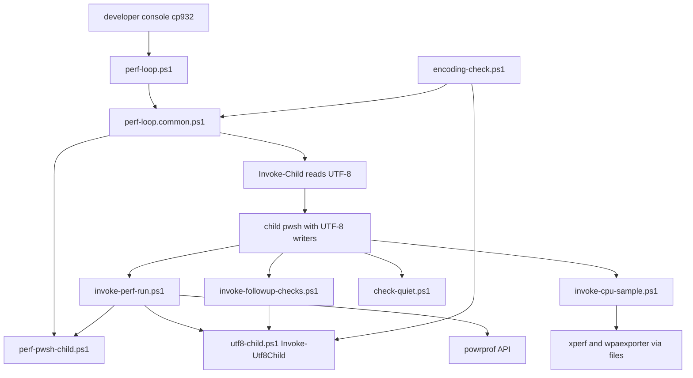
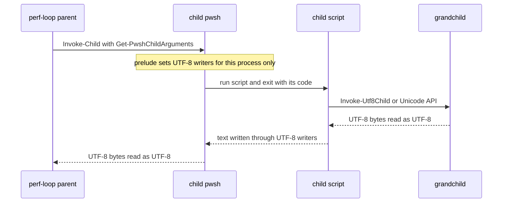

# 設計: areka-P0-perf-tools-console-encoding

## Overview

**目的**: 性能改善ループの道具（`tools/perf/*.ps1` の 7 本）が、共有の端末の文字コードを書き替えずに、子と孫の出力を 1 字違わず受け取り、自分で端末へ出す文を ASCII だけにする。`tools/encoding-check.ps1` の対象に `tools/perf/*.ps1` を入れ、書き替えや日本語の文が戻ったら判定で赤にする。

**使う人**: 性能改善ループを回す開発者（コードページ 932 の端末から `perf-loop.ps1` を回す）と、文字コードの判定を全体テスト（`tools/test-all.ps1` の段 `encoding check`）で回す開発者。

**変わること**: 今は `Invoke-PwshChild` が子の PowerShell へ「端末の出力の文字コードを UTF-8 に書き替える」文を渡しており、子が終わっても共有の端末は 65001 のまま残る（実測）。これを「子のプロセスの中で、その子自身の出力先だけを UTF-8 の書き手に替える」形に替える。書き替えが消えると、子のスクリプトが孫（`cargo`・Python・`git`・`pwsh`・`powercfg`）を素の呼び出しで受けている所が化けるので、同時にその読み方を直す。

### Goals

- どの道具も、親でも子でも、端末の文字コードの設定を書き替えない（1.1・1.2）
- 端末が 932・437・65001 のどれでも、子と孫の出力の字と、ファイルに値として残る物（`power_scheme`・`git_branch` など）が同じになる（1.3・2.1〜2.4）
- 7 本が自分で端末へ出す文は ASCII だけ。機械が読む行と、ほかの道具が読むファイルの形は変えない（4.1〜4.7）
- `tools/encoding-check.ps1` が `tools/perf/*.ps1` を調べ、今の書き替えの形（文字列を変数に組んで子へ渡す形）と、変数で渡す素の `cargo` を赤にする（5.1〜5.7）
- 932 の条件で、本物の `Invoke-PwshChild` で子の日本語が届くことを合否で判定する（6.1〜6.6）
- 一時ファイルはワークツリーの `target\` の下だけ（10.1〜10.3）

### Non-Goals

- Python のスクリプト（`judge-*.py`・`perf-*.py`）とその出す文・見本（`fixtures`・`fixtures-loop`）の変更（9.2）
- `tools/perf/` の外の `tools/*.ps1`（`tools/utf8-child.ps1` を含む）と CI の workflow の変更（9.3）。`Invoke-Utf8Child` は読み込んで使うだけ
- 道具が写す子の中身（Python の判定器の日本語の報告など）を ASCII にすること（中身は子の物・2.4）
- 出力先の根（`-OutRoot`・既定の `%LOCALAPPDATA%\areka-diag\perf-loop`・`%LOCALAPPDATA%` が無いときの `%TEMP%`）の決め方の変更（10.3）
- 実機を何分も回す計測（7.3）

## Boundary Commitments

### This Spec Owns

- `tools/perf/*.ps1` の 7 本が子と孫を起こして出力を受け取る所の読み方（棚卸の表の全行）
- 子の PowerShell に「端末を書き替えずに UTF-8 で書かせる」起こし方と、その引数の組み立て（新しい部品 `Get-PwshChildArguments`・`tools/perf/perf-pwsh-child.ps1`）
- 7 本が自分で端末へ出す文の文面（ASCII への書き直し）と、ファイルにだけ出す日本語の書き表し方
- `tools/perf/*.ps1` の一時ファイルと作業用のフォルダの置き場（ワークツリーの `target\perf-loop-tmp\` の下）
- `tools/encoding-check.ps1` の対象の広げ方・規則 C と規則 D の広げ方・較正の見本・932 の判定（perf の起こし方）・端末の文字コードの前後の比べ方
- 文書: `tools/perf/README.md` の新しい節・`perf-loop.common.ps1` の頭書と子を起こす所の注記・steering `tech.md` の 2 行・スキル `perf-loop-iteration` の 1 行

### Out of Boundary

- `tools/utf8-child.ps1`（`Invoke-Utf8Child` の引数と戻り値を含め、ファイルに手を入れない）
- `tools/test-all.ps1`（段 `encoding check` の名前・順・終了コードの約束はそのまま。判定の中身だけが広がる）
- `tools/perf/` の Python・見本・目標定義（`goals/`）
- `.github/workflows/*.yml`・`tools/package.ps1`・`tools/crates-io.ps1` ほか `tools/perf/` の外の道具
- 機械が読む行（`PERF-LOOP RESULT`・`SELFTEST RESULT`・`FOLLOWUP RESULT`・`CHECK-QUIET RESULT`・`INVOKE-CPU-SAMPLE RESULT`・`selftest <道具> ok|NG code=<n>`・`available=`・`capabilities=` ほか `key=value` の行）の字面
- 性能改善ループの判定・計測の中身と、サブコマンド・引数・終了コード・出力先の配置（9.1）

### Allowed Dependencies

- PowerShell 7 と .NET の標準の型（`System.Diagnostics.ProcessStartInfo`・`System.IO.StreamWriter`・`System.Text.UTF8Encoding`・`System.Management.Automation.Language`）
- `Add-Type -MemberDefinition` による Windows の API の呼び出し（`kernel32.dll` の `GetConsoleOutputCP`／`GetConsoleCP`、`powrprof.dll` の `PowerGetActiveScheme`／`PowerReadFriendlyName`、`kernel32.dll` の `LocalFree`）。新しい依存ではない（9.5）
- `tools/utf8-child.ps1` の `Invoke-Utf8Child`（読み込んで使うだけ・形は変えない）
- 依存の向き（逆向きの読み込みは誤り）:
  - `tools/encoding-check.ps1` → `tools/utf8-child.ps1`、`tools/encoding-check.ps1`（窓の無い子の中だけ）→ `tools/perf/perf-loop.common.ps1`
  - `tools/perf/perf-loop.ps1` → `perf-loop.common.ps1`・`perf-loop.measure.ps1`（今のまま）
  - `tools/perf/perf-loop.common.ps1` → `tools/perf/perf-pwsh-child.ps1`
  - `tools/perf/invoke-perf-run.ps1` → `tools/utf8-child.ps1`・`tools/perf/perf-pwsh-child.ps1`
  - `tools/perf/invoke-followup-checks.ps1` → `tools/utf8-child.ps1`
  - `tools/perf/perf-pwsh-child.ps1` は何も読み込まない
  - `check-quiet.ps1`・`invoke-cpu-sample.ps1` は何も読み込まない（今のまま）

### Revalidation Triggers

- `Invoke-Utf8Child` の引数・戻り値・読み方が変わる（perf の 2 本と判定が頼る）
- `Get-PwshChildArguments` の戻り値の形（前置き＋`& '<script>' <引数>; exit $LASTEXITCODE`）が変わる（`Invoke-PwshChild`・`invoke-perf-run.ps1`・932 の判定が頼る）
- `Invoke-Child`／`Invoke-PwshChild` の戻り値（`Code`・`Out`・`Err`・`Lines`・`LastLine`）が変わる（呼ぶ側 7 か所と判定が頼る）
- `tools/encoding-check.ps1` の規則・対象・自分の例外が変わる（steering `tech.md` の段 `encoding check` の説明と揃える）
- 機械が読む行の字面、`run-meta.txt` の節の見出しと鍵、`followup.txt`・`DRY-RUN.txt`・`FAILED.txt` の置き場が変わる（スキル `perf-loop-iteration`・判定器が読む）
- `tools/perf/` に `.ps1` が足される・下の階層へ移る（判定の対象の取り方は `tools/perf` の直下だけを見る）

## Architecture

### Existing Architecture Analysis

- 親の読む側は正しい: `Invoke-Child`（`perf-loop.common.ps1`）は `ProcessStartInfo` の `StandardOutputEncoding`／`StandardErrorEncoding` を UTF-8 に固定して読む。Python の子には `PYTHONIOENCODING`・`PYTHONUTF8` を渡す（`Invoke-PythonChild`）。これらは変えない（2.3）。
- 直す所は書く側: PowerShell は渡された出力先へも端末の出力の文字コードで書く。今はそれを合わせるため、子の中で `[Console]::OutputEncoding` に代入しており、共有の端末を書き替えている。
- 子のスクリプト 4 本（`check-quiet.ps1`・`invoke-cpu-sample.ps1`・`invoke-followup-checks.ps1`・`invoke-perf-run.ps1`）は単独のスクリプトで、`perf-loop.common.ps1` を読み込まない。`invoke-perf-run.ps1` は自前の `Write-Info`・`Stop-Run`・`Get-PwshPath` を持つので、`perf-loop.common.ps1` を読み込むと名前がぶつかる。
- `perf-loop.measure.ps1` は 993 行で、1,000 行の上限の手前にある。

### Architecture Pattern & Boundary Map



**Architecture Integration**:
- 選んだ形: 書く側に「そのプロセスの中だけの UTF-8 の書き手」を頼み、読む側は UTF-8 で読む。Python の子に `PYTHONIOENCODING` を渡すのと同じ考えを PowerShell の子にも当てる。孫は、相手が書く文字コードに合わせて読む（UTF-8 で書く物は UTF-8 で読む・端末の文字コードで書く OS の道具は端末の文字コードで読む・ファイルに値として残す OS の情報は Unicode の API で取る）。
- 新しい部品は 1 つだけ: `tools/perf/perf-pwsh-child.ps1` の `Get-PwshChildArguments`。子の PowerShell を起こす所が 2 つ（`Invoke-PwshChild` と `invoke-perf-run.ps1` の `check-quiet.ps1` の呼び出し）あり、前置きの文を 1 か所に置くため。`invoke-perf-run.ps1` は `perf-loop.common.ps1` を読み込めない（名前がぶつかる）ので、前置きを `perf-loop.common.ps1` に置くと 2 か所に写しができる。
- 今の形を保つ所: `Invoke-Child`・`Invoke-PythonChild`・`Invoke-PwshChild` の引数と戻り値・呼ぶ側 7 か所・出力先の配置・終了コード。
- steering との整合: `tech.md` の「道具が端末へ出す文は ASCII だけ・端末の文字コードを書き替えない・子の出力を値として読む所は `Invoke-Utf8Child`」をそのまま `tools/perf/` に当てる。

### Technology Stack

| 層 | 選んだ物 / 版 | この spec での役目 | 備考 |
|---|---|---|---|
| 道具の言語 | PowerShell 7（実測は 7.6.7） | 7 本・判定・新しい部品 | 新しい依存なし |
| 子の書き手 | .NET `System.IO.StreamWriter`＋`UTF8Encoding($false)`＋`[Console]::SetOut`／`SetError` | 子の PowerShell の出力先だけを UTF-8 にする | 端末の設定に触れない（実測で全部の出力の経路が届いた） |
| 子の読み手 | `Invoke-Child`（既存）・`Invoke-Utf8Child`（既存・読み込むだけ） | 子と孫の出力を UTF-8 で読む | 形は変えない |
| OS の API | `kernel32` `GetConsoleOutputCP`／`GetConsoleCP`・`powrprof` `PowerGetActiveScheme`／`PowerReadFriendlyName` | 端末の今の値を OS から読む・電源設定の名前を Unicode で取る | `Add-Type -MemberDefinition`（メモリの中で組む） |
| 判定 | `System.Management.Automation.Language.Parser` | 規則 A〜E と、文字列の中身の構文解析 | 既存の手を広げる |

## File Structure Plan

### Directory Structure

```
tools/
├── encoding-check.ps1          # 判定（対象・規則 C／D・較正・932 の判定・前後の比べ）
├── utf8-child.ps1              # 触らない（Invoke-Utf8Child を読み込んで使う）
└── perf/
    ├── perf-pwsh-child.ps1     # 新規: 子の PowerShell の引数を組む Get-PwshChildArguments（前置きの唯一の所在）
    ├── perf-loop.common.ps1    # Invoke-PwshChild を新しい部品へ差し替え・文面・注記
    ├── perf-loop.ps1           # 文面・自己較正の作業用のフォルダを target\ の下へ・日本語の突き合わせを `u{} で
    ├── perf-loop.measure.ps1   # 文面だけ（行を増やさない）
    ├── check-quiet.ps1         # 文面だけ
    ├── invoke-cpu-sample.ps1   # 文面・一時ファイルを target\ の下へ・OS の道具の出力を端末の文字コードで読む
    ├── invoke-followup-checks.ps1  # 文面・cargo と Python を Invoke-Utf8Child で・ログの目印を $LOG_MARKER_* へ
    ├── invoke-perf-run.ps1     # 文面・git と check-quiet を UTF-8 で読む・電源設定を API で取る・規則 B の 1 件
    └── README.md               # 新しい節「端末の文字コードと子の出力」
```

### Modified Files

- `tools/perf/perf-pwsh-child.ps1`（新規）— `Get-PwshChildArguments` だけを定義する読み込み用のファイル。前置きの文と引数の引用の規則を持つ（今の `Invoke-PwshChild` の 302〜311 行の引用の規則を移す）。
- `tools/perf/perf-loop.common.ps1` — `perf-pwsh-child.ps1` を読み込む。`Invoke-PwshChild` は `Invoke-Child -Exe <pwsh> -Arguments (Get-PwshChildArguments ...)` だけになる。`Invoke-Child`・`Invoke-PwshChild`・`Stop-Run`・`Test-ResumeArtifact`・`Get-LoopDir` ほかの文面と投げる例外の文を ASCII に。頭書 ⒝（17〜25 行）と `Invoke-PwshChild` の注記（281〜286 行）を実際の動きに合わせる（8.2）。
- `tools/perf/perf-loop.ps1` — 文面を ASCII に。`Test-GoalTextMatchesGoalMd` の作業用のフォルダ（272 行）を `target\perf-loop-tmp\` の下へ。313・315 行の正規表現の日本語を `` `u{…} `` で書く（4.7）。
- `tools/perf/perf-loop.measure.ps1` — 文面を ASCII に（行の中で書き替え、行を足さない。直した後の行数は 993 以下）。
- `tools/perf/check-quiet.ps1` — 文面を ASCII に（子を起こさない）。
- `tools/perf/invoke-cpu-sample.ps1` — 文面を ASCII に（`Write-Problem` の前置き `エラー: ` を `error: ` に）。`Invoke-NativeCommand`（202〜203 行）の受け皿と `-Probe` の作業用のフォルダ（342 行）を `target\perf-loop-tmp\` の下へ。受け皿のファイルを端末の出力の文字コードで読む。
- `tools/perf/invoke-followup-checks.ps1` — `tools/utf8-child.ps1` を読み込む。`Get-NarSampleMap` の `& cargo @cargoArgs`（245 行）と `Invoke-Judge` の `& $Python.Exe @argv | ForEach-Object { Write-Host $_ }`（290 行）を `Invoke-Utf8Child` に替える。478 行の目印を `$LOG_MARKER_SHOW_READY` への代入に移す。`Write-Note`（`followup.txt`）を含む文面を ASCII に。
- `tools/perf/invoke-perf-run.ps1` — `tools/utf8-child.ps1` と `perf-pwsh-child.ps1` を読み込む。`git`（329〜334 行）を `Invoke-Utf8Child` に、`Invoke-CheckQuietOnce`（407 行）を `Invoke-Utf8Child` ＋ `Get-PwshChildArguments` に、`powercfg /getactivescheme`（316 行）を `powrprof` の API に替える。864 行の規則 B の 1 件を直す。`run-meta.txt` の節の見出しを `` `u{…} `` で書く。ほかの文面を ASCII に。
- `tools/encoding-check.ps1` — 下の「判定」の節のとおり。頭書（2〜42 行）の規則の説明を合わせる。
- `tools/perf/README.md` — 第 11 節に小節「端末の文字コードと子の出力」を足す（8.1）。
- `.kiro/steering/tech.md` — 93 行（段 `encoding check` の「`tools/perf/` を除く」を外し、規則 C・D の広がりと perf の 932 の判定を足す）と 97 行（決まりの対象に `tools/perf/` を含めると明記）（8.3）。
- `.claude/skills/perf-loop-iteration/SKILL.md` — 29 行の注記を「道具が写した子の中身（例: Python の判定器の日本語の報告）は、端末の文字コードと会話へ届ける仕組みの組み合わせで化けることがある」に狭める（8.4）。

## System Flows



- 前置きは子のプロセスの中のその子の書き手だけを替える。端末の出力・入力の文字コード、コードページ、`$OutputEncoding` には触れない（1.1）。
- 孫を読む所は「相手が書く文字コードで読む」。UTF-8 で書く物（`cargo`・`git`・`reconfigure` 済みの Python・前置き付きの `pwsh`）は `Invoke-Utf8Child`、端末の文字コードで書く OS の道具（xperf・wpaexporter）は端末の文字コードで、ファイルに値として残す OS の情報（電源設定）は Unicode の API で取る。

## Requirements Traceability

| 要件 | 要約 | 部品 | 契約 | 流れ |
|---|---|---|---|---|
| 1.1 | 書き替えない | PwshChildArgs・PerfLoopCommon | 前置きは `SetOut`／`SetError` だけ | 子の起こし方 |
| 1.2 | 回し終えた後も同じ（OS の値で比べる） | EncodingCheck（前後の比べ・perf の 932 の判定）・手元の確かめ | `Get-ConsoleCodePages` | 判定 |
| 1.3 | どのコードページでも同じ結果 | InvokePerfRun（`power_scheme`・`git_branch`）・InvokeCpuSample（端末の文字コードで読む） | 孫の読み方の表 | 孫の読み方 |
| 2.1 | 子の PowerShell の字を 1 字違わず | PwshChildArgs・PerfLoopCommon | 前置き＋`Invoke-Child` | 子の起こし方 |
| 2.2 | 孫の字を化けさせない | InvokeFollowupChecks・InvokePerfRun・InvokeCpuSample | 棚卸の表 | 孫の読み方 |
| 2.3 | 今の正しい読み方を後退させない | PerfLoopCommon（`Invoke-Child`・`Invoke-PythonChild` は変えない） | — | — |
| 2.4 | 写す所は中身を変えない | PerfLoopCommon（`Invoke-Child` の写し）・InvokeFollowupChecks（判定器の行を行のまま写す） | — | — |
| 3.1 | 7 本の受け取る所を挙げる | 棚卸の表 | — | — |
| 3.2 | 端末の文字コードで解く所を直す | 棚卸の表の「直す」の行 | — | — |
| 3.3 | 扱いを 0 件も含めて残す | 棚卸の表（本書） | — | — |
| 4.1 | 自分で出す文は ASCII | 7 本の文面 | 文面の規則 R1 | — |
| 4.2 | 埋め込む値は書き替えない | 7 本の文面 | 文面の規則 R1 | — |
| 4.3 | 意味と終了コードを落とさない | 7 本の文面 | 文面の規則 R1 | — |
| 4.4 | 機械が読む行の字面を変えない | 7 本の文面 | 文面の規則 R0 | — |
| 4.5 | ほかの道具が読むファイルの形を変えない | InvokePerfRun（`run-meta.txt`）・InvokeFollowupChecks（`followup.txt`） | 文面の規則 R2・R3 | — |
| 4.6 | 端末とファイルの両方へ出す文は ASCII | InvokePerfRun（`FAILED.txt`）・InvokeFollowupChecks（`Stop-Run`） | 文面の規則 R1 | — |
| 4.7 | Python の日本語との突き合わせを保つ | PerfLoop（313・315 行） | 文面の規則 R2 | — |
| 5.1 | 対象に入れる | EncodingCheck | 対象の取り方 | 判定 |
| 5.2 | 直した後は緑 | EncodingCheck・7 本 | — | 判定 |
| 5.3 | 子へ渡す文の中の書き替えも赤 | EncodingCheck（規則 C の文字列の中身） | 規則 C | 判定 |
| 5.4 | 端末へ出す日本語は赤 | EncodingCheck（規則 A） | 規則 A | 判定 |
| 5.5 | 今の対象の合否と較正を保つ | EncodingCheck | 較正の見本 | 判定 |
| 5.6 | 今の約束を保つ | EncodingCheck | 約束の一覧 | 判定 |
| 5.7 | 変数で渡す素の cargo も赤 | EncodingCheck（規則 D の値の追跡） | 規則 D | 判定 |
| 6.1 | 932 で perf の起こし方で見本が届けば合格 | EncodingCheck（perf の 932 の判定） | `-PerfSampleChild` | 判定 |
| 6.2 | 端末に頼る形へ戻れば赤 | EncodingCheck（本番の確かめ） | 同上 | 判定 |
| 6.3 | 壊れることを先に確かめる | EncodingCheck（較正の確かめ） | 同上 | 判定 |
| 6.4 | 判定を回す端末を書き替えない | EncodingCheck（前後の比べを OS の値で） | `Get-ConsoleCodePages` | 判定 |
| 6.5 | 機械のコードページに依らない | EncodingCheck（自分だけの端末を 932 にする既存の子の中で回す） | — | 判定 |
| 6.6 | 一時ファイルは target\ の下だけ | EncodingCheck（一時ファイルを作らない） | — | 判定 |
| 7.1 | 932 で selftest が緑・前後同じ | 手元の確かめ | — | Testing Strategy |
| 7.2 | 932 で preflight と -DryRun が同じ終了コード | 手元の確かめ | — | Testing Strategy |
| 7.3 | 重い計測を要しない | 手元の確かめ | — | Testing Strategy |
| 7.4 | 確かめの結果を残す | `research.md` の「手元での確かめの記録」 | — | Testing Strategy |
| 8.1 | README | `tools/perf/README.md` | — | — |
| 8.2 | 頭書と注記 | PerfLoopCommon | — | — |
| 8.3 | steering `tech.md` | `.kiro/steering/tech.md` | — | — |
| 8.4 | スキルの注記 | `.claude/skills/perf-loop-iteration/SKILL.md` | — | — |
| 9.1 | サブコマンド・引数・終了コード・配置を変えない | 全部品 | — | — |
| 9.2 | Python と見本に触れない | 境界 | — | — |
| 9.3 | `Invoke-Utf8Child` と外の道具と CI を変えない | 境界 | — | — |
| 9.4 | 各ファイル 1,000 行以下 | PerfLoopMeasure（行を足さない）・全 7 本 | — | — |
| 9.5 | 依存を足さない | Technology Stack | — | — |
| 10.1 | 一時ファイルは target\ の下だけ | PerfLoop・InvokeCpuSample | `target\perf-loop-tmp\` | — |
| 10.2 | target\ が無ければ作り直す | PerfLoop・InvokeCpuSample | `New-Item -Force` | — |
| 10.3 | 出力先の根の決め方を変えない | PerfLoopCommon（`Resolve-OutRoot` に触れない） | — | — |

## Components and Interfaces

| 部品 | 層 | 役目 | 要件 | 主な依存 | 契約 |
|---|---|---|---|---|---|
| PwshChildArgs（`perf-pwsh-child.ps1`） | 子の起こし方 | 子の PowerShell の引数を前置き付きで組む | 1.1, 2.1 | なし | Service |
| PerfLoopCommon（`perf-loop.common.ps1`） | 子の起こし方・表示 | `Invoke-PwshChild` を新しい部品に替える・文面 | 1.1, 2.1, 2.3, 2.4, 4.1〜4.4, 8.2, 10.3 | PwshChildArgs（P0） | Service |
| InvokePerfRun（`invoke-perf-run.ps1`） | 子のスクリプト | 孫の読み方 3 種・`run-meta.txt` | 1.3, 2.2, 4.1〜4.6 | Invoke-Utf8Child（P0）・PwshChildArgs（P0）・powrprof（P1） | Service |
| InvokeFollowupChecks（`invoke-followup-checks.ps1`） | 子のスクリプト | 孫の読み方 2 種・ログの目印 | 2.2, 2.4, 4.1〜4.6 | Invoke-Utf8Child（P0） | Service |
| InvokeCpuSample（`invoke-cpu-sample.ps1`） | 子のスクリプト | OS の道具の読み方・一時ファイルの置き場 | 1.3, 2.2, 4.1, 10.1, 10.2 | なし | Service |
| PerfLoop・PerfLoopMeasure・CheckQuiet | 入口・計測・子のスクリプト | 文面・自己較正の作業用のフォルダ | 4.1〜4.7, 9.4, 10.1, 10.2 | PerfLoopCommon（P0） | — |
| EncodingCheck（`tools/encoding-check.ps1`） | 判定 | 対象・規則 C／D・較正・perf の 932 の判定・前後の比べ | 1.2, 5.1〜5.7, 6.1〜6.6 | Invoke-Utf8Child（P0）・PerfLoopCommon（P0・窓の無い子の中だけ） | Batch |

### 子の起こし方

#### PwshChildArgs

| 項目 | 内容 |
|---|---|
| 役目 | 子の PowerShell に .ps1 を回させる引数の並びを、UTF-8 の書き手の前置き付きで組む |
| 要件 | 1.1, 2.1 |

**責務と制約**
- 前置きの文の唯一の所在。ほかのファイルに前置きの写しを置かない。
- 前置きは、そのプロセスの標準出力と標準エラーを、BOM の無い UTF-8 の `StreamWriter`（`AutoFlush` を立てる）に替える。`[Console]::SetOut`／`[Console]::SetError` だけを使い、`[Console]::OutputEncoding`・`InputEncoding`・`$OutputEncoding`・`chcp` には触れない。
- 前置きは自分だけの範囲（`& { … }`）で回し、子のスクリプトから見える変数を残さない。
- 引数の引用の規則は今の `Invoke-PwshChild` と同じ（`^-[A-Za-z][A-Za-z0-9]*$` の形は素で、それ以外は単引用符で括り `'` を `''` にする）。

**Contracts**: Service [x]

##### Service Interface

```powershell
function Get-PwshChildArguments {
    [OutputType([string[]])]
    param(
        [Parameter(Mandatory)][string]$ScriptPath,   # 回す .ps1 の絶対パス
        [string[]]$Arguments = @()                    # 子のスクリプトへ渡す引数（1 要素 1 引数）
    )
    # 戻り値: @('-NoProfile', '-NonInteractive', '-Command', '<前置き>; & ''<ScriptPath>'' <引数>; exit $LASTEXITCODE')
}
```
- 事前条件: なし（パスの在る無しは呼ぶ側が確かめる）
- 事後条件: 戻り値を `ProcessStartInfo.ArgumentList`（`Invoke-Child`・`Invoke-Utf8Child`）に渡して子の pwsh を起こすと、子の標準出力と標準エラーは端末の文字コードに依らず UTF-8 のバイトで来る。子の終了コードはスクリプトの `exit` の値になる（今と同じ）
- 不変条件: 子の中で端末の文字コードの設定を書き替える文を含まない（判定の規則 C で見張る）

**Implementation Notes**
- 統合: `perf-loop.common.ps1` と `invoke-perf-run.ps1` が `. (Join-Path $PSScriptRoot 'perf-pwsh-child.ps1')` で読み込む。
- 確かめ: 判定の perf の 932 の判定（`Invoke-PwshChild` 経由）と `perf-loop.ps1 selftest`（子 3 本を回す）。
- 危うさ: `AutoFlush` を立てないと `exit` の手前の出力が落ちうる。`Write-Error` の色の符号は前置きの有無で変わらない（実測）。

#### PerfLoopCommon（`Invoke-PwshChild` と文面）

| 項目 | 内容 |
|---|---|
| 役目 | 子の PowerShell を前置き付きで起こし、UTF-8 で読む。表示と例外の文を ASCII にする |
| 要件 | 1.1, 2.1, 2.3, 2.4, 4.1〜4.4, 8.2, 10.3 |

**責務と制約**
- `Invoke-PwshChild` の引数（`ScriptPath`・`Arguments`・`Quiet`）と戻り値（`Code`・`Out`・`Err`・`Lines`・`LastLine`）は変えない。呼ぶ側 7 か所（`perf-loop.measure.ps1` 5・`perf-loop.ps1` 2）は触らない。
- `Invoke-Child`・`Invoke-PythonChild`・`Resolve-OutRoot` の動きは変えない（文面だけ ASCII に）。
- 子を起こせないときに持ち帰る文（今の `実行体がありません`・`起動できません`・`pwsh が見つかりません`・`スクリプトがありません`）を ASCII に（4.1）。例: `executable not found: <path>`・`cannot start: <message>`・`pwsh not found`・`script not found: <path>`。

**Contracts**: Service [x]（既存の `Invoke-PwshChild` の契約のまま・中身だけ替える）

### 子のスクリプト

#### InvokePerfRun

| 項目 | 内容 |
|---|---|
| 役目 | 孫の `git`・`pwsh`（`check-quiet.ps1`）を UTF-8 で読み、電源設定を Unicode の API で取る |
| 要件 | 1.3, 2.2, 4.1〜4.6 |

**責務と制約**
- `Get-SourceFacts`: `git -C <root> rev-parse HEAD`／`rev-parse --abbrev-ref HEAD`／`status --porcelain` を `Invoke-Utf8Child git @(...)` で回す。`Code -ne 0` のときは今と同じく値の代わりに失敗の札を入れる（札の文面は ASCII）。`git_dirty_files` は空でない行の数（今と同じ）。
- `Invoke-CheckQuietOnce`: `Invoke-Utf8Child (Get-PwshPath) (Get-PwshChildArguments -ScriptPath $ScriptPath -Arguments @('-Stage', $Stage, '-OutDir', $TargetOutDir[, '-GoalFile', $GoalFilePath]))` で回し、標準出力の行、続いて標準エラーの行を `Write-Info` で行のまま写し、`Code` を返す。今の `2>&1` の混ざる順（標準出力と標準エラーの交互）は保たない（標準出力の後に標準エラー）。
- `Get-MachineFacts` の `power_scheme`: `powrprof.dll` の `PowerGetActiveScheme`（GUID）と `PowerReadFriendlyName`（UTF-16 の名前）を `Add-Type -MemberDefinition` で呼び、`<GUID> (<名前>)` の形で入れる（例: `d7a728f8-6d8b-4ab7-a3e3-7aaeb0f9871c (Sonos)`）。取れないときは `(unavailable: <理由>)`。`powercfg` は使わない（端末の文字コードで書き、437 の端末では日本語の名前が `?` に落ちると実測）。値の文は `powercfg` の地域語の行から変わるが、鍵と節は変わらず、この値を読む道具は無い（`judge-perf.py` は見出しと鍵で引き、`power_scheme` は引かない）。
- `run-meta.txt` の節の見出し（`実行`・`対象`・`較正値`・`マシン`・`ソース`・`結果`）は字を変えず、字句は `` `u{…} `` で書く（R2）。
- 規則 B の 1 件（864 行）: 失敗の文に `$LOG_MARKER_SMOKE_GATE` の中身を埋めず、名前 `LOG_MARKER_SMOKE_GATE` で言う。目印の文言そのものは `run-meta.txt` の `[較正値]` に今も残る。
- `Stop-Run` の文は端末と `FAILED.txt` の両方へ出るので ASCII（4.6）。`DRY-RUN.txt` の本文は ASCII の英文（R3）。

**Contracts**: Service [x]（スクリプトの引数・終了コード・出力先は変えない）

#### InvokeFollowupChecks

| 項目 | 内容 |
|---|---|
| 役目 | 孫の `cargo`（`nar-sample-path`）と Python（`judge-followup.py`）を UTF-8 で読む |
| 要件 | 2.2, 2.4, 4.1〜4.6 |

**責務と制約**
- `Get-NarSampleMap`: `Invoke-Utf8Child cargo $cargoArgs` で回し、`Out` を行に分けて今と同じく `key=value` の表にする。`Code -ne 0` のときは `ErrLines` を `Write-Info` で写してから `Stop-Run`（今は「理由は上の標準エラーに出ています」＝標準エラーが端末へ直に出ていた。写すことで同じ情報が残る）。起こせない（`throw`）ときは今と同じく `Stop-Run`。
- `Invoke-Judge`: `Invoke-Utf8Child $Python.Exe (@($Python.Prefix) + $Arguments)` で回し、`Out` の行、続いて `ErrLines` を `Write-Host` で行のまま写し、`$script:JudgeExitCode` に `Code` を入れる。`judge-followup.py` は入口で標準出力と標準エラーを UTF-8 に寄せる（894〜899 行）ので、UTF-8 で読めば字のとおり。
- 478 行の目印 `apply\(ShowSurface\): 表示・マスクを更新` を `$LOG_MARKER_SHOW_READY = '…'` の代入に移し、`Wait-RunLogPattern -Pattern $LOG_MARKER_SHOW_READY` で使う（規則 A の例外の内・R2）。目印を展開文字列に埋めない（規則 B）。
- `Write-Note`（`followup.txt`・ファイルにだけ出す）と `Stop-Run`（端末と `followup.txt`）の文は ASCII の英文（R1・R3）。`FOLLOWUP RESULT` の行は変えない。

**Contracts**: Service [x]

#### InvokeCpuSample

| 項目 | 内容 |
|---|---|
| 役目 | xperf・wpaexporter の出力を化けさせずに読み、一時ファイルを `target\` の下に作る |
| 要件 | 1.3, 2.2, 4.1, 10.1, 10.2 |

**責務と制約**
- `Invoke-NativeCommand`: 受け皿の 2 つのファイルを `<ワークツリー>\target\perf-loop-tmp\` の下に一意の名前で作り（フォルダが無ければ `New-Item -ItemType Directory -Force` で作り直す）、`finally` で消す。読むときは `Get-Content -Raw -Encoding ([Console]::OutputEncoding)`（端末の出力の文字コード）で読む。xperf と wpaexporter は渡された出力先へ端末の出力の文字コードで書く（`powercfg` で実測・xperf は端末の文字コードに依らず同じ ASCII のバイトを書き、日本語の字は自分で落とすと実測）。今は共有の端末が 65001 に書き替わっていたので UTF-8 で読んで合っていたが、書き替えを消すと食い違う。
- `-Probe` の作業用のフォルダ（342 行）も `target\perf-loop-tmp\areka-cpu-probe-<guid>` へ。
- ワークツリーの根は `Split-Path -Parent (Split-Path -Parent $PSScriptRoot)`（ほかの子のスクリプトと同じ求め方）。
- xperf が `-o` で書く dump は xperf が自分でファイルに書く物で、端末を通らない。読み方は変えない。

**Contracts**: Service [x]

#### PerfLoop・PerfLoopMeasure・CheckQuiet（文面と作業用のフォルダ）

- `perf-loop.ps1` の `Test-GoalTextMatchesGoalMd`: 作業用のフォルダを `<ワークツリー>\target\perf-loop-tmp\perf-loop-selftest-<guid>` に作る（`$repoRoot` は 246 行で求め済み・`New-Item -Force` で `target\` ごと作り直す）。`finally` で消すのは今のまま。313 行 `(\d+)\s*文字`・315 行 `本文は\s*([\d,]+)\s*字` は、二重引用符の文字列の中で日本語の字を `` `u{…} `` で書き、突き合わせる字は変えない（4.7）。
- `perf-loop.measure.ps1`: 文面だけを行の中で書き替える。直した後の行数は 993 以下（9.4）。
- `check-quiet.ps1`: 文面だけ。

**Implementation Notes**（子のスクリプト共通）
- 統合: `invoke-perf-run.ps1`・`invoke-followup-checks.ps1` は `. (Join-Path (Split-Path -Parent $PSScriptRoot) 'utf8-child.ps1')` で読み込む。
- 確かめ: `perf-loop.ps1 selftest`（`invoke-followup-checks.ps1 -SelfTest` が `Invoke-Judge` を通る）・`-DryRun`・判定。
- 危うさ: 標準出力と標準エラーの交互の順は保たない（人が読む写しだけで、機械が読む行は標準出力の 1 行なので影響しない）。

### 判定

#### EncodingCheck

| 項目 | 内容 |
|---|---|
| 役目 | `tools/perf/*.ps1` を対象に入れ、規則 C・D を今の perf の形まで広げ、perf の起こし方での 932 の判定を足し、前後の端末の値を OS から読んで比べる |
| 要件 | 1.2, 5.1〜5.7, 6.1〜6.6 |

**Contracts**: Batch [x]

##### Batch / Job Contract

- **きっかけ**: `pwsh -NoProfile -File tools/encoding-check.ps1`（段 `encoding check`・手で回すのも同じ）。終了コード 0＝全部合格・1＝1 つ以上不合格（今のまま）。
- **対象**（5.1）: `tools/*.ps1`・`tools/perf/*.ps1`（どちらも直下だけ）・`.github/workflows/*.yml` の `run:` の本文。`tools/perf/` の `.ps1` は `tools/*.ps1` と同じ規則 A〜D で調べる。規則 E の対象は今のまま。
- **規則 C の広がり**（5.3）: 今の検査（代入・`chcp`・子の pwsh の `-Command`／`-c` の次の文字列）に、次を足す。対象の中のすべての文字列（単引用符・二重引用符・ヒア文字列）のうち、字面に `Encoding` か `chcp` を含むもの（大文字小文字を問わない・速さのための前の絞り）を PowerShell として構文解析し、今の規則 C と同じ見方（`[Console]`／`[System.Console]` の `OutputEncoding`・`InputEncoding` への代入・`$OutputEncoding` への代入・`chcp`／`chcp.com` のコマンド）で当たれば、その文字列の行で赤にする。これで「文字列を変数に組み、`ProcessStartInfo.ArgumentList` に渡す」形（今の `perf-loop.common.ps1:310`）を捕まえる。
  - 自分の例外: `tools/encoding-check.ps1` 自身には、この文字列の中身の検査を当てない（規則の語彙と較正の見本を文字列で持つため。実測で 113 行の `'chcp'` と較正の見本 9 個が当たる）。`tools/encoding-check.ps1` の文字列でない所の検査と、`-Command` の次の文字列の検査は今のまま当てる。
  - `[Console]::SetOut`／`SetError` は書き替えではないので当てない（前置きは赤にならない）。
- **規則 D の広がり**（5.7）: 素の `cargo`／`cargo.exe` の呼び出しの引数に変数（`@x` の展開・`$x`）があれば、同じファイルの中のその変数への代入（`=`・`+=`）の右辺から、文字列の定数を集める。集め方は「文字列の定数・配列（`@(…)`・`,` の並び）・`+`・括弧・ほかの変数（同じ規則で追い、同じ変数は 1 度だけ）」だけを辿り、コマンドの結果・メンバーの参照・メソッドの呼び出しの値は辿らない。集めた字に `metadata` か `nar-sample-path` があれば赤。変数の名前で辿る（範囲は見ない＝広めに当たる側へ寄せる）。今の対象では `tools/crates-io.ps1` の `cargo publish … @pArgs`（`$pArgs = $PUBLISH | ForEach-Object { '-p', $_ }`＝パイプの値なので辿らない）が当たらないこと、`invoke-followup-checks.ps1:245`（`$cargoArgs = @($NAR_SAMPLE_ARGS) + …` → `$NAR_SAMPLE_ARGS` に `nar-sample-path`）が直す前は当たることを確かめる。
- **較正の見本**（5.5）: 今の 27 見本はそのまま。足す見本（文字列は ASCII・日本語は `` `u{…} ``）:
  - 赤（C）: 前置きを変数に組んで `ArgumentList` に渡す形（`$inner = '[Console]::OutputEncoding=[System.Text.UTF8Encoding]::new($false); ' + $x; $psi.ArgumentList.Add($inner)`）
  - 赤（C）: 引数の配列の中の `'chcp 65001'`（`$a = @('-Command', 'chcp 65001')`）
  - 緑: UTF-8 の書き手の前置き（`[Console]::SetOut($w); [Console]::SetError($e)` を持つ文字列）
  - 赤（D）: `$a = @('metadata', '--no-deps'); & cargo @a`
  - 赤（D）: 2 段の変数（`$b = @('run', '--bin', 'nar-sample-path'); $c = @($b) + @('x'); cargo @c`）
  - 緑（D）: パイプの値（`$p = $names | ForEach-Object { '-p', $_ }; cargo publish @p`）
  - 緑（D）: 当たらない字だけの変数（`$a = @('build', '--release'); & cargo @a`）
- **perf の 932 の判定**（6.1〜6.6）: 今の窓の無い子（`-Cp932Child`・自分だけの端末を 932 にする）の中で、今の 3 つの確かめの後に次を行う。
  - 子は `tools/perf/perf-loop.common.ps1` を読み込む（本物の `Invoke-PwshChild`・`Invoke-Child` を使うため）。
  - 見本を出す孫は、このスクリプト自身を内部の引数 `-PerfSampleChild` で回したもの。孫は決まった見本 `<U+7248><U+2460><U+1F600>`（932 で 0x88 で終わる字・932 にある字・932 に無い字）を、`Write-Output`・`Write-Host`（標準出力）と `[Console]::Error.WriteLine`（標準エラー）で、`out1=`・`out2=`・`err1=` を頭に付けて 1 行ずつ出し、0 で終わる。手で端末から回したとき（標準出力か標準エラーが端末のとき）は、ASCII の 1 行を出して 1 で終わり、見本を出さない（端末へ ASCII だけ・5.6）。
  - 較正の確かめ（6.3）: `Invoke-Child -Exe <pwsh> -Arguments @('-NoProfile', '-NonInteractive', '-File', <自分>, '-PerfSampleChild') -Quiet`（前置きの無い・端末に頼る形）で読んだ行が見本と 1 字違わず一致したら `FAIL … cannot detect a regression`（壊れない条件では戻りを捕まえられない）。
  - 本番の確かめ（6.1・6.2）: `Invoke-PwshChild -ScriptPath <自分> -Arguments @('-PerfSampleChild') -Quiet` の `Code` が 0、`Out` が `out1=<見本>`・`out2=<見本>` の 2 行、`Err` が `err1=<見本>` の 1 行と 1 字違わず一致すれば `PASS`、違えば `FAIL`（`Show-Ascii` で字を `\uXXXX` にして示す）。
  - 端末が変わっていないことの確かめ（1.2）: 本番の確かめの後、子は自分の端末の出力・入力の文字コードを OS から読み（`Get-ConsoleCodePages`）、932・932 のままでなければ `FAIL`（前置きが書き替えの形に戻されたとき、字は届いても端末が 65001 に変わるのでここで捕まる）。
- **前後の比べ**（1.2・6.4）: 今の「own console code pages unchanged」は .NET が覚えた値（`[Console]::OutputEncoding.CodePage`）で比べていて、子の書き替えに気付けない。`Get-ConsoleCodePages`（`Add-Type -MemberDefinition` で `kernel32.dll` の `GetConsoleOutputCP`・`GetConsoleCP` を呼ぶ・戻りは `@(<出力>, <入力>)`）で、始めと終わりに OS から読んで比べる。行の文面は今のまま。
- **約束**（5.6・6.6）: 何も書き出さない・一時ファイルを作らない（`Add-Type` はメモリの中で組む）・端末へ ASCII だけを出す・判定を回す端末の文字コードを書き替えない（書き替えは窓の無い子の自分だけの端末だけ・`Set-OwnConsoleCp932` のまま）・環境変数を出さない。
- **出力**: 足した確かめの行は今の形（`PASS cp932 child: …`／`FAIL cp932 child: …`・ASCII）。親は今のとおり子の行を写し、`FAIL` を集める。

**Implementation Notes**
- 統合: `-PerfSampleChild` は `-Cp932Child` と並ぶ内部の引数。`perf-loop.common.ps1` を読み込むのは `-Cp932Child` の枝の中だけ（親のプロセスには入れない）。
- 確かめ: 直した後の実物で `encoding check: all passed`。較正の見本の全部が期待どおり。
- 危うさ: 文字列の中身の構文解析は 8,000 個余りの文字列に当てると 15 秒かかった（実測）ので、前の絞りを必ず入れる。規則 D の追跡は名前で辿るので、同じ名前の別の変数に `metadata` があれば赤になる（広めに当たる側・直すのは変数の名前を分けること）。

## 子の出力を受け取る所の棚卸（要件 3）

扱いの語: **直す**＝この spec で読み方を替える・**もとから**＝もとから端末に依らない（UTF-8 で読む）・**ファイル**＝端末を通らない（ファイルを介して受け取る）・**API**＝子を起こさずプロセスの中の API で取る。

| スクリプト | 受け取る所（今の行） | 相手 | 扱い |
|---|---|---|---|
| `perf-loop.common.ps1` | `Invoke-Child`（188） | 任意 | もとから（`StandardOutputEncoding` を UTF-8） |
| | `Invoke-PythonChild`（270） | Python | もとから（`PYTHONIOENCODING`・`PYTHONUTF8`） |
| | `Invoke-PwshChild`（287） | pwsh | **直す**（前置きを `SetOut`／`SetError` に・`Get-PwshChildArguments`） |
| | `Get-NarSampleMap`（129・`Invoke-Child`） | cargo | もとから |
| | `Sync-MeasureWorktreeBuild`（663・`Invoke-MeasureCargo`） | cargo | もとから |
| `perf-loop.measure.ps1` | `Invoke-PwshChild` 5 か所（267・293・638・659・913） | pwsh | 部品の直しで足りる（呼ぶ側は変えない） |
| | `Invoke-PythonChild` 3 か所（337・424・811） | Python | もとから |
| | `Invoke-Child` 2 か所（448・449） | git | もとから |
| | `Invoke-MeasureCargo`（470・`Invoke-Child`） | cargo | もとから |
| `perf-loop.ps1` | `Invoke-PythonChild` 5 か所（279・283・291＝`Test-GoalTextMatchesGoalMd`、373＝自己較正、521＝preflight） | Python | もとから |
| | `Invoke-Child`（418・`python -c`） | Python | もとから（ASCII の版の字） |
| | `Invoke-PwshChild` 2 か所（375・427） | pwsh | 部品の直しで足りる |
| `check-quiet.ps1` | なし（性能カウンタ・プロセスの一覧はプロセスの中の API） | — | 0 件 |
| `invoke-cpu-sample.ps1` | `Invoke-NativeCommand`（205・呼ぶ所 347・352・354・359・407・447・467・472） | xperf・wpaexporter | **直す**（受け皿を `target\` の下へ・端末の出力の文字コードで読む）。受け皿のファイルを介すので端末の字に解き直されることはない |
| | dump の読み（`-o` で xperf が書くファイル・487） | xperf | ファイル（変えない） |
| `invoke-followup-checks.ps1` | `Get-NarSampleMap` の `& cargo @cargoArgs`（245） | cargo | **直す**（`Invoke-Utf8Child`） |
| | `Invoke-Judge` の `& python … \| Write-Host`（290・呼ぶ所 365・836） | Python | **直す**（`Invoke-Utf8Child`） |
| | `Start-Process areka.exe -RedirectStandardOutput`（464）と実行ログの読み | areka | ファイル（`-Encoding utf8` で読む・変えない） |
| `invoke-perf-run.ps1` | `& powercfg /getactivescheme`（316） | powercfg | **直す**（`powrprof` の API・`power_scheme`） |
| | `& git rev-parse`／`status --porcelain`（329・332・334） | git | **直す**（`Invoke-Utf8Child`） |
| | `Invoke-CheckQuietOnce` の `& pwsh -File check-quiet.ps1 2>&1`（407） | pwsh | **直す**（`Invoke-Utf8Child`＋`Get-PwshChildArguments`） |
| | `Start-Process areka.exe -RedirectStandardOutput`（745）と実行ログの読み（862） | areka | ファイル（変えない） |

## 端末へ出す文の規則（要件 4）

- **R0 機械が読む行**: Out of Boundary に挙げた行の字面は 1 字も変えない。`selftest <道具> ok|NG code=<n> | <説明>` は `|` より前が機械の部分で、後ろの説明は R1 に従う。
- **R1 端末へ出す文**（端末とファイルの両方へ出す文を含む）: 道具が自分で書く文面を ASCII の英文に書き直す。どの段の・何が・どの値で失敗したか・次に何をするかを残す（4.3）。値（パス・子の出力の行・目標の名前・`LastLine`）は書き替えずに埋め込む（4.2）。区切りの `・` は `, ` に、全角の括弧は半角に。終了コードは変えない。
- **R2 ファイルにだけ出す日本語で、ほかの道具や外の文言と字で突き合わせる物・見出しとして読まれる物**: 字を変えず、字句は ASCII で書く。ログの目印は `$LOG_MARKER_*` への代入（規則 A の例外）に置き、ほかは二重引用符の文字列の中で `` `u{…} `` で書く。該当: `run-meta.txt` の節の見出し 6 つ・`$LOG_MARKER_SMOKE_GATE`（今のまま）・`$LOG_MARKER_SHOW_READY`（移す）・`perf-loop.ps1` の正規表現 2 つ。
- **R3 ファイルにだけ出す、人が読むだけの文**（`DRY-RUN.txt`・`FAILED.txt` の本文の決まり文句・`followup.txt` の覚え書き・`run-meta.txt` の値の失敗の札）: ASCII の英文に書き直す。これらを中身で読む道具は無く（判定器は `followup-verdict.txt` と `run-meta.txt` の鍵を読む）、ファイルの名前・行の並び・鍵は変えない（4.5）。
- 書き直しのとき R0〜R2 に当たる字を網に掛けないこと。実装では、直す前に 7 本の機械の行（`RESULT`・`key=value`）を一覧にして、直した後に同じ字面で残っていることを確かめる。

## Error Handling

- 子を起こせない・スクリプトが無い: 今のとおり `Code = -1` と 1 行の文を持ち帰る（文は ASCII）。
- `Invoke-Utf8Child` の `throw`（コマンドが無い・起こせない）: 呼ぶ所の今の失敗の扱い（`Stop-Run`・失敗の札）へつなぐ。`Get-SourceFacts` は `try` の中で札を入れる今の形を保つ。
- 電源設定の API が失敗: `power_scheme = (unavailable: <理由>)` を入れて続ける（今の `powercfg` 失敗と同じく走行は止めない）。
- 一時ファイルの置き場が作れない: `New-Item` の失敗はそのまま失敗として表に出す（OS の一時フォルダへ逃がさない・10.2）。
- 判定の失敗は今のとおり全部集めてから終了コードを 1 回だけ決める。

## Testing Strategy

### 判定の自分の確かめ（`tools/encoding-check.ps1`）

- 較正: 今の 27 見本＋足す 7 見本が全部期待どおり（`PASS calibration (34 samples)`）。規則 C の文字列の中身・規則 D の 2 段の追跡・パイプの値を辿らないこと・前置きが緑であることを、それぞれ見本 1 つ以上で固定する（5.3・5.5・5.7）。
- 直す前の実物に当てた結果: `perf-loop.common.ps1:310` が規則 C で、`invoke-followup-checks.ps1:245` が規則 D で赤になることを確かめる（広げた規則が今ある穴を捕まえることの証拠・5.3・5.7）。
- 直した後の実物: `encoding check: all passed`（5.2）。`tools/*.ps1` と workflow の合否が直す前と同じ（5.5）。
- perf の 932 の判定: 較正の確かめ（前置きの無い形で見本が壊れる）・本番の確かめ（`Invoke-PwshChild` で 3 行が 1 字違わず）・端末が 932 のまま、の 3 行が `PASS`（6.1〜6.3）。前置きを外したとき本番が `FAIL` になること、前置きを書き替えの形に戻したとき「端末が 932 のまま」が `FAIL` になることを、実装の途中で 1 回ずつ手で確かめる（戻した形は残さない・6.2）。
- 前後の比べ: 始めと終わりの値を OS から読んで同じ（6.4）。

### 手元での確かめ（要件 7・重い計測なし）

- 回し方: 開発者の端末は触らない。窓の無い自分だけの端末を持つ子（`Invoke-Utf8Child -OwnConsole` で起こす・その子が自分の端末だけを 932 にする）の中から道具を回す。その子の手順書きは `<ワークツリー>\target\` の下に置く一時ファイルにし、`tools/` には置かない。前と後の端末の値は、その子の中で `GetConsoleOutputCP`／`GetConsoleCP` を OS から読む（1.2）。
- 直す前に同じ条件で 7.2 のコマンドを回し、終了コードを控える（7.2 の「直す前と同じ」の基準）。
- 7.1: `pwsh -NoProfile -File tools/perf/perf-loop.ps1 selftest -Goal <goal>` が 0 で終わり、`SELFTEST RESULT ok=<n> ng=0`、前後の値が 932・932（`invoke-cpu-sample.ps1 -SelfTest`・`check-quiet.ps1 -SelfTest`・`invoke-followup-checks.ps1 -SelfTest`（`Invoke-Judge`）を子の PowerShell で通る）。
- 7.2: `preflight` と、子の PowerShell を起こす計測のサブコマンド 1 つ以上（例: `rank-run -Iter 1 -DryRun`。実行体が在る状態で回し、`invoke-perf-run.ps1` の行が出たことで子が回ったことを確かめる）を `-OutRoot <ワークツリー>\target\perf-loop-check` で回し、直す前と同じ終了コードと末尾の `PERF-LOOP RESULT` の行、前後の値が同じ。
- 7.4: 端末の値・回したコマンド・終了コード・前後の値を `research.md` の節「手元での確かめの記録」に残す。

### 静的な確かめ

- 7 本の行数がどれも 1,000 以下、`perf-loop.measure.ps1` は 993 以下（9.4）。
- `tools/perf/*.ps1` に `GetTempPath`・`GetTempFileName` が無い（10.1）。`Resolve-OutRoot` の差分が無い（10.3）。
- 機械が読む行の一覧が直す前と同じ字面で残る（4.4）。
- `tools/perf/*.py`・`fixtures`・`fixtures-loop`・`tools/utf8-child.ps1`・`.github/workflows/` に差分が無い（9.2・9.3）。

## Security Considerations

- `Add-Type` で呼ぶ API は読むだけ（端末の文字コードの読み取り・電源設定の読み取り）。設定を書く API は呼ばない。
- 判定の窓の無い子が自分の端末を 932 にするのは今のまま（`Set-OwnConsoleCp932` だけ・規則 C の名前つきの例外）。
