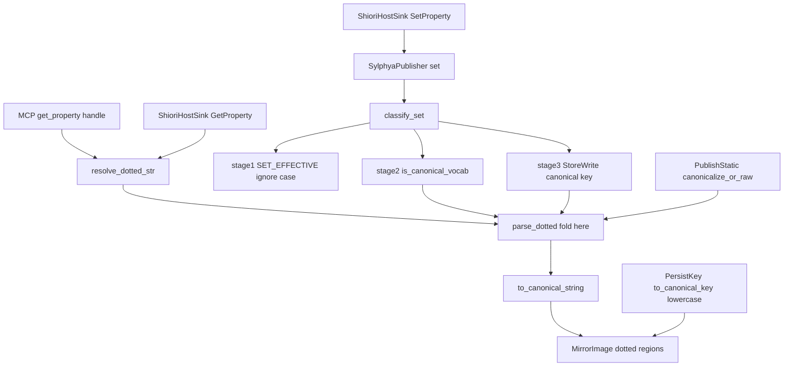
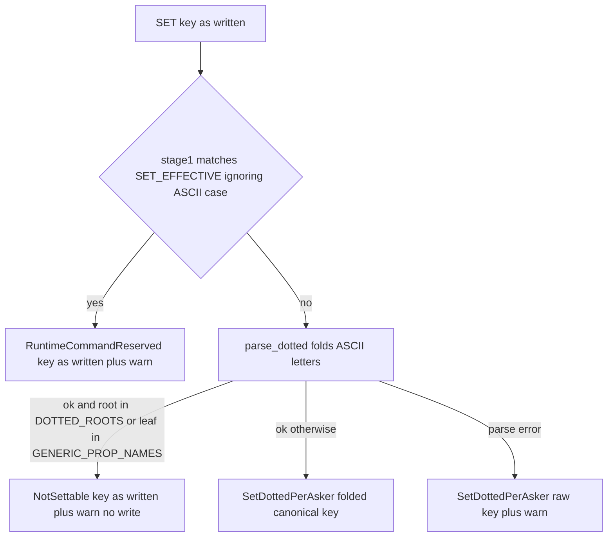

# Design Document: areka-P0-property-name-case-fold

> 本文の実物の確認は **2026-10-22・本ブランチ**（main `6e0ea8d8` の上）。コードは「何の定義か」（関数名・型名＋ファイルパス）で指し、行番号では指さない。調べた経過と比べた案は [research.md](research.md)（前半＝ギャップ分析・後半＝設計の段の記録）。本書だけで決めたことが読めるように、結論はここに書き直してある。

## Overview

**Purpose**: プロパティの名前の半角の英字（A〜Z と a〜z）の大小を区別しない読みと書き込みの仕分けを、SSP 向けに書かれたゴーストと MCP の `get_property` を使う人に届ける。SSP 2.9.07 の実測（`doc/ssp-mcp/survey.md` §7.1）では `BASEWARE.NAME` も `baseware.name` と同じ値を返す。areka は今、大小まで一致しないと「無い名前」になる。

**Users**: SSP 向けのゴーストが SHIORI の `GetProperty` で、AI エージェントが MCP の `get_property` で、大小を混ぜた名前を聞く。開発者は、書き込みの検査（書けない名前を書かせない）が大文字で迂回されない状態を得る。

**Impact**: 名前を鍵の綴りへ直す所（`crates/areka-sylphya/src/key.rs` の `parse_dotted`）で半角の英字を小文字へ畳み、書き込みの仕分け `classify_set`（`crates/areka-sylphya/src/actor.rs`）の 1 段目の比べを大小を区別しない比べにする。この 2 か所だけで、読み・自由な名前の書き・書けない名前の判定・保存された値の読みが同じ決まりにそろう。読む口 2 つ（MCP・SHIORI）・読み手 `SylphyaReader`・保存（`persist/`）のコードは変えない。

### Goals
- 名前の英字の大小だけが違う聞き方に、どの読む口でも同じ値を返す（`BASEWARE.NAME` → `areka`）。
- 書き込みの仕分け（運行の値・書けない名前・自由な名前）を名前の大小で変えない＝大文字で書けない名前を迂回できない。
- 前後の空白・全角の英字・かな・値の綴りは今のまま変えない。
- 上のすべてを決定論テストで固定し、配布形で MCP を 1 回当てて記録する。

### Non-Goals
- プロパティの値そのものを足すこと（一覧・`currentghost` の木など）。
- `shiori.変数名` の変数名の部分を区別するかどうかの決定（値を足す spec の持ち物。本 spec の畳みは一律に及ぶ＝「Revalidation Triggers」）。
- 括弧の中の数字の読み方（`ghostlist(0)`）と、括弧の中の名前で一覧から選ぶ処理（`property-catalog-lists`）。
- `%` で始まるフラットな名前（`%username` など）の大小。
- 台本の `%property[]`・`\![get,property]`・`\![set,property]` の口を開くこと（`property-query-channels`）。
- 保存ファイルの形・保存する名前の綴り・`persist/` のコード。
- `InProcHost`（`crates/areka-ghost/src/shiori_inproc.rs`）の `GetProperty`／`SetProperty`。
- 書式として読めない名前を「無い名前」とする今の扱いの変更。

## Boundary Commitments

### This Spec Owns
- **名前 → 鍵の綴りの決まり**: `parse_dotted` が作る `PropPath` の各部分の名前と括弧の中の名前（`Selector::ByName` の中身）は、半角の英字が小文字である。それ以外の文字（全角の英字・かな・数字・記号・空白）は 1 字も変えない。
- **`index(…)` の見分け**: 畳んだ後の名前で行う（`INDEX(abc)` は `index(abc)` と同じく書式の誤り）。
- **書き込みの仕分けの大小の扱い**: `classify_set` の 3 段（`SET_EFFECTIVE`・正準語彙・自由な名前）の判定が名前の半角の英字の大小で変わらない。
- **語彙の表の綴りの不変**: `DOTTED_ROOTS`・`GENERIC_PROP_NAMES`・`SET_EFFECTIVE`（`crates/areka-sylphya/src/vocab/dotted.rs`）の英字が小文字であることを、本 spec のテストで固定する（表そのものは変えない）。
- 上の決まりを固定する決定論テスト・配布形での実機確認の記録・沈黙ルール対応表の行・survey §7.3 の注記。

### Out of Boundary
- 読む口のコード: MCP の `get_property`（`crates/areka/src/mcp/get_property.rs` の `handle`）と SHIORI の `GetProperty`（`crates/areka/src/shiori_host.rs` の `ShioriHostSink_Impl::GetProperty`）。どちらも名前を手直しせずに `SylphyaReader::resolve_dotted_str` へ渡すまま（`mcp-get-property` 要件 1.4 と同じ）。
- 読み手 `SylphyaReader`（`crates/areka-sylphya/src/reader.rs`）の読む順（ゴーストごと → 全体）と縮退の形。
- 保存（`crates/areka-sylphya/src/persist/`）の名前・形・読み戻し。保存の名前はもともと小文字だけで、読む側の畳みで大小違いの名前でも引ける。
- フラットな名前の読み `SylphyaReader::resolve_flat` と `talk_snapshot`。
- 書き込みの効果（`Effect::NotSettable`・`Effect::RuntimeCommandReserved`）が運ぶ名前の綴りと、それを記録する `warn!` の綴り（書かれた綴りのまま。下の「決めたこと 4」）。
- `RuntimeCommandSink` の配線（今は未配線＝`runtime_sink: None`）。
- `InProcHost` の自前の表（sylphya の外・本番の結線では使われない）。

### Allowed Dependencies
- 標準ライブラリの `str::to_ascii_lowercase`・`str::eq_ignore_ascii_case` だけ。`str::to_lowercase`・`char::to_lowercase`（Unicode の畳み）は使わない（全角の英字まで畳むため要件 1.3 に反する）。
- 新しいクレート・依存・設定は足さない。
- 依存の向きは今のまま: `vocab` ← `key` ← `actor`／`reader` ← `crates/areka` の読む口。`key.rs` は `vocab` も `actor` も読まない。

### Revalidation Triggers
- **語彙の表に大文字を含む綴りを足す**: `parse_dotted` が畳んだ名前と一致しなくなる。本 spec の語彙の不変テストが赤になる。
- **保存の名前（`PersistKey::to_canonical_key`）に大文字を含む綴りを足す**: 既存の往復テスト `canonical_key_round_trips_with_to_canonical_string`（`persist/persist_tests.rs`）が赤になる。
- **`shiori.変数名` に値を足す spec が変数名の部分の大小を区別すると決める**: `parse_seg` の畳みに例外を足すことになる（`PropPath` は元の綴りを持たないので、元の綴りが要るなら読む口から受けた生の文字列を使う）。
- **`RuntimeCommandSink` を配線する spec**: sink が受ける `key` は書かれた綴り（`MENU` もありうる）。名前で振り分けるなら大小を区別せずに比べるか、受ける前に `SET_EFFECTIVE` の綴りへ直す。
- **新しい読む口・書く口を開く spec（`property-query-channels` など）**: 名前を `resolve_dotted_str`／`publisher.set`（`classify_set`）へ渡す限り追加の作業は無い。自前で鏡像を引く・自前で比べる形にするなら、本 spec の決まりをその口で守り直す。
- **sylphya の作り直し（v0.2.0 `sylphya-sqlite-kvs`）**: 名前 → 鍵の 1 か所の畳みと、仕分けの 1 段目の大小を区別しない比べを引き継ぐ。
- **手で `PropPath` を組んで `resolve_dotted` へ渡す呼び手が増える**: 名前を小文字で組む約束（`PropPath` の説明）に従う。今の呼び手はクレートの中のテストだけで、すべて小文字。

## Architecture

### Existing Architecture Analysis
- 鏡像（`MirrorImage`）の点付きの区画へ書く道（静的な値の `PublishStatic`〔`canonicalize_or_raw`〕・自由な名前の `Set`〔`StoreWrite`〕）と、読む道（`SylphyaReader::resolve_dotted_str` → `resolve_dotted`）は、どれも `parse_dotted` → `PropPath::to_canonical_string` の同じ綴りで鍵を作る。保存の投影（`PersistPut`・起動時の `build_initial_image`）だけは `PersistKey::to_canonical_key` の小文字の定数を使う。
- 書き込みの仕分け `classify_set` は ⑴ `SET_EFFECTIVE` と**生の文字列**の完全一致 → ⑵ `is_canonical_vocab`（`parse_dotted` の結果の根・葉の名前を表と比べる）→ ⑶ それ以外、の順。⑵ は `parse_dotted` の結果を見るので、`parse_dotted` で畳めば自動で追従する。⑴ だけが生の文字列を見る。
- 読む口 2 つは名前を手直しせずに同じ `resolve_dotted_str` を呼ぶ（要件 2.4 の構造上の根拠）。

### Architecture Pattern & Boundary Map



**Architecture Integration**:
- 選んだ形: **名前を区切る所（`parse_seg`）での 1 か所の畳み**＋仕分けの 1 段目の比べの差し替え（research.md「設計の段の記録」の案 A）。鍵を作る道がもともと 1 本なので、そこを畳めば読みと書きがずれない。
- 境界: 畳みの持ち主は `key.rs` の 1 か所。`actor.rs` は 1 段目の比べだけを持つ。読む口・読み手・保存は追従するだけ。
- 守る既存の形: 正準の綴り 1 本で鏡像を引く形・ゴーストごと → 全体の順・読めない名前を「無い名前」にする縮退・保存の名前の往復の不変（`parse_dotted(k).unwrap().to_canonical_string() == k`）。
- 新しい部品: 無い（関数・型・モジュールを足さない。足すのはテストのファイルだけ）。
- steering: ukadoc が黙っている所を SSP の実測に合わせる例外として §8 に記録する（`product.md` の互換の方針）。ログの無い失敗の道は増えない（新しい失敗の道が無い）。

### 設計で決めたこと（ギャップ分析 §8 の 7 点）

| # | 点 | 決めたこと | 理由 |
|---|---|---|---|
| 1 | 畳む所 | **`parse_dotted` の中（`parse_seg`）**＋`classify_set` の 1 段目の比べ | 鍵を作る道がもともと 1 本で、読み・自由な名前の書き・正準語彙の判定・`index` の見分けが 1 か所の畳みで同じ決まりにそろう。`to_canonical_string` だけで畳む案は比べる所が 3 か所に割れ、入口ごとに畳む案は後で口が増えるたびに畳みを足すことになる |
| 2 | `PropPath` に元の綴りを残すか | **残さない**（`PropPath` の名前は半角の英字が小文字） | 元の綴りを使う呼び手が今は無い。`shiori.変数名` の値を足す spec が元の綴りを要るなら、読む口から受けた生の文字列を使う（Revalidation Triggers） |
| 3 | `index(…)` の見分け | **畳んだ名前で行う**（`INDEX(abc)` は `index(abc)` と同じ `BadIndex`） | 要件 1.6 の例をそのまま満たし、生の綴りで保存された読めない名前が大文字の問いで当たる穴（ギャップ分析 §5 の端 1）が起きない |
| 4 | 効果・記録・`RuntimeCommandSink` へ渡す名前の綴り | **書かれた綴りのまま**（`NotSettable`・`RuntimeCommandReserved` の `key` と `warn!`）。`StoreWrite` の鍵と `debug!` は畳んだ正準の綴り | 受け手（sink）は未配線で、今は綴りで答えが変わらない。記録に書かれた綴りが残るので、大文字で迂回を試みた書き込みを後から見分けられる。sink を配線する spec が振り分けの比べを決める |
| 5 | `InProcHost` | **範囲の外**（要件ディスカッションで確定）。§8 の行に「sylphya の外の自前の表で対象外」と書く | 本番の結線で使われず、ネイティブの SHIORI を使う段で作り直す |
| 6 | SHIORI の `GetProperty`（要件 2.2）の証拠 | **`ShioriHostSink` を立てる決定論テスト（5.4）＋2 つの口が同じ `resolve_dotted_str` を手直し無しで呼ぶ静的な構造**。実機の確認は MCP だけ | 本番の結線（32bit の中継）には sylphya へ届く `GetProperty` が無い |
| 7 | 要件 6.1 の実機確認の書き方 | **配布形を手で起こし curl で当てる 1 回の確認を、spec の `verification/signoff.md` に記録する**（`mcp-get-property` と同じ手順）。`real-run-kit` の常設の試験は足さない | 要件が配布形を求める（窓口が起こすのは `cargo` が作った実行ファイル）。同じ答えは 5.3 が実行系ごと常に固定しており、常設にすると全体のテストのたびに約 30 秒を足すだけになる |

### Technology Stack

| Layer | Choice / Version | Role in Feature | Notes |
|-------|------------------|-----------------|-------|
| プロパティシステム | `areka-sylphya`（ワークスペースの今の版） | 名前の畳みと仕分け | 変更は `key.rs`・`actor.rs` の数行 |
| 文字の畳み | Rust 標準 `str::to_ascii_lowercase`・`str::eq_ignore_ascii_case` | 半角の英字だけを畳む | `to_lowercase` は使わない。兄弟の決まり `mcp-ghost-name-match`（`crates/areka/src/mcp/resolve.rs`）も `eq_ignore_ascii_case` |
| 実機確認 | `tools/package.ps1` の配布形・curl（Git for Windows 同梱） | 要件 6.1 の 1 回の確認 | `mcp-get-property` の `verification/signoff.md` と同じ手順 |

## File Structure Plan

### Directory Structure
```
crates/areka-sylphya/src/
├── key.rs                       # 変更: parse_seg で名前と括弧の中の名前を畳む・index の見分けを畳んだ名前で・PropPath の説明に小文字の約束・兄弟テストの接続宣言
├── key_case_fold_tests.rs       # 新規: 解釈の段の檻（畳む文字・畳まない文字・空白・書式の誤り・語彙の表の小文字の不変）
├── actor.rs                     # 変更: classify_set の 1 段目を eq_ignore_ascii_case に・兄弟テストの接続宣言
├── actor_case_fold_tests.rs     # 新規: 仕分けと効果の檻・アクターを立てて書いて読む檻（読み・自由な名前・本物の値を隠さない・保存された値）
└── reader.rs                    # 変更なし（畳んだ鍵で今の順に引く）
crates/areka/src/
├── shiori_host.rs               # 変更: 兄弟テストの接続宣言だけ（本体のコードは変えない）
├── shiori_host_case_fold_tests.rs  # 新規: SHIORI の GetProperty に大小違いの名前を渡す檻
└── mcp/
    ├── get_property.rs          # 変更なし
    └── get_property_tests.rs    # 変更: 聞く名前の並びに BASEWARE.NAME を足す・説明の 1 行を直す
doc/
├── COMPAT_ARCHITECTURE.md       # 変更: §8 の表の末尾に 1 行を足す
└── ssp-mcp/survey.md            # 変更: §7.3 の 4 の末尾に着地の注記を 1 句足す
.kiro/specs/areka-P0-property-name-case-fold/
└── verification/signoff.md      # 新規: 配布形での実機確認の記録（要件 6.1）
```

### Modified Files
- `crates/areka-sylphya/src/key.rs` — `parse_seg` で `name` と `Selector::ByName` の中身を `to_ascii_lowercase` してから `PathSeg` を作り、`index` の見分けは畳んだ名前で行う。`PropPath`・`parse_dotted` の説明に「名前の半角の英字は小文字（`parse_dotted` が畳む）・手で組むときも小文字」を書く。末尾に `#[cfg(test)] #[path = "key_case_fold_tests.rs"] mod case_fold_tests;`。既存の `mod tests` には手を入れない。
- `crates/areka-sylphya/src/actor.rs` — `classify_set` の 1 段目を `SET_EFFECTIVE.iter().any(|(k, _)| k.eq_ignore_ascii_case(key))` に変え、説明の「厳密一致」を「半角の英字の大小を区別しない一致」に直す。末尾の兄弟テストの並びに `#[cfg(test)] #[path = "actor_case_fold_tests.rs"] mod case_fold_tests;`。効果・ログ・`canonicalize_or_raw`・`StoreWrite` の腕のコードは変えない（畳みは `parse_dotted` から届く）。
- `crates/areka/src/shiori_host.rs` — `#[cfg(test)] #[path = "shiori_host_case_fold_tests.rs"] mod case_fold_tests;` の接続宣言だけ。
- `crates/areka/src/mcp/get_property_tests.rs` — `reads_values_through_the_ghost_own_asker_on_a_real_runtime` の `names` に `"BASEWARE.NAME"` を足し、期待の並びに `Some(outcome::value("areka"))` を足す。冒頭の説明の「英字の大小を混ぜた名前は使わない（要件 4.7）」を、本 spec の着地で大小違いの 1 つを足したことへ直す。
- `doc/COMPAT_ARCHITECTURE.md` — §8 の表の末尾に「プロパティの名前の英字の大小」の行（下の「記録の文書」）。
- `doc/ssp-mcp/survey.md` — §7.3 の 4 の末尾に注記（下の「記録の文書」）。

1,000 行の目安: `actor.rs` 799 → 約 805、`key.rs` 411 → 約 420、`shiori_host.rs` 628 → 約 632。新しいテストのファイルはどれも 300 行を超えない見込み。

## System Flows

書き込みの仕分けの分岐（大小違いの名前がどこへ行くか）:



- `CURRENTGHOST.NAME` は畳んだ根 `currentghost` が `DOTTED_ROOTS` に当たり、書けない名前になる（要件 3.1）。`MENU`・`Surface.Num` は 1 段目で当たる（要件 3.2）。
- 読めない名前（`INDEX(abc)` など）は今どおり生の綴りで保存されるが、読む側は読めない名前を常に「無い名前」にするので、どの綴りで聞いても値は見えない（要件 1.6 と矛盾しない）。

## Requirements Traceability

| Requirement | Summary | Components | Interfaces | Flows |
|-------------|---------|------------|------------|-------|
| 1.1 | 各部分の名前の大小違いで同じ値 | 名前の畳み | `parse_dotted`・`resolve_dotted_str` | 鍵の 1 本化 |
| 1.2 | 括弧の中の名前の大小違いで同じ値 | 名前の畳み | `parse_seg`（`ByName`） | 鍵の 1 本化 |
| 1.3 | 全角の英字・かなは別の名前 | 名前の畳み | `to_ascii_lowercase` だけ | — |
| 1.4 | 前後の空白を削らない | 名前の畳み（`trim` を足さない） | `parse_dotted` | — |
| 1.5 | 値の綴りを変えない | 読み手（変更なし） | `DottedResolution::Value` | — |
| 1.6 | 書式の誤りは大小にかかわらず「無い名前」 | 名前の畳み（`index` の見分け） | `parse_seg`・`KeyParseError` | 仕分けの分岐（生の保存） |
| 1.7 | 大小違いでもゴーストごとの値が先 | 読み手（変更なし） | `resolve_dotted_canonical` | — |
| 2.1 | MCP で大小違いに同じ答え | 読む口（変更なし）・名前の畳み | `get_property::handle` | 鍵の 1 本化 |
| 2.2 | SHIORI の `GetProperty` で同じ値 | 読む口（変更なし）・名前の畳み | `ShioriHostSink_Impl::GetProperty` | 鍵の 1 本化 |
| 2.3 | どの綴りでも無い名前は今の答え | 読む口（変更なし） | `NG:Cannot find such property name.`・`SHIORI_E_PROPERTY_NOT_FOUND` | — |
| 2.4 | 2 つの口の答えがそろう | 読む口（変更なし） | 同じ `resolve_dotted_str` を手直し無しで呼ぶ | 鍵の 1 本化 |
| 3.1 | 書けない名前の大小違いは書けない | 書き込みの仕分け（2 段目は畳みで追従） | `classify_set`・`is_canonical_vocab` | 仕分けの分岐 |
| 3.2 | 書ける名前の大小違いは運行の値 | 書き込みの仕分け（1 段目） | `classify_set` | 仕分けの分岐 |
| 3.3 | 自由な名前は 1 つの名前へ | 名前の畳み | `StoreWrite` の腕の `to_canonical_string` | 仕分けの分岐 |
| 3.4 | 大小違い 2 綴りへの続けての書きは後勝ち | 名前の畳み | 同上 | 仕分けの分岐 |
| 3.5 | 大小違いの書きが本物の値を隠さない | 書き込みの仕分け | `Effect::NotSettable`（書かない） | 仕分けの分岐 |
| 4.1 | 着地前の保存がそのまま読める | 保存（変更なし） | `build_initial_image` | — |
| 4.2 | 保存された値を大小違いで引ける | 名前の畳み | `parse_dotted`（鍵は小文字の保存名と一致） | 鍵の 1 本化 |
| 4.3 | 保存ファイルの形と名前と値は前後で同じ | 保存（変更なし） | `persist/` の差分 0 | — |
| 5.1 | 読みの決定論テスト | 解釈の段の檻・アクターの檻 | `key_case_fold_tests.rs`・`actor_case_fold_tests.rs` | — |
| 5.2 | 書き込みの仕分けの決定論テスト | アクターの檻 | `actor_case_fold_tests.rs` | — |
| 5.3 | MCP を実行系ごと通す決定論テスト | MCP の檻 | `get_property_tests.rs` | — |
| 5.4 | SHIORI の `GetProperty` の決定論テスト | SHIORI の檻 | `shiori_host_case_fold_tests.rs` | — |
| 5.5 | 既存の期待を変えずに通す | 全体 | 既存のテスト全部 | — |
| 6.1 | 配布形で MCP を当てて記録 | 実機確認の記録 | `verification/signoff.md` | — |
| 6.2 | §8 に行を足す | 記録の文書 | `doc/COMPAT_ARCHITECTURE.md` | — |
| 6.3 | survey §7.3 の 4 に注記 | 記録の文書 | `doc/ssp-mcp/survey.md` | — |

## Components and Interfaces

| Component | Domain/Layer | Intent | Req Coverage | Key Dependencies (P0/P1) | Contracts |
|-----------|--------------|--------|--------------|--------------------------|-----------|
| 名前の畳み（`parse_dotted`／`parse_seg`） | sylphya の key | 名前を鍵の綴りへ直す唯一の所で半角の英字を小文字へ | 1.1, 1.2, 1.3, 1.4, 1.6, 3.3, 3.4, 4.2 | 標準 `to_ascii_lowercase`（P0） | Service |
| 書き込みの仕分け（`classify_set`） | sylphya の actor | 3 段の判定を大小で変えない | 3.1, 3.2, 3.5 | 名前の畳み（P0）・`vocab/dotted.rs` の表（P0） | Service |
| 読み手（`SylphyaReader`・変更なし） | sylphya の reader | 畳んだ鍵でゴーストごと → 全体を引く | 1.5, 1.7, 4.1 | 名前の畳み（P0） | — |
| 読む口（`get_property::handle`・`ShioriHostSink::GetProperty`・変更なし） | areka | 名前を手直しせずに読み手へ渡す | 2.1, 2.2, 2.3, 2.4 | 読み手（P0） | — |
| 決定論テスト 4 つ | テスト | 決まりを固定する | 5.1〜5.5 ほか全要件の証拠 | 上の全部 | — |
| 記録の文書・実機確認の記録 | doc・spec | 例外の決まりと実機の答えを残す | 6.1, 6.2, 6.3, 4.3 | — | — |

### sylphya の key

#### 名前の畳み（`parse_dotted`／`parse_seg`）

| Field | Detail |
|-------|--------|
| Intent | 点付きの名前を `PropPath` へ区切るときに、各部分の名前と括弧の中の名前の半角の英字を小文字へ畳む |
| Requirements | 1.1, 1.2, 1.3, 1.4, 1.6, 3.3, 3.4, 4.2 |

**Responsibilities & Constraints**
- 畳むのは `PathSeg::name` と `Selector::ByName` の中身だけ。`Selector::ByIndex` は数字なので触れない。
- 畳みは `str::to_ascii_lowercase` で行う。半角の英字以外（全角の英字・かな・漢字・数字・記号・空白）は 1 字も変えない。
- 前後の空白は削らない（`trim` を足さない）。空白を含む部分の名前は空白ごと鍵になり、値が無いので「無い名前」になる。
- `index` の見分けは畳んだ後の名前で行う。`INDEX(abc)`・`Index(abc)` は `index(abc)` と同じく `KeyParseError::BadIndex`。
- 区切りの規則・エラーの種類・エラーの位置（`at`）は今のまま。大文字だけが違う 2 つの入力は、同じ `Ok`（同じ `PropPath`）か同じ `Err` を返す。

**Dependencies**
- Inbound: `SylphyaReader::resolve_dotted_str`・`classify_set`（`is_canonical_vocab`）・`apply` の `StoreWrite` の腕・`canonicalize_or_raw` — 名前 → 鍵（P0）
- External: Rust 標準 `str::to_ascii_lowercase`（P0）

**Contracts**: Service [x]

##### Service Interface
```rust
/// 点付き key 文字列 → PropPath。純粋・no I/O・決定論。
/// 返す PropPath の名前（PathSeg::name と Selector::ByName の中身）は半角の英字が小文字。
pub fn parse_dotted(input: &str) -> Result<PropPath, KeyParseError>;
```
- Preconditions: なし（どんな文字列も受ける）。
- Postconditions: `Ok(p)` のとき `p` のすべての名前で `s == s.to_ascii_lowercase()`。`parse_dotted(a)` と `parse_dotted(b)` は、`a.eq_ignore_ascii_case(b)` なら等しい（`Ok` どうし・`Err` どうしとも）。
- Invariants: 小文字の入力では今と同じ結果（既存の檻 `canonical_string_is_idempotent_for_canonical_inputs`・`canonical_key_round_trips_with_to_canonical_string` がそのまま緑）。

**Implementation Notes**
- Integration: シグネチャは変えない。`PropPath`・`parse_dotted` の説明に小文字の約束を足す（`to_canonical_string` の「往復整合（冪等）」の説明は、正準形＝小文字の入力について今のまま正しい）。
- Validation: `key_case_fold_tests.rs`（下の Testing Strategy）。
- Risks: `to_lowercase` と取り違えると全角の英字まで畳む＝全角の檻が赤で捕まえる。

### sylphya の actor

#### 書き込みの仕分け（`classify_set`）

| Field | Detail |
|-------|--------|
| Intent | `SET_EFFECTIVE`・正準語彙・自由な名前の 3 段の判定を、名前の半角の英字の大小で変えない |
| Requirements | 3.1, 3.2, 3.5 |

**Responsibilities & Constraints**
- 1 段目: `SET_EFFECTIVE` の各綴りと書かれた名前を `eq_ignore_ascii_case` で比べる（前後の空白は削らない）。
- 2 段目: `is_canonical_vocab` は今のまま（`parse_dotted` の結果の名前が畳まれているので、表の小文字の綴りと当たる）。
- 3 段目: 今のまま。`StoreWrite` の腕は `parse_dotted` → `to_canonical_string` の畳んだ鍵で書く（3.3・3.4）。読めない名前は今どおり警告を残して生の綴りで書く。
- 効果とログの綴り（決めたこと 4）: `Effect::RuntimeCommandReserved` と `Effect::NotSettable` の `key`、それらの `warn!` の `key` は**書かれた綴りのまま**。`Effect::SetDottedPerAsker` の `key` と `StoreWrite` の `debug!` は畳んだ正準の綴り（今の作りのまま畳みが届く）。

**Dependencies**
- Inbound: `SylphyaCore::apply` の `Set` の腕（P0）
- Outbound: 名前の畳み（P0）・`vocab/dotted.rs` の `SET_EFFECTIVE`／`DOTTED_ROOTS`／`GENERIC_PROP_NAMES`（P0・読むだけ）

**Contracts**: Service [x]

##### Service Interface
```rust
/// SET 対象 key を 3 分岐へ分類する純関数（no I/O・決定論）。
/// 半角の英字の大小だけが違う 2 つの key は同じ SetClass を返す。
pub fn classify_set(key: &str) -> SetClass;
```
- Preconditions: なし。
- Postconditions: `a.eq_ignore_ascii_case(b)` なら `classify_set(a) == classify_set(b)`。
- Invariants: 小文字の key では今と同じ分類（既存の `classify_set_*` の檻がそのまま緑）。

**Implementation Notes**
- Integration: `classify_set` の 1 行と説明だけを直す。`apply`・効果の型・`RuntimeCommandSink` のシグネチャは変えない。
- Validation: `actor_case_fold_tests.rs`。
- Risks: 1 段目を畳み忘れると `MENU` が 2 段目で `GENERIC_PROP_NAMES` の `menu` に当たり、運行の値でなく書けない名前になる＝`MENU` の檻が赤で捕まえる。

### 変更しない部品（追従するだけ）

- **読み手 `SylphyaReader`**（`reader.rs`）: `resolve_dotted_str` → `parse_dotted`（畳む）→ `resolve_dotted` → `to_canonical_string` → `resolve_dotted_canonical`（ゴーストごと → 全体）。値はそのまま返す（1.5）。順は変わらない（1.7）。保存の投影は小文字の鍵なので、大小違いの問いも畳まれて当たる（4.1・4.2）。
- **読む口**: MCP の `get_property::handle` と `ShioriHostSink_Impl::GetProperty` は、受けた名前を手直しせずに同じ `resolve_dotted_str` へ渡す（2.4 の構造上の根拠）。無い名前の答え（`NG:Cannot find such property name.`・`isError: true`／`SHIORI_E_PROPERTY_NOT_FOUND`）も今のまま（2.3）。
- **SHIORI の `GetProperty` が届く道**: 本番のゴーストの結線（`ShioriWiring::Helper`・32bit の中継）には sylphya へ届く `GetProperty` が無く、`ShioriHostSink` を使うのは環境変数で開くデモ（`crates/areka/src/shiori_demo.rs`）とテストの入口だけ。ゆえに要件 2.2 の証拠は `ShioriHostSink` を立てる決定論テスト（5.4）と、2 つの口が同じ関数を呼ぶ静的な構造とする（決めたこと 6）。

## Data Models

### Logical Data Model
- 鏡像の点付きの区画（`MirrorImage` の `dotted_global`・`dotted_per_asker`）の鍵は、`parse_dotted` で読める名前については「半角の英字が小文字の正準の綴り」になる。今ある鍵（`baseware.*` の静的な値・`areka.*` の保存の投影）はもともと小文字なので、着地の前後で鍵は変わらない。
- 読めない名前（書式の誤り）を `StoreWrite` で書いたときだけは、今どおり生の綴りが鍵になる。読む側は読めない名前を常に「無い名前」にするので、この鍵は読まれない（今と同じ）。
- 保存ファイル（TOML の型の決まった項目）の形と名前と値は変わらない（4.3）。移し替えは要らない。

## Error Handling

### Error Strategy
- 新しい失敗の道は無い。畳みはどんな文字列にも定義される（失敗しない）。
- 書式の誤りは今の `KeyParseError` のまま。読み手は今どおり `warn!` を残して `NotFound` へ縮退し、`StoreWrite` は今どおり `warn!` を残して生の綴りで書く。
- 書けない名前・運行の値への書き込みは今どおり `warn!` を残し、呼び出しは失敗にしない（大小違いでも同じ）。

### Monitoring
- 既存の記録をそのまま使う。書けない名前への書き込みの `warn!`（"SET on non-settable canonical vocab: warn and drop …"）は書かれた綴り（`CURRENTGHOST.NAME`）を `key` に残すので、大文字で迂回を試みた書き込みも記録から見分けられる。

## Testing Strategy

すべてアプリ本体やゴーストの実行系を要しない決定論テスト（5.3 だけは実行系を立てる既存の檻に名前を 1 つ足す）。新しいテストは兄弟のファイルに置く（`structure.md`）。

### 解釈の段の檻（`crates/areka-sylphya/src/key_case_fold_tests.rs`・5.1）
1. 各部分の名前の大小違い: `BASEWARE.NAME`・`Baseware.Name` の `parse_dotted(..).to_canonical_string()` が `baseware.name`（1.1）。
2. 括弧の中の名前: `test(ABC).key` → `test(abc).key`、`ghostlist(えも2DEBUG).path` → `ghostlist(えも2debug).path`（1.2）。
3. 畳まない文字: 全角の英字 `ＴＥＳＴ.ｋｅｙ` はそのまま（`to_lowercase` との取り違えを捕まえる）・かな `test.ア` はそのまま（1.3）。
4. 前後の空白: ` BASEWARE.NAME` → ` baseware.name`（空白は残る）（1.4）。
5. 書式の誤り: `INDEX(abc)`・`Index(abc)` は `index(abc)` と同じ `Err(BadIndex { at: 0 })`。`A..B`・`FOO(BAR`・`.A` も小文字の同じ名前と同じ `Err`（1.6）。
6. 語彙の表の小文字の不変: `DOTTED_ROOTS`・`GENERIC_PROP_NAMES`・`SET_EFFECTIVE` の各綴りで `s == s.to_ascii_lowercase()`（畳んだ名前と表が当たる前提を固定）。

### アクターの檻（`crates/areka-sylphya/src/actor_case_fold_tests.rs`・5.1・5.2）
純関数の段（`classify_set`・`SylphyaCore::apply`）:
1. 書けない名前の大小違い: `classify_set("CURRENTGHOST.NAME")`・`classify_set("Baseware.Name")` が `NotSettable`。`apply` の効果が `Effect::NotSettable { key: "CURRENTGHOST.NAME", .. }` の 1 つだけ（書き込みの効果が無い）で、`warn!` の固定文を `crate::test_log_capture::capture` で捕まえる（3.1）。
2. 書ける名前の大小違い: `classify_set("MENU")`・`classify_set("Surface.Num")` が `RuntimeCommand`。`apply` の効果が `Effect::RuntimeCommandReserved` の 1 つだけ（3.2）。
3. 自由な名前の大小違い 2 綴り: `My.Flag` と `MY.FLAG` の `apply` の効果が、どちらも `SetDottedPerAsker { key: "my.flag", .. }`（3.3・3.4）。

アクターを立てて書いて読む段（`spawn_sylphya`＋`FakePersistIo`・`barrier` で反映を待つ・既存の `actor_actor_integration_tests.rs` と同じ形）:
4. 読みの大小違い: `publish_static` の `baseware.name = areka` を `BASEWARE.NAME`・`Baseware.Name` で読むと `areka`。自由な名前 `test(ABC).key` に書いた値を `test(abc).key` で読むと同じ値（1.1・1.2）。
5. 畳まない文字: `ｔｅｓｔ.ｋｅｙ`（全角の小文字）に書いて `ＴＥＳＴ.ＫＥＹ` で読むと `NotFound`（書いた綴りの `ｔｅｓｔ.ｋｅｙ` では読める）。`test.あ` に書いて `test.ア` で読むと `NotFound`（`test.あ` では読める）（1.3）。
6. 前後の空白: ` BASEWARE.NAME`・`BASEWARE.NAME ` は `NotFound`（1.4）。
7. 値の綴り: `test.key` に `MiXeD値` を書き、`TEST.KEY` で読むと `MiXeD値`（1.5）。
8. ゴーストごとが先: 同じ `test.key` に自分の問い手の値と全体の値を載せ、`TEST.KEY` で読むと自分の問い手の値（1.7）。
9. 書式の誤り: `INDEX(abc)` に書いた後（生の綴りで保存される道）、`INDEX(abc)`・`index(abc)` のどちらで読んでも `NotFound`（1.6）。
10. 自由な名前の書きと読み: `My.Flag = 1` → `MY.FLAG = 2` の順に書き、`my.flag`・`My.Flag`・`MY.FLAG` のどれで読んでも `2`（3.3・3.4）。
11. 本物の値を隠さない: `baseware.name = areka` を載せた後 `BASEWARE.NAME = evil` を書いても `baseware.name` は `areka`。値の無い `CURRENTGHOST.NAME` に書いた後 `currentghost.name` は `NotFound` のまま（3.5）。
12. 保存された値: `save_scope` で `PersistKey::BootCount = 7` を偽の IO に置いてから立て、`AREKA.BOOT.COUNT`・`areka.boot.count` がどちらも `7`（4.1・4.2）。

### MCP の檻（`crates/areka/src/mcp/get_property_tests.rs`・5.3・2.1・2.3）
- `reads_values_through_the_ghost_own_asker_on_a_real_runtime` の名前の並びに `BASEWARE.NAME` を足し、`areka`（`isError: false`）を期待する。既存の ` baseware.name` → `NG:Cannot find such property name.` はそのまま残る（空白を削らない檻）。

### SHIORI の檻（`crates/areka/src/shiori_host_case_fold_tests.rs`・5.4・2.2・2.3）
- `spawn_test_sylphya_sink` で立て、`publisher.publish_static` で `baseware.name = areka`、`publisher.set` で自由な名前 `path.to.key = some-value` を載せて `barrier` の後、`IShioriHost::get_property` で `BASEWARE.NAME`・`Baseware.Name` → `areka`、`PATH.TO.KEY` → `some-value`、` baseware.name` と `NO.SUCH.KEY` → `ShioriError::PropertyNotFound`。

### 既存のテスト（5.5）
- 本 spec の後も、`crates/areka-sylphya` の既存の檻（`key.rs` の `mod tests`・`reader.rs` の檻・`actor_tests.rs`・`ledger_key_determinism_tests.rs`・`vocab/dotted_set_ledger_tests.rs`・`persist/persist_tests.rs`）、`crates/areka/src/shiori_host.rs` の `mod tests`、`get_property_tests.rs` の既存の 7 つの名前、`crates/areka/src/placement/zorder_property_deferral_tests.rs` を期待を変えずに通す。既存のテストが聞く名前の英字はどれも小文字なので、期待を変える必要は無い（ギャップ分析 §2.5 の確認）。

### 実機確認（6.1）
- `mcp-get-property` の `verification/signoff.md` と同じ手順で行い、`.kiro/specs/areka-P0-property-name-case-fold/verification/signoff.md` に記録する。
  1. `pwsh -NoProfile -File tools/package.ps1` で配布形を作り、ワークツリーの `target\signoff-case-fold\x\` の下へ展開する（試験の根・記録の置き場はワークツリーの `target\` の下だけ。`C:\` 直下・`C:\tmp` は使わない）。
  2. `AREKA_*`／`WINTF_*` を起動前に空にし、`AREKA_APP_SMOKE_EXIT_MS`（有界の自動終了）・`AREKA_NO_ALERT=1`・`NO_COLOR=1`・`RUST_LOG=info,areka_mcp=debug` を付けて展開先の `areka.exe` を起こす。記録の行「MCP: 待受を始めた url=…」から URL を読む（SSP が動いていれば 9821 側になりうる）。
  3. 会話の開始の後に、curl の `tools/call`（`MCP-Protocol-Version: 2026-07-28` の無状態版の形・本文は UTF-8 のファイルから送る）で `get_property` に `baseware.name`・`BASEWARE.NAME`・` baseware.name` を順に渡す。期待は `areka`・`areka`・`NG:Cannot find such property name.`（`isError: true`）。
  4. 記録には、版（コミットと `BUILD-INFO.txt`）・環境変数・URL の行・3 回の要求と答えの全文・各呼び出しの「MCP: ツールに答えた」の `debug!` の行・`ERROR` の段の行の数・終わり方を残す。自分で起こしたプロセス以外は止めない。
- 実機の試験の窓口 `real-run-kit` は使わない。窓口が起こすのは `cargo` が作った `areka.exe` で配布形ではなく、常設の試験にすると全体のテストのたびに約 30 秒を足して、5.3 が実行系ごと固定している同じ答えをもう一度確かめるだけになるため（決めたこと 7）。

## 記録の文書（6.2・6.3）

**§8 の表の末尾に足す行**（`doc/COMPAT_ARCHITECTURE.md`・表の 4 列〔項目・決めたこと・根拠・出どころ〕に合わせる）:
- 項目: **プロパティの名前の英字の大小**（正典は一般の規則を書かない。大小を区別しないと書くのは `developer.log.ログ種別(名前).count` の括弧の中の名前だけ）
- 決めたこと: **半角の英字（A〜Z と a〜z）の大小だけを同じとみなす**＝点で区切った各部分の名前と括弧の中の名前の両方・自由な名前と保存された値の名前も含む。全角の英字の大小・かなの違いは別の名前。前後の空白は削らない。値は畳まない。書き込みの仕分け（運行の値・書けない名前・自由な名前）も同じ決まりで判定する。畳む所は 1 か所＝`crates/areka-sylphya/src/key.rs` の `parse_dotted`（仕分けの 1 段目だけは `crates/areka-sylphya/src/actor.rs` の `classify_set` で大小を区別せずに比べる）。`InProcHost`（`crates/areka-ghost/src/shiori_inproc.rs`）の自前の表は sylphya の外で対象外。`shiori.変数名` の変数名の部分の大小は値を足す spec が決める。
- 根拠: ukadoc が黙っている所を SSP 2.9.07 の実測（`doc/ssp-mcp/survey.md` §7.1＝`BASEWARE.NAME` と括弧の中の名前の大小違いが通り、前後の空白は通らない）に合わせた、ukadoc から意味を持ち込む方針の例外。本表の「小文字の完全一致のみ」の行（`windowposition.x` のキーワード・重なり指定の語・6 値の語）とは扱いが逆で、プロパティの名前は SSP の実測に合わせて区別しない側に倒した。宛先の名前の照合（`mcp-ghost-name-match`）は前後の空白を除くが、プロパティの名前は除かない（SSP も除かない）。
- 出どころ: areka-P0-property-name-case-fold（要件 1・3・6.2）

**survey §7.3 の 4 の末尾に足す注記**（`doc/ssp-mcp/survey.md`・6 の項の注記と同じ形）: 「**2026-10-xx に `property-name-case-fold` が読み手の側（`parse_dotted`）で畳んだ**（半角の英字の大小だけ・括弧の中の名前も・前後の空白は削らない）＝この項の areka の側の記述は直す前の形。」（日付は着地の日）

## Security Considerations
- 守りの穴（`CURRENTGHOST.NAME` のように大文字で書くと書けない名前の判定をすり抜け、自由な名前として保存される）を、台本と MCP から書く道（`\![set,property]`・`property-query-channels`）が開く前に塞ぐ。塞いだことはアクターの檻 1・11 で固定する。
- 畳みを半角の英字に限るので、全角や Unicode の大小の対応で別の名前が当たることは無い（要件 1.3）。
