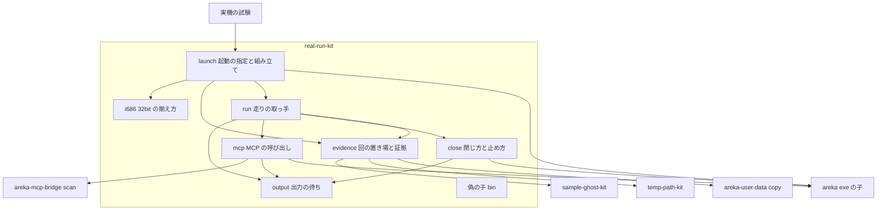
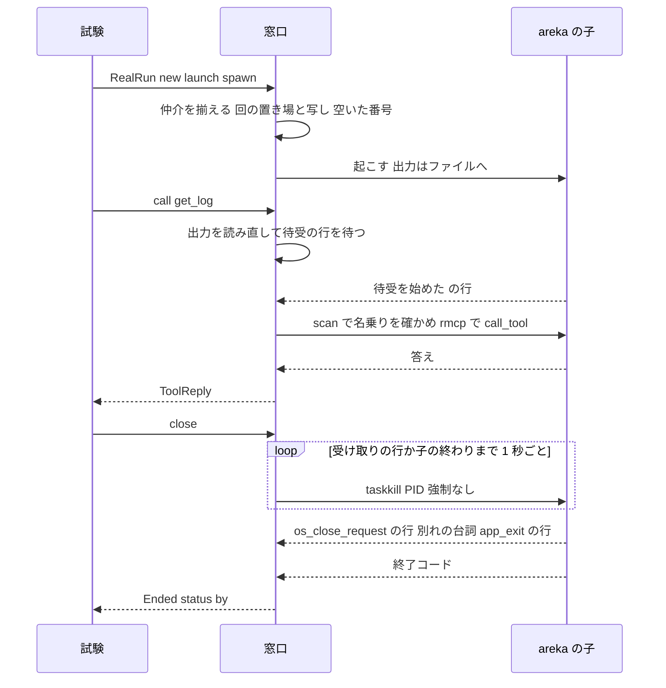
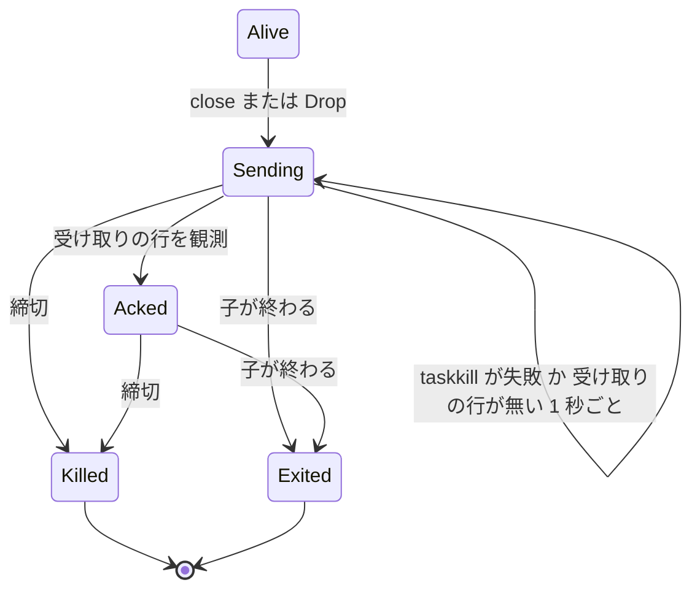

# Design Document: areka-P0-real-run-mcp-kit

> 2026-10-18・本ブランチ（main `e2370df8` の上・要件は全議題を推奨案で確定した `5e653b52`）。`requirements.md`（末尾の「要件の討議で決まったこと」1〜5 を含む）と `research.md`（1〜8 章のギャップ分析と、9 章の設計の段の調べ）を入力に書いた。コードは「何の定義か」（関数名・定数名＋ファイル）で指す。rmcp の呼び方は `Cargo.lock` が固定する rmcp 3.5.0 のソースで確かめた（`research.md` 9.2）。決めたことは「D-番号」で引ける（下の「決めたこと」の表）。

## Overview

**Purpose**: 実機の試験を書く人（開発者と AI のエージェント）が、本物の `areka.exe` を「開発者の環境に干渉しない形」で立て、記録を探して待ち、MCP のツールを名前と引数で呼び、利用者と同じ道で閉じて終了コードを受け取る——その足場を 1 つの窓口にまとめる。窓口はワークスペースの新しいテスト専用のクレート `crates/real-run-kit/` に置く。

**Users**: 今の実機の試験 3 本（`crates/areka/tests/emo2_real_run.rs`・`mcp_get_log_real_run.rs`・`smoke_boot_loop_exit.rs`）と、v0.1.0 で足される実機の試験（`mcp-kanade-tools`・`mcp-reload`・`mcp-strict-errors`・`pasta-in-windows-verification`・`emo2-real-run-stability` ほか）。

**Impact**: 3 本が自分の中に写している足場（32bit の判定・仲介の置き方・空いた番号の取り方・子の起こし方と番犬・手書きの HTTP と JSON）を 0 にし、窓口を通す形へ移す。`areka.exe` の本番の振る舞いは 1 つも変えない。見張り `log-capture-kit/tests/sample_path_guard_test.rs` を、新しいクレートを足した後も同じ強さで働く形に直す（D-2）。

### Goals

- 起動するもの（検体の名前・任意のゴーストのフォルダ・根・何も無し）を渡すだけで、`target\` の下の回の置き場・空いた MCP の番号・32bit の仲介つきで areka を立てる（1.x・2.x・9.x）。
- 待ちはすべて観測で終わり（出力の文字列・子の終わり・MCP の答え）、どの待ちにも締切がある（3.x・4.x・5.x）。
- 落ちた回の根・記憶の置き場・出力・検体の写しが `target\` の下に残り、成功した回は消える（6.x）。
- 3 本を移し替え、写した足場を 0 にし、確かめの中身を 1 つも落とさない（7.x）。
- 窓口そのものを偽の子と本物の MCP の受け口で、常時のテストとして確かめる（10.1）。

### Non-Goals

- 新しい実機の試験を足すこと（各 spec が窓口を使って足す）。
- `emo2_real_run` の待ち方の直し（印を観測してから閉じる形への直し・200% と 100% 相当での確かめ＝`emo2-real-run-stability` の件 1）。
- 起動オプション（`startup-options-core`・`readonly-mode`）。窓口は今は環境変数と位置の引数で伝え、着地の後に窓口の中だけを替えて移れる形にしておく（8.3）。
- 排他テストの机（`impl-watch-test-desk`）・二重起動の守り（要件の討議 3）・画面の入力（`SendInput`）の足場。
- MCP のツールの中身・areka の記録の行・終了の握手の変更。

## Boundary Commitments

### This Spec Owns

- 新しいクレート `crates/real-run-kit/` の全部: 起動の指定と子へ渡す形の組み立て・回の置き場と証拠・32bit の成果物の揃え方・出力の流しと待ち・MCP の呼び出し（tokio の器を中に閉じる）・閉じ方と止め方・偽の子（`[[bin]]`）・窓口の決定論のテスト。
- 窓口が頼る areka の記録の綴り（待受の 3 行・終了の行・閉じる知らせの受け取りの行）を窓口の定数として持つこと（D-4・D-5）。綴りの持ち主は areka 側のまま。
- 実機の試験 3 本の移し替え（確かめの中身は変えない・窓口の綴りの本物の檻を 2 つ足す＝D-19）。
- `crates/areka/Cargo.toml` の `[dev-dependencies]` の 1 行と、`Cargo.lock`（このウェーブの 1 本だけの席）。
- 見張り `crates/log-capture-kit/tests/sample_path_guard_test.rs` の直し（D-2）。
- 使い方の説明: クレートの説明（`lib.rs` の doc）と、新しい試験の手引き `doc/testing.md` の「実機の試験」の節、`doc/README.md` の表の 1 行（D-16）。
- `.kiro/steering/structure.md` の新しいクレートの節（D-17）。

### Out of Boundary

- `crates/sample-ghost-kit/**`（使うだけ。特に `src/lib.rs`・`src/devroot.rs` は同じウェーブの `sample-url-fetch` の持ち物。窓口は写しの消え方の中身に頼らない＝D-6）。
- `crates/temp-path-kit/**`・`crates/areka-mcp-bridge/**`・`crates/areka-mcp/**`・`crates/areka-user-data/**`（公開の部品を使うだけ）。
- `crates/areka/src/**`（本番の振る舞い・記録の行・終了の握手）。窓口が頼る記録の文が変わったら、窓口の定数の方を直す（Revalidation Triggers）。
- `tools/test-all.ps1`（このウェーブでは ① `impl-watch-test-desk` の持ち物）・`doc/impl-watch.md`（手引きは指すだけ）。
- `.kiro/steering/roadmap.md`（⑥ の触るファイルの欄の追記は D-2 の決定として記録し、直すのは棚卸の側）。
- 32bit の仲介そのものの寿命（areka が起こし、areka との結びが切れると終わる）。窓口は仲介を起こさず、止めない（5.6）。

### Allowed Dependencies

依存の向き（左から右へだけ）: 呼び手の試験 → `real-run-kit` → {`sample-ghost-kit`・`temp-path-kit`・`areka-mcp-bridge`・`areka-mcp`・`areka-user-data`} と外のクレート。逆向き（これらが `real-run-kit` を引く）は禁止で、`real-run-kit` を `[dev-dependencies]` 以外から引くことも禁止（見張りが赤にする＝D-2）。

| 依存 | 使うもの | 置き方 |
|---|---|---|
| `sample-ghost-kit`（path） | `SampleRoot::acquire`・`root`・`folder`・`balloon` | `[dependencies]`（見張りの例外 1 件＝D-2） |
| `temp-path-kit`（path） | `TempPath::under_target` | `[dependencies]` |
| `areka-mcp-bridge`（path） | `scan::scan`・`scan::Scan`・`scan::Link`・`config::Timeouts` | `[dependencies]` |
| `areka-mcp`（path） | 偽の子だけ: `start`・`ToolRegistry`・`ToolSpec`・`ToolOutcome`・`ToolContent` | `[dependencies]`（`[[bin]]` は `[dependencies]` しか使えない） |
| `areka-user-data`（path） | `copy_tree_atomic`（落ちた回の写しの複写＝D-6） | `[dependencies]` |
| `rmcp` `=3.5.0`（`default-features = false`・`client`） | `model::CallToolRequestParams`・`CallToolResult`・`RawContent`・`ServiceError` | `[dependencies]` |
| `tokio` 1（`rt`・`time`・`macros`） | `current_thread` の器・`time::timeout`・`select!` | `[dependencies]` |
| `serde_json` 1 | 引数の JSON の文を `Map` へ読む | `[dependencies]` |
| `windows`（`workspace = true`） | 偽の子の最上位の窓（`CreateWindowExW`・`GetMessageW`） | `[dependencies]` |
| `tracing`・`tracing-subscriber`（`workspace = true`） | 偽の子の記録（`RUST_LOG` で絞れる・本物と同じ形の行） | `[dependencies]` |

- どれも `Cargo.lock` に既にある。**新しい外部のクレートは 0 個**（10.4）。`Cargo.lock` に増えるのはワークスペースのクレート `real-run-kit` の行だけ。
- `tracing-subscriber` は `workspace = true` で引き、`env-filter` を自分の `Cargo.toml` に綴らない（見張り `with_default_guard_test.rs` の 4 つ目の検査）。偽の子の記録の据え付けは `init()` で行い、見張りの走査語（捕捉先を直接差す 3 語）を綴らない。
- `Cargo.toml` は `publish = false # <理由>` の行を持つ（`tools/crates-io.ps1` の判定「理由」）。
- `std::env::temp_dir` は使わない（`temp_path_guard_test.rs`）。どのファイルも 1,000 行の内（`file_length_guard_test.rs`）。

### Revalidation Triggers

- `crates/areka-mcp/src/server.rs` の待受の行（`MCP: 待受を始めた`・`MCP: どの候補のポートも束ねられなかった`・`MCP: 待ち受けない`）の文や出所（`areka_mcp::server`）が変わる → 窓口の定数を直す。偽の子が本物の `start` を呼ぶので、窓口の決定論のテストが赤で知らせる。
- `crates/areka/src/app_exit.rs` の `quit_app` の行（`event="app_exit"`・`origin=` の `Debug` の綴り）か `on_ghost_os_close` の行（`event="os_close_request"`）か出所（`areka::app_exit`）が変わる → 窓口の定数を直す。本物の檻は D-19 の 2 つの確かめ（`mcp_get_log` の `UserClose`・smoke ① の `SafetyExit`）。
- `OnCloseRequest` を差す時点（`app_exit::attach_os_close_request` の `FrameFinalize`）が窓を作る tick の外へ動く → 閉じ方（D-3）を見直す。
- `startup-options-core` が着地する → 子へ伝える形（`launch.rs` の `child_command` 1 か所）を起動オプションへ移せる。窓口を使う試験は書き換えない（8.3）。
- `areka_mcp_bridge::scan::scan`・`config::Timeouts` の形、`SampleRoot` の読み口、`TempPath::under_target` の形、rmcp の版が変わる → 窓口を直す（使う側の試験は変わらない）。
- 窓口の公開の型（`RealRun`・`Launch`・`Run`・`Ended`・`EndedBy`・`ToolReply`・`McpError`・`ChildExited`）を変える → `emo2-real-run-stability` ほか窓口を使う spec が確かめ直す。

## Architecture

### Existing Architecture Analysis

- 足場の部品はほぼ全部ワークスペースに在る（`research.md` 2 章）。窓口はそれを 1 か所に集めるだけで、新しく作るのは「待ち」「閉じ方」「証拠を残す」「偽の子」の 4 つ。
- 3 本の試験は、子の出力をパイプで受けて終わるまで読まない形（2 本）・開発者の環境を受け継ぐ形（2 本）・OS の一時フォルダを使う形（1 本）を持つ。窓口へ移すとどれも消える（D-14 に子の環境の変化を書く）。
- areka の記録は 2 つの層に出る。標準出力の層は `RUST_LOG` で絞られ（未設定は `info`・`log_history.rs`）、履歴の層は絞られない。窓口が見られるのは標準出力と標準エラーのファイルだけなので、窓口が頼る 2 つの出所（`areka_mcp::server`・`areka::app_exit`）を `RUST_LOG` に足して必ず出す（D-4）。
- ゴーストの窓は、窓を作る排他の段（wintf `create_windows`）で HWND が付き、同じ tick の `FrameFinalize` で `OnCloseRequest` が差される。OS の `WM_CLOSE` は tick の外の窓の手続きで届くので、届いた時点のゴーストの窓には受け手が付いている。窓がまだ 1 枚も無い子へは `taskkill`（強制なし）が届かず失敗する（D-3 はそれを送り直しで扱う）。

### Architecture Pattern & Boundary Map



**Architecture Integration**:
- 選んだ形: 呼び手から見える型は「組み立て役 `RealRun`」と「走りの取っ手 `Run`」の 2 つだけ。中の役（出力・MCP・閉じ方・証拠・32bit）は私有のモジュールに分け、`Run` が束ねる。
- ファイルの中の依存の向き（上の段は下の段だけを使う・逆向きは誤り）: ⑴ `i686`・`evidence`・`output`（互いを使わない）→ ⑵ `close`・`mcp`（`output` を使う）→ ⑶ `run`（⑴⑵ を使って束ねる）→ ⑷ `launch`（`run`・`i686`・`evidence` を使って `Run` を作る）→ ⑸ `lib.rs`（再輸出だけ）。偽の子（`src/bin/`）は窓口のライブラリを使わない（`areka-mcp`・`windows`・`tracing-subscriber` だけ）。
- 残す先例: 子を `Command` で起こし `Child` の取っ手を持つ・出力をファイルへ向ける（`mcp_get_log` の形）・仲介は一時名へ写してから改名（2 本の形）・偽の受け口は本物の `areka_mcp::start(&[…])`（中継の通しのテストの形）・テスト専用のクレートは `publish = false` で `[dev-dependencies]` からだけ引く（`temp-path-kit`・`sample-ghost-kit` の形）。

### Technology Stack

| Layer | Choice / Version | Role in Feature | Notes |
|-------|------------------|-----------------|-------|
| 言語 | Rust 2024（ワークスペースの版） | 窓口と偽の子 | 新しい道具なし |
| MCP | rmcp `=3.5.0`（`client`）＋ `areka-mcp-bridge` の `scan` | ツールの呼び出し（公式 SDK・手で組まない＝10.5） | areka・中継と同じ版を `=` で固定 |
| 非同期 | tokio 1（`rt`・`time`・`macros`） | 走りごとに 1 つの `current_thread` の器 | 呼び手には見せない（10.5） |
| OS | `taskkill.exe`（Windows 標準・強制なし） | 利用者と同じ閉じ方の知らせ | 依存なし・実機の先例あり（D-3） |
| OS（偽の子だけ） | `windows` 0.62（ワークスペースの機能） | 閉じ方を受ける最上位の窓 | 本物の窓・GPU は使わない |
| 置き場 | `temp-path-kit`・`sample-ghost-kit`・`areka-user-data::copy_tree_atomic` | 回の置き場・検体の写し・落ちた回の複写 | すべて `target\` の下 |

## File Structure Plan

### Directory Structure

```
crates/real-run-kit/
├── Cargo.toml                    # publish = false # 理由・[[bin]] 1 つ・依存は Allowed Dependencies の表のとおり
├── src/
│   ├── lib.rs                    # 使い方の説明（no_run の例）・mod の宣言・公開の型の再輸出だけ
│   ├── launch.rs                 # RealRun（起動の指定）・Launch・Staged・子へ渡す形の組み立て（child_command・compose_rust_log）・spawn
│   ├── launch_tests.rs           # 組み立ての純粋な部分（環境の外し・既定・上書きの順・RUST_LOG の足し方・パスの絶対化）
│   ├── run.rs                    # Run（走りの取っ手）・Limits（既定の時間）・出力の読み口・Drop の順（子を止める → 置き場）
│   ├── run_tests.rs              # Limits の既定の大小（1.8）など値だけで決まるもの
│   ├── output.rs                 # 出力のファイルの読み直しと文字列の待ち（wait_any）・失敗の文の組み立て（末尾 64 KiB）
│   ├── output_tests.rs           # 手で書いたファイルと終わった偽の状態での待ちの分岐
│   ├── i686.rs                   # 32bit の判定（is_i686_pe）と揃え方（ensure）・仲介の定め（HELPER）
│   ├── i686_tests.rs             # 作った PE の頭のファイルで、探す順・失敗の文・改名の競り合い
│   ├── mcp.rs                    # McpChannel（器と Link）・待受の観測・call・call_until・失敗の写し・答えの文の取り出し
│   ├── mcp_tests.rs              # 答えの文の取り出し・引数の文の読み・失敗の文
│   ├── close.rs                  # 閉じる知らせの送り直し（taskkill）・終わりの待ち・止め方・EndedBy の読み取り
│   ├── close_tests.rs            # EndedBy の読み取り（行の綴りの表）
│   ├── evidence.rs               # RunDirs（回の置き場＋検体の写し）・落ちた回に残す・成功で消す
│   ├── evidence_tests.rs         # 残す・消すの判定（panicking の真偽を引数で渡す形）
│   └── bin/
│       └── real-run-fake-areka.rs  # 偽の子（手順の環境変数 1 つで振る舞いを選ぶ）
└── tests/
    ├── fake_wait_close_test.rs   # 偽の子で: 立てる・環境・出力の待ち・自分で終わるのを待つ・閉じる・止める・大量の出力
    ├── fake_mcp_test.rs          # 偽の子＋本物の受け口で: 呼ぶ・ツールの失敗・絞った段・待受の失敗・取られた番号・つながらない・途中で終わる・呼び直し
    └── fake_evidence_test.rs     # 偽の子で: 成功で消える・panic の途中で残る・残した場所の文
```

- 兄弟のテストのファイルは、本体の末尾の `#[cfg(test)] #[path = "<名>_tests.rs"] mod tests;` で読む（ワークスペースの作法）。
- 偽の子は窓口の統合テストから `env!("CARGO_BIN_EXE_real-run-fake-areka")` で場所を得る。窓口を `[dev-dependencies]` で引く側（areka）のビルドでは建たない（依存のライブラリの bin は建たない）。

### Modified Files

- `crates/areka/Cargo.toml` — `[dev-dependencies]` に `real-run-kit = { path = "../real-run-kit" }` を 1 行（「`[dependencies]` へは決して置かない」の注記つき）。
- `crates/areka/tests/emo2_real_run.rs` — 窓口へ移す（D-14・移し替えの表）。
- `crates/areka/tests/mcp_get_log_real_run.rs` — 窓口へ移す。`is_i686_pe`・`ensure_helper_beside_areka`・`free_port`・`call_get_log_status`・`decode_json_string`・`wait_exit`・`Scratch` を消す。`parse_status_line`（確かめの中身）は残す。
- `crates/areka/tests/smoke_boot_loop_exit.rs` — 窓口へ移す。`run_smoke`・`is_i686_pe`・`ensure_i686_artifact`・`ensure_helper_beside_areka` を消す。確かめの関数（`assert_no_shiori_fault`・`assert_line_has`・`accepted_as_no_monitor`・`assert_real_windows_and_exit_zero`）は残す。
- `crates/log-capture-kit/tests/sample_path_guard_test.rs` — D-2 の直し（約 794 行 → 約 860 行の見込み・1,000 行の内）。
- `Cargo.lock` — ワークスペースのクレート `real-run-kit` の行（外の依存は増えない）。
- `doc/testing.md`（新規）— 試験の手引き。「実機の試験」の節（D-16・10.2）に、立て方（`Launch` の 5 通りと上書き）・ツールの呼び方（`call`・`call_until`・失敗の見分け）・閉じ方（`close`）と自分で終わるのを待つ形（`wait_exit`）の使い分け・残した証拠の場所（`target\test-roots\areka-rr-…`）と読み方（`stdout.log`・`stderr.log`・`sample\`）・試験を `Result` でなく panic で落とすこと・32bit の仲介の建て方（`cargo build -p shiori-host32-helper --target i686-pc-windows-msvc`）・負荷の走り（`areka-test-binary-stability`）と同じ時間に回さないこと・実機の試験を 1 本ずつ回す机（`doc/impl-watch.md` を指す）を書く。
- `doc/README.md` — 直下の表に `testing.md` の 1 行。
- `.kiro/steering/structure.md` — Temp Path Kit・Sample Ghost Kit の並びに Real Run Kit の節（D-17）。

## System Flows

### 立てる → 呼ぶ → 閉じる



- 待受の行より先に `どの候補のポートも束ねられなかった`・`待ち受けない` の行が出たら、締切を待たずに `McpError::ListenFailed`（4.5・9.2）。子が先に終われば `McpError::ChildExited`（4.8）。
- 呼び出しの最中は、呼び出しの未来と子の終わりの見回りを `select!` で並べる。子が終われば直ちに `ChildExited`。輸送の失敗のときは、子の終わりを `exit_grace`（既定 2 秒）まで観測し、終わればその終了コードで `ChildExited`、生きていれば `Unreachable`（4.7・4.8）。

### 閉じる知らせの扱い（状態）



- 受け取りの行は `event="os_close_request"`（kanade と結線した起動）か `event="app_exit"`（未結線の起動の直ちの終了・ほかの出所の先着）のどちらか。受け取った後は送り直さない。
- `Killed` は窓口が起こした子の取っ手への `Child::kill` だけ（5.4・5.6）。`close` と `wait_exit` では止めた後に試験を失敗させ、`Drop` では止めた旨を標準エラーへ書く（panic しない）。

## Requirements Traceability

| Requirement | Summary | Components | Interfaces | Flows |
|---|---|---|---|---|
| 1.1 | 起動するものの 4 通り | launch | `Launch` | — |
| 1.2 | 検体の新しい写し | launch・evidence | `Launch::Sample`・`Launch::SampleRoot` | — |
| 1.3 | 起こす前に写しを書き換える | launch | `RealRun::before_spawn`・`Staged` | — |
| 1.4 | 回の置き場を新しく作る | evidence | `RunDirs::create` | — |
| 1.5 | 開発者の 4 つの環境変数を受け継がない | launch | `child_command`（`env_remove`） | — |
| 1.6 | 明示の値を優先（壊した値も） | launch | `profile_dir`・`env`・`arg`・`mcp_port`・`Launch::Root` | — |
| 1.7 | 告知の抑止・着色を切る・保険の自動終了 | launch | `child_command` | — |
| 1.8 | 保険の自動終了 ＜ 待ちの締切 | run | `Limits::default`（`run_tests.rs` が大小を固定） | — |
| 1.9 | Windows の形の絶対パス・短いパス | launch・evidence | `std::path::absolute`・札 `rr` | — |
| 1.10 | 起こせなかったら場所と理由 | launch | `RealRun::spawn`（panic） | — |
| 2.1 | 隣に 32bit の仲介を置いてから起こす | i686・launch | `i686::ensure(HELPER)` | — |
| 2.2 | 探す順（環境変数 → debug → release） | i686 | `i686::ensure` | — |
| 2.3 | 環境変数が指す物が無い・32bit でない | i686 | `i686::ensure`（panic） | — |
| 2.4 | どこにも無い → 建て方を添える | i686 | `I686Spec.package`（panic の文） | — |
| 2.5 | 試験用の 32bit の成果物も同じ規則 | i686・launch | `Staged::ensure_i686` | — |
| 2.6 | 書きかけを起動させない | i686 | 一時名＋改名・プロセス内の鍵・改名の競り合いの見直し | — |
| 3.1 | 標準出力・標準エラーを別々のファイルへ | launch・evidence | `stdout.log`・`stderr.log` | — |
| 3.2 | 文字列が現れた時点で待ちを終える | output・run | `Run::wait_for` | — |
| 3.3 | どの待ちにも締切・既定の締切 | run | `Limits.deadline`・`RealRun::deadline` | — |
| 3.4 | 締切切れの失敗の文 | output | `wait_any` の panic の文 | — |
| 3.5 | 子が先に終わったら見分けて返す | output・run | `Err(ChildExited)` | — |
| 3.6 | 途中でも後でも読める | run | `Run::stdout`・`stderr`・`output` | — |
| 3.7 | 決まった時間だけ眠る待ちを持たない | output・mcp・close | 見回りの間隔 `Limits.poll` | 両方の図 |
| 4.1 | 空いた番号を選んで渡す | launch | `free_port` | — |
| 4.2 | 名前と引数で呼んで答えの文 | mcp・run | `Run::call` | 立てる → 呼ぶ → 閉じる |
| 4.3 | 待受の始まりを待ってから呼ぶ | mcp | `McpChannel::ensure_listening` | 同上 |
| 4.4 | 記録の段を絞っても観測できる | launch・mcp | `compose_rust_log` | — |
| 4.5 | 待受を始められなかった | mcp | `McpError::ListenFailed` | 同上 |
| 4.6 | ツールの失敗を見分ける | mcp | `ToolReply.is_error` | — |
| 4.7 | つながらない・読めない・締切 | mcp | `McpError::Unreachable` | 同上 |
| 4.8 | 呼び出しの前か途中で子が終わる | mcp | `McpError::ChildExited` | 同上 |
| 4.9 | 文字列が現れるまで呼び直す | mcp・run | `Run::call_until` | — |
| 5.1 | 利用者と同じ閉じ方で閉じる | close・run | `Run::close` | 両方の図 |
| 5.2 | 自分で終わるのを待つ | close・run | `Run::wait_exit` | — |
| 5.3 | 閉じ方か保険の自動終了かの見分け | close | `Ended.by`・`EndedBy` | — |
| 5.4 | 締切で窓口の子だけを止めて失敗 | close | `Child::kill`＋panic | 状態の図 |
| 5.5 | 閉じないまま終わったら子を残さない | run・close | `Drop for Run` | 状態の図 |
| 5.6 | 起こしたと確かめられない物を止めない | close | 取っ手を持ち生存を見た子の番号だけへ送る | — |
| 6.1 | 落ちた回の置き場と写しを残す | evidence | `RunDirs::finish(true)` | — |
| 6.2 | 残した場所を試験の出力に書く | evidence | 標準エラーの 1 行 | — |
| 6.3 | 成功で消す | evidence | `RunDirs::finish(false)` | — |
| 6.4 | 残す先を `target\` の下に限る | evidence | `TempPath::under_target`・`<回>\sample\` | — |
| 7.1 | 3 本が窓口を通す | 移し替え | — | — |
| 7.2 | 同じ確かめを持つ | 移し替え | 移し替えの表 | — |
| 7.3 | 写しが 0 | 移し替え | 消す関数の一覧 | — |
| 7.4 | smoke は自分で終わるのを待つ | 移し替え | `Run::wait_exit` | — |
| 7.5 | mcp_get_log は閉じ方で閉じる | 移し替え | `Run::close` | — |
| 7.6 | emo2 は今の終わり方を保つ | 移し替え | `safety_exit(3 s)`＋`wait_exit` | — |
| 7.7 | 走る条件を変えない | 移し替え | `AREKA_EMO2_REAL_RUN` の判定を試験に残す | — |
| 8.1 | 綴りを書かずに指定できる | launch | `RealRun` の各メソッド | — |
| 8.2 | 伝える形は窓口の中で決める | launch | `child_command` だけが綴る | — |
| 8.3 | 起動オプションへ窓口の中だけで移れる | launch | `child_command` 1 か所 | — |
| 9.1 | 走りごとに分ける | launch・evidence | `TempPath` の一意な名前・写し・番号 | — |
| 9.2 | 番号が先に取られていた | mcp | `McpError::ListenFailed` | — |
| 10.1 | 決定論のテスト（偽の子・偽の受け口） | 偽の子・tests | `real-run-fake-areka`・3 本の統合テスト | — |
| 10.2 | 使い方の説明 | lib.rs・doc | `lib.rs` の doc・`doc/testing.md` | — |
| 10.3 | 配布物の依存に入らない・見張りの強さ | 見張り | `sample_path_guard_test.rs`（D-2） | — |
| 10.4 | 外の依存を足さない | Cargo.toml | Allowed Dependencies | — |
| 10.5 | 公式 SDK・非同期を見せない | mcp | `scan`＋`call_tool`・器を `Run` に閉じる | — |
| 10.6 | 作るものは `target\` の下 | evidence・i686 | `TempPath::under_target`・仲介は `areka.exe` の隣 | — |

## Components and Interfaces

| Component | Domain/Layer | Intent | Req Coverage | Key Dependencies (P0/P1) | Contracts |
|---|---|---|---|---|---|
| launch（`RealRun`・`Launch`・`Staged`） | 起動 | 起動の指定を受け、子へ渡す形を組んで起こす | 1.1〜1.10・2.1・2.5・3.1・4.1・4.4・8.x・9.1 | i686（P0）・evidence（P0） | Service |
| run（`Run`・`Limits`） | 走り | 走りの取っ手。待ち・呼び出し・閉じ方を束ね、破棄の順を守る | 1.8・3.2〜3.6・4.2・4.9・5.1〜5.5 | output・mcp・close・evidence（P0） | Service・State |
| output | 待ち | 出力のファイルを読み直し、文字列か子の終わりか締切まで待つ | 3.2〜3.5・3.7 | なし | Service |
| mcp（`McpChannel`） | MCP | 器と `Link` を持ち、待受の観測の後にツールを呼ぶ | 4.2〜4.9・9.2・10.5 | `areka-mcp-bridge`（P0）・rmcp（P0）・output（P0） | Service |
| close | 終わり | 閉じる知らせの送り直し・終わりの待ち・止め方・終わり方の読み取り | 5.1〜5.6 | output（P0）・`taskkill.exe`（P0） | Service・State |
| evidence（`RunDirs`） | 置き場 | 回の置き場と検体の写しを持ち、落ちた回だけ残す | 1.2・1.4・6.x・9.1・10.6 | `temp-path-kit`・`sample-ghost-kit`・`areka-user-data`（P0） | State |
| i686 | 成果物 | 32bit の判定と、仲介・試験用の成果物の揃え方 | 2.x | なし | Service |
| 偽の子（`real-run-fake-areka`） | 試験 | 手順どおりに出力・待受・窓・終了を演じる | 10.1 | `areka-mcp`（P0）・`windows`（P0） | Batch |
| 見張りの直し | 守り | 窓口を経て検体の窓口が配布物へ入る道を塞ぐ | 10.3 | `workspace_scan` の共有の関数 | — |

### 起動

#### launch（`crates/real-run-kit/src/launch.rs`）

| Field | Detail |
|-------|--------|
| Intent | 起動の指定を受け、回の置き場・写し・仲介・番号を揃えて子を起こす |
| Requirements | 1.1〜1.10・2.1・2.5・3.1・4.1・4.4・8.1〜8.3・9.1 |

**Responsibilities & Constraints**
- 呼び手が綴らないもの（環境変数の名前・位置の引数の並べ方）を、`child_command` の 1 か所だけが綴る（8.2・8.3）。今の伝え方は環境変数と位置の引数。
- 子の環境は次の順で組む: ⑴ `AREKA_ROOT`・`AREKA_USER_ROOT`・`AREKA_PROFILE_DIR`・`AREKA_MCP_PORT` を外す（1.5）→ ⑵ 窓口の既定（下の表）→ ⑶ 呼び手の論理の指定（`profile_dir`・`mcp_port`・`rust_log`・`safety_exit`）→ ⑷ 呼び手の任意の `env` を最後に（1.6・何でも上書きできる）。
- 位置の引数は、`Launch::Sample`・`Launch::Ghost` のときゴーストのフォルダ（とバルーンのフォルダ）。その後ろに呼び手の `arg` を足す（1.6）。
- 子へ渡すパスは `std::path::absolute` で絶対にする（`canonicalize` の `\\?\` の形は使わない・1.9）。窓口が作るパスは最初から絶対。
- 空いた番号は `127.0.0.1:0` を束ねて番号を得て放す（4.1）。子が束ねるまでに取られたら、子の記録で `ListenFailed` になる（9.2・窓口は立て直さない＝要件の討議 4）。
- `spawn` は、仲介を揃える（2.1・`without_host32_helper` のときを除く＝D-18）→ 回の置き場と写しを作る（1.2・1.4）→ `before_spawn` を呼ぶ（1.3）→ 子を起こす、の順。起こせなければ実行ファイルの場所と理由を書いて panic（1.10）。このとき回の置き場は panic の途中で破棄されるので、落ちた回として残る（6.1）。

子へ渡す既定（窓口の中だけの綴り）:

| 項目 | 既定 | 呼び手の上書き |
|---|---|---|
| `AREKA_ROOT` | 回の空の根（`Launch::Sample`・`Ghost`・`Empty`）／検体の写しの根（`SampleRoot`）／渡された根（`Root`） | `Launch` で選ぶ |
| `AREKA_PROFILE_DIR` | 回の記憶の置き場 `<回>\profile` | `profile_dir(p)`（普通のファイルも可） |
| `AREKA_MCP_PORT` | 空いた番号 | `mcp_port(n)` |
| `AREKA_NO_ALERT` | `1` | `env` |
| `NO_COLOR` | `1` | `env` |
| `AREKA_APP_SMOKE_EXIT_MS` | `Limits.safety_exit`（既定 45 秒） | `safety_exit(d)` |
| `RUST_LOG` | `compose_rust_log(呼び手の値 か "info")` | `rust_log(s)` |
| `AREKA_USER_ROOT` | 渡さない（外したまま＝書ける根は実行ファイルの隣＝`target\` の下） | `env` |

`compose_rust_log(base)` は、`base` が名指していない出所だけを `,<出所>=info` で末尾へ足す（D-4）。足す出所は `areka_mcp::server`（待受の行）と `areka::app_exit`（閉じる知らせの受け取りの行と終わり方の行）。`base` が既にその出所の名前を含めば足さない（呼び手の指定を下げない）。

**Contracts**: Service [x] / State [ ]

##### Service Interface

```rust
/// 起動するもの（1.1）。既定は Empty。
pub enum Launch {
    /// ⑴ 検体の名前。写しのゴーストのフォルダ（と同梱バルーンのフォルダ）を位置の引数で渡す。
    Sample { name: String, balloon: Option<String> },
    /// ⑵ 任意のゴーストのフォルダ（とバルーンのフォルダ）を位置の引数で渡す。
    Ghost { folder: PathBuf, balloon: Option<PathBuf> },
    /// ⑶ 検体の写しの根を根として渡す（どのゴーストを起こすかは areka が根から決める）。
    SampleRoot { name: String },
    /// ⑶ 任意の根。
    Root(PathBuf),
    /// ⑷ その回だけの空の根。
    Empty,
}

pub struct RealRun { /* 私有 */ }

impl RealRun {
    /// `areka_exe` は呼び手が `env!("CARGO_BIN_EXE_areka")` で渡す（D-8）。
    pub fn new(areka_exe: impl AsRef<Path>) -> RealRun;
    pub fn launch(self, what: Launch) -> RealRun;
    /// 子を起こす前に 1 度だけ呼ぶ（写しの書き換え・試験用の DLL を揃える）。
    pub fn before_spawn(self, f: impl FnOnce(&Staged) + 'static) -> RealRun;
    pub fn profile_dir(self, path: impl AsRef<Path>) -> RealRun;
    pub fn mcp_port(self, port: u16) -> RealRun;
    pub fn rust_log(self, filter: &str) -> RealRun;
    pub fn safety_exit(self, after: Duration) -> RealRun;
    /// どの待ちにも使う締切（3.3）。
    pub fn deadline(self, limit: Duration) -> RealRun;
    pub fn env(self, key: impl AsRef<OsStr>, value: impl AsRef<OsStr>) -> RealRun;
    pub fn arg(self, arg: impl AsRef<OsStr>) -> RealRun;
    /// 子が areka でない（窓口自身の試験の偽の子）ときだけ使う。32bit の仲介を揃えない（D-18）。
    pub fn without_host32_helper(self) -> RealRun;
    /// 起こせなければ panic（1.10）。仲介が揃わなければ panic（2.3・2.4）。
    pub fn spawn(self) -> Run;
}

/// `before_spawn` に渡す、起こす直前の置き場。
pub struct Staged<'a> { /* 私有 */ }

impl Staged<'_> {
    /// Sample・Ghost のときの起動するゴーストのフォルダ（Sample は写しの中）。
    pub fn ghost_folder(&self) -> Option<&Path>;
    /// 子へ渡す根。
    pub fn root(&self) -> &Path;
    pub fn run_dir(&self) -> &Path;
    /// 試験用の 32bit の成果物を `dest_dir` へ揃える（2.5）。規則は仲介と同じ。
    pub fn ensure_i686(&self, file_name: &str, env_var: &str, package: &str, dest_dir: &Path) -> PathBuf;
}
```
- Preconditions: `areka_exe` は `<target>\<profile>\areka.exe` の形（`<target>` を 2 つ上として仲介の元を探す）。
- Postconditions: `spawn` が返った時点で子は起きており、出力はファイルへ流れている。
- Invariants: 呼び手の試験の中に `AREKA_ROOT`・`AREKA_PROFILE_DIR`・`AREKA_MCP_PORT`・`AREKA_NO_ALERT` の綴りは要らない（8.2）。

**Implementation Notes**
- Integration: `child_command` は `std::process::Command` を返す純粋に近い関数にし、`launch_tests.rs` が環境の外し・既定・上書きの順・引数の並びを値で確かめる（開発者の環境変数を試験のプロセスに置かずに 1.5 を確かめる）。
- Validation: 偽の子の手順 `env`（受け取った環境変数と引数を出す）で、統合テストが本物の子のプロセスに届いた値を確かめる。
- Risks: 位置の引数で起こす回にも空の根を `AREKA_ROOT` に渡す（1.4）。今の 3 本は根を外していたので、根の列挙の記録の行が増えうる（確かめの対象の行は変わらない・移し替えのタスクで実機の出力を見る）。

### 走り

#### run（`crates/real-run-kit/src/run.rs`）

| Field | Detail |
|-------|--------|
| Intent | 走りの取っ手。待ち・呼び出し・閉じ方を束ね、破棄で子を残さず、置き場の後始末の順を守る |
| Requirements | 1.8・3.2〜3.6・4.2・4.9・5.1〜5.5 |

**Responsibilities & Constraints**
- 持つもの: `Child`・出力の 2 つのパス・`McpChannel`・`RunDirs`・`Limits`・選んだ番号・最初に観測した終わり（`Option<Ended>`）。
- `close`・`wait_exit` は `&mut self` で、取っ手は試験の終わりまで生きる（終わった後も出力が読め＝3.6、確かめが落ちたときも破棄が証拠を残せる＝6.1）。
- `Drop` の順: ⑴ `Run` の `Drop` の本体が、子が生きていれば `close::stop_quietly`（閉じる知らせ → 締切の内に終わらなければ `kill`・panic しない＝5.5）→ ⑵ 欄の破棄として `RunDirs` の `Drop` が `finish(std::thread::panicking())`（6.1・6.3）。⑴ が先に走るのは言語の決まり（`Drop::drop` の本体の後に欄が破棄される）で、子がファイルを掴んだまま写しを複写・削除しないため。

**Contracts**: Service [x] / State [x]

##### Service Interface

```rust
/// 既定の時間（D-13）。`safety_exit < deadline` を run_tests.rs が固定する（1.8）。
pub struct Limits {
    pub deadline: Duration,     // 60 秒: 各待ちの始まりから数える
    pub safety_exit: Duration,  // 45 秒: 子の起動から数える保険の自動終了
    pub poll: Duration,         // 50 ms: 出力・子の状態を読み直す間隔
    pub close_retry: Duration,  // 1 秒: 閉じる知らせを送り直す間隔
    pub exit_grace: Duration,   // 2 秒: MCP の輸送の失敗の後に子の終わりを観測する上限
}

pub struct Run { /* 私有 */ }

/// 子が待ちの途中で終わった（3.5・4.8）。締切切れ（panic）と見分けられる値。
#[derive(Debug, Clone, Copy, PartialEq, Eq)]
pub struct ChildExited { pub status: ExitStatus }

#[derive(Debug, Clone, PartialEq, Eq)]
pub struct Ended { pub status: ExitStatus, pub by: EndedBy }

impl Run {
    pub fn pid(&self) -> u32;
    pub fn mcp_port(&self) -> u16;
    pub fn run_dir(&self) -> &Path;
    pub fn stdout_path(&self) -> &Path;
    pub fn stderr_path(&self) -> &Path;
    /// 走りの途中でも終わった後でも読める（3.6）。読めない字は U+FFFD。
    pub fn stdout(&self) -> String;
    pub fn stderr(&self) -> String;
    /// 標準出力・改行・標準エラー（今の 3 本の `all` と同じ並び）。
    pub fn output(&self) -> String;
    /// 出力（両方）に `needle` が現れるまで待つ。締切切れは panic（3.4）。
    pub fn wait_for(&mut self, needle: &str) -> Result<(), ChildExited>;
    /// ツールを呼ぶ（4.2〜4.8）。`args_json` は JSON の object の文（`"{}"` 可）。読めない文は panic（呼び手の誤り）。
    pub fn call(&mut self, tool: &str, args_json: &str) -> Result<ToolReply, McpError>;
    /// 答えの文に `needle` が現れるまで呼び直す（4.9）。締切切れは panic。
    pub fn call_until(&mut self, tool: &str, args_json: &str, needle: &str) -> Result<ToolReply, McpError>;
    /// 利用者と同じ閉じ方で閉じる（5.1・5.3）。締切切れは子を止めて panic（5.4）。
    pub fn close(&mut self) -> Ended;
    /// 閉じる知らせを送らず、子が自分で終わるのを待つ（5.2）。締切切れは子を止めて panic。
    pub fn wait_exit(&mut self) -> Ended;
}
```
- Preconditions: `call`・`close` は子が生きていなくても呼べる（終わっていれば `ChildExited`／記録済みの `Ended` を返す）。
- Postconditions: `close`・`wait_exit` が返った時点で子は終わっている。2 度目からは同じ `Ended` を返す。
- Invariants: どの待ちも、観測（文字列・子の終わり・MCP の答え・受け取りの行）が揃った時点か締切で終わる（3.7）。

##### State Management
- State model: 走りの状態は「子が生きている／終わった（`Ended` を持つ）」の 2 つと、`McpChannel` の「待受を観測した／まだ」。
- Concurrency strategy: `Run` は 1 つの試験のスレッドだけが使う（`Send` は要らない）。走りどうしは何も共有しない（9.1）。共有するのは `i686` の改名だけ（プロセスの中の鍵とプロセスの間の改名＝2.6）。

### 待ち

#### output（`crates/real-run-kit/src/output.rs`）

| Field | Detail |
|-------|--------|
| Intent | 出力のファイルを読み直して、文字列か子の終わりか締切まで待つ |
| Requirements | 3.2〜3.5・3.7 |

**Responsibilities & Constraints**
- `wait_any(files, needles, child, deadline, poll) -> Result<usize, WaitEnd>`: 1 回ごとに ⑴ 2 つのファイルを全部読み直し、`needles` のどれかを含めばその番号を返す ⑵ 子の終わりを `try_wait` で見て、終わっていればもう 1 度だけ読み直してから `ChildExited` ⑶ 締切を過ぎていれば `Deadline` ⑷ `poll` だけ待って ⑴ へ。眠るのは観測を読み直す間隔だけ（3.7）。
- `Run::wait_for` は `Deadline` を panic にし（3.4）、`mcp` は `Deadline` を `Unreachable` に写す（4.7）。
- 締切切れの文（3.4・5.4 で共用）: 待っていた文字列・待った時間・2 つのファイルの場所・各ファイルの末尾 64 KiB（全文はファイルにある旨を添える）。
- 読み直しは毎回ファイルの全文。走りの出力は数 MB までで、待つ試験は `trace` を開けない前提（`emo2_real_run` は待たずに終わりだけを待つ）。

**Contracts**: Service [x]

**Implementation Notes**
- Validation: `output_tests.rs` で、手で書いたファイル（後から追記するスレッドつき）と、終わった子（偽の子 `exit:N` の代わりに `std::process::Command` で起こす `cmd /c exit 3`）で ⑴〜⑶ の分岐を確かめる。統合テストで偽の子の大量の出力（`flood`）でも子が止まらないこと（3.1）を確かめる。
- Risks: 出力が数十 MB になる走りで待つと、読み直しが重くなる。そのときは読んだ位置から先だけを読む形へ替える（窓口の中だけの変更）。

### MCP

#### mcp（`crates/real-run-kit/src/mcp.rs`）

| Field | Detail |
|-------|--------|
| Intent | 走りごとの非同期の器と areka への `Link` を持ち、待受を観測してからツールを呼ぶ |
| Requirements | 4.2〜4.9・9.2・10.5 |

**Responsibilities & Constraints**
- 器は走りごとに 1 つの tokio `current_thread`（`enable_all`）。`Run` の中に閉じ、呼び手には `block_on` の外の同期の関数だけを見せる（10.5）。試験は同期の `#[test]` なので、器の入れ子は起きない。
- 待受の観測（4.3〜4.5）: まだ観測していなければ、`output::wait_any` で次の 3 行を待つ。`MCP: 待受を始めた`（先の候補が使用中の版も前方一致で拾う）→ 観測済みにする。`MCP: どの候補のポートも束ねられなかった`・`MCP: 待ち受けない` → その行（全文）と選んだ番号を持つ `ListenFailed`。子の終わり → `ChildExited`。締切 → `Unreachable`。
- つなぐ（4.2・4.7）: `areka_mcp_bridge::scan::scan(&[port], &timeouts)`。`Found { link, .. }` を `Link` として持ち、次の呼び出しで使い回す。`NotFound { others }` は `Unreachable { target: "127.0.0.1:<番号>", reason: 名乗った別の相手の並び か "areka と名乗る相手が居ない" }`。`timeouts` は中継の既定（つなぐ 300 ms・確かめ 3 秒・答え 30 秒）。
- 呼ぶ（4.2・4.6〜4.8）: `CallToolRequestParams::new(name).with_arguments(map)` を `link.peer().call_tool(...)` へ。`tokio::time::timeout(Limits.deadline, …)` で包み、子の終わりの見回り（`poll` ごとの `try_wait`）と `select!` で並べる。結果の写し:
  - `Ok(CallToolResult)` → `ToolReply { text: 文の片を順に "\n" で繋いだもの, is_error: is_error.unwrap_or(false) }`（4.6）。文でない片（絵）は飛ばす。
  - 子の終わり → `ChildExited`（4.8）。
  - 締切 → `Unreachable { reason: "答えを <時間> 待った" }`（4.7）。
  - `ServiceError`（輸送・読めない答え） → `exit_grace` まで子の終わりを観測し、終わればその終了コードで `ChildExited`、生きていれば `Unreachable { reason: エラーの文 }`。`Link` を捨て、次の呼び出しはつなぎ直す。
- 呼び直し（4.9）: `call_until` は締切の内で `call` をくり返す。答えの文が `needle` を含めば返す。`is_error` の答えと含まない答えは `poll` だけ待って呼び直す。`ListenFailed`・`Unreachable`・`ChildExited` はそのまま返す。締切は panic（3.4 と同じ文の形・最後の答えを添える）。

**Contracts**: Service [x]

##### Service Interface

```rust
#[derive(Debug, Clone, PartialEq, Eq)]
pub struct ToolReply {
    pub text: String,
    /// ツールが失敗を答えた（isError）。成功の答えと見分ける（4.6）。
    pub is_error: bool,
}

#[derive(Debug)]
pub enum McpError {
    /// 子の記録が待受を始められなかったことを示した（4.5・9.2）。`line` はその行の全文。
    ListenFailed { port: u16, line: String },
    /// つながらない・答えが読めない・締切を過ぎた（4.7）。`target` は "127.0.0.1:<番号>"。
    Unreachable { target: String, reason: String },
    /// 呼び出しの前か途中で子が終わった（4.8）。
    ChildExited(ChildExited),
}
// Display: 各腕の中身（番号と行・つなぐ先と理由・終了コード）を書く。出力の場所は呼び手が
// `Run::stdout_path`・`output` で添える（落ちた回は窓口が置き場の場所を別に書く＝6.2）。
```

**Implementation Notes**
- Integration: 待受の 3 行の綴りは窓口の私有の定数（`LISTEN_STARTED`・`LISTEN_FAILED`・`LISTEN_OFF`）。偽の子が本物の `areka_mcp::start` を呼ぶので、綴りがずれたら `fake_mcp_test.rs` が赤になる。
- Validation: `fake_mcp_test.rs` が、成功・`is_error`・`rust_log("warn")` でも待受を観測（4.4）・取られた番号（偽の子が番号を先に束ねてから `start`＝本物の失敗の行）・`AREKA_MCP_PORT` 相当が空の `start(&[])`（待ち受けない）・待受の直後に受け口を落として生き続ける子（`Unreachable`）・ツールの中で `process::exit`（`ChildExited`）・呼び直しで 3 回目に文字列が出るツールを確かめる。
- Risks: 子が受け口を閉じてから終わるまでの間に輸送の失敗が起きると、`exit_grace` の内に終われば `ChildExited`、超えれば `Unreachable` になる（どちらも締切の内）。

### 終わり

#### close（`crates/real-run-kit/src/close.rs`）

| Field | Detail |
|-------|--------|
| Intent | 利用者と同じ閉じ方の知らせを送り直しながら終わりを待ち、締切で窓口の子だけを止め、終わり方を読む |
| Requirements | 5.1〜5.6 |

**Responsibilities & Constraints**
- 閉じる知らせ（5.1・D-3）: `taskkill /PID <子の番号>`（`/F` なし・`/T` なし）を `std::process::Command` で起こす。`taskkill` はその番号のプロセスの最上位の窓すべてへ閉じる知らせを送り、areka では `on_ghost_os_close` → メニューの「終了」と同じ要求 → `OnClose` → 別れの台詞 → `quit_app(KanadeStopped(Quit))` → 終了コード 0 になる。
- 送り直し（5.1）: 送った後、`close_retry`（1 秒）の内に受け取りの行（`event="os_close_request"` か `event="app_exit"`）か子の終わりを観測しなければ、もう 1 度送る。窓がまだ無い子では `taskkill` が失敗する（終了コード非 0）ので、送り直しが届くまで待つことになる。受け取りの行を観測したら送り直さない。
- 送る相手の確かめ（5.6）: 送る直前に、取っ手の `try_wait` で子が生きていることを見る。取っ手を持つ間は OS がその番号を別のプロセスへ使い回さないので、届くのは窓口が起こした子だけ。名前やほかの番号では送らない・止めない。
- 締切（5.4）: `Limits.deadline` を過ぎたら `Child::kill`（取っ手への TerminateProcess）→ `wait` で回収 → 「締切切れ・出力の場所・末尾 64 KiB・最後の `taskkill` の終了コード」を書いて panic（`close`・`wait_exit`）。`Drop` から呼ぶ `stop_quietly` は同じ手順で panic せず、標準エラーへ 1 行書く（5.5）。
- 終わり方（5.3・D-5）: 出力の中の最初の `event="app_exit"` の行の `origin=` の値で決める（`quit_app` は最初の出所だけを `info` で出す）。

**Contracts**: Service [x] / State [x]

##### Service Interface

```rust
#[derive(Debug, Clone, PartialEq, Eq)]
pub enum EndedBy {
    /// 利用者と同じ閉じ方（`origin=KanadeStopped(…)` か `origin=OsClose`）。
    UserClose,
    /// 保険の自動終了（`origin=Smoke`）。
    SafetyExit,
    /// ほかの出所（`origin=` の値をそのまま。例: 記憶の書き込みの失敗）。
    Other(String),
    /// 終わり方の行が無い（窓を作る前に止まった起動など）。
    Unlogged,
}

pub(crate) fn ended_by(output: &str) -> EndedBy; // close_tests.rs が綴りの表で確かめる
```

**Implementation Notes**
- Integration: `taskkill.exe` は Windows に必ずある標準の道具（`%SystemRoot%\System32`）。出力の文字コードは端末の既定のままで、窓口は終了コードだけで判定し、文は診断に添えるだけ（読めない字は U+FFFD）。
- Validation: 偽の子の手順 `window`（最上位の窓を 1 枚作り、閉じる知らせで受け取りの行と `origin=KanadeStopped(Quit)` の終わりの行を出して 0 で終わる）で `close` → `UserClose`・0 を確かめる。`window-deaf`（知らせを受けても終わらない）で締切 → 止める → panic、`smoke`（保険の自動終了の時間で `origin=Smoke` の行を出して終わる）で `wait_exit` → `SafetyExit` を確かめる。
- Risks: 偽の子の窓は表示しない最上位の窓にする。`taskkill` が表示されていない窓へも知らせを送ることは、窓口の最初の実装のタスクで偽の子を相手に確かめる（届かなければ、画面の外の 1×1 の道具窓〔`WS_EX_TOOLWINDOW`・`WS_EX_NOACTIVATE`〕に替える。窓口の外は変わらない）。

### 置き場

#### evidence（`crates/real-run-kit/src/evidence.rs`）

| Field | Detail |
|-------|--------|
| Intent | 回の置き場と検体の写しを持ち、落ちた回だけ `target\` の下に残す |
| Requirements | 1.2・1.4・6.1〜6.4・9.1・10.6 |

**Responsibilities & Constraints**
- `RunDirs::create(sample: Option<&str>)`: `TempPath::under_target("rr")`（`<ワークスペース>\target\test-roots\areka-rr-<pid>-<連番>`・約 100 字＝1.9）を作り、その下に `root\`（空の根）・`profile\`（記憶の置き場）・`stdout.log`・`stderr.log` の場所を持つ。検体の名前があれば `SampleRoot::acquire` で新しい写しを持つ（1.2）。取得の失敗は panic（`SampleError` の文つき）。
- `RunDirs` は自分の `Drop` で `finish(std::thread::panicking())` を呼ぶ。だから `Run` ができる前の失敗（`before_spawn` の中の panic・子を起こせない＝1.10）でも、回は残る。`Run` の `Drop` は子を止めることだけを行い、その後に欄の破棄として `RunDirs` の `Drop` が走る。
- `finish(failed: bool)`（私有・`Drop` からだけ呼ぶ・panic しない・兄弟のテストは真偽を直に渡す）:
  - `failed == false`（6.3）: 何もしない＝`TempPath` と `SampleRoot` の破棄が消す。
  - `failed == true`（6.1・6.2・6.4）: 写しがあれば `areka_user_data::copy_tree_atomic(写しの根, <回>\sample, <回>)` で回の置き場へ複写する（D-6）。次に `TempPath` を `std::mem::forget` して残し、標準エラーへ「落ちた回の証拠を残しました: <回の置き場>」を 1 行書く。複写の失敗は標準エラーへ理由を書いて続ける（残せるものは残す）。
- 落ちたかの判定は `std::thread::panicking()`（窓口の panic も呼び手の `assert!` も、取っ手が生きている間に起きれば破棄は panic の途中で走る）。`Result` を返して落ちる形の試験では残らない（手引きに書く）。

**Contracts**: State [x]

##### State Management
- State model: 回の置き場は走りの持ち物で、走りが終わる（`Run` の破棄）ときに残すか消すかが 1 度だけ決まる。
- Persistence & consistency: 残した回は誰も消さない（次の走りが掃除しない＝`TempPath` の名前は毎回新しい）。検体の写しの元の場所は `SampleRoot` の破棄で消える（複写した方が残る）。
- Concurrency strategy: 名前はプロセスの番号と連番で一意（9.1）。

### 成果物

#### i686（`crates/real-run-kit/src/i686.rs`）

| Field | Detail |
|-------|--------|
| Intent | 32bit（i686）の判定と、仲介・試験用の 32bit の成果物を置き先へ揃える |
| Requirements | 2.1〜2.6 |

**Responsibilities & Constraints**
- `is_i686_pe(path) -> bool`: PE の頭の機械の種類が i386（`0x014c`）か。読めない・短いは偽。
- `ensure(spec, env_value: Option<OsString>, i686_target: &Path, dest_dir: &Path) -> PathBuf`（純粋に近い核・環境は引数で受ける）:
  1. 置き先が 32bit ならそのまま返す（2.1・2.5）。
  2. `env_value` があり、指すファイルが無いか 32bit でなければ、その値を添えて panic（2.3）。
  3. 元を `env_value` → `<target>\i686-pc-windows-msvc\debug\<名>` → `…\release\<名>` の順に、32bit であるものから選ぶ（2.2・`is_file` でなく 32bit の判定で揃える）。無ければ「探した場所」と「`cargo build -p <package> --target i686-pc-windows-msvc`」を添えて panic（2.4）。
  4. `<置き先>\<名>.<pid>.<連番>.tmp` へ写してから置き先へ改名する（2.6）。改名が失敗したら置き先を見直し、32bit になっていれば通す（別のプロセスが先に置いた・使用中で替えられない）。32bit でなければ理由を添えて panic。
- プロセスの中では静的な鍵で `ensure` を 1 本ずつにする（2.6）。
- 定め `HELPER = I686Spec { file_name: "shiori-host32-helper.exe", env_var: "HOST32_HELPER_EXE", package: "shiori-host32-helper" }`。試験用の DLL は呼び手が `Staged::ensure_i686` に名前・環境変数・パッケージを渡す（smoke ④: `shiori_loadu.dll`・`HOST32_TESTDLL_LOADU_DLL`・`shiori-host32-testdll-loadu`）。

**Contracts**: Service [x]

```rust
pub(crate) struct I686Spec { pub file_name: &'static str, pub env_var: &'static str, pub package: &'static str }
pub(crate) fn is_i686_pe(path: &Path) -> bool;
pub(crate) fn ensure(spec: &I686Spec, env_value: Option<OsString>, i686_target: &Path, dest_dir: &Path) -> PathBuf;
```

**Implementation Notes**
- Validation: `i686_tests.rs` が `TempPath::under_target` の下に、頭だけを作った 32bit と 64bit の偽の PE を置いて、置き先が 32bit／64bit・環境変数あり（32bit／64bit／無い）・debug だけ・release だけ・どこにも無い・改名の先が既に 32bit の各分岐を確かめる（本物の建てた成果物は使わない）。

### 試験

#### 偽の子（`crates/real-run-kit/src/bin/real-run-fake-areka.rs`）

| Field | Detail |
|-------|--------|
| Intent | 窓口の決定論のテストの相手。環境変数 `REAL_RUN_FAKE_STEPS` の手順どおりに振る舞う |
| Requirements | 10.1 |

**Contracts**: Batch [x]

##### Batch / Job Contract
- Trigger: 窓口の統合テストが `RealRun::new(env!("CARGO_BIN_EXE_real-run-fake-areka")).without_host32_helper().env("REAL_RUN_FAKE_STEPS", "<手順>")` で起こす。
- Input / validation: 手順は `;` 区切りで左から順に行う。知らない手順は標準エラーに書いて終了コード 64。
  - `out:<文>`・`err:<文>`: 標準出力・標準エラーへ 1 行。
  - `flood:<KiB>`: 標準出力へその量を書く（3.1）。
  - `env`: 受け取った `AREKA_ROOT`・`AREKA_USER_ROOT`・`AREKA_PROFILE_DIR`・`AREKA_MCP_PORT`・`AREKA_NO_ALERT`・`NO_COLOR`・`AREKA_APP_SMOKE_EXIT_MS`・`RUST_LOG` と位置の引数を 1 行ずつ出す（無いものは「無い」と出す）。
  - `listen`: 記録を `RUST_LOG` で絞る形で据え（`tracing-subscriber` の `fmt`・着色なし・標準出力）、`AREKA_MCP_PORT` の 1 つの番号で本物の `areka_mcp::start` を呼ぶ。ツール `echo`（引数 `text`・`error`・`die`・`after`）を 1 本載せる: `text` を返す・`error` が真なら `is_error`・`die` が真なら答える前に `process::exit(9)`・`after` が N なら N 回目の呼び出しから `text` を返し、それまでは空の文を返す。
  - `listen-taken`: 番号を先に自分で束ねてから `start`（本物の「束ねられなかった」の行）。
  - `listen-off`: `start(&[])`（本物の「待ち受けない」の行）。
  - `listen-drop`: `start` の直後に取っ手を捨てて受け口を閉じ、生き続ける。
  - `window`: 表示しない最上位の窓を 1 枚作って知らせを待つ。閉じる知らせで `areka::app_exit` を出所に `event="os_close_request"` の行と `event="app_exit" origin=KanadeStopped(Quit)` の行を出し、環境変数 `REAL_RUN_FAKE_MARK` があればそのパスへ `closed` を書いて、0 で終わる（破棄で閉じたことを、置き場が消えた後も試験が確かめられる）。`origin` は `%` で出す（本物の `?origin` と同じく引用符なし）。
  - `window-deaf`: 同じ窓を作るが、閉じる知らせを無視する。
  - `smoke`: `AREKA_APP_SMOKE_EXIT_MS` の時間の後に `event="app_exit" origin=Smoke` の行を出して 0 で終わる（窓は作らない）。
  - `exit:<N>`: 終了コード N で終わる。`hang`: 何もせず生き続ける。
- Output / destination: 標準出力・標準エラー・終了コード。
- Idempotency & recovery: 状態を持たない（ファイルを書かない）。

**Implementation Notes**
- Integration: 本物の窓・GPU・SHIORI は使わない（10.1）。記録の行の形は areka と同じ `tracing-subscriber` の `fmt`（`NO_COLOR` で着色なし）。偽の子の終わり方の行は areka の綴りの写しで、本物の檻は D-19。
- Risks: 偽の子の綴りと本物の綴りがずれても窓口の決定論のテストは緑のまま（終わり方の行だけ）。それを D-19 の 2 つの実機の確かめが拾う。

#### 見張りの直し（`crates/log-capture-kit/tests/sample_path_guard_test.rs`）

| Field | Detail |
|-------|--------|
| Intent | 検体の窓口がテスト専用の道具を経て配布物の依存へ入る道を、窓口を足した後も赤で知らせる |
| Requirements | 10.3 |

**Responsibilities & Constraints**（D-2）
- 例外表 `GATEWAY_USERS: &[(&str, &str)] = &[("real-run-kit", "<理由>")]` と件数の定数 `GATEWAY_USERS_COUNT = 1` を逐語で持ち、表と件数が食い違えば赤（今の見張りの作法）。表のクレートの `Cargo.toml` だけが `sample-ghost-kit` を本番の表に持ってよい。
- 新しい検査: 表のクレート（`real-run-kit`）が、ワークスペースのどの `Cargo.toml`（自分のものを除く）の本番の表（`[dependencies]`・`[build-dependencies]`・`[target.….dependencies]`）にも現れない。本番の道で `sample-ghost-kit` に届くには「本番の表に `sample-ghost-kit` を持つクレート」を通るしかなく、それは表のクレートだけで、表のクレートはどこの本番の表にも載れない＝間接の道も塞がる（今と同じ強さ）。
- 較正: 表のクレートが少なくとも 1 つのクレート（`areka`）の `[dev-dependencies]` に載っていること（検査が空振りしていない証）・表のクレートの `Cargo.toml` が本当に `sample-ghost-kit` を本番の表に持つこと（陳腐化した例外を赤にする）・本番の表に `real-run-kit` を書いた見本の manifest が違反になること。
- 共有の `workspace_scan/mod.rs` には触らない（`workspace_manifests` と `production_dependencies_on` を使うだけ）。

**Implementation Notes**
- Integration: このファイルは roadmap の C9 の行 ⑥ の触るファイルの欄に無い。**本 spec はこのファイルを触るので、欄に `crates/log-capture-kit/tests/sample_path_guard_test.rs` を足す必要がある**（C9 のほかの 7 本はこのファイルに触らない＝`research.md` 2.7 の確かめ）。欄の追記は本 spec の設計の決定（D-2）として記録し、roadmap.md は棚卸の側で直す。

## Data Models

### 回の置き場の形

```
<ワークスペース>\target\test-roots\areka-rr-<pid>-<連番>\
├── root\          空の根（Launch が根を渡さないとき）
├── profile\       記憶の置き場（profile_dir で上書きしたときは作るだけで使わない）
├── stdout.log     子の標準出力
├── stderr.log     子の標準エラー
└── sample\        落ちた回だけ: 検体の写しの複写（D-6）
```

- 検体の写しそのものは `sample-ghost-kit` の置き場（`<target>\…\work\<pid>-<連番>\`）にあり、成功した回は `SampleRoot` の破棄で消える。
- 仲介と試験用の DLL は置き場に入らない（`areka.exe` の隣と、写しの中のゴーストのフォルダ）。

## Error Handling

### Error Strategy

失敗は黙って通さない。要件の書き分けに合わせて、失敗の返し方を 2 つにする（D-12）。

| 場面 | 返し方 | 要件 |
|---|---|---|
| 起こせない・仲介が揃わない・検体を取れない・引数の JSON が読めない | panic（試験を失敗させる・回は残る） | 1.10・2.3・2.4 |
| 文字列の待ち・呼び直し・閉じる・終わりを待つ、の締切切れ | panic（子が生きていれば止めてから） | 3.4・4.9・5.4 |
| 待ちの途中で子が終わった | `Err(ChildExited)`（呼び手が受理できる） | 3.5・4.8・4.9 |
| 待受を始められなかった・番号が取られていた | `Err(McpError::ListenFailed)` | 4.5・9.2 |
| つながらない・読めない・呼び出しの締切 | `Err(McpError::Unreachable)` | 4.7 |
| ツールの失敗 | `Ok(ToolReply { is_error: true, .. })` | 4.6 |
| 破棄の中の失敗（止めた・複写できなかった） | 標準エラーへ 1 行（panic しない＝2 重の panic でプロセスを落とさない） | 5.5・6.1 |

- 窓口の panic の文は、どれも出力の 2 つのファイルの場所を含む（試験の出力から証拠へ辿れる）。`McpError` の文は中身だけで、落ちた回は置き場の場所の 1 行が別に出る（6.2）。
- 窓口は記録の購読者を据えない（試験のプロセスの `tracing` は誰も読まない）。窓口の文は panic の文と標準エラーだけに出す。

### Monitoring

- 落ちた回は、残した置き場の場所が試験の出力に 1 行出る（6.2）。中の `stdout.log`・`stderr.log` が子の記録の全文。

## Testing Strategy

窓口の決定論のテストは常時のテストに入る（`cargo test -p real-run-kit`・10.1）。本物の窓・GPU・SHIORI は使わない。

### Unit Tests（兄弟のファイル）

- `launch_tests.rs`: 外す 4 つの環境変数が組んだ `Command` の外す側に在ること（1.5）・既定の 6 つの値（1.7・4.1）・上書きの順で呼び手の `env` が最後に勝つこと（1.6）・`Launch` の 5 通りの位置の引数と根（1.1・1.4）・`compose_rust_log` の足し方（`"warn,areka::boot_config=info"`・`"info,kanade=trace"`・既に `areka::app_exit=trace` を含む値・空の値＝4.4）・相対のパスが絶対になり `\\?\` が付かないこと（1.9）。
- `run_tests.rs`: `Limits::default()` で `safety_exit < deadline`・中継の答えの上限 30 秒 ＜ `deadline`（1.8）。
- `output_tests.rs`: 追記されて現れた文字列で終わる・子が先に終わったら `ChildExited`・終わる直前に書かれた文字列は拾う・締切の文に場所と末尾が入る（3.2〜3.5）。
- `i686_tests.rs`: 探す順と各失敗の文（2.2〜2.4）・改名の先が既に 32bit なら通す（2.6）。
- `close_tests.rs`: `ended_by` の表（`origin=KanadeStopped(Quit)`・`OsClose`・`Smoke`・`MemoryWriteFailed(…)`・行なし・2 行あれば最初の行）（5.3）。
- `mcp_tests.rs`: 文の片の繋ぎ方・`is_error` の `None` の扱い・引数の文（object でない・壊れた JSON は panic）（4.2・4.6）。
- `evidence_tests.rs`: `finish(true)` で置き場と `sample\` が残る・`finish(false)` で消える（6.1・6.3・6.4）。

### Integration Tests（偽の子・`tests/`）

- `fake_wait_close_test.rs`: 文字列を待って見つかる（3.2）・`exit:3` で `ChildExited` と終了コード 3（3.5）・`hang` に締切 1 秒で panic し子が止まっている（3.4・5.4）・`flood:4096` で子が止まらず終わる（3.1）・`env` で子に届いた値（1.5・1.6・1.7・8.2）・`window` に `close` で `UserClose`・0（5.1・5.3）・`window-deaf` に `close` で締切 → 止める → panic（5.4）・`smoke` に `wait_exit` で `SafetyExit`（5.2・5.3）・`window` を閉じずに取っ手を捨てると、破棄が閉じる知らせで子を終わらせている（`REAL_RUN_FAKE_MARK` のファイルが在る＝5.5）・`window-deaf` に `close` の締切切れの panic の文が「止めた」ことと終了コードを含む（5.4）・2 つの走りを同時に立てて置き場と番号が別（9.1）。
- `fake_mcp_test.rs`: 4.2〜4.9・9.2 の各分岐（mcp の Validation の一覧）。偽の子が本物の `areka_mcp::start` を呼ぶので、待受の行の綴りがずれたら赤。
- `fake_evidence_test.rs`: 成功で回の置き場が消える（6.3）・`catch_unwind` の中で panic させると置き場が残り、標準エラーの 1 行が場所を名指す（6.1・6.2・6.4）・残った置き場は試験の最後に自分で消す。

### 実機の試験（移し替えた 3 本・areka のクレート）

- 移し替えの前の確かめを 1 つずつ残す（下の移し替えの表）。窓口の綴りの本物の檻として 2 つ足す（D-19）。`smoke` と `mcp_get_log` は常時のテスト、`emo2_real_run` は `AREKA_EMO2_REAL_RUN` を明示したときだけ（7.7）。実機の窓が出るので、負荷の走りと同じ時間に回さない（手引きに書く）。

## Migration Strategy

### 移し替えの表（3 本・7.1〜7.7）

| 試験 | 起動の指定 | 終わらせ方 | 残す確かめ（中身は今のまま） | 足す確かめ（D-19） | 消す写し |
|---|---|---|---|---|---|
| smoke ① 本物方向 | `Launch::Sample { emo2, emo2-kakukaku }`・`safety_exit(500 ms)` | `wait_exit`（7.4） | `route=Argv`×2・SHIORI の失敗 0 件・モニタ 0 台の受理・exit 0・wire 成立・本物の窓 | 受理しなかったとき `ended.by == SafetyExit` | `run_smoke`・`is_i686_pe`・`ensure_i686_artifact`・`ensure_helper_beside_areka` |
| smoke ② 根方向 | `Launch::SampleRoot { emo2 }`・`safety_exit(500 ms)` | `wait_exit` | `route=Only`・`route=Companion`・失敗 0 件・受理・exit 0・wire・本物の窓 | なし | 同上 |
| smoke ③ 0 体方向 | `Launch::Empty`・`safety_exit(500 ms)` | `wait_exit` | 非 0・「ゴーストが見つかりません」・本物の窓なし | なし | 同上 |
| smoke ④ 失敗方向 | `Launch::Sample`・`before_spawn`（descript の差し替え＋`ensure_i686("shiori_loadu.dll", …)`）・`env("HOST32_TESTDLL_LOADU_FAIL","1")`・`safety_exit(20 s)` | `wait_exit` | 受理・非 0・告知の記録ちょうど 1 件・本物の窓 | なし | 同上 |
| smoke ⑤ 書けない方向 | `Launch::SampleRoot { emo2 }`・`profile_dir(<普通のファイル>)`（今のまま `TempPath::under_target` に作る）・`safety_exit(500 ms)` | `wait_exit` | 非 0・`memory_write_failed`／`moment="boot"`・告知ちょうど 1 件・本物の窓と印 0 件 | なし | 同上 |
| mcp_get_log | `Launch::Sample { emo2, emo2-kakukaku }`・`rust_log("warn,areka::boot_config=info")` | `call_until("get_log", r#"{"log_type":"status"}"#, "本物のゴースト窓を開きました")` → `close`（7.5） | `ChildExited` のときモニタ 0 台の受理（非 0）・標準出力に「本物のゴースト窓を開きました」が無い・行の頭の形と番号の昇順・`ghost_resolved` の 1 行と逆斜線と引用符・履歴と標準出力の本文の一致 | `ended.by == UserClose` | `Scratch`・`is_i686_pe`・`ensure_helper_beside_areka`・`free_port`・`call_get_log_status`・`decode_json_string`・`wait_exit` |
| emo2_real_run | `Launch::Sample { emo2, emo2-kakukaku }`・`rust_log("info,kanade=trace")`・`safety_exit(3 s)`・`deadline(120 s)` | `wait_exit`（7.6） | `AREKA_EMO2_REAL_RUN` の判定（7.7）・exit 0・wire 成立・attach の印・`wrap=BudouxWordWrap` | なし | 子の起こし方・番犬・`LazyLock` の写し |

- 3 本から消すもの（7.3）: 32bit の判定・仲介と試験用の DLL の揃え方・空いた番号の取り方・子の起こし方と番犬・MCP の要求の手書き・JSON の手書きの復号。`smoke` の確かめの関数と `mcp_get_log` の `parse_status_line` は確かめの中身なので残す。
- `mcp_get_log` の「標準出力に出ないはずの行」の確かめ（`本物のゴースト窓を開きました`・出所 `areka::ghost_session`）は、D-4 で足す 2 つの出所に入らないので、移し替えの後も同じ意味で効く。標準出力に増えるのは待受の行と閉じる知らせ・終わり方の行だけ。
- 子の環境の変化（D-14・移し替えのタスクの記録に書く）: `emo2_real_run` は開発者の `AREKA_ROOT`・`AREKA_PROFILE_DIR` を受け継がず、空の根・回の記憶の置き場・空いた番号で立つ。`smoke` ① は開発者の本物の記憶の置き場を使わなくなる。②③④ の記憶の置き場は OS の一時フォルダから `target\` の下へ移る。位置の引数で立てる回にも空の根を渡す。`smoke` ③⑤ と `emo2_real_run` も 32bit の仲介を自動で揃えるようになる（全体テストは i686 の成果物を先に建てる＝`tools/test-all.ps1` の段 2）。

## 決めたこと（D-番号）

| 番号 | 決めたこと | 主な理由 |
|---|---|---|
| D-1 | 窓口は新しいクレート `crates/real-run-kit/`（`publish = false`・テスト専用） | 要件の討議 1・C9 の約束（`sample-ghost-kit/src/lib.rs` に触らない） |
| D-2 | 見張りに例外表（`real-run-kit` 1 件・件数の定数）と「`real-run-kit` がどの本番の表にも載らない」検査と較正を足す。**roadmap の C9 の行 ⑥ の触るファイルの欄に `crates/log-capture-kit/tests/sample_path_guard_test.rs` を足す必要がある**（あわせて、欄に名前の無い `crates/areka/Cargo.toml` の `[dev-dependencies]` の 1 行・`doc/testing.md`（新規）・`doc/README.md` の 1 行も。`Cargo.lock` は 1 本だけの席で既に ⑥・steering は許す重なり）。本 spec の決定として記録し、roadmap は棚卸の側で直す | 10.3（間接の道を 1 段で塞ぐ・共有の走査器を増やさない） |
| D-3 | 閉じ方は `taskkill /PID`（強制なし）を、受け取りの行か子の終わりを観測するまで 1 秒ごとに送り直す | 依存なし・`unsafe` なし・実機の先例・窓が無い時点の失敗を送り直しで吸う |
| D-4 | `RUST_LOG` に `areka_mcp::server=info`・`areka::app_exit=info` を、呼び手の値が名指していないときだけ足す。既定の値は `info` | 4.4・5.3 を本番を変えずに満たす。ほかの行は増えない |
| D-5 | 終わり方は最初の `event="app_exit"` の行の `origin=` で見分ける | `quit_app` は最初の出所だけを `info` で出す |
| D-6 | 検体の写しは、落ちた回だけ子が終わった後に `copy_tree_atomic` で `<回>\sample\` へ複写する | `sample-ghost-kit` の中のふるまい（写しの消え方）に頼らない・成功の回は複写しない |
| D-7 | 回の置き場は `TempPath::under_target("rr")`。落ちた回は `forget` で残す。判定は `std::thread::panicking()` | `temp-path-kit` に触らない・取っ手を持たないので残しても副作用が無い |
| D-8 | `areka.exe` の場所は呼び手が `env!("CARGO_BIN_EXE_areka")` で渡す | 窓口のライブラリはその名前を展開できない・偽の子へも同じ口で差し替わる |
| D-9 | 出力はファイルへ直に向け、50 ms ごとに全文を読み直して探す | パイプの詰まりが無い・途中でも後でも読める・眠りは観測の読み直しの間隔だけ |
| D-10 | MCP は中継の `scan` で名乗りを確かめた `Link` に rmcp の `call_tool`。器は走りごとの `current_thread`。引数は JSON の文で受ける | 公式 SDK・areka に `serde_json` の依存を足させない・非同期を見せない |
| D-11 | 偽の子は窓口のクレートの `[[bin]]`。振る舞いは環境変数 1 つの手順で選ぶ | 試験のバイナリを起こし直す形より読みやすい・窓口の外へ漏れない |
| D-12 | 失敗の返し方は Error Handling の表（締切と準備の失敗は panic、子の先の終わりと MCP の失敗は値） | 要件の「試験を失敗させる」と「失敗を返す」の書き分け |
| D-13 | 既定の時間: 締切 60 秒・保険の自動終了 45 秒・見回り 50 ms・送り直し 1 秒・輸送の失敗の後の観測 2 秒・MCP の答えの上限 30 秒（中継の既定） | 1.8（45 ＜ 60・30 ＜ 60）・今の番犬 60 秒と同じ |
| D-14 | 移し替えで子の環境が変わること（Migration の一覧）を移し替えのタスクの記録に書く | 確かめの中身は変わらないが、子が立つ条件は変わる |
| D-15 | 選んだ番号が先に取られていたら `ListenFailed` で止め、立て直さない | 要件の討議 4 |
| D-16 | 手引きは新しい `doc/testing.md`（試験の手引き）の「実機の試験」の節。`doc/README.md` の表に 1 行。机のことは `doc/impl-watch.md` を指すだけ | `doc/` に試験の手引きが無い・机は ① の持ち物 |
| D-17 | `.kiro/steering/structure.md` に Real Run Kit の節（場所・役・依存・`[dependencies]` へ置かない決まり）を足す | 新しいクレートの登記（steering は許す重なり） |
| D-18 | 32bit の仲介は既定で必ず揃える。`without_host32_helper()` は子が areka でない（偽の子）ときだけ | 2.1 は areka の走りの約束。窓口自身の常時のテストを i686 の建ての有無に縛らない |
| D-19 | 移し替えた試験に窓口の綴りの本物の檻を 2 つ足す: `mcp_get_log` の閉じた後に `ended.by == UserClose`、`smoke` ① の受理しなかったときに `ended.by == SafetyExit`。今ある確かめは 1 つも変えない | 終わり方の行は偽の子では檻にならない（本物の areka の綴りに頼る） |

## Security Considerations

- 子へ届く知らせと止める操作は、窓口が起こして取っ手を持つ子だけに向く（5.6）。名前・ほかの番号では送らない。
- 窓口は `127.0.0.1` の選んだ番号だけへつなぐ（中継の `scan` の名乗りの確かめつき）。

## Performance & Scalability

- 走りの準備（写しの取得・仲介の確かめ）は今の 3 本と同じ。成功した回は複写しない（D-6）。
- 待ちの読み直しは 50 ms ごとの全文読み。待つ走りの出力は数 MB までを前提にし、超えたら読んだ位置からの読みに替える（output の Risks）。
