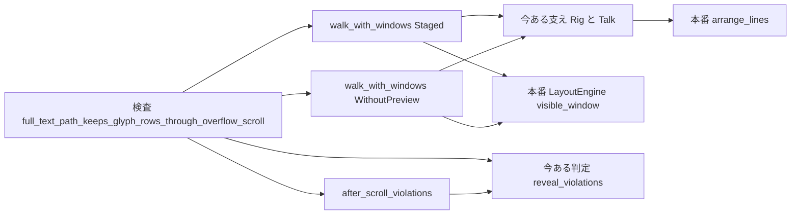
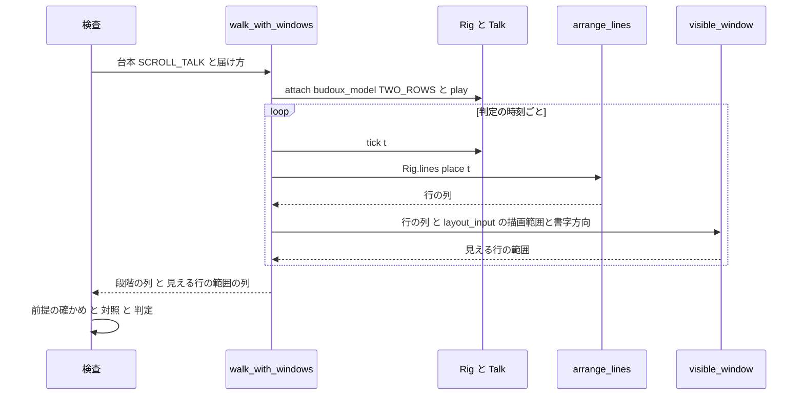

# 設計: areka-P0-reflow-scroll-path-test

## Overview

**Purpose**: 文節の折り返し（`budoux_newline,1`）のバルーンで、台本の全部を先に知らされた文字の層が全文で区切って配置する道筋（全文の枝）と、字が欄からあふれたときのスクロールを、同時に踏む検査を 1 本足す。完了済み `areka-P0-budoux-reveal-reflow` の要件 4.2（あふれても表示済みの字の行が変わらない）と要件 4.3（あふれのスクロールの仕組みを変えない）を、作りの構造ではなく、本番と同じ経路を歩く決定論の検査で守る。

**Users**: 開発者。文字の層の検査を回す人と、後続の `balloon-scroll-fade`・`text-reveal-fade` を作る人（表示の途中で字の行が変わらないことを当てにする）。

**Impact**: 本番のコードは変えない。今ある検査のファイル `crates/areka-emo-text/src/actor_lookahead_tests.rs`（630 行）の末尾に、定数 3 つ・小さな関数 2 つ・検査 1 本（合わせて 110 行ほど）を足すだけである。

### Goals
- 先渡しありの台本を 2 行だけ入る欄からあふれさせ、各段階で「行の割り当て」と「見える行の範囲」を取り、表示済みの字が動かないことを判定する。
- 出終わったときの見える行の範囲と行の割り当てが、同じ台本を先渡しなしで流したときと同じであることを判定する。
- 同じ台本を先渡しなしで流した対照で、台本が「届いた字だけで区切ると、あふれの境で字が動く」形を保っていることを毎回確かめる。
- 全文の枝を外す変異で赤になり、戻すと緑になることを、手順として確かめる。

### Non-Goals
- 本番のコード（区切り・配置・あふれの判定・見える行の範囲の決め方・先渡し）の変更。
- 描画の画素での確かめ（`actor_scroll_retain_tests.rs` の担当）、フェード（`balloon-scroll-fade`・`text-reveal-fade` の担当）。
- 1 字ずつの折り返し・縦書き・消去や選択肢を挟む台本でのあふれ。
- 途中の段階の見える行の範囲を、先渡しなしと比べること（全文の枝では、あふれが始まる時刻が先渡しなしより早くなるのが正しい動き。要件 3 が比べるのは出終わりだけ）。

## Boundary Commitments

### This Spec Owns
- `actor_lookahead_tests.rs` の末尾に足す、あふれる台本の定数・出終わりの区切りの定数・欄の大きさの定数。
- 段階ごとに行の割り当てと見える行の範囲を残す歩き方の関数 `walk_with_windows`。
- あふれのスクロールの後の段階の違反だけを抜き出す関数 `after_scroll_violations`。
- 検査 `full_text_path_keeps_glyph_rows_through_overflow_scroll`（要件 1〜3 の判定と前提の確かめ）。
- 変異の確かめの手順（入れ方・戻し方・記録の残し方。コードには残らない）。

### Out of Boundary
- 本番のファイル（`actor_present.rs`・`lookahead.rs`・`layout.rs`・`region.rs`・`actor.rs`・`lib.rs` など）の変更。変異は確かめの間だけ `lookahead.rs` に入れ、必ず戻す。
- 今ある支え（`Rig`・`Talk`・`Stage`・`Delivery`・`walk`・`walk_with`・`walk_injecting`・`reveal_violations`・`budoux_model` など）と今ある検査 1〜7 の中身の変更。
- 兄弟の検査ファイル（`actor_lookahead_shapes_tests.rs` など）と、新しいファイルの追加。
- warn の件数の判定（先渡しなしの warn は今ある検査 2 が受け持つ）。

### Allowed Dependencies
- 同じファイルの今ある支え: `Rig`（`new`・`attach`・`play`・`lines`・`runtime`）、`Talk`（`tick`・`times`）、`Stage`、`Delivery::Staged`／`Delivery::WithoutPreview`、`reveal_violations`、`show`、`budoux_model`、`ANCHOR`、`NINE_WIDE`。
- 本番の 2 つの手順: `arrange_lines`（`Rig::lines` → `arrange_for_test` 経由）と `LayoutEngine::visible_window`（`crate::layout`・公開）。
- 実行時の配置の入力 `TextLayerRuntime.layout_input`（非公開の欄。検査のモジュールは `actor` の子なので読める。読むだけで書かない）。
- 依存の向き: 検査 → 支え → 本番の関数。本番から検査へは向かない。

### Revalidation Triggers
- BudouX の模型・区切りの計算の変更（出終わりの区切りの定数がずれる）。
- 字の丈の既定（20）・行間の既定（2）・行の矩形の規約の変更（欄の高さ 53 の前提「2 行目の下端 42 は入り、3 行目の下端 64 は入らない」がずれる）。
- `validrect` を書かないバルーンの描画範囲の決め方（`region.rs` の `TextRegion::resolve`）の変更。同じ時期に `balloon-text-bugs` が `region.rs`・`actor_present.rs` を直すので、後から着地した側でこの検査を回し直す。
- `arrange_lines` または `visible_window` の引数・呼ぶ順の変更、`present_actor` が 2 つの間に別の手順を挟む変更（要件 1.4 の「本番と同じ順に呼ぶ」が崩れる）。
- `TalkLookahead::basis` の形の変更（変異の入れ場所が変わる）。

## Architecture

### Existing Architecture Analysis
- 本番の提示 `present_actor`（`actor_present.rs`）は、`layout_input` から配置の入力（`ResolvedBalloonText`）を引き、`arrange_lines`（区切り → 配置）で行の列を作り、続けて `LayoutEngine::visible_window(&lines, &resolved.region, resolved.mode)` で見える行の範囲を決める。2 つは別々の呼び出しで、まとめて返す本番の関数は無い。
- `arrange_lines` は文節の折り返しのとき `TalkLookahead::basis` に聞き、`Basis::Full`（全文の枝）なら区間の全文の字の列と区切りで、`Basis::Arrived` なら届いた字で区切る。
- `visible_window` は行の列・描画範囲・書字方向だけの純関数。横書きでは「最後の行の下端 > 描画範囲の下端」であふれ、最新の行が入る最小の先頭の行を選ぶ。
- 今ある支え `walk*` は段階ごとに行の列だけを `Stage { time, rows }` に残し、`Rig` を関数の中で捨てるので、見える行の範囲は外へ出ない。ここだけが欠けている。

### Architecture Pattern & Boundary Map



**Architecture Integration**:
- 選んだ形: 今ある支えに触らず、同じファイルの末尾に「見える行の範囲も残す小さな歩き方」を足す（ギャップ分析の案 A）。
- 境界: 新しいコードは支えと本番の関数を呼ぶだけで、どちらも書き換えない。
- 守る型: 本番と同じ経路（parse → compile → 刻印 → 先渡し → tick → 汲み出し → `arrange_lines`）、決まった字幅（`FixedMetrics`）、GPU を使わない。
- 新しい関数が要る理由: `walk*` は `Rig` を捨てるので見える行の範囲を取れない。`Stage` に欄を足すと兄弟のファイルの構造体の式まで直すことになり、要件 5.2 と並走の約束に当たる。
- steering との整合: テストは兄弟のファイル・1 ファイル 1,000 行以下（足した後も 740 行ほど）。

### Technology Stack

| Layer | Choice / Version | Role in Feature | Notes |
|-------|------------------|-----------------|-------|
| 検査 | Rust 標準の `#[test]` | 経路の検査 1 本 | 新しい依存なし |
| 文字の層 | `areka-emo-text`（ワークスペースの今の版） | 本番の `arrange_lines`・`visible_window` を呼ぶ | 変更なし |
| 台本 | `areka-parsers`・`areka-sakura`・`dola::cue` | 台本 → 合図の予定表 → 先渡し・tick | 今ある `Rig::play` 経由 |

## File Structure Plan

### Modified Files
- `crates/areka-emo-text/src/actor_lookahead_tests.rs` — 末尾（検査 7 の後）に次を足す。今ある行は 1 行も書き換えない（`use` も足さず、新しい関数の中で `use` するか完全なパスで書く）。
  - 定数 `SCROLL_TALK`・`SCROLL_TALK_FINAL`・`TWO_ROWS`
  - 関数 `walk_with_windows`・`after_scroll_violations`
  - 検査 `full_text_path_keeps_glyph_rows_through_overflow_scroll`

### 確かめの間だけ触るファイル（コードには残さない）
- `crates/areka-emo-text/src/lookahead.rs` — 変異を入れて赤を確かめ、戻す（下の「変異の確かめの手順」）。終わったときに差分が 0 であること。

新しいファイルは足さない。`actor.rs`（検査のモジュールの宣言）と `lib.rs`（源のファイルの一覧）には触らない。

## System Flows



検査の中の判定の順（変異のときに、あふれの後の段階の違反が失敗の文に出る順にしてある）:

1. 前提（先渡しあり）: 出終わりの区切りが `SCROLL_TALK_FINAL`（3 行）、出終わりの見える最初の行が 2 行目（添字 1。3 行のうち 2 行だけが見える＝欄に 2 行だけ入る）、見える最初の行が 1 行目の段階と 2 行目以降の段階が両方ある。
2. 対照（先渡しなし）: `reveal_violations` が空でなく、`after_scroll_violations` も空でない。
3. 要件 2: 先渡しありの `reveal_violations` が空。失敗の文に、全部の違反と、そのうちあふれの後の段階の違反を並べる。
4. 要件 3: 出終わりの見える行の範囲と行の割り当てが、先渡しありと先渡しなしで同じ。

## Requirements Traceability

| Requirement | Summary | Components | Interfaces | Flows |
|-------------|---------|------------|------------|-------|
| 1.1 | 先渡しありで本番の経路を流し、段階ごとに行の割り当てと見える行の範囲を取る | `walk_with_windows` | `Rig::play(.., Delivery::Staged)`・`Talk::tick`・`Rig::lines`・`visible_window` | 流れの図のループ |
| 1.2 | 消去なし 1 区間で 3 行以上の台本・2 行だけ入る欄 | `SCROLL_TALK`・`SCROLL_TALK_FINAL`・`TWO_ROWS`・検査の前提 | — | 判定の順 1 |
| 1.3 | 合図が 2 つ以上に分かれ、届いた字だけで区切ると字が動く形 | `SCROLL_TALK`（「‥」「‥」「ええと、」が別の合図） | — | 判定の順 2 で毎回確かめる |
| 1.4 | 本番の 2 つの手順を本番と同じ順に呼ぶ（写しを作らない） | `walk_with_windows` | `arrange_lines`（`Rig::lines` 経由）→ `visible_window`、描画範囲と書字方向は `layout_input` から | 流れの図 |
| 1.5 | 一度もあふれなければ失敗 | 検査の前提 | `VisibleWindow::first_visible_line` | 判定の順 1 |
| 1.6 | 決まった字幅・GPU なし・決定論 | `walk_with_windows` | `FixedMetrics`（`Rig::lines` の中） | — |
| 1.7 | 先渡しなしの対照で違反があり、その中にあふれの後の段階の違反がある | 検査の対照・`after_scroll_violations` | `Rig::play(.., Delivery::WithoutPreview)` | 判定の順 2 |
| 2.1 | 段階ごとに (a)(b) を判定して失敗させる | 検査 | `reveal_violations` | 判定の順 3 |
| 2.2 | 送る前の行の番号で比べる | `walk_with_windows`（行の列を見える行の範囲で切り取らずに `Stage` へ入れる） | `Stage.rows` | — |
| 2.3 | あふれの前後の段階の両方を判定に含める | 検査（全段階を `reveal_violations` に渡す） | — | 判定の順 3 |
| 2.4 | 前後の段階の片方しか無ければ失敗 | 検査の前提 | `first_visible_line == 0` と `> 0` の段階 | 判定の順 1 |
| 3.1 | 出終わりの見える行の範囲が先渡しなしと同じ | 検査 | `VisibleWindow` の等しさ | 判定の順 4 |
| 3.2 | 出終わりの行の割り当てが先渡しなしと同じ | 検査 | `Stage.rows` の等しさ | 判定の順 4 |
| 4.1 | 全文の枝を外す変異で失敗 | 変異の確かめの手順 | `TalkLookahead::basis` | 判定の順 3 で赤 |
| 4.2 | 戻して時刻を新しくしてから緑 | 変異の確かめの手順 | — | — |
| 4.3 | 変異を残さない | 変異の確かめの手順 | `git diff` | — |
| 4.4 | 変異の失敗にあふれの後の段階の違反がある | `after_scroll_violations`・検査の失敗の文・`SCROLL_TALK` の形の置き場所 | — | 判定の順 3 |
| 5.1 | 本番のコードを変えない | File Structure Plan | — | — |
| 5.2 | 今ある検査の中身を変えない | File Structure Plan（末尾に足すだけ） | — | — |

## Components and Interfaces

| Component | Layer | Intent | Req Coverage | Key Dependencies | Contracts |
|-----------|-------|--------|--------------|------------------|-----------|
| 台本と欄の定数 | 検査の入力 | あふれる台本・出終わりの区切り・2 行だけ入る欄 | 1.2, 1.3, 4.4 | `budoux_model`・`NINE_WIDE` | State |
| `walk_with_windows` | 検査の支え（新） | 段階ごとに行の割り当てと見える行の範囲を残す | 1.1, 1.4, 1.6, 2.2 | `Rig`・`Talk`・`arrange_lines`・`visible_window`・`layout_input` | Service |
| `after_scroll_violations` | 検査の支え（新） | あふれの後の段階の違反だけを抜き出す | 1.7, 4.4 | `reveal_violations` | Service |
| 検査本体 | 検査 | 前提・対照・要件 2・要件 3 を判定する | 1.2, 1.3, 1.5, 1.7, 2.1, 2.3, 2.4, 3.1, 3.2 | 上の 3 つ | — |
| 変異の確かめの手順 | 手順（コードに残らない） | 検査が全文の枝に効いていることを確かめる | 4.1, 4.2, 4.3, 4.4 | `lookahead.rs` | — |

### 検査の入力

#### 台本と欄の定数

| Field | Detail |
|-------|--------|
| Intent | あふれの境に「届いた字だけで区切ると動く形」を置いた台本と、2 行だけ入る欄 |
| Requirements | 1.2, 1.3, 4.4 |

```rust
/// 台本: 1 行目を改行で区切り、2 行目と 3 行目の境（＝あふれが始まる所）に検査 1 と同じ仕掛けを置く。
const SCROLL_TALK: &str = "\\1こんにちは。\\nイイジャン！\\_w[450]‥\\_w[150]‥\\_w[150]ええと、";
/// 出終わったときの区切り（前提）。
const SCROLL_TALK_FINAL: [&str; 3] = ["こんにちは。", "イイジャン！", "‥‥ええと、"];
/// 欄: 幅は NINE_WIDE と同じ全角 9 字。高さ 53 は、字の丈 20・行送り 22 で
/// 2 行目の下端 42 は入り（42 <= 53）、3 行目の下端 64 は入らない（64 > 53）値（境の 42〜63 の真ん中あたり）。
const TWO_ROWS: (u32, u32) = (NINE_WIDE.0, 53);
```

- 改行（`\n`）は消去ではないので、台本は 1 つの区間のままである（要件 1.2）。
- 「イイジャン！」「‥」「‥」「ええと、」は待ちのタグで別々の合図になる（要件 1.3）。届いた字だけで区切ると「‥」は 2 行目の後ろ（全角 8 字まで入る）に入り、「ええと、」が届いた時点で 3 行目の頭へ移る。全文で区切ると「‥」は最初から 3 行目の頭に出る。どちらの道筋でも 3 行目が現れた段階であふれが始まるので、字が動く段階とあふれが始まる段階が重なる（要件 4.4）。
- 区切りは設計の段で GPU なしで回して確かめた（`research.md` の「設計の段の実測」）。

### 検査の支え（新）

#### `walk_with_windows`

| Field | Detail |
|-------|--------|
| Intent | 本番と同じ経路で台本を流し、段階ごとに行の割り当てと見える行の範囲を返す |
| Requirements | 1.1, 1.4, 1.6, 2.2 |

**Responsibilities & Constraints**
- 役者 `"1"`・`budoux_model()`・`TWO_ROWS` の欄で `Rig::new` → `attach` → `play(script, ANCHOR, delivery)` を行い、`talk.times` の各時刻で `tick` してから、その時刻の行の列を `Rig::lines` で 1 回だけ取る。
- 同じ行の列を、`layout_input` から引いたその場所の `ResolvedBalloonText` の `region` と `mode` とともに `LayoutEngine::visible_window` へ渡す。描画範囲と書字方向は、本番の提示と同じく段階ごとに `layout_input` から読む（`attach` が入れた値。検査の側で解決し直さない）。
- 行の割り当ては、同じ行の列を `Rig::rows` と同じ写し方（行ごとに字の並び）で `Stage { time, rows }` にする。見える行の範囲で切り取らない（送る前の行の番号のまま）。
- `delivery` は `Delivery::Staged` と `Delivery::WithoutPreview` だけで使う（`AllAtOnce` は使わない）。

**Contracts**: Service [x]

##### Service Interface
```rust
/// 2 本の列は同じ長さで、添字が同じ段階を指す。最後が「出終わったとき」。
fn walk_with_windows(script: &str, delivery: Delivery) -> (Vec<Stage>, Vec<crate::layout::VisibleWindow>);
```
- 前提: `script` は役者 1 の台本。
- 事後: 段階の数は `talk.times` の数と同じ。`windows[i]` は `stages[i]` を作ったのと同じ行の列から出した値。
- 不変: 本番の状態に書き込まない（`Rig` の中の実行時を通常どおり動かすだけ）。

#### `after_scroll_violations`

| Field | Detail |
|-------|--------|
| Intent | 違反のうち、あふれのスクロールが起きている段階で見つかったものだけを返す |
| Requirements | 1.7, 4.4 |

**Responsibilities & Constraints**
- 2 番目以降の各段階 `j` で、`windows[j].first_visible_line > 0`（スクロールが起きている）なら、隣り合う 2 段階 `stages[j - 1..=j]` を `reveal_violations` に渡し、`(a)` で始まる違反（前の段階で見えていた字が段階 `j` で動いた）を集める。
- 今ある判定の関数をそのまま使い、違反の文を読み解かない。2 段階だけを渡すと (b) は (a) と同じ中身の重複になるので、`(a)` だけを取る（今ある検査 2 の `starts_with("(a)")` と同じ扱い）。
- あふれの後の段階が出終わりと違う違反（(b)）は、その段階から出終わりまでのどこかで (a) としても現れるので、取りこぼさない。

**Contracts**: Service [x]

##### Service Interface
```rust
fn after_scroll_violations(stages: &[Stage], windows: &[crate::layout::VisibleWindow]) -> Vec<String>;
```
- 前提: `stages` と `windows` は `walk_with_windows` の同じ呼び出しの戻り値。
- 事後: 空なら、スクロールが起きている段階で字は動いていない。

### 検査

#### `full_text_path_keeps_glyph_rows_through_overflow_scroll`

| Field | Detail |
|-------|--------|
| Intent | 全文の枝であふれても、表示済みの字の行が変わらず、出終わりの見える行の範囲が先渡しなしと同じ |
| Requirements | 1.2, 1.3, 1.5, 1.7, 2.1, 2.3, 2.4, 3.1, 3.2 |

**Responsibilities & Constraints**（判定の順は System Flows のとおり）
- 先渡しあり（`Staged`）と先渡しなし（`WithoutPreview`）を 1 回ずつ流す。
- 前提の確かめ（どれも `assert`。前提が崩れたことが分かる文で失敗させる）:
  - 出終わりの区切りが `SCROLL_TALK_FINAL`（要件 1.2）。
  - 出終わりの `first_visible_line` が 1（3 行のうち 2 行だけが見える＝欄の高さの前提・要件 1.2）。
  - `first_visible_line == 0` の段階と `> 0` の段階が両方ある（要件 1.5・2.4）。
- 対照: 先渡しなしの `reveal_violations` が空でなく、`after_scroll_violations` が空でない（要件 1.7・1.3）。
- 要件 2: 先渡しありの全段階の `reveal_violations` が空（要件 2.1・2.3）。失敗の文に全部の違反と `after_scroll_violations` の結果を並べる（要件 4.4 の確かめに使う）。
- 要件 3: 出終わりの `VisibleWindow` が先渡しありと先渡しなしで等しく（要件 3.1）、出終わりの行の割り当て（`show(&last.rows)`）も等しい（要件 3.2）。
- 先渡しなしの流れで出る warn「先渡しが無い」は捕まえない（件数の判定は今ある検査 2 の担当。今ある検査 3 と同じ扱い）。

### 手順

#### 変異の確かめの手順（コードに残らない）

| Field | Detail |
|-------|--------|
| Intent | 検査が全文の枝とあふれの組み合わせに本当に効いていることを確かめる |
| Requirements | 4.1, 4.2, 4.3, 4.4 |

1. `git diff --stat -- crates/areka-emo-text/src/lookahead.rs` が空であることを確かめる（戻すときに他の変更を消さないため）。
2. 変異を入れる: `TalkLookahead::basis` の本体の 1 行目に `if true { return Basis::Arrived; }` を入れる（先渡しの有無にかかわらず「届いた字で区切る」を返す。`if true` で包むので、続く行が「届かないコード」の警告にならない。設計の段で警告 0 件を確かめた）。
3. `cargo test -p areka-emo-text --lib full_text_path_keeps_glyph_rows_through_overflow_scroll -j 2` が失敗し、失敗の文の「あふれの後の段階の違反」に 1 件以上あることを確かめる（設計の段の実測では `(a) t=1.300→1.450` の 1 件。要件 4.1・4.4）。
4. 戻す: `git checkout -- crates/areka-emo-text/src/lookahead.rs`、続けて `touch crates/areka-emo-text/src/lookahead.rs`（時刻を新しくしてビルドに古い結果を使わせない・要件 4.2）。git の stash は他のセッションと共有なので使わない。
5. 同じ検査が成功し、`git status --short` に本番のファイルが出ないこと（`git diff --stat -- crates/areka-emo-text/src/lookahead.rs` が空）を確かめる（要件 4.2・4.3）。
6. 記録: 3 の失敗の文の要点（あふれの後の段階の違反の行）、5 の成功、差分が空であることを、tasks.md のそのタスクの記録に書く。出力を保存するなら、ワークツリーの `target\` の下だけに置く。

## Data Models

検査の中だけの値で、新しい型は作らない。

- `Stage { time: f64, rows: Vec<Vec<String>> }`（今ある型）: 段階の時刻と、送る前の行の番号のままの行ごとの字の並び。
- `VisibleWindow { first_visible_line: usize, block_offset: f32 }`（本番の型・`PartialEq`）: 見える最初の行の添字と、行を送る量。設計の段の実測では、出終わりはどちらの届き方でも `first_visible_line = 1`・`block_offset = -22`。

## Error Handling

- 検査の失敗は `assert!`／`assert_eq!` で出す。前提の確かめ・対照・要件 2・要件 3 で失敗の文を分け、どれが崩れたか（台本の形が崩れたのか、本番の動きが変わったのか）を文で区別する。
- 前提の失敗の文には段階ごとの行の列と `first_visible_line` を並べる（区切りや欄の高さの前提がずれたときに、どこがずれたか分かるように）。
- 本番の記録（warn）は判定しない。

## Testing Strategy

- **経路の検査（新・1 本）**: `full_text_path_keeps_glyph_rows_through_overflow_scroll`。
  - 前提: 出終わりの区切りが 3 行・欄に 2 行だけ見える・あふれの前と後の段階が両方ある（要件 1.2・1.5・2.4）。
  - 対照: 先渡しなしで違反があり、その中にあふれの後の段階の違反がある（要件 1.3・1.7）。
  - 要件 2: 先渡しありの全段階で表示済みの字が動かない（要件 2.1・2.2・2.3）。
  - 要件 3: 出終わりの見える行の範囲と行の割り当てが先渡しなしと同じ（要件 3.1・3.2）。
- **変異の確かめ（手順・1 回）**: 上の手順で赤（あふれの後の段階の違反つき）→ 戻す → 緑 → 差分 0（要件 4.1〜4.4）。
- **今ある検査の回し直し**: `cargo test -p areka-emo-text --lib actor::lookahead_tests -j 2`（今ある 7 本と新しい 1 本）が緑で、今ある検査の中身に差分が無い（要件 5.2）。
- 回すのは文字の層の対象の検査だけ。GPU は使わない（要件 1.6）。
