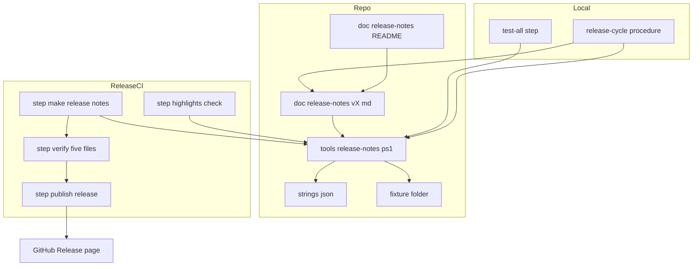
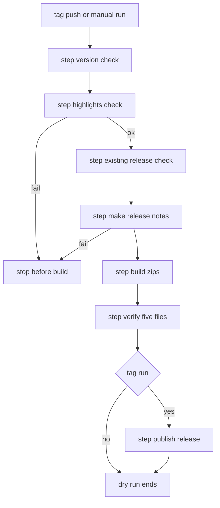

# Design Document

## Overview

**Purpose**: リリースの頁の本文を、PR の題名の全件の一覧から、その版の見どころを日本語で紹介する文章に替える。全件の一覧は、詳しいリリースノートとして添付へ移す。

**Users**: areka を使う人とゴーストを作る人は、頁の本文で見どころを読み、要るときに添付の詳しいリリースノートを開く。開発者と、リリースの手順を回す AI は、版上げの PR で見どころを書き、手元の道具で確かめる。

**Impact**: リリース CI（`.github/workflows/release.yml`）の公開の段が、GitHub に本文を作らせる形（`--generate-notes`）から、リポジトリの見どころのファイルを本文に使う形に変わる。添付は 4 つから 5 つになる。リリースの手順（`areka-P0-release-cycle`）の版上げの PR に、見どころのファイルが 1 つ加わる。`tools/` にスクリプトが 1 本増え、全体テストに段が 1 つ増える。

### Goals
- 見どころのファイルの形と書き方の決まりを 1 か所に置く。
- 見どころの検査・詳しいリリースノートの生成・本文の組み立てを、手元とリリース CI が同じ 1 本の道具で行う。
- 見どころの無い版では、リリース CI が組み立ての前に止まる。
- リリースの手順の文書を、見どころを書く段と 5 つの添付に合わせる。
- 公開済みの `v0.0.2` の頁を同じ形に直す。

### Non-Goals
- 見どころを機械に書かせること。見どころの文章の出来（口調・必ず載せるもの）を機械で判定すること。
- 通しの変更履歴（`CHANGELOG.md`）、英語の本文、zip の中身の変更。
- PR の題名の書き方の決まりの変更。
- 一つ前のタグの決め方の変更（段「既存の Release の検査」の `Get-PrevTag` のまま）。
- 完了した `areka-P0-release-ci-workflow` の文書の書き換え。

## Boundary Commitments

### This Spec Owns
- `doc/release-notes/` のフォルダ: 書き方の決まり（`README.md`）と、`v0.0.2` の見どころのファイル。
- `tools/release-notes.ps1` と、その定型文（`tools/release-notes.strings.json`）・検査の見本（`tools/release-notes-fixture/`）。
- 見どころのファイルの形の契約（下の「見どころのファイルの形」）と、詳しいリリースノートの形の契約（下の「詳しいリリースノートの形」）。
- リリース CI の次の変更: 取り出しの深さ、段「見どころの検査」と段「リリースノートを作る」の追加、段「4 つの確かめ」を「5 つの確かめ」に改めること、段「Release を公開」の本文と添付。
- リリースの手順の文書（`areka-P0-release-cycle` の `requirements.md`・`design.md`・`tasks.md`）のうち、見どころを書く段・版上げの数え上げ・公開の後の確かめに関わる所。
- `v0.0.2` の頁の 1 回きりの直しと、その証跡。
- 全体テストの段 `release notes check` と、段の一覧を写している文書の追随。

### Out of Boundary
- 各版の見どころの文章を書くこと（`v0.0.3` からはリリースの手順の仕事。本 spec が書くのは `v0.0.2` の分だけ）。
- リリース CI の段「版の検査」「既存の Release の検査」「道具の用意」「環境の記録」「zip を作る」「後始末」の中身。配布スクリプト `tools/package.ps1`。
- `crates-io.yml`・winget への PR・配布物の署名。
- リリースの手順の文書のうち、上に挙げた所の外（前提の確かめ・タグ・赤のときの決まり・記録）。
- 完了した spec の文書と、`areka-P0-release-cycle` の `verification/first-run.md`（過ぎた回の記録）。
- `.kiro/steering/roadmap.md`（完了の手順が直す）。

### Allowed Dependencies
- `tools/utf8-child.ps1` の `Invoke-Utf8Child`（子の出力を UTF-8 で読む）。
- `git`（`log`・`rev-parse`）、`gh`（`release create`・`release view`・`release edit`・`release upload`・`api`）、PowerShell 7。新しい道具は足さない。
- リリース CI の段「版の検査」の出力 `version` と、段「既存の Release の検査」の出力 `prev_tag`。
- 全体テストの `Step` の仕組みと、段 `encoding check` の規則（新しいスクリプトと workflow の本文は、この規則に従う）。
- 道具は、端末の文字コードを読みも書きもしない。画面へ出す文は ASCII だけ。

### Revalidation Triggers
- 見どころのファイルの置き場所・名前・見出しの形・出典の URL が変わる → リリースの手順の文書と、pasta の側の同じ決まり。
- 添付の数または詳しいリリースノートの名前が変わる → リリースの手順の公開の後の確かめ、`areka-P0-winget-release-automation` の zip の拾い方。
- `tools/release-notes.ps1` の引数の名前・終了コードの意味が変わる → リリース CI の 2 つの段と、リリースの手順のタスク。
- PR の題名の形（「種類(スコープ): 題名 (#番号)」）または main への入り方（PR の squash）が変わる → 詳しいリリースノートの区分けと PR の番号の拾い方。
- リリース CI の段の並び（とくに組み立てと zip の間）が変わる（`areka-P0-release-code-signing`）→ 段「5 つの確かめ」が見る置き場。

## Architecture

### Existing Architecture Analysis
- リリース CI は 1 本の job で、段は「改行の設定 → 取り出し → Rust の固定 → 版の検査 → 既存の Release の検査 → 道具の用意 → 環境の記録 → zip を作る → 4 つの確かめ → Release を公開 → 後始末」の順に並ぶ。公開するのはタグの push のときだけで、手で起こした走りは乾いた走りになる（環境変数 `PUBLISH`）。
- 段の本文は workflow の中に書き、入力は環境変数だけにしている。配布物の組み立てだけは `tools/package.ps1` を別のプロセスで呼ぶ。本 spec の 2 つの新しい段も、同じ形（`pwsh -NoProfile -NonInteractive -File ./tools/…` を呼び、終了コードをそのまま返す）にする。
- 取り出しは浅い。一つ前のタグは `git` でなく API で決めている。
- `tools/*.ps1` と workflow の `run:` の本文は、コメントの外に ASCII の外の字を置けない（段 `encoding check` の規則 A）。日本語の定型文と検査の見本は、スクリプトの外のファイルに置く。
- リリース CI は取り出しの前に `core.autocrlf true` を置くので、取り出したテキストは CRLF になる。

### Architecture Pattern & Boundary Map



**Architecture Integration**:
- **選んだ形**: 道具 1 本（`tools/release-notes.ps1`）に、検査・一覧・本文の組み立て・自分の検査の 4 つの形を持たせ、手元・全体テスト・リリース CI・`v0.0.2` の直しの全部が同じ物を呼ぶ。
- **責任の分け方**: 文章は人が書く（見どころのファイル）。形の判定と一覧は道具が行う。Release への載せ方は workflow が行う。道具は Release にも GitHub にも触らない（読むのは作業木と `git` の履歴だけ）。
- **保つ形**: workflow の今の決まり（要件 5.8）、下書きで作って載せ終えてから公開する形、段「後始末」。
- **新しい部品の理由**: 道具は要件 2.5・4.11（手元と CI で同じ物）と 8.3・8.4（動かして確かめる検査）のため。定型文の JSON と見本のフォルダは、規則 A のため。
- **依存の向き**: 見どころのファイル・定型文 → 道具 → workflow の段／リリースの手順。逆向きは無い（道具は workflow もリリースの手順の文書も読まない）。

### Technology Stack

| Layer | Choice / Version | Role in Feature | Notes |
|-------|------------------|-----------------|-------|
| 道具 | PowerShell 7（`#Requires -Version 7`） | 検査・一覧・本文の組み立て | 既存の `tools/*.ps1` と同じ流儀（`Set-StrictMode -Version 3.0`・`$ErrorActionPreference = 'Stop'`） |
| 履歴 | `git log --first-parent --format=%s` | 一覧のもと | `Invoke-Utf8Child` で UTF-8 として読む。範囲の前に `--end-of-options` を、後ろに `--` を付けて呼ぶ（`-` で始まる値をオプションとして働かせない） |
| 公開 | `gh release create --notes-file` | 本文と 5 つの添付 | `--generate-notes`・`--notes-start-tag` をやめる |
| CI | `actions/checkout`（今の固定の版）に `fetch-depth: 0` | 履歴の全部とタグ | 版の固定の値は変えない |

## File Structure Plan

### Directory Structure
```
doc/release-notes/
├── README.md                      # 見どころの書き方の決まり（形・口調・出典の URL・数の目安・材料の出し方・検査の回し方）
└── v0.0.2.md                      # v0.0.2 の見どころ（本 spec が書く）
tools/
├── release-notes.ps1              # 道具（-Check / -Notes / -Body / -SelfTest）
├── release-notes.strings.json     # 日本語の定型文（詳しいリリースノートの題・見出し・本文の末尾のリンクの文）
└── release-notes-fixture/         # 検査の見本（encoding check は下のフォルダを見ない）
    ├── subjects.txt               # 題名の並び（1 行 1 題名）
    ├── expected-notes.md          # subjects.txt から作られるべき詳しいリリースノート
    ├── expected-notes-from-start.md # subjects.txt から fix と perf の製品の変更を除き、一つ前のタグを空にしたときの出力
    ├── highlights-ok.md           # 形を満たす見どころのファイル
    └── expected-body.md           # highlights-ok.md から作られるべき本文
.kiro/specs/areka-P0-release-notes-highlights/verification/
├── release-cycle-sweep.md         # リリースの手順の文書の洗い出し（直した所・直さなかった所と理由）
├── docs-sweep.md                  # 生きている文書の洗い出し
├── workflow-check.md              # workflow の静的な確かめ・段の本文の手元の走り・乾いた走りの結果
├── v0.0.2-before-body.md          # 直す前の本文（そのまま）
└── v0.0.2-page-fix.md             # 直す前後の添付の一覧・タグ・状態と、判定
```

### Modified Files
- `.github/workflows/release.yml` — 取り出しに `fetch-depth: 0`。段「見どころの検査」「リリースノートを作る」を足す。段「4 つの確かめ」を「5 つの確かめ」に改める。段「Release を公開」の添付と本文を替える。
- `tools/test-all.ps1` — `Step 'release notes check'` を `encoding check` の後ろに足し、冒頭のコメントの段の一覧に 1 行足す。
- `.kiro/specs/areka-P0-release-cycle/requirements.md`・`design.md`・`tasks.md` — 下の「リリースの手順の文書の直し」。
- `.kiro/steering/tech.md` — 全体テストの段の説明に `release notes check` を足す。リリース CI の説明（zip と SHA256 を作って公開する）に、本文と詳しいリリースノートを足す。
- `.kiro/steering/structure.md` — `tools/` の行に `release-notes.ps1` を、`.github/` の `release.yml` の説明に本文と添付を足す。`doc/release-notes/` を 1 行で書く。
- `.claude/skills/kiro-complete/SKILL.md` — 全体テストの段の一覧の写しに 1 行足す（段の名前の追随だけ。手順は変えない）。

## System Flows



- 見どころの検査は、版が分かった直後に回す（組み立ての前・要件 3.1）。乾いた走りでも同じ場所で同じ検査を回す（要件 3.3）。
- 詳しいリリースノートと本文は、一つ前のタグが分かった直後に作る。組み立て（最長 90 分）の前に失敗が分かる（要件 5.6）。作った 2 つは、その場で走りの結果の頁（`GITHUB_STEP_SUMMARY`）にも書く（要件 5.7）。
- 一覧の先は「`refs/tags/v{版}` が在ればそれ、無ければ `HEAD`」。タグの走りでは両者は同じコミットである。版が公開済みの乾いた走りでは、その版に入っていない変更が混ざらない。

## Requirements Traceability

| Requirement | Summary | Components | Interfaces | Flows |
|-------------|---------|------------|------------|-------|
| 1.1 | 置き場所と名前 | 書き方の決まり・道具 | 見どころのファイルの形 | — |
| 1.2, 1.3, 1.4 | 見どころの形・PR の番号 | 書き方の決まり・道具 | 見どころのファイルの形・`-Check` | — |
| 1.5 | spec 名を含まない | 道具 | `-Check` | — |
| 1.6, 1.8, 1.9 | 口調・動きが変わる点・直しだけの版 | 書き方の決まり | README の節 | 承認（リリースの手順の承認 A・本 spec の 7.3） |
| 1.7 | 最初の「Claudia」を出典へのリンクに | 書き方の決まり・道具 | `-Check` | — |
| 1.10 | リンクは CI が足す | 道具 | `-Body` | — |
| 1.11 | 決まりを 1 か所に | 書き方の決まり | `doc/release-notes/README.md` | — |
| 2.1, 2.2, 2.3, 2.6 | 検査の項目と終了コード | 道具 | `-Check` | — |
| 2.4 | 読むだけ | 道具 | `-Check` | — |
| 2.5 | 手元と CI で同じ物 | 道具・workflow | `-Check` | 段「見どころの検査」 |
| 2.7 | 文は ASCII | 道具 | 段 `encoding check` | — |
| 3.1, 3.2, 3.3, 3.4 | 組み立ての前に止まる | workflow | 段「見どころの検査」 | System Flows |
| 4.1, 4.2 | すべての変更・一つ前のタグが無いとき | 道具 | `-Notes` | — |
| 4.3〜4.9 | 行の形・区分け・見出し・冒頭 | 道具・定型文 | 詳しいリリースノートの形 | — |
| 4.10 | UTF-8 で 1 字も変えない | 道具 | `Invoke-Utf8Child`・LF と BOM なしの書き出し | — |
| 4.11 | 手元で同じ一覧 | 道具・リリースの手順 | `-Notes`（`-To` の既定は `HEAD`） | — |
| 4.12 | 同じ入力から同じ出力 | 道具 | `-SelfTest` | — |
| 5.1 | 本文＝見どころ＋リンク | 道具・workflow | `-Body`・`--notes-file` | 段「リリースノートを作る」「Release を公開」 |
| 5.2, 5.3 | 5 つの添付・名前 | workflow | 段「5 つの確かめ」「Release を公開」 | — |
| 5.4 | zip と `.sha256` を変えない | workflow | 触らない段 | — |
| 5.5 | 下書き → 公開 → 失敗なら消す | workflow | `gh release create`・段「後始末」 | — |
| 5.6 | 作れなければ公開しない | workflow | 段「リリースノートを作る」 | System Flows |
| 5.7 | 乾いた走りで読める | workflow | `GITHUB_STEP_SUMMARY` | 段「リリースノートを作る」 |
| 5.8 | 今の決まりを保つ | workflow | workflow の静的な確かめ | — |
| 5.9 | 道具を足さない | 道具・workflow | Technology Stack | — |
| 6.1, 6.2, 6.3, 6.4, 6.5 | 手順の段・数え上げ・検査・PR の説明・5 つ | リリースの手順の文書の直し | 直しの表 | — |
| 6.6 | 洗い出しの記録 | 証跡 | `verification/release-cycle-sweep.md` | — |
| 6.7, 6.8 | 繰り返しの形・workflow と `tools/` を書き換えない | リリースの手順の文書の直し | 直しの表の「保つ物」 | — |
| 7.1 | `v0.0.2` の見どころ | `v0.0.2` の頁の直し | `doc/release-notes/v0.0.2.md` | — |
| 7.2〜7.7 | 証跡・承認・同じ作り方・確かめ・書き換えない・一致 | `v0.0.2` の頁の直し | 直しの手順 | — |
| 8.1, 8.2 | 生きている文書の追随・完了した spec は触らない | 文書の追随 | `verification/docs-sweep.md` | — |
| 8.3, 8.4, 8.5 | 動かして確かめる検査 | 道具・全体テスト | `-SelfTest`・`Step 'release notes check'` | — |

## Components and Interfaces

| Component | Domain/Layer | Intent | Req Coverage | Key Dependencies (P0/P1) | Contracts |
|-----------|--------------|--------|--------------|--------------------------|-----------|
| 書き方の決まり | 文書 | 見どころの形と口調を 1 か所で決める | 1.1〜1.11 | — | State |
| 道具 `release-notes.ps1` | 開発の道具 | 検査・一覧・本文の組み立て・自分の検査 | 1.2〜1.5, 1.7, 1.10, 2.1〜2.7, 4.1〜4.12, 5.1, 5.9, 8.3, 8.4 | `Invoke-Utf8Child`（P0）・`git`（P0） | Service, Batch |
| リリース CI の変更 | CI | 検査で止める・作る・確かめる・載せる | 2.5, 3.1〜3.4, 5.1〜5.9 | 道具（P0）・`gh`（P0） | Batch |
| リリースの手順の文書の直し | 文書 | 見どころを書く段と数え上げ | 6.1〜6.8 | 道具（P0） | State |
| `v0.0.2` の頁の直し | 1 回きりの作業 | 公開済みの頁を同じ形にする | 7.1〜7.7 | 道具（P0）・`gh`（P0） | Batch |
| 文書の追随と全体テストの段 | 文書・検査 | 段の一覧と説明を合わせる | 8.1, 8.2, 8.5 | `tools/test-all.ps1`（P0） | — |

### 文書

#### 書き方の決まり（`doc/release-notes/README.md`）

| Field | Detail |
|-------|--------|
| Intent | 見どころのファイルを、このファイルだけを読んで書けるようにする |
| Requirements | 1.1, 1.2, 1.3, 1.4, 1.5, 1.6, 1.7, 1.8, 1.9, 1.10, 1.11 |

**Responsibilities & Constraints**
- 次の節を持つ: 置き場所と名前／形（下の「見どころのファイルの形」と同じ中身）／口調／必ず載せるもの／数の目安／材料の出し方（`-Notes` の呼び方）／検査の回し方（`-Check` の呼び方）。
- **口調**: 語り手は Claudia（令嬢）。一人称と語尾の型を 5〜8 行で示す。全文を口調で書く。動きが変わる点は「何が・どう変わる・何を直せばよいか」を事実の文で言い切ってから、口調の一言を添える。口調の決まりは本書で書き起こす（pasta のリポジトリの文書を写さない）。
- **出典**: `https://github.com/ponapalt/claudia`。最初に現れる「Claudia」だけをこの URL へのリンクにし、出典の段落は書かない。URL の値は、道具の較正値と同じでなければならない（`-SelfTest` が見る）。
- **必ず載せるもの**: 動きが変わる点（1.8）。直しだけの版は、使う人に効く直し（1.9）。
- **数の目安**: 3〜5。機械は 1 つ以上だけを見る。
- **書かないもの**: spec 名（1.5）、詳しいリリースノートへのリンク（1.10・リリース CI が足す）。
- 口調（1.6）・必ず載せるもの（1.8・1.9）は機械で判定しない。読んで確かめるのは、リリースの手順の承認 A と、本 spec の要件 7.3 の承認である。

##### State Management（見どころのファイルの形）

```markdown
ごきげんよう、[Claudia](https://github.com/ponapalt/claudia) ですわ。（挨拶と、その版のひとことの段落）

### 範囲を選ぶ選択肢に対応しましたわ(#293)

（紹介の文章。段落・箇条書きは自由）

### もう 1 つの見どころですわ(#286, #287)

（紹介の文章）
```

- 置き場所は `doc/release-notes/v{版}.md`（`{版}` は `v` を付けない版。例 `v0.0.3.md`）。UTF-8。
- 見どころ 1 つ＝`### ` で始まる見出し 1 行と、次の見出しまでの文章。
- 見出しの末尾（行末の空白を除く）は `(#番号)` か `(#番号, #番号, …)`。
- `### ` より上の段の見出し（`#`・`##`）は使わない（頁の題は GitHub が付ける）。

### 開発の道具

#### 道具 `tools/release-notes.ps1`

| Field | Detail |
|-------|--------|
| Intent | 見どころの検査・詳しいリリースノートの生成・本文の組み立てを、手元と CI に同じ形で出す |
| Requirements | 1.2, 1.3, 1.4, 1.5, 1.7, 1.10, 2.1, 2.2, 2.3, 2.4, 2.5, 2.6, 2.7, 4.1〜4.12, 5.1, 5.3, 5.9, 8.3, 8.4 |

**Responsibilities & Constraints**
- 読むのは、作業木のファイルと `git` の履歴だけ。GitHub へ通信しない。Release に触らない。
- `-Check` と `-SelfTest` は、`target/` の下の外には何も書かない。`-Notes` と `-Body` は、`-Out` の 1 つのファイルだけを書く（親のフォルダが無ければ作る）。
- 読んだ文は改行を LF にそろえて扱う。書くときは LF・BOM なしの UTF-8。
- 画面へ出す文は ASCII だけ。日本語の定型文は `tools/release-notes.strings.json` から読む。
- 較正値は冒頭の 1 か所に置く: 見どころのフォルダ（`doc/release-notes`）、出典のリンク（`[Claudia](https://github.com/ponapalt/claudia)`）、spec 名の印（`areka-P0-`）、添付の名前の形（`release-notes-v{版}.md`）。

**Dependencies**
- Outbound: `tools/utf8-child.ps1` — `git log` の出力を UTF-8 で読む（P0）
- External: `git` — 本線の題名の並び（P0）
- Inbound: リリース CI の 2 つの段・リリースの手順・全体テスト・`v0.0.2` の頁の直し

**Contracts**: Service [x] / API [ ] / Event [ ] / Batch [x] / State [ ]

##### Service Interface

```powershell
[CmdletBinding(DefaultParameterSetName = 'Check')]
param(
    [Parameter(ParameterSetName = 'Check', Mandatory)][switch]$Check,
    [Parameter(ParameterSetName = 'Notes', Mandatory)][switch]$Notes,
    [Parameter(ParameterSetName = 'Body', Mandatory)][switch]$Body,
    [Parameter(ParameterSetName = 'SelfTest', Mandatory)][switch]$SelfTest,

    # v を付けない版（例 0.0.3）。-SelfTest の外では必須。
    # ファイルの名前と印字に使うので、版に現れる ASCII の字だけを通す
    [Parameter(ParameterSetName = 'Check', Mandatory)]
    [Parameter(ParameterSetName = 'Notes', Mandatory)]
    [Parameter(ParameterSetName = 'Body', Mandatory)]
    [ValidatePattern('^[0-9A-Za-z.+-]+$')][string]$Version,

    # owner/name（例 ekicyou/areka）。リンクの URL を作る
    [Parameter(ParameterSetName = 'Notes', Mandatory)]
    [Parameter(ParameterSetName = 'Body', Mandatory)][string]$Repository,

    # 一つ前のタグ（例 v0.0.2）。空なら最初のコミットから
    [Parameter(ParameterSetName = 'Notes')][string]$PrevTag = '',
    # 一覧の先（タグの名前かコミット）
    [Parameter(ParameterSetName = 'Notes')][string]$To = 'HEAD',

    [Parameter(ParameterSetName = 'Notes', Mandatory)]
    [Parameter(ParameterSetName = 'Body', Mandatory)][string]$Out
)
```

| 形 | すること | 終了コード |
|----|----------|-----------|
| `-Check -Version` | その版の見どころのファイルを検査し、欠けをすべて印字する | 0 通った／1 欠けが在る |
| `-Notes -Version -Repository [-PrevTag] [-To] -Out` | `{PrevTag}..{To}`（`PrevTag` が空なら `{To}` まで全部）の本線の題名から、詳しいリリースノートを `-Out` に書く | 0／1（`git` が失敗・定型文が読めない） |
| `-Body -Version -Repository -Out` | 先に `-Check` と同じ検査を回し、通れば「見どころのファイルの中身＋空行＋区切りの線（`---`）＋空行＋リンクの文」を `-Out` に書く | 0／1（検査の欠け・書けない） |
| `-SelfTest` | 下の「自分の検査」を回す | 0 全部通った／1 |

- 知らない引数は断る（`[CmdletBinding()]`）。引数の組み合わせの誤りは PowerShell の引数の誤りとして落ちる。
- Preconditions: 作業フォルダはどこでもよい。道具は今のフォルダを変えない。リポジトリの根は自分の置き場所（`$PSScriptRoot`）から決め、`git` は `-C {根}` を付けて呼ぶ。`-Out` の相対パスは、呼んだ側の今のフォルダから数える。`-Notes` は、`PrevTag` と `To` が作業木の `git` から見えること。
- Postconditions: 終了コード 0 のとき、`-Out` のファイルは在って空でない。
- Invariants: 同じ入力（題名の並び・版・`PrevTag`・`Repository`・定型文）から、1 バイトも違わない出力になる（日付や時刻を書かない）。

**中の関数（`-SelfTest` が直接呼ぶ。入出力は文字列だけで、ファイルにも `git` にも触らない）**

```powershell
# 欠けの名前の並びを返す（空なら通った）。$Text が $null ならファイルが無い扱い。
# 引数に型を付けない: [string] を付けると PowerShell が $null を空の文字列に変え、無いファイルと空のファイルを分けられない
function Test-Highlights([AllowNull()]$Text) # -> [pscustomobject[]] @{ Key; Line; Detail }
# 題名の並びから詳しいリリースノートの全文を返す
function Format-ReleaseNotes([string[]]$Subjects, [string]$Version, [string]$PrevTag, [string]$Repository, [pscustomobject]$Strings) # -> [string]
# 見どころの文とリンクの文から本文を返す
function Format-Body([string]$Highlights, [string]$Version, [string]$Repository, [pscustomobject]$Strings) # -> [string]
```

**見どころの検査の項目（要件 2.1）**

| 欠けの名前（`Key`） | 判定 | 要件 |
|---|---|---|
| `missing-file` | `doc/release-notes/v{版}.md` が無い（この名前のファイルだけを見る・2.6） | 1.1, 2.1 |
| `no-highlight` | `### ` で始まる行が 0 | 1.2, 2.1 |
| `heading-no-pr` | `### ` の行のうち、行末が `\(#[0-9]+(, #[0-9]+)*\)` でないもの（行の番号を付ける） | 1.3, 1.4, 2.1 |
| `spec-name` | `areka-P0-` が現れる（行の番号を付ける・大文字と小文字を区別する） | 1.5, 2.1 |
| `no-source-link` | 出典のリンクの字の並びが無い | 1.7, 2.1 |
| `first-name-not-linked` | 出典のリンクが在り、それより前に `Claudia` が現れる（リンクが 1 つも無いときは、`no-source-link` だけを出す） | 1.7 |

- 欠けは 1 つ目で止めず、全部を集めて `FAIL {Key} line {行}: {ASCII の説明}` の形で印字する（2.2）。行の中身は印字しない（日本語を画面へ出さない）。
- ファイルの全体の欠け（`missing-file`・`no-highlight`・`no-source-link`）は、行を 0 で印字する。
- 通ったときは `OK highlights v{版} ({見どころの数} item(s))` を印字する。

**詳しいリリースノートの形（要件 4）**

```markdown
# areka v0.0.3 の詳しいリリースノート

v0.0.2 から v0.0.3 までに入ったすべての変更です（37 件）。

## 新しい機能

- さくらスクリプトのアンカー \_a[ID]…\_a を働かせる（…） ([#286](https://github.com/ekicyou/areka/pull/286))

## 不具合の修正

## 性能の改善

## そのほかの変更

## 開発の内部の作業など

- バグの起票 12 本を、触る場所ごとの 5 本にまとめる ([#291](https://github.com/ekicyou/areka/pull/291))
```

- 1 つの題名を、次の順で扱う。
  1. 行末の ` (#番号)` を拾って外す。在れば PR の番号にする。無ければ番号なし（4.3）。
  2. `^(?<type>[a-z]+)(\((?<scope>[^)]*)\))?!?: (?<rest>.+)$` に当てる。
  3. 当たり、`scope` が `areka-P0-` で始まれば製品の変更。`type` が `feat` →「新しい機能」、`fix` →「不具合の修正」、`perf` →「性能の改善」、ほか →「そのほかの変更」（4.5）。載せる文は `rest`。
  4. 当たったが `scope` が spec 名でない（`scope` が無いものを含む）→「開発の内部の作業など」。載せる文は `rest`（4.6）。
  5. 当たらない →「開発の内部の作業など」。載せる文は題名の全体（4.7）。
  6. 載せる文から `areka-P0-` の字の並びをすべて外す（4.4）。
- 行は `- {載せる文}` に、PR の番号が在れば ` ([#{番号}](https://github.com/{Repository}/pull/{番号}))` を続ける。
- 載せる文は、Markdown の記号を逃がさずにそのまま載せる（4.10）。
- PR の番号として扱うのは、行末の ` (#番号)`（空白 1 つ・括弧・`#`・数字）だけである。行末の `(PR#番号)` は PR の番号として扱わず、文のまま載せる。
- 見出しの中の並びは `git log` の順（新しい順）。0 件の見出しは出さない（4.8。上の見本の空の見出しは、形を見せるための物）。
- 冒頭は題の行と、範囲の 1 行（4.9）。`PrevTag` が空のときは「最初から v{版} まで」の文を使う。件数は行の数と同じ（4.1）。
- 題・範囲の文・5 つの見出し・本文の末尾のリンクの文は `tools/release-notes.strings.json` に置く。詳しいリリースノートは普通の文体で書く（口調は本文だけ）。

**本文の形（要件 5.1）**

```markdown
{見どころのファイルの中身（末尾の空行を除く）}

---

{リンクの文。例: すべての変更は、添付の [release-notes-v0.0.3.md](https://github.com/ekicyou/areka/releases/download/v0.0.3/release-notes-v0.0.3.md) にまとめてありますわ。}
```

**自分の検査（`-SelfTest`・要件 8.3・8.4）**

| 見るもの | 判定 |
|---|---|
| 一覧の整形 | `release-notes-fixture/subjects.txt` を `Format-ReleaseNotes` に入れた結果が、`expected-notes.md` と 1 字違わず同じ（改行を LF にそろえて比べる）。見本は、製品の変更の 4 つの種類・内部の作業・接頭辞の無い題名・接頭辞の外に spec 名を含む題名・PR の番号の無い題名・日本語の題名を含む。0 件の見出しを出さないことと、一つ前のタグが空のときの範囲の文は、`subjects.txt` から fix と perf の製品の変更を除き、一つ前のタグを空にして入れた結果を `expected-notes-from-start.md` と比べて見る（同じく 1 字違わず同じ） |
| 本文の組み立て | `release-notes-fixture/highlights-ok.md` を `Format-Body` に入れた結果が、`expected-body.md` と 1 字違わず同じ。見どころの末尾に空行を足して入れても、同じ結果になる |
| 検査が通る | `highlights-ok.md` を `Test-Highlights` に入れると、欠けが 0 |
| 検査が落ちる | `highlights-ok.md` から 1 か所ずつ外した文（見出しを全部消す／見出しの `(#番号)` を消す／`areka-P0-x` を足す／出典のリンクを消す／リンクの前に `Claudia` を足す）と `$null` を入れると、それぞれ決まった `Key` の欠けが出る |
| 決まりとの一致 | `doc/release-notes/README.md` が、較正値の出典の URL を含む |
| 実物 | `doc/release-notes/v*.md` の全部が `Test-Highlights` を通る |

- 落ちた項目は `FAIL selftest {名前}` を全部印字し、最後に 1 回で終了コードを決める。

**Implementation Notes**
- Integration: 今のフォルダを変えない（リポジトリの根は自分の置き場所 `$PSScriptRoot` から決め、`git` は `-C {根}` を付けて呼び、`-Out` の相対パスは呼んだ側の今のフォルダから数える）・`utf8-child.ps1` を読み込む・冒頭のコメントのヘルプは、`tools/crates-io.ps1` の流儀に合わせる。
- Validation: 段 `encoding check` が、このスクリプトを自動で対象にする（コメントの外は ASCII だけ）。
- Risks: 定型文の JSON が壊れると `-Notes` と `-Body` が落ちる。`-SelfTest` が全体テストで先に落ちる。

### CI

#### リリース CI の変更（`.github/workflows/release.yml`）

| Field | Detail |
|-------|--------|
| Intent | 見どころが欠ければ組み立ての前に止め、本文と 5 つの添付で公開する |
| Requirements | 2.5, 3.1, 3.2, 3.3, 3.4, 5.1, 5.2, 5.3, 5.4, 5.5, 5.6, 5.7, 5.8, 5.9 |

**Contracts**: Service [ ] / API [ ] / Event [ ] / Batch [x] / State [ ]

##### Batch / Job Contract

| 段 | 変更 | 入力（環境変数） | 中身 |
|----|------|------------------|------|
| 取り出し | 直す | — | `with:` に `fetch-depth: 0` を足す（履歴の全部とタグ）。`persist-credentials: false` と版の固定はそのまま |
| 見どころの検査 | 足す（「版の検査」の直後） | `VERSION` | `pwsh -NoProfile -NonInteractive -File ./tools/release-notes.ps1 -Check -Version $env:VERSION`。子の終了コードをそのまま返す（`$host.SetShouldExit`）。条件を付けない＝タグの走りでも乾いた走りでも回る |
| リリースノートを作る | 足す（「既存の Release の検査」の直後） | `VERSION`・`PREV_TAG`・`GITHUB_REPOSITORY`・`GITHUB_STEP_SUMMARY` | 先を決める（`git rev-parse -q --verify "refs/tags/v$env:VERSION"` が通ればそのタグ、通らなければ `HEAD`）。`-Notes` で `target/release-notes/release-notes-v{版}.md` を、`-Body` で `target/release-notes/release-body-v{版}.md` を作る。どちらかが失敗したら、その終了コードで止まる。2 つの中身を `GITHUB_STEP_SUMMARY` へ UTF-8 で足す。走りの結果の頁では、2 つの中身のそれぞれの前に ASCII の見出しの行を 1 行置く。`-PrevTag` は、`PREV_TAG` が空でないときだけ渡す |
| 4 つの確かめ → 5 つの確かめ | 直す | `VERSION` | 今の 4 つの判定はそのまま。加えて、`target/release-notes/` の 2 つ（詳しいリリースノート・本文）が在って空でないことを見る。読むだけ |
| Release を公開 | 直す | `GITHUB_REPOSITORY`・`GH_TOKEN`・`VERSION` | `$files` に詳しいリリースノートを足す（5 つ）。`$opts` から `--generate-notes` と `--notes-start-tag` を外し、`--notes-file {本文}` を足す。`PREV_TAG` はこの段では使わない。下書きで作って載せ終えてから公開する `gh` の動きと、終了コードの返し方はそのまま |
| 後始末 | 触らない | — | Release を探す行は「既存の Release の検査」と 1 字違わず同じまま |

- Idempotency & recovery: 失敗したら段「後始末」がこの走りの Release を消し、頭からやり直す（今の形）。足りない物だけを補う形は持ち込まない。
- 段の本文は ASCII だけで書く（コメントは日本語でよい）。段の入力は環境変数だけで、GitHub の式を本文に埋めない。権限は `contents: write` のまま（5.8）。
- 走りの記録に出る失敗の文は、道具の印字（`FAIL {Key} …`）である（3.4）。

**Implementation Notes**
- Validation: 直した後、`tools/encoding-check.ps1` が緑であること（規則 A・C と、規則 E の「`release.yml` に `Invoke-Utf8Child` の `metadata` の呼び出しが在る」）。2 つの新しい段と「5 つの確かめ」の本文を、環境変数を差し替えて手元で回す。枝を push して乾いた走りを 1 回行う（開発者の承認の後）。
- Risks: 公開の段は `v0.0.3` まで本番で動かない。乾いた走りで見られるのは「5 つの確かめ」までである。公開の段の引数は、差分の読み合わせで確かめ、リリースの手順の公開の後の確かめ（5 つ・本文）で受ける。

### リリースの手順の文書の直し（`areka-P0-release-cycle`）

| Field | Detail |
|-------|--------|
| Intent | 見どころを書く段と検査を足し、数え上げを 5 つに合わせる |
| Requirements | 6.1, 6.2, 6.3, 6.4, 6.5, 6.6, 6.7, 6.8 |

**直す所**（場所は「何の行か」で指す。実装では、直す前に洗い出しをやり直し、`verification/release-cycle-sweep.md` に 1 行ずつ記録する・6.6）

| 文書 | 何の行か | 直し |
|------|----------|------|
| 要件 | 「本書で使う言葉」の Release の走り | 作る物に、本文と詳しいリリースノートを足す |
| 要件 | Boundary Context の「版上げで書き換えるファイル」 | その版の見どころのファイルを足す |
| 要件 | 3.3（書き換える物の一覧） | `doc/release-notes/v{版}.md`（新しいファイル 1 つ・その版の分だけ）を足す |
| 要件 | 3.4（書き換えない物） | 見どころのファイルを例外に足す |
| 要件 | 要件 3 の末尾に 3.10・3.11 を足す | 3.10＝版を上げた後、一つ前のタグからの一覧を手元で出し、見どころを書く。3.11＝見どころの検査が赤なら PR を出さずに止まる（既存の番号は動かさない） |
| 要件 | 6.1（公開の後の確かめ） | 「5 つのファイル」と「本文がその版の見どころであること」 |
| 要件 | 「決まったこと」 | 本 spec が足した段であることを 1 行で書く |
| 設計 | 使う道具の列挙（Overview・Allowed Dependencies） | `tools/release-notes.ps1` を足す（main に在る物を使う・新しいスクリプトは 0 本、はそのまま） |
| 設計 | Revalidation の「添える物の数」 | 5 つ |
| 設計 | 版上げの 1 コミットの中身・コミットの表・Modified Files・段の表 | 見どころのファイルを足す。段の表に「見どころを書く」「見どころの検査」を足す |
| 設計 | 差分の範囲の判定（在ってよいファイル・`git status --porcelain` の `??` の行） | 在ってよいファイルに見どころのファイルを足す。`??` の行は「`doc/release-notes/v{版}.md` の 1 行だけ」にする |
| 設計 | `git add` の行・`gh pr view --json files` の判定・main を取り込んだ後の `git diff -- …` の行 | 見どころのファイルを足す。「4 ファイル（同じ日の 2 回目なら 3 つ）」を「5 ファイル（同 4 つ）」にする |
| 設計 | 版上げの PR の本文・承認 A | 本文に見どころのファイルの所在を書く。承認 A で見どころを読んでもらう |
| 設計 | 公開の後の判定（添わった物がちょうど 4 つ） | ちょうど 5 つ。加えて、`gh release view --json body` の本文が、見どころのファイルの中身で始まること |
| 設計 | 要件の対応表・テストの節の「4 ファイル」「4 つの物」 | 3.10・3.11 の行を足し、数を合わせる |
| タスク | 2 の末尾に 2.3 を足す | 見どころを書く（`-Notes` で一覧を出す・`doc/release-notes/README.md` に従って書く） |
| タスク | 3.2（差分の範囲の判定） | 設計の判定に合わせる |
| タスク | 3 の末尾に 3.5 を足す | 見どころの検査（`-Check`）。赤なら止まる |
| タスク | 4.1（コミット・PR・読み直し）・4.2（承認 A）・4.3（取り込み） | `git add` と PR の本文と判定の数を合わせる。承認 A に見どころを足す |
| タスク | 6.2（緑の判定）・7.1（main の取り込み） | 5 つと本文。同じ 5 ファイルの差分 |

**直さない所と理由**
- 設計の「初回だけ」の表の、Release の本文の比べる範囲の行と、`verification/first-run.md` — 過ぎた初回の記録である。
- 要件 1.6・3.5・4.2 の文 — 3.3 を指しているので、3.3 の直しで足りる。
- 要件 2.2（開いている PR の条件の 3 つのファイル） — 見どころのファイルは版ごとに別の名前で、ほかの PR と取り合わない。

**保つ物**
- `tasks.md` のチェックはすべて未完了のまま。`spec.json` は書き換えない。既存のタスクと受け入れ基準の番号は動かさない（足す物は末尾に置く）（6.7）。
- リリースの手順は、足した段でも workflow と `tools/` を書き換えない。使う道具は、本 spec が main に入れた `tools/release-notes.ps1` である（6.8）。

### 1 回きりの作業

#### `v0.0.2` の頁の直し

| Field | Detail |
|-------|--------|
| Intent | 公開済みの `v0.0.2` の頁を、見どころの本文と 5 つの添付にする |
| Requirements | 7.1, 7.2, 7.3, 7.4, 7.5, 7.6, 7.7 |

##### Batch / Job Contract
- Trigger: 本 spec の実装の中で 1 回。外へ出る操作（下の 4）は、開発者の明示の承認の後。
- 手順:
  1. `-Notes -Version 0.0.2 -PrevTag v0.0.1 -To v0.0.2 -Repository ekicyou/areka` で一覧を出し、それを材料に `doc/release-notes/v0.0.2.md` を書く。見出しにするのは、題名の末尾に PR の番号を持つ変更（614 のうち 194）が元になった内容だけで、PR を通していない古い変更だけが元になった内容は、紹介の文章の中で触れる（見出しの末尾に番号を書けないため）。`-Check -Version 0.0.2` を通す（7.1）。
  2. 直す前の状態を保存する: 本文をそのまま `verification/v0.0.2-before-body.md` に、添付の一覧（名前・大きさ・ハッシュ）とタグの指すコミットと公開の状態を `verification/v0.0.2-page-fix.md` に（7.2）。読むだけ。
  3. `-Body` で本文を作り、開発者に見どころの文章と本文を読んでもらい、明示の承認を得る（7.3）。
  4. `gh release upload v0.0.2 {詳しいリリースノート} --clobber` → `gh release edit v0.0.2 --notes-file {本文}` の順に行う（添付を先に載せると、本文のリンクが切れている間が無い）（7.4）。
  5. 直した後の状態を同じ形で読み、判定を記録する: 本文が `-Body` の出力と同じ／添付が 5 つ／もとの 4 つの名前・大きさ・ハッシュが同じ／タグの指すコミットが同じ／下書きでない（7.5・7.6）。
  6. 実装の最後に、枝の `doc/release-notes/v0.0.2.md` から作った本文と、頁の本文が同じであることをもう一度見る。違えば 4 と 5 をやり直す（7.7）。
- Idempotency & recovery: 4 は何度行っても同じ結果になる。失敗したら、保存した本文で `gh release edit` し、足した添付を消せば、直す前に戻る。
- 触らない物: zip・`.sha256`・タグ。Release を作り直さない。`gh release edit` に本文の外の引数（題・タグ・下書き）を付けない。

### 文書の追随と全体テストの段

- `tools/test-all.ps1`: `Step 'release notes check' { pwsh -NoProfile -File tools/release-notes.ps1 -SelfTest }` を `encoding check` の後ろに足す（8.5）。段の一覧の写し（冒頭のコメント・`tech.md`・`structure.md`・`kiro-complete` の段の一覧）に同じ名前を足す。
- 生きている文書の洗い出し（8.1）は、実装でやり直して `verification/docs-sweep.md` に記録する。設計の時点で直すと決めた所は Modified Files の `tech.md`・`structure.md` である。`README.md`・`dist/README.txt`・`doc/crates-io-publish.md` は、zip の入手と Release の公開の事実だけを書いていて、本文の作り方にも添付の数にも触れていないので、直さない。
- 完了した spec の文書（`.kiro/specs/completed/`）は書き換えない（8.2）。公開の段の新しい形の正本は本書である。

## Error Handling

### Error Strategy
- 道具は、欠けを全部集めてから 1 回で終了コードを決める。警告で続ける道は持たない。
- workflow の段は、道具の終了コードをそのまま返す。失敗した段より後ろの公開の段は動かない。

### Error Categories and Responses
- **見どころの欠け**（ファイルが無い・形が違う）: `-Check` が `FAIL {Key} line {行}: …` を印字して 1。リリース CI は組み立ての前に止まる。リリースの手順は PR を出さずに止まる。
- **履歴が読めない**（`PrevTag` や `To` が見えない・`git` の失敗）: `-Notes` が `FAIL git log (exit {コード}): {標準エラーの最後の行}` を印字して 1。リリース CI は公開せずに止まる。取り出しが浅いままだと、ここで落ちる。
- **定型文が読めない**（JSON が壊れた・鍵が無い）: `-Notes`・`-Body` が 1。全体テストの `-SelfTest` が先に落ちる。
- **公開の途中の失敗**: 今の形のまま（段「後始末」が Release を消す）。
- **`v0.0.2` の頁の直しの失敗**: 保存した本文で戻す（上の Idempotency & recovery）。

### Monitoring
- 走りの記録に、道具の `OK …`／`FAIL …` の行が残る。乾いた走りでは、走りの結果の頁に本文と詳しいリリースノートが出る。

## Testing Strategy

### 道具の検査（全体テストで毎回回る）
- `Format-ReleaseNotes`: 見本の題名の並びから、見本の出力と 1 字違わず同じ文が出る（4.3〜4.8・4.12・8.3）。
- `Test-Highlights`: 形を満たす見本が通り、6 つの欠け（`missing-file`・`no-highlight`・`heading-no-pr`・`spec-name`・`no-source-link`・`first-name-not-linked`）が、それぞれの名前で出る（2.1・2.2・8.4）。
- `doc/release-notes/README.md` の出典の URL が、道具の較正値と同じ（1.11）。
- `doc/release-notes/v*.md` の実物が全部通る（7.1）。
- 段 `encoding check` が、新しいスクリプトと直した workflow を緑と判定する（2.7・5.8）。

### 手元の走り（実装のときに 1 回ずつ・結果は `verification/workflow-check.md`）
- `-Notes -Version 0.0.3 -PrevTag v0.0.2`（先は `HEAD`）: 行の数が `git rev-list --first-parent --count v0.0.2..HEAD` と同じで、`areka-P0-` が 0 件（4.1・4.4・4.11）。
- `-Notes -Version 0.0.2 -PrevTag v0.0.1 -To v0.0.2`: 行の数が 614 で、PR の番号の無い行が落ちていない（4.1・4.3）。`-PrevTag` を空にした走りが、最初のコミットまで並べる（4.2）。
- 端末の文字コードを 932 にした子で `-Notes` を回し、出力が同じ（4.10）。
- workflow の 3 つの段（見どころの検査・リリースノートを作る・5 つの確かめ）の本文を、環境変数を差し替えて回す: 見どころの在る版で通る／無い版で 1 で止まる／`target/release-notes/` の物を消すと「5 つの確かめ」が落ちる（3.1〜3.4・5.2・5.6）。
- workflow の静的な確かめ: 権限・式の埋め込み・Release を探す行の一致・`--generate-notes` が 0 件（5.5・5.8）。

### 乾いた走り（枝で 1 回・開発者の承認の後）
- 見どころの検査が緑、リリースノートを作る段が緑、走りの結果の頁に本文と詳しいリリースノートが出る、「5 つの確かめ」が緑、公開の段が動かない（3.3・5.7）。取り出しの時間を記録する。

### `v0.0.2` の頁
- 上の手順 5 と 6 の判定（7.5・7.7）。

### 本 spec では確かめられないもの
- 公開の段が、5 つの添付と本文で Release を作ること（5.1・5.2・5.5 の本番の経路）。初めて動くのは `v0.0.3` で、リリースの手順の公開の後の確かめが受ける。

## Security Considerations
- 権限は `contents: write` のまま。新しい段は鍵を使わない（`GH_TOKEN` を渡すのは、今と同じ 3 つの段だけ）。
- 見どころのファイルと題名は、PR で main に入った物である。道具はそれを文として扱い、式としても、コマンドとしても評価しない。
- `v0.0.2` の頁の直しは、外へ出る操作である。開発者の明示の承認の後にだけ行い、接続先の URL や認証の情報を印字しない。
