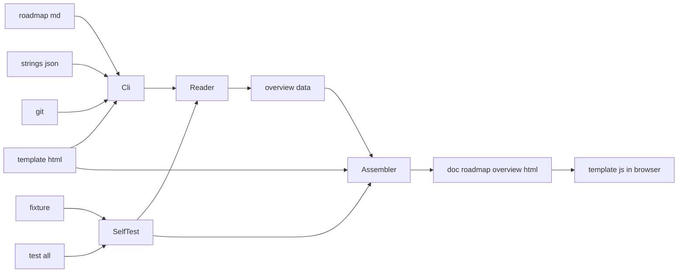
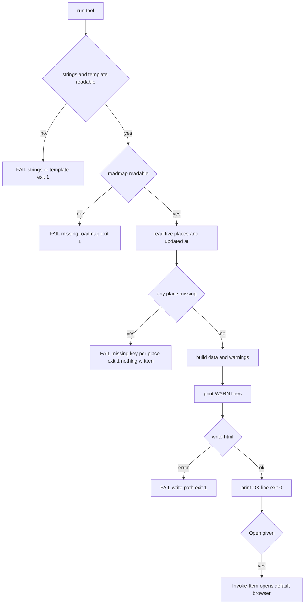

# 設計: areka-P0-roadmap-overview-html

## Overview

**目的**: 開発者が、1,000 行を超える `.kiro/steering/roadmap.md` を読まずに、版の段ごとの spec の並び・依存の順・段と区分・テーマ・着手中・完了を、ブラウザで 1 枚の HTML を開くだけで見渡せるようにする。あわせて `doc/` の古い記載を片づけ、残ったものが「今も効く」か「歴史」かを 1 枚の案内で分かるようにする。

**使う人**: areka の開発者。見たい日に 1 つのコマンドで、その日の roadmap.md から日付つきの HTML（`doc/roadmap-overview-{updated_at}.html`）を作って開く。実装の時点の 1 枚をリポジトリに入れるが、継続して直さない（要件 5.3・5.6）。

**変わること**: `tools/` に道具 1 本（`roadmap-overview.ps1`）と、その文言のファイル・HTML のひな形・見本を足し、全体テストに段を 1 つ足す。`doc/` では `ROADMAP.md` を消し、M1 期の議論 3 ファイルを `doc/archive/` へ寄せ、案内 `doc/README.md` を新しく置く。参照していた steering とスキルの行を同じ変更で直す。

### Goals

- roadmap.md の 5 か所（版の段の表・spec 台帳の表・テーマ別の決めごと・ウェーブ編成の表・完了サマリの表）を、今の書き方のまま読み、版の段ごとの帯とカードの 1 枚の自己完結の HTML を作る（要件 1〜4）。
- 同じ roadmap.md（同じ中身）からは、いつ・どの枝で作っても同じバイトを作る。全体テストで道具の働きを見本だけで確かめる（要件 5.4・6.5・6.6）。
- `doc/` の整理で、コードとテストが読むファイルには触らず、動かしたファイルへの参照を同じ変更で直す（要件 8）。

### Non-Goals

- roadmap.md の中身（版の段・台帳・ウェーブ）の見直しと、HTML のための書き方の変更（要件 4.1）。
- 入れた HTML と今の roadmap.md の食い違いの検査・作り直しの手順の追加（要件 5.6）。
- Web への公開・網羅台帳 `doc/ukadoc-coverage/` の数の直し・根の `docs/`・`doc/` の正本の文書の中身の書き直し。
- 暗い配色・JS を止めたブラウザでの表示・括弧の閉じ忘れの専用の検査（下の「単純にしたこと」）。

## Boundary Commitments

### This Spec Owns

- 道具 `tools/roadmap-overview.ps1` と、その文言のファイル `tools/roadmap-overview.strings.json`・HTML のひな形 `tools/roadmap-overview.template.html`・見本 `tools/roadmap-overview-fixture/`。
- roadmap.md の 5 か所の読み方の規則（区切りの字・括弧の組・名前の見分け・完了の判定・一言の切り方）。読み方の規則の正本は本 design と道具の中だけに置く。
- HTML に埋める中身の形（下の「データの形」）と、その見せ方（帯・カード・凡例・絞り込み・完了の場所）。
- 全体テストの段 `roadmap overview check`（`tools/test-all.ps1`）。
- `doc/` の整理（`doc/ROADMAP.md` の削除・`doc/discussion-260702-*` 3 つの `doc/archive/` への移動）と参照の直し、案内 `doc/README.md`、棚卸の表 `doc-inventory.md`（本仕様のフォルダ）。
- 実装の時点の roadmap.md から作った 1 枚 `doc/roadmap-overview-{YYYY-MM-DD}.html`。
- 本仕様の brief と roadmap.md の「ロードマップの俯瞰図と doc の整理」節の誤った記載の直し（要件 8.7）。

### Out of Boundary

- roadmap.md の版の段・台帳・ウェーブ・完了サマリの中身と書き方（棚卸と `/kiro-discovery` の持ち物）。道具は読むだけで、書き方の変化は道具の側（文言のファイルの目印と見本）で吸収する。
- `.kiro/specs/completed/`・`roadmap-history.md`・`doc/archive/` の中の古い場所の名前（歴史の記録として残す）。
- コードとテストが読む `doc/` のファイル（`doc/ukadoc-coverage/` の全体・`doc/ssp-mcp/tools-list-ssp-2.9.05.json`・`doc/ssp-mcp/log-convention.md`・`doc/release-notes/`・`doc/impl-watch.md`）の場所と中身。
- `doc/shiori/` の中身が今の正本と食い違うか（`shiori4-api` の持ち物）。
- `tools/encoding-check.ps1`（新しい道具は自動で検査の対象になるだけで、検査の側は直さない）。

### Allowed Dependencies

- PowerShell 7（`#Requires -Version 7`・手元は 7.6.7）と .NET の標準（`System.IO.File`・`System.Text.UTF8Encoding`・`ConvertTo-Json -EscapeHandling EscapeHtml`）。
- `git`（既に使っている。roadmap.md の中身の印を `hash-object` で求めるだけ）を `tools/utf8-child.ps1` の `Invoke-Utf8Child` 経由で呼ぶ。
- ブラウザの標準（HTML・CSS・素の JavaScript）。外の CDN・フォント・画像・ライブラリは使わない。
- 依存の向き: 文言のファイル・ひな形（データ）→ 読み手（純粋な関数）→ HTML の組み立て（純粋な関数）→ 入出力（本体・`-SelfTest`）。ひな形の JS は埋め込まれたデータの形だけに依る。逆向きは作らない。

### Revalidation Triggers

- roadmap.md の 5 か所の節の見出し・表の列の並び・区切りの字（`／`・`＝`・`→`・`・`）・「＝**N 本**」の書き方・`#### Specs (dependency order)` の行の形が変わる → 文言のファイルの `markers` と見本を直す（道具は欠けを `FAIL missing`・数の違いを `WARN` で知らせる）。
- 下の「データの形」を変える → ひな形の JS と見本の期待の値を一緒に直す。
- 全体テストの段の一覧を変える → 3 か所（`tools/test-all.ps1` の頭の説明・`tech.md`・スキル `kiro-complete` の `SKILL.md` の段の並び）をそろえる。
- `doc/` のファイルを足す・動かす → `doc/README.md` に 1 行足す（決まりは書くだけ・要件 9.3）。

## Architecture

### Existing Architecture Analysis

- 前例は `tools/release-notes.ps1`: `#Requires -Version 7`・`Set-StrictMode -Version 3.0`・`$ErrorActionPreference = 'Stop'`・冒頭の「較正値」・`$root = Split-Path $PSScriptRoot -Parent`・`Read-Lf`（UTF-8 で読み CRLF を LF に）・`WriteAllText`（BOM なし UTF-8）・端末へは ASCII の 1 行・純粋な関数と入出力を分ける・`-SelfTest` は `ok selftest {名前}`／`FAIL selftest {名前}` を 1 行ずつ。新しい道具はこの型をそのままなぞる。
- `tools/encoding-check.ps1` の規則 A は `tools/*.ps1` のコメントの外の字句に ASCII の外の字を許さない。注記（コメント）の日本語は許される。新しい道具も自動で対象になる。
- roadmap.md は CRLF・約 1,100 行・381 KB。表の見出し行（`| 版 |`・`| Wave |`）は別の節にも在るので、節（`## ` の見出し）の中で最初の表を探す。

### Architecture Pattern & Boundary Map



- **選んだ形**: 「読み手が中身を決め、ブラウザの JS が見せる」。道具は roadmap.md を読んで、見せる文と印をすべて決めたデータ（JSON）を作り、ひな形の 1 か所に埋める。ひな形の JS はデータを並べて描き、凡例と絞り込みを受け持つ。中身の判断（区切り・完了・前提の居場所・一言の切り方・警告）はすべて PowerShell の純粋な関数に置くので、`-SelfTest` が見本だけで確かめられる。
- **新しい部品の理由**: 文言のファイル＝日本語の目印と HTML の決まった文言を 1 か所に置く（規則 A・要件 6.7）。ひな形＝HTML・CSS・JS を PowerShell の文字列の外に置き、HTML を組む文字列のコードと HTML の逃がしを道具から無くす。見本＝要件 6.5 の検査の入力と期待の値。
- **steering との整合**: 新しい依存は無い（`tech.md`）。端末へは ASCII だけ・端末の文字コードを読みも書きもしない。今のフォルダを変えない。

### Technology Stack

| Layer | Choice / Version | Role in Feature | Notes |
|-------|------------------|-----------------|-------|
| CLI | PowerShell 7（`pwsh`）| 読み手・データの組み立て・HTML の書き出し・`-SelfTest`・`-Open` | 既存の道具と同じ。新しいモジュールは無い |
| データ | JSON（`ConvertTo-Json -Depth 10 -Compress -EscapeHandling EscapeHtml`）| HTML に埋める中身 | `<`・`>`・`&`・`'`・`"` を `\u003c` などに逃がす＝台帳の文の中の `</script>` で壊れない（手元の 7.6.7 で確かめた）|
| 表示 | HTML5・CSS・素の JavaScript（ES2017 程度）| 帯・カード・凡例・絞り込み | 外の物を読まない。`<details>` で開く |
| 外の道具 | git（既存）| roadmap.md の中身の印（`git hash-object`）| `Invoke-Utf8Child` で読む |

## File Structure Plan

### Directory Structure

```
tools/
├── roadmap-overview.ps1               # 道具の本体（読み手・組み立て・入出力・-SelfTest・-Open）。コメントの外は ASCII だけ
├── roadmap-overview.strings.json      # 日本語の目印（markers）と HTML の決まった文言（labels）。日本語はここだけ
├── roadmap-overview.template.html     # HTML・CSS・JS のひな形。ASCII だけ。データの差し込み口 @@ROADMAP_DATA@@ を 1 つ持つ
└── roadmap-overview-fixture/
    ├── roadmap.md                     # 見本の roadmap の断片（5 か所と、下の「見本が持つ形」をすべて含む・LF でも CRLF でもよい）
    └── expected-data.json             # 見本から作るデータの期待の値（-SelfTest が 1 字違わず比べる）
doc/
├── README.md                          # 新しい案内（残った各ファイル・フォルダの役目と、今も効くか歴史か・俯瞰の作り方と開き方・足すときの決まり）
├── roadmap-overview-{YYYY-MM-DD}.html # 実装の時点の roadmap.md から道具で作った 1 枚（手で直さない）
└── archive/
    ├── discussion-260702-m1-roadmap.md          # doc/ の直下から移す（中身は変えない）
    ├── discussion-260702-concurrency-model.svg  # 同上
    └── discussion-260702-roadmap-tree.svg       # 同上
.kiro/specs/areka-P0-roadmap-overview-html/
└── doc-inventory.md                   # 要件 7 の棚卸の表（実装の時点の数え）と、要件 8.4 の 0 件の記録
```

### Modified Files

- `doc/ROADMAP.md` — 消す（要件 7 の表の「消す」）。
- `tools/test-all.ps1` — 頭の説明に「9. 俯瞰の道具の自分の検査」を足し（`-License` を 10 へ）、`Step 'roadmap overview check' { pwsh -NoProfile -File tools/roadmap-overview.ps1 -SelfTest }` を `release notes check` の次・`-License` の前に足す。
- `.kiro/steering/tech.md` — 段の説明に「段 `roadmap overview check`」の 1 項を足す（`release notes check` の項の次）。
- `.claude/skills/kiro-complete/SKILL.md` — 324 行の段の並びに `roadmap overview check` を足す。339 行と 412 行の「触ってよいもの」から `doc/ROADMAP.md` を外す。350 行の「`doc/ROADMAP.md` はポインタ stub」「定めが無ければ `doc/ROADMAP.md` を見る」を `.kiro/steering/roadmap.md` を見る形へ直す。
- `.kiro/steering/focus.md` — 63 行の `doc/ROADMAP.md` の行を `doc/README.md`（`doc/` の案内・俯瞰の HTML の作り方と開き方）の行に差し替える（行は増やさない・要件 5.5）。
- `.kiro/steering/workflow.md` — 89 行の「`doc/ROADMAP.md` はポインタ stub のため更新対象ではない。」の文を外す。
- `.kiro/steering/structure.md` — `tools/` の一覧の文に `roadmap-overview.ps1` の 1 項を足す（`release-notes.ps1` の項の書き方に合わせる）。
- `.kiro/steering/roadmap.md` — 「ロードマップの俯瞰図と doc の整理」節の「消すと壊れる参照」の項を、引き直した事実に直す（要件 8.7）。ほかの行は触らない。
- `.kiro/specs/areka-P0-roadmap-overview-html/brief.md` — Current State の「参照の見つかったもの（消すと壊れる）」の項を同じく直す（要件 8.7）。

## System Flows



- 書き出しは、読み取りがすべて済んで欠けが無いときだけ行う。欠けが在れば何も書かず、前に書いた HTML にも触らない（要件 4.2）。
- 警告は終了コードを変えない（要件 4.6）。

## Requirements Traceability

| Requirement | Summary | Components | Interfaces | Flows |
|-------------|---------|------------|------------|-------|
| 1.1 | 表の行ごとの帯・表の順 | Reader・Renderer | `Read-Roadmap`（`bands`）| 読み取り |
| 1.2 | 帯に版の名前・目標・数 | Reader・Renderer | `Band.name`・`goal`・`cards.length` | — |
| 1.3 | 1 本 1 枚のカード | Reader | 版の段の読み方 4〜5 | — |
| 1.4 | 小見出しの組 | Reader・Renderer | `Group.heading` | — |
| 1.5 | 名前の順・`→` の依存 | Reader・Renderer | `Card.chained` | — |
| 1.6 | カードの欄・一言の出どころ | Reader・Renderer | `Card.oneLiner`・`tier`・`cls`・`size`・`prereqs`・`Get-OneLiner` | — |
| 1.7 | 開くと台帳の全文と注 | Reader・Renderer | `Card.ledger`・`Card.note`・`<details>` | — |
| 1.8 | どの roadmap から | Cli・Renderer | `Source`（`updatedAt`・`blob`）| — |
| 2.1 | 着手中の印 | Reader・Renderer | `Card.wave` | — |
| 2.2 | 完了の印・帯から外さない | Reader・Renderer | `Card.done` | — |
| 2.3 | 完了の場所（完了サマリの順）| Reader・Renderer | `completed.rows` | — |
| 2.4 | 完了サマリに無い完了 | Reader・Renderer | `completed.extra` | — |
| 2.5 | 前提の名前と居場所 | Reader・Renderer | `Prereq` | — |
| 3.1 | テーマの決め方と名前の切り方 | Reader | `themes`・`Card.theme` | — |
| 3.2 | 色と凡例 | Renderer | 色の規則 | — |
| 3.3 | 絞り込みと数の差し替え | Renderer | 凡例のボタン | — |
| 3.4 | 絞り込みを解く | Renderer | 解くボタン | — |
| 3.5 | テーマ名の文字 | Renderer | カードのテーマの札 | — |
| 4.1 | 読むだけ・roadmap.md だけ | Cli・Reader | `Read-Roadmap` は文字列だけを受ける | — |
| 4.2 | 欠けたら書かず非 0 | Cli・Reader | `Missing` の鍵 | 欠け |
| 4.3 | 数の違いの警告 | Reader・Renderer | `band-count`・`Band.declared`・`Band.read` | 警告 |
| 4.4 | 台帳に無い・帯に無い | Reader・Renderer | `not-in-ledger`・`not-in-band`・帯「帯に無い」| 警告 |
| 4.5 | 2 つの帯に出る | Reader・Renderer | `duplicate`・`Card.otherBands` | 警告 |
| 4.6 | 書き終えの報告 | Cli | `OK` の行 | 書き出し |
| 4.7 | 書けない | Cli | `FAIL write` | 書き出し |
| 5.1 | 1 つのコマンド | Cli | 引数なしの呼び出し | — |
| 5.2 | 開く指定 | Cli | `-Open` | 書き出し |
| 5.3 | 日付つきのファイル名・入れる 1 枚 | Cli・Snapshot | `doc/roadmap-overview-{updatedAt}.html` | — |
| 5.4 | 同じ入力から同じバイト | Reader・Assembler・Cli | 時刻を入れない・順序つき・LF・BOM なし | — |
| 5.5 | 手順を案内に・focus.md から辿る | DocGuide・SteeringEdits | `doc/README.md`・`focus.md` 63 行 | — |
| 5.6 | 直さない・検査しない | （作らないことの約束）| — | — |
| 6.1 | PowerShell だけ | Cli | Allowed Dependencies | — |
| 6.2 | 1 ファイルで完結・オフライン | Template・SelfTest | ひな形の検査 | — |
| 6.3 | 端末は ASCII・文字コードを明示 | Cli・Template | `WriteAllText` UTF-8・`<meta charset="utf-8">` | — |
| 6.4 | 今のフォルダによらない | Cli | `$root`・`git -C` | — |
| 6.5 | 自分の検査 | SelfTest・Fixture | `-SelfTest` | — |
| 6.6 | 全体テストの段 | TestAllStep | `roadmap overview check` | — |
| 6.7 | 文言の外出し | StringsFile | `labels`・`markers` | — |
| 7.1 | 1 行ずつ・読むファイルは別の行 | DocInventory | 表の行の決め方 | — |
| 7.2 | 行の欄 | DocInventory | 表の列 | — |
| 7.3 | 歴史の記録からの参照を分ける | DocInventory | 表の列 | — |
| 7.4 | 本仕様の文書に残り扱いが一致 | DocInventory | `doc-inventory.md` | — |
| 8.1 | 参照の直し | DocCleanup・SteeringEdits | 直す行の一覧 | — |
| 8.2 | 読まれるファイルに触らない | DocCleanup | Out of Boundary | — |
| 8.3 | 完了 spec・history を書き換えない | DocCleanup | Out of Boundary | — |
| 8.4 | 0 件の記録 | DocCleanup・DocInventory | 探し方のコマンド | — |
| 8.5 | 全体テスト | DocCleanup | `tools/test-all.ps1` | — |
| 8.6 | 正本の文書の中身を書き直さない | DocCleanup | Out of Boundary | — |
| 8.7 | 誤った記載の直し | SteeringEdits | roadmap.md・brief.md | — |
| 9.1 | 案内に役目と今か歴史か | DocGuide | `doc/README.md` の表 | — |
| 9.2 | 歴史は archive だけ・スナップショットの例外 | DocGuide・DocCleanup | `doc/README.md` | — |
| 9.3 | 作り方と足すときの決まり | DocGuide | `doc/README.md` | — |

## Components and Interfaces

| Component | Domain/Layer | Intent | Req Coverage | Key Dependencies | Contracts |
|-----------|--------------|--------|--------------|------------------|-----------|
| Reader | 道具（純粋な関数）| roadmap.md の文字列からデータと警告と欠けを作る | 1.1〜1.7・2.1〜2.5・3.1・4.1〜4.5・5.4 | StringsFile（P0）| Service |
| Assembler | 道具（純粋な関数）| データをひな形へ埋めて HTML の全文を作る | 5.4・6.2・6.3 | Template（P0）| Service |
| Cli | 道具（入出力）| 読む・git を問う・書く・印字・`-Open` | 1.8・4.2・4.6・4.7・5.1〜5.3・6.1・6.3・6.4 | Reader・Assembler（P0）・git（P1）| Batch |
| SelfTest | 道具（入出力）| 見本で Reader と Assembler とひな形を判定する | 6.5・6.2 | Fixture（P0）| Batch |
| StringsFile | データ | 日本語の目印と HTML の決まった文言 | 6.7 | — | State |
| Template | 表示 | 帯・カード・凡例・絞り込み・完了の場所を描く | 1.1〜1.8・2.1〜2.5・3.2〜3.5・4.3〜4.5・6.2・6.3 | データの形（P0）| State |
| Fixture | データ | 見本の断片と期待のデータ | 6.5 | — | — |
| TestAllStep | 全体テスト | 段 `roadmap overview check` | 6.6 | SelfTest（P0）| — |
| DocCleanup | 文書の手入れ | 消す・寄せる・参照の直し・0 件の確かめ・全体テスト | 8.1〜8.6・9.2 | — | — |
| SteeringEdits | 文書の手入れ | steering・スキル・brief の行の直し | 5.5・8.1・8.7 | — | — |
| DocGuide | 文書 | `doc/README.md` | 5.5・9.1〜9.3 | — | — |
| DocInventory | 文書 | `doc-inventory.md`（棚卸の表と 0 件の記録）| 7.1〜7.4・8.4 | — | — |
| Snapshot | 生成物 | 実装の時点の 1 枚 | 5.3 | Cli（P0）| — |

### 道具（`tools/roadmap-overview.ps1`）

#### Reader

| Field | Detail |
|-------|--------|
| Intent | roadmap.md の全文（LF にそろえた文字列）から、HTML に埋めるデータ・警告・欠けを作る。ファイルにも git にも触らない |
| Requirements | 1.1〜1.7・2.1〜2.5・3.1・4.1〜4.5・5.4 |

**Responsibilities & Constraints**

- 入力は文字列と読み取りの目印（`markers`）と `Source` だけ。ファイルを開かない（要件 4.1 の「roadmap.md だけを読む」は Cli が roadmap.md だけを開くことで守る）。
- 出力の並びはすべて roadmap.md に出る順。並べ替えない（要件 5.4）。
- 同じ規則を 1 か所に置く: 括弧の深さを数える区切り（`Split-Top`）・表の行の割り方（`Split-Row`）・一言の切り方（`Get-OneLiner`）・地の文への直し（`ConvertTo-Plain`）。

**Contracts**: Service [x]

##### Service Interface

```powershell
# 表の 1 行を欄に割る。先頭と末尾の | は在っても無くてもよい（末尾の | が無い行が今の完了サマリに在る）。
# バッククォートの中の | は区切りにしない。\| は | に直して区切りにしない。欄は前後の空白を外す。
function Split-Row([string]$Line) -> [string[]]

# 括弧の深さ 0 の所だけで、$Seps のどれかの字で区切る。括弧の組は markers.brackets（（）・〔〕・「」）。
# バッククォートの中は 1 つの塊として扱い、括弧も区切りも数えない。
# 返り値は順序どおりの [pscustomobject]@{ Sep = 前の区切りの字（最初は ''）; Text = 区切りの間の文 }
function Split-Top([string]$Text, [string[]]$Seps, [pscustomobject]$Markers) -> [object[]]

# 「## {marker}」で始まる節（次の「## 」の前まで）の最初の表を返す。節か表が無ければ $null。
# 返り値 [pscustomobject]@{ Width = 見出し行の欄の数; Rows = @([pscustomobject]@{ Line = 行番号; Cells = [string[]] }) }
# 見出し行と区切り行（|---）は Rows に入れない。表は「|」で始まる行が続く所まで。
function Get-Table([string[]]$Lines, [string]$SectionMarker) -> [pscustomobject]

# ** とバッククォートを外した地の文
function ConvertTo-Plain([string]$Text) -> [string]

# 一言: （）の組（入れ子ごと）を外す → ConvertTo-Plain → 深さ 0 の最初の「。」の前まで →
#       前後の空白を外す → ONE_LINER_MAX（較正値・60）字を越えれば 60 字で切って「…」を足す
function Get-OneLiner([string]$Text, [pscustomobject]$Markers) -> [string]

# 全体。欠けが 1 つでも在れば Data は $null。HTML の決まった文言（labels）は受け取らない＝データに日本語の決まった文言を入れない
function Read-Roadmap([string]$Text, [pscustomobject]$Markers, [pscustomobject]$Source) -> [pscustomobject]@{
    Missing  = [string[]]       # 欠けの鍵（下の表）。在れば Data は $null
    Warnings = [object[]]       # [pscustomobject]@{ Key; Detail }（Detail は ASCII だけ）
    Data     = [pscustomobject] # 下の「データの形」
}
```

- 事前条件: `$Text` の改行は LF。`$Markers` は鍵がそろっている（Cli と SelfTest が先に確かめる）。
- 事後条件: 同じ引数からは同じ値（時刻・乱数・環境を読まない）。`Warnings` の数は `Data.warningCount` と同じ。

**欠けの鍵（要件 4.2）**: `roadmap`（ファイルが読めない＝Cli が出す）・`updated-at`（先頭の前置きに `updated_at: YYYY-MM-DD` が無い＝ファイル名を決められない）・`version-table`・`ledger-table`・`themes`（節が無い）・`wave-table`・`summary-table`。表の鍵は「節が無い」と「節に表が無い」を区別しない。

**警告の鍵（要件 4.3〜4.5・端末の文は ASCII）**

| 鍵 | 条件 | 端末の行 | HTML |
|---|---|---|---|
| `band-count` | 帯の「＝**N 本**」が無い、または N と読んだ名前の数が違う | `WARN band-count band {番号}: declared {N か ?}, read {M}` | 帯に両方の数 |
| `not-in-ledger` | 帯の名前が台帳に無い | `WARN not-in-ledger {名前}` | カードに「台帳に無い」 |
| `not-in-band` | 台帳の spec がどの帯にも無い | `WARN not-in-band {名前}` | 末尾の帯「帯に無い」にカードを置く |
| `duplicate` | 同じ名前が 2 つ以上の帯に出る | `WARN duplicate {名前}: bands {i},{j}` | 先の帯に置き、カードに「ほかの帯」 |
| `table-columns` | 表の行の欄の数が見出し行と違う | `WARN table-columns {表の鍵} line {行}: {k} cell(s), expected {w}` | 足りない欄は空として読む |
| `git` | git が使えない・中身の印を求められない | `WARN git: blob unknown` | 中身の印を「不明」と出す |

帯の番号は表の行の順の 1 から。名前は spec 名（ASCII）なので、そのまま印字する（念のため ASCII の外の字は `?` に替える）。

##### 読み方の規則（今の roadmap.md で 8 帯の数が全部合うことを試作で確かめた）

**共通**

- 節は「`## ` で始まり `markers` の節の目印で始まる行」から次の「`## ` で始まる行」の前まで。表は節の中の最初の「`|` で始まる行」を見出し行とし、続く区切り行の後から「`|` で始まらない行」の前まで。別の節に同じ見出し行の表が在っても読まない。
- spec 名に見える語＝`^[a-z0-9]+(-[a-z0-9]+)+$`（小文字と数字のハイフンつなぎ）。先頭の `areka-P0-` は外してから当てる。これに当たらないバッククォートの語（`catalog.rs`・`Cargo.lock`・`TempPath::under_target`・`shell/{model,decode}.rs`・`.webp` など）はファイル名などとして読み飛ばす。

**版の段（要件 1.1〜1.5・1.7・4.3〜4.5）**: 表の 3 欄（版・目標・spec）を行ごとに 1 本の帯にする。

1. 版の名前＝1 欄目の `ConvertTo-Plain`（括弧書きも残す）。目標＝2 欄目の `ConvertTo-Plain`。
2. 3 欄目で、括弧の深さ 0 の所に現れる `markers.countRegex`（今は `＝\*\*(\d+) 本\*\*`）の**最後**の一致を数の印とし、N を `declared` に、その前だけを並びの文とする（後ろの説明の文の名前は読まない）。一致が無ければ `declared` は無し（`band-count` の警告）。
3. 並びの文を深さ 0 の `／` で組に分ける。組の中の深さ 0 の最初の `＝` の前を小見出し（`ConvertTo-Plain`）、後ろを中身とする（`＝` が無い組は小見出し無し）。小見出しの中の名前はカードにしない。
4. 中身を深さ 0 の `→` と `・` で要素に分ける。前の区切りが `→` の要素は `chained`（直前のカードを待つ）。
5. 要素が（前の空白を外して）バッククォートの語で始まり、その語が spec 名に見えるときだけカードにする。名前＝その語。注＝語の後ろの残り（`ConvertTo-Plain`・空なら無し）。そうでない要素は地の文として読み飛ばす。
6. `read`＝その行で読んだ名前の数（重なりを外す前）。

**spec 台帳（要件 1.6・1.7・4.4）**: 7 欄（spec・段・何をするか・規模・並び・前提・Fable）。名前＝1 欄目の最初のバッククォートの語。段の欄は深さ 0 の最初の `・` の前を段（`tier`）、`markers.classRegex`（今は `区分 ?([A-Z])`）の一致を区分（`cls`）とする。規模＝4 欄目の地の文。並びと前提の全文は `ledger` に地の文で持つ。前提の名前＝6 欄目の**深さ 0** のバッククォートの語のうち spec 名に見えるもの（括弧の中の名前は注として扱い数えない＝「なし（`mcp-stdio-bridge` は 10-11 着地）」は前提なし）。

**テーマ別の決めごと（要件 1.6・2.2・2.4・3.1）**: 節の中の `### ` 見出しごとに、`#### ` の見出しが `#### Specs (dependency order)` のときだけ、その下の `- [{印}] {名前の並び} -- {残り}` の行を読む（`#### Existing Spec Updates` の下の行は申し送りなので読まない）。

- テーマ名＝`### ` の見出しの最初の `（` の前（`ConvertTo-Plain`・前後の空白を外す）。`themes` は Specs の行を 1 つ以上持つ見出しを出る順に並べる。どの Specs の行にも載らない spec のテーマの添字は `themes` の長さ（＝テーマなし・名前はひな形が `labels` から出す）。
- 名前の並び＝`, ` で分けた各語から `areka-P0-` を外したもの。spec のテーマは最初に載った見出し。
- 残り＝最後の `Dependencies:` の前を一言の元（末尾の `。` を外す）、後ろを前提の文とする。前提の名前＝前提の文の深さ 0 の `areka-P0-{spec 名}` の語。
- 印が `x` の行の名前は完了。`→` などほかの印は完了としない。

**ウェーブ編成（要件 2.1）**: 表の最初の行だけを読む。ウェーブ名＝1 欄目の最初の `**…**` の中（無ければ欄の地の文）。名前＝2 欄目のバッククォートの語のうち spec 名に見えるもの。

**完了サマリ（要件 2.3〜2.5）**: 4 欄（Wave・完了日・ユニット（PR）・一行要約）の行を順に `completed.rows` へ。ユニットの欄の（深さを問わない）バッククォートの語のうち spec 名に見えるものを完了の名前とする（`W1〜W4` の行のようにバッククォートの無い名前は完了と数えない。roadmap.md に載せた形のまま読む）。節の中の後の表（`### リリース` の表など）は読まない。

**組み立て**

- 完了の名前＝完了サマリの名前 ∪ Specs の `x` の名前。カードの `done` と前提の居場所はこの 1 つの集まりで決める（要件 2.2・2.5）。
- カードの一言＝その spec の Specs の行の一言の元の `Get-OneLiner`。Specs の行が無ければ台帳の「何をするか」の `Get-OneLiner`（要件 1.6）。
- カードの前提＝台帳の前提の名前 → Specs の前提の名前の順に、重なりを外して並べる。居場所＝最初に置かれた帯の名前（在れば）と完了か。帯にも完了にも無ければ `band = null`・`done = false`＝HTML で「roadmap に無い」（要件 2.5）。
- 重なり: 2 つ目以降の帯に出た名前はカードにせず、先の帯のカードの `otherBands` に帯の名前を足す（`duplicate`）。
- 台帳に在ってどの帯にも無い spec は、表の帯の後ろに帯（`notInBand = true`・名前と目標は空・帯の名前はひな形が `labels` の「帯に無い」から出す・小見出し無しの組 1 つ・台帳の順）を足して置く。無ければ足さない（`not-in-band`）。
- `completed.extra`＝Specs の `x` の名前のうち、どの帯にも完了サマリにも無いもの（Specs の順・要件 2.4）。

#### Assembler

| Field | Detail |
|-------|--------|
| Intent | データを JSON にしてひな形の差し込み口に入れ、HTML の全文を返す |
| Requirements | 5.4・6.2・6.3 |

```powershell
# [ordered]@{ labels = $Labels; data = $Data } を ConvertTo-Json -Depth 10 -Compress -EscapeHandling EscapeHtml にした文で、
# ひな形の @@ROADMAP_DATA@@（1 つだけ）を文字列の置き換え（正規表現でない）で替える。改行は LF。
function Format-Html([string]$Template, [pscustomobject]$Data, [pscustomobject]$Labels) -> [string]
```

- データの中の並びは 1 要素でも配列として書く（PowerShell が 1 要素の並びをほどかないように、並びは `@()`・`[object[]]` で持つ。見本の期待の値で崩れに気付ける）。
- 時刻・乱数・環境の値を入れない。

#### Cli（本体の入出力）

| Field | Detail |
|-------|--------|
| Intent | 文言・ひな形・roadmap.md を読み、git に問い、HTML を書き、端末へ報告する |
| Requirements | 1.8・4.2・4.6・4.7・5.1〜5.3・6.1・6.3・6.4 |

**Contracts**: Batch [x]

##### Batch / Job Contract

- **呼び方**: `pwsh -NoProfile -File {根}\tools\roadmap-overview.ps1 [-Open]`／`... -SelfTest`。知らない引数は断る（`[CmdletBinding()]`・パラメーターセット `Build`（既定）と `SelfTest`）。
- **入力**: `$root = Split-Path $PSScriptRoot -Parent` の `.kiro/steering/roadmap.md` だけ（要件 4.1・6.4）。今のフォルダを変えない。
- **読み方**: 道具が読むファイル（roadmap.md・文言のファイル・ひな形、`-SelfTest` では見本と期待の値も）は、すべて `Read-Lf`（UTF-8 で読み CRLF を LF に）を通す。`.gitattributes` が無く `core.autocrlf=true` の写しでは、入れたファイルが作業の木で CRLF になるため（前例の release-notes の見本も同じ形で緑）。
- **Source（要件 1.8）**: `updatedAt`＝前置きの `updated_at`。`blob`＝`git -C $root hash-object -- .kiro/steering/roadmap.md` の先頭 12 字（中身の印。中身だけで決まり、HEAD や未コミットかによらない。長さは道具が決める・`--short` は使わない）。HEAD は使わない（作業の枝で作った 1 枚は squash マージの後に main から辿れず、roadmap.md と無関係なコミットでもバイトが変わるため・設計討議 議題 1）。辿り方は `git log --find-object={blob}`、手元の roadmap.md と同じ中身かは `git hash-object` 1 回で分かる（`doc/README.md` に書く）。git が使えなければ `blob = null` とし、`git` の警告を出す。
- **出力**: `$root/doc/roadmap-overview-{updatedAt}.html` を BOM なしの UTF-8・LF で書く（同じ名前が在れば書き替える・ほかの日付のファイルには触らない・要件 5.3）。
- **端末（ASCII だけ・要件 4.6・6.3）**: `FAIL strings: ...`／`FAIL template: ...`／`FAIL missing {鍵}`（欠けごとに 1 行）／`WARN ...`（警告ごとに 1 行）／`FAIL write {path}: {理由}`／`OK wrote doc/roadmap-overview-{日付}.html ({帯} band(s), {spec} spec(s), {警告} warning(s))`。帯の数は表の行の数、spec の数は帯に置いたカードの数（「帯に無い」の帯を含む）。
- **終了コード**: 0＝書けた（警告が在っても 0）／1＝文言かひな形が読めない・欠けが在る・書けない。
- **`-Open`（要件 5.2）**: 書けたときだけ `Invoke-Item -LiteralPath {書いたファイル}`（OS の既定のアプリ＝ブラウザで開く）。

#### SelfTest

| Field | Detail |
|-------|--------|
| Intent | ネットを使わずに、見本で読み方・警告・欠け・HTML の組み立て・ひな形の約束を判定する |
| Requirements | 6.5・6.2 |

判定は 1 つずつ `ok selftest {名前}`／`FAIL selftest {名前}` で印字し、落ちが在れば終了コード 1（release-notes と同じ）。実物の roadmap.md は読まない（要件 6.6・議題 1 の結論）。

1. 文言のファイルが読めて、`markers` と `labels` の鍵がそろっている。
2. ひな形: 差し込み口がちょうど 1 つ・`<meta charset="utf-8">` を持つ・外の物を読む書き方（`<script ... src`・`<link`・`@import`・`url(`・`http://`・`https://`）が無い・ASCII だけ（日本語を文言のファイルの 1 か所に保つ）。
3. 見本（`roadmap-overview-fixture/roadmap.md`）から作ったデータの JSON（`ConvertTo-Json -Depth 10` の字下げつき・LF）が `expected-data.json` と 1 字違わず同じ。`Source` は固定の値（`updatedAt` は見本の前置き・`blob = '0123456789ab'`）。
4. 見本は欠け 0・警告 0。
5. 見本を 1 か所ずつ壊した文が、決まった警告の鍵だけを出す: 帯の「＝**N 本**」の N を変える → `band-count`／帯に台帳に無い名前を足す → `not-in-ledger`／台帳に帯に無い行を足す → `not-in-band`／帯の名前を別の帯にも書く → `duplicate`／台帳の行の欄を 1 つ増やす → `table-columns`。壊した文が見本と同じなら判定は空振りなので落とす。
6. 見本から 1 か所ずつ外した文が、決まった欠けの鍵だけを出し、`Data` が無い: 前置きの `updated_at`・5 つの節の見出し（`themes` 以外は「節は在るが表が無い」形も 1 つ）。
7. 見本から 2 回作った HTML（`labels` は文言のファイルのもの）が 1 字違わず同じで、データの中の `</script>` に当たる字（見本の台帳の文に入れておく）が `\u003c/script\u003e` に逃がされている。

**見本が持つ形**（期待の値で確かめる。今の roadmap.md の難所をそのまま写す）: 3 帯以上（小見出しの組・小見出しの中の名前・`→` と `・` の混在・括弧の中の `・`／`＝`／`→`／名前・`〔〕` の入れ子・「＝**N 本**」の後ろのバッククォートの名前）／台帳の行にバッククォートの中の生の `|`・`\|`・末尾の `|` の無い行・前提にファイル名・前提に括弧の中だけの名前・`✅` 付きの名前／テーマの見出しの括弧書き・`#### Existing Spec Updates` の下の `- [x]`（完了と数えない）・`- [→]` の行・Specs の `x` で完了サマリに無い名前（`completed.extra` へ）・Specs の行が無い spec（テーマなし・台帳の文から一言）／ウェーブの表の 2 行目（着手中にしない）／完了サマリの節の後ろの別の表（読まない）・版の段の節の外に同じ見出し行の表（読まない）／どこにも無い前提の名前（「roadmap に無い」）／一言の 60 字の切り。

### データ（`tools/roadmap-overview.strings.json`・`tools/roadmap-overview.template.html`）

#### StringsFile

- `markers`（読み取りの目印・日本語を含む）: `secVersions`（`版の段`）・`secLedger`（`spec 台帳`）・`secThemes`（`テーマ別の決めごと`）・`secWaves`（`ウェーブ編成`）・`secSummary`（`完了サマリ`）・`groupSep`（`／`）・`headSep`（`＝`）・`chainSep`（`→`）・`listSep`（`・`）・`brackets`（`["（）","〔〕","「」"]`）・`countRegex`（`＝\*\*(\d+) 本\*\*`）・`classRegex`（`区分 ?([A-Z])`）・`themeCut`（`（`）・`sentenceEnd`（`。`）・`ellipsis`（`…`）。ASCII の目印（`## `・`#### Specs (dependency order)`・`Dependencies:`・`areka-P0-`・`updated_at`）は本体の較正値に置く。
- `labels`（HTML の決まった文言・要件 6.7）: 題・作った元の行（更新日・中身の印・印が不明）・帯の数の書き方・数の違いの書き方・着手中・完了・台帳に無い・帯に無い（帯の名前を兼ねる）・ほかの帯・前提・roadmap に無い・段・区分・規模・並び・テーマ・テーマなし・絞り込みを解く・完了の場所の見出し・完了サマリの列の名前・完了サマリに無い完了・開いたときの欄の名前（何をするか・並び・前提・版の段の注）・警告の件数。
- 読むときに鍵の欠けか空を `FAIL strings` にする（release-notes と同じ）。

**データの形（Reader の出力・ひな形の JS が読む契約）**

HTML に埋めるのは `{ labels: Record<string, string>; data: OverviewData }`（`labels` は StringsFile の `labels` をそのまま・Assembler が足す）。`OverviewData` は HTML の決まった文言を含まないので、文言を直しても見本の期待の値は変わらない。

```typescript
type OverviewData = {
  source: { updatedAt: string; blob: string | null };   // blob＝roadmap.md の git hash-object の先頭 12 字
  themes: string[];                    // 凡例の順。添字 themes.length が「テーマなし」
  bands: Band[];                       // 表の行の順。在れば末尾に notInBand の帯
  completed: { rows: SummaryRow[]; extra: DoneItem[] };
  warningCount: number;
};
type Band = {
  name: string; goal: string;          // notInBand の帯は name = goal = ""（名前は labels から）
  declared: number | null;             // 「＝**N 本**」の N
  read: number;                        // その行で読んだ名前の数
  notInBand: boolean;
  groups: { heading: string | null; cards: Card[] }[];
};
type Card = {
  name: string; oneLiner: string; theme: number;   // theme は themes の添字（themes.length＝テーマなし）
  tier: string | null; cls: string | null; size: string | null;  // 台帳に無ければ null
  chained: boolean;                    // 直前のカードと → で結ばれる
  note: string | null;                 // 版の段の表の、名前の後ろの括弧書き
  wave: string | null;                 // 着手中のウェーブ名
  done: boolean; notInLedger: boolean;
  otherBands: string[];
  prereqs: { name: string; band: string | null; done: boolean }[];  // band も done も無い＝roadmap に無い
  ledger: { what: string; order: string; prereq: string } | null;
};
type SummaryRow = { wave: string; date: string; units: string; summary: string; oneLiner: string };
type DoneItem = { name: string; oneLiner: string; theme: number };
```

文はすべて `ConvertTo-Plain` 済みの地の文（名前を除く）。ひな形は `textContent` だけで差し込み、`innerHTML` に roadmap.md 由来の文を入れない。

#### Template（ひな形と JS）

| Field | Detail |
|-------|--------|
| Intent | 埋め込まれたデータから、帯・カード・凡例・絞り込み・完了の場所を描く |
| Requirements | 1.1〜1.8・2.1〜2.5・3.2〜3.5・4.3〜4.5・6.2・6.3 |

- **骨組み**: `<!doctype html>`・`<html lang="ja">`・`<meta charset="utf-8">`・`<meta name="viewport">`・`<style>`（中に書く）・`<script id="roadmap-data" type="application/json">@@ROADMAP_DATA@@</script>`・`<script>`（中に書く）。題（`<title>`）は JS が `labels` から付ける。ひな形は ASCII だけ（矢印などの記号は JS や CSS の逃がし `\u2192`・`\2192` で書く）。
- **頭**: 題・作った元（更新日・roadmap.md の中身の印）・警告の件数（0 なら出さない）を、開いてすぐ見える所に出す（要件 1.8）。
- **帯（要件 1.1〜1.5）**: 帯を左から右へ並べた横の列（1 帯＝幅を決めた 1 列・はみ出す分は横に送る）。帯の頭に版の名前・目標・数（`declared` と `read` が違えば両方を `labels` の書き方で）。小見出しの組は帯の中で小見出しを付けて順に。`chained` のカードの前に `→` を置き、直前のカードを待つと分かるようにする。
- **カード（要件 1.6・1.7・2.1・2.2・2.5・3.5・4.4・4.5）**: `<details>`。閉じた面（`<summary>`）に名前・テーマの札（色と文字）・一言・段・区分・規模・印（着手中＋ウェーブ名・完了・台帳に無い・ほかの帯）・前提の名前と居場所（帯の名前／完了／roadmap に無い）。開いた面に台帳の何をするか・並び・前提の全文と版の段の注。
- **色（要件 3.2）**: テーマの添字 i の色相＝`(i × 137.508) mod 360`（黄金角で隣り合うテーマの色を離す）・彩度と明度は固定。テーマなしは灰色。色はカードの左の帯と凡例の札に使い、文字の色は地の色と組で読める濃さに保つ。
- **凡例と絞り込み（要件 3.2〜3.4）**: テーマごとに押しボタン（`<button aria-pressed>`・色の札とテーマ名）。押したテーマを選びに足す／外す（複数可）。選びが空でなければ選んだテーマのカードだけを見せ（ほかは `hidden`）、各帯の数を見えているカードの数に替える。「絞り込みを解く」ボタンで選びを空にし、すべてのカードと元の数に戻す。完了の場所は絞り込まない。
- **完了の場所（要件 2.3・2.4）**: 帯の下に見出しを置き、`completed.rows` を表の順に 1 行ずつ（ウェーブ・完了日・ユニット・一言、開くと一行要約の全文）。`completed.extra` が在れば末尾に `labels` の「完了サマリに無い完了」の組として、完了の印つきで並べる。
- JS が要る（今のブラウザはどれも動く）。JS を止めたときの代わりの表示は作らない。

### 全体テストと文書

- **TestAllStep（要件 6.6）**: `tools/test-all.ps1` に `Step 'roadmap overview check' { pwsh -NoProfile -File tools/roadmap-overview.ps1 -SelfTest }`（`release notes check` の次・`-License` の前・ネットを使わない）。段の一覧の 3 か所（同ファイルの頭の説明・`tech.md`・`kiro-complete` の `SKILL.md` 324 行）をそろえる。
- **DocCleanup（要件 8.1〜8.6・9.2）**: `git rm doc/ROADMAP.md`。`git mv doc/discussion-260702-m1-roadmap.md doc/discussion-260702-concurrency-model.svg doc/discussion-260702-roadmap-tree.svg doc/archive/`（3 つを一緒に動かすので、md の中の svg への相対のリンクはそのまま効く・中身は変えない）。直す参照は「Modified Files」の steering とスキルの行（`focus.md`・`workflow.md`・`kiro-complete` の 339・350・412 行）。`doc/archive/ARCHITECTURE.md:171` の `doc/ROADMAP.md` の名指しは、要件 7 の表の確定（「`doc/archive/` の中の名指しは歴史として残す」）に従い直さない。
- **0 件の確かめ（要件 8.4）**: `git grep -n -e 'doc/ROADMAP.md' -e 'doc/discussion-260702-' -- . ':!.kiro/specs/completed' ':!.kiro/steering/roadmap-history.md' ':!doc/archive' ':!.kiro/specs/areka-P0-roadmap-overview-html'` が 0 件であることを、コマンドと結果を `doc-inventory.md` に記録する。除くのは、要件 8.3 の 2 つ（完了した spec の文書・`roadmap-history.md`）と、要件 7 の表で歴史として残すと確定した `doc/archive/`、それに本仕様の文書（移動の記録そのもので、完了のときに `completed/` へ移る）。除いた所に残る名指しの件数も同じ所に書く。
- **全体テスト（要件 8.5）**: 整理と道具を入れ終えた後に `tools/test-all.ps1` を 1 回回す（コードとテストが読む `doc/` のファイルには触らないので、壊れる所は無い見込みを確かめる）。重いので、整理のたびに回さない。
- **SteeringEdits（要件 5.5・8.7）**: `focus.md` 63 行を `📍 doc/README.md … doc/ の案内（俯瞰の HTML の作り方と開き方・今も効く文書と歴史の書き分け）` の形に差し替える。roadmap.md と brief.md の誤った記載は「`doc/` のうちコードとテストが読むのは `doc/ukadoc-coverage/`・`doc/ssp-mcp/` の 2 ファイル・`doc/release-notes/`・`doc/impl-watch.md`。`doc/shiori/` を読むコードとテストは無い（`resolve.rs:41` は doc コメントで名指すだけ・網羅台帳の名指しは自由文の注。`shiori4-api` の brief が `doc/shiori/fragments/` を紙の契約の正本と呼ぶ）」の趣旨に直す。roadmap.md のほかの行は触らない。
- **DocGuide（要件 5.5・9.1〜9.3）**: `doc/README.md` に、(1) 決まり＝歴史として置くものは `doc/archive/` の下だけ・外に残るものは今も効く・日付つきの俯瞰のスナップショットは例外としてファイル名の日付で「その日の姿」と分かる・`doc/` に足すときはこの案内に 1 行足す（機械の検査は無い）、(2) 残った直下の各ファイルと各フォルダの役目を 1 行ずつ（今も効く／歴史）、(3) 俯瞰の HTML の作り方と開き方＝`pwsh -NoProfile -File C:\home\maz\git\areka\tools\roadmap-overview.ps1 -Open`（どのフォルダから打っても動く。ほかの写しでは根の部分をその写しの場所に替える。作ったファイルは継続して直さない・コミットするかは任意）と、頭の中身の印の使い方（`git log --oneline --find-object={印}` で辿る・`git hash-object .kiro/steering/roadmap.md` で手元と同じ中身か確かめる）を書く。
- **DocInventory（要件 7.1〜7.4・8.4）**: `doc-inventory.md` に要件 7 の表を実装の時点の数えで書く。行＝`doc/` の直下の各ファイルと各フォルダ。フォルダの中にコードかテストが読むファイルが在れば、そのファイルを別の行に分ける（`doc/ssp-mcp/` はフォルダの行と 2 ファイルの行。`doc/ukadoc-coverage/`・`doc/release-notes/` は全体が読まれるのでフォルダの 1 行）。列＝ファイルの数・最後に変わった日（`git log -1 --format=%cs -- {場所}`）・参照（コードとテスト／steering／スキル／まだ完了していない spec の文書／ほかの `doc/` のファイル／根の文書）・歴史の記録からの参照（`.kiro/specs/completed/` と `roadmap-history.md` の件数）・中身の見立て・扱い。扱いは requirements.md の表の確定と同じにする。末尾に 0 件の確かめのコマンドと結果を置く。
- **Snapshot（要件 5.3）**: 上の roadmap.md の直し（要件 8.7）をコミットした後に道具を回し、できた `doc/roadmap-overview-{updated_at}.html` を手で直さずにコミットする（直しの後に作るので、頭の中身の印が「その日の姿」を正しく指す。完了の手続きで roadmap.md がもう一度直されると、この印の中身は main の歴史には残らないが、日付と印は正しいまま＝設計討議 議題 1 で了承）。

## Error Handling

### Error Strategy

- 黙って間違えない: 読めない形は欠け（`FAIL missing`・書かない）、読めたが食い違う形は警告（`WARN`・HTML に印・書く）に分ける。警告はどれも HTML の上にも見える形で残す（要件 4.3〜4.5）。
- 書き出しは読み取りの後の 1 回だけ。欠けが在れば前のファイルに触らない（要件 4.2）。
- 投げられた例外（文言・ひな形・書き出し）は捕まえて `FAIL ...` の 1 行（ASCII・理由の ASCII の外の字は `?` に替える）と終了コード 1 にする。

### Monitoring

- 端末の `OK`／`WARN`／`FAIL` の行と終了コードだけ。記録のファイルは作らない。

## Testing Strategy

- **自分の検査（`-SelfTest`・全体テストの段）**: 上の SelfTest の 1〜7。読み方の規則のすべての分かれ道（版の段の組・小見出し・連鎖・括弧の深さ・数の印・台帳の欄の割り方・名前とファイル名の見分け・括弧の中の前提・テーマの切り方・Specs と Existing Spec Updates の区別・完了の判定・完了サマリに無い完了・roadmap に無い前提・一言の切り）を見本の期待の値で、警告 5 種と欠け 7 種を壊した見本で、HTML の決定論と逃がしとひな形の約束を組み立てで確かめる（要件 4.2〜4.5・5.4・6.2・6.5〜6.7）。
- **実物での確かめ（実装のとき 1 回・全体テストには入れない）**: 今の roadmap.md から作り、端末の `OK` の行が 8 帯・114 本・警告 0 であること、着手中が C6 の 8 本・完了サマリに無い完了が `package-check-temp-cleanup`・roadmap に無い前提が `status-execution-states` であることを見る（要件 1〜4 の今の値）。
- **ブラウザでの確かめ（実装のとき 1 回）**: ネットを切った状態（または `file://` で開いて開発者の道具の通信の一覧が空）で、帯の並び・カードの開閉・凡例で 1 つと 2 つのテーマを選んだときの数・絞り込みを解いたときの元の数・完了の場所を見る（要件 3.3・3.4・6.2）。
- **整理の確かめ**: 0 件の確かめのコマンド（要件 8.4）と全体テスト 1 回（要件 8.5）。

## 単純にしたこと（入れない物と、要るときの足し方）

- 括弧の閉じ忘れの専用の警告は作らない。崩れは多くの場合 `band-count` の警告に出る。黙って違う組に入る崩れが実際に起きたら、行の終わりで深さが 0 でないときの警告を足す。
- 暗い配色・印刷の形・JS を止めたときの表示は作らない（見たい日に開く 1 枚のため）。
- テーマの色の割り当ての設定は作らない（添字からの計算だけ）。
- 名前の見分けに台帳の外の一覧（`completed/` のフォルダ名など）を使わない（要件 4.1）。

## Supporting References

- 前例: `tools/release-notes.ps1`・`tools/release-notes.strings.json`・`tools/release-notes-fixture/`・`tools/test-all.ps1`・`tools/encoding-check.ps1`（規則 A）・`tools/utf8-child.ps1`。
- 調べの記録と決定の理由: `research.md` の 11 節。
