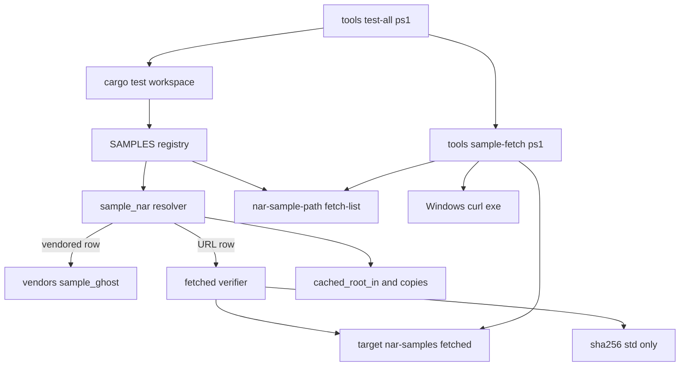
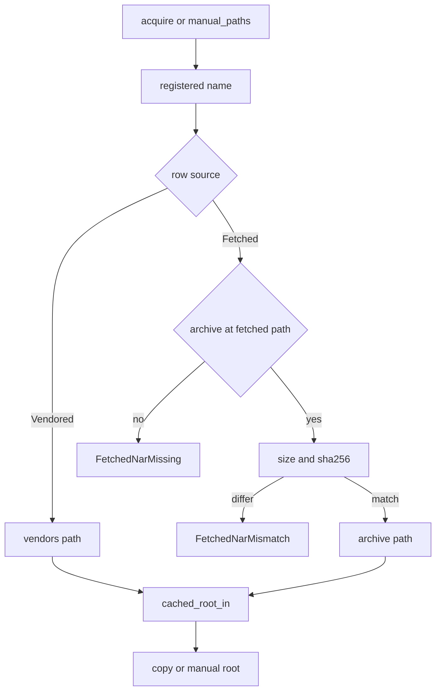
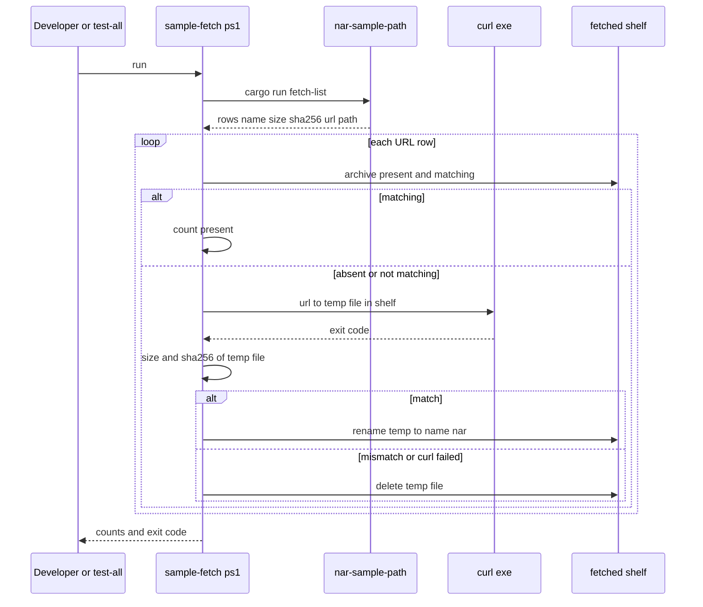

# 設計: areka-P0-sample-url-fetch

> 入力: `requirements.md`（2026-10-18 の討議で全議題を推奨案で確定）・`research.md`（ギャップ分析 §1〜§9 と、設計の段の調べ §10）・`brief.md`（「2026-10-18 棚卸㉗の再測定」を優先）・steering `tech.md`／`structure.md`・`roadmap.md` のウェーブ C9 ⑤ の約束。
> コードは「何の定義か」（関数名・型名＋ファイルパス）で指す。行数は 2026-10-18 の実測（参考）。

## Overview

**目的**: 検体の登記表に「取り寄せる URL・SHA-256・大きさ」の行（URL の行）を足し、その書庫をワークツリーの `target\` の下へ取り寄せる段（`tools/sample-fetch.ps1`）と、窓口がそこから確かめて読む道を作る。最初の URL の行として「窓際のぱすたさん」（`pasta-in-windows`）を登記する。書庫はこのリポジトリに入れない。

**使う人**: 検体を使うテストと実機の手順の書き手（呼び方は `SampleRoot::acquire("<名>")`・`nar-sample-path <名>` のまま）、検体を足す開発者、全体テストを回す開発者と同じウェーブの兄弟の spec、後続 `areka-P0-pasta-in-windows-verification`。

**変わること**: 窓口は通信しないまま、URL の行の書庫を置き場から読み、大きさと SHA-256 を確かめてから今の展開・刻印・複製の道へ渡す。通信は取り寄せの段の中だけで起きる。今の 8 本は今の行のまま、今と同じ道で動く。

### Goals

- 登記表が「今の行／URL の行」を区別し、URL の行の URL・SHA-256・大きさを 1 か所で持つ（1.1・1.2・2.9）。
- 取り寄せの段が、無い・合わない書庫だけを取り寄せ、合ったものだけを置き、2 回目からは通信しない（2.2〜2.7）。
- 窓口と `nar-sample-path` が、確かめた書庫だけを使い、無い・合わないときは直し方つきの文で失敗する（3.4〜3.7）。
- 「窓際のぱすたさん」を名前で引ける（登記の数 8 → 9・5.1〜5.6）。
- 全体テストの入口が取り寄せの段を先に回す（`impl-watch-test-desk` の着地を取り込んだ後に限る・6.2・6.3）。

### Non-Goals

- 今の 8 本の書庫を `vendors/sample_ghost/` から外す移し替え（後続）。
- 展開器 `areka-nar` と、窓口の展開・刻印・複製・後始末の作り直し。
- 配布の道（`tools/package.ps1`・`.github/workflows/release.yml`）の変更。
- 利用者向けのゴーストの取り寄せ（`areka-update` は流用しない）。
- 「窓際のぱすたさん」が SSP と同じに動くかの確かめ（`areka-P0-pasta-in-windows-verification`）。
- 根の `README.md` の「動作を確かめているゴースト」の表・`dist/README.txt`。

## Boundary Commitments

### This Spec Owns

- 登記表の行の出どころの区別（型 `SampleSource`）と、URL の行の 3 つの欄の形の決まり（`https://` で始まる・空白と制御文字を含まない URL／小文字 16 進 64 桁の SHA-256／0 より大きい大きさ）。
- 取り寄せた書庫の置き場の位置 `<名前空間>\fetched\<名前>.nar`（名前空間は窓口の今の `<target>\nar-samples`）と、その位置を決める式（Rust の 1 か所）。
- 窓口の「URL の行の書庫を確かめる」道（大きさ → SHA-256 → 今の `cached_root_in` へ）と、その 2 つの失敗の種類と文。
- 標準ライブラリだけの SHA-256（窓口の中だけで使う）。
- `nar-sample-path` の終了コード 3（URL の行の書庫が無い・合わない）と、取り寄せの段へ登記を渡す呼び方 `--fetch-list`。
- 取り寄せの段 `tools/sample-fetch.ps1`（取り寄せ・確かめ・置く・数の報告・`-SelfTest`）。
- 「窓際のぱすたさん」の行（登記の数 9）。
- 文書: `vendors/sample_ghost/README.md`、steering `tech.md`／`structure.md` の検体の節。
- `tools/test-all.ps1` の取り寄せの段のつなぎ（`impl-watch-test-desk` の着地を取り込んだ後のタスクに限る）と、それを書く `tech.md` のフルテストの節。

### Out of Boundary

- `areka-nar` の受理と展開の振る舞い（受け入れなければ止めて報告する＝5.7）。
- 窓口の名前空間の中の `work\`・`cache\`・`manual\` の棚の作りと掃除（`fetched\` は新しい棚で、今の掃除 `sweep`・回収 `reclaim_stale` はどちらも走査しない）。
- 検体を使う各クレートのテスト・`crates/log-capture-kit/tests/sample_path_guard_test.rs`（回して緑を確かめるだけ）。
- `tools/package.ps1`・`.github/workflows/*.yml`・`tools/encoding-check.ps1`・`tools/utf8-child.ps1`（使うだけ）。
- `roadmap.md` と `pasta-in-windows-verification` の brief の直し（コードではなく、完了のときの文書の手当て＝「完了のときの手当て」の節）。

### Allowed Dependencies

- `sample-ghost-kit` の依存は今の 3 つ（`thiserror`・`areka-nar`・`miniz_oxide`）のまま。`Cargo.toml`・`Cargo.lock` を変えない。
- Rust の標準ライブラリ（SHA-256 の手書き・パスの絶対化 `std::path::absolute`）。
- 取り寄せの段: PowerShell 7（今の `tools/*.ps1` と同じ `#Requires -Version 7`）・Windows に標準で在る `%SystemRoot%\System32\curl.exe`・`Get-FileHash`・`tools/utf8-child.ps1` の `Invoke-Utf8Child`・`cargo`（`nar-sample-path` を組んで呼ぶ）。
- 依存の向き: `tools/sample-fetch.ps1` → `nar-sample-path --fetch-list` → `sample_ghost_kit` の登記表。窓口は取り寄せの段を呼ばない（逆向きの依存は禁止）。

### Revalidation Triggers

- `Sample`／`SampleSource` の欄の形が変わる → `sample_path_guard_test.rs`（`name`・`balloons` を読む）と、URL の行を足す後続（`dot-sakura-specimen` など）を確かめ直す。
- 置き場の位置（`fetched\` の名前・名前空間の決め方）が変わる → README の手で置く口・取り寄せの段・`--fetch-list` の出力を確かめ直す。
- `nar-sample-path` の終了コードや出力の形が変わる → 読み手（`tools/perf/` の 3 本・`tools/package.ps1`・`release.yml`）を確かめ直す。今の読み手は「0 以外なら止める」なので、3 を足しても壊れない。
- `--fetch-list` の列の並び・区切りが変わる → `tools/sample-fetch.ps1` を同時に直す。
- `tools/test-all.ps1` の段の並びが変わる → 取り寄せの段が「`cargo test` の段より先・失敗したら `cargo test` の段を回さない」を保つかを確かめ直す。

## Architecture

### Existing Architecture Analysis

- 登記表 `SAMPLES`（`crates/sample-ghost-kit/src/lib.rs`）の行の型 `Sample` を組む式は、`SAMPLES` と `lib_tests.rs` の固定入力 2 つ（`GHOST_WITH_BALLOON`・`GHOST_ALONE`）にしか無い。外のクレートは `name`・`balloons` を読むだけ。
- 書庫の在処は `devroot::nar_dir()`（`vendors/sample_ghost`）で、それを組む所は `devroot.rs` の `fresh_root`・`manual_root`・`cached_root`（テスト専用）の 3 か所。どれも `nar_dir().join(format!("{name}.nar"))` を `*_in(namespace, name, nar)` へ渡す。`*_in` から先（展開・刻印・複製・後始末）は書庫のパスを引数で受けるので変えない。
- 名前空間 `<target>\nar-samples` は `namespace_dir()` が `CARGO_TARGET_DIR` か実行ファイルの祖先の `target` から決める。テストの実行体と、`cargo run` で起こした `nar-sample-path` は同じ置き場を指す。
- `SampleError` は `#[non_exhaustive]` なので、種類を足しても外は壊れない。
- 検体の見張り `sample_path_guard_test.rs` は `crates/**/*.rs` のうち `crates/sample-ghost-kit/src/` の外で、名前空間の綴り（`nar-samples`）を見張る。`crates/sample-ghost-kit/tests/` は見張られる側なので、結合テストはこの綴りをコードに書かない（置き場のパスは `--fetch-list` の出力から得る）。

### Architecture Pattern & Boundary Map



**Architecture Integration**:

- 選んだ形: ギャップ分析の案 C（行と失敗は `lib.rs`・置き場と照合は新しい `fetched.rs`・`devroot.rs` は書庫のパスを決める所だけ）＋登記を 1 か所から読む道は案 ①（Rust の実行体が登記を印字し、スクリプトが読む）。
- 境目: 通信するのは取り寄せの段だけ。窓口は置き場を読むだけで、取り寄せの段を呼ばない。置き場の位置を決める式は Rust の 1 か所で、取り寄せの段はそれを `--fetch-list` で聞く（`CARGO_TARGET_DIR` で食い違わない）。
- 保つ型: 原本は刻印つきで作り、配るのは複製（`devroot.rs` の不変条件のまま）。URL の行の書庫も、確かめた後は同じ `cached_root_in` を通る。
- 新しい部品の理由: `fetched.rs`＝置き場と照合と失敗の文（`devroot.rs` 696 行に混ぜない）、`sha256.rs`＝依存を足さずに要件 3.4 を満たす唯一の手（案 ア）、`tools/sample-fetch.ps1`＝通信の置き場。
- steering: テスト専用 leaf のまま（本番依存に現れない）・依存を足さない・道具の端末への文は ASCII・検体と一時フォルダはワークツリーの `target\` の下だけ。

### Technology Stack

| 層 | 選んだもの | この spec での役目 | 注 |
|---|---|---|---|
| 窓口（Rust） | `sample-ghost-kit`（edition はワークスペースのまま）・標準ライブラリ | 登記・照合・SHA-256・失敗の文 | 依存の追加なし |
| 実行体 | `nar-sample-path`（今の bin） | `--fetch-list` で登記と置き場を印字・終了コード 3 | bin を増やさない |
| 取り寄せの段 | PowerShell 7・`%SystemRoot%\System32\curl.exe`・`Get-FileHash -Algorithm SHA256`・`Invoke-Utf8Child` | 取り寄せ・確かめ・置く | `curl.exe` は Windows 10 以降の標準。`file://` を受けるので `-SelfTest` が本物の取り寄せの道を通せる |
| 置き場 | `<target>\nar-samples\fetched\<名前>.nar` | URL の行の書庫 | 根の `.gitignore` の `target` で追跡外 |

## File Structure Plan

### Directory Structure

```
crates/sample-ghost-kit/
├── src/
│   ├── lib.rs                 # 変更: SampleSource・Sample.source・ぱすたの行・失敗 2 種・fetched_archive_path
│   ├── devroot.rs             # 変更: sample_nar（行から書庫のパスを決める 1 か所）を 3 つの入口が通る
│   ├── fetched.rs             # 新: 置き場の位置・大きさと SHA-256 の照合・取り寄せの段のコマンド文・ASCII の写し
│   ├── fetched_tests.rs       # 新: 行の形・追跡しない・照合の 4 通り・決定論・数 9 の外の判定
│   ├── sha256.rs              # 新: 標準ライブラリだけの SHA-256（小文字 16 進を返す）
│   ├── sha256_tests.rs        # 新: FIPS 180-4 の試験値
│   ├── lib_tests.rs           # 変更: 数 8 → 9・未登録の一覧・固定入力 2 つに source・全部の行の判定を窓口の解決へ
│   └── bin/nar-sample-path.rs # 変更: 終了コード 3・--fetch-list
└── tests/nar_sample_path_test.rs  # 変更: 終了コード 3 の 2 通り・--fetch-list の形
tools/
├── sample-fetch.ps1           # 新: 取り寄せの段と -SelfTest
└── test-all.ps1               # 変更（impl-watch-test-desk の着地を取り込んだ後のタスクだけ）
vendors/sample_ghost/README.md # 変更: URL の行・取り寄せの段・手で置く口・足す手順・claudia の節の書き直し・ぱすたの出どころ
.kiro/steering/tech.md         # 変更: 検体の保管の項（2 つの形）・フルテストの節（取り寄せの段・ゲート後のタスク）
.kiro/steering/structure.md    # 変更: Sample Ghost Kit の節・tools の列挙に sample-fetch.ps1
```

### Modified Files

- `crates/sample-ghost-kit/src/lib.rs`（548 → 約 650 行）— `SampleSource` と `Sample.source`、`SAMPLES` の今の 8 行に `source: SampleSource::Vendored`、ぱすたの行、`SampleError` の 2 種、`pub fn fetched_archive_path`。crate の doc の「検体を足すとき」「引き方」を 2 つの形に書き直す。
- `crates/sample-ghost-kit/src/devroot.rs`（696 → 約 715 行）— `pub(crate) fn sample_nar(name)` を足し、`fresh_root`・`manual_root`・`cached_root` の `nar_dir().join(...)` をこれに替える（引数の形は `name: &str` のまま＝呼び手の書き替えなし）。
- `crates/sample-ghost-kit/src/lib_tests.rs`（648 行）— 数の直書き 2 か所を 9、未登録の一覧に `pasta-in-windows`、固定入力 2 つに `source`、`every_registered_sample_lands_where_its_registry_row_says` の失敗を `Display` で出す、`every_sample_nar_installs_exactly_the_elements_its_registry_row_declares` の書庫のパスを `devroot::sample_nar` へ。
- `crates/sample-ghost-kit/src/bin/nar-sample-path.rs`（76 → 約 120 行）— 終了コードの分け方と `--fetch-list`。doc の「0 が成功・2 が失敗」を改める。
- `crates/sample-ghost-kit/tests/nar_sample_path_test.rs`（196 → 約 320 行）— 新しい判定 3 本。
- `tools/test-all.ps1`・`tech.md` のフルテストの節 — ゲート後のタスクだけ（「全体テストへのつなぎ」の節）。

## System Flows

### 窓口が URL の行の書庫を読む



- 照合は取得のたびに行う（刻印つきの原本が `cache\` に在っても省かない）。原本の作り直しと照合を別の物差しにしないため。3 MB の SHA-256 はデバッグ版でも 1 秒を下回る見込みで、実測はタスクで記録する（下の「性能」）。
- 照合に落ちた書庫は `cached_root_in` へ渡さないので、展開も原本も作られない（3.6）。

### 取り寄せの段



- 一時のファイルは置き場と同じフォルダの `<名前>.nar.part-<プロセス識別子>`（同じボリュームなので名前の付け替えは 1 回の `rename`）。`try`／`finally` で、成功の付け替え以外の道（失敗・Ctrl+C）ではかならず消す。行を始めるときに、前の走行の消し残し `<名前>.nar.part-<pid>` のうち、`<pid>` のプロセスがもう生きていないものだけを消す（生きている走行の物は触らない）。行ごとの想定外の例外はその行の `failed` にし、最後の数の行はかならず出す。
- 置き場に合わない書庫が在るときは、合わない旨（2.4 と同じ文の形）を出してから取り寄せ直す。取り寄せに成功すれば上書きされ、失敗すれば合わない書庫はそのまま残る（開発者の物を黙って消さない。窓口は 3.6 の文で使わない）。

## Requirements Traceability

| 要件 | 要約 | 部品 | 口 | 流れ |
|---|---|---|---|---|
| 1.1 | 行の区別 | Registry | `SampleSource` | — |
| 1.2 | URL の行の欄 | Registry | `SampleSource::Fetched { url, sha256, size }` | — |
| 1.3 | URL の行の書庫を追跡しない | Registry・FetchedTests | 判定「URL の行の名前の `.nar` が `vendors/sample_ghost/` に無い」 | — |
| 1.4 | 今の 8 本は今のまま | Registry・Resolver | `SampleSource::Vendored` → `nar_dir()` | 窓口の流れ |
| 1.5 | 欄の欠け・形の誤りで赤 | FetchedTests | 判定「行の形」（欠けは型でコンパイルが落ちる・形は判定が落ちる） | — |
| 1.6 | 置き場を追跡しない | Fetched | 置き場は `<target>` の下 | 検証の手順 |
| 2.1 | 1 つのコマンド・絶対パス | FetchScript | `pwsh -NoProfile -File <絶対>\tools\sample-fetch.ps1` | 取り寄せの段 |
| 2.2 | 無い・合わないものだけ取り寄せる | FetchScript | `Sync-FetchedSample` | 取り寄せの段 |
| 2.3 | 合えば置く | FetchScript | 一時のファイル → `rename` | 取り寄せの段 |
| 2.4 | 合わなければ捨てて失敗 | FetchScript | 失敗の文（名前・URL・登記と得た SHA-256・大きさ） | 取り寄せの段 |
| 2.5 | 切れた・届かない | FetchScript | 一時のファイルを消す・失敗の文（名前・URL・理由・直し方） | 取り寄せの段 |
| 2.6 | 2 回目は通信しない | FetchScript | 在って合えば `curl.exe` を起こさない | 取り寄せの段 |
| 2.7 | 数と終了コード | FetchScript | 最後の 1 行・失敗が在れば 1 | 取り寄せの段 |
| 2.8 | 端末へ ASCII | FetchScript | 字句は ASCII・動的な文は `ConvertTo-AsciiText` | — |
| 2.9 | 登記を 1 か所から | FetchList・Registry | `nar-sample-path --fetch-list` | 取り寄せの段 |
| 2.10 | 新しい依存なし | FetchScript | `curl.exe`・`Get-FileHash` | — |
| 3.1 | 置き場から読む | Resolver・Fetched | `sample_nar`・`fetched::verified_nar_in` | 窓口の流れ |
| 3.2 | 呼び方・出力の形は同じ | Resolver | `SampleRoot::acquire`・`manual_paths` は不変 | 窓口の流れ |
| 3.3 | 窓口は通信しない | Fetched | 通信の部品を持たない・取り寄せの段を呼ばない | — |
| 3.4 | 確かめてから展開 | Fetched・Sha256 | 大きさ → SHA-256 → `cached_root_in` | 窓口の流れ |
| 3.5 | 無いときの失敗 | Fetched・Registry | `SampleError::FetchedNarMissing` | 窓口の流れ |
| 3.6 | 合わないときの失敗 | Fetched・Registry | `SampleError::FetchedNarMismatch` | 窓口の流れ |
| 3.7 | `nar-sample-path` の 3・ASCII | FetchList | 終了コード 3・標準出力は空 | — |
| 3.8 | 今の行は取り寄せなしで引ける | Resolver | `Vendored` は置き場を見ない | 窓口の流れ |
| 3.9 | 同じ登記なら同じバイト列 | Fetched | SHA-256 の一致だけを通す | 窓口の流れ |
| 4.1 | 手で置いても同じ扱い | Fetched・FetchScript | 置き場の同じファイル名を同じに照合 | 両方の流れ |
| 4.2 | 手で置いて合わない | Fetched・FetchScript | 3.6・2.4 と同じ文 | 両方の流れ |
| 4.3 | README に手で置く口 | Docs | README の節 | — |
| 5.1 | ぱすたの行 | Registry | `SAMPLES` の 9 行目 | — |
| 5.2 | 行を書庫の中身に合わせる | Registry・Task 1 | `install.txt` の `type`・`directory`・同梱 | 実物の確かめ |
| 5.3 | 書庫を持たない | Registry・FetchedTests | 判定（1.3）＋検証の手順 `git ls-files` | — |
| 5.4 | 数 9 | LibTests | 数の直書き 2 か所 | — |
| 5.5 | README の出どころ | Docs | README の節 | — |
| 5.6 | 同じ形の木 | LibTests・NarSamplePathTest | 全部の行の判定 3 本 | 窓口の流れ |
| 5.7 | 受け入れなければ止める | Task 1 | 最初のタスクの止まる条件 | 実物の確かめ |
| 6.1 | 取り寄せていなければ 3.5 の文で赤 | LibTests・NarSamplePathTest | 全部の行の判定が `Display` を出す | 窓口の流れ |
| 6.2 | 全体テストが先に取り寄せる | TestAllHook | 段 `sample fetch`（失敗したら `cargo test` の段を回さない） | 取り寄せの段 |
| 6.3 | ゲートの後にだけ変える | TestAllHook | ゲート後のタスク | — |
| 6.4 | README に先に回す手順 | Docs | README の節 | — |
| 7.1 | URL の行で足す手順 | Docs | README の節 | — |
| 7.2 | 取り寄せ先の条件と約束 | Docs | README の節 | — |
| 7.3 | claudia の節の書き直し | Docs | README の節 | — |
| 7.4 | 回し方・置き場・直し方 | Docs | README の節 | — |
| 7.5 | `tech.md` の項 | Docs | steering | — |
| 7.6 | `structure.md` の節 | Docs | steering | — |

## Components and Interfaces

| 部品 | 層 | 役目 | 要件 | 主な依存 | 契約 |
|---|---|---|---|---|---|
| Registry（`lib.rs`） | 窓口 | 行の区別・欄・失敗の種類・ぱすたの行 | 1.1, 1.2, 1.4, 3.5, 3.6, 5.1, 5.2 | なし | State |
| Resolver（`devroot.rs` の `sample_nar`） | 窓口 | 行から書庫のパスを決める 1 か所 | 1.4, 3.1, 3.2, 3.8 | Registry (P0)・Fetched (P0) | Service |
| Fetched（`fetched.rs`） | 窓口 | 置き場の位置・照合・失敗の文 | 1.6, 3.1, 3.3〜3.6, 3.9, 4.1, 4.2 | Sha256 (P0) | Service |
| Sha256（`sha256.rs`） | 窓口 | SHA-256 | 3.4 | 標準ライブラリ | Service |
| FetchList（`nar-sample-path`） | 実行体 | 終了コード 3・登記の印字 | 2.9, 3.7 | Registry (P0) | Batch |
| FetchScript（`tools/sample-fetch.ps1`） | 道具 | 取り寄せ・確かめ・置く・報告・自分の検査 | 2.1〜2.10, 4.1, 4.2 | FetchList (P0)・curl.exe (P0) | Batch |
| TestAllHook（`tools/test-all.ps1`） | 道具 | 取り寄せの段を先に回す | 6.2, 6.3 | FetchScript (P0) | Batch |
| Docs | 文書 | README・steering | 4.3, 5.5, 6.4, 7.1〜7.6 | — | — |
| 判定（`fetched_tests.rs`・`sha256_tests.rs`・`lib_tests.rs`・`tests/nar_sample_path_test.rs`） | テスト | 上の振る舞いの決定論の判定 | 1.3, 1.5, 5.4, 5.6, 6.1 ほか | — | — |

### 窓口

#### Registry（`crates/sample-ghost-kit/src/lib.rs`）

| 項目 | 内容 |
|---|---|
| 役目 | 登記表の行の形と、URL の行の失敗の種類を定義する |
| 要件 | 1.1, 1.2, 1.4, 3.5, 3.6, 5.1, 5.2 |

**責務と制約**

- `Sample` に `source: SampleSource` を足す。今の 8 行は `SampleSource::Vendored`。
- 欄の欠けは型が許さない（`Fetched` の 3 つの欄は省けない＝コンパイルが落ちる）。形の誤りは判定が落とす（1.5）。
- 名前の約束は今のまま（`.nar` のファイル名＝`install.txt` の `directory`＝`name`）。URL の行の置き場のファイル名も `<name>.nar`。

**Contracts**: State [x]

```rust
/// 検体の書庫の出どころ。
#[derive(Clone, Copy, Debug, PartialEq, Eq)]
pub enum SampleSource {
    /// 書庫をリポジトリの `vendors/sample_ghost/<name>.nar` に置く行（今の行）。
    Vendored,
    /// 書庫を取り寄せの段が取り寄せる行（URL の行）。
    Fetched {
        /// 取り寄せる URL（`https://`・コミットやタグを固定したもの）。
        url: &'static str,
        /// 書庫の SHA-256（小文字 16 進 64 桁）。
        sha256: &'static str,
        /// 書庫の大きさ（バイト）。
        size: u64,
    },
}

pub struct Sample {
    pub name: &'static str,
    pub kind: SampleKind,
    pub balloons: &'static [&'static str],
    pub source: SampleSource, // 新
}

#[non_exhaustive]
pub enum SampleError {
    // 今の 6 種はそのまま
    /// URL の行の書庫が置き場に無い（3.5）。
    FetchedNarMissing { sample: &'static str, path: PathBuf },
    /// URL の行の書庫が登記と合わない（3.6）。
    FetchedNarMismatch {
        sample: &'static str,
        path: PathBuf,
        expected_size: u64,
        actual_size: u64,
        expected_sha256: &'static str,
        actual_sha256: String,
    },
}

/// URL の行の書庫を置く場所（`<名前空間>\fetched\<name>.nar`）。`nar-sample-path --fetch-list` が使う。
/// 今の行（Vendored）には置き場が無いので `Ok(None)`。名前空間が決まらなければ `Err`。
pub fn fetched_archive_path(sample: &Sample) -> Result<Option<PathBuf>, SampleError>;
```

- 2 つの失敗の表示（`Display`）は英語の ASCII。パスと取り寄せの段のコマンドは `fetched::ascii` で写す（ASCII の外の字は `\u{XXXX}`。ASCII だけのパスはそのまま）。
  - `FetchedNarMissing`: 検体名・探した場所・直し方 2 つ（取り寄せの段のコマンド＝絶対パス、または手で置く口＝`vendors/sample_ghost/README.md` を見よ）。
  - `FetchedNarMismatch`: 検体名・置き場のパス・登記と得た大きさ・登記と得た SHA-256・「使わない」・直し方 2 つ（取り寄せの段で取り直す、または登記の書庫で置き換える）。
- 取り寄せの段のコマンドの文は `pwsh -NoProfile -File "<リポジトリの根の絶対パス>\tools\sample-fetch.ps1"`。根は `env!("CARGO_MANIFEST_DIR")` から `std::path::absolute` で `..` を畳んで作る（どのディレクトリからでも動く形）。

**ぱすたの行**（5.1・5.2）

```rust
Sample {
    name: "pasta-in-windows",
    kind: SampleKind::Ghost,
    balloons: &[],
    source: SampleSource::Fetched {
        url: "https://raw.githubusercontent.com/ekicyou/ghost_dev/e1e05590dbed0a4a4b1afadf55ca896f36d82c14/release/pasta-in-windows/pasta-in-windows.nar",
        sha256: "04a8e1c19b534b38e39d24f93ac7735c74e186249965b3a0876a893cb41fe35b",
        size: 3_025_198,
    },
},
```

- `name`・`kind`・`balloons` は最初のタスクで実物の `install.txt` から確かめて決める（`type`・`directory`・`balloon.directory`／`balloonN.directory`）。上の値は `pasta-in-windows-verification` の brief の調べ（`install.txt` に `balloon.directory` が無い・縦書きのバルーンはゴーストのフォルダの直下）からの見込み。`directory` が違えば `name` をそれに合わせる（5.2 が正）。

#### Resolver（`crates/sample-ghost-kit/src/devroot.rs` の `sample_nar`）

| 項目 | 内容 |
|---|---|
| 役目 | 行から書庫のパスを決める唯一の式 |
| 要件 | 1.4, 3.1, 3.2, 3.8 |

**Contracts**: Service [x]

```rust
/// 登記の行から、展開に使う書庫のパスを決める。
/// Vendored → `nar_dir().join("<name>.nar")`（今と同じ・置き場を見ない）。
/// Fetched  → `fetched::verified_nar_in(&namespace_dir()?, name, sha256, size)`。
pub(crate) fn sample_nar(name: &str) -> Result<PathBuf, SampleError>;
```

- 前提: `name` は登記済み（`crate::registered` で引く。未登録なら `UnknownSample`）。
- 事後: `Ok` のパスは、Vendored なら今と同じ、Fetched なら大きさと SHA-256 が登記と合った置き場の書庫。
- `fresh_root`・`manual_root`・`cached_root` は `nar_dir().join(format!("{name}.nar"))` をこれに替えるだけ。`*_in` 系と、呼び手（`lib.rs`・`devroot_cache_tests.rs`・`devroot_sweep_tests.rs`）は変えない。

#### Fetched（`crates/sample-ghost-kit/src/fetched.rs`）

| 項目 | 内容 |
|---|---|
| 役目 | 置き場の位置・大きさと SHA-256 の照合・失敗の文の部品 |
| 要件 | 1.6, 3.1, 3.3, 3.4, 3.5, 3.6, 3.9, 4.1, 4.2 |

**責務と制約**

- 置き場の棚の名前 `fetched` を持つ唯一の所。`devroot.rs` の掃除（`sweep`＝`work\` だけ）と回収（`reclaim_stale`＝`cache\` だけ）はこの棚を走査しない。窓口はこの棚に書かない（書くのは取り寄せの段と開発者だけ）。
- 通信の部品を持たない。子のプロセスも起こさない（3.3）。
- 照合は大きさ → SHA-256 の順。大きさが違っても SHA-256 は計算して文に載せる（3.6 が両方の SHA-256 を求める）。

**Contracts**: Service [x]

```rust
/// `<namespace>\fetched\<name>.nar`。
pub(crate) fn fetched_path_in(namespace: &Path, name: &str) -> PathBuf;

/// 置き場の書庫を読み、大きさと SHA-256 が登記と合えばそのパスを返す。
/// 無い（NotFound）→ FetchedNarMissing。合わない → FetchedNarMismatch。
/// ほかの読み取りの失敗 → SampleError::Io。
pub(crate) fn verified_nar_in(
    namespace: &Path,
    name: &'static str,
    sha256: &'static str,
    size: u64,
) -> Result<PathBuf, SampleError>;

/// 取り寄せの段のコマンドの文（絶対パス）。失敗の文と README の例が同じ形になる。
pub(crate) fn fetch_command() -> String;

/// ASCII の外の字と制御文字を `\u{XXXX}` に写す。
pub(crate) fn ascii(text: &str) -> String;
```

- 不変条件: `Ok` を返したパスの書庫は、照合した時点で登記のバイト列と同じ（3.9）。照合と `cached_root_in` の読み取りの間に書庫を差し替える取り合いは扱わない（取り寄せの段は確かめた書庫しか付け替えないので、差し替わっても登記のバイト列）。

#### Sha256（`crates/sample-ghost-kit/src/sha256.rs`）

| 項目 | 内容 |
|---|---|
| 役目 | FIPS 180-4 の SHA-256 を標準ライブラリだけで計算する |
| 要件 | 3.4 |

**Contracts**: Service [x]

```rust
/// バイト列の SHA-256 を小文字 16 進 64 桁で返す。
pub(crate) fn sha256_hex(bytes: &[u8]) -> String;
```

- 手書き（案 ア）を選んだ理由: 依存を足さない（C9 の約束・`Cargo.lock` の席は ⑥）、子のプロセスの失敗の扱い（案 ウ）を窓口へ持ち込まない、窓口の判定が速く決定論のまま。判定は FIPS 180-4 の試験値（空・`abc`・448 ビットの 2 ブロックの文・`a` の 100 万回）。

### 実行体

#### FetchList（`crates/sample-ghost-kit/src/bin/nar-sample-path.rs`）

| 項目 | 内容 |
|---|---|
| 役目 | URL の行の失敗を終了コード 3 で返し、取り寄せの段へ登記を渡す |
| 要件 | 2.9, 3.7 |

**Contracts**: Batch [x]

- 呼び方 1（今のまま）: `nar-sample-path <名>`。成功 0・標準出力に `root=`／`folder=`／`balloon.<名>=`。
  - `FetchedNarMissing`・`FetchedNarMismatch` → 標準出力は空・標準エラーへ表示（ASCII）・**終了コード 3**。
  - ほかの失敗（未登録・展開の失敗・入出力の失敗・置き場が決まらない）→ 今のまま 2。
- 呼び方 2（新）: `nar-sample-path --fetch-list`。URL の行ごとに 1 行、タブ区切りで `<name>\t<size>\t<sha256>\t<url>\t<置き場の絶対パス>`、`SAMPLES` の順。URL の行が 0 なら何も出さずに 0。置き場が決まらなければ標準出力は空・標準エラー・2。
  - 区切りをタブにする理由: パスに空白は在りうるが制御文字は在りえない（Windows のファイル名の決まり）。名前・URL・SHA-256 に空白と制御文字が無いことは行の形の判定（1.5）が保証する。
  - 置き場のパスはこのコマンドを `cargo run` で起こした実行体の場所と `CARGO_TARGET_DIR` から決まるので、同じ環境で回すテストの窓口と同じ所を指す。
- 検体の名前は `--` で始まらない（行の形の判定に含める）ので、`--fetch-list` が検体名と取り違えられることはない。

### 道具

#### FetchScript（`tools/sample-fetch.ps1`）

| 項目 | 内容 |
|---|---|
| 役目 | URL の行の書庫を取り寄せ、確かめ、置き場に置く |
| 要件 | 2.1〜2.10, 4.1, 4.2 |

**Contracts**: Batch [x]

- 起動: `pwsh -NoProfile -File <リポジトリの絶対パス>\tools\sample-fetch.ps1`（引数なし）／`-SelfTest`。根は `$PSScriptRoot` の親で、どのディレクトリから呼んでも同じに動く（2.1）。`#Requires -Version 7`・`Set-StrictMode -Version 3.0`・`$ErrorActionPreference = 'Stop'`。
- 入力: `Invoke-Utf8Child cargo @('run', '--quiet', '-p', 'sample-ghost-kit', '--bin', 'nar-sample-path', '--', '--fetch-list')` を根で起こし、行をタブで 5 つに割る（2.9）。終了コードが 0 でない・列が 5 つでない行が在る → その旨を出して終了コード 1（取り寄せに進まない）。URL が `https://` で始まらない行は、取り寄せずにその行を `failed`（`only https:// URLs are fetched`）にする（登記の行の形の判定と同じ決まりを、実行時にも守る。`-SelfTest` は `--fetch-list` を通さず `Sync-FetchedSample` へ直に偽の `file:///` の行を渡すので、この判定に当たらない）。
- 1 行の処理 `Sync-FetchedSample`（結果は `present`／`fetched`／`failed` と、出す文の行）:
  1. 前の走行の消し残し `<名前>.nar.part-<pid>` のうち、名前の `<pid>` のプロセスがもう生きていないものだけを消す（生きている走行の一時のファイルは触らない＝並走する取り寄せの段の付け替え前のファイルを消さない）。消せないものは触らない。
  2. 置き場に `<名前>.nar` が在れば大きさと SHA-256（`Get-FileHash -Algorithm SHA256` を小文字へ）を見る。合えば `present`（`curl.exe` を起こさない＝2.6・4.1）。合わなければ合わない旨を出して 3 へ（4.2・2.2）。
  3. `"$env:SystemRoot\System32\curl.exe"` を `Invoke-Utf8Child` で起こす: `--fail --location --silent --show-error --connect-timeout 30 --speed-limit 1 --speed-time 60 --output <一時のファイル> <URL>`。`--speed-*` は「60 秒のあいだ 1 バイト/秒を下回ったら止める」＝止まった取り寄せの検出で、全体の時間の締切ではない。
  4. 終了コードが 0 でない → 一時のファイルを消し、失敗の文（名前・URL・理由＝`curl` の終了コードと標準エラー・直し方＝回し直す／手で置く口のパスと README）で `failed`（2.5）。
  5. 一時のファイルの大きさと SHA-256 が合わない → 消して、失敗の文（名前・URL・登記と得た大きさ・登記と得た SHA-256）で `failed`（2.4）。
  6. 合う → `[System.IO.File]::Move(<一時>, <置き場>, $true)` で付け替えて `fetched`（2.3）。
- 行ごとの想定外の例外: `Sync-FetchedSample` の呼び出しを行ごとに `try`／`catch` で包み、`Move`・`Get-FileHash`・削除などが投げた例外は、その行を `failed`（文は名前・URL・例外の文を ASCII に写したもの・直し方）にして次の行へ進む。最後の数の行は、行の例外の有無にかかわらずかならず出す（2.7）。
- 出力: 行ごとに `sample-fetch: <name>: present|fetched|FAILED ...`、最後に `sample-fetch: fetched <n>, present <n>, failed <n>`。失敗が 1 つでも在れば終了コード 1、無ければ 0（2.7）。
- ASCII（2.8）: 字句はすべて ASCII（`tools/encoding-check.ps1` の規則 A の対象）。外から来る文（パス・`curl` の標準エラー・例外の文）は `ConvertTo-AsciiText`（ASCII の外の字を `\uXXXX` に写す・`encoding-check.ps1` の `Show-Ascii` と同じ考え方）を通してから出す。
- `cargo` の呼び出しは `Invoke-Utf8Child` を通すので、規則 D（`nar-sample-path` の素の呼び出し）に当たらない。端末の文字コードは読みも書きもしない（規則 C）。
- 冪等: 何度回しても、合っている書庫は触らない。2 つ同時に回しても一時のファイルの名前がプロセスごとに違い、付け替えるのはどちらも確かめた同じバイト列。

**`-SelfTest`**（2.2〜2.7・4.1・4.2 の決定論の判定・通信しない）

- 私有の場所 `<リポジトリ>\target\sample-fetch-selftest\<プロセス識別子>\` に、取り寄せ先の見本（`abc` の 3 バイト＝SHA-256 は FIPS の試験値 `ba7816bf…15ad` を文字で書く・別の 3 バイト）と置き場を作り、`Sync-FetchedSample` に偽の行（`file:///` の URL）を渡して本物の `curl.exe` の道を通す。終わったら私有の場所を消す。
- 判定（1 つずつ `PASS`／`FAIL` を印字・`release-notes.ps1 -SelfTest` の型）:
  1. 無い＋正しい見本 → `fetched`・置き場に見本と同じバイト列・`.part-*` が残らない。
  2. 続けてもう 1 度（URL を在りえない `file:///` に替える）→ `present`（取り寄せようとすれば失敗するので、通信しないことの判定になる）。
  3. 無い＋違う見本 → `failed`・置き場に何も無い・文に名前・URL・登記と得た SHA-256。
  4. 無い＋在りえない `file:///` → `failed`・何も残らない・文に名前・URL・理由・直し方。
  5. 手で置いた正しい書庫＋在りえない URL → `present`。
  6. 手で置いた違う書庫＋在りえない URL → `failed`・合わない旨と取り寄せの失敗の両方・手で置いた書庫は消さない。
  7. 3 行（1 つ成功・1 つ在る・1 つ失敗）をまとめて回す部分 → 数が `1, 1, 1`・終了コードの値 1。全部成功なら 0。
  8. 上の全部の出力が ASCII だけ。
- 誰がいつ回すか: 実装のタスクが回す。`impl-watch-test-desk` の着地を取り込んだ後は、全体テストの段 `sample fetch check` が回す（下の TestAllHook）。

#### TestAllHook（`tools/test-all.ps1`・ゲート後のタスクだけ）

| 項目 | 内容 |
|---|---|
| 役目 | テストより先に取り寄せの段を回し、失敗したらテストへ進まない |
| 要件 | 6.2, 6.3 |

**Contracts**: Batch [x]

- **このタスクは `areka-P0-impl-watch-test-desk` が `main` へ squash マージされ、その `main` をこの枝へ取り込んだ後にだけ着手する**（6.3・C9 の約束）。それまで `tools/test-all.ps1` を 1 文字も変えない。着手のときは取り込んだ後の `test-all.ps1` を読み直し、その形に合わせて置く。
- つなぎ方（契約）:
  - 段 `sample fetch` = `pwsh -NoProfile -File tools/sample-fetch.ps1`。**`cargo test` を回す最初の段より前**に置く（取り込んだ後の `test-all.ps1` の段の名前で指す。今の形なら作業の場所と `PATH` の手当ての後・`x64 workspace tests` の前）。終了コードが 0 でなければ、`sample fetch` を FAIL として一覧に載せ、`cargo test` を回す段だけを `skipped (sample fetch failed)` として回さず（6.2＝テストへ進まない）、整形・文字コード・ライセンス・各 `-SelfTest` など通信も検体も要らない段は今の「赤でも最後まで回して一覧にする」作りのまま回す。全体の終了コードは 0 でない（FAIL が在るので今の作りどおり）。
  - 段 `sample fetch check` = `pwsh -NoProfile -File tools/sample-fetch.ps1 -SelfTest`。ほかの自分の検査の段（`release notes check` など）と並べ、赤でも止めない。
  - `.SYNOPSIS`／`.DESCRIPTION` の段の一覧に 2 つを足す。
- 同じタスクで `tech.md` の「フルテスト」の節に 2 つの段を書き、「ネットへ出るテストは常時テストに入れない」の項に「通信するのはテストの前の段 `sample fetch` だけで、テストは通信しない」を足す。

### 文書

#### Docs（`vendors/sample_ghost/README.md`・`tech.md`・`structure.md`）

要件 4.3・5.5・6.4・7.1〜7.6 の書き場所:

- README 先頭: 2 つの形（書庫を置く行／URL の行）の説明と、表に「置き方」の列（または URL の行の別の表）。ぱすたの行（種別・中のファイル数・大きさ・置き方＝URL）。「展開した木は追跡しない」は今のまま。
- README「`pasta-in-windows`（URL の行）の出どころ」の節（5.5・7.2）: ghost_dev・固定したコミット `e1e05590…`・URL・SHA-256・大きさ・書庫を入れない理由（寄贈のシェルの絵の置き直しが許されるか分からない）・ghost_dev はその履歴を書き換えない（固定したコミットを消さない）と開発者が約束したこと（2026-10-18）。
- README「取り寄せの段」の節（7.4・6.4）: コマンド `pwsh -NoProfile -File <ワークツリーの絶対パス>\tools\sample-fetch.ps1`、ワークツリーごとに 1 回（2 回目からは通信しない）、全体テストの入口を通さずにテストを回すときは先に 1 回回すこと、置き場 `<ワークツリー>\target\nar-samples\fetched\<名前>.nar`（`CARGO_TARGET_DIR` を設定しているならその下の `nar-samples\fetched\`）、失敗したときの直し方（回し直す・手で置く口）、`cargo clean` で消えたら取り寄せ直すこと。
- README「手で置く口」の節（4.3）: 置き場のパス・ファイル名 `<名前>.nar`・確かめ方（取り寄せの段を回す＝合えば通信せずに `present`、または `Get-FileHash -Algorithm SHA256` で README の値と比べる）。
- README「検体を 1 本足す手順」に「URL の行で足す」手順（7.1）と、取り寄せ先に求める条件（7.2: 置いた書庫を消さない・同じ URL のバイト列を書き換えない＝コミットやタグを固定した URL）。
- README `claudia.nar` の節の「URL とハッシュだけ記録して…形にしないのはこのためである」を、「上流の消えるリリースには頼らない。消えない固定した取り寄せ先からなら URL の行を使ってよい（`pasta-in-windows`）」に書き直す（7.3）。
- `tech.md`「検体は配布形 `.nar` のまま保管し…」の項を、今の行（`vendors/sample_ghost/*.nar`）と URL の行（固定した取り寄せ先・SHA-256・大きさ・`target\` の下の置き場・取り寄せの段）の 2 つの形に書き直す（7.5）。
- `structure.md` の Sample Ghost Kit の節（Purpose・Pattern「2 手で終わる」・Modules に `fetched.rs`・`sha256.rs`）と、最上位の `tools/` の列挙に `sample-fetch.ps1` を足す（7.6）。
- crate の doc（`lib.rs` の「検体を足すとき」「使い方」・`SampleRoot::acquire` の doc）も 2 つの形に合わせる（文書の古び止め・7.6 の続き）。

## Data Models

### Domain Model

- 行 `Sample` は値（`Copy`）。`SampleSource` が出どころを決める。登記表 `SAMPLES` が唯一の正本で、取り寄せの段は `--fetch-list` を通してだけ読む。
- 不変条件:
  - URL の行の名前の `.nar` は `vendors/sample_ghost/` に無い（1.3）。今の行の名前の `.nar` は在る（1.4）。
  - URL の行の欄の形: `url` は `https://` で始まり空白と制御文字を含まない／`sha256` は `[0-9a-f]{64}`／`size > 0`。名前は `--` で始まらない。
  - 置き場のファイル名は `<name>.nar`。窓口が使うのは大きさと SHA-256 が合ったものだけ。

### Physical Data Model（置き場）

```text
<target>\nar-samples\
├── cache\      # 今のまま（原本）
├── work\       # 今のまま（複製・札・掃除の対象）
├── manual\     # 今のまま（nar-sample-path の根）
└── fetched\    # 新: URL の行の書庫。書くのは取り寄せの段と開発者だけ
    ├── <name>.nar
    └── <name>.nar.part-<pid>   # 取り寄せ中だけ在る一時のファイル（窓口は読まない）
```

- 追跡: 根の `.gitignore` の `target` がどの深さの `target` も外す（1.6）。
- 寿命: `cargo clean` で消え、次に取り寄せの段を回せば戻る。

## Error Handling

### Error Strategy

- 窓口: 黙って飛ばさない・テストを無視扱いにしない（3.5・6.1）。失敗は `SampleError` の 2 種で返し、全部の行を引く判定は `Display` を出して落ちる（`expect` の `Debug` ではなく `unwrap_or_else(|err| panic!("{err}"))` の形）。
- 取り寄せの段: 行ごとに失敗を集めて最後まで回し、最後に数と終了コードで 1 度だけ判定する。置き場に入るのは確かめたバイト列だけ（途中のファイル・合わないファイルは名前を付け替えない）。
- `nar-sample-path`: URL の行の失敗だけ 3、ほかは今の 2。どちらも標準出力は空。

### Error Categories and Responses

| 起き場所 | 状態 | 返すもの | 文に載るもの |
|---|---|---|---|
| 窓口 | 置き場に無い | `FetchedNarMissing` | 名前・探した場所・取り寄せの段のコマンド（絶対パス）・手で置く口 |
| 窓口 | 大きさか SHA-256 が違う | `FetchedNarMismatch` | 名前・置き場のパス・登記と得た大きさ・登記と得た SHA-256・直し方 |
| 窓口 | 読めない（NotFound 以外） | `SampleError::Io` | 今の形 |
| `nar-sample-path` | 上の 2 種 | 終了コード 3 | 標準エラーに表示（ASCII） |
| 取り寄せの段 | 登記を聞けない | 終了コード 1 | `cargo` の終了コードと標準エラー（ASCII に写す） |
| 取り寄せの段 | 取り寄せの失敗 | 行は `failed` | 名前・URL・理由・直し方 |
| 取り寄せの段 | 取り寄せたものが合わない | 行は `failed` | 名前・URL・登記と得た大きさと SHA-256 |
| 全体テストの入口 | 取り寄せの段が 1 | `cargo test` の段だけ飛ばし、ほかの段は回す・全体は 0 でない | 一覧に `sample fetch` の FAIL と、飛ばした段の `skipped (sample fetch failed)` |

### Monitoring

- 窓口はテスト専用で記録層に依存しない（今のまま）。失敗はテストの落ちる文と `nar-sample-path` の標準エラーに出る。

## Testing Strategy

### 単体（`src/` の兄弟のテスト・通信しない）

- `sha256_tests.rs`: FIPS 180-4 の試験値 4 つ（空・`abc`・2 ブロックの文・`a` の 100 万回）で `sha256_hex` が一致する（3.4 の土台）。
- `fetched_tests.rs`:
  - 行の形: `SAMPLES` の URL の行が 1 つ以上在る（母数 0 で緑にしない較正）・各欄の形（1.5）。形の判定関数に悪い入力（`http://`・空白入りの URL・大文字の SHA-256・63 桁・大きさ 0・`--` で始まる名前）を渡して落ちる較正。
  - 追跡しない: URL の行の名前の `.nar` が `devroot::nar_dir()` に無い（1.3・5.3）。今の行の名前の `.nar` は在る（1.4）。
  - 照合（私有の名前空間＋`NarBuilder` で組んだ書庫・期待値は `sha256_hex` で求める）: 無い → `FetchedNarMissing`（文に名前・パス・`sample-fetch.ps1`・README）／大きさ違い → `FetchedNarMismatch`・`cache\` に原本ができない／同じ大きさで 1 バイト違い → `FetchedNarMismatch`（両方の SHA-256 が文に載る）／合う → `fresh_root_in` まで通り、今の行と同じ形の木（3.4・3.5・3.6・4.1・4.2）。
  - 決定論: 同じ書庫で 2 回取ると同じ刻印の原本を使う（3.9）。
  - 置き場の位置: `fetched_path_in(ns, "x")` が `ns\fetched\x.nar`（1.6 の土台）。
  - 表示が ASCII: 2 種の `Display` が ASCII だけ（ASCII の外の字を含むパスを渡しても `\u{…}` に写る＝3.7）。
- `lib_tests.rs`: 数 9（5.4）・未登録の一覧に `pasta-in-windows`・全部の行の 2 本が取り寄せた後に緑（5.6）・取り寄せていなければ 3.5 の文で赤（6.1）。

### 結合（`tests/nar_sample_path_test.rs`・実行体を起こす）

- 全部の行で終了コード 0（今の判定のまま・URL の行も含む＝5.6・3.2）。
- `CARGO_TARGET_DIR` を私有の場所（`sample_ghost_kit::WorkDir`）へ振って URL の行の名前を渡す → 終了コード 3・標準出力は空・標準エラーは ASCII で名前と `sample-fetch.ps1` を含む（3.5・3.7）。
- 同じく私有の場所で `--fetch-list` → URL の行の数だけの行・列 5 つ・置き場のパスが私有の場所の下（2.9）。そのパスへ違うバイト列を置いて名前を渡す → 終了コード 3・登記の SHA-256 が載る（3.6・3.7）。名前空間の綴りはこのファイルに書かない（見張りの対象）。
- 未登録の名前は 2 のまま（今の判定の言い回しを「3 とは別の 2」に合わせる）。

### 道具

- `tools/sample-fetch.ps1 -SelfTest`（上の 8 判定・本物の `curl.exe` を `file:///` で通す）。
- `tools/encoding-check.ps1` が新しいスクリプトを規則 A〜D で通す。

### 実物（最初のタスクと検証の手順・通信する）

- 最初のタスク: 取り寄せ → 大きさと SHA-256 が登記どおり → `install.txt` の `type`・`directory`・同梱のバルーンの鍵を読む → `areka-nar` が受け入れて空の根へ展開できる（5.2・5.7）。受け入れなければここで止めて開発者へ報告する。
- 検証の手順: 取り寄せの段を 2 回（2 回目は `fetched 0`）→ `git status --porcelain` が空（1.6）→ `git ls-files '*.nar'` に `pasta-in-windows` が無い（5.3）→ `cargo test -p sample-ghost-kit` と `cargo test -p log-capture-kit --test sample_path_guard_test` が緑。

### 性能

- デバッグ版で 3 MB の SHA-256 は 1 秒を下回る見込み（64 バイトの塊が約 4.7 万）。SHA-256 を足すタスクで、ぱすたの書庫 1 本の計算時間を測って記録する。全体テストでぱすたを引くのは 3 回（全部の行の判定 3 本）。

## Security Considerations

- 窓口が使うのは SHA-256 が登記と合ったバイト列だけ（取り寄せ先や途中の経路が書庫を差し替えても使われない）。
- 取り寄せの段は登記の `https://` の URL だけを取る（行の形の判定が `https://` を求め、取り寄せの段も `--fetch-list` から読んだ行で `https://` 以外を断る）。`file:///` は `-SelfTest` が `Sync-FetchedSample` へ直に渡す偽の行だけ。
- 取り寄せた書庫は `target\` の下に置くだけで、展開は窓口の今の道（`areka-nar`）を通る。

## 実装の順（タスクの段への申し送り）

1. **実物の確かめ**（5.2・5.7・通信する）: `curl.exe` でぱすたの書庫を `<ワークツリー>\target\nar-samples\fetched\pasta-in-windows.nar` へ取り寄せ、大きさと SHA-256 を確かめ、`install.txt` を読み、`areka-nar` が受け入れることを確かめる（受け入れなければ止めて報告）。行の `name`・`kind`・`balloons` をここで決める。
2. SHA-256（`sha256.rs`・`sha256_tests.rs`・計算時間の実測）。
3. 行の形と照合（`SampleSource`・失敗 2 種・`fetched.rs`・`sample_nar`・`fetched_tests.rs`・固定入力 2 つ）。
4. ぱすたの行と数 9（`lib_tests.rs` の書き替え）。
5. `nar-sample-path` の終了コード 3 と `--fetch-list`（結合テスト）。
6. `tools/sample-fetch.ps1` と `-SelfTest`。
7. 文書（README・`tech.md` の検体の項・`structure.md`・crate の doc）。
8. **ゲート後**: `impl-watch-test-desk` の着地を `main` から取り込んだ後に、`tools/test-all.ps1` の 2 つの段と `tech.md` のフルテストの節（6.2・6.3）。この spec の着地（squash マージ）もこの後。

2〜7 は 1 の結果（受け入れられる）を前提にする。6 は 5 の `--fetch-list` を使う。

## 完了のときの手当て（コードではない）

要件の Adjacent expectations と棚卸セッションの了承（2026-10-18）どおり、`/kiro-complete` の文書の手当てで次を直す。

- `roadmap.md` の「検体の登記表の順を改めた」: URL の行を足すのはこの spec（URL の欄＋ぱすたの行・8 → 9）とし、`pasta-in-windows-verification` は登記表に触らない形にする。
- `roadmap.md` の直列の列「棚卸㉗で列に足したこと」の検体の登記表の順を「この spec（8 → 9）→ `dot-sakura-specimen`（9 → 10）→ `default-balloon-selfmade`（10 → 11）」にする。
- `roadmap.md` の C9 の行の ⑤ の注（`pasta-in-windows-verification` → … の並び）を合わせる。
- `pasta-in-windows-verification` の brief: Scope の In の「登記」・「規模」・「触るファイル」から登記の分を外す（登記はこの spec が済ませた）。
