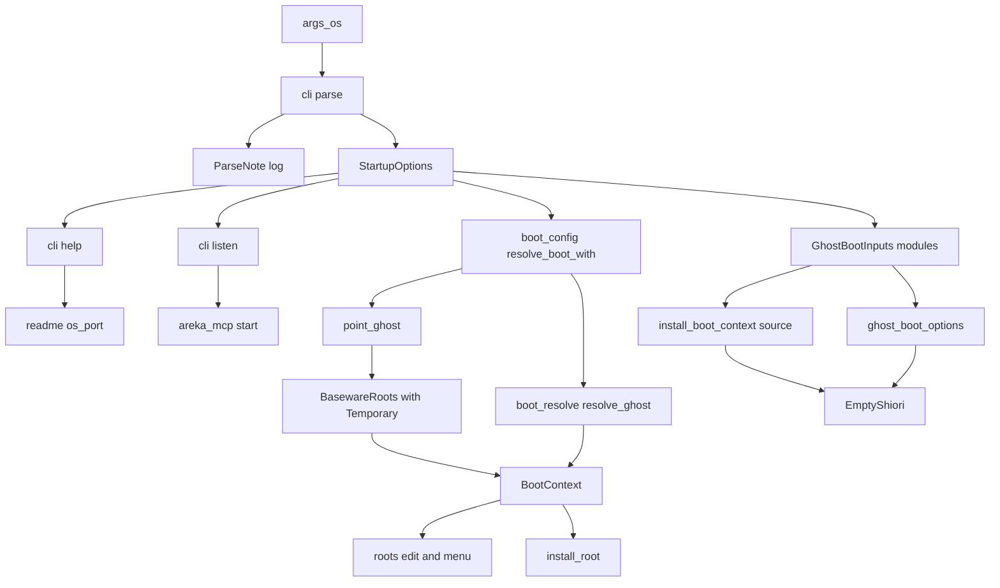
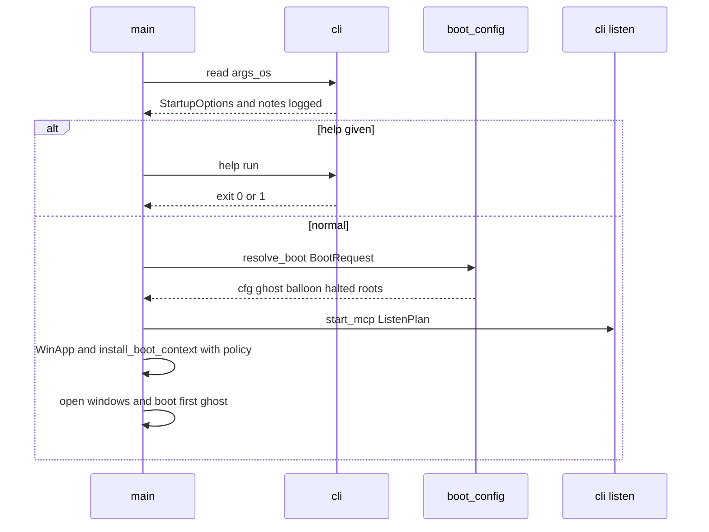
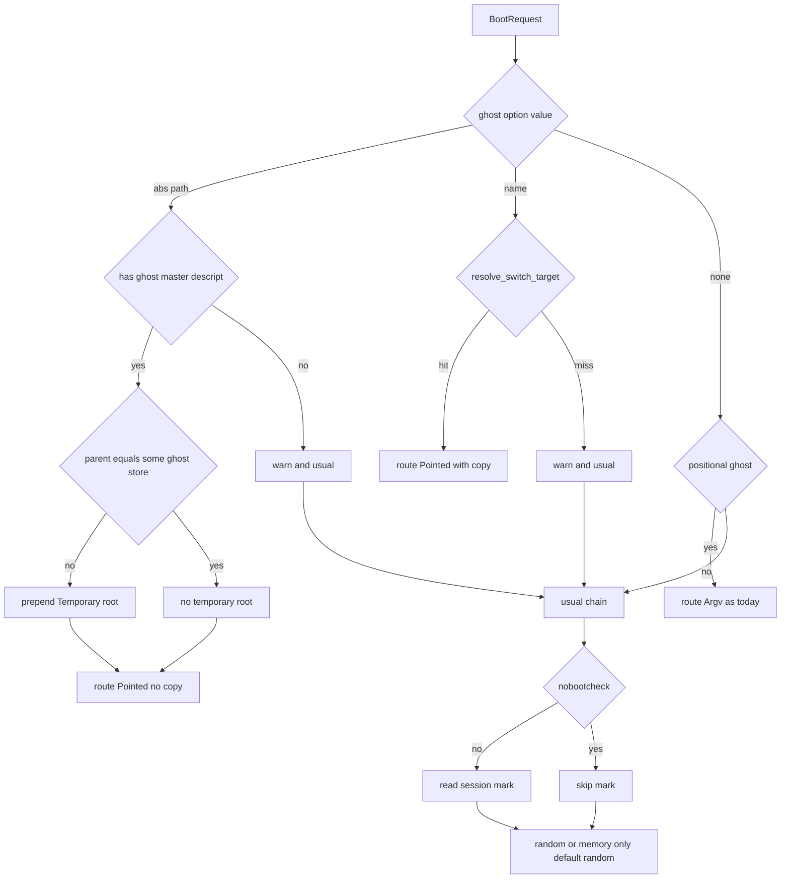

# 設計: areka-P0-startup-options-core

## Overview

**目的**: areka が SSP と同じ書き方の起動オプション（`--名前 値`・`--名前=値`・`/x`・`-x`・`--option a,b`）を読み、`--ghost`・`--random`・`--option nobootcheck`・`--option dontloadmodule`・`--sstp-listen`・`--help` を効かせる。知らない名前と扱わない名前は記録に残して起動を続ける。

**使う人**: 自動の試験を書く開発者と AI のエージェント。SSP 向けの 1 行（`--ghost 名前 --option nobootcheck,bootunlock,standalone --sstp-listen 9900`）をそのまま areka に向けられる。

**今との違い**: 今の areka は `args[1]`・`args[2]` を位置で読むだけ。この設計は、引数を読む口（新しい `crates/areka/src/cli/`）を起動の最初に置き、読んだ値を今ある起動の解決（`boot_config.rs`・`boot_resolve.rs`）・置き場の並び（`RootMark`）・MCP の待受（`areka_mcp::start`）・SHIORI の差し替え口（`ShioriWiring::Custom`）へ渡す。位置で渡す今の形（`areka.exe <ゴースト> <バルーン>`）と、その経路の名前 `route=Argv` は変えない。

### Goals

- 正典（SSP ヘルプ「起動オプション一覧」）の 4 つの書き方と短い形を読み、知らない名前・扱わない名前・書式の誤りでは止まらない（終了コードもメッセージボックスも変えない）。
- `--ghost`（絶対パス＝この起動のあいだだけの置き場・名前＝置き場から探す）・`--random`・`nobootcheck`・`dontloadmodule`・`--sstp-listen`・`--help` が働く。
- 実機の試験 3 本（`emo2_real_run.rs`・`mcp_get_log_real_run.rs`・`smoke_boot_loop_exit.rs`）を 1 行も変えずに通す。
- 後に続く 3 本が、表の行と `StartupOptions` の欄を足すだけで乗れる形にする。

### Non-Goals

- `--offline-dump` とその仲間・`--option readonly`・`--install`・`callghost`・`deletesource`・`initial_install.nar`（後に続く 3 本）。
- `kiosk`・`--fmo-name`・`--ukagaka-link`・`--ssf`・`--windowmode`・`--guifont`・`--offline-tool` の働き（受けて記録だけ）。
- 起動中の areka へ処理を任せる仕組み・二重起動の確かめ・`--ghost` の 2 体目以降を同時に起こすこと・`--help ファイル名` の働き。
- MCP の中継（`areka-mcp-bridge.exe`）が `--sstp-listen` を読むこと。網羅台帳に起動オプションの台帳を足すこと。

## Boundary Commitments

### This Spec Owns

- 引数の列から起動オプションの中身（`StartupOptions`）と記録の材料（`ParseNote` の列）を作る読み方と、その表（名前・短い形・値の取り方・種類）。
- 起動オプションの中身から、起動するゴースト・バルーン・置き場の並びを決める段（`--ghost` の指し先・`--random`・`nobootcheck`）。
- 一時の置き場（`RootMark::Temporary`）の印と、それが効く所の決まり（記憶への書き出し・入れ先・先頭へ・外す・足す・メニュー・記録・バルーンの目録）。
- `--sstp-listen` の値から MCP の待受の候補を作る決まりと、`none`・全部はねたときの記録。
- 何を聞かれても中身なしで答える SHIORI（`EmptyShiori`）と、`dontloadmodule` の指定を起動の入力（`GhostBootInputs.modules`）に値として持たせ、そこから 2 か所（結線ありの起動と切替・倒れ先の `ghost_boot_options`）の SHIORI の結線を決めること。
- `--help` で配布物の説明書を開いて終わる道。
- `dist/README.txt` の起動オプションの節。
- 上のすべての決定論のテスト。

### Out of Boundary

- 置き場の並びの決め方そのもの（`roots::resolve_roots`）と保存の形（`[baseware] roots`）。この spec は決まった並びの先頭に一時の項目を足すだけ。
- ゴーストの選び方の今の段（記憶 → 唯一 → 既定 → 無作為）・起動中の印の書き方と消し方・`OnBoot` の由来・利用者ごとの置き場への写しの判断（`user_root::plan_copy`）。
- 名前の引き当ての決まり（`ghost_switch::resolve_switch_target`）。呼ぶだけで動かさない。
- MCP の待受の束ね方・`AREKA_MCP_PORT` の読み方（`crates/areka-mcp/**`）。触らない。
- `areka-ghost/src/runtime.rs`・`config.rs`・`emo2_boot/ghost_switch.rs`・実走の 3 本のテスト。触らない。`crates/areka/src/ghost_session.rs` は `GhostBootInputs` の欄と倒れ先の呼び出しだけを触る（下の申し合わせ）。
- SHIORI が中身なしで答えたときの kanade の振る舞い（`OnBoot` の 204 で次へ・`OnClose` の 204 で終わる）。今のまま使う。

### Allowed Dependencies

- 依存の向き: `cli`（文字列の読み方・型・純粋） ← `boot_config`／`boot_resolve`／`roots`／`menu` ← `main`。`cli` は起動の解決・World・areka-ghost を知らない（`cli::listen::start_mcp` と `cli::help::run` だけが `areka_mcp` と `readme::os_port` を呼ぶ）。
- `areka-ghost` の公開物（`BasewareRoot`・`BasewareRoots`・`RootMark`・`catalog::is_ghost_dir`・`catalog_roots::{list_ghosts, same_root}`・`shiori_wiring::empty_connect`・`ShioriWiring::Custom`）。
- `areka_kanade` が再輸出する `ShioriBackend`・`ExitKind`・`HelperStatus`（areka-ghost の中で使う）。
- `areka_mcp::{start, read_port_candidates, McpServer, ToolRegistry}`（今ある公開物だけ）。
- `crate::readme::os_port::{OsPort, OsCall, Verb, WindowsShell, init_com_for_shell}`。
- 新しい部品（クレート）は足さない。std の `std::net::Ipv4Addr` などで足りる。

### Revalidation Triggers

- `StartupOptions`・`BootRequest`・`ParseNote` の形を変えたとき（後に続く 3 本が欄と表の行を足す）。
- 表の値の取り方を変えたとき（同じ 1 行の別の引数が値か位置の引数かが変わる）。
- `GhostRoute` に腕を足した・名前を変えたとき（`route=` の記録を照合する試験）。
- `RootMark` に腕を足したとき（`report.rs` の網羅の `match`・メニューの選べる判断・`encode_memory`・`install_root`・`scan_balloons`）。
- SHIORI の結線を作る所を足したとき（④ `mcp-reload` の SHIORI の読み直しなど）: `boot_config::shiori_wiring` か作り口を通らないと `dontloadmodule` が破れる。
- `areka_mcp::start` の空の列・全部失敗のときの振る舞いを変えたとき。

### 並走の申し合わせ（ウェーブ C9）

- `crates/areka-mcp/**`・`areka-ghost/src/runtime.rs`・`config.rs`・`emo2_boot/ghost_switch.rs`・実走の 3 本は**触らない**。
- `crates/areka/src/ghost_session.rs` は**触る**（約 6 行: `GhostBootInputs` に `modules` の欄・`production` に引数 `modules`・倒れ先の `ghost_boot_options` へ `modules` を渡す）。④ `mcp-reload` も「本物の SHIORI の読み直し」を選ぶと同じファイルに触る見込みなので、タスクの生成の前に areka棚卸 へ知らせ、④ と「どちらが先に入れ、後の方が取り込みでつなぎ直すか」を申し合わせる（2026-10-18 設計の討議で決定）。
- ④ `mcp-reload` へ: `\![reload,shiori]`・MCP の `reload` で SHIORI を読み直すときは、起動の入力の `modules`（`GhostBootInputs.modules`）か作り口（`GhostBootInputsSource`）を通して SHIORI の結線を決めること（`dontloadmodule` の起動では中身なしの SHIORI を読み直す＝要件 7.6 と同じ考え）。
- `emo2_boot/ghost_switch.rs` は ④ が先に割る。`resolve_switch_target` の場所が変わったら、取り込みで `use` の 1 行をつなぎ直す。

## Architecture

### Existing Architecture Analysis

- `main` は記録の初期化 → `resolve_boot(&args)`（根 → ゴースト → バルーン）→ 書けるかの確かめ → MCP の待受 → `WinApp` → 起動の文脈と作り口の据え付け → 窓 → 初回の起動、の順。この並びは変えない。
- 起動の解決は「純粋な判断（`boot_resolve::resolve_ghost`・`resolve_balloon`）に、`boot_config::resolve_boot_from` が値を集めて渡す」形。指し先・無作為の旗はこの形に入力を足すだけで入る。
- 置き場の並びは `BootContext.roots`（プロセスに 1 つ）で、目録・メニュー・切替・入れ先・記憶の書き出しがすべてここを読む。一時の置き場はこの並びに印つきで入れれば、どこもその 1 本だけを見ればよい。
- SHIORI の結線は 2 か所で決まる: 結線ありの起動と切替＝`GhostBootInputs::production`（作り口の閉包が呼ぶ・`ghost_session.rs:364`）、倒れ先＝`boot_config::ghost_boot_options`（`ghost_session.rs:680` が呼ぶ）。どちらも同じ `GhostBootInputs` の値から決まるので、`modules` をその値に持たせれば 2 か所がそろう。

### Architecture Pattern & Boundary Map



**Architecture Integration**:
- 選んだ形: 読む口（純粋）と働かせる所（今ある部品）を分ける。読む口は値と記録の材料を返すだけで、ファイル・環境変数・World に触らない（要件 11.1）。
- 境: `cli` は「引数の列 → 値」まで。値から何を起こすかは `boot_config`・`roots`・`main` が決める。
- 保つ形: 1 本の選び方（`resolve_ghost`）・印つきの置き場の項目（`UserRoot` の先例）・`Custom` の差し替え口・「純粋な判断＋薄い I/O の口」。
- steering: 1,000 行の上限（先に `main.rs` から自動 close の仕掛けを出す）・兄弟のテスト・依存なし・`error!`＋`Err`・メッセージボックスなし・本番の環境変数を足さない。

### Technology Stack

| 層 | 選んだもの | この機能での役目 | メモ |
|---|---|---|---|
| アプリ（`crates/areka`） | Rust 2024・std（`std::env::args_os`・`std::net::Ipv4Addr`） | 引数を読む・起動の解決・待受の候補・説明書を開く | 新しい依存なし |
| ゴーストの結線（`crates/areka-ghost`） | 今ある `ShioriWiring::Custom`・`ShioriBackend` | 中身なしの SHIORI・一時の置き場の印 | `lib.rs` に触らない |
| OS | `ShellExecuteExW`（`readme/os_port.rs` の `WindowsShell`） | `--help` で説明書を開く | 今ある口 |
| MCP | `areka_mcp::start(&[u16])` | `--sstp-listen` の候補で待ち受ける | `areka-mcp` に触らない |

## File Structure Plan

### Directory Structure

```
crates/areka/src/
├── cli/                      # 起動オプションの読み方（新）
│   ├── mod.rs                # 型（StartupOptions・BootRequest・ModulePolicy・ListenPlan）と本物の読み口 read()
│   ├── parse.rs              # 表 1 本と純粋な読み方 parse()・ParseNote と記録の出し方
│   ├── parse_tests.rs        # 要件 1・2.1・2.3・2.4・4.5〜4.7・6.1・6.4〜6.7・9.4 の読み方の表
│   ├── listen.rs             # --sstp-listen の値 → ListenPlan（純粋）と start_mcp（MCP の待受を立てる口）
│   ├── listen_tests.rs       # 要件 8.1〜8.8
│   ├── help.rs               # --help: README.txt を OS で開いて終わる
│   └── help_tests.rs         # 要件 9.1・9.3（偽の OsPort）
├── smoke_exit.rs             # main.rs から出す自動 close の仕掛け（中身は変えない）
└── smoke_exit_tests.rs       # main_startup_window_tests.rs を名前替え（中身は変えない）

crates/areka-ghost/src/
└── shiori_wiring_empty_tests.rs  # 要件 7.2・7.4（中身なしの SHIORI と、shiori 行の無いゴーストの起動）
```

### New Test Files（兄弟の `*_tests.rs`）

- `crates/areka/src/boot_config_option_tests.rs` — 引数の列から起動の答え（要件 2.2・2.4・3.1〜3.5・3.8・3.10・3.11・4.2〜4.5・4.7・5.1・5.3・5.4・6.2・6.8）。`resolve_boot_from` に `["areka", "--ghost", …]` を渡し、作業用のフォルダはワークツリーの `target\` の下。
- `crates/areka/src/boot_resolve_option_tests.rs` — 指し先の段と無作為の段の純粋な判断（要件 4.3・5.1・5.2・5.4）。
- `crates/areka/src/roots/edit_temporary_tests.rs` — 一時の置き場と 4 つの判断＋`encode_memory`（要件 3.4・3.6・3.7）。
- `crates/areka/src/menu/roots_frame_temporary_tests.rs` — メニューの選べる・選べない（要件 3.6）。
- `crates/areka/src/main_module_policy_tests.rs` — 作り口と倒れ先の SHIORI の結線（要件 7.1・7.6）。
- `crates/areka-ghost/src/catalog_roots_temporary_tests.rs` — 一時の置き場の目録・バルーンを探さない・入れ先にしない（要件 3.2・3.5・3.9）。

### Modified Files

- `crates/areka/src/main.rs` — ① 自動 close の仕掛け（275〜305 行の仕掛け・904〜925 行の定数と関数・931〜937 行のテストの宣言）を `smoke_exit.rs` へ出し、`smoke_exit::arm(&app)` の 1 行にする（記録の文・環境変数の名前は同じ）。② `mod cli;`・`mod smoke_exit;` と、テストの宣言 `main_module_policy_tests` を足す。③ 171〜183 行を「`cli::read()` → `--help` なら `cli::help::run()` で戻る → `Skip` なら info（`shiori_skipped`）→ `resolve_boot(&opts.boot)`」へ。④ 196〜200 行の MCP を `cli::listen::start_mcp(&opts.listen, …)` へ。⑤ `install_boot_context` に `modules: cli::ModulePolicy` の引数を足し、閉包の中で `GhostBootInputs::production(.., modules)` へ渡す（閉包は値を写して持つ）。全体として行は減る（約 55 行減・約 20 行増）。
- `crates/areka/src/boot_config.rs` — `resolve_boot(&BootRequest)`・`resolve_boot_with`（本番）・`#[cfg(test)] resolve_boot_from(&[String])`（今のテストの口）・`point_ghost`・一時の置き場の付け足し・純粋な `shiori_wiring_for(modules, helper_exe)`・`ghost_boot_options` に引数 `modules` を足し、SHIORI を `shiori_wiring_for(modules, …)` で決める。テストの宣言 `boot_config_option_tests` を足す。
- `crates/areka/src/ghost_session.rs` — 約 6 行: `GhostBootInputs` に `pub modules: cli::ModulePolicy`・`production` に引数 `modules`（`wiring.shiori` を `boot_config::shiori_wiring_for(modules, helper_exe.clone())` で決める）・`boot_ghost` の倒れ先が `ghost_boot_options(.., modules)` を呼ぶ・厳格な入口（740 行目）の分解に `modules: _`。④ `mcp-reload` との申し合わせの対象（上の「並走の申し合わせ」）。
- 欄が増えるのでつなぎ直すテスト（中身は変えず `modules: ModulePolicy::Load` を足すだけ）: `ghost_session_restart_tests.rs:213`・`ghost_session_strict_tests.rs:209`・`emo2_boot/ghost_switch_test_support.rs:284`（`GhostBootInputs` の組み立て）・`main_ghost_wiring_tests.rs:30`（`ghost_boot_options` の呼び出し）。`ghost_switch_test_support.rs` は ④ が割る `ghost_switch.rs` の兄弟なので、同じ申し合わせに含める。
- `crates/areka/src/boot_resolve.rs` — `GhostRoute::Pointed`・`GhostInputs` に `pointed`・`random` の 2 欄・`resolve_ghost` に段 1b（指し先）と無作為の段。テストの宣言 `boot_resolve_option_tests` を足す。
- `crates/areka/src/boot_resolve_tests.rs` — `GhostInputs` を組む手伝いの 1 か所に `pointed: None, random: false` を足す（中身は変えない）。
- `crates/areka/src/main_session_mark_tests.rs` — `install_boot_context` の呼び出し 1 か所に `ModulePolicy::Load` を足す。
- `crates/areka/src/roots/edit.rs` — 3 つの判断が一時の項目を探さない・`Temporary` の断り・「先頭」を覚える置き場の先頭にする・「最後の 1 つ」を覚える置き場で数える。記録の `reason` に `temporary`。テストの宣言を足す。
- `crates/areka/src/roots/resolve.rs` — `encode_memory` が `Temporary` を飛ばす。
- `crates/areka/src/roots/report.rs` — `user_root_str` の網羅の `match` に `RootMark::Temporary => "temporary"`。
- `crates/areka/src/menu/roots_frame.rs` — 一時の項目の子を選べなくする・先頭へ動かせない子の判定と見出しの選べる判定を覚える置き場で数える。テストの宣言を足す。
- `crates/areka/src/readme.rs` — `mod os_port;` を `pub(crate) mod os_port;` にする（`cli::help` が `WindowsShell` を使う）。
- `crates/areka/src/install/destination.rs` — 一時の置き場を入れ先にしない（3.5）: `running_root`（58 行目の「`dir` の 2 つ上が根」の決めつけ）は、動いているゴーストが一時の置き場にいるとき答えず `answer` に任せる。`copied_root` は一時の置き場のゴーストを同じフォルダ名の相手に数えない。`CatalogDestinations::new` の控えの根と `install_into` の記録の根（170 行目）も一時の置き場を飛ばす。テストは兄弟の `install/destination_temporary_tests.rs`。
- `crates/areka-ghost/src/catalog.rs` — `RootMark::Temporary`・`BasewareRoot::temporary(dir)`・`ghost_store()` が `Temporary` なら `dir()` を返す・`scan_balloons` が `Temporary` を飛ばす。
- `crates/areka-ghost/src/catalog_roots.rs` — `balloon_stores()` が `Temporary` を飛ばす・`install_root` が `Temporary` の項目を入れ先にしない。テストの宣言を足す。
- `crates/areka-ghost/src/shiori_wiring.rs` — `EmptyShiori` と `empty_connect()`。テストの宣言を足す。
- `dist/README.txt` — 「■ 起動」の「引数は要りません」を書き直し、「■ 起動オプション」の節を足す。

## System Flows

### 起動の流れ（`main`）



- `--help` の道は、起動の解決・書けるかの確かめ・MCP・`WinApp` のどれよりも前で戻る（要件 9.2）。
- 記録（`ParseNote` と中身のまとめ）は `log_history::init()` の後に出す。

### ゴーストの決め方（`resolve_boot_with`）



- 起動中の印は、位置の引数の起動（`Argv`）と `nobootcheck` のときだけ読まない。`--ghost`・`--random` でも読み、値は `OnBoot` の由来へ今までどおり渡す（要件 6.8）。印が在るときに記憶を読まないのは今の決まりで、指し先・無作為はもともと記憶を読まない。
- 写し（`prepare_ghost`）は `Argv` と「絶対パスの指し先」には掛けない。名前の指し先・無作為・いつもの段には掛ける。

## Requirements Traceability

| 要件 | まとめ | 部品 | 口 | 流れ |
|---|---|---|---|---|
| 1.1 | `--名前 値` | CliParse | `parse` | 起動 |
| 1.2 | `--名前=値` | CliParse | `parse`（最初の `=` で割る） | 起動 |
| 1.3 | 短い形 `/o /r /g /?`・`-x` | CliParse | 表の `short` | 起動 |
| 1.4 | 短い形に `=` は知らない名前 | CliParse | `ParseNote::Unknown` | 起動 |
| 1.5 | 大文字小文字を区別しない | CliParse | 名前と語を ASCII 小文字で比べる | 起動 |
| 1.6 | 正典にあるが扱わない名前 | CliParse | 表の `Kind::Unsupported`＋値の取り方・`ParseNote::Unsupported` | 起動 |
| 1.7 | 知らない名前 | CliParse | `ParseNote::Unknown`（値を飲まない） | 起動 |
| 1.8 | 値が無い | CliParse | `ParseNote::MissingValue` | 起動 |
| 1.9 | `--option` の重ね | CliParse | 語を合わせる | 起動 |
| 1.10 | `--ghost` の重ね | CliParse | 値を順に並べる | 起動 |
| 1.11 | ほかの重ね | CliParse | 後勝ち・`ParseNote::Repeated` | 起動 |
| 1.12 | 中身のまとめ | CliParse | `ParseNote::Summary`（info） | 起動 |
| 1.13 | 止めない・終了コードを変えない | CliParse・Main | `parse` は `Result` を返さない | 起動 |
| 1.14 | UTF-8 でない引数 | CliRead | `args_os`＋`to_string_lossy`・`ParseNote::NonUtf8` | 起動 |
| 2.1 | 位置の引数 | CliParse | `BootRequest.positional_*` | 起動 |
| 2.2 | オプションなしは今と同じ | BootResolve | `resolve_boot_with`（`Argv` の道は今のまま） | 決め方 |
| 2.3 | 3 つ目以降 | CliParse | `ParseNote::ExtraPositional` | 起動 |
| 2.4 | 位置と `--ghost` | CliParse | `positional_ghost=None`・`ParseNote::PositionalGhostIgnored` | 決め方 |
| 2.5 | 位置のバルーン | BootResolve | `positional_balloon` を今の `BalloonInputs.argv` へ | 決め方 |
| 2.6 | 実走の 3 本 | 全体 | 位置の引数と `route=Argv` を保つ | 起動 |
| 3.1 | 絶対パスのゴースト | PointGhost・GhostChain | `Pointed::Path`・段 1b | 決め方 |
| 3.2 | 一時の置き場を先頭に足す | PointGhost・TemporaryRoot | `BasewareRoot::temporary`・`with_temporary` | 決め方 |
| 3.3 | 親がすでに置き場の `ghost\` | PointGhost | `same_root(parent, ghost_store)` | 決め方 |
| 3.4 | 記憶に書かない | RootsEdit | `encode_memory` が飛ばす | — |
| 3.5 | 入れ先にしない | TemporaryRoot・InstallDest | `install_root` が飛ばす・`running_root`／`copied_root`／控えの根が一時の置き場を使わない | — |
| 3.6 | 先頭へ・外すで動かない | RootsEdit・RootsMenu | `FrontVerdict::Temporary`・`RemoveVerdict::Temporary`・子を選べない | — |
| 3.7 | 足せば普通の置き場 | RootsEdit | `decide_add` が一時の項目を重なりと見ない | — |
| 3.8 | 指されたフォルダそのもの | BootResolve | 絶対パスの指し先は写さない・`dir` を直に使う | 決め方 |
| 3.9 | ほかと同じ決まり | GhostChain・TemporaryRoot | `route=Pointed`（`argv_session` は偽）・先頭の項目で和が先に当たる | 決め方 |
| 3.10 | ゴーストのフォルダでない | PointGhost | `Pointed::Miss`＋warn | 決め方 |
| 3.11 | 次の起動で一時の置き場が無い | GhostChain | 今の段 2 の `last_ghost_not_found` | 決め方 |
| 4.1 | 名前として探す | PointGhost | 絶対パスでない値 | 決め方 |
| 4.2 | 探し方は切替と同じ | PointGhost | `resolve_switch_target(&listed, &GhostSpec::Name)` | 決め方 |
| 4.3 | 見つかれば起こす | GhostChain | 段 1b | 決め方 |
| 4.4 | 見つからない | PointGhost | warn＋いつもの選び方 | 決め方 |
| 4.5 | 2 つ以上 | CliParse | `ParseNote::ExtraGhosts` | 起動 |
| 4.6 | 次のオプションまで全部 | CliParse | `Arity::Many` | 起動 |
| 4.7 | 値なし | CliParse | `ParseNote::GhostEmpty` | 決め方 |
| 5.1 | 無作為 | GhostChain | `GhostInputs.random` | 決め方 |
| 5.2 | 選んだものと数の info | GhostChain | `ghost_random_requested` | 決め方 |
| 5.3 | 指し先があれば使わない | BootResolve | `random_unused` の info | 決め方 |
| 5.4 | 0 体 | GhostChain | 今の `NoGhost` | 決め方 |
| 6.1 | カンマ区切り | CliParse | 語に割る | 起動 |
| 6.2 | `nobootcheck` は印を読まない | BootResolve | `no_boot_check` | 決め方 |
| 6.3 | 印の書き消しは今まで | Main | `argv_session` は偽のまま（触らない） | — |
| 6.4 | 受けて何もしない 5 語 | CliParse | `ParseNote::WordNoop`（info） | 起動 |
| 6.5 | まだ扱わない 4 語 | CliParse | `ParseNote::WordPending`（warn） | 起動 |
| 6.6 | 正典に無い語 | CliParse | `ParseNote::WordUnknown` | 起動 |
| 6.7 | 空の語 | CliParse | `ParseNote::WordEmpty` | 起動 |
| 6.8 | `--ghost`・`--random` でも印は読む | BootResolve | 印を読む条件 | 決め方 |
| 7.1 | SHIORI・MAKOTO・helper を起こさない | ModulePolicy・EmptyShiori | `shiori_wiring_for(Skip)`＝`Custom(empty_connect)`（`production` と倒れ先の `ghost_boot_options` の両方） | — |
| 7.2 | 中身なしで答える | EmptyShiori | `get→Ok(None)`・`notify→Ok(())` | — |
| 7.3 | 中身なしの起動と同じ見た目 | EmptyShiori | kanade の `OnBoot` の 204（今のまま） | — |
| 7.4 | SHIORI の行が無くても起こす | EmptyShiori | `Custom` は `mount.shiori` を読まない | — |
| 7.5 | 「終了」で終わる | EmptyShiori | kanade の `OnClose` の 204（今のまま）・`unload→Ok(Clean)` | — |
| 7.6 | 切替の先も読まない | ModulePolicy | 作り口の閉包が `production(.., modules)` を呼ぶ | — |
| 7.7 | info 1 件 | ModulePolicy | `main` の `shiori_skipped` | 起動 |
| 7.8 | PLUGIN など | — | areka に読む働きが無い（何もしない） | — |
| 8.1 | 指定だけを候補に | CliListen | `ListenPlan::Ports` | 起動 |
| 8.2 | ループバックの 3 書式 | CliListen | `plan` | 起動 |
| 8.3 | 書いた順・最初の 1 つ | CliListen | `areka_mcp::start`（今のまま） | 起動 |
| 8.4 | `none`・値なし | CliListen | `ListenPlan::Off`＋`mcp_listen_off`（info） | 起動 |
| 8.5 | 書式の誤り | CliListen | `ListenNote::Rejected` | 起動 |
| 8.6 | 127.0.0.1 以外 | CliListen | `ListenNote::NotLoopback` | 起動 |
| 8.7 | 全部だめ | CliListen | `AllRejected`＝`mcp_listen_all_rejected`（error）・全部使用中＝`start` の error | 起動 |
| 8.8 | 渡されていないとき | CliListen | `NotGiven`→`read_port_candidates()` | 起動 |
| 9.1 | 説明書を開いて 0 | CliHelp | `open_readme`・`run` | 起動 |
| 9.2 | ほかを効かせない | Main | `main` の早い戻り | 起動 |
| 9.3 | 無い・開けない | CliHelp | `HelpError`＋error＋非 0 | 起動 |
| 9.4 | `--help` の値 | CliParse | `ParseNote::HelpValueIgnored` | 起動 |
| 10.1 | 書き方と効く 6 つ・位置の引数はすべての起動オプションの前 | Readme | `dist/README.txt` の「■ 起動オプション」 | — |
| 10.2 | 受けて何もしない語・扱わないものは記録して無視 | Readme | 同上 | — |
| 10.3 | オプションなしで今どおり・`--sstp-listen` の強さと違い | Readme | 同上と「■ 起動」の書き直し | — |
| 11.1 | 読み方のテスト | テスト | `cli/parse_tests.rs`・`cli/listen_tests.rs` | — |
| 11.2 | 起動の答えのテスト | テスト | `boot_config_option_tests.rs`・`boot_resolve_option_tests.rs`・`catalog_roots_temporary_tests.rs`・`roots/edit_temporary_tests.rs` | — |
| 11.3 | 待受の候補のテスト | テスト | `cli/listen_tests.rs` | — |
| 11.4 | SHIORI を読まない起動のテスト | テスト | `shiori_wiring_empty_tests.rs`・`main_module_policy_tests.rs` | — |
| 11.5 | 検体は `target\` の下 | テスト | 作業用のフォルダの作り方 | — |

## Components and Interfaces

| 部品 | 層 | 役目 | 要件 | 主な依存 | 契約 |
|---|---|---|---|---|---|
| CliRead（`cli/mod.rs`） | cli | 本物の引数を読み、読み方を通して記録を出す | 1.12・1.14 | CliParse（P0） | Service |
| CliParse（`cli/parse.rs`） | cli | 引数の列 → `StartupOptions`＋`ParseNote` | 1.1〜1.14・2.1・2.3・2.4・4.5〜4.7・6.1・6.4〜6.7・9.4 | なし | Service |
| CliListen（`cli/listen.rs`） | cli | `--sstp-listen` → 候補・MCP の待受を立てる | 8.1〜8.8 | `areka_mcp`（P0） | Service |
| CliHelp（`cli/help.rs`） | cli | 説明書を開いて終わる | 9.1・9.3 | `readme::os_port`（P0） | Service |
| BootResolve（`boot_config.rs`） | 起動の解決 | 値 → ゴースト・バルーン・並び | 2.2・2.4・2.5・3.1〜3.3・3.8〜3.10・4.1〜4.4・5.3・6.2・6.8 | GhostChain（P0）・TemporaryRoot（P0）・`resolve_switch_target`（P1） | Service |
| GhostChain（`boot_resolve.rs`） | 起動の解決 | 1 本の選び方に段を足す | 3.1・3.9・3.11・4.3・5.1・5.2・5.4 | なし（純粋） | Service |
| TemporaryRoot（`areka-ghost` の `catalog.rs`・`catalog_roots.rs`） | 目録 | 一時の置き場の印と目録・入れ先 | 3.2・3.5・3.9 | なし | State |
| RootsEdit・RootsMenu（`roots/edit.rs`・`resolve.rs`・`report.rs`・`menu/roots_frame.rs`） | 置き場 | 一時の項目を覚えず・動かさず・外さない | 3.4・3.6・3.7 | TemporaryRoot（P0） | State |
| ModulePolicy（`boot_config.rs`・`main.rs`） | 起動の解決 | `dontloadmodule` を 2 か所の SHIORI の結線へ | 7.1・7.6・7.7 | EmptyShiori（P0） | State |
| EmptyShiori（`areka-ghost/src/shiori_wiring.rs`） | ゴーストの結線 | 中身なしで答える SHIORI | 7.2〜7.5 | `ShioriBackend`（P0） | Service |
| SmokeExit（`smoke_exit.rs`） | アプリ | `main.rs` から出す自動 close（中身は変えない） | —（1,000 行の上限） | `app_exit`（P2） | — |
| Readme（`dist/README.txt`） | 配布物 | 起動オプションの節 | 10.1〜10.3 | — | — |

### cli

#### CliParse・CliRead

| 欄 | 中身 |
|---|---|
| 役目 | 引数の列を 1 回だけ読み、起動オプションの中身と記録の材料を返す |
| 要件 | 1.1〜1.14・2.1・2.3・2.4・4.5〜4.7・6.1・6.4〜6.7・9.4 |

**責務と縛り**
- 純粋: ファイル・環境変数・時計・World に触らない。記録を出すのは `CliRead::read` と `ParseNote::log` だけ。
- `args[0]`（exe）は読まない。`--`・`/`・`-` で始まる引数を起動オプションの名前として読む（用語「起動オプション」）。それ以外で値にならなかったものが位置の引数。
- 書式の誤りで `Err` を返さない（1.13）。

**表（1 本）**

| 名前 | 短い形 | 値の取り方 | 種類 |
|---|---|---|---|
| `ghost` | `g` | 空白区切りで複数（次の起動オプションまで） | 効かせる |
| `random` | `r` | 値なし | 効かせる |
| `option` | `o` | 1 つ（カンマ区切りの語） | 効かせる |
| `sstp-listen` | — | 省略できる 1 つ | 効かせる |
| `help` | `?` | 省略できる 1 つ（値は使わない＝9.4） | 効かせる |
| `install` | `i` | 空白区切りで複数 | 扱わない（1.6） |
| `fmo-name` | `f` | 1 つ | 扱わない |
| `ukagaka-link` | `m` | 1 つ | 扱わない |
| `ssf` | `s` | 1 つ | 扱わない |
| `offline-dump`・`offline-tool`・`target-dir`・`output`・`guifont` | — | 1 つ | 扱わない |
| `windowmode`・`password`・`dump-` で始まる名前 | — | 省略できる 1 つ | 扱わない |

`--option` の語の表: 効かせる＝`nobootcheck`・`dontloadmodule`／受けて何もしない（info）＝`bootunlock`・`standalone`・`layered`・`region`・`dpiaware`／まだ扱わない（warn）＝`readonly`・`kiosk`・`callghost`・`deletesource`／それ以外＝正典に無い語（warn）。

**値の読み方の決まり**
- 「1 つ」「省略できる 1 つ」: 次の引数が起動オプションの名前でなければ値として読む。無ければ値なし（1.8・`--sstp-listen` は 8.4・`--help` は 9.1 の意味）。
- 「複数」: 次の起動オプションの名前の前までを全部読む（4.6）。
- `--名前=値`: 最初の `=` で割る（1.2）。「複数」の名前は、`=` の値を 1 つ目として続く引数も読む（`--ghost=A B`＝`--ghost A B`）。値を取らない名前に `=` の値が付いたら、名前は効かせ値は使わずに warn（`option_value_ignored`）。
- 短い形（`/x`・`-x`）に `=` が付いたら知らない名前（1.4）。長い形は `--` の後、短い形は `/` か `-` の後の 1 字だけの名前で、ASCII の小文字で表と比べる（1.5）。`-ghost` のような「`-` ＋ 2 字以上」は知らない名前。
- 知らない名前は値を飲まない（1.7）。扱わない名前は表の値の取り方で値も飲む（1.6）。
- 重ね: `option` は語を合わせる（1.9）、`ghost` は値を順に足す（1.10）、ほかは後勝ち＋warn（1.11）。扱わない名前は重ねの warn を出さない（1 件ずつ 1.6 の warn が出る）。

##### Service Interface

```rust
// cli/mod.rs
pub(crate) struct StartupOptions {
    pub boot: BootRequest,
    pub listen: ListenPlan,
    pub modules: ModulePolicy,
    /// `--help` が渡された（値は使わない）。
    pub help: bool,
}

pub(crate) struct BootRequest {
    /// 位置の引数の 1 つ目（`--ghost` が渡されたら None＝2.4）。
    pub positional_ghost: Option<PathBuf>,
    /// 位置の引数の 2 つ目（2.5）。
    pub positional_balloon: Option<PathBuf>,
    /// `--ghost` の最初の値（値なしは None・残りは記録だけ＝4.5・4.7）。
    pub ghost: Option<String>,
    pub random: bool,
    pub no_boot_check: bool,
}

#[derive(Clone, Copy, Debug, Default, PartialEq, Eq)]
pub(crate) enum ModulePolicy { #[default] Load, Skip }

/// 本物の口: `std::env::args_os()` を読み（1.14）、`parse` を通し、記録を出して中身を返す。
pub(crate) fn read() -> StartupOptions;

// cli/parse.rs
pub(crate) struct Parsed { pub options: StartupOptions, pub notes: Vec<ParseNote> }

/// `args[0]` は exe。純粋（環境変数・ファイルを読まない）。
pub(crate) fn parse(args: &[String]) -> Parsed;

/// OS の引数を文字列へ（置き換えた引数ごとに `ParseNote::NonUtf8`）。
pub(crate) fn from_os(args: &[std::ffi::OsString]) -> (Vec<String>, Vec<ParseNote>);

pub(crate) enum ParseNote {
    Unknown { arg: String },                 // warn  1.4・1.7
    Unsupported { name: String },            // warn  1.6
    MissingValue { name: String },           // warn  1.8
    Repeated { name: String },               // warn  1.11
    ValueIgnored { name: String },           // warn  値を取らない名前の `=`
    ExtraPositional { args: Vec<String> },   // warn  2.3
    PositionalGhostIgnored { arg: String },  // warn  2.4
    ExtraGhosts { rest: Vec<String> },       // warn  4.5
    GhostEmpty,                              // warn  4.7
    WordNoop { word: String },               // info  6.4
    WordPending { word: String },            // warn  6.5
    WordUnknown { word: String },            // warn  6.6
    WordEmpty,                               // warn  6.7
    NonUtf8 { lossy: String },               // warn  1.14
    HelpValueIgnored { value: String },      // warn  9.4
    Listen(crate::cli::listen::ListenNote),  // warn  8.5・8.6
    Summary { effective: Vec<String>, noop: Vec<String>, ignored: Vec<String> }, // info 1.12（最後に 1 件）
}

impl ParseNote { pub(crate) fn log(&self); }
```
- 事前条件: `args` は空でもよい（`args[0]` が無ければ何も読まない）。
- 事後条件: `notes` の最後は必ず `Summary` が 1 件。`options.boot.positional_ghost` と `options.boot.ghost` が両方 `Some` になることはない。
- 記録の形: `event`（`startup_option_unknown` など・語と名前を欄に）と前置き `[cli]`。

#### CliListen

| 欄 | 中身 |
|---|---|
| 役目 | `--sstp-listen` の値を MCP の待受の候補にし、待受を立てる |
| 要件 | 8.1〜8.8 |

```rust
pub(crate) enum ListenPlan {
    /// `--sstp-listen` が渡されていない（今までどおり `AREKA_MCP_PORT` か既定・8.8）。
    NotGiven,
    /// `none` か値なし（8.4）。
    Off,
    /// 書いた順の番号（127.0.0.1 で試す・8.1〜8.3）。
    Ports(Vec<u16>),
    /// 待ち受け先はあったが全部はねた（8.7）。
    AllRejected,
}

pub(crate) enum ListenNote {
    Rejected { item: String, reason: &'static str }, // 8.5（"port"・"format"）
    NotLoopback { item: String },                    // 8.6
}

/// 純粋。`value` は `--sstp-listen` の値（None＝値なし）。
pub(crate) fn plan(value: Option<&str>) -> (ListenPlan, Vec<ListenNote>);

/// `NotGiven` → `areka_mcp::start(&read_port_candidates(), ..)`・`Ports` → `start(&ports, ..)`・
/// `Off` → info（`mcp_listen_off`）で `None`・`AllRejected` → error（`mcp_listen_all_rejected`）で `None`。
pub(crate) fn start_mcp(
    plan: &ListenPlan,
    tools: areka_mcp::ToolRegistry,
    bridge_exe: Option<PathBuf>,
) -> Option<areka_mcp::McpServer>;
```
- 読める待ち受け先: `ポート番号`・`localhost:ポート番号`・`127.0.0.1:ポート番号`（大文字小文字を区別しない `localhost`）。番号は 1〜65535。項目の前後の空白は落とす。
- `none` は値の全体のときだけ。ほかと並んだ `none` と空の項目は `Rejected { reason: "format" }`。
- `127.0.0.1` 以外の IPv4・`[…]:p` の IPv6（`[::1]` を含む）は `NotLoopback`。
- 指定した番号が全部使用中のときは `start` の今の error（「どの候補のポートも束ねられなかった」）が 8.7 の記録になる。`AREKA_MCP_PORT` へ戻らない。
- `main` は戻り値を `_mcp` として `app` より先に持つ（今の `Drop` の順を保つ）。

#### CliHelp

```rust
pub(crate) enum HelpError {
    NoExeDir,
    Missing(PathBuf),
    OpenFailed { path: PathBuf, code: u32 },
}

/// 純粋に近い口: `exe_dir\README.txt` が在れば `os` で開く（`Verb::Open`）。
pub(crate) fn open_readme(exe_dir: Option<&Path>, os: &mut dyn OsPort) -> Result<PathBuf, HelpError>;

/// 本物: `init_com_for_shell` → `open_readme(exe の本当の場所の親, &mut WindowsShell)`。
/// 開けたら info（`help_opened`）で `Ok(())`、だめなら error（`help_open_failed`）で `Err(E_FAIL)`。
pub(crate) fn run() -> windows::core::Result<()>;
```
- `main` は `opts.help` のとき、ほかの何もせずに `return cli::help::run();`（9.1・9.2・9.3）。OS が受け付けたかまでを見て、表示されたかは見ない。

### 起動の解決

#### BootResolve（`boot_config.rs`）

| 欄 | 中身 |
|---|---|
| 役目 | 起動オプションの中身から、起動するゴースト・バルーン・置き場の並びを決める |
| 要件 | 2.2・2.4・2.5・3.1〜3.3・3.8〜3.10・4.1〜4.4・5.3・6.2・6.8 |

```rust
/// 本番の薄い口（env・記憶・exe の場所を読む）。
pub(crate) fn resolve_boot(request: &cli::BootRequest) -> Result<BootResolved, AlertScene>;

pub(crate) fn resolve_boot_with(
    resolved: Result<ResolvedRoots, RootError>,
    request: &cli::BootRequest,
    app_profile_dir: &Path,
    pick: fn(usize) -> usize,
    prepare_ghost: fn(&BasewareRoots, &Path) -> PathBuf,
) -> Result<BootResolved, AlertScene>;

/// テストの口（今の 18 か所が使う）: `cli::parse(args).options.boot` で `resolve_boot_with` を呼ぶ。
#[cfg(test)]
pub(crate) fn resolve_boot_from(
    resolved: Result<ResolvedRoots, RootError>,
    args: &[String],
    app_profile_dir: &Path,
    pick: fn(usize) -> usize,
    prepare_ghost: fn(&BasewareRoots, &Path) -> PathBuf,
) -> Result<BootResolved, AlertScene>;

enum Pointed {
    /// 絶対パス（3.1）。`temporary` は先頭に足す一時の置き場（3.2）・None は 3.3。
    Path { dir: PathBuf, folder: String, temporary: Option<PathBuf> },
    /// 名前（4.2）。
    Name { dir: PathBuf, folder: String },
    /// 指せなかった（3.10・4.4 の warn は中で出す）。
    Miss,
}

/// fs を読む（`is_ghost_dir`・`list_ghosts`）。名前の突き合わせは `resolve_switch_target`。
fn point_ghost(value: &str, roots: &BasewareRoots) -> Pointed;
```
**決まり（順に）**
1. 並びが決まらなければ今の告知（`RootMissing`）。
2. `request.ghost` が `Some(v)` なら `point_ghost`。`Path { temporary: Some(p) }` なら、並びの先頭に `BasewareRoot::temporary(p)` を、`status` の先頭に `RootStatus { dir: p, found: true }` を足す（`status` と並びの数と順の約束を保つ）。
3. 並びと隠れの記録（今の `log_roots`・`log_hidden`）。隠れの記録を飛ばすのは位置の引数のゴーストの起動だけ（今のまま）。
4. 位置の引数のゴースト（`--ghost` が無いときだけ来る）がゴーストのフォルダでなければ今の告知（`GhostMissing`）。
5. 起動中の印は「位置の引数のゴーストが無く、`no_boot_check` でない」ときに読む（6.2・6.8）。印が在るときの info は今のまま。
6. 記憶は「印が無く、指し先が無く、`random` でない」ときに読む。目録は位置の引数のゴーストが無いときに読む（今と同じ・一時の置き場を足した後の並びで）。
7. `resolve_ghost` に `argv`・`pointed`・`random`・`memory`・`listed`・`stores` を渡す。
8. 写し（`prepare_ghost`）は経路が `Argv` でなく、絶対パスの指し先でもないときに掛ける（3.8・4.3）。
9. 経路が `Pointed` か `Argv` で `request.random` なら info（`random_unused`・5.3）。
10. バルーン: `positional_balloon` が在れば今の `BalloonRoute::Argv`、無ければ今の `resolve_balloon_for_ghost`（2.5）。一時の置き場はバルーンの置き場に入らない。
11. 戻りの形 `BootResolved`（構成入力・ゴースト・バルーン・印の値・並び）は今のまま。

#### GhostChain（`boot_resolve.rs`）

```rust
pub(crate) enum GhostRoute { Argv, Pointed, Memory, Only, Default, Random, Switched }

pub(crate) struct GhostInputs<'a> {
    pub argv: Option<&'a Path>,
    /// `--ghost` の指し先（場所・フォルダ名）。
    pub pointed: Option<(&'a Path, &'a str)>,
    /// `--random`（記憶・唯一・既定の段を飛ばす）。
    pub random: bool,
    pub memory: Option<&'a str>,
    pub listed: &'a [GhostEntry],
    pub stores: &'a [PathBuf],
}
```
- 段の並び: 段 1 `argv` → 段 1b `pointed`（`route=Pointed`・`folder=Some`）→ `random` なら無作為の段（0 体＝`NoGhost`・1 体＝その 1 体・2 体以上＝`pick`・info `ghost_random_requested { folder, candidates }`）→ 段 2 記憶 → 0 体 → 段 3 唯一 → 段 4 既定 → 段 5 無作為（今のまま）。
- 経路が `Pointed` と `Random` なら、`main` の `argv_session` は偽（`route == Argv` だけが真）なので、起動中の印の書き消し・最後に使ったものの記憶の書き込み（`LastUsed::record`）は今の道をそのまま通る（3.9・6.3）。位置の引数のバルーンは `BalloonRoute::Argv` なので記憶に書かない（今のまま）。

### 目録と置き場

#### TemporaryRoot（`areka-ghost`）

```rust
pub enum RootMark {
    Plain,
    UserRoot { from_env: bool },
    /// この起動のあいだだけの、ゴーストだけの置き場（`--ghost` の絶対パスの親）。
    Temporary,
}

impl BasewareRoot {
    /// 一時の置き場。`dir` はゴーストのフォルダを並べたフォルダそのもの。
    pub fn temporary(dir: PathBuf) -> Self;
    /// `Temporary` なら `dir()`、ほかは `<dir>\ghost`。
    pub fn ghost_store(&self) -> PathBuf;
}
```
- `scan_balloons` は `Temporary` の項目で何も返さない。`BasewareRoots::balloon_stores()` は `Temporary` を飛ばす（3.2「`balloon\` は探さない」）。`ghost_stores()` には入る（告知に載る）。
- 和（`union`）は今のまま上から走査するので、先頭の一時の置き場のゴーストが同じフォルダ名のほかのゴーストより先に当たる（3.9）。
- `install_root` は、見えている項目の根が `Temporary` ならそれを使わず、「見つかるいちばん上の根」も `Temporary` を飛ばして決める（3.5）。
- 状態: 一時の項目は `BootContext.roots` の中だけに在り、プロセスが終われば消える（3.4）。
- `.nar` の入れ先（`install/destination.rs`・InstallDest）: 動いているゴーストが一時の置き場にいるとき、`running_root` は「`dir` の 2 つ上」を根とみなさず答えない（一時の置き場ではゴーストは `<一時の置き場>\<フォルダ>` にいて、2 つ上は置き場の外）。`copied_root`・控えの根・記録の根も一時の置き場を飛ばし、入れ先は `install_root` の答え（覚える置き場）になる（3.5・3.9）。

#### RootsEdit・RootsMenu（`crates/areka`）

- `encode_memory` は `Temporary` の項目を書かない（3.4）。
- 3 つの判断（`decide_add`・`decide_remove`・`decide_front`）は、一時の項目を探す相手にしない（同じフォルダを指す普通の置き場を取り違えない）。
  - `decide_add`: 一時の項目は重なりに数えない＝同じフォルダを普通の置き場として末尾に足し、覚える（3.7）。
  - `decide_remove`: 指したフォルダが一時の項目だけに一致すれば `RemoveVerdict::Temporary`（warn・`reason="temporary"`）。「最後の 1 つ」は覚える置き場の数で決める。
  - `decide_front`: 一時の項目だけに一致すれば `FrontVerdict::Temporary`。動かす先は「覚える置き場の先頭」＝一時の項目の直後で、そこにすでに在れば `AlreadyFront`（一時の置き場は並びの先頭のまま＝3.9）。
- メニュー（`roots_frame.rs`）: 一時の項目の子は「外す」「先頭へ」とも選べない（3.6）。「外す」の見出しの選べる判定と「先頭へ」の見出しの判定は覚える置き場の数で数え、「先頭へ」の子は覚える置き場の先頭を選べない。
- 記録（`report.rs`）: `user_root` の欄に `temporary`。

### SHIORI を読まない起動

#### ModulePolicy

```rust
// boot_config.rs
/// 純粋: Load → `Helper { helper_exe }`・Skip → `Custom(Box::new(empty_connect()))`。
pub(crate) fn shiori_wiring_for(modules: cli::ModulePolicy, helper_exe: PathBuf) -> areka_ghost::ShioriWiring;
/// 倒れ先の起動の選び。SHIORI は `shiori_wiring_for(modules, helper_exe)`。
pub(crate) fn ghost_boot_options(
    ghost_root: PathBuf,
    helper_exe: PathBuf,
    app_profile_dir: Option<PathBuf>,
    modules: cli::ModulePolicy,
) -> GhostBootOptions;

// ghost_session.rs
pub(crate) struct GhostBootInputs {
    pub wiring: emo2_boot::Emo2BootInputs,
    pub helper_exe: PathBuf,
    pub kanade_stop: Sender<KanadeNotice>,
    /// `--option dontloadmodule`（結線ありの起動・倒れ先の両方がこの値で SHIORI を決める）。
    pub modules: cli::ModulePolicy,
}
impl GhostBootInputs {
    pub(crate) fn production(
        cfg: &ConfigInputs,
        helper_exe: PathBuf,
        kanade_stop: Sender<KanadeNotice>,
        boot_origin: BootOrigin,
        app_profile_dir: Option<PathBuf>,
        modules: cli::ModulePolicy,
    ) -> Self;
}

// main.rs
fn install_boot_context(world: &mut World, ctx: BootContext, kanade_stop: Sender<KanadeNotice>, modules: cli::ModulePolicy);
```
- 指定は値として流れる: `main` が `opts.modules` を `install_boot_context` へ渡し、作り口の閉包が `production(.., modules)` を呼ぶ（初回の起動と切替＝7.6）。`boot_ghost` は同じ入力の `modules` を倒れ先の `ghost_boot_options` へ渡す（7.1）。プロセスに 1 つの値は持たない。
- `main` は `opts.modules == Skip` のとき info（`shiori_skipped`）を 1 件出す（7.7）。
- MAKOTO: areka は MAKOTO を読み込まない（今の `TranslateSeams::passthrough`）ので、7.1 の MAKOTO の部分は今のまま満たす。PLUGIN・HEADLINE・CALENDAR は読む働きが無い（7.8）。

#### EmptyShiori（`areka-ghost/src/shiori_wiring.rs`）

```rust
/// 何を聞かれても中身なしで答える SHIORI（`--option dontloadmodule`）。
pub struct EmptyShiori;

impl ShioriBackend for EmptyShiori {
    fn get(&mut self, id: &str, references: &[String], status: Option<&str>) -> Result<Option<String>, RequestError>; // Ok(None)
    fn notify(&mut self, id: &str, references: &[String], status: Option<&str>) -> Result<(), RequestError>;           // Ok(())
    fn unload(&mut self) -> Result<ExitKind, ShutdownError>;                                                          // Ok(ExitKind::Clean)
    fn status(&mut self) -> HelperStatus;                                                                             // Running
}

/// `ShioriWiring::Custom` に渡す閉包（窓もプロセスも作らない・`mount.shiori` を読まない）。
pub fn empty_connect() -> impl FnOnce() -> Result<Box<dyn ShioriBackend>, String> + Send + 'static;
```
- 起動の問い合わせの 204 は台本なしで次へ進み、シェルは窓を開いたときの面のまま（7.3）。終了の問い合わせの 204 は終わる（7.5・今の kanade の決まり）。
- SHIORI の行が無い・読めない SHIORI を指すゴーストでも、`Custom` は DLL の名前を見ないので起動は失敗にならない（7.4）。

**Implementation Notes**
- Integration: `main.rs` の差し替えは 1,000 行を超えないことを `file_length_guard` で確かめる。
- Validation: 7.3 の見た目は実機で 1 度確かめる（`--option dontloadmodule` で既定のゴーストを起こし、面が出て「終了」で終わる）。
- Risks: ④ の読み直しが `GhostBootInputs.modules` か作り口を通らない形になると 7.6 が破れる。`ghost_session.rs` は ④ も触りうる（並走の申し合わせ）。

## Error Handling

### Error Strategy

- 読み方の誤り（知らない名前・書式・重ね・語）は warn の記録だけで続ける。起動を止めない・終了コードを変えない・メッセージボックスを出さない（1.13）。
- 指し先の失敗（3.10・4.4・4.7）は warn の記録といつもの選び方。
- 起動できない（根なし・ゴーストなし・バルーンなし）は今の告知の道（`alert`）。この spec は告知を足さない。
- 失敗の道は必ず記録する: `--help` の説明書が無い・開けない（`error!`＋`Err(E_FAIL)`）・`--sstp-listen` が全部はねた（`error!`）。

### Monitoring

| 事 | 重さ | `event` |
|---|---|---|
| 読み終えたまとめ | info | `startup_options` |
| 知らない名前・扱わない名前・値なし・重ね・値を使わない | warn | `startup_option_unknown`・`startup_option_unsupported`・`startup_option_missing_value`・`startup_option_repeated`・`option_value_ignored` |
| 位置の引数の余り・位置のゴーストを使わない・`--ghost` の余り・値なし | warn | `positional_extra`・`positional_ghost_ignored`・`ghost_option_extra`・`ghost_option_empty` |
| `--option` の語 | info／warn | `option_word_noop`（info）・`option_word_pending`・`option_word_unknown`・`option_word_empty` |
| UTF-8 でない引数・`--help` の値 | warn | `startup_arg_not_utf8`・`help_value_ignored` |
| 指し先 | info／warn | `ghost_resolved`（今の行・`route=Pointed`）・`ghost_option_not_ghost_dir`・`ghost_option_not_found`・`temporary_root_added`（info） |
| 無作為 | info | `ghost_random_requested`・`random_unused` |
| 待受 | info／warn／error | `mcp_listen_off`・`mcp_listen_rejected`・`mcp_listen_not_loopback`・`mcp_listen_all_rejected`（error） |
| SHIORI を読まない | info | `shiori_skipped` |
| 説明書 | info／error | `help_opened`・`help_open_failed` |
| 置き場の編集の断り | warn | 今の `roots_remove_refused`・`roots_front_refused` に `reason="temporary"` |

## Testing Strategy

すべて実機を使わない決定論のテスト。作業用のフォルダと検体はワークツリーの `target\` の下（11.5・今のテストの組み立てと同じ置き場）。

- **読み方（`cli/parse_tests.rs`・11.1）**: 1 つの表で「引数の列 → `BootRequest`・`ModulePolicy`・`help`・`notes` の種類」を並べる。行の例: `--ghost a` と `--ghost=a`（1.1・1.2）・`/g a`・`-g a`・`/G a`（1.3・1.5）・`/g=a`（1.4）・`--install x y --random`（1.6 の値の読み飛ばし）・`--foo bar`（1.7＝`bar` は位置の引数）・`--option` だけ（1.8・6.7）・`--option a --option b`（1.9）・`--ghost a --ghost b`（1.10）・`--sstp-listen 1 --sstp-listen 2`（1.11）・まとめが最後に 1 件（1.12）・`from_os` の置き換え（1.14）・位置の 3 つ目（2.3）・位置と `--ghost`（2.4）・`--ghost A B --random`（4.5・4.6）・`--ghost --random`（4.7）・`nobootcheck,bootunlock,readonly,xyz,,`（6.1・6.4〜6.7）・`--help x`（9.4）・`--sstp-listen C:\g\emily C:\b\x`（省略できる値が後ろの位置の引数を値として読む今のふるまいを固める＝説明書の「位置の引数はすべての起動オプションより前に」の根拠）・実走の 3 本と同じ形（絶対パス 2 つ）で位置の引数だけになり notes がまとめ 1 件だけ（2.6 の読み方側）。
- **待受（`cli/listen_tests.rs`・11.3）**: `plan` の表（`9900`・`localhost:9900`・`127.0.0.1:9900`・`9900,9901` の順・`none`・`NONE`・値なし・`0`・`70000`・`abc`・`none,9900`・`0.0.0.0:9900`・`192.168.0.5:9900`・`[::1]:9900`・全部はねる）で 8.1〜8.6・8.7。`start_mcp` は `NotGiven` が `read_port_candidates` を使うこと（8.8）と、`Off`・`AllRejected` で待受を立てないこと（記録の捕捉）を確かめる。
- **起動の答え（`boot_config_option_tests.rs`・`boot_resolve_option_tests.rs`・11.2）**: 検体の根と外のゴーストのフォルダを作り、`resolve_boot_from(["areka", …])` の答え（経路・`dir`・並びの先頭・印の値）を見る。オプションなしは今の答えと同じ（2.2）・位置と `--ghost`（2.4）・絶対パスで一時の置き場が先頭に付く（3.1・3.2）・親が置き場の `ghost\` なら付かない（3.3）・同じフォルダ名と写しがあっても指されたフォルダ（3.8）・ゴーストのフォルダでない（3.10）・次の起動で記憶が見つからない（3.11）・名前は `name` が先でフォルダ名が後（4.2・4.3）・見つからない（4.4）・余り（4.5）・値なし（4.7）・無作為（1 体・2 体・0 体＝5.1・5.2・5.4）・指し先と無作為（5.3）・`nobootcheck` で印を読まない（6.2）・`--ghost` でも印の値が返る（6.8）。
- **目録と置き場（`catalog_roots_temporary_tests.rs`・`roots/edit_temporary_tests.rs`・`menu/roots_frame_temporary_tests.rs`）**: 一時の置き場のゴーストが和で先に当たり、`balloon\` は探さない（3.2・3.9）・入れ先にならない（3.5）・`encode_memory` に出ない（3.4）・外す・先頭へが断る、覚える置き場の先頭へ入る（3.6）・同じフォルダを足すと普通の置き場として足りる（3.7）・メニューの子が選べない（3.6）。
- **SHIORI を読まない（`shiori_wiring_empty_tests.rs`・`main_module_policy_tests.rs`・11.4）**: `EmptyShiori` の 4 つの答え（7.2）・`shiori` の行の無いゴーストを `Custom(empty_connect())` で `areka_ghost::boot` して起動が `Ok` になり、起動と終了の問い合わせが中身なしで返る（7.4・areka-ghost の今の起動のテストの組み立てを使う）・`install_boot_context(.., ModulePolicy::Skip)` の作り口が `Custom` を返し、`Load` なら今の `Helper`（7.1・7.6）・`shiori_wiring_for` と `ghost_boot_options(.., modules)` の表（倒れ先・`Skip` で `Custom`、`Load` で `Helper`＝値を渡すだけなので、テストどうしが互いに影響しない）。
- **説明書（`cli/help_tests.rs`）**: 偽の `OsPort` で、在れば `Verb::Open` で 1 回だけ呼ぶ（9.1）・無い・OS が断る・exe の場所が無い（9.3）。
- **今のテストの保ち**: 実走の 3 本・`main_config_input_tests.rs` ほか `resolve_boot_from` の 18 か所・`smoke_exit_tests.rs`（名前替えだけ）がそのまま緑。

## Supporting References

- `dist/README.txt` の節に書くこと（10.1〜10.3）: 書き方 4 つ（`--名前 値`・`--名前=値`・`/x`・`--option a,b`）／効く 6 つ（`--ghost`・`--random`・`--option nobootcheck`・`--option dontloadmodule`・`--sstp-listen`・`--help`）の働き／位置の引数はすべての起動オプションより前に（`--ghost` は次のオプションまでを全部、`--sstp-listen`・`--help` などの省略できる値も次の引数を値として読むため）・Windows の綴り（`C:\…`）で書く（`/` で始まると起動オプションとして読まれる）／受けて何もしない語（`bootunlock`・`standalone`・`layered`・`region`・`dpiaware`）と、まだ扱わない名前・語は記録に残して無視する／起動オプションが無くても今までどおり起動でき、`areka.exe <ゴースト> <バルーン>` も使える／`--sstp-listen` は `AREKA_MCP_PORT` より強く、MCP の中継は `--sstp-listen` を読まない／SSP と違い、最初に待ち受けられた 1 つだけで、127.0.0.1 だけで待ち受ける（`::1` では待ち受けない）。「■ 起動」の「引数は要りません」は「引数が無くても起動できます」へ。
- 調べと決めの詳しい記録は `research.md` の 10 節。
