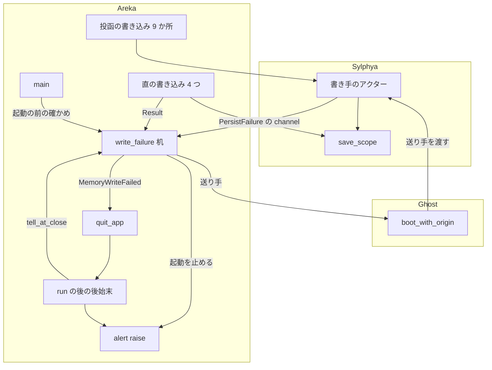
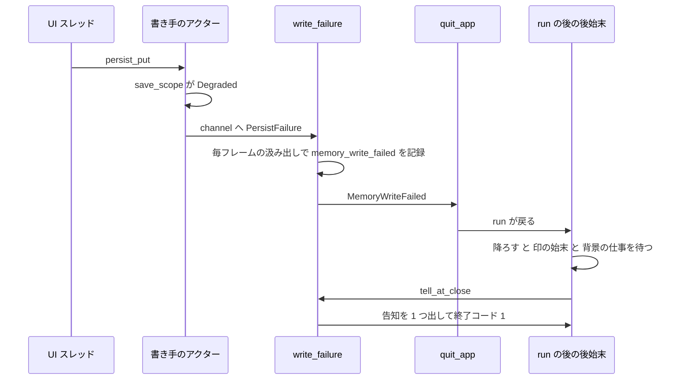
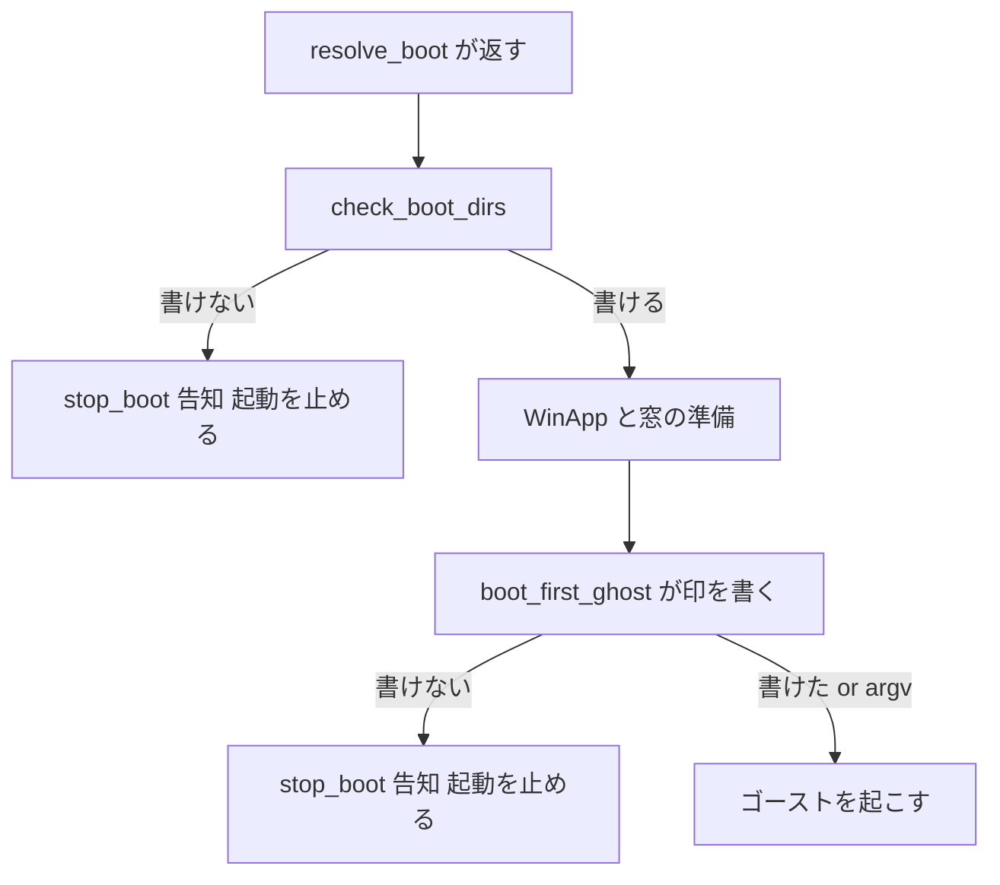

# 設計: areka-P0-write-failure-notice

> 2026-10-16・本ブランチ（main `0bb51d42`）のコードに対して書いた。コードは「何の定義か」（関数名・型名＋ファイルパス）で指す。調べの記録と、採らなかった案の理由は `research.md` §11。

## Overview

**目的**: areka が自分の記憶（アプリの記憶とゴーストごとの記憶）を書けないとき、それを致命として扱い、書けないまま動き続けずに告知（メッセージボックス）を出して終わる。利用者は「書けないこと」「どこへ書けないのか」「OS の理由」「直し方の案内」を知る。あわせて、起動の記録の文を起きたことに合わせ、書けないせいの `.nar` のインストールの失敗を書庫の破損と見分けてゴーストへ渡す。

**利用者**: areka のフォルダが書けない場所にある利用者（winget の機械の全員向けの入れ方・読み取り専用の媒体・空きの無いディスク）。起動の記録を読む開発者と、MCP の `get_log` で記録を読む外の道具。

**変わること**: 今は書けなくても `warn!`／`error!` を残して動き続ける。この設計の後は、起動の前に書けないと分かればゴーストを起こさずに起動を止める告知を出して終わり、動いている途中で 1 度でも書けなければ、正規の終了の道で終わってから告知を出す。書けるときの振る舞いは何も変わらない。

### Goals

- areka が書く 13 種の記憶の書き込み（要件 1 の表）と、印を消す書き込みの失敗が、どれも 1 つの道（致命の机）へ届く。記録だけで終わる失敗の道を 0 にする。
- 書けない失敗は致命。起動の前なら起動を止める告知、途中なら正規の終了の後の告知。告知は 1 回の起動で 1 回だけ。
- 「書きました」と先に言う記録 4 行と、印の 2 つの文が、起きたことと合う。
- 書けないせいのインストールの失敗は `fileio`、書庫の破損は今日どおり `extraction`。

### Non-Goals

- 書ける場所へ置き場を移すこと（`areka-P0-user-data-root` の持ち物）。
- 切替の時点で切替先の置き場を前もって確かめること（D7・要件 2.2 は任意としている）。
- ゴーストへの新しいイベント・Reference・台詞（要件 2.8）。emo2 の辞書の直し（要件 8.1）。
- 記憶の保存の仕組み（読んで重ねて書く・一時ファイルからの名前替え）と `areka-nar` の展開の手続き（要件 6.3）。
- ネットワーク更新の失敗の語と、その作業フォルダ（要件 2.10・6.5）。

## Boundary Commitments

### This Spec Owns

- 記憶の書き込みの失敗の中身の型 `PersistFailure`（スコープ・置き場・覚えられなかった key・理由）と、`PersistOutcome::Degraded` がそれを運ぶこと。
- 書き手のアクター（`areka-sylphya`）が失敗を外の受け口へ渡す口（`spawn_sylphya_with_failures`）と、ゴーストの書き手を起こすときにその口を通すこと（`areka-ghost` の `boot_with_origin`・`spawn_ghost_sylphya` の引数）。
- 致命の机 `crates/areka/src/write_failure.rs`: 受け口の据え付けと毎フレームの汲み出し、致命の扱い（`fatal`）、起動の前の確かめ（`probe_dir`・`check_boot_dirs`）、起動を止める口（`stop_boot`）、後始末の告知の選び（`tell_at_close`）。
- 終了の出所 `ExitOrigin::MemoryWriteFailed` と、その出所の告知・終了コード・印の判定での扱い。
- 告知の場面 `AlertScene::MemoryWrite` と文面。
- UI スレッドの直の書き込み 4 つ（`write_session_mark`・`write_switch_drop`・`clear_session_mark`・`roots/edit.rs` の `apply`）の失敗の扱い。
- 記録の文: `last_used_recorded`・`last_shell_recorded`・`last_balloon_recorded`・`install_balloon_remembered`・`session_mark_clear_degraded`・`session_mark_kept`・`session_mark_write_degraded`・`switch_drop_record_degraded`・`roots_memory_write_failed` の文と欄。新しい記録 `memory_write_failed`。
- インストールの失敗理由の語 `fileio` と、`doc/COMPAT_ARCHITECTURE.md` の 2 行（インストールの失敗理由の語の写し・終了コード）。
- emo2 の辞書の持ち主への申し送り（`.kiro/steering/roadmap.md` の申し送りの行）。

### Out of Boundary

- 置き場の決め方・書ける根・同梱のゴーストの写し・記憶の引き継ぎ・`dist/README.txt` の「■ 記憶の置き場」の中身（`user-data-root`）。この spec は決まった置き場を受け取って確かめるだけ。
- `crates/areka/src/boot_config.rs`・`crates/areka/src/roots/{mod,resolve}.rs`・`crates/areka-update/`・`crates/areka-mcp-bridge/`（ウェーブの約束・触らない）。
- SHIORI（辞書）が自分で書くセーブファイルの失敗。ネットワーク更新の作業フォルダ（`<ゴースト>\.update-work\`）と更新の失敗の語。
- 告知の今の 5 場面の文面と出る条件。`AREKA_NO_ALERT` の意味。
- きれいな終わりの判定（`session_mark_verdict`）の今の理由と順序、印を書く・消す時点、argv のプロセスは印に触れないこと。

### Allowed Dependencies

- 依存の向き: `areka-sylphya`（失敗の型・受け口）→ `areka-ghost`（書き手を起こすときに受け口を渡す）→ `areka`（机・告知・終わり方）。`areka-sylphya` は `areka-ghost`・`areka` を知らない。
- `areka` の中: `write_failure` → `alert`・`app_exit`。`alert`・`app_exit` は `write_failure` を知らない。`boot_resolve` は記録の欄 `first` のために `app_exit::ExitOrigin` を読む（`keep_session_mark`）。`main.rs`・`ghost_switch.rs`・`roots/edit.rs`・`ghost_session.rs`・`emo2_boot/mod.rs` が `write_failure` を呼ぶ。
- 使う物: std（`std::sync::mpsc`・`std::fs::OpenOptions`・`std::os::windows::fs::OpenOptionsExt`）、今の `windows` crate（`windows::core::Error` だけ）。外の新しい依存と `windows` crate の機能は足さない。ワークスペースの中の依存を 1 つ足す: `areka` → `areka-user-data`（`user-data-root` が作る葉のクレート・書けるかの確かめの口・設計討議の議題 1）。

### Revalidation Triggers

- `PersistOutcome` の形（`Degraded` が中身を持つ・`Copy` でない）→ `areka-sylphya` の全利用者。
- `boot_with_origin`・`spawn_ghost_sylphya` の引数 → `areka-ghost` の呼び手。
- `ExitOrigin` の変種の追加 → 出所を網羅で見る所（`fault_of`・`write_failure_of`・`session_mark_verdict`）。
- `roots/edit.rs` の `apply` の約束（下の「`user-data-root` への引き渡し」）→ `user-data-root` の「置き場を先頭へ ▸」。
- 起動の前の確かめが走る時点（`resolve_boot` が返した直後）→ `user-data-root` が同梱のゴーストを写す時点をそれより後へ動かしたら、確かめは写す前の置き場を見る。
- 告知の文が指す説明書の節の名前「■ 記憶の置き場」→ `user-data-root` が節の名前を変えたら、`alert.rs` の文を直す。

## Architecture

### Existing Architecture Analysis

- 告知は `alert.rs` の `AlertScene` を `alert::raise` で出す。起動を止める 4 場面は `main` が `Err(E_FAIL)` で戻る。SHIORI の失敗は `quit_app(ExitOrigin::KanadeStopped(Fault))` → `run()` の後の `after_run` が場面を組む → 後始末（降ろす → 印の始末 → 背景の仕事を待つ → 告知）の形。この設計は両方の形をそのまま使う。
- 記憶の書き込みは 2 通り。ゴーストが動いている間は、そのゴーストの書き手（`areka-sylphya` のアクター）へ投函して結果を待たない（9 か所）。ゴーストが動いていない間だけ、UI スレッドが `save_scope` を直に呼ぶ（4 か所）。
- 守る形: `FirstExit` は最初の出所だけを残す・後始末は成否によらず 1 回通す・`session_mark_verdict` は出所を網羅で見る・`GhostBootOptions` と `SylphyaInit` には欄を足さず派生の関数・引数で足す（`boot_with_kanade_stop` の前例）。

### Architecture Pattern & Boundary Map



- **選んだ形**: 失敗を 2 か所（アクターの中・直の書き込みの戻り値）で拾い、1 つの机へ集める。机は「起動の前なら止める・途中なら `quit_app`・後始末なら告知を 1 つ選ぶ」だけを決める。
- **新しい部品の理由**: `write_failure.rs` は、3 つの時点（起動の前・途中・後始末）の判断を `main.rs`（上限の近く）の外に置くため。`PersistFailure` は、置き場と OS の理由を告知まで運ぶため（今の `Degraded` は中身を持たない）。
- **steering との合い方**: 失敗の道は必ず記録を残す（`error!`）。`panic!` は使わない。決定論のテストは兄弟のファイル。一時フォルダはワークツリーの `target\` の下。

### Technology Stack

| 層 | 選んだ物 | この機能での役 | 備考 |
|---|---|---|---|
| 記憶 | `areka-sylphya`（今の物） | 失敗の中身の型・アクターの受け口 | 保存の仕組みは変えない |
| 運び手 | `std::sync::mpsc` | アクター（別のスレッド）から UI スレッドへ失敗を運ぶ | `KanadeNotice` と同じ形 |
| 確かめ | `areka-user-data` の確かめの口（`user-data-root` が作る） | フォルダを「ファイルを足す・フォルダを足す」権利つきで開いて閉じる（何も作らない） | こちらは「在るいちばん深いフォルダを選ぶ・フォルダでなければ書けない」を足して包むだけ |
| 告知 | 今の `alert.rs`（`MessageBoxW`） | 場面を 1 つ足す | `AREKA_NO_ALERT` の意味は変えない |

## File Structure Plan

### Directory Structure

```
crates/
├── areka-sylphya/src/
│   ├── persist/mod.rs                     # PersistFailure・PersistFailureCause・Degraded(PersistFailure)
│   ├── persist/persist_failure_tests.rs   # 新: save_scope の失敗の中身（置き場・key・理由・NoRoot）
│   ├── actor.rs                           # spawn_sylphya_with_failures・失敗を受け口へ送る
│   ├── actor_failure_sink_tests.rs        # 新: 投函の失敗が受け口へ 1 件ずつ届く・成功は 0 件
│   └── lib.rs                             # 公開の並びに 3 つ足す
├── areka-ghost/src/
│   ├── runtime.rs                         # boot_with_origin に引数 persist_failures
│   └── sylphya_wiring.rs                  # spawn_ghost_sylphya に引数 failures
└── areka/src/
    ├── write_failure.rs                   # 新: 致命の机（下の Components）
    ├── write_failure_tests.rs             # 新: 確かめ・机・告知の選び・抑止
    ├── write_failure_sites_tests.rs       # 新: 13 種の書き込みが机へ届く行列
    ├── main_session_mark_write_tests.rs   # 新: 印の 4 つの形（main の兄弟）
    ├── boot_resolve_mark_text_tests.rs    # 新: 要件 4.1〜4.3 の文（書けた・書けない）
    └── alert_memory_write_tests.rs        # 新: 告知の文面
```

### Modified Files

- `crates/areka-sylphya/src/persist/mod.rs` — `PersistFailure`・`PersistFailureCause` を足す。`PersistOutcome` から `Copy` を外し、`Degraded(PersistFailure)` にする。`save_scope` は失敗の中身を組んで返し、`persist commit failed` の `error!` に欄 `keys` を足す（名前は変えない）。
- `crates/areka-sylphya/src/actor.rs` — `spawn_sylphya_with_failures(init, failures)` を足し、`spawn_sylphya(init)` はそれへ `None` を渡す薄い包みにする。`run_actor` は `Degraded(failure)` を受け口へ送る（送れなければ `warn!`）。返信の結果が無いとき（起きない）は `error!` を残して返信端を落とす。
- `crates/areka-sylphya/src/lib.rs` — `PersistFailure`・`PersistFailureCause`・`spawn_sylphya_with_failures` を公開の並びへ。
- `crates/areka-sylphya/src/persist/persist_tests.rs` — `== PersistOutcome::Degraded` の 3 か所を `matches!` へ（型合わせ）。
- `crates/areka-ghost/src/runtime.rs` — `boot_with_origin` の末尾に `persist_failures: Option<Sender<PersistFailure>>`。`boot`・`boot_with_kanade_stop` は `None`。`spawn_ghost_sylphya` へ渡す。
- `crates/areka-ghost/src/sylphya_wiring.rs` — `spawn_ghost_sylphya(roots, failures)`（`spawn_sylphya_with_failures` を呼ぶ）。同じファイルの中のテストの呼び出し（`spawn_ghost_sylphya(ScopeRoots::default())`）にも引数 `None` を足す（型合わせ）。
- `crates/areka-ghost/src/runtime_origin_tests.rs`・`runtime_shell_tests.rs`・`runtime_tests.rs`・`translate_wiring_tests.rs`、`crates/areka/src/install/names_tests.rs` — 引数 `None` を足す（型合わせ）。
- `crates/areka/src/main.rs` — `mod write_failure;`・起動の前の確かめの呼び出し・`boot_first_ghost` の戻り値・`after_run` の場面と終了コード・`session_mark_verdict` の群に 1 腕・`settle_session_mark` の戻り値・後始末の告知を `tell_at_close` へ（約 +14 行・985 行前後）。
- `crates/areka/src/alert.rs` — `AlertScene::MemoryWrite`・`WriteMoment`・文面・`remembered_text`。
- `crates/areka/src/app_exit.rs` — `ExitOrigin::MemoryWriteFailed(PersistFailure)`・`write_failure_of`・`fault_of` の網羅に 1 腕。
- `crates/areka/src/boot_resolve.rs` — 3 つの書き手が `Result<(), PersistFailure>` を返す・`keep_session_mark` を足す・印の文を読み直しで決める・「書きました」の 3 行の文。
- `crates/areka/src/ghost_session.rs` — `register_systems` の中で `write_failure::install(world)`・倒れ先の `boot_with_origin` に `write_failure::sender(world)`。
- `crates/areka/src/emo2_boot/mod.rs` — `wire_emo2_boot` の `boot_with_origin` に `crate::write_failure::sender(world)`。
- `crates/areka/src/emo2_boot/ghost_switch.rs` — `switch_to` で `write_switch_drop` の失敗を致命へ（切替を下ろして戻る）。
- `crates/areka/src/roots/edit.rs` — `apply` のゴーストが居ないときの失敗を致命へ（`apply` の形は変えない）。
- `crates/areka/src/install/judge.rs` — `FailureWord::FileIo`・`IoPhase` での振り分け。
- `crates/areka/src/install/desk.rs` — `install_balloon_remembered` の文。
- `crates/areka/src/install/judge_tests.rs`・`procedure_branch_tests.rs` — `every_io_phase_is_extraction` を新しい振り分けの判定へ改め、語の綴りを 4 つに（要件 5 の判定）。
- 戻り値の型合わせだけ（判定は足さない・`main_session_mark_tests.rs` にも足さない）: `boot_resolve.rs` の 3 つの書き手を呼ぶ `boot_resolve_tests.rs`・`emo2_boot/ghost_switch_fallback_tests.rs`・`ghost_session_switch_memory_tests.rs`・`main_config_input_tests.rs`・`main_session_mark_fallback_tests.rs`・`main_session_mark_tests.rs`・`session_end_tests.rs`・`session_end_deadline_tests.rs`（成功を前提にする所は `.expect`、書けない置き場の所は `Err` を受ける）、`boot_first_ghost` と `settle_session_mark` を呼ぶ `main_session_mark_tests.rs`・`ghost_session_switch_memory_tests.rs`（`.expect`・`.0`）、`== PersistOutcome::Degraded` と比べる `boot_resolve_tests.rs`・`roots/edit_tests.rs`（`matches!`）。`crates/areka/src/session_end.rs` は、`settle_session_mark` の 2 つ目を `write_failure::log_only` へ渡す（告知は出さない・設計討議の議題 2）。
- `crates/areka/tests/smoke_boot_loop_exit.rs` — 方向を 1 つ足す（⑤ 書けない方向・要件 7.7）。
- `doc/COMPAT_ARCHITECTURE.md` — 「インストールの失敗理由の語の写し」の行（要件 5.6）と「SHIORI の失敗でプロセスが終わるときの終了コード」の行（D12）。
- `.kiro/steering/roadmap.md` — emo2 の辞書の持ち主への申し送りの行（要件 8.2・最後のタスク）。

### ウェーブの約束と重なり

- **約束のファイル（`boot_config.rs`・`roots/{mod,resolve}.rs`・`areka-update/`・`areka-mcp-bridge/`）に触る所は 0**。起動の前の確かめは `main.rs` の `resolve_boot` の呼び出しの直後に置き、`boot_config.rs` の中には入らない。
- `main.rs` は呼び出しの行だけ（約 +14 行・上限 1,000 の内）。判断は `write_failure.rs` に置く。
- `user-data-root` と重なりうるファイル（約束の外・進行役が向こうへ送る）:
  - `crates/areka-ghost/src/runtime.rs`・`crates/areka-ghost/src/sylphya_wiring.rs`: この spec は `boot_with_origin` と `spawn_ghost_sylphya` の引数を 1 つずつ足すだけ。向こうが同じ関数の中（記憶の置き場の組み方）を直すなら、行が近い。
  - `crates/areka/src/emo2_boot/ghost_switch.rs`: この spec は `switch_to` の `write_switch_drop` の呼び出しの所だけ。向こうが切替の写しをこのファイルに置くなら、同じ関数の中で近い。
  - `crates/areka/src/roots/edit.rs`: 向こうは着地の後に関数を足す約束（下の引き渡し）。
- 向こうが触らないと約束したファイル（`main.rs`・`boot_resolve.rs`・`roots/edit.rs`）は、この spec が触る。

### `user-data-root` への引き渡し: `roots/edit.rs` の `apply` の形

- **形**: `fn apply(world: &mut World, roots: BasewareRoots, exe_dir: Option<PathBuf>)`。引数も戻り値（`()`）も今と同じで、私有のまま（同じファイルに足す関数から呼ぶ）。
- **書けなかった結果は `apply` の中で閉じる**: ゴーストが居ないときの直の書き込みが失敗したら、`error!(event = "roots_memory_write_failed")`（欄 `dir`・`reason`）を残して `crate::write_failure::fatal(world, failure)` を呼ぶ（正規の終了の道 → 告知）。ゴーストが動いているときの投函は、書き手の受け口から同じ `fatal` へ届く。
- **呼び手がすること**: 戻り値を受け取らず、失敗のための分岐も書かない。`apply` を呼べば、書けなかった結果は握りつぶされずに致命の道へ渡る（向こうの要件 3.9 はこれで満たされる）。`apply` が戻った時点で終了の指示が出ていることがある（`quit_app` 済み）が、その後に記録を残すだけなら差し支えない（`add_root`・`remove_root` と同じ）。
- **巻き戻さない**: 起動の文脈の並び（`BootContext.roots`）は書き込みの前に書き換わり、書けなくても戻さない（要件 1.5）。
- **確かめの部品**（2026-10-16 設計討議・議題 1 で確定）: 書けるかの確かめは両 spec で 1 つにする。
  - **作るのは `user-data-root`**。葉のクレート `areka-user-data` に公開の口を 1 つ置く: フォルダを `access_mode(FILE_ADD_FILE | FILE_ADD_SUBDIRECTORY)`＋`custom_flags(FILE_FLAG_BACKUP_SEMANTICS)` で開いてすぐ閉じ、OS の結果を `std::io::Result<()>` のまま返す（何も作らない）。向こうの `exe_dir_writability` はこの結果を `Writability` へ写すだけにする。
  - **この spec は自前の確かめを作らない**。`write_failure::probe_dir` は、在るいちばん深いフォルダを選ぶ・選んだ所がフォルダでなければ書けない、の 2 つを足してその口を呼ぶ薄い包み。`Err` はどれも書けない（`PermissionDenied` だけでなく、読み取り専用の媒体の失敗なども OS の理由のまま告知へ）。
  - 確かめで拾いきれない失敗（ディスクがいっぱい など）は、実際に書いた時点で致命の机が拾う。確かめは早めに止めるためのもので、最後の守りではない。
- **着地の順**: `user-data-root` が先に着地する。この spec の「起動の前の確かめ」のタスクは、向こうの着地（main に `areka-user-data` の確かめの口が在ること）を待つ。ほかのタスク（受け口・机・告知・終わり方・記録の文・インストールの語）は待たずに進める。向こうはこの spec を待たない（`apply` の形が変わらないので、「置き場を先頭へ ▸」は今の `apply` を呼べばよい）＝待ちは片向きで、互いに待ち合う形にならない。

### セッション間の打ち合わせの時点（タスクに入れる）

1. **設計の確定の直後（済み・2026-10-16）**: 上の `apply` の形・確かめの部品の持ち主・着地の順を、`user-data-root` のセッションへ送った。向こうは異論なく合わせた（向こうのコミット `a7f2f344`）。確かめの口の名前と形は `areka_user_data::open_dir_for_add(dir: &Path) -> std::io::Result<()>`。向こうの「置き場を先頭へ ▸」は `apply` の外（`decide_front`・`move_to_front`）だけを足し、こちらは `apply` の中身を変える。同じ `roots/edit.rs` に後で着地する側が main を取り込んで合わせる。
2. **「起動の前の確かめ」のタスクの初め**: main を取り込み、`areka-user-data` の確かめの口が在るかを見る。在れば使う。無ければ、`user-data-root` のセッションへ着地の見込みを尋ね、そのタスクだけ止めて待つ（自前の確かめを作って先へ進めない）。
3. **完了の前（`/kiro-complete` の前）**: `apply` が `write_failure::fatal` へ渡す形で着地することを、`user-data-root` のセッションへ知らせる（向こうの要件 3.9 の確かめのため）。
## System Flows

### 動いている途中で書けない（要件 1.3・2.2・2.5）



- 汲み出しは毎フレームの相 `Update` の系 1 本（`ghost_quit_system` と同じ置き場）。失敗が 2 件以上あっても `quit_app` は最初の出所だけを残す（2 件目以降は `app_exit_again` の `debug!`）。
- 降ろす途中（`GhostSession::shutdown`）に起きた失敗は `run()` の後なので汲み出されない。後始末が受け手を取り出し（`take_receiver`）、告知の候補にする。

### 起動の前（要件 2.1・3.1・3.2）



- 確かめは `resolve_boot` が返した直後＝`user-data-root` が同梱のゴーストを書ける置き場へ写した後で、`WinApp` を作る前。窓はまだ無い。
- 印の書き込みは今の時点（ゴーストを起こす直前）のまま（要件 3.6）。窓の実体は `run()` の中の系が作るので、ここで止めても画面に窓は出ていない。

### 後始末の告知の選び（要件 2.3・2.5）

`tell_at_close(scene, clear_failed, late, suppressed)` は次の順で最初に在る 1 つだけを告げる。

1. 出所から組んだ場面（SHIORI の失敗・`MemoryWriteFailed`）。
2. 印を消せなかった失敗（`settle_session_mark` が返した物）→ `MemoryWrite { moment: Running }`。
3. 降ろす途中の失敗（取り出した受け手に残っていた最初の 1 件）→ `MemoryWrite { moment: Running }`。

2・3 のときは `Err(E_FAIL)` を返す（終了コード 1）。1 のときの終了コードは今どおり `after_run` の旗が決める。どれも無ければ何も出さず `Ok`。印を消せなかった失敗と、受け手に残っていた失敗は、告げるかどうかに関わらず 1 件ずつ `memory_write_failed` を残す。

`main` の後始末の中の順は今と同じ（降ろす → 印の始末 → 背景の仕事を待つ → 告知 → 降ろした結果 → 性能の最後の 1 枚）。告知の位置で今の `alert::raise` の 3 行を `tell_at_close` の 1 行に置き換え、その戻り値は性能の最後の 1 枚の後で `?` する（最後の 1 枚を飛ばさない）。

## Requirements Traceability

| 要件 | 要約 | 部品 | 口 | 流れ |
|---|---|---|---|---|
| 1.1 | アプリの記憶の 6 種が告知へ | 書き手のアクター・直の書き込み・机 | `spawn_sylphya_with_failures`・`write_session_mark`・`write_switch_drop`・`clear_session_mark`・`apply`・`fatal` | 途中・起動の前 |
| 1.2 | ゴーストの記憶の 7 種が告知へ | 書き手のアクター・机 | `run_actor` の送り・`drain` | 途中 |
| 1.3 | 投函だけの書き込みも漏らさない | 書き手のアクター（生成時に受け口） | `spawn_sylphya_with_failures`・`boot_with_origin` の引数 | 途中 |
| 1.4 | 記録に置き場・OS の理由・何を | `PersistFailure`・`save_scope`・`fatal` | `memory_write_failed` の欄・`persist commit failed` の欄 `keys` | — |
| 1.5 | 致命・巻き戻さない | 机・`apply` | `fatal`（`quit_app` だけ・巻き戻しなし） | 途中 |
| 2.1 | 起動の時点で書けなければ止める | `check_boot_dirs`・`probe_dir`・`stop_boot`・`boot_first_ghost` | `AlertScene::MemoryWrite { moment: Boot }` | 起動の前 |
| 2.2 | 途中は正規の終了の後に告知 | 机・`quit_app`・後始末 | `ExitOrigin::MemoryWriteFailed`・`after_run`・`tell_at_close` | 途中 |
| 2.3 | 印を消せないときも告知（OS の終了の中は記録だけ） | `settle_session_mark`・`tell_at_close`・`log_only` | 戻り値の組の 2 つ目 | 後始末の告知の選び |
| 2.4 | 告知の 4 項目・環境変数の名前を書かない | `alert_text`・`remembered_text` | 本文 5 行 | — |
| 2.5 | 1 回だけ | `FirstExit`・`tell_at_close`・起動の前の早い戻り | — | 後始末の告知の選び |
| 2.6 | `AREKA_NO_ALERT` は画面だけ | `stop_boot_with`・`tell_at_close` の `suppressed` | `alert::raise(scene, suppressed)` | — |
| 2.7 | `alert.rs` の場面として足す・今の 5 場面は不変 | `AlertScene::MemoryWrite` | `alert_text` の 1 腕 | — |
| 2.8 | 新しい SHIORI イベント 0 | （何も送らない） | — | — |
| 2.9 | 確かめで物を残さない | `probe_dir`（`areka-user-data` の確かめの口） | フォルダを開いて閉じるだけ・何も作らない | 起動の前 |
| 2.10 | 更新の作業フォルダは対象外 | （`areka-update` に触らない） | — | — |
| 3.1 | 起動の時点で印を書けなければ止める | `boot_first_ghost`・`stop_boot` | `write_session_mark` の `Err` | 起動の前 |
| 3.2 | 前回の印が残り書き替えられなければ止める | 同上（由来 `Halted` でも同じ道） | 同上 | 起動の前 |
| 3.3 | 降ろした直後・定常の印を書けなければ終わる | `switch_to`・書き手のアクター・机 | `write_switch_drop` の `Err`・`fatal` | 途中 |
| 3.4 | 終わるときに印を消せなければ告知 | `settle_session_mark`・`tell_at_close` | — | 後始末の告知の選び |
| 3.5 | 補いの仕組みを作らない | （作らない） | — | — |
| 3.6 | 判定の理由と順序・時点・argv を変えない | `session_mark_verdict` | 新しい出所は「きれいな終わり」の群へ 1 腕 | — |
| 4.1 | 「書きました」は書けたときだけ | `LastUsed::record`・`record_last_shell`・`record_last_balloon`・`remember_balloon` の文・`fatal` の記録 | 文「…書くように頼みました」 | — |
| 4.2 | 消せなかったときの文は残る印から | `clear_session_mark` | `read_session_mark` で読み直し | — |
| 4.3 | 残すときの文は印が在るときだけ予告 | `keep_session_mark` | 同上 | — |
| 4.4 | 語彙を変えるなら読み手も | 名前を変えない（文と欄だけ）・新しい名前 `memory_write_failed` | — | — |
| 4.5 | 事実と合う行の名前を変えない | `session_mark_write_degraded`・`switch_drop_record_degraded`・`session_mark_steady`・`roots_memory_write_failed`・`persist commit failed` | 欄を足すだけ | — |
| 5.1 | 書けない I/O の失敗は `fileio` | `failure_word`・`FailureWord::FileIo` | `IoPhase` の網羅の match | — |
| 5.2 | 根が無いときも `fileio` | 同上（`install_into` は `IoPhase::Stage`） | — | — |
| 5.3 | 破損と `.nar` を読めないのは `extraction` | 同上 | `IoPhase::Read`・`RefuseReason` の 3 種 | — |
| 5.4 | Reference0 は語 1 つ・代わりの台詞なし | （`procedure.rs` は変えない） | — | — |
| 5.5 | 網羅の形・他の語は不変 | `failure_word` | ワイルドカードの腕なし | — |
| 5.6 | §8 の登記 | `doc/COMPAT_ARCHITECTURE.md` | — | — |
| 5.7 | `install_failed` の欄を残す | （`fail_nar` は変えない・`word` が `fileio` に） | — | — |
| 5.8 | インストールの記憶の失敗も告知へ | `remember_balloon` の投函 → 書き手のアクター → 机 | — | 途中 |
| 6.1 | 書けるときは何も変わらない | 机は失敗のときだけ動く・成功の行を足さない | — | — |
| 6.2 | 足す告知は 2 つの時点だけ | `AlertScene::MemoryWrite`（`moment` 2 値） | — | — |
| 6.3 | 保存の仕組みと展開は不変 | `save_scope` は中身を返すだけ | — | — |
| 6.4 | 約束のファイルに触らない・`main.rs` 1,000 行以下 | File Structure Plan | 約 985 行 | — |
| 6.5 | 更新の語は不変 | （`update/refs.rs` に触らない） | — | — |
| 7.1 | 13 種の書き込みの行列 | `write_failure_sites_tests.rs` | — | — |
| 7.2 | 印の 4 つの形・写しの後・物を残さない | `main_session_mark_write_tests.rs`・`write_failure_tests.rs` | — | — |
| 7.3 | 4.1〜4.3 の文の両面 | `boot_resolve_mark_text_tests.rs` | — | — |
| 7.4 | 語を種類ごとに | `install/judge_tests.rs`・`procedure_branch_tests.rs` | — | — |
| 7.5 | 書けるときは告知 0・抑止は画面だけ | `write_failure_tests.rs` | — | — |
| 7.6 | 一時フォルダは `target\` の下・印のテストは兄弟へ | `TempPath::under_target`・新しい兄弟のファイル | — | — |
| 7.7 | 実機の確かめ | `smoke_boot_loop_exit.rs` の ⑤ | — | 起動の前 |
| 8.1 | 辞書を書き換えない | （`vendors/` に触らない） | — | — |
| 8.2 | 申し送り | `.kiro/steering/roadmap.md`・完了の報告 | — | — |
| 8.3 | 申し送りが届くまでも `fileio` を送る | `failure_word` | — | — |
| 9.1 | 致命として告知を出して終わる | 机・告知 | — | 起動の前・途中 |
| 9.2 | 語は `fileio` | `FailureWord::FileIo` | — | — |
| 9.3 | 補いの仕組みを作らない | （作らない） | — | — |
| 9.4 | 申し送る | 8.2 と同じ | — | — |

## Components and Interfaces

| 部品 | 層 | 役目 | 要件 | 主な依存 | 契約 |
|---|---|---|---|---|---|
| `PersistFailure`・`Degraded(PersistFailure)` | areka-sylphya | 失敗の中身を運ぶ | 1.4・6.3 | — | State |
| 書き手のアクターの受け口 | areka-sylphya | 投函の失敗を外へ送る | 1.1・1.2・1.3・5.8 | `save_scope`（P0） | Service・Event |
| ゴーストの書き手の結線 | areka-ghost | 起こすときに受け口を渡す | 1.3 | 受け口（P0） | Service |
| 致命の机 `write_failure` | areka | 起動の前・途中・後始末の判断 | 1.1〜1.5・2.1〜2.6・2.9・3.1〜3.4 | `alert`（P0）・`app_exit`（P0） | Service・State |
| 告知の場面 `MemoryWrite` | areka | 文面 | 2.1・2.4・2.7・6.2 | — | Service |
| 出所 `MemoryWriteFailed` | areka | 終わり方・終了コード・印の判定 | 2.2・3.6 | — | State |
| 直の書き込み 4 つ | areka | 失敗を呼び手へ返す | 1.1・3.1〜3.4・4.2・4.3 | `save_scope`（P0） | Service |
| 記録の文 | areka | 起きたことと合う文 | 4.1〜4.5 | — | — |
| インストールの語 | areka | `fileio` の振り分け | 5.1〜5.8・8.3・9.2 | `areka-nar` の `IoPhase`（P0） | Service |

### areka-sylphya

#### `PersistFailure` と `PersistOutcome`

| 項目 | 内容 |
|---|---|
| 役目 | 書けなかった 1 回の中身を、スコープ・置き場・覚えられなかった key・理由で運ぶ |
| 要件 | 1.4・6.3 |

```rust
/// 保存できなかった 1 回の中身（要件 1.4）。
#[derive(Clone, Debug, PartialEq, Eq)]
pub struct PersistFailure {
    pub scope: PersistScope,
    /// 書けなかった置き場（スコープの root＝`…\profile\areka`）。root が無ければ `None`。
    pub dir: Option<PathBuf>,
    /// 覚えられなかった key（投函の entries の key の並び。起動の前の確かめは空）。
    pub keys: Vec<PersistKey>,
    pub cause: PersistFailureCause,
}

#[derive(Clone, Debug, PartialEq, Eq)]
pub enum PersistFailureCause {
    /// スコープの置き場が決まっていない（root 不在）。
    NoRoot,
    /// OS の理由（`std::io::Error` の表示。例「アクセスが拒否されました。 (os error 5)」）。
    Io(String),
}

#[derive(Clone, Debug, PartialEq, Eq)] // Copy を外す
pub enum PersistOutcome {
    Saved,
    Degraded(PersistFailure),
}
```

- 事後条件: `save_scope` は root 不在なら `Degraded(PersistFailure { dir: None, cause: NoRoot, keys, .. })`、`commit` の失敗なら `Degraded(PersistFailure { dir: Some(root), cause: Io(error.to_string()), keys, .. })` を返す。記録（`warn!`・`error!(persist commit failed)`）は今日どおり出し、`error!` に欄 `keys` を足す。
- 不変: 読んで重ねて書く・一時ファイルからの名前替えは変えない（要件 6.3）。

#### 書き手のアクターの受け口

**Contracts**: Service [x] / Event [x]

```rust
/// `spawn_sylphya` の派生（`SylphyaInit` に欄を足さない）。`failures` が Some なら、
/// 保存が `Degraded` になるたびに中身を 1 件送る。
pub fn spawn_sylphya_with_failures(
    init: SylphyaInit,
    failures: Option<std::sync::mpsc::Sender<PersistFailure>>,
) -> SylphyaParts;

/// 今の口（`spawn_sylphya_with_failures(init, None)` の薄い包み）。
pub fn spawn_sylphya(init: SylphyaInit) -> SylphyaParts;
```

- 送る時点: `run_actor` が `Effect::PersistSave` を処理し `save_scope` が `Degraded(failure)` を返した直後に `failure.clone()` を送る（返信端への中継は今どおり）。成功では送らない。
- 送れない（受け手が落ちている）: `warn!`（target `areka_sylphya::persist`・「失敗の受け口が閉じている」）を残して続ける（失敗そのものは `save_scope` が記録済み）。
- 順序: アクターは 1 本のスレッドで直列なので、同じ書き手の失敗は投函の順に届く。
- 返信の結果が無いとき（`PersistPut` は必ず `PersistSave` を出すので起きない）: `error!` を残して返信端を落とす（受け手は `ReplyError::Dropped` を見る）。`panic!` しない。

### areka-ghost

#### ゴーストの書き手の結線

```rust
pub fn boot_with_origin(
    options: GhostBootOptions,
    kanade_stop: Option<Sender<KanadeNotice>>,
    origin: BootOrigin,
    shell: Option<&str>,
    persist_failures: Option<Sender<areka_sylphya::PersistFailure>>,
) -> Result<GhostRuntime, GhostBootError>;

pub fn spawn_ghost_sylphya(
    roots: ScopeRoots,
    failures: Option<Sender<areka_sylphya::PersistFailure>>,
) -> SylphyaParts;
```

- `boot`・`boot_with_kanade_stop` は `None` を渡す（今の呼び手は変わらない）。`GhostBootOptions` に欄は足さない（35 か所の構築点を変えない前例）。
- ゴーストの書き手を通る書き込みは全部この受け口を通る: 最後に使ったもの（App・Ghost）・定常の印（App）・動いている間の置き場の並び（App）・最後のシェルだけ・最後のバルーンだけ・入れたバルーン・窓の位置・ゴーストのプロパティ（`prop_sink.rs`・talk のスレッド）。
- App スコープだけの書き手（`shiori_host.rs` の `spawn_app_sylphya_sink`）は記憶の投函を持たないので、今の `spawn_sylphya` のまま。

### areka

#### 致命の机 `crates/areka/src/write_failure.rs`

| 項目 | 内容 |
|---|---|
| 役目 | 書けない失敗を集め、時点ごとに「止める・終わる・告げる」を決める |
| 要件 | 1.1〜1.5・2.1〜2.6・2.9・3.1〜3.4・6.1 |

**Dependencies**
- Inbound: `main.rs`（確かめ・止める・後始末）（P0）・`ghost_session.rs`（据え付け・送り手）（P0）・`emo2_boot/mod.rs`（送り手）（P0）・`ghost_switch.rs`・`roots/edit.rs`（`fatal`）（P0）
- Outbound: `alert::raise`（P0）・`app_exit::quit_app`（P0）

**Contracts**: Service [x] / State [x]

```rust
/// 受け口の両端（World の NonSend・プロセスに 1 つ）。
pub(crate) struct WriteFailureTx(pub(crate) Sender<PersistFailure>);
pub(crate) struct WriteFailureRx(pub(crate) Receiver<PersistFailure>);

/// channel を 1 本作って両端を World に置き、汲み出しの系を `Update` に登録する。
/// 呼び手は `ghost_session::register_systems`（プロセスに 1 回）。
pub(crate) fn install(world: &mut World);

/// 送り手の写し（据えていない World では None＝受け口なしで起こす）。
pub(crate) fn sender(world: &World) -> Option<Sender<PersistFailure>>;

/// 致命: `error!(event = "memory_write_failed")` を 1 件残し、
/// 出所 `ExitOrigin::MemoryWriteFailed(failure)` で `quit_app` を呼ぶ。巻き戻しはしない。
pub(crate) fn fatal(world: &mut World, failure: PersistFailure);

/// 毎フレーム: 受け手に溜まった失敗を全部取り出し、1 件ずつ `fatal` へ。
fn drain_system(world: &mut World);

/// 書けるかの確かめ: `dir`（無ければ在るいちばん深い親）を選び、フォルダでなければ Err、
/// フォルダなら `areka-user-data` の確かめの口へ渡す（作る物 0・フォルダも作らない）。
pub(crate) fn probe_dir(dir: &Path) -> std::io::Result<()>;

/// 起動の前の確かめ: アプリの記憶の置き場 → ゴーストの記憶の置き場
/// （`<cfg.ghost_root>\ghost\master\profile\areka`）の順。最初の失敗を返す（keys は空）。
/// `ConfigInputs` は `resolve_boot` の結果からしか得られないので、写しの前には呼べない（並びを型で守る）。
pub(crate) fn check_boot_dirs(cfg: &ConfigInputs, app_profile_dir: &Path)
    -> Result<(), PersistFailure>;

/// 起動を止める: `memory_write_failed` を記録し、`MemoryWrite { moment: Boot }` を告げ、
/// `main` が返す `E_FAIL` を返す。`stop_boot` は `alert::suppressed()` を読む薄い口。
pub(crate) fn stop_boot(failure: PersistFailure) -> windows::core::Error;
pub(crate) fn stop_boot_with(failure: PersistFailure, suppressed: bool) -> windows::core::Error;

/// 後始末で受け手を取り出す（OS のセッションの終了を処理済みなら None＝告げない）。
pub(crate) fn take_receiver(world: &mut World) -> Option<Receiver<PersistFailure>>;

/// OS のセッションの終了の中の後始末: 印を消せなかった失敗と、受け手に残っていた失敗を
/// `memory_write_failed` で 1 件ずつ記録するだけ（告知は出さない・終了コードは問わない・要件 2.3 の例外）。
pub(crate) fn log_only(world: &mut World, clear_failed: Option<PersistFailure>);

/// 後始末の告知を 1 つだけ選んで告げる（System Flows「後始末の告知の選び」）。
pub(crate) fn tell_at_close(
    scene: Option<AlertScene>,
    clear_failed: Option<PersistFailure>,
    late: Option<Receiver<PersistFailure>>,
    suppressed: bool,
) -> windows::core::Result<()>;
```

- 事前条件: `install` は系の登録の中で 1 回。`fatal` は UI スレッドから（`&mut World`）。
- 事後条件: `fatal` の後は `FirstExit` が在る（最初の出所が残る）。`stop_boot_with` は抑止でも `Err` を返す（終わることは変えない・要件 2.6）。`tell_at_close` が告げるのは 0 か 1 件。
- 記録 `memory_write_failed`（`error!`）の欄: `scope`・`what`（`alert::remembered_text`）・`dir`・`reason`・`moment`（`boot`／`running`）。どの致命も 1 件ずつ残す（汲み出した失敗・起動の前・印を消せない・降ろす途中に残っていた失敗）。
- `probe_dir` の手順: ① `dir` から親へ辿り、在る最初の物（`dir` 自身を含む）を選ぶ（無ければ `NotFound` の `Err`）。② 選んだ物がフォルダでなければ `Err`（書けない）。③ フォルダなら `areka-user-data` の確かめの口（開いて閉じるだけ）を呼び、その結果を返す。
- 確かめの置き場: `resolve_boot` が返した `ConfigInputs` を受け取り、その `ghost_root`（`user-data-root` の写しの後の、決まったゴーストのフォルダ）を見る。`main` の中で `ConfigInputs` は `resolve_boot` の結果からしか作れないので、確かめを写しの前へ動かすことは型の上でできない（要件 7.2 の「写しの後」はこれで守り、並びを照らす檻のテストは足さない）。アプリの記憶は `default_app_profile_dir()`（`main` が起動の文脈へ渡すのと同じ値）。シェルの記憶は areka が書かないので確かめない。
- argv で始まったプロセスも同じ確かめをする（argv のプロセスもゴーストの記憶と置き場の並びを書く）。

**Implementation Notes**
- 汲み出しの系は `Update` の 1 本。受け口が World に無い（据えていない構成のテスト）なら何もしない。
- 送り手は `Sender` の写しで、ゴーストを起こすたびに渡す（切替の相手も同じ channel）。
- `probe_dir` は定数も OS の口も持たない（確かめの口は `areka-user-data` の物を使う・設計討議の議題 1）。

#### 告知の場面 `AlertScene::MemoryWrite`（`crates/areka/src/alert.rs`）

```rust
#[derive(Debug, Clone, Copy, PartialEq, Eq)]
pub(crate) enum WriteMoment { Boot, Running }

pub(crate) enum AlertScene {
    // 今の 5 場面は変えない
    MemoryWrite { failure: PersistFailure, moment: WriteMoment },
}

/// 覚えられなかったものの利用者向けの語（純粋・`memory_write_failed` の欄 `what` も同じ物）。
pub(crate) fn remembered_text(failure: &PersistFailure) -> String;
```

- 題名: `Boot` は今の「areka を起動できません」、`Running` は「areka の記憶を書けません」。
- 本文（5 行）:
  1. `Boot`「記憶を書けないので、ゴーストを起こさずに起動を止めました。」／`Running`「記憶を書けなくなったので、areka を終了しました。」
  2. 「覚えられなかったもの: 〈`remembered_text`〉」
  3. 「置き場: 〈`dir` の絶対パス〉」（`None` は「置き場: 決まっていません」）
  4. 「理由: 〈`Io` の文〉」（`NoRoot` は「理由: 記憶の置き場が決まっていません」）
  5. 「直し方: この置き場を書ける状態にしてください。置き場の変え方は、説明書（README.txt）の「■ 記憶の置き場」にあります。」
- `remembered_text` の語（`PersistKey` の網羅・ワイルドカードの腕なし・同じ語は 1 回・「・」で繋ぐ）: `LastRunning`＝起動中の印・`LastGhost`＝最後に使ったゴースト・`LastBalloon`＝最後に使ったバルーン・`LastShell`＝最後に使ったシェル・`BasewareRoots`＝置き場の並び・`WindowPos`／`BalloonOffset`＝窓の位置・`BootCount`／`VanishCount`＝ゴーストのプロパティ。`keys` が空（起動の前の確かめ）なら、スコープで「areka の記憶」（App）／「ゴーストの記憶」（Ghost）／「シェルの記憶」（Shell）／「バルーンの記憶」（Balloon）。
- 環境変数の名前（`AREKA_PROFILE_DIR` など）と既定の置き場の場所（`%LOCALAPPDATA%` など）は本文に書かない（要件 2.4）。
- 今の 5 場面の文面と題名の組み方は変えない（要件 2.7・6.2）。

#### 出所 `MemoryWriteFailed`（`crates/areka/src/app_exit.rs`・`main.rs`）

```rust
pub(crate) enum ExitOrigin {
    // 今の 7 種は変えない
    /// 記憶を書けなかった（最初の失敗の中身つき）。
    MemoryWriteFailed(PersistFailure),
}

/// 出所が記憶の書き込みの失敗なら中身（網羅の match）。
pub(crate) fn write_failure_of(origin: &ExitOrigin) -> Option<&PersistFailure>;
```

- `fault_of` は新しい出所に `None`（SHIORI の告知を出さない）。
- `after_run`（`main.rs`）は `fault_of` が無く `write_failure_of` が在れば場面 `MemoryWrite { moment: Running }` を組み、終了コードの旗を立てる（`fault_exit = fault.is_some() || write.is_some()`）。OS のセッションの終了を処理済みなら今どおり場面を組まない。
- `session_mark_verdict` は新しい出所を「きれいな終わり」の群（`Quit`・`Escape`・`Smoke`・`OsClose`・`SessionEnd` と同じ腕）へ入れる。今の理由と順序は変えない（要件 3.6）。理由: 降ろす手順は正規の道を通り、ゴーストは落ちていない。

#### 直の書き込み 4 つ

```rust
// crates/areka/src/boot_resolve.rs
pub(crate) fn write_session_mark(app_profile_dir: &Path, running: &str) -> Result<(), PersistFailure>;
pub(crate) fn write_switch_drop(app_profile_dir: &Path, mark: Option<&str>) -> Result<(), PersistFailure>;
pub(crate) fn clear_session_mark(app_profile_dir: &Path) -> Result<(), PersistFailure>;
/// 残すと決めたときの記録（`session_mark_kept`）。記憶の印を読み直して文を決める。
pub(crate) fn keep_session_mark(app_profile_dir: &Path, reason: &'static str, first: Option<&ExitOrigin>);

// crates/areka/src/main.rs
fn boot_first_ghost(/* 今と同じ */) -> std::result::Result<(), PersistFailure>;
fn settle_session_mark(mark: &MarkInputs, end: Teardown) -> (MarkVerdict, Option<PersistFailure>);
```

| 書き込み | 呼び手 | 失敗のとき |
|---|---|---|
| `write_session_mark` | `boot_first_ghost`（argv でないとき） | `Err` を返し、`main` が `map_err(write_failure::stop_boot)?` で起動を止める。ゴーストは起こさない（要件 3.1・3.2） |
| `write_switch_drop` | `ghost_switch::switch_to` | 切替の予約（`SwitchInFlight`）を下ろし、`write_failure::fatal` を呼んで戻る。切替先は起こさない（要件 3.3） |
| `clear_session_mark` | `settle_session_mark` | 組の 2 つ目で返す。後始末が `tell_at_close` へ渡す（要件 2.3・3.4） |
| `apply`（ゴーストが居ないとき） | `add_root`・`remove_root`（と `user-data-root` の新しい関数） | `roots_memory_write_failed` を残して `fatal`（上の引き渡し） |

- 記録の名前は変えない（要件 4.5）。`session_mark_write_degraded`・`switch_drop_record_degraded` の文は、起きない先の予告（「このゴーストが落ちても…」）を外し「起動を止めます」「終了します」に改め、欄 `reason` を足す。
- `session_mark_clear_degraded`（要件 4.2）: 消せなかった直後に `read_session_mark` で読み直す。値が在れば「…次の起動は前回落ちたとして既定のゴーストで起き、Ref7 は〈値〉になります」、無い・読めないなら予告しない。欄 `remaining`（値か `-`）を足す。
- `session_mark_kept`（要件 4.3）: `main.rs` の腕から `keep_session_mark` へ移す（`main.rs` の行を減らす）。読み直した値が在れば「次の起動は既定のゴーストで Ref6/7 付き（Ref7＝〈値〉）」、無ければ「記憶に起動中の印が無いので、次の起動は前回落ちたとは扱われません」。欄 `reason`・`first` は今どおり、`remaining` を足す。

#### 記録の文（要件 4.1）

| 名前（変えない） | 定義点 | 今の文 | 新しい文 |
|---|---|---|---|
| `last_used_recorded` | `boot_resolve.rs` の `LastUsed::record` | 最後に使ったものを記憶へ書きました | 最後に使ったものを記憶へ書くように頼みました |
| `last_shell_recorded` | 同 `record_last_shell` | 最後のシェルだけを記憶へ書きました | 最後のシェルだけを記憶へ書くように頼みました |
| `last_balloon_recorded` | 同 `record_last_balloon` | 最後のバルーンだけを記憶へ書きました | 最後のバルーンだけを記憶へ書くように頼みました |
| `install_balloon_remembered` | `install/desk.rs` の `remember_balloon` | …入れたバルーンへ書き換えました | …入れたバルーンへ書き換えるように頼みました |

- 出す時点（投函の直後）と欄は変えない。結果は、書けなければ `memory_write_failed`（`error!`）が 1 件出て終わる。書けたときの行は足さない（要件 6.1 の行の数）。
- 読み手（14 ファイル）は名前と出す時点で数えているので、直す所は 0（テストの中で文を照らす物は 0 と grep で確かめた）。新しい名前は `memory_write_failed` の 1 つだけ。

#### インストールの語（`crates/areka/src/install/judge.rs`）

```rust
pub(crate) enum FailureWord { Extraction, InvalidType, Unsupported, FileIo }
// FileIo.as_ref_str() == "fileio"

pub(crate) fn failure_word(error: &NarError) -> FailureWord {
    // NarError::Io { phase, .. } は IoPhase の網羅の match:
    //   Read → Extraction / Stage | Commit | Rollback → FileIo
    // Refused は今どおり（ワイルドカードの腕なし）
}
```

- `install_into`（`install/destination.rs`）の根が無い失敗は `IoPhase::Stage` で作られているので、そのまま `fileio` になる（要件 5.2）。`Stage` の中の「入れる先の今の中身を読めない」も `fileio`（要件 5.1）。
- `OnInstallFailure` の Reference0 は語 1 つのまま（`procedure.rs` の `fail_nar` は変えない・`install_failed` の欄 `word` が `fileio` になる）。
- 登記: `doc/COMPAT_ARCHITECTURE.md` の「インストールの失敗理由の語の写し」の行を、`extraction` の範囲から「組み上げ・確定・巻き戻しの I/O の失敗」と根が無い失敗を外し、`fileio` の行（ukadoc `list_shiori_event.html` の「ネットワーク失敗理由」の `fileio`「※SSPのみ。容量不足による更新対象への書き込み失敗。」を、インストールの失敗理由の一覧に「書けない」の語が無いので借りる）を足す。判定のテスト名も改める。

## Data Models

### Domain Model

- 失敗 1 件＝`PersistFailure`（値。同じ物を記録・出所・告知が共有する）。
- 机の状態＝World の受け手 1 つと `FirstExit`（最初の出所）。机は失敗の列を持たない（最初の 1 件で終わりへ向かい、残りは記録だけ）。
- 不変: 1 回の起動で告知は 0 か 1 件。告知が出る前に、必ず `memory_write_failed`（または SHIORI の失敗の記録）が 1 件以上ある。

## Error Handling

### Error Strategy

| 起きること | 拾う所 | 扱い | 記録 |
|---|---|---|---|
| 起動の前に置き場へ書けない | `check_boot_dirs` | 起動を止める告知・終了コード 1 | `memory_write_failed`（moment=boot）・`alert` |
| 起動の前に印を書けない | `boot_first_ghost` | 同上 | `session_mark_write_degraded`（warn）・`memory_write_failed`・`alert` |
| 投函の書き込みが失敗 | アクター → 汲み出し | `quit_app(MemoryWriteFailed)` → 後始末 → 告知・終了コード 1 | `persist commit failed`（error・欄 keys）・`memory_write_failed` |
| 切替の降ろした直後に書けない | `switch_to` | 切替を下ろして `fatal` | `switch_drop_record_degraded`（warn）・`memory_write_failed` |
| ゴーストが居ないときに置き場の並びを書けない | `apply` | `fatal` | `roots_memory_write_failed`（error）・`memory_write_failed` |
| 終わるときに印を消せない | `settle_session_mark` | 告知の候補（ほかに無ければ告げる）・終了コード 1 | `session_mark_clear_degraded`（warn）・`memory_write_failed` |
| 降ろす途中に書けない | 後始末が受け手を取り出す | 告知の候補・終了コード 1 | `persist commit failed`・`memory_write_failed` |
| 受け口が閉じている | アクター | 続ける | `warn!`（areka_sylphya::persist） |
| OS のセッションの終了の中 | `session_end.rs` → `log_only` | 告げない（OS の終了を塞がない・要件 2.3 の例外）・終了コードは問わない | `memory_write_failed` を 1 件ずつ |

- `panic!` は使わない。失敗の道はどれも `error!` を 1 件以上残す。

### Monitoring

- 実機の確かめと MCP の `get_log` は `memory_write_failed` と `alert`（`scene=MemoryWrite`）で引ける。

## Testing Strategy

すべて決定論。書けない置き場は「置き場のパスに普通のファイルを置く」形（`TempPath::under_target` の下）か、`commit` が必ず失敗する偽の `PersistIo`（テストの中の小さな型）で作る。権限は変えない。印のテストは `main_session_mark_tests.rs` に足さない（要件 7.6）。

### 単体（areka-sylphya）

- `persist/persist_failure_tests.rs`: `commit` の失敗で `Degraded` が置き場（root）・key の並び・`Io` の理由を運ぶ／root 不在で `NoRoot`・`dir: None`／`persist commit failed` の記録に欄 `keys`（要件 1.4）。
- `actor_failure_sink_tests.rs`: 投函が失敗すると受け口へ 1 件届き、中身が投函の key とスコープに合う／成功では 0 件（要件 6.1）／受け口なし（`spawn_sylphya`）でも今どおり／受け手を落としても `panic!` せず `warn!`（要件 1.3）。

### 単体（areka）

- `write_failure_tests.rs`:
  - `probe_dir` は在るフォルダでも、在らない下のフォルダ（親を確かめる）でも、前後でフォルダの中身が同じ（ファイル 0・フォルダ 0 が増えない）（要件 2.9）。普通のファイルの下を指すと `Err`。
  - `check_boot_dirs`: アプリの置き場が書けない → `scope=App`・ゴーストの置き場が書けない → `scope=Ghost`・`dir=<ghost_root>\ghost\master\profile\areka`。元の置き場（写す前）を書けなくし、決まった置き場（写した先）だけ書けるとき `Ok`＝渡された `ConfigInputs` の置き場しか見ない（要件 2.1・7.2。写しの後に走る並びは、`ConfigInputs` を受け取る引数の型が守る）。
  - 汲み出し: 失敗 1 件 → `FirstExit` が `MemoryWriteFailed`・`memory_write_failed` が 1 件／2 件 → `FirstExit` は最初の 1 件のまま（要件 2.5）。
  - `stop_boot_with(failure, true)`: `alert` の記録が 1 件（`suppressed=true`・題名「areka を起動できません」）で、`Err` を返す（要件 2.6）。
  - `log_only`: 印を消せない＋受け手の残り 1 件 → `memory_write_failed` が 2 件・`alert` の記録は 0 件（要件 2.3 の例外）。`tell_at_close`: 出所の場面＋印を消せない＋残りの失敗 → 告げるのは出所の場面 1 件／場面なし＋印を消せない → `Running` の 1 件で `Err`／何も無い → 0 件で `Ok`（要件 6.1・7.5）／抑止でも `Err` は変わらない（要件 2.6）。
- `write_failure_sites_tests.rs`（要件 7.1）: 要件 1 の表の 13 種を 1 つずつ書けなくし、失敗が机へ届く（投函の物は受け口つきの書き手と必ず失敗する `PersistIo`、直の物は普通のファイルの置き場）ことを判定する。判定した種類の数が 13 と等しいことも判定する。置き場の並びは「ゴーストが居る（投函）」と「居ない（直）」の両方を踏む。13 種＝起動中の印を書く・降ろした直後・定常の印・印を消す・最後に使ったゴースト・置き場の並び・最後に使ったバルーン・最後に使ったシェル・最後のシェルだけ・最後のバルーンだけ・入れたバルーン・窓の位置・ゴーストのプロパティ。
- `main_session_mark_write_tests.rs`（要件 7.2）: ⑴ 起動の時点で印を書けない（由来 `Plain`）→ `boot_first_ghost` が `Err`・置き場（`GhostSlot`）が空 ⑵ 前回の印がある起動（由来 `Halted`）で書けない → 同じ ⑶ 切替の降ろした直後に書けない → 切替先を起こさず `FirstExit` が `MemoryWriteFailed`・予約が無い、定常の印の投函が失敗 → 汲み出しで同じ ⑷ 終わるときに印を消せない → `settle_session_mark` の 2 つ目が `Some`・`tell_at_close` が `Running` の告知を 1 件。出所 `MemoryWriteFailed` の判定が `Clear` であること。
- `boot_resolve_mark_text_tests.rs`（要件 7.3）: 4 行（要件 4.1）は書けたときも書けないときも「書きました」を含まず、書けないときだけ `memory_write_failed` が出る／`session_mark_clear_degraded` は印が残るときだけ「前回落ちたとして」を含む／`session_mark_kept` は印が在るときだけ「Ref6/7 付き」を含む。
- `alert_memory_write_tests.rs`（要件 2.4・2.7）: 2 つの時点の題名と 5 行／本文に `AREKA_`・`%LOCALAPPDATA%`・`LOCALAPPDATA` が無い／「■ 記憶の置き場」が在る／`remembered_text` が `PersistKey` の全種と空の 4 スコープに語を返す。今の 5 場面の判定は `alert_tests.rs` のまま通る。
- `install/judge_tests.rs`・`procedure_branch_tests.rs`（要件 7.4）: `IoPhase` の 4 つを 1 つずつ組み、`Read` だけ `extraction`・ほかは `fileio`／語の綴りが 4 つ／根が無い（`install_into`）失敗が `fileio`／`RefuseReason` の 14 種の判定は今のまま。

### 実機（要件 7.7）

- `crates/areka/tests/smoke_boot_loop_exit.rs` に ⑤ 書けない方向を足す: `AREKA_ROOT`＝検体の根（`SampleRoot::acquire`）・`AREKA_PROFILE_DIR`＝`TempPath::under_target` の下に作った普通のファイル・`AREKA_NO_ALERT=1`。番犬の締切の内に非 0 で終わり、記録に `memory_write_failed` と題名「areka を起動できません」の `alert`（本文に「記憶を書けないので」）が在り、本物のゴースト窓の印が 0・`session_mark_written` が 0。窓を開く前に止まるので、モニタの有無に依らない。人の手は要らない。`AREKA_ROOT` を渡すと `user-data-root` は写さないので、この方向は「写しの後」の並びを受け持たない（並びは `check_boot_dirs` の引数の型が守る）。

## Security Considerations

- 確かめはフォルダを開いて閉じるだけで、何も作らない。権限（ACL）は読みも変えもしない。`FILE_FLAG_BACKUP_SEMANTICS` はフォルダを開くための指定で、バックアップの特権を有効にしない。

## Performance & Scalability

- 起動の前の確かめはフォルダを 2 回開いて閉じるだけ。汲み出しは毎フレーム `try_recv` 1 回（書けるときは空）。書けるときの書き込みの道は、アクターの `match` の腕が 1 つ増えるだけ。
