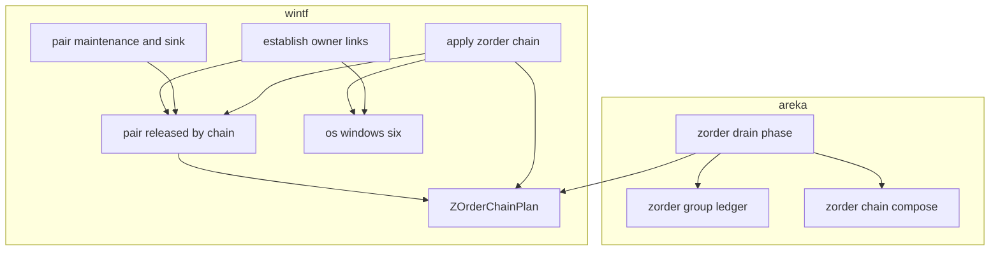
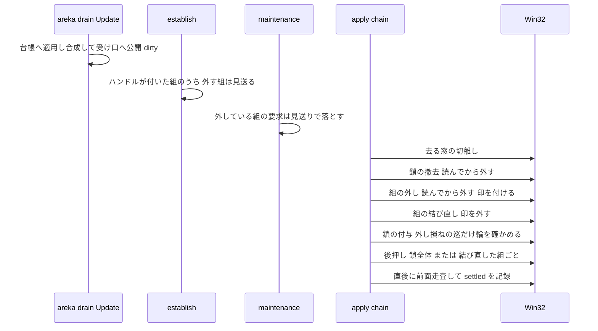
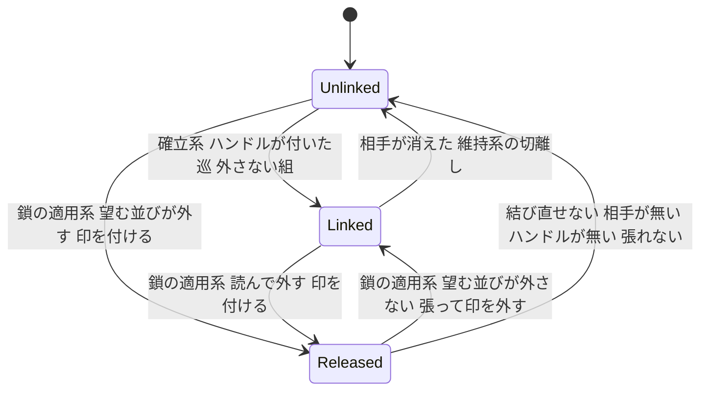

# 設計書: areka-P0-zorder-scope-inversion

> 2026-10-18・要件（2026-10-18 の要件ディスカッションで全議題を推奨案で確定）と research.md（§0〜§9 のギャップ分析・SSP の測り、§10 以降の設計の段の記録）に基づく。
> 本書だけで判断が読めるように、research.md の結論はここへ書き写してある。

## Overview

**Purpose**: ゴーストの作者が明示の記法（`\![set,zorder,balloonN,surfaceN,…]`・省略形 `bN`／`sN`、shell の descript の `seriko.zorder` の同じ記法）で書いた窓の並びを、**書かれた順のとおりに**重ねる。キャラクターの窓を自分のバルーンより手前に置く並び（逆転）も、同じスコープの 2 枚の間に他のスコープの窓を挟む並び（非隣接）も、そのまま採る。

**Users**: ゴースト「窓際のぱすたさん」のように `\![set,zorder,s0,b0,s1]` で「窓の枠の絵 → バルーンの文字 → その手前のキャラクター」を重ねる作者と、そのゴーストを常駐させる利用者。

**Impact**: 今は明示の記法の並びを解釈の段で「各スコープを `[バルーン, キャラクター]` の隣り合った 2 枚」へ寄せている（完了 spec `areka-P0-scope-zorder-pinning` 要件 2.4）。本機能の後は寄せずに書かれた順を保ち、OS の持ち主の鎖（所有される窓は所有者より手前）を書かれた順のまま張る。逆転・非隣接になったスコープでは、組の結び目（バルーンをキャラクターに持たせる関係）を**鎖が有効な間だけ外し**、グループが解けたら同じ巡のうちに結び直す。指定が無いとき・数字だけの記法・逆転の無い明示の記法の重なりは、1 命令も変わらない。

### Goals

- 明示の記法の逆転・非隣接を、書かれた順のまま 1 本の持ち主の鎖として重ねる（要件 1・2）
- 片方だけの名指しの補いを今と同じ位置で続ける（要件 3）
- 逆転・非隣接の無い重なりを 1 命令も変えない（要件 4）
- 組の結び目の外し・結び直しを、鎖の組み替えと**同じ巡の中で、持ち主の輪を作らない順**で行う（要件 1.5・4.5・6.5）
- 利用者の操作では areka が重なりを 1 度も書かず、OS の持ち主の鎖に保たせる（要件 5）
- 全分岐を決定論のテストで固定し、ぱすたの重なりを実機で確かめる（要件 8）

### Non-Goals

- 数字だけの記法の意味・指定が無いときの重なり・拒否の決まり（変えない）
- プロパティ `currentghost.seriko.zorder`（`areka-P0-zorder-property`）
- 常に手前の指定（`areka-P0-stay-on-top-directives`）
- SSP の癖（バルーンが一度出るまで指定が効かない・読み直しの後に並べ直しが要る・指定の直後に直前の手前の窓が手前に残る）を写すこと
- 窓の位置と大きさ・バルーンの見える／見えないの寿命
- wintf の公開の宣言 `KeepDirectlyAbove` の形（欄）を変えること

## Boundary Commitments

### This Spec Owns

- 明示の記法の解釈の決まりのうち「並べ替えない・補いだけ足す・書かれた並びの形を記録する」部分（`parse_zorder_tokens` の第 6 段）と、その記録の語（`normalized=` 欄の `inverted`／`split`／`inverted-split`）
- 鎖の計画（`ChainPlan`）に対する新しい読み方の約束——**`members` で連続しない組は、鎖が有効な間、組の結び目を外す**
- 組の結び目を鎖のために外している状態（印 `PairReleased`）と、その外し・結び直しの手順（鎖の適用系の 1 巡の中）
- 外し損ねがあった巡の、持ち主の輪を作らないための付与の直前の確かめ
- 組の系（確立・維持・沈降の観測）が、外している組に触れないための見送り（見送りの理由の語 `ReleasedByChain`）
- 新しい記録 3 語（`[zorder-chain] pair-released`／`pair-restored`／`link-refused`）
- `doc/COMPAT_ARCHITECTURE.md` §8 の該当行と、網羅台帳 `sakura-script.toml` の `\![set,zorder,…]` の行の説明

### Out of Boundary

- 数字だけの記法の展開・後ろ側の参加の並び（スコープ ID の昇順・`[バルーン, キャラクター]`）・グループどうしの登記順・拒否 5 種の判定（変えない）
- 宣言 `KeepDirectlyAbove` の欄と、それを付ける場所（`placement/spawn.rs` の窓の生成）
- 確定段の系の並び（`wire_zorder_pair` の「確立 → 維持 → 鎖」の `.chain()`）——変えない
- 押す・掴んで動かす・他のアプリを選ぶ、の各経路（`WM_ACTIVATE`・窓の移動）——本機能は 1 行も足さない
- プロパティの読み書き・常に手前の帯・バルーンの表示の寿命
- 完了アーカイブの下の文書

### Allowed Dependencies

- areka の解釈・合成（`zorder_group_ledger`・`zorder_chain_compose`・`zorder_drain`）→ wintf の公開の型（`ChainPlan`・`CrossEdge`・`ChainSegment`・記録の入口）。向きは今と同じ `areka → wintf` だけ（`wintf → areka` の import は禁止）
- wintf の組の系（`zorder_pair_establish`・`zorder_pair_maintain`・`zorder_pair_sink`）→ 鎖の受け口 `ZOrderChainPlan` を**読むだけ**。読む口は純関数 `pair_released_by_chain` の 1 本に限る
- wintf の鎖の適用系 → 組の宣言 `KeepDirectlyAbove`（読むだけ）と組の帳簿 `OwnerLink`（外している間の取り下げと、結び直しのときの付け直しだけ）
- Win32 の持ち主の読み書き（`GWLP_HWNDPARENT`）と後押し（`SetWindowPos`）は、鎖の適用系の 6 つの窓口（`os_*`）だけを通す
- 新しい外部の依存（クレート）は足さない

### Revalidation Triggers

- `ChainPlan` の `members` の意味（手前から奥・実在する窓だけ・全窓を含む）が変わるとき——組を外す判定がこれに乗っている
- `KeepDirectlyAbove` を付ける窓・`peer` の向きが変わるとき（今はバルーンに付き、`peer` はキャラクター）
- 確定段の系の並び（確立 → 維持 → 鎖）を変えるとき（`stay-on-top-directives` が同じファイルを触る）
- `normalized=` 欄の語を変えるとき（実機の手順・`signoff-scan.ps1` と隣の spec の確かめが読む）
- 押して活性化したときに鎖が塊で上がらないことが実機で判ったとき（R3）——要件 5 の作りを見直す

## Architecture

### Existing Architecture Analysis

- **2 つの層**: areka が「何を望むか」（台帳 → 合成 → 望む鎖 `ChainPlan`）を決め、wintf が「どう強制するか」（組の結び目・鎖の繋ぎ・後押し）を持つ。areka は HWND を知らず、wintf はスコープを知らない。
- **組の結び目**（完了 `ghost-window-zorder`）: バルーンに `KeepDirectlyAbove { peer: キャラクター }` が付き、確立系が窓のハンドルが付いた巡に 1 回だけ `バルーン ← キャラクター` の持ち主を張る（帳簿 `OwnerLink`）。維持系は再断行の要求（`ReassertZOrder`）だけを消費する。
- **鎖**（完了 `scope-zorder-pinning`）: 合成が `members`（手前から奥・全窓）と、その連続する 2 枚のうち「同じスコープの（バルーン, キャラクター）」を**除いた**繋ぎ `cross_edges` を作る。適用系は「去る窓の切離し → 撤去が全部先・付与が全部後 → 後押し 1 回 → 直後の実測」を、計画が動いた巡だけ行う（帳簿 `CrossOwnerLink`）。
- **今の穴**: 解釈の段が各スコープを `[バルーン, キャラクター]` の隣り合いへ寄せるので、逆転・非隣接は鎖へ届かない（research.md §1・§3 G1）。寄せるのをやめると、組の結び目と鎖が同じ窓の持ち主の欄を奪い合うか、持ち主の輪になる。
- **既に成り立っていること**: 合成の繋ぎの規則は向きを問わないので、`s0,b0` が連続すれば `s0 ← b0`（`s0` が手前）の繋ぎがそのまま出る（research.md §0）。バルーンの再表示は重なりに触れない（同 §1.4）。

### Architecture Pattern & Boundary Map

**採る形**: 鎖の計画の `members` を唯一の正本とし、「連続する 2 枚は全部繋ぐ。同じスコープの（バルーン, キャラクター）の連続は組の結び目が受け持ち、それ以外は鎖の繋ぎが受け持つ。連続しない組の結び目は外す」という 1 本の規則で、最後の持ち主の関係を決める。外し・結び直しは鎖の適用系の 1 巡に入れ、「撤去が全部先・付与が全部後」の規則を組の結び目にまで広げる。



**Architecture Integration**:
- 選んだ形: 鎖の計画からの導出（research.md §8 の議題 1 の選択肢 B を、`ChainPlan` に欄を足さずに行う形）＋鎖の適用系が順序を一括で持つ（議題 2 の ⑴）。理由は下の「主な設計判断」。
- 境界: 組を外すかどうかの判定は wintf の純関数 1 本（`pair_released_by_chain`）に置き、組の系 3 か所と鎖の適用系が同じ関数を呼ぶ。areka はスコープの知識で並びを決めるだけで、組を外す対象を別に渡さない。
- 守る既存の形: 宣言 `KeepDirectlyAbove`・`ChainPlan`・`CrossEdge` の欄、確定段の系の並び、鎖の 6 つの窓口と替え玉、記録の既存の語。
- 新しく足すもの: 印 `PairReleased`（値を持たないコンポーネント）・見送りの理由 1 語・記録 3 語・純関数 3 本。
- steering: 1 フレーム遅らせない（全部 `FrameFinalize` の同じ巡）・毎巡の観測と是正をしない・失敗は全部記録・本番ファイル 1,000 行以下・テストは兄弟のファイル。

### 主な設計判断（research.md §8 の 11 項目への答え）

| # | 項目 | 決め | 理由 |
| --- | --- | --- | --- |
| D1 | 組の一時停止を wintf へ伝える口 | **`ChainPlan.members` の並びから wintf が導く**。新しい欄も新しい公開の宣言も足さない。外している事実は wintf 内の印 `PairReleased` で持つ | 並びが正本であり、別の欄で「外す組」を渡すと並びと食い違う余地（二重帳簿）ができる。合成は今でも「連続する（バルーン, キャラクター）は組に任せる」と並びで決めており、その裏返しが「連続しない組は外す」である。`KeepDirectlyAbove` の付け外し（選択肢 A）は宣言の意味を「永続」から変え、確定段の並びも変える必要がある。逆向きの付け直し（D）は非隣接に効かない。形の作り替え（E）は採らない |
| D2 | 1 巡の中で輪を作らない順序を誰が持つか | **鎖の適用系が一括で持つ**: 去る窓の切離し → 鎖の撤去 → 組の外し → 組の結び直し → 鎖の付与 → 後押し → 直後の実測 | 撤去を全部先・付与を全部後にすると、途中の持ち主の関係は常に「最後の関係」の部分集合になる。最後の関係は一直線の鎖なので、部分集合にも輪も分岐も無い。確定段の並び（`spawn.rs`）を変えずに済む |
| D3 | 組を外す範囲 | **実在する窓の並びで、組の 2 枚が（バルーン, キャラクター）の順に連続していない組だけ** | 要件 4.4 の「他のスコープは組のまま」に素直。逆転の無いグループでは組の付け外しが 1 度も起きず、記録も今と同じ |
| D4 | 鎖が無くなる解除で組へ戻ったときの重なり | **結び直した組ごとに、その 2 枚の後押しを同じ巡で 1 回出す**（鎖の後押しと同じ純関数 `nudge_command` を `[バルーン, キャラクター]` に当てる）。鎖が残る解除では鎖全体の後押しが組も並べ直す | 再断行の要求を挿す形は維持系が次の巡で消費する＝1 フレーム遅れになる |
| D5 | 記録の語彙 | `normalized=` 欄は `false`（隣り合い）と `+bN`／`+sN`（補い）の綴りを残し、`true` を廃して `inverted`／`split`／`inverted-split` を足す。組の外し・結び直しは `[zorder-chain] pair-released`／`pair-restored`（debug）。外している組への組の系の見送りは `[zorder-pair] skip reason=ReleasedByChain`（debug）。沈降の観測は外している組を測らずに同じ見送りを出す | 既存の読み手（完了 spec の実機の手順・既存の檻）が `false` と `+bN` を読んでいる（要件 7.4）。`true` は「書いた順を採らなかった」の意味であり、本機能の後は起きない |
| D6 | 持ち主の輪への守り | **順序の論証を本線とし、撤去か外しが 1 本でも済まなかった巡（失敗・食い違い・読めない）だけ、付与の直前に所有側から持ち主を辿って輪にならないことを確かめる**。輪になる・辿れないなら付与を見送り `link-refused`（error） | 順序の論証は「撤去が全部済んだ」前提で成り立つ。前提が崩れる巡だけ確かめれば、正常な巡の窓口の呼び出しは今と 1 回も変わらない（既存の呼び出し順の檻が緑のまま）。輪を作ったときの Win32 の振る舞いは未測（R1）なので、作らない側に倒す |
| D7 | 結び直しの契機 | **鎖の適用系の 1 巡**（印が付いていて、望む並びがもう外さない組）。確立系の契機（`Added<WindowHandle>`）は変えない | 確立系は鎖の適用系より前に走るので、確立系に結び直させると 1 フレーム遅れる。確立系の「ペアにつき 1 度きり」の前提はそのまま（結び直しは確立系を通らない） |
| D8 | 陳腐化するテスト | 覆した決め（寄せる・`reordered: true`・各スコープがバルーン先の隣り合い）を主張するテストは既存のファイルから**外す**。主題が残り期待値だけ変わるテスト（台帳が受け取った並びを組み替えない・受理の行の書式）は**期待値を書き直す**。新しいテストは新しい兄弟のファイルへ置く | 「陳腐化したテストは除外・壊れたテストは更新」の方針 |
| D9 | 網羅台帳の行の持ち主 | `owner = "areka-P0-scope-zorder-pinning"` は**変えず**、説明だけを書き替え、説明の中で本 spec を名指しする | 要件 9.5 は説明の書き替えだけを求める。タグを実装したファイルの持ち主は変わらない |
| D10 | SSP の測り | **済み**（research.md §9）。設計は測りの結果で変わらない。互換の記録の根拠に使う | — |
| D11 | 押したとき | **OS の持ち主の鎖に任せ、areka は何も書かない**。決定論の檻で「押す・他のアプリを選ぶ経路で、外している組へ重なりを書く処理が 1 本も走らない」ことを固定し、塊で上がることは実機（R3）で確かめる | 鎖は 1 本の持ち主の鎖なので OS が塊として扱う（完了 spec の実測 §12.5） |

### Technology Stack

| Layer | Choice / Version | Role in Feature | Notes |
| --- | --- | --- | --- |
| ECS | bevy_ecs 0.19 | 印 `PairReleased`・受け口 `ZOrderChainPlan` の読み取り・確定段の系 | 新しい依存なし |
| Win32 | windows 0.62.2 | 持ち主の読み書き（`GWLP_HWNDPARENT`）・後押し（`SetWindowPos`）・前面走査 | 既存の 6 つの窓口だけを使う |
| 記録 | tracing | 新しい 3 語・見送りの 1 語 | 出力先は既存の `wintf::ecs::window::zorder_chain`／`zorder_pair` |

## File Structure Plan

### Directory Structure（新しく作るファイル）

```
crates/areka/src/placement/
├── zorder_group_ledger_written_order_tests.rs   # 解釈: 逆転・非隣接・補い・分類と記録の語（要件 1・2・3）
├── zorder_chain_compose_written_order_tests.rs  # 合成: 書かれた順の繋ぎ・一直線の鎖（要件 1.1・1.2・2.2・3.3・8.2）
├── zorder_chain_inversion_order_tests.rs        # 実窓: 合成＋確立＋鎖の適用を繋いで重なりを測る（要件 1.2・2.2・4.5・6.1）
└── zorder_inversion_branch_coverage_tests.rs    # 要件 8.2 の分岐 → テストの対応表（錨が実在し #[test] が付くこと）
crates/areka/src/emo2_boot/frame/
└── zorder_drain_written_order_tests.rs          # 受理の行の新しい語・descript の逆転・解除と読み直し（要件 1.3・1.4・2.3・4.5）
crates/wintf/src/ecs/window/
├── zorder_chain_apply_test_support.rs           # 既存の替え玉 `double` の移し先（中身は変えない）
├── zorder_chain_release_tests.rs                # 純関数: 組を外す判定・組の操作の導出・輪の確かめ・新しい行（要件 4・6・7・8.2）
├── zorder_chain_apply_release_tests.rs          # 替え玉で 1 巡: 窓口の呼び出し順・失敗・輪の見送り・組ごとの後押し（要件 1.5・4.5・6・7）
├── zorder_chain_order_inversion_tests.rs        # 実窓: s0,b0,b1,s1 と b1,s0,s1,b0 の前面走査・解除で組へ戻る（要件 1.2・2.2・4.5）
├── zorder_pair_establish_release_tests.rs       # 確立系: 外している組は張らない（要件 1.3・6.1）
└── zorder_pair_maintain_release_tests.rs        # 維持系・沈降の観測: 外している組には書かない・測らない（要件 5.1・5.2・5.4・5.5）
```

### Modified Files（同じウェーブの約束の内側）

- `crates/areka/src/placement/zorder_group_ledger.rs` — 第 6 段を「並べ替えない・補いだけ足す・書かれた並びの形を分類する」へ。`Normalization.reordered: bool` を `order: WrittenOrder` へ。モジュールの説明と台帳の不変条件 ⑶ の書き直し
- `crates/areka/src/placement/zorder_chain_compose.rs` — **説明だけ**。前提「各スコープが `[バルーン, キャラクター]` の隣り合い」を「補い済み・書かれた順」へ。繋ぎの規則（`is_intra_scope_pair` を除く連続対）は変えない
- `crates/wintf/src/ecs/window/zorder_chain.rs` — `ChainPlan` の説明に組の約束を追記。印 `PairReleased`・純関数 `pair_released_by_chain`／`plan_pair_ops`／`check_owner_loop`・記録の出口 3 本
- `crates/wintf/src/ecs/window/zorder_chain_diag.rs` — 新しい 3 語の行を組む純関数と、試験用の語の一覧 `pair_handover_tags`（既存の 7 語の一覧は変えない）
- `crates/wintf/src/ecs/window/zorder_chain_apply.rs` — 1 巡の手順に組の外し・結び直しと、外し損ねの巡の輪の確かめと、組ごとの後押しを足す。替え玉 `double` を兄弟の試験用ファイルへ移す（`#[path]` で同じモジュール名のまま繋ぐ）
- `crates/wintf/src/ecs/window/zorder_pair.rs` — 見送りの理由 `SkipReason::ReleasedByChain` を足す。`KeepDirectlyAbove` の説明に「鎖が組の 2 枚を連続させない間は結び目を外す（宣言は残る）」を追記
- `crates/wintf/src/ecs/window/zorder_pair_diag.rs` — 見送りの理由の語 `ReleasedByChain`
- `crates/wintf/src/ecs/window/zorder_pair_establish.rs` — 受け口を読み、外す組は張らずに見送る
- `crates/wintf/src/ecs/window/zorder_pair_maintain.rs` — 受け口を読み、外している組の要求を見送りで落とす。沈降の観測へ受け口を渡す
- `crates/wintf/src/ecs/window/zorder_pair_sink.rs` — 外している組は測らずに見送る
- `doc/COMPAT_ARCHITECTURE.md` §8 — 「隣接と矛盾するときの優先順位」の行（今の 211 行）・「片方だけ名指し」の行（208 行）の書き替えと、SSP の癖を写さない行の追加
- `doc/ukadoc-coverage/ledger/sakura-script.toml` — `\![set,zorder,スコープID,…]` の行（3396 行付近）の説明

各ファイルの見込みの行数（上限 1,000）: `zorder_pair.rs` 884 → 約 895、`zorder_chain_apply.rs` 799 → 替え玉の移し出し（約 155 行）と手順の追加（約 190 行）で約 835、`zorder_chain.rs` 450 → 約 620、`zorder_chain_diag.rs` 376 → 約 440、`zorder_group_ledger.rs` 633 → 約 650。新しい本番ファイルは作らない（`mod.rs` と名簿 `PRODUCTION_FILES` を触らずに済む）。

### 同じウェーブの約束の外で要るファイル（本質の形を曲げずに名指しする）

| ファイル | 何を変えるか | なぜ要るか |
| --- | --- | --- |
| `crates/areka/src/emo2_boot/frame/zorder_drain.rs` | `normalizations_text` が `n.reordered` の代わりに `n.order` の語を出す（数行）。`set_applied_detail` と `normalizations_text` の説明の `scope:true` の段を書き直す | 受理の行の本文はここで組まれている。`Normalization` の欄を変える以上、ここが変わらないと組めない（要件 1.4・2.3） |
| `crates/areka/src/placement/zorder_group_ledger_tests.rs` | 覆した決めを主張するテスト（`t_zgp15`・`t_zgp16`・`t_zgp17`・`t_zgp21`・`t_zgp29` と道具 `adjusted`・`assert_every_scope_forms_a_balloon_first_block` を使う箇所）を外す。主題が残るものは期待値を書き直す | 陳腐化（要件 2.4 を覆した） |
| `crates/areka/src/placement/zorder_group_ledger_state_tests.rs` | `t_zgl3` の期待値（`[b1,s1,b2,s2]` → 書かれた順 `[s1,b2,s2,b1]`）と説明 | 主題（台帳は受け取った並びを組み替えない）は残り、期待値だけ変わる |
| `crates/areka/src/placement/zorder_group_branch_coverage_tests.rs` | 完了 spec の要件 10.2 の対応表のうち、外したテスト（`t_zgp15`・`t_zgp17`・`t_zdb04` ほか）を指す行を、新しいテストへ指し直す | 錨が消えると表が赤になる |
| `crates/areka/src/emo2_boot/frame/zorder_drain_tests.rs` | 139〜201 行付近の受理の行の期待値（`normalized=1:true,0:false`・`members=b1,s1,b0,s0`）を新しい語と書かれた順へ | 期待値だけ変わる |
| `crates/areka/src/emo2_boot/frame/zorder_descript_tests.rs` | 206〜251 行付近（`t_zdb04`）の「正規化を要する並び」の主張を、書かれた順と `inverted` の記録へ書き直す | 期待値だけ変わる |
| `crates/areka/src/placement/spawn.rs` | **説明のコメントだけ**（538〜557 行付近の「本宣言が張るスコープ内ペアには 1 本も触れない」）を、「鎖が組の 2 枚を連続させない間は、鎖の適用系が結び目を外して結び直す」へ。コードと結線は変えない | 事実と食い違う説明を残さない |

触らないと決めたもの: `crates/wintf/src/ecs/window/mod.rs`（新しい本番ファイルが無い）、`zorder_pair_deferred_vocabulary_tests.rs` の名簿（同）、`spawn.rs` の `wire_zorder_pair`（確定段の並びを変えない）、`ChainPlan` を字面で組む既存のテスト 11 本（欄を足さない）、既存の替え玉の呼び出し順の檻（正常な巡の窓口の呼び出しは変わらない）。

## System Flows

### 鎖の適用系の 1 巡（`FrameFinalize`・確立 → 維持 → 鎖の 3 本目）



- 公開（`Update`）と適用（`FrameFinalize`）は同じフレームなので、タグへの応答として並びが成り立つ（要件 1.5・6.5）。
- 組の操作が 0 個で鎖の操作も 0 個のときだけ `skipped reason=NoChange`。組の印の付け外しは窓口を呼ばないので、ハンドル待ちの持ち越しの巡でも先に済ませる。

### 組の状態（バルーン 1 枚ごと）



- `Linked` は `OwnerLink` あり、`Released` は `PairReleased` あり、`Unlinked` はどちらも無い。`OwnerLink` と `PairReleased` は同時に付かない。
- `Released → Unlinked`（ハンドルが無い）のあとでハンドルが付けば、確立系が通常どおり張る（要件 6.6）。

## Requirements Traceability

| Requirement | Summary | Components | Interfaces | Flows |
| --- | --- | --- | --- | --- |
| 1.1 | 逆転を書かれた順に | Ledger・Compose・ChainRelease・ChainApply | `parse_zorder_tokens`・`pair_released_by_chain` | 1 巡 |
| 1.2 | `s0,b0,s1` の前 3 枚 | Ledger・Compose・ChainApply | 同上 | 1 巡 |
| 1.3 | descript の逆転 | Ledger（共通の解釈）・PairSystems（確立の見送り） | `parse_zorder_tokens`・`establish_owner_links` | 1 巡・組の状態 |
| 1.4 | 逆転の記録・「採らなかった」を出さない | Ledger・Drain | `WrittenOrder`・`normalizations_text` | — |
| 1.5 | タグへの応答として成り立つ | Drain・ChainApply | 同じフレームの公開と適用・直の後押し | 1 巡 |
| 1.6 | 隣り合いは今の重なり | Compose（連続対の除外は不変）・ChainRelease（外さない） | `pair_released_by_chain` | — |
| 2.1 | 非隣接を書かれた順に | Ledger・Compose・ChainRelease・ChainApply | 同 1.1 | 1 巡 |
| 2.2 | `b1,s0,s1,b0` の 4 枚 | 同上 | 同上 | 1 巡 |
| 2.3 | 非隣接の記録 | Ledger・Drain | `WrittenOrder::Split`／`InvertedSplit` | — |
| 3.1 | `sN` だけなら `bN` をすぐ手前へ・記録 | Ledger | `fill_partner_windows`・`Normalization.implied_partner` | — |
| 3.2 | `bN` だけなら `sN` をすぐ奥へ・記録 | Ledger | 同上 | — |
| 3.3 | `s0,b0,s1` → `s0,b0,b1,s1` | Ledger・Compose | 同上 | 1 巡 |
| 3.4 | 要素 2 個未満は補わず無視 | Ledger（判定の順序は不変） | `parse_zorder_tokens` ⑶ | — |
| 3.5 | 2 枚とも書けば補わない | Ledger | `fill_partner_windows` | — |
| 4.1 | 指定が無いときは今のまま | Drain（計画を作らない）・ChainApply（受け口が無ければ何もしない） | 既存 | — |
| 4.2 | 数字だけの記法は今のまま | Ledger（展開は不変）・ChainRelease（連続なので外さない） | 既存の ⑷ | — |
| 4.3 | 後ろ側の参加は今のまま | Compose（不変） | 既存 | — |
| 4.4 | 他のスコープは組のまま | ChainRelease | `pair_released_by_chain`（連続しない組だけ） | 組の状態 |
| 4.5 | 解除・読み直しで組へ戻る | ChainRelease・ChainApply | `plan_pair_ops`（Restore）・組ごとの後押し | 1 巡・組の状態 |
| 4.6 | 次の起動へ持ち越さない | Ledger（保存しない）・印は実体と同じ寿命 | 既存 | — |
| 4.7 | 拒否は今のまま | Ledger（拒否 5 種は不変） | 既存 | — |
| 5.1 | 押すと並び全体が上がる | 持ち主の鎖（OS）・PairSystems（書かない） | `apply_zorder_pair_maintenance` の見送り | 組の状態 |
| 5.2 | 逆転のキャラを押してもバルーンを手前へ出さない | PairSystems | `SkipReason::ReleasedByChain` | — |
| 5.3 | 掴んで動かしても並びを保つ | 位置の系は重なりを書かない（不変）・持ち主の鎖 | 既存 | — |
| 5.4 | 他のアプリを選ぶと全部が一緒に背面へ | 持ち主の鎖（OS）・沈降の観測は読むだけで外している組は測らない | `observe_marked_pair_sinks` | — |
| 5.5 | 観測と直しの往復をしない | ChainApply（計画が動いた巡だけ）・PairSystems（外している組へ要求を消費しない） | 既存の門 | — |
| 6.1 | バルーンが後から現れても効く | PairSystems（確立の見送り）・ChainApply（ハンドル待ちの持ち越し・印は先に付く） | `establish_owner_links`・`apply_zorder_chain` | 組の状態 |
| 6.2 | 破棄されて再び現れても戻る | Drain（在庫の変化で再公開）・ChainApply | 既存＋印 | 1 巡 |
| 6.3 | 再表示で寄せない | バルーンの表示の系は重なりに触れない（不変）・PairSystems（外している組へ再断行しない） | 既存 | — |
| 6.4 | キャラの窓の出入りで残りの順を保つ | ChainApply（去る窓の切離しは不変・相手の無い組は印を外すだけ） | `plan_pair_ops` | 組の状態 |
| 6.5 | 出入りへの応答として済ませる | Drain・ChainApply（同じフレーム） | 既存 | 1 巡 |
| 6.6 | 組へ戻った後に現れたバルーンは組の重なり | PairSystems（確立系の通常の道）・印が残らないこと | `establish_owner_links` | 組の状態 |
| 7.1 | 失敗しても止まらず記録 | ChainApply | `unlink-failed`／`link-failed`／`link-refused` | — |
| 7.2 | どこまで済んだかの記録 | ChainApply | `pair-released`／`pair-restored`／`unlinked`／`linked` の行の並び | 1 巡 |
| 7.3 | 繋いだ窓と直後の実測 | ChainApply | `linked`＋`settled`（組ごとの後押しも `settled`） | 1 巡 |
| 7.4 | 既存の記録の名前と語彙を保つ | Drain（`false`・`+bN` を残す）・ChainDiag（既存 7 語は不変） | — | — |
| 8.1 | 判断を決定論のテストで | Ledger・Compose・ChainRelease は純関数、ChainApply は替え玉で 1 巡 | — | — |
| 8.2 | 各分岐の網羅 | 新しいテスト一式と対応表 | `zorder_inversion_branch_coverage_tests.rs` | — |
| 8.3 | 単独でも一括でも同じ | 替え玉はスレッドローカルで据えて戻す・実体は試験ごとの World | — | — |
| 8.4 | ぱすたと同じ指定の実機の証跡 | 実機の確かめ（検体の派生・ログの照合・目視） | `signoff-procedure.md`（本 spec） | — |
| 8.5 | 押した後・他のアプリから戻った後の証跡 | 実機の確かめ（活性化の道具は許可を得て走行の間だけ） | 同上 | — |
| 8.6 | 指定なし・数字だけの記法の証跡 | 実機の確かめ | 同上 | — |
| 9.1 | 優先順位の行の書き替え | COMPAT §8 | — | — |
| 9.2 | 覆した要件の番号 | COMPAT §8 | — | — |
| 9.3 | 片方だけ名指しの行の根拠 | COMPAT §8 | — | — |
| 9.4 | SSP の癖を写さない裁量 | COMPAT §8 | — | — |
| 9.5 | 網羅台帳の行 | `sakura-script.toml` | — | — |
| 9.6 | 完了アーカイブを書き換えない | 変更の一覧に `.kiro/specs/completed/` が無いこと | — | — |

## Components and Interfaces

| Component | Layer | Intent | Req Coverage | Key Dependencies | Contracts |
| --- | --- | --- | --- | --- | --- |
| Ledger（`zorder_group_ledger`） | areka・純関数 | 書かれた順を保ち補いだけ足し、並びの形を記録する | 1.1〜1.4・2.1〜2.3・3.1〜3.5・4.2・4.6・4.7 | なし | Service |
| Compose（`zorder_chain_compose`） | areka・純関数 | 並びから望む鎖を組む（ロジック不変） | 1.1・1.2・1.6・2.1・2.2・3.3・4.3 | Ledger (P0) | Service |
| Drain（`zorder_drain`） | areka・相 | 受理の行の新しい語・同じフレームの公開 | 1.4・1.5・2.3・6.2・6.5・7.4 | Ledger・Compose (P0) | Service |
| ChainRelease（`zorder_chain` の純関数と印） | wintf・純関数＋状態 | 組を外す判定・組の操作の導出・輪の確かめ | 1.1・2.1・4.4・4.5・6.4・7.1 | ChainPlan (P0) | Service・State |
| ChainApply（`zorder_chain_apply`） | wintf・system | 1 巡の手順に組の外し・結び直しを入れる | 1.5・4.5・6.1・6.2・6.4・6.5・7.1〜7.3 | ChainRelease・Win32 窓口 (P0) | Service |
| ChainDiag（`zorder_chain_diag`） | wintf・純関数 | 新しい 3 語の行 | 7.2・7.3・7.4 | なし | Service |
| PairSystems（`zorder_pair_establish`／`_maintain`／`_sink`） | wintf・system | 外している組に触れない | 1.3・5.1・5.2・5.4・5.5・6.1・6.3・6.6 | ChainRelease (P0) | Service |

### areka

#### Ledger（`crates/areka/src/placement/zorder_group_ledger.rs`）

| Field | Detail |
| --- | --- |
| Intent | 明示の記法を書かれた順のまま受け取り、片方だけの名指しに相棒の窓を補い、各スコープの並びの形を記録として返す |
| Requirements | 1.1・1.2・1.3・1.4・2.1・2.2・2.3・3.1・3.2・3.3・3.4・3.5・4.2・4.6・4.7 |

**Responsibilities & Constraints**
- 判定の順序 ⑴解釈不能 → ⑵記法の混在 → ⑶要素 2 個未満 → ⑷数字だけの記法の展開 → ⑸同じ窓の重複 は**変えない**。⑹ だけを差し替える。
- ⑹ `fill_partner_windows`（今の `normalize_scope_blocks` を置き換える）: 要素の並びは書かれた順のまま。片方だけ書かれたスコープにだけ相棒を 1 枚足す——`sN` だけなら `bN` を `sN` のすぐ手前、`bN` だけなら `sN` を `bN` のすぐ奥。2 枚とも書かれたスコープには何も足さず、動かしもしない。
- 数字だけの記法は今のまま `[バルーン, キャラクター]` へ展開し、記録は空。
- 台帳の不変条件 ⑶ は「明示の記法で名前の挙がったスコープは 2 枚とも並びに居る（補い済み）」へ改める。台帳は受け取った並びを組み替えない（今と同じ）。
- Win32・ECS・tracing に依存しない（今と同じ）。

**Contracts**: Service [x]

```rust
/// 2 枚とも書かれたスコープの、書かれた並びの形（左ほど手前）。
#[derive(Debug, Clone, Copy, PartialEq, Eq)]
pub enum WrittenOrder {
    /// バルーンのすぐ奥にキャラクター（今と同じ組の重なり）。補ったスコープも常にこれ。
    Adjacent,
    /// キャラクターがバルーンのすぐ手前（隣り合った逆転）。
    Inverted,
    /// バルーンが手前・キャラクターが奥で、間に他の窓がある（非隣接）。
    Split,
    /// キャラクターが手前・バルーンが奥で、間に他の窓がある（逆転かつ非隣接）。
    InvertedSplit,
}

impl WrittenOrder {
    /// 受理の行の `normalized=` 欄の語。`Adjacent` は既存の読み手のために `false` のまま。
    pub fn as_str(self) -> &'static str; // "false" | "inverted" | "split" | "inverted-split"
}

#[derive(Debug, Clone, Copy, PartialEq, Eq)]
pub struct Normalization {
    pub scope: u32,
    /// 書かれた並びの形（補ったスコープは `Adjacent`）。
    pub order: WrittenOrder,
    /// 補った窓の種別（今と同じ）。`Some(_)` のとき `order` は必ず `Adjacent`。
    pub implied_partner: Option<GroupWindowKind>,
}

pub fn parse_zorder_tokens(
    tokens: &[&str],
) -> Result<(Vec<GroupElement>, Vec<Normalization>), ZOrderReject>; // 署名は不変
```
- Postconditions: 戻りの要素の並びは、書かれた要素を書かれた順に含み、補った窓だけが相棒のすぐ隣に挟まる。記録は明示の記法で現れたスコープごとに初出順で 1 件。
- 分類（2 枚とも書かれたスコープ、`b`＝バルーンの位置・`c`＝キャラクターの位置、補った後の並びで数える）: `c == b + 1` → `Adjacent`、`b == c + 1` → `Inverted`、`b < c` かつ離れている → `Split`、`c < b` かつ離れている → `InvertedSplit`。

**Implementation Notes**
- 例: `s0,b0,s1` → 要素 `s0,b0,b1,s1`・記録 `0:inverted`・`1:false+b1`。`b1,s0,s1,b0` → 要素そのまま・記録 `1:split`・`0:inverted-split`。
- 区別の語を 4 つにするのは要件 1.4（逆転させたか）と 2.3（離して並べたか）を 1 語ずつ読めるようにするため。

#### Compose（`crates/areka/src/placement/zorder_chain_compose.rs`）

| Field | Detail |
| --- | --- |
| Intent | 台帳のグループと窓の在庫から望む鎖を組む（**ロジックは変えない**） |
| Requirements | 1.1・1.2・1.6・2.1・2.2・3.3・4.3 |

- 繋ぎの規則「連続する 2 枚のうち、同じスコープの（バルーン, キャラクター）の順の連続だけを除く」は向きを問わず書かれた順に効く。`s0,b0,b1,s1` → 繋ぎ `s0←b0`・`b0←b1`（`b1,s1` は組）。`b1,s0,s1,b0` → `b1←s0`・`s0←s1`・`s1←b0`。
- 説明の前提を「各グループの要素は補い済み・書かれた順」へ書き直し、「`members` で（バルーン, キャラクター）が連続しない組は、wintf の鎖の適用系が結び目を外す」という wintf 側の約束を指す一文を足す。
- 不変条件（鎖は一直線・窓は 1 度だけ）は今のまま成り立つ: 最後の持ち主の関係は「`members` の連続する 2 枚の全部」になり、そのうち組の連続は組の結び目、残りは鎖の繋ぎが受け持つ。

#### Drain（`crates/areka/src/emo2_boot/frame/zorder_drain.rs`・約束の外）

| Field | Detail |
| --- | --- |
| Intent | 受理の行の `normalized=` 欄に新しい語を載せる |
| Requirements | 1.4・2.3・7.4（1.5・6.2・6.5 は今の作りのまま） |

- `normalizations_text` の 1 スコープぶんの字面を `"{scope}:{order}"`（`order` は `WrittenOrder::as_str`）に、補いのときは今と同じく `+bN`／`+sN` を続ける。例 `normalized=0:inverted,1:false+b1`。
- 起動の段（`zorder_descript.rs`）は同じ `set_applied_detail` を通すので変更不要。

### wintf

#### ChainRelease（`crates/wintf/src/ecs/window/zorder_chain.rs` に足す純関数と印）

| Field | Detail |
| --- | --- |
| Intent | 望む鎖から「どの組の結び目を外すか」を導き、外し・結び直しの操作列と、輪の確かめを純関数で持つ |
| Requirements | 1.1・2.1・4.4・4.5・6.4・7.1 |

**Responsibilities & Constraints**
- 組を外す判定は 1 本の純関数だけが持つ。確立系・維持系・沈降の観測・鎖の適用系がこれを呼ぶ。
- 印 `PairReleased` は「鎖のために組の結び目を外している」事実の記録であり、付ける・外すのは鎖の適用系だけ。

**Contracts**: Service [x] / State [x]

```rust
/// 組の結び目を鎖のために外している印（バルーン窓＝`KeepDirectlyAbove` を持つ窓へ付く）。
/// 公開到達性は鎖の適用系の引数に現れるためだけ（`OwnerEstablishFailed` と同じ）。
#[derive(Component, Debug, Clone, Copy, PartialEq, Eq, Default)]
pub struct PairReleased;

/// 望む鎖がこの組の結び目を外させるか（純関数）。
/// 真になるのは、鎖が在り、バルーンとキャラクターの両方が `members` に居て、
/// キャラクターがバルーンのすぐ奥（次の要素）に居ないときだけ。
pub(crate) fn pair_released_by_chain(chain: Option<&ChainPlan>, balloon: Entity, peer: Entity) -> bool;

/// 組 1 つの現況（鎖の適用系が World から集める）。
#[derive(Clone, Copy, Debug, PartialEq, Eq)]
pub(crate) struct PairState {
    pub balloon: Entity,
    pub peer: Entity,
    /// `PairReleased` が付いているか。
    pub released: bool,
}

#[derive(Clone, Copy, Debug, PartialEq, Eq)]
pub(crate) enum PairOp {
    /// 結び目を外し、印を付ける（結び目が張られていなければ印だけ）。
    Release { balloon: Entity, peer: Entity },
    /// 印を外し、結び目を張り直す（張れなければ印だけ外す）。
    Restore { balloon: Entity, peer: Entity },
}

/// 組の操作列を導く（純関数）。全部の Release が先・全部の Restore が後。
/// 各群の中はバルーンの `Entity` の昇順（決定論）。
pub(crate) fn plan_pair_ops(chain: Option<&ChainPlan>, pairs: &[PairState]) -> Vec<PairOp>;

/// 付与 `owned ← owner` が持ち主の輪を作らないか（純関数・読む口は引数）。
/// `owner` から持ち主を辿り、`owned` に出会えば `Loop`、持ち主の無い窓に着けば `Clear`、
/// 読めなければ `Unreadable`。辿るのは上限 `OWNER_WALK_LIMIT`（64）回までで、超えたら `Loop`。
pub(crate) fn check_owner_loop(
    owned: HWND,
    owner: HWND,
    read_owner: &mut dyn FnMut(HWND) -> windows::core::Result<HWND>,
) -> OwnerLoopCheck;

#[derive(Clone, Copy, Debug, PartialEq, Eq)]
pub(crate) enum OwnerLoopCheck { Clear, Loop, Unreadable }
```
- Invariants: `plan_pair_ops` は `released == pair_released_by_chain(..)` の組に操作を出さない（印の状態が望みと一致していれば空）。鎖が `None` なら外す組は 0 で、印の付いた組は全部 Restore。
- `ChainPlan` の説明に約束を追記する: 「`members` は全窓を手前から並べた列であり、（バルーン, その `KeepDirectlyAbove` の相手）が連続する組は組の結び目が受け持つ（`cross_edges` に載らない）。連続しない組は、この計画が有効な間、鎖の適用系が結び目を外す」。

#### ChainApply（`crates/wintf/src/ecs/window/zorder_chain_apply.rs`）

| Field | Detail |
| --- | --- |
| Intent | 1 巡の手順に組の外し・結び直しを入れ、撤去が全部先・付与が全部後を組の結び目まで広げる |
| Requirements | 1.5・4.5・6.1・6.2・6.4・6.5・7.1・7.2・7.3 |

**Responsibilities & Constraints**
- 引数に組のクエリ `(Entity, &KeepDirectlyAbove, Option<&OwnerLink>, Option<&PairReleased>)` を足す。その他の引数・門（`dirty`）・持ち越しの作りは今のまま。
- 1 巡の手順（`dirty` が立った巡）:
  1. 去る窓の切離し（今のまま・門より前）
  2. `plan_chain_ops`（今のまま）と `plan_pair_ops` を求める。両方が空なら `skipped reason=NoChange`
  3. 鎖の撤去（今の `detach_one`）
  4. 組の外し: 結び目が張られていれば（`OwnerLink` あり）バルーンの今の持ち主を読み、`OwnerLink.owner_hwnd` と一致すれば外す（一致しない・読めない・外せないは張らずに記録）。`OwnerLink` を取り下げ、`PairReleased` を付け、`pair-released` を記録
  5. 組の結び直し: 相手の実体が無ければ `[zorder-pair] skip reason=PeerMissing` を出して印を外すだけ。どちらかのハンドルが無ければ `skip reason=HandleMissing` を出して印を外すだけ（ハンドルが付いた巡に確立系が張る）。`OwnerLink` が既に付いていれば（同じ巡に確立系が張った）印を外すだけ。それ以外は `バルーン ← キャラクター` を張り、成功なら `OwnerLink` を付けて印を外し `pair-restored` を記録。失敗なら `link-failed`（区間は `-`）を記録して印を外す
  6. 鎖の付与（今の付与）。ただし 3・4 のどれか 1 本でも「外し損ね」（外せなかった・食い違った・読めなかった）があった巡、または 1 の切離しで外し損ねがあった巡だけ、各付与の直前に `check_owner_loop` を当て、`Loop`／`Unreadable` なら付与を見送り `link-refused` を記録
  7. 窓口を 1 度でも呼んだ巡は後押し: 鎖が在れば鎖全体（今のまま）。鎖が `None` なら、5 で結び目を張った組ごとに `[バルーン, キャラクター]` へ後押しと直後の実測（`nudge_and_measure` をそのまま 2 枚に当てる・`settled` を 1 行ずつ）
  8. 持ち越し（ハンドル待ち）の判断は**鎖の操作の結果だけ**で今のまま行う——鎖の付与が 1 本も書けずにハンドル待ちが出た巡は、組の操作が窓口を呼んでいても印 `dirty` を戻して持ち越す（組の操作の分で持ち越しが解けると、鎖が永久に書かれない）。後押しの要否は鎖と組のどちらかが窓口を呼んだかで決める。組の印の付け外しは 2〜5 の中で先に済んでいる
- 替え玉 `double` は `zorder_chain_apply_test_support.rs` へ移し、`#[cfg(test)] #[path = "zorder_chain_apply_test_support.rs"] pub(crate) mod double;` で同じ名前のまま繋ぐ（中身・呼び方は変えない）。
- 窓口は今の 6 つだけを使う（輪の確かめも `os_read_owner` を通す）。

**Contracts**: Service [x]

```rust
pub fn apply_zorder_chain(
    _ui_thread: NonSendMarker,
    commands: Commands,
    plan: Option<ResMut<ZOrderChainPlan>>,
    links: CrossLinkQuery,
    pairs: PairQuery, // 新: (Entity, &KeepDirectlyAbove, Option<&OwnerLink>, Option<&PairReleased>)
    handles: HandleQuery,
    carry_announced: Local<bool>,
);
```
- Preconditions: 確定段で確立系・維持系の後に `.chain()` で走る（今の結線のまま）。
- Postconditions: 撤去と外しが全部済んだ巡では、最後の持ち主の関係が `members` の連続する 2 枚の全部と一致する。外し損ねのある巡でも輪は作らない（見送りと記録）。
- Invariants: 正常な巡（組が 1 つも外れず結ばれもしない巡）の窓口の呼び出し列は今と 1 回も変わらない。

**Implementation Notes**
- 解除で鎖が `None` になったときの組ごとの後押しは、`nudge_command` の 2 枚の場合（錨＝バルーン・根＝キャラクター）。キャラクターをバルーンのすぐ奥へ差し直し、持ち主の関係でバルーンがその手前に保たれる。既に並んでいれば空振り（収めるものが無い）。
- 組のクエリと鎖の帳簿のクエリは別の欄を読むので交わらない。

#### ChainDiag（`crates/wintf/src/ecs/window/zorder_chain_diag.rs`）と記録の出口（`zorder_chain.rs`）

| 語 | 水準 | 本文 | 出す時 |
| --- | --- | --- | --- |
| `[zorder-chain] pair-released` | debug | `entity= peer= owned_hwnd= owner_hwnd= unlinked=true|false` | 組の外し（`unlinked=false` は結び目が張られていなかった・食い違った・読めなかった） |
| `[zorder-chain] pair-restored` | debug | `entity= peer= owned_hwnd= owner_hwnd=` | 組の結び直しの成功 |
| `[zorder-chain] link-refused` | error | `owned= owner= owned_hwnd= owner_hwnd= reason=Loop|Unreadable` | 外し損ねの巡の付与の見送り |

- 行を組む純関数は `zorder_chain_diag.rs`、マクロを撃つ関数（`log_chain_pair_released`／`log_chain_pair_restored`／`log_chain_link_refused`）は `zorder_chain.rs`（出力先を `wintf::ecs::window::zorder_chain` の 1 本に保つ既存の決まり）。
- 既存の 7 語の一覧 `chain_record_tags()` は変えない。新しい 3 語は試験用の一覧 `pair_handover_tags() -> [&str; 3]` に置き、新しい兄弟のテストで「共通の冠・互いに異なる・既存 7 語と重ならない」を固定する。
- 外し・結び直しの失敗は既存の `unlink-failed`／`link-failed`（区間は `-`）で出す。

#### PairSystems（`zorder_pair_establish.rs`・`zorder_pair_maintain.rs`・`zorder_pair_sink.rs`・`zorder_pair.rs`・`zorder_pair_diag.rs`）

| Field | Detail |
| --- | --- |
| Intent | 外している組（望む鎖が外させる組）に、確立・再断行・沈降の観測のどれも触れさせない |
| Requirements | 1.3・5.1・5.2・5.4・5.5・6.1・6.3・6.6 |

- 共通: 各 system に `chain: Option<Res<ZOrderChainPlan>>` を足し、組ごとに `pair_released_by_chain(chain.chain.as_ref(), balloon, peer)` を見る。読むのは**望む鎖**（同じフレームの `Update` で公開済み）であり、鎖の適用系が後で付ける印ではない——同じ巡に公開された逆転でも、確立系が先に張って維持系が直上へ直す指令を積む形を作らないため。
- 確立系: ハンドルが付いた巡に外す組なら、張らずに `record_decision(Skip(ReleasedByChain))`。`OwnerEstablishFailed` は付けない。
- 維持系: 外す組に付いた `ReassertZOrder` は、未適用でも検証待ちでも、判断・照合をせずに `Skip(ReleasedByChain)` を記録して `ReassertZOrder` と `IssuedPairFix` を外す（直上へ直す指令を 1 本も積まない）。
- 沈降の観測（`observe_marked_pair_sinks` に `chain: Option<&ChainPlan>` を足す）: 外す組の目印は、測らずに外して `Skip(ReleasedByChain)` を記録する。
- `SkipReason::ReleasedByChain` を足し、`as_str` は `"ReleasedByChain"`。`decide_pair_fix` はこの理由を返さない（判断の表は不変）。
- 押す・他のアプリを選ぶ経路（`WM_ACTIVATE` の目印付け）には 1 行も足さない。

## Data Models

### Domain Model

- **グループ**（areka・台帳）: 窓 1 枚単位の要素の並び（左ほど手前）。本機能の後は書かれた順＋補った相棒。
- **望む鎖**（`ChainPlan`）: 実在する全窓の並び `members` と、鎖の繋ぎ `cross_edges`。
- **組**（wintf）: `KeepDirectlyAbove` を持つバルーンと、その `peer` のキャラクター。状態は `Linked`（`OwnerLink`）／`Released`（`PairReleased`）／`Unlinked`。

### 不変条件

1. 最後の持ち主の関係＝`members` の連続する 2 枚の全部。連続する（バルーン, 相手）は組の結び目、それ以外は鎖の繋ぎ（`CrossOwnerLink`）。よって一直線で、輪も分岐も無い。
2. 鎖の適用系の巡の終わりには、`PairReleased` が付いた組に `OwnerLink` は無い（外しで取り下げる。同じ巡に確立系が張った組は、結び直しが印を外すだけにする）。
3. 鎖の適用系の 1 巡の途中の持ち主の関係は、撤去と外しが全部済んだ巡では常に 2 の関係の部分集合。
4. 印・帳簿は実体と同じ寿命（保存しない・要件 4.6）。

## Error Handling

| 失敗 | 応答 | 記録 |
| --- | --- | --- |
| 組の外しで今の持ち主が読めない | 外さない。印は付け、`OwnerLink` は取り下げる。この巡の付与は輪を確かめる | `unlink-failed`（error）＋`pair-released unlinked=false` |
| 組の外しで持ち主が帳簿と食い違う | 外さない（他が書いた関係を壊さない）。印は付ける。付与は輪を確かめる | `pair-released unlinked=false`（debug） |
| 組の外しで外せない | 印は付ける。付与は輪を確かめる | `unlink-failed`（error） |
| 結び直しで張れない | 印を外す。その組は結び目なしのまま（次にハンドルが付き直せば確立系が張る） | `link-failed segment=-`（error） |
| 結び直しで相手が無い・ハンドルが無い | 印を外すだけ | `[zorder-pair] skip reason=PeerMissing`／`HandleMissing`（debug） |
| 付与が輪を作る・確かめの読み取りが失敗 | その付与だけ見送る。残りは張る | `link-refused reason=Loop`／`Unreadable`（error） |
| 後押し・前面走査の失敗 | 今のまま（`settled` の `nudge_ok=false`・走査側の warn） | 既存 |

- どの道も panic しない。ゴーストを止めず、窓の表示と入力の受け付けに触れない（要件 7.1）。
- 1 巡の行の並び（`unlinked`・`pair-released`・`pair-restored`・`linked`・`link-refused`・`settled`）が、どこまで済んだかをそのまま語る（要件 7.2）。

## Testing Strategy

すべて新しい兄弟のファイルに置く（既存のファイルは「同じウェーブの約束の外」の表の書き直しだけ）。替え玉はスレッドローカルで据えて戻し、World は試験ごとに作る（要件 8.3）。

### 純関数（実機不要・要件 8.1・8.2）

1. **解釈**（`zorder_group_ledger_written_order_tests.rs`）: `s0,b0,s1` → `s0,b0,b1,s1`・`0:inverted`・`1:false+b1`（要件 1.2・3.3）／`b1,s0,s1,b0` → そのまま・`1:split`・`0:inverted-split`（2.2・2.3）／`s1,b1` → そのまま・`inverted`（1.1）／`b0,s0,b1,s1` → そのまま・全部 `false`（1.6）／`bN` だけ・`sN` だけの補いの位置（3.1・3.2）／2 枚とも書けば補わない（3.5）／`b0` だけは `TooFewElements(1)`（3.4）／数字だけの記法は `[b,s]` に展開・記録は空（4.2）／拒否 5 種は今と同じ（4.7）／`balloonN`・`surfaceN` の完全形でも同じ（1.3 の descript と共通の解釈）。
2. **合成**（`zorder_chain_compose_written_order_tests.rs`）: `s0,b0,b1,s1` の繋ぎが `s0←b0`・`b0←b1` だけ／`b1,s0,s1,b0` の繋ぎが 3 本／後ろ側の参加は今のまま／**最後の持ち主の関係（繋ぎ＋連続する組）が `members` の連続対の全部と一致し、一直線になる**ことを逆転・非隣接・補いの組み合わせの全数で（8.2「枝分かれの無い一直線」）。
3. **組を外す判定と操作列**（`zorder_chain_release_tests.rs`）: 鎖なし → 外さない（4.1）／連続 → 外さない（1.6・4.4）／逆転・非隣接 → 外す（1.1・2.1）／片方が `members` に居ない → 外さない／印と望みが一致 → 操作 0／外しが全部先・結び直しが全部後・各群は `Entity` 昇順／鎖が `None` になると印の付いた組が全部結び直し（4.5）／`check_owner_loop` の `Clear`・`Loop`・`Unreadable`・上限／新しい 3 語の行の書式と語の一覧。

### 替え玉で 1 巡（`zorder_chain_apply_release_tests.rs`・要件 1.5・4.5・6・7）

1. 組 → 逆転（`s0,b0,b1,s1`）: 窓口の呼び出し列が「鎖の撤去 → 組の読み取り・外し → 鎖の付与 → 後押し → 前面走査」の順で、組の結び直しも輪の確かめの読み取りも出ないこと。
2. 逆転 → 解除（鎖 `None`）: 「鎖の撤去 → 組の張り直し → 組ごとの後押し → 前面走査」の順。鎖の付与より前に組の張り直しが来ること（輪を作らない順）。
3. 逆転 → descript の基底へ戻る解除（鎖が残る）: 組の張り直しの後に鎖全体の後押しが 1 回だけ。
4. 外し損ね（読めない・食い違い・外せない）の巡だけ付与の前に輪の確かめの読み取りが入り、輪なら `link-refused` で見送り、残りは張ること。正常な巡では確かめの読み取りが 1 回も出ないこと。
5. ハンドル待ち: 印は先に付き、付与は持ち越され、ハンドルが揃った巡で張られること（6.1）。組の外しが窓口を呼んだ巡でも、鎖の付与が 1 本も書けなければ持ち越しが続くこと。相手の実体が無い組の結び直しは窓口を呼ばず印だけ外すこと（6.4）。
6. 既存の替え玉の試験（`zorder_chain_apply_tests.rs` ほか）が書き換えなしで緑のまま——組の無い巡の呼び出し列が変わっていないことの証明。

### 組の系（`zorder_pair_establish_release_tests.rs`・`zorder_pair_maintain_release_tests.rs`・要件 1.3・5・6）

1. 起動時から逆転の計画がある状態でハンドルが付いても、確立系は張らず `ReleasedByChain` を記録し、`ReassertZOrder` を挿さない（1.3・6.1）。
2. 外す組に未適用・検証待ちの要求が付いていても、維持系は指令を積まず要求を落とす（5.2・5.5）。
3. 活性化の目印（押す・他のアプリを選ぶ）が外す組に付いても、沈降の観測は測らず、指令も要求も生まない（5.1・5.4・D11）。
4. 外さない組は今と同じに確立・是正・観測される（4.4）。バルーンの再表示は重なりの判断を 1 ビットも変えない（6.3・既存の檻の型を逆転の計画で）。

### 実窓（`zorder_chain_order_inversion_tests.rs`・`zorder_chain_inversion_order_tests.rs`）

1. 4 枚の実窓で `s0,b0,b1,s1` と `b1,s0,s1,b0` を張り、前面走査の可視の並びが宣言どおり（1.2・2.2）。不可視の補助窓（既定の IME 窓）が挟まっても読み飛ばされること（R2）。
2. 解除で組へ戻ったとき、各スコープでバルーンがキャラクターのすぐ手前に並ぶ（4.5）。
3. areka 側は合成＋確立＋鎖の適用を繋ぎ、ぱすたと同じ指定 `\![reset,zorder]\![set,zorder,s0,b0,s1]` から前 3 枚の並びが成り立つこと（1.2・8.4 の前段）。

### 分岐の対応表（`zorder_inversion_branch_coverage_tests.rs`・要件 8.2）

要件 8.2 の 10 分岐（逆転・非隣接・逆転と補い・逆転の無い明示の記法・数字だけの記法・解除で組へ戻る・descript の逆転・バルーンの窓の後からの出現と破棄・キャラクターの窓の破棄・一直線の鎖）ごとに、覆うテストの錨（ファイル・関数名）を並べ、錨が実在し `#[test]` が付くことを機械で確かめる（完了 spec の対応表と同じ作り。wintf 側の錨はファイルを読んで確かめる）。

### 実機の確かめ（要件 8.4〜8.6）

- 本 spec の下に `signoff-procedure.md` と判定の道具を置く（完了 spec の手順の型）。検体は既存の検体ゴーストから派生させ（再生成が正本・コミットしない）、起動の台本に `\![reset,zorder]\![set,zorder,s0,b0,s1]` を差し込む。ほかに逆転の無い明示の記法・数字だけの記法・指定なしの対照を同じ回に取る（8.6）。
- 有界の時間で自動で終わる走行（`RUST_LOG=info,wintf::ecs::window=debug`・絶対パス）のログで、`[zorder-group] applied ... normalized=0:inverted,1:false+b1`・`pair-released`・`linked`・`settled`（宣言の列と実測の列が同じ）を照合し、目視で前 3 枚の重なりを確かめる（8.4）。
- 逆転したスコープのキャラクターとバルーンをそれぞれ押した後、他のアプリを選んでから戻った後の前面走査を取り、並びが変わらないことを判定する（8.5・R3）。活性化を与える道具は開発者の許可を得て走行の間だけ使う。
- 実機の根・検体・一時フォルダはワークツリーの `target\` の下だけ。

## Risks

- **R1（輪のときの Win32 の振る舞い・未測）**: 作らない順序（D2）と、外し損ねの巡だけの確かめ（D6）で、輪を書き込む経路を持たない。
- **R2（組を外した直後の不可視の補助窓）**: 実測は可視の窓だけを読むので判定は動かない。実窓の檻で確かめる。
- **R3（押して活性化したとき塊で上がるか）**: 完了 spec の実測（`HWND_TOP` の書き込み）からの見込み。実機の確かめで閉じる。上がらないと判ったら要件 5 の作りを見直す（Revalidation Triggers）。
- **同じ巡の確立系との競り合い**: 確立系は望む鎖を直に読むので、同じ巡に公開された逆転でも張らない。鎖の適用系の結び直しは `OwnerLink` が既にあれば張らない。
- **隣の spec**: `stay-on-top-directives` は `zorder_chain_apply.rs`・`zorder_pair.rs` を触る（同じウェーブに置かない）。本機能は確定段の並びを変えないので、その余地を塞がない。
