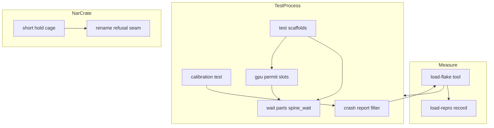
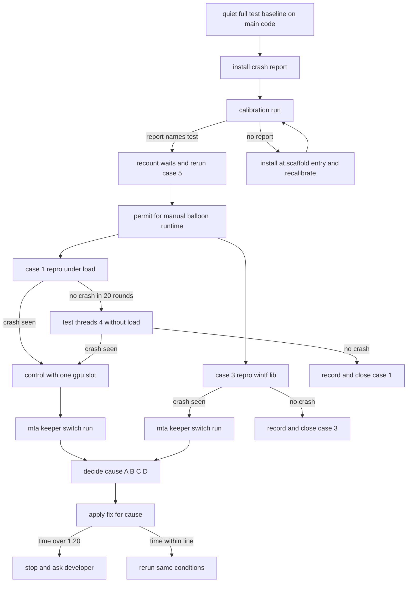

# 設計: areka-test-binary-stability

> 2026-11-01 `/kiro-spec-design`（`-y`）。枝 `claude/kiro-start-areka-test-binary-stability-dec94e`（main `0cd4577f` の上・`497d1829`）のコードを読んで書いた。テスト・ビルド・負荷の走行は回していない。行の番号はこのコミットのもの。調べた中身と比べた案は `research.md`（ギャップ分析と、末尾の「設計の段」の節）。
>
> 2026-11-01 実装の段で CrashReport を改めた。測った事実: Y1 の落ち 4 回が報告の行を出さず、最後の受け手は差し替えられていなかった（番地が同じ）＝AV が最後の受け手まで届かなかった。届かなかった訳の見立て（確かめていない）: 落ちた番地がどのモジュールにも当たらず枠を巻き戻せない（`load-repro.md` ⑹「Y1 の 2 回目」）。そこで AV は最初の受け手（`AddVectoredExceptionHandler`）で書く形にした。

## Overview

**Purpose**: `areka` のテストの実行ファイル（`cargo test -p areka --bin areka`）と `wintf` の lib のテスト（`cargo test -p wintf --lib`）が、負荷の下で原因の分からない落ち（`0xc0000005`）と、許す赤の線に揃っていない待ちの赤を出す。本 spec は、落ちたテストを名指す仕掛けを先に入れ、決めた条件と回数で測って原因を特定し、原因ごとの直しを当て、待ちを steering `tech.md` の線に揃え、最後に負荷つきの全体の走行 5 回を 1 度だけ回して確かめる。

**Users**: 開発者と実装の手順（`/kiro-impl` の査読・`/kiro-complete` の全体テスト）。赤が出たとき、文言とプロセスの落ちの報告から「負荷のせいか欠陥か」を読み分けられるようになる。

**Impact**: 本番のコードの振る舞いは変えない（件 1・件 3 で本番の欠陥が見つかった場合を除く）。変わるのはテストの土台・テストのファイル・`tools/load-flake.ps1`・steering `tech.md` の 2 か所の書き足し。

### Goals
- 落ちたスレッドの名前・生きているスレッドの名前・呼び出しの積み上げを、落ちた走行の出力に残す（較正で確かめてから測る）。
- 件 1・件 3 の原因を、決めた条件と回数の測りで候補 A〜D から絞り、候補ごとに決めた直しを当てる（再現しなければ記録して閉じる）。
- 件 2 の 5 種類の待ちを待ちの部品（`spine_wait.rs`）の形に揃え、`［進みは不明］` を出しうる待ちを `crates/areka/src` のテストから無くす。
- 件 4・件 5・`spine_third_scope_talk` の赤を、同じ切り分けの手順の中で読み分けて、足場の側の原因を直す。
- 静かな机の所要時間を修正の前の基準の 1.20 倍以内に保ち、最後の負荷つきの全体の走行 5 回で、プロセスの落ちと許さない赤を 0 件にする。

### Non-Goals
- 本番の `rename_patiently` の試し直しの間隔・上限・対象のエラー、許可の数（同時に 4 つ）、`tools/test-all.ps1` の並列度。
- 許す赤の線の理由の書き換え（要件 4.2 の範囲の書き足しだけを行う）。
- 15 か所の外の文言の無い待ち（自前の `recv_timeout`・`Instant` の締切・`run_bounded` の呼び手）の直し。数えて記録し、本 spec の走行で赤になったものだけ移す（要件 7.6）。
- `areka` の実行ファイルの外の `join_bounded`（`areka-ghost`・`areka-kanade` の結合テスト）、`wintf --test graphics` の一度だけの落ち、`areka-seriko` の一度だけの赤（再び赤なら文言を記録するだけ）。

## Boundary Commitments

### This Spec Owns
- 落ちの報告の仕掛け（`areka` と `wintf` のテストのプロセスの中だけで働く、捕まえられなかった例外の最後の受け手）と、それをわざと働かせる較正のテスト。
- 測りの手順と記録（`.kiro/specs/areka-test-binary-stability/load-repro.md`）: 条件・回数・上限の時間・結果・原因の経路・待ちの数え直し・件 4 の見立て・件 5 の赤の文・所要時間の比べ。
- `tools/load-flake.ps1` の口の広げ（絞り込みを複数・`wintf` の lib を回す口・子へ渡す環境変数・落ちの報告の行のまとめ）。
- 待ちの部品 `crates/areka/src/emo2_boot/spine_wait.rs` の、打ち切りの長さを渡す内側の形・`join_bounded` の 1 本化・GPU の装置の許可の上限つきの待ち。
- `crates/areka/src` のテストの足場の目印（`LapRig`・`SpineHarness` とその仲間の `StageSink`・作業プールの見張り・MCP の答えの待ち）と、15 か所の移し。
- `manual_balloon_runtime` の許可の取り方と、その 4 本の呼び手。
- `areka-nar` の `install.rs` の `#[cfg(test)]` の継ぎ目と、短い掴みの檻。
- `SwitchRig::new` の検体の組み方（件 4）と、件 5 の原因が足場の側にあったときの直し。
- 件 1・件 3 の原因ごとの直し（下の「原因ごとの直し」の表の範囲）。
- steering `tech.md` の「テストの待ちと、負荷の下で許す赤」の 2 か所の書き足し（要件 4.3・10.7）。

### Out of Boundary
- 本番のコードの振る舞い（件 1・件 3 の原因が本番の欠陥と分かったときの `crates/wintf/src/ecs/graphics/` などの直しを除く。`#[cfg(test)]` の部分は範囲に入る）。
- 許す赤の線の理由、`GpuPermit` の数（件 1 の直しが求めるときを除く）、`rename_patiently` の振る舞い。
- WER のダンプの置き場の設定・`procdump` などの外の道具・デバッガの導入。
- 依存の追加（新しいクレートもワークスペースの新しいクレートも作らない）。`Cargo.toml` には触らない。今の `windows` の機能に無い kernel32 の関数は、落ちの報告のファイルの中で `#[link(name = "kernel32")] unsafe extern "system"` で直に宣言する（2026-11-01 設計の議題 2: dev の側だけで機能を足すと `windows` の機能の組が `cargo build` と `cargo test` で分かれ、上の全部のクレートが 2 組組み直されるため）。
- 文字の層のクレート、`main.rs`、`tools/test-all.ps1`、テストの一時フォルダの置き場（`temp-path-kit`）。

### Allowed Dependencies
- 上流の `ghost-session-test-load-flake`（完了）の待ちの部品・打ち切りの文言・許す赤の線・`tools/load-flake.ps1`。
- `std`（`std::backtrace`・`LazyLock`・`thread_local!`）と、既にある `windows` 0.62 の今の機能（機能は足さない）。足りない kernel32 の関数（`SetUnhandledExceptionFilter`・`RaiseException`・`CreateToolhelp32Snapshot`・`Thread32First`・`Thread32Next` など）はテスト専用のファイルで直に宣言する。
- 依存の向き: テストの足場 → 待ちの部品（`spine_wait.rs`）→ `std`。待ちの部品は足場を知らない。落ちの報告はどのクレートの足場にも依らない（`windows` と `std` だけ）。`install/` のテストは `crate::emo2_boot::spine` の出し直しを通して待ちの部品を使う（今の `fetch_url_tests.rs` と同じ道）。

### Revalidation Triggers
- 待ちの部品の形（`join_bounded` の引数・`GpuPermit::take` が上限で panic すること・打ち切りの長さを渡す内側の形）が変わる → それを使う全てのテストの移しと、静かな机の緑（要件 10.6）。
- `manual_balloon_runtime` の返り値の形（先頭に許可）が変わる → 4 本の呼び手。
- 件 1・件 3 の直しが「テストのプロセスの初めにプロセスの寿命の MTA を立てる」形になった場合 → `areka`・`wintf` の lib のテストの COM の前提（「テストのスレッドは COM 未初期化」と書くテストの説明）を読み直す。
- steering の許す赤の範囲の書き足し → `/kiro-impl` の査読と `/kiro-complete` の赤の読み方。
- 測りの間に Adjacent の spec（`temp-path-exceptions-to-target`・`install-live-target-hazards`・`background-result-tick-wake`・`balloon-element-order`・`mcp-user-response`・`zorder-chain-residue`）が main に着地する → 比べの基準を採り直す（要件 9.5）。

## Architecture

### Existing Architecture Analysis
- 待ちの部品（`spine_wait.rs`・462 行）は芯 `wait_until_with`（目印つきなら 30 秒進まない＝`［止まった］`・300 秒＝`［進んではいた］`、目印なしなら 30 秒＝`［進みは不明］`）を持ち、`spine.rs` 367〜371 行が同じ名前で出し直す。`join_bounded`（385 行）は `ActorHandle` だけを受け、写しが `install/desk_pick_tests.rs` 60 行・`install/fetch_url_tests.rs` 80 行にある。`GpuSlots::take`（418 行）は `Condvar::wait_while` で上限が無い。
- GPU の足場は `GraphicsCore::new()` の直前で `GpuPermit::take()` を取り、最後の欄に持つ（steering）。`frame_test_support.rs` 915 行の `manual_balloon_runtime` だけが許可を取らない。
- テストのスレッドは足場ごとに `CoInitializeEx(MULTITHREADED)` を呼んで MTA に入り、`WucGraphicsResource::new` で MTA の `Compositor` を作る（`DQTAT_COM_NONE`）。`wintf` の `WicCore` は初めて作られた時に `CoIncrementMTAUsage` でプロセスの寿命の MTA を立てる（`wic_core.rs` 28 行）＝その前後で MTA が解体されうるかが走行の並びで変わる。
- 前例は 2 つ（`research.md` 1.4 節）: ① 別のスレッドの 2 つ目の MTA の `Compositor`（完了 `wintf-gpu-test-crash`）、② 一時的な MTA の解体の後の `Release`（`wic_core.rs`）。どちらも本 spec の落ちでは確かめていない。

### Architecture Pattern & Boundary Map



**Architecture Integration**:
- 採る形: 段に分ける（ギャップ分析の案 C）。段 1 で名指しの仕掛けと測りの道具を入れて較正し、段 2 で件 1・件 3 を測って原因を決め、段 3 で原因ごとに直し、段 4 で件 2 の待ちと件 4・件 5 を揃え、段 5 で静かな机の全体と負荷つき 5 回を 1 度だけ回す。原因が分からないまま直しの形を決めないための順で、要件 6.5・6.6（許可の揃えは対照の前・上限の値は件 1 の直しの後）の前後とも合う。
- 守る形: 待ちは全部、待ちの部品の芯を通す（自前の締切を書かない）。足場は許可を最後の欄に持つ。テストの土台の物は `#[cfg(test)]` のモジュールに置き、兄弟のファイル（`*_test_support.rs`・`*_tests.rs`）を `#[path]` で引く。
- 新しい物を作る訳: 落ちの報告（今は落ちたテストの名前が 1 行も出ない・要件 1.1）・許可の上限つきの待ち（要件 6.1）・`rename` の拒みの継ぎ目（檻が実時間に頼らないため・要件 5.2）。ほかは今ある物の形を揃えるだけ。

### Technology Stack

| Layer | Choice / Version | Role in Feature | Notes |
|-------|------------------|-----------------|-------|
| テストの土台 | Rust 2024・`rustc 1.99.1`・libtest | 落ちの報告・待ち・足場 | libtest はテストごとにテストの名前のスレッドを起こし、std はその名前を `SetThreadDescription` で OS へ渡す（較正で確かめる） |
| Windows の口 | `windows` 0.62.2（ワークスペースの版のまま） | `SetUnhandledExceptionFilter`・`CreateToolhelp32Snapshot`・`GetThreadDescription`・`GetModuleHandleExW`・`RaiseException` | 機能は足さない。今の機能に無い関数は落ちの報告のファイルで `extern "system"` に直に宣言する（`Cargo.toml` に触らない・議題 2） |
| 測りの道具 | PowerShell 7（`tools/load-flake.ps1`） | 負荷・回数・上限の時間・記録 | 端末へ出す文は ASCII だけ（`encoding check` の段） |
| 記録 | Markdown（spec のフォルダ） | 条件・結果・原因・数え直し | `load-repro.md` 1 つ |

## File Structure Plan

### Directory Structure
```
crates/areka/src/emo2_boot/
├── crash_report_test_support.rs      # 新: 落ちの報告（最後の受け手・据え付け・較正のテスト）。mod.rs から #[cfg(test)] で引く
├── frame_balloon_runtime_test_support.rs  # 新: frame_test_support.rs から manual_balloon_runtime を移す（許可を取る形で）
└── spine_conformance_support_stage_tests.rs  # 新: spine_conformance_support_tests.rs の後ろ半分（696 行・816 行の待ちを含む檻）を移す
crates/wintf/src/
└── test_crash_report.rs              # 新: crash_report_test_support.rs と同じ中身の写し。lib.rs から #[cfg(test)] で引く
.kiro/specs/areka-test-binary-stability/
└── load-repro.md                     # 新: 測りの記録（条件を先に書き、結果を後から足す）
```

### Modified Files
- `crates/areka/src/emo2_boot/mod.rs`（828 行）— `#[cfg(test)] mod crash_report_test_support;` の 2 行。
- `crates/wintf/src/lib.rs`（13 行）— `#[cfg(test)] mod test_crash_report;` の 2 行。
- `crates/areka/src/emo2_boot/frame.rs`（663 行）— 新しい足場のファイルを `#[cfg(test)] #[path]` で引く 3 行。
- `crates/areka/src/emo2_boot/frame_test_support.rs`（974 行）— `manual_balloon_runtime` を抜き出す（行が減る）。
- `crates/areka/src/emo2_boot/spine_wait.rs`（462 行）— 打ち切りの長さを渡す内側の形・`join_bounded` の 1 本化・許可の上限つきの待ちと測りの間だけの数の口。
- `crates/areka/src/emo2_boot/spine_wait_tests.rs`（356 行）— 許可の待ち合いの檻・1 本化した `join_bounded` の檻。
- `crates/areka/src/emo2_boot/spine.rs`（937 行）— 出し直しの名前の入れ替え（行の数は増やさない・増えても 1〜2 行）。
- `crates/areka/src/install/desk_pick_tests.rs`・`install/fetch_url_tests.rs` — 写しの `join_bounded` を消し、1 本化した部品と相手のスレッドの中の数えを使う。
- `crates/areka/src/emo2_boot/balloon_visibility_phase_box_tests.rs`・`emo2_boot/frame/balloon_face_tests.rs`・`input_events/balloon_pressed_tests.rs`・`input_events/balloon_wheel_tests.rs` — `manual_balloon_runtime` の新しい返り値を受ける（先頭の許可を `_permit` に束ねる）。
- `crates/areka/src/shell_balloon_switch_session_lap_tests.rs`（792 行）— `LapRig` に UI の側の進みの数えを持たせ、`frames_until` の目印に足す。
- `crates/areka/src/emo2_boot/spine_conformance_support.rs`（773 行）— `StageSink::progress_probe` の既定 `None` を無くし、`SpineHarness` に目印を書く。
- `crates/areka/src/emo2_boot/spine_conformance_support_tests.rs`（959 行）— 分けた後、残る 470・635 行の待ちを目印つきへ。檻の偽の受け手に目印を書く。
- `crates/areka/src/emo2_boot/spine_boot_smoke_tests.rs`・`spine_close_wiring_tests.rs`・`spine_hold_tests.rs`・`spine_seriko_loop_tests.rs`・`crates/areka/src/session_end_deadline_tests.rs`・`crates/areka/src/ghost_session_restart_tests.rs` — `spin_wait_until` の直の呼び出しを目印つきの `wait_until` へ。
- `crates/areka/src/mcp/dump_surface.rs`（`#[cfg(test)]` の `WaitAnswer` だけ）と呼び手 `mcp/check_script_tests.rs`・`mcp/dump_surface_gpu_tests.rs` — 答えの待ちに目印を渡す。
- `crates/areka/src/emo2_boot/ghost_switch_test_support.rs`（722 行）— 件 4 の `remove_dir` を無くす。件 5 の原因がここに在れば直す。
- `crates/areka-nar/src/install.rs`（666 行）— `rename_patiently` の拒みの枝に `#[cfg(test)]` の継ぎ目。`install_commit_tests.rs`（857 行）— 檻を継ぎ目で放す形へ。
- `tools/load-flake.ps1`（297 行）— 口を広げる（下の LoadFlake の節）。
- `.kiro/steering/tech.md` — 許す赤の範囲の書き足し（要件 4.3）と、件 1・件 3 の直しが決まりを生んだ場合の足場の決まり（要件 10.7）。
- 件 1・件 3 の直しで触る所（原因で決まる・下の「原因ごとの直し」の表）: 候補 B なら落ちの報告の 2 つのファイル（初期化子で MTA を立てる）。候補 A・C なら `spine_wait.rs` の許可の数と、`Compositor` を作る足場（`frame_test_support.rs`・`frame_balloon_runtime_test_support.rs`・`spine.rs` の GPU の足場・`dump_surface_gpu_test_support.rs`・`shell_balloon_switch_session_lap_tests.rs` ほか `GpuPermit` を持つ足場）。候補 D なら捨てる側の足場か、本番の欠陥なら `crates/wintf/src/ecs/graphics/` とそのテスト。
- 件 5 の直しで触る所（原因で決まる）: `ghost_switch_test_support.rs`・`main_session_mark_tests.rs`（953 行・足すなら先に分ける）・`main_session_mark_fallback_tests.rs`・`main_session_mark_write_tests.rs`。`log-capture-kit` そのものは触らない（捕まえの範囲は呼び手の側で絞る）。

`spine_conformance_lap_tests.rs`（914 行）と `main.rs`（986 行）は触らない。触ることになったら、足す前に分ける（要件 10.4）。

## System Flows

### 測りと直しの流れ（件 1・件 3）



- 修正の前の基準（要件 9.4）は、コードに触る前のこの枝（main `0cd4577f`＝`test-roots-under-target` の着地の後＋spec の文書だけ）で、静かな机の `tools/test-all.ps1` を 1 回回して採る。
- 較正（要件 1.2）は測りの前に 1 度だけ。報告が出なければ、据え付けの場所を足場の入口（`GpuPermit::take`・`SwitchRig::new`・`wintf` の `with_com_initialized` の 2 つ）の `Once` に替えて較正し直す。
- X3・Y2（プロセスの寿命の MTA を立てた走行）は、報告の積み上げが COM の物の解放（`combase.dll`・`Release`・スレッドの終わり）を指すとき、または X2 で落ちが消えなかったときだけ回す。X2 で落ちが消え、報告が `Compositor` の作りを指すなら X3 は省く（重い走行を増やさない・要件 9.3）。

### 測りの条件（要件 1.3・2.1・始める前に `load-repro.md` へ書く）

| 走行 | 範囲（libtest の絞り込み） | 負荷 | スレッドの数 | 回数 | 1 回の上限 |
|---|---|---|---|---|---|
| 較正 | 較正のテスト 1 本（`--ignored --exact`）を `areka`・`wintf` の lib でそれぞれ | なし | 既定 | 各 1 | 5 分 |
| X1 | `emo2_boot::frame`（`scale_notice_integration_tests` を含む）と、自分で COM と GPU の装置を開く 28 ファイルのモジュールの道（数え直しで並べる・ファイルの名前でなくモジュールの道で書く） | 論理 CPU の 2 倍 | 既定 | 報告つきの落ちが 1 回出たら止める・最大 20 | 10 分 |
| X1b | X1 と同じ（X1 が 20 回で 0 件のときだけ） | なし | 4 | 報告つきの落ちが 1 回出たら止める・最大 20 | 10 分 |
| X2 | X1 の報告の持ち手の行と生きているテストの一覧に出たテストのモジュール（並走の相手が要るなら X1 の範囲を残し、その訳を記録に書く） | X1 と同じ | X1 と同じ | 落ちたら止める・落ちなければ 20 | 10 分 |
| X3 | X2 と同じ | X1 と同じ | X1 と同じ | 落ちたら止める・落ちなければ 20 | 10 分 |
| Y1 | `begin_draw_roundtrip alpha_mask_resource bitmap_source`（`wintf` の lib） | なし | 既定 | 報告つきの落ちが 1 回出たら止める・最大 20 | 5 分 |
| Y2 | Y1 と同じ | なし | 既定 | 落ちたら止める・落ちなければ 20 | 5 分 |
| 件 5 | `session_mark`（`areka`） | なし | 既定 | 10 | 10 分 |

- X2 は許可の数を 1 にする（`AREKA_TEST_GPU_SLOTS=1`）。X3・Y2 はテストのプロセスの初めに `CoIncrementMTAUsage` を呼ぶ（`AREKA_TEST_MTA_KEEPER=1`）。どちらも測りの間だけの口で、ふだんの走行では読まれない値が無ければ今と同じ（下の GpuSlots・CrashReport の節）。
- 回数の訳: 前の記録（`load-repro.md` の 4.7〜4.9）では負荷の下でおおむね 5 回に 1 回落ちた。その率なら 20 回で 1 度も落ちない見込みは約 1%、件 3 の 8 回で 2 回の率なら 20 回で 0 件の見込みは 1% 未満。
- 止め方は左右で分ける（要件 9.3・開発者の決まり「2 回目からは赤のテストに絞って短く」）: 落ちを採る走行（X1・X1b・Y1）と「落ちが残る」側の対照は、報告つきの落ちが 1 回出た時点で決まるので止める。「落ちが消える」側は見逃しの見込みが約 1% になる 20 回を回す。X2・X3 は X1 の報告が名指したテストへ絞る。
- 所要時間の見込みは、系列ごとに「最大の回数 × 1 回の見込み」を始める前に `load-repro.md` へ書いて開発者へ伝え、X1 の 1 回目を回し終えた所で言い直す（要件 9.2）。全体の負荷 5 回は約 50 分（前の記録）。

### 原因ごとの直し（要件 1.5〜1.8・2.2・2.3）

| 候補 | 見分ける印（報告と対照） | 直し | 所要時間の線 |
|---|---|---|---|
| A: 別々のスレッドに MTA の `Compositor` を並べる（前例 ①） | 積み上げが `Compositor::new`・`CreateGraphicsDevice` の中。X2（許可 1 つ）で落ちが消える | 互いに同時に走らない形（許可の数を下げる・または `Compositor` を作る足場だけを 1 つずつにする）か、前例と同じ 1 本のオーナーのスレッドへ寄せる。どちらも確かめの内容とテストの本数は減らさない | 許可 2 つで 1.48 倍だった前の測り（`spine_wait.rs` 394 行の説明）から、線を越える見込みが高い。越えるならその場で止まり、測った時間と案を開発者へ示す（要件 9.11） |
| B: 一時的な MTA の解体の後の解放（前例 ②） | 積み上げが `combase.dll` の解放・スレッドの終わり。X3・Y2（MTA を立てた走行）で落ちが消える | テストのプロセスの初めにプロセスの寿命の MTA を立てる（落ちの報告の据え付けと同じ所で `CoIncrementMTAUsage`・`areka` と `wintf` の lib の両方）。本番は UI のスレッドが MTA に居続けるので、テストの土台に固有の直し（要件 1.6） | 増えない見込み |
| C: ドライバや D3D の確かめの層のスレッドの競り合い | 落ちた番地のモジュールが `igd*`・`d3d11*`・`dxgi*`。A・B の対照で消えない | テストの側で手が届く形（同時の数を下げる）だけを試す。届かなければ条件と結果を記録し、開発者へ示す | A と同じ |
| D: 装置や WUC の物を、作ったスレッドと別のスレッドで捨てる | 積み上げの中の捨てる側のスレッドが、作った足場のスレッドと違う | 足場なら作ったスレッドで捨てる形に直す。本番のコードなら、直す前に落ちか赤になり直した後に緑になるテストを添えて直す（要件 1.7）。本番の直しで見立てが 20 タスクを超えるなら、件 2 の切り出しを開発者へ報告する（要件 1.8） | 増えない見込み |
| 再現しない | X1・X1b・Y1 で 0 件 | 条件と結果を記録して閉じる（要件 1.9・2.4）。落ちの報告はそのまま残り、以後の落ちは自分を名指す | — |

- 件 3 の原因が件 1 と同じなら、件 1 の直しの後に Y1 と同じ条件と回数で回し、0 件を示す（要件 2.2）。別なら同じ表で直す（要件 2.3）。
- 直しが「テストのプロセスの初めに MTA を立てる」「`Compositor` を作る足場は 1 つずつ」などの決まりを生んだら、steering `tech.md` のテストの待ちと足場の節に書き足す（要件 10.7）。

## Requirements Traceability

| Requirement | Summary | Components | Interfaces | Flows |
|-------------|---------|------------|------------|-------|
| 1.1 | 落ちたスレッドの名前と積み上げを残す | CrashReport | `report`・出力の行の形 | 測りと直しの流れ |
| 1.2 | 仕掛けを測りの前に較正 | CrashReport（較正のテスト） | `--ignored --exact` | 較正 |
| 1.3 | 条件を先に書き frame の族に絞る | LoadFlake・MeasureRecord | `-Filter` の複数 | 測りの条件 |
| 1.4 | 許可 1 つの対照 | GpuSlots・LoadFlake | `AREKA_TEST_GPU_SLOTS`・`-SetEnv` | X2 |
| 1.5 | 落ちる組・場所・経路を記録 | MeasureRecord | — | Decide |
| 1.6 | 土台の直し | CauseFix | 原因ごとの直しの表 | Fix |
| 1.7 | 本番の欠陥はテストを添えて直す | CauseFix | 同上（候補 D） | Fix |
| 1.8 | 20 タスクを超える見込みなら切り出しを報告 | CauseFix | 同上 | Fix |
| 1.9 | 再現しなければ記録して閉じる | MeasureRecord | — | Close1 |
| 1.10 | プロセスの中で完結 | CrashReport | `.CRT$XCU` の据え付け | — |
| 2.1 | 件 3 の組を同じ手順で回す | LoadFlake・CrashReport（wintf の写し） | `-Binary wintf-lib` | Y1 |
| 2.2 | 同じ原因なら直しの後に同じ条件で 0 件 | CauseFix・MeasureRecord | — | Verify |
| 2.3 | 別の原因なら 1.5〜1.7 と同じ扱い | CauseFix | — | Fix |
| 2.4 | 再現しなければ記録して閉じる | MeasureRecord | — | Close3 |
| 3.1 | UI の側の仕事を進みに数える | LapProbe | `LapRig::frames_until` の目印 | — |
| 3.2 | 確かめの内容を弱めない | LapProbe | — | — |
| 3.3 | 目印を使う全テストを移し緑を示す | LapProbe | lap の 25 か所 | — |
| 4.1 | 相手のスレッドの中の進みを目印に | JoinBounded | `join_thread_bounded`・install の数え | — |
| 4.2 | 進み 0 回の `［止まった］` を許す赤へ | SteeringAddendum | — | — |
| 4.3 | 4.2 を steering へ書き足す | SteeringAddendum | — | — |
| 4.4 | どの `join_bounded` も同じ文言の形 | JoinBounded | 1 本化 | — |
| 5.1 | 放す側の遅れで赤にならない | RenameSeam・HoldCage | `ON_RENAME_REFUSED` | — |
| 5.2 | 放す時機を拒みの観測に結ぶ | RenameSeam・HoldCage | 同上 | — |
| 5.3 | 確かめの内容を弱めない | HoldCage | — | — |
| 5.4 | 本番の試し直しを変えない | RenameSeam | `#[cfg(test)]` だけ | — |
| 6.1 | 許可の待ちに上限 | GpuSlots | `judge_permit_wait`・`GPU_PERMIT_IDLE` | — |
| 6.2 | 打ち切りの文言 | GpuSlots | `PermitWaitFailure` | — |
| 6.3 | 2 つ取りの待ち合いの檻 | GpuSlots（檻） | `GpuSlots::new(2)`・偽の時計 | — |
| 6.4 | 全ての GPU の足場が許可を取る | BalloonRuntimeScaffold | `manual_balloon_runtime` | Align |
| 6.5 | 6.4 を対照の前に | MeasureRecord（順） | — | Align の後に X2 |
| 6.6 | 上限の値は件 1 の直しの後 | GpuSlots・MeasureRecord | `GPU_PERMIT_IDLE` | Fix の後 |
| 6.7 | 許可の数を変えない | GpuSlots | 既定 4 | — |
| 7.1 | 目印の無い待ちを数え直して記録 | MeasureRecord・WaitMigration | — | Inventory |
| 7.2 | 数える口があれば目印つきへ | WaitMigration | `wait_until`・`Progress::Count` | — |
| 7.3 | 口が無ければ足すか理由つきの例外 | WaitMigration | 作業プールの見張りの数え | — |
| 7.4 | `［進みは不明］` を出しうる待ちを残さない | WaitMigration・StageProbe | `progress_probe` の既定を無くす | — |
| 7.5 | 確かめの内容を弱めない | WaitMigration | — | — |
| 7.6 | 15 か所の外も記録し、赤になったものを移す | MeasureRecord・WaitMigration | — | Inventory |
| 8.1 | 握りで検体の組み立てを失敗にしない | SampleLayout | `SwitchRig::new` | — |
| 8.2 | 握り手の見立てと根拠を記録 | MeasureRecord | — | — |
| 8.3 | 件 5 の赤の文を採り直す | MeasureRecord・LoadFlake | 件 5 の走行 | Inventory |
| 8.4 | 並走の重なりなら直す | Case5Fix | 原因で決まる | — |
| 8.5 | third scope の赤を読み分けて記録 | MeasureRecord | 文言の先頭と進み | — |
| 8.6 | 足場の側の止まりなら直す | Case5Fix | 原因で決まる | — |
| 8.7 | 再現しなければ記録して閉じる | MeasureRecord | — | — |
| 9.1 | 静かな机・机の道具が main と揃う | MeasureRecord（手順） | `areka-impl-watch.exe status` | — |
| 9.2 | 重い走行の前に所要時間を伝える | MeasureRecord（手順） | — | — |
| 9.3 | 2 回目からは赤のテストに絞る | LoadFlake・MeasureRecord | `-Filter` | — |
| 9.4 | 修正の前と後の全体テストの所要時間 | MeasureRecord | `tools/test-all.ps1` | Base・最後 |
| 9.5 | Adjacent が着地したら基準を採り直す | MeasureRecord | — | — |
| 9.6 | 最後の負荷 5 回で落ちと許さない赤が 0 | FinalRun | `load-flake.ps1 -Label final` | 最後 |
| 9.7 | 赤を文言で読み分け、回し直しで置き換えない | FinalRun・MeasureRecord | — | 最後 |
| 9.8 | 修正の後の全体テストが緑 | FinalRun | `tools/test-all.ps1` | 最後 |
| 9.9 | 所要時間を 1.20 倍以内 | MeasureRecord・CauseFix | — | Fix |
| 9.10 | 一時の置き場は `target\` の下・負荷の子を止める | LoadFlake | 今の形のまま | — |
| 9.11 | 線を越える見込みなら止まって裁定 | CauseFix | — | Stop |
| 10.1 | sleep・締切だけ・1 フレーム遅らせ・無視・本数減で消さない | 全部 | — | — |
| 10.2 | 実の GPU のまま | 全部 | — | — |
| 10.3 | 本番の振る舞いを変えない | RenameSeam・CrashReport ほか | `#[cfg(test)]` | — |
| 10.4 | 1,000 行・上限に近いファイルは先に分ける | FileSplit | 新しい 3 ファイル | — |
| 10.5 | 一時パスは共通の窓口 | 全部 | `temp-path-kit`（今のまま） | — |
| 10.6 | 部品の形を変えたら全ての使い手を移す | JoinBounded・GpuSlots・StageProbe | — | — |
| 10.7 | 新しい決まりは steering へ | SteeringAddendum | — | Fix |

## Components and Interfaces

| Component | Domain/Layer | Intent | Req Coverage | Key Dependencies | Contracts |
|-----------|--------------|--------|--------------|------------------|-----------|
| CrashReport | テストのプロセス | 捕まえられなかった例外で、落ちたスレッド・生きているスレッド・積み上げを書く | 1.1, 1.2, 1.10, 2.1 | `windows`（P0） | Service, State |
| LoadFlake | 測りの道具 | 絞り込み・実行ファイル・環境変数・落ちの行のまとめ | 1.3, 1.4, 2.1, 8.3, 9.3, 9.10 | CrashReport の行の形（P0） | Batch |
| MeasureRecord | 記録 | 条件を先に・結果と原因を後に書く | 1.3, 1.5, 1.9, 2.4, 6.5, 6.6, 7.1, 7.6, 8.2, 8.3, 8.5, 8.7, 9.1〜9.5, 9.9 | LoadFlake（P0） | — |
| CauseFix | テストの土台／本番（欠陥のときだけ） | 原因ごとの直し | 1.5〜1.8, 2.2, 2.3, 9.9, 9.11, 10.7 | MeasureRecord（P0） | — |
| WaitCore | 待ちの部品 | 打ち切りの長さを渡す内側の形 | 6.1, 10.6 | — | Service |
| GpuSlots | 待ちの部品 | 許可の上限つきの待ち・測りの間だけの数の口 | 1.4, 6.1〜6.3, 6.6, 6.7 | WaitCore（P0） | Service, State |
| JoinBounded | 待ちの部品 | `join_bounded` の 1 本化 | 4.1, 4.4, 10.6 | WaitCore（P0） | Service |
| BalloonRuntimeScaffold | 足場 | `manual_balloon_runtime` が許可を取る | 6.4, 6.5, 10.4 | GpuSlots（P0） | Service |
| LapProbe | 足場 | UI の側の仕事を進みに数える | 3.1〜3.3 | `SwitchRig::progress_probe`（P1） | State |
| StageProbe | 足場 | `StageSink` の目印の既定を無くす | 7.1, 7.4 | WaitCore（P1） | Service |
| WaitMigration | テスト | 15 か所を目印つきへ | 7.2〜7.6 | WaitCore・各足場の数え（P1） | — |
| RenameSeam・HoldCage | `areka-nar` | 拒みを檻が観測し、同じスレッドで放す | 5.1〜5.4 | — | Service |
| SampleLayout | 足場 | 件 4: 移した直後のフォルダを消さない | 8.1 | — | — |
| Case5Fix | 足場 | 件 5・third scope の足場の側の原因の直し | 8.4, 8.6 | MeasureRecord（P0） | — |
| FileSplit | 構造 | 上限に近いファイルを先に分ける | 10.4 | — | — |
| SteeringAddendum | steering | 許す赤の範囲と足場の決まりの書き足し | 4.2, 4.3, 10.7 | — | — |
| FinalRun | 確かめ | 静かな机の全体と負荷つき 5 回を 1 度だけ | 9.6〜9.8 | 全部（P0） | Batch |

### テストのプロセス

#### CrashReport

| Field | Detail |
|-------|--------|
| Intent | 捕まえられなかった例外で、落ちたスレッドの名前・生きているスレッドの名前の一覧・落ちた番地のモジュール・積み上げを標準エラーへ書く |
| Requirements | 1.1, 1.2, 1.10, 2.1 |

**Responsibilities & Constraints**
- 置き場は `crates/areka/src/emo2_boot/crash_report_test_support.rs` と、同じ中身の写し `crates/wintf/src/test_crash_report.rs`（どちらも `#[cfg(test)]`）。新しいクレートを作らない（依存を足さない）ための写しで、2 つのファイルの頭に「写しの相手」を 1 行書く。
- 据え付けは `#[used] #[unsafe(link_section = ".CRT$XCU")] static` の初期化子から `SetUnhandledExceptionFilter`（最後の受け手 `report`）と `AddVectoredExceptionHandler(0, first_chance)`（最初の受け手）を 1 度ずつ呼ぶ。AV（`0xC0000005`）は最初の受け手が書き（書く途中の AV では書き直さない）、最後の受け手はそれ以外のコードだけ書く。テストの実行ファイルの根のクレートの中に置くので、リンクで落ちない（較正で確かめる）。`main.rs` は触らない。
- 受け手は書いた後に `EXCEPTION_CONTINUE_SEARCH` を返す（最後の受け手は前の受け手があればそれを呼ぶ）。プロセスはこれまでどおり `0xc0000005` で終わり、`load-flake.ps1` の終了コードの数えは変わらない。
- 許可の持ち手の表: `GpuSlots` の `take`／許可の `Drop` で、許可を持つスレッドの番号と名前を固定の配列（`HOLDER_ROWS`＝16 行・測りの口で許可の数を変えても入る・割り当て無し）に載せ降ろしする。落ちたスレッドが名前の無いドライバや COM のスレッドでも、どのテストが GPU の装置を持っていたかを `AREKA-CRASH-HOLDER` の行で名指す（要件 1.1）。`wintf` の lib の写しは並ぶテストが少ないので表を持たず、生きているスレッドの一覧で読む。
- 書く順は、割り当ての無い 1 行目（例外のコード・番地・スレッドの番号）→ 落ちたスレッドの名前とモジュール → 許可の持ち手の表 → 生きているスレッドの一覧 → `std::backtrace::Backtrace::force_capture()`。後ろの段で錠やヒープが壊れて止まっても、前の行は残る（止まったときは回の上限の時間で `load-flake.ps1` が木を止める）。
- 書き先は標準エラーの OS のハンドルへ直に書く（`io::stderr().as_raw_handle()` を `ManuallyDrop<File>` で包む）。libtest の捕まえ（`print!` の横取り）を通らず、`std` の標準エラーの錠も取らない。行はどれも手元の 1024 バイトの配列に溜めて 1 度の書き込みで出す（libtest の出力が行の途中に入らない・Y1 の 2 回目で行が切れていた）。越えた分は字の境目で切り、行の終わりに ` <cut>` を付ける。
- 測りの間だけの口: 初期化子は `AREKA_TEST_MTA_KEEPER` が `1` なら `CoIncrementMTAUsage` を呼ぶ（X3・Y2）。候補 B が原因と決まれば、口を外して無条件に呼ぶ形が直しになる。B でなければ口ごと外す。

**Dependencies**
- External: kernel32 の関数。今の `windows` の機能に在るもの（`Win32::System::Threading` の `OpenThread`・`GetThreadDescription`、`Win32::System::LibraryLoader` の `GetModuleHandleExW`・`GetModuleFileNameW` など・各クレートで有効かは実装の段で確かめる）はそのまま使い、無いもの（`SetUnhandledExceptionFilter`・`AddVectoredExceptionHandler`・`VirtualQuery`・`RaiseException`・`CreateToolhelp32Snapshot`・`Thread32First/Next` と `EXCEPTION_POINTERS`・`THREADENTRY32`・`MEMORY_BASIC_INFORMATION` の構造体）はファイルの中で `#[link(name = "kernel32")] unsafe extern "system"` と `#[repr(C)]` で直に宣言する（P0・議題 2）
- 写しの扱い: areka と wintf に同じ中身を 1 つずつ置き、それぞれの頭に「写しの相手」を 1 行書く（2026-11-01 設計の議題 1）。

**Contracts**: Service [x] / State [x]

##### Service Interface
```rust
/// プロセスの読み込みの初め（libtest の main より前）に 1 度だけ走る。
extern "C" fn install();

/// 最初の受け手（AV だけ書く）。いつも EXCEPTION_CONTINUE_SEARCH を返す。
unsafe extern "system" fn first_chance(info: *const EXCEPTION_POINTERS) -> i32;

/// 捕まえられなかった例外の最後の受け手（AV 以外を書く）。次の受け手へ回す。
unsafe extern "system" fn report(info: *const EXCEPTION_POINTERS) -> i32; // EXCEPTION_CONTINUE_SEARCH

/// 較正（`#[ignore = "..."]`・`--ignored --exact` でだけ回す）。areka では許可を 1 つ取り `GraphicsCore` を
/// 作った後に（GPU の DLL を読み込んだ後も受け手が生きていることを見るため）、名前の無いスレッドを 1 本起こし、
/// そこで `RaiseException(0xC0000005)` を起こす。出力に落ちたスレッド（名前なし）・持ち手の行の自分のテストの名前・
/// 生きているスレッドの一覧が出ることを、`load-flake.ps1` の summary で見る。wintf の lib は装置を作らずに同じ形で起こす。
#[test]
#[ignore = "較正: わざとプロセスを落とす（要件 1.2）"]
fn crash_report_names_the_running_test();
```
- 出力の行の形（ASCII の頭・`load-flake.ps1` が拾う）:
  - `AREKA-CRASH code=0xC0000005 addr=0x... tid=1234`
  - `AREKA-CRASH module=<落ちた番地のモジュールのパス>+0x<ずれ> thread="<落ちたスレッドの名前・無ければ空>"`
  - `AREKA-CRASH region base=0x.. alloc_base=0x.. size=0x.. state=0x.. protect=0x.. type=0x..`（モジュールが空のときだけ・落ちた番地の `VirtualQuery`・問い合わせが失敗すれば `AREKA-CRASH region query-failed`）
  - `AREKA-CRASH-HOLDER tid=<番号> name="<許可を持つテストの名前>"`（許可の持ち手ごとに 1 行・areka だけ）
  - `AREKA-CRASH-THREAD tid=<番号> name="<名前>"`（生きているスレッドごとに 1 行）
  - `AREKA-CRASH-STACK <積み上げの行>`
- Preconditions: デバッガが付いていない（付いていれば受け手は呼ばれない）。
- Postconditions: プロセスの終了コードは例外のコードのまま。
- Invariants: ふだんの緑の走行では何も書かない。

**Implementation Notes**
- Integration: 較正のテストは `#[ignore]` を理由つきで付け、ふだんの走行では回らない（要件 10.1 の除外に当たる）。`areka` と `wintf` の lib で 1 回ずつ回す。
- Validation: 較正は報告を出したが、Y1 の落ち 4 回は出さなかった。最後の受け手は `Compositor`・`GraphicsCore`・`EndDraw` の後も差し替えられていなかった（番地が同じ）ので、足場の入口の `Once` での据え直しは効かないと測れた＝最初の受け手へ替えた。
- Risks: libtest が `--test-threads=1` で主のスレッドで回すときは、落ちたスレッドの名前が `main` になる＝生きているスレッドの一覧と積み上げで読む。後で誰かが捕まえて続く AV も最初の受け手は書く（ふだんの緑の走行の AV は 0 件と測った: wintf の lib の 1246 本・areka の 4157 本）。OS が利用者の側へ渡せない AV（積み上げの壊れ）と `__fastfail`（`0xc0000409`）は報告を出さない＝出たら記録に書く。

#### LoadFlake（`tools/load-flake.ps1`）

| Field | Detail |
|-------|--------|
| Intent | 測りの条件を引数で受け、回ごとの出力と落ちの報告をまとめる |
| Requirements | 1.3, 1.4, 2.1, 8.3, 9.3, 9.10 |

**Contracts**: Batch [x]

##### Batch / Job Contract
- 足す引数:
  - `-Filter` を `[string[]]` にする（libtest の位置引数として 1 つずつ渡す・今の 1 つの形も通る）。
  - `-Binary`（`areka-bin` 既定・`wintf-lib`）。`wintf-lib` のとき組み立てと回す口を `-p wintf --lib` にする。
  - `-SetEnv`（`NAME=VALUE` の並び）。子の `cargo` にだけ渡し、`conditions.txt` に書く。
  - `-Ignored`（libtest に `--ignored --exact` を渡す・較正のため）。
- 足す出力: `summary.txt` の回ごとの欄に `AREKA-CRASH` で始まる行を全部写す（行の途中も探す）。全回のまとめに「落ちの報告のあった回の数」を足す。
- 変えない所: 置き場（`target\load-flake\<Label>-<時刻>\`）・負荷の子を番号で控えて止めること・端末へ ASCII だけ（要件 9.10）。
- 冒頭の説明（使い方の例）に、件 1・件 3 の走行の書き方を 1 行ずつ足す。

#### MeasureRecord（`load-repro.md`）

- 節の並び: ⑴ 机と道具の確かめ（`areka-impl-watch.exe` が main と揃うこと・要件 9.1） ⑵ 待ちの数え直し（15 か所と、その外の文言の無い待ちをファイルと行で・要件 7.1・7.6） ⑶ 件 5 の赤の文（要件 8.3） ⑷ 修正の前の静かな机の全体テストの所要時間（全体と `areka` の実行ファイル・コードに触る前に採る・要件 9.4） ⑸ 較正 ⑹ X1〜X3・Y1〜Y2（走らせる前に条件の行を書き、走った後に結果を足す） ⑺ 原因の経路（コードの定義の名前で・要件 1.5）と直し ⑻ 許可の待ちの上限の値と決めた訳（要件 6.6） ⑼ 件 4 の見立てと根拠（要件 8.2） ⑽ third scope の読み分け（要件 8.5） ⑾ 修正の後の静かな机の全体テストと 1.20 倍の線（要件 9.4・9.9） ⑿ 最後の負荷 5 回の赤の読み分け（要件 9.6・9.7）。
- 重い走行（全体テスト・負荷の走行）の前に、所要時間の見込みを開発者へ伝え、伝えたことを記録の行に書く（要件 9.2）。測りの途中で Adjacent の spec が main に着地したら、⑷ を採り直す（要件 9.5）。

### 待ちの部品（`spine_wait.rs`）

#### WaitCore

```rust
/// 芯の内側の形。`idle` は目印つきの待ちの「相手が進まない」上限（既定の SPIN_WAIT の代わり）。
/// 目印なし（Progress::Unknown）と総時間の上限 WAIT_CAP は今のまま。
pub(super) fn wait_until_idle_with(
    now: impl FnMut() -> Instant,
    pause: impl FnMut(Duration),
    what: &str,
    progress: Progress<'_>,
    idle: Duration,
    cond: impl FnMut() -> bool,
) -> Result<(), WaitFailure>;
// 今の wait_until_with は idle = SPIN_WAIT で上を呼ぶだけになる（呼び手は変わらない）。
```

#### GpuSlots

| Field | Detail |
|-------|--------|
| Intent | 許可の待ちに上限と文言を付け、測りの間だけ数を替えられるようにする |
| Requirements | 1.4, 6.1, 6.2, 6.3, 6.6, 6.7 |

**Contracts**: Service [x] / State [x]

```rust
/// 許可の待ちの「許可が 1 つも返らない」上限。値は件 1 の直しの後に、負荷の下で測った許可の持ち時間から決めて
/// load-repro.md に書く（要件 6.6）。決めるまでは SPIN_WAIT と同じ 30 秒。
/// 決め方（2026-11-01 設計の議題 4）: X1・X2 で測った許可の持ち時間の最大の 2 倍以上・SPIN_WAIT の 30 秒を下回らない。
/// 許可の待ちの［止まった］は負荷の下でも許す赤に入れない（1 つも返らないのは本当の待ち合い）。
pub(super) const GPU_PERMIT_IDLE: Duration;

/// 測りの間だけ: AREKA_TEST_GPU_SLOTS があればその数、無ければ 4（要件 6.7）。測りが終われば口を外し、4 の const に戻す。
static GPU_SLOTS: LazyLock<GpuSlots>;

pub(super) struct GpuSlots { held: Mutex<usize>, freed: Condvar, cap: usize, returned: AtomicU64 }

pub(super) struct PermitWaitFailure { pub held: usize, pub cap: usize, pub failure: WaitFailure }
// Display: 「GPU の装置の許可の待ち（持たれている数 {held}／上限 {cap}）— {failure}」

/// 決め手（純粋な関数）。目印は「許可が返された回数」（returned）。返り続けている間は止まったと見ない。
pub(super) enum PermitVerdict { Continue, Stalled, Capped }
pub(super) fn judge_permit_wait(
    started: Instant, now: Instant, last_return_at: Instant, idle: Duration,
) -> PermitVerdict; // idle を越えて返りが無い＝Stalled・WAIT_CAP を越えた＝Capped

impl GpuSlots {
    /// `const fn` のまま（檻が `static SLOTS: GpuSlots = GpuSlots::new(2)` を作れるように・`returned` の AtomicU64 も const で作る）。
    pub(super) const fn new(cap: usize) -> Self;
    /// 本物の待ち。freed.wait_timeout_while の輪の中で judge_permit_wait を呼ぶだけ（許可が返ればすぐ起きる）。
    /// Stalled／Capped なら PermitWaitFailure の文で panic する。
    fn take(&'static self) -> GpuPermit;
}
```
- Preconditions: 許可を待つ足場は装置を作る前に取る（今の決まりのまま）。
- Postconditions: 返り値の許可を捨てると `held` が 1 減り、`returned` が 1 増え、待っている足場を起こす。
- 檻（`spine_wait_tests.rs`・要件 6.3）: 本物の `take` と同じ決め手を通すため、檻は `judge_permit_wait` を偽の時刻で呼び（返りの無いまま idle を越えると Stalled・返りがあれば Continue）、`static SLOTS: GpuSlots = GpuSlots::new(2)` で 2 つを `try_take` で取った形（2 つ取りのテストが 1 つずつ持った形）から作る `PermitWaitFailure` の文に「許可」「2／上限 2」「［止まった］」「待った秒数」が出ることを見る。実時間は待たない。
- Risks: 負荷の下で GPU のテストが 4 つとも長く許可を持つと、待つ側が `［止まった］` で赤になりうる。上限の値を件 1 の直しの後に測って決めるのはこのため。

#### JoinBounded

```rust
/// スレッドの終わりを待つ芯。目印は「相手のスレッドの中の進み（あれば）＋終わったか」。
/// 打ち切りの文はどの呼び手も「'{what}' join did not complete (possible hang) — {failure}」。
pub(crate) fn wait_thread_end(what: &str, inner: Option<&dyn Fn() -> u64>, is_finished: impl Fn() -> bool);

/// std のスレッド版（install の 2 本が使う）。待ってから同じスレッドで join する。
pub(crate) fn join_thread_bounded<T>(what: &str, inner: Option<&dyn Fn() -> u64>, handle: JoinHandle<T>) -> std::thread::Result<T>;

/// アクター版（今の形のまま・中で wait_thread_end を inner = None で呼ぶ）。
pub(super) fn join_bounded(what: &str, handle: ActorHandle) -> Result<(), ActorError>;
```
- `install/desk_pick_tests.rs`・`install/fetch_url_tests.rs` の写しを消す。相手のスレッドの中の進みは、テストが差し込む閉包の側（`desk_pick` の選ぶ画面の代わり・`fetch_url` の `MakeFetch` と `FakeFetch`）で `AtomicU64` を数えて `inner` に渡す（要件 4.1）。spine の `ActorHandle` は中の進みを外から読む口が無いので `inner = None`（進みは終わったかの 0→1 だけ）。
- 進み 0 回の `［止まった］`（相手のスレッドが始まれない形）は、要件 4.2 の裁定で許す赤に入る。steering の書き足しは SteeringAddendum。

### 足場

#### BalloonRuntimeScaffold

```rust
// crates/areka/src/emo2_boot/frame_balloon_runtime_test_support.rs（frame_test_support.rs から移す）
/// 許可を装置より先に取り、組の先頭で返す（組の束縛は後のものから捨てられる＝許可は装置より後に返る）。
pub(crate) fn manual_balloon_runtime(actor: &str) -> (GpuPermit, World, Rc<RefCell<TextLayerRuntime>>);
```
- 4 本の呼び手は `let (_permit, mut world, runtime) = ...` の形で受ける。`balloon_visibility_phase_box_tests.rs` 355 行の `_gpu`（中身は World）は名前を合わせる。
- 移すのは `frame_test_support.rs` の 915 行からの関数とその私用の手伝いだけ。移した後の `frame_test_support.rs` は 974 行より短くなる（要件 10.4）。
- 対照 X2 の前に済ませる（要件 6.5）。

#### LapProbe（`shell_balloon_switch_session_lap_tests.rs`）

- `LapRig` に `ui_moves: Rc<Cell<u64>>` を持たせる。`frames_until` の条件の関数の中で、巡を回した後に UI の側の要約（台詞の起動の数・台詞の表示の数（文字の層に載った字の数か表示の指令の数）・定常の知らせの数・取りやめの記録の数）を読み、前の巡と違えば `ui_moves` を 1 増やす。要約の欄はどれも増えるだけの数にする（行ったり来たりする見た目の状態を入れると、止まっていても進みに数えてしまう）。目印は `SwitchRig::progress_probe()` の数＋`ui_moves`（lap の前例 `spine_conformance_lap_tests.rs` 270 行と同じ考え）。
- 取りやめの記録の数は、`log-capture-kit` の捕まえの途中で件数を読む口が無ければ、取りやめで変わる World の状態（切り替えの予約が消えること）で数える（実装の段で口の有無を確かめる）。
- `SwitchRig::progress_probe` は変えない＝波及は `LapRig::frames_until` を通る 25 か所だけ。呼び手のコードは変わらず、目印だけが変わるので、25 か所を静かな机で回して緑を示す（要件 3.3）。確かめの内容（条件の関数）は触らない（要件 3.2）。

#### StageProbe（`spine_conformance_support.rs`）

- `StageSink::progress_probe` の既定 `None` を消し、実装の全部に書かせる。`SpineHarness` は SHIORI の呼び出しの数（`spine.rs` 345 行の `call_count`）＋採った表示の指令の数を返す。檻の偽の受け手は自分が受けた注入の数を返す。`［進みは不明］` の形そのものを確かめる檻が在れば、その偽の受け手だけが理由の注記つきで `None` を返す（要件 7.3 の例外として記録）。

#### WaitMigration（15 か所）

| ファイル | 行 | 移した後の目印 |
|---|---|---|
| `emo2_boot/spine_boot_smoke_tests.rs` | 35・131 | SHIORI の `call_count()`＋足場の受けた指令の数 |
| `emo2_boot/spine_close_wiring_tests.rs` | 91 | 同上 |
| `emo2_boot/spine_conformance_support_tests.rs`（分けた後） | 470・635 | `call_count()` |
| `emo2_boot/spine_conformance_support_stage_tests.rs`（分けて移った分） | 元 696・816 | 足場の段の数え（StageProbe と同じ） |
| `emo2_boot/spine_hold_tests.rs` | 39 | `call_count()` |
| `emo2_boot/spine_seriko_loop_tests.rs` | 233 | 受けた指令の数 |
| `session_end_deadline_tests.rs` | 111・139・331・354 | `call_count()`（354 は `unblock_calls()` を足す） |
| `mcp/dump_surface.rs`（`WaitAnswer`） | 415 | 呼び手が渡す目印（`wait_answer(&self, progress: Progress<'_>)`・呼び手 8 か所は自分の足場の目印を渡す） |
| `ghost_session_restart_tests.rs` | 74 | 見張りの閉包を包んで、作業プールのスレッドで走り始めた数と `Input` の段で届いた数を `AtomicU64` で数える（テストの側に口を足す・要件 7.3） |

- 移す先はどれも `wait_until(what, Progress::Count(&probe), cond)`。打ち切りの扱い（`false` を返して呼び手の assert で落とす）は今の `spin_wait_until` と同じに保ち、確かめの内容は変えない（要件 7.5）。移した後に `git grep -n "spin_wait_until(" -- crates/areka/src` が定義の 1 行だけになることを見る。`spin_wait_until` そのものは、呼び手が 0 になったら消す。
- 15 か所の外（`recv_timeout` の自前の上限・`Instant` の締切・`run_bounded` の呼び手）は MeasureRecord に数えて書き、本 spec の走行で赤になったものだけ同じ形へ移す（要件 7.6）。

#### SampleLayout（件 4・`ghost_switch_test_support.rs` 223 行）

- 空になった `balloon\` を消す `remove_dir` をやめる（1 行を消す）。消さない空のフォルダは、ゴーストの中のバルーンの走査（`areka-ghost` の `scan_ghost_balloons`→`subdirs`）で 0 件になり、無いのと同じに扱われる（`catalog.rs` 225 行・警告も出ない）。A／B への複製にも空のフォルダが写るだけで、同じく 0 件。
- 消す操作が無くなるので、移した直後のフォルダの一時的な握りに当たる操作そのものが無くなる（要件 8.1）。sleep も試し直しも足さない（要件 10.1）。
- 実装の段で、`SwitchRig` の検体の `ghost\<名>\balloon` が「無いこと」を確かめるテストが無いことを grep で確かめる（在れば、その確かめを「中のバルーンが 0 件」に読み替える）。
- 見立て（要件 8.2）: 同じフォルダの中の `rename` が通った直後に親の `remove_dir` だけが拒まれた＝子の中を開いている者は居らず、親のフォルダそのものを共有の削除なしで開いた者（検索のインデクサー・ウイルス対策の走査）が居た、と読む。根拠は、件 4 の観測の文と、同じ切り分けの走行で再び出たときの io のエラーの番号（`expect` の文に `Os { code: … }` として出る）。記録に書く。

#### Case5Fix

- 着手の時に件 5 の走行（`session_mark` を 10 回）で赤の文を採る（要件 8.3）。赤の文で原因が決まってから、並走しても互いに妨げない形へ直す（記録の捕まえの重なりなら捕まえの範囲を自分のスレッドとその子に絞る、印のファイルの置き場の重なりなら置き場をテストごとに分ける・要件 8.4）。`main_session_mark_tests.rs`（953 行）に足すなら先に分ける。10 回で再現しなければ、条件と結果を書いて閉じる（要件 8.7）。
- `spine_third_scope_talk` は、X1〜X3 と最後の負荷 5 回で赤になったら、文言の先頭（`［止まった］` か）・進みの回数・足場（`SpineHarness`＝GPU の足場）から読み分けて記録する（要件 8.5）。足場の側の止まり（相手の処理の取り違え）と読めたときだけ直す（要件 8.6）。

### `areka-nar`

#### RenameSeam・HoldCage

```rust
// crates/areka-nar/src/install.rs
#[cfg(test)]
thread_local! {
    /// rename が 5・32 で拒まれ、試し直しへ入る直前に呼ぶ（檻だけが据える）。
    pub(crate) static ON_RENAME_REFUSED: RefCell<Option<Box<dyn FnMut()>>> = const { RefCell::new(None) };
}
// rename_patiently の拒みの枝: #[cfg(test)] で ON_RENAME_REFUSED を呼んでから、今どおり STEP 眠る。
```
- 檻 `a_destination_held_briefly_by_another_process_still_commits` は、放す側のスレッドと 200 ms の眠りを無くし、掴みの手（`handle`）を継ぎ目の閉包へ移す。閉包は最初に呼ばれた時に掴みを放し、呼ばれた回数を数える。`commit_all` の後に、確定したこと（今の確かめ全部）と、呼ばれた回数が 1 以上＝掴みに当たって試し直したこと（要件 5.3）を見る。
- 放すのは拒みを観測した同じスレッドの中なので、放す側のスレッドの起動の遅れが無くなる（要件 5.1・5.2）。放した後の次の試しは期限の内側で必ず通る（期限の確かめは拒まれた時にだけ行われる）。
- 本番の間隔（50 ms）・上限（約 2 秒）・対象のエラー（5・32）は変えない（要件 5.4）。`install.rs` の継ぎ目は `#[cfg(test)]` だけ（要件 10.3）。

### 構造と steering

#### FileSplit
- `frame_test_support.rs`（974）→ `manual_balloon_runtime` を `frame_balloon_runtime_test_support.rs` へ（BalloonRuntimeScaffold）。
- `spine_conformance_support_tests.rs`（959）→ 後ろ半分の檻（元 696・816 行の待ちを含む段の始まりの檻）を `spine_conformance_support_stage_tests.rs` へ。宣言は `spine_conformance_support.rs` 772 行の隣。
- 分けるだけの段（中身を変えない）を、待ちの移しより先に別のコミットにする。

#### SteeringAddendum（`tech.md` の「テストの待ちと、負荷の下で許す赤」）
- 許す赤の項に 1 文を足す: 負荷の再現の下では、`areka` の実行ファイルの `join_bounded`（`desk_pick`・`fetch_url` の素の World のテストを含む）の、進み 0 回の `［止まった］` も許す。進みが 1 回以上ある `［止まった］` は許さない。理由は今の項の理由（ローダーの錠でスレッドの生まれと消えが列を作る）がそのまま当たる（要件 4.2・4.3・今の理由は書き換えない）。
- 件 1・件 3 の直しが決まりを生んだら、足場の項に 1 文を足す（例: テストのプロセスは初めにプロセスの寿命の MTA を立てる・`Compositor` を作る足場は 1 つずつ）（要件 10.7）。
- 許可の待ちに上限が付いたことを、足場の項の `GpuPermit::take()` の文に足す（「取れないまま上限を越えると許可の待ちの文で赤」）。

## Error Handling

### Error Strategy
- 待ちの打ち切りは今の 4 つの文言（`［止まった］`・`［進んではいた］`・`［進みは不明］`・`［相手が居ない］`）のまま。許可の待ちは頭に「GPU の装置の許可の待ち（持たれている数／上限）」を付けた `［止まった］`・`［進んではいた］`。`join_bounded` はどれも `'{what}' join did not complete (possible hang) —` を頭に付ける。
- プロセスの落ちは `AREKA-CRASH` の行。落ちの後でも行が出ない場合（`__fastfail`・受け手の中の止まり）は、終了コードと最後の行を記録に書く。

### 赤が出たときの読み方（本 spec が足すもの）

| 出たもの | 読み | 扱い |
|---|---|---|
| `AREKA-CRASH`（負荷の有無によらず） | プロセスの落ち | 許さない。原因ごとの直しの表で読む |
| `GPU の装置の許可の待ち … ［止まった］` | 許可が `GPU_PERMIT_IDLE` のあいだ 1 つも返らなかった | 負荷の下でも、上限の値を決めた後に出たら許可の持ち時間を測り直す（許す赤の項に入れない） |
| `join did not complete … ［止まった］ … 進み 0 回` | 相手のスレッドが始まれない／終われない | 負荷の再現の下だけ許す（要件 4.2） |
| `join did not complete … ［止まった］ … 進み 1 回以上` | 相手のスレッドが途中で止まった | 許さない |

### Monitoring
- 落ちの報告と待ちの打ち切りの行は、`load-flake.ps1` の `summary.txt` に回ごとに集まる。全体テスト（`tools/test-all.ps1`）でも、落ちた段の出力にそのまま残る。

## Testing Strategy

### 単体（檻）
- 許可の待ち合い（要件 6.3）: 上限 2 の数えで 2 つ持った状態の決め手 `judge_permit_wait` を偽の時刻で呼ぶ → 返りの無いまま idle を越えると `Stalled`・文の中身（許可・2／上限 2・`［止まった］`・秒数）。途中で許可が 1 つ返る（`last_return_at` が進む）と `Continue`（打ち切りが返りを進みとして数えること）。
- `join_thread_bounded`（要件 4.1・4.4）: 中の数えが増え続けるスレッドは `［止まった］` で打ち切られない（偽の時計）・終わらないスレッドの文が `'{what}' join did not complete (possible hang) — 待ちの打ち切り［止まった］` で始まる・ActorHandle 版と std 版で同じ頭。
- 短い掴みの檻（要件 5.1〜5.3）: 継ぎ目が 1 回以上呼ばれ、確定し、宛先が書庫の中身になる。放す側のスレッドを持たない。
- `wait_until_idle_with`（要件 6.1）: `idle` を渡した上限で `Stalled` になり、`wait_until_with` は今の 30 秒のまま（今の檻 `spine_wait_tests.rs` が緑のまま）。

### 結合
- 較正（要件 1.2）: `areka` と `wintf` の lib で較正のテストを 1 回ずつ回し、`AREKA-CRASH-THREAD` の行（areka では `AREKA-CRASH-HOLDER` の行も）に較正のテストの名前が出ることを見る。
- lap の 25 か所（要件 3.3）と、15 か所を移したテスト（要件 7.5）を静かな机で回して緑。
- `manual_balloon_runtime` の 4 本（要件 6.4）を静かな机で回して緑。
- 件 4・件 5 の足場の直しの後、件 5 の走行（`session_mark` 10 回）と `ghost_switch` の族を静かな机で回して緑。

### 負荷の測り（要件 1.3・1.4・2.1・9.3・9.6）
- X1〜X3・Y1〜Y2 は「測りの条件」の表のとおり。修正の途中の重い走行は、赤が出たテストに絞って回す。
- 最後に 1 度だけ: 静かな机の `tools/test-all.ps1`（緑・所要時間を基準と並べる・要件 9.4・9.8・9.9）→ `load-flake.ps1 -Label final -NoCapture`（全体・5 回・要件 9.6・9.7）。赤は文言で読み分けて記録し、回し直しの緑で置き換えない。

## Performance & Scalability
- 線: 静かな机の `areka` の実行ファイルの所要時間を、修正の前の基準（`test-roots-under-target` の着地の後の main で採る）の 1.20 倍以内（要件 9.9）。全体の所要時間も並べて記録する。
- 落ちの報告は落ちたときにしか働かないので、ふだんの所要時間に効かない。許可の待ちは今の `Condvar` の待ちを時間つきの待ちへ替えるだけで、許可が返ればすぐ起きる。
- 線を越える見込みになるのは候補 A・C の直し（同時の数を下げる）だけで、そのときはその場で止まり、測った時間と案を開発者へ示す（要件 9.11）。

## Migration Strategy
- コミットの順（1 タスク 1 つ以上・測りは静かな机）: ⓪ 修正の前の基準（コードに触る前の静かな机の全体テスト）⑴ 分けるだけの段 ⑵ 落ちの報告・較正・`load-flake.ps1` の口・測りの間だけの数の口 ⑶ `manual_balloon_runtime` の許可 ⑷ 待ちの数え直しと件 5 の赤の採り直し ⑸ 件 1・件 3 の測りと原因の記録 ⑹ 原因ごとの直しと、同じ条件での確かめ ⑺ 許可の待ちの上限（値は ⑹ の後）⑻ `join_bounded`・短い掴みの檻・lap の目印・15 か所・件 4・件 5 ⑼ 測りの間だけの口を外す・steering の書き足し ⑽ 最後の確かめ（静かな机の全体 → 負荷 5 回を 1 度だけ）。
- ⑻ の中の項目は互いに触るファイルが重ならないので、どの順でもよい。ただし負荷の下の確かめは ⑽ にまとめる。
- 戻し方: 原因ごとの直しが確かめで落ちを消さなかったら、その直しのコミットを戻して次の候補の対照へ進む（記録にはどちらも残す）。
