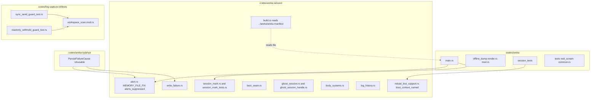
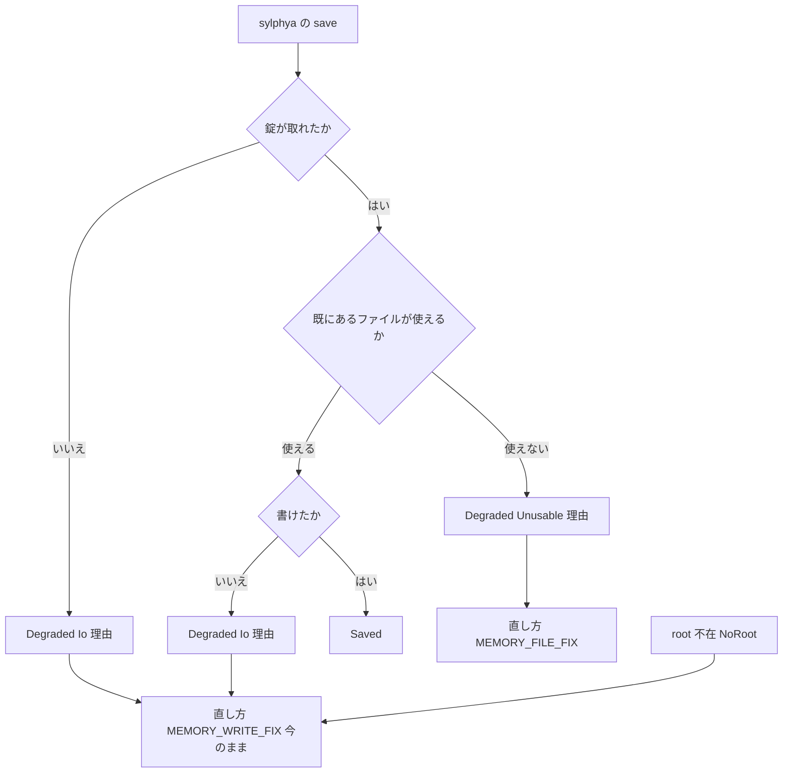
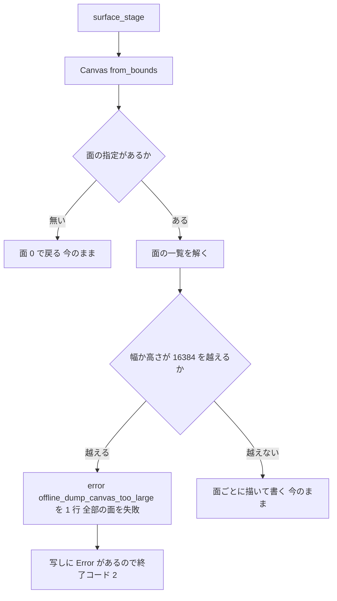

# 設計: audit-areka-app（areka 本体の残りと集めた層 `areka-session` の見直し）

## Overview

**目的**: 本体（`crates/areka/`）の残りと `crates/areka-session/` の大半に `/ponytail:ponytail-audit` をかけて出た 97 件（必ず直す 2・直したほうがよい 74・できれば 21）と、brief に預かった件 5.1〜5.21 を、要件の討議の確定（`requirements.md` の「要件の討議で確定したこと（2026-11-22）」の 18 件）どおり全部直す。残すと裁定した指摘は 0 件。設計の段で並走の兄弟 `audit-areka-install-update` から回ってきた件（下の「兄弟から受けた件」S1〜S7）も、このファイルの中の件として同じ組で扱う。直し方はどれも「いちばん小さい完全な直し」で、消せるものは消し、使うテスト・検体・呼び出し元・文書まで直し切る。

**使う人**: 開発者と、areka を使う人。使う人から見て変わるのは 2 つだけ。⑴ 記憶のファイル `sylphya.toml` が壊れている・版が違う・読めないときの知らせの直し方の一文が、効く向き（ファイルを直すか別の名前に変える）になる（指摘 1）。⑵ `--offline-dump` が、遠くに置いた element 1 つで巨大な下地を確保して落ちる代わりに、ERROR を 1 行残して終了コード 2 で終わる（指摘 2）。開発者から見ては、守っているつもりのテスト（ゴーストの道・見張りの歩く範囲・時間の決め打ちの待ち）が本当に守るようになり、写しが 1 か所ずつになり、出荷しない約 2,800 行の SHIORI の試験用の脳と走らないテストを抱えた例と誰も読まない絵 77 個が消える。

**変わらないこと**: 起動オプションの読み方と、SHIORI へ送る起動・終了・切替のイベントの名・参照・送る条件は変えない（要件 2.2 の 3 種類目は 0 件・ukadoc の確かめは下の「設計の段で決めた事項」1）。外への約束で変わるのは、要件の討議で確定した分（知らせの文＝指摘 1・`AREKA_SHIORI_DEMO` が消える＝指摘 5・ログの語＝指摘 4・95）と、兄弟の依頼で足す公開の関数 1 つ（S2）と公開のテストの支え 1 つ（S1）だけ。

### Goals

- 確定した 97 件・預かった件 5.1〜5.21・兄弟から受けた件 S1〜S6 を全部直す（S7 は範囲の外の持ち主へ返す）。直したバグと危ない所の 1 件ずつに、壊れたら落ちる決定論のテストを置く（要件 4.1）。テストの弱さの指摘は、テストそのものが直し。
- 範囲の外へは、要件 5 の件・直しに要る呼び出し元・確定した議題 17 の説明の文だけに触る。C26 の兄弟の持ち物は申し合わせの分だけ（「並走の兄弟と申し送り」）。
- 直し終えたら同じ作法で audit をかけ直して新しい指摘 0 件、全体テスト緑（要件 9）。
- タスクは 26 前後（1 本の spec のまま・要件 2.6・確定の議題 3）。

### Non-Goals

- 新しい機能・外の crate の依存の追加・clippy の機械的な直し。
- 本体の `runtime_tests/`・`placement_tests/`・`menu/` の見直し（確定の議題 2）。触るのは要件 5 の件の行と、S1 で写しを寄せる 1 か所だけ。
- `areka-emo-compose` の `shell_bounds` に上限を入れること（確定の議題 7）。
- `areka-ghost` の `InProcHost` が `GetProperty` を sylphya に委ねない件（確定の議題 5・範囲の外。完了のときに `/kiro-discovery` の起票の候補として開発者へ渡す）。
- `NO_BODY` の受け口をそろえること（兄弟が「そろえない」と決めた・要件 5.17）。

## Boundary Commitments

### This Spec Owns

- 本体（`crates/areka/`）の範囲の 94 ファイル・`examples/`・`README.md`・`areka.manifest`・`shell/`・`icon/` と、`crates/areka-session/` の範囲の 74 ファイル（要件の Boundary Context）の、確定した指摘の直しと、そのためのテストの追加・直し・削除・移し・名の変更。
- 新しく置くファイル（File Structure Plan の「新しいファイル」）と、消すファイル（脳 8 本・`examples/mock-shell.rs`・`areka-session/tests.manifest`・絵 77 個）。
- 外への約束のうち確定した変化: 知らせの一文（`MEMORY_FILE_FIX`）・`AREKA_SHIORI_DEMO` の削除・ログの文の頭（`[session_mark]`・`[boot_seam]`）と倒れ先の 3 つの記録の `event` 欄。
- `areka-session` の公開の面に足すもの 2 つ: `alert::alerts_suppressed()`（S2）・`reload::test_support::boot_context_named`（S1・test-support の中）。
- 本体の `Cargo.toml`・`Cargo.lock`（C26 でこの spec だけの席・約束 ⑵）と `areka-session/Cargo.toml`・`build.rs`。

### Out of Boundary

- C26 の兄弟の持ち物（要件 7.3）: `audit-areka-install-update`＝本体の `install*`・`update*`・`mcp*`・`roots.rs`・`roots/`・`session_tests/readme_body_tests.rs`、`areka-session` の `roots/`・`readme*`。`audit-emo2-boot-switch`＝`areka-session` の `ghost_switch*`・`shell_balloon_switch*`、本体の `session_tests/shell_balloon_switch*`・`runtime_tests/balloon_visibility*`、`areka-runtime` の受け持ち。どれも差分 0 行。逆向きに、兄弟が列挙の欄を減らすコミットでこちらの `alert_tests.rs` の構築の 2 行を消すことだけを申し合わせる（設計の討議の議題 3）。
- `crates/dola/`・`crates/wintf*`・`vendors/`（要件 7.4・7.13）。
- `areka-session` の公開の項目の名と形のうち、兄弟のファイルが使うもの（`boot_config`・`ghost_session`・`app_exit`・`log_history`・`write_failure`・`alert` ほか）。足すのは S1・S2 の 2 つだけで、既にある項目の名と形は変えない（`log_history::snapshot` の形も変えない）。
- `session-crate-split` が開けた `pub` 6 項目（`pub` のまま残す・要件 5.14・確定の議題 9）。
- 範囲の外の古い説明のうち、コードの直し（`areka-placement/src/persist_finalize_save_tests.rs:106` の `join`）とログの語（`areka-emo-present/src/shell_target.rs:494`）は直さず覚え書きとして回す（確定の議題 17）。

### Allowed Dependencies

- 今の依存だけ。外の crate を足さない（要件 6.6）。本体の `[dependencies]` から消すのは `async-io`・`windows-core`・`shiori-abi`（脳と 2 本のテストが外れた後）、`[dev-dependencies]` へ移すのは `areka-user-data`・`tracing-subscriber`（指摘 8〜10）。`areka-session` の `areka-emo-present` は `optional` にして `test-support` と dev で開く（指摘 78）。外の crate が依存の木から消えることは無い（research.md 10.1）。
- テストから使う既にある口: `areka_runtime::spine::join_bounded`・`areka_runtime::consumer_ledger::test_support::carrier_cue`・`areka_runtime::frame::test_support::{capture_logs, gpu_on}`・`areka_runtime::frame::shared_test_support::wiring`・`areka_runtime::source_text_test_support::code_only`・`areka_placement::test_support::{SharedFakeIo, fake_handle}`・`areka_ghost::prop_get_sink::PropGetCueSink`・`areka_ghost::sylphya_wiring::ghost_asker_id`・`temp_path_kit::TempPath`・`log_capture_kit::capture`・`log-capture-kit/tests/workspace_scan`。
- 依存の向きは今のまま: 本体 → `areka-session` → `areka-runtime`・`areka-input` → `areka-placement`。`areka-session` は本体を引かない（`build.rs` が本体の `areka.manifest` のファイルを読むのは、crate の依存ではない＝指摘 12）。

### Revalidation Triggers

- **知らせの一文**: `PersistFailureCause` に腕 `Unusable(String)` が足される。この列挙を `match` する呼び手（今は `alert.rs`・`write_failure.rs`）を後で足す人は、腕を網羅する。
- **ログの語**: `areka_session::session_mark`・`areka_session::boot_seam` の 3 行の文の頭が `[main]` から変わる。起動の倒れ先の 3 行に `event` 欄（`fallback_boot_wired_off`・`fallback_boot_origin_missing`・`fallback_boot_failed`）が足される。文の字面で数える読み手は欄で数える。
- **`--offline-dump`**: シェル全体の下地の幅か高さが 16,384 を越えると、面を 1 枚も書かずに終了コード 2。
- **テストの置き場**: 本体の部品を使わないテスト（指摘 30・46・91）は `areka-session` に、全体を歩く見張り 2 本は `crates/log-capture-kit/tests/` に移る。名で指す説明（`doc/COMPAT_ARCHITECTURE.md` §8 の既にある行）は同じ変更で直す。
- **公開の面に足すもの**: `alert::alerts_suppressed()`（兄弟が呼ぶ）・`reload::test_support::boot_context_named`（兄弟と `menu/` のテストが呼ぶ）。
- **消えるもの**: `AREKA_SHIORI_DEMO`・`shiori_factory`（exe の中の C の入口・引く者 0）・`examples/mock-shell.rs`・`shell/` の絵 77 個・`areka-session/tests.manifest`。

## Architecture

### Existing Architecture Analysis

- 本体は入口 `main.rs` と、本体だけのモジュール（`cli/`・`offline_dump/`・`file_drop*`・`png_image*`・`thread_roles*`・`perf_thread_report*`・`tick_gate_config*`）と、本体の部品どうしをつなぐテストの置き場（`session_tests/`・`runtime_tests/`・`placement_tests/`）。起動と終了の中身は `areka-session` にあり、本体は `BODY_SYSTEMS` の口の束で本体だけの系を渡す。
- `areka-session` は平らな置き方（`src/<name>.rs`）で、テストは `#[cfg(test)] #[path = "<name>_tests.rs"] mod tests;` の兄弟のファイル、本体のテストへ開く支えは `#[cfg(any(test, feature = "test-support"))]` の下に置く。
- 本体のテストでは `areka-session` が `cfg(test)` なしで組まれる（`BodySystems::of` の `#[cfg(not(test))] error!` が生きる＝指摘 16）。
- ワークスペース全体を歩く見張りの置き場は `crates/log-capture-kit/tests/`（`structure.md:460`）で、走査器 `workspace_scan/mod.rs` を共有する。範囲の中の 2 本だけが自前の走査器を持つ（指摘 20・43）。

### Architecture Pattern & Boundary Map



- **選んだ形**: research.md 9 節の案 C（今あるファイルの中で直すのを基本に、移すのは全体を歩く見張り・本体の部品を使わないテスト・番人に迫るファイルだけ・確定の議題 4）。新しい本番のモジュールは作らない（`ghost_session_handle.rs` は `impl GhostSession` を移すだけ）。
- **寄せの決まり**: 写しは「上流の test-support にもう在るものへ寄せる」か「同じ crate の支えへ 1 つ置く」の 2 つだけ。新しい補助の crate・trait は作らない。
- **守る既存の形**: ログの先に立つ失敗（`error!` と `Err`）・終了の順（`main.rs` の後始末の列）・イベントを投げて台本を待つ仕組み・読み取りだけの走りの控え。
- **steering**: 依存を足さない・GPU の当たりを CPU へ戻さない（触らない）・ベースウェアに判断を足さない・メッセージボックスでなく既定ゴーストの台詞で伝える形を変えない（告知の文の向きだけを直す）。

### Technology Stack

| Layer | Choice / Version | Role in Feature | Notes |
|---|---|---|---|
| 本体・集めた層 | `areka`・`areka-session`（ワークスペースの中）・`bevy_ecs`・`tracing`・`windows` | 直しの本体 | 外の依存は足さない。本体の依存の行は 3 つ消し 2 つを dev へ |
| 記憶 | `areka-sylphya`（ワークスペースの中） | `PersistFailureCause::Unusable` | 見直し済み・持ち主なし（確定の議題 6） |
| テスト | `log-capture-kit`・`temp-path-kit`・`areka-runtime`／`areka-placement`／`areka-input`（`test-support`）・`sample-ghost-kit`・`real-run-kit` | 落ちる力のあるテスト・待ちの上限・見張り | 既にある口だけ |
| 生成物 | `cargo about generate`（`tools/test-all.ps1 -License`） | `THIRD-PARTY-NOTICES.md` の作り直しの確かめ | 差 0 の見込み（research.md 10.1） |

## File Structure Plan

### Directory Structure（新しいファイルと消すファイル）

```
crates/areka/
├── src/
│   ├── main_winapp_log_tests.rs              # 新: WinApp の初期化の失敗に error! があることを main.rs の本文で見る（指摘 3）
│   ├── shiori_host.rs ほか脳の 8 本           # 消す（指摘 5・兄弟が遅れたら shiori_host.rs と case_fold だけ cfg(test) で残す）
│   └── session_tests/ (変える・下の表)
├── tests/
│   └── real_screen/common.rs                 # 新: 実画面の 2 本の補助（per_monitor・mouse・copy_dir・lines_with・wait_new・json・Notes）（指摘 45）
├── examples/mock-shell.rs                    # 消す（指摘 75）
└── shell/                                     # base.png と org/2.zip だけ残し 77 個を消す（指摘 76）
crates/areka-session/
├── src/
│   ├── session_mark_tests.rs                 # 新: 印の判定の表ほか 3 本（本体から移す・指摘 30）
│   ├── session_end_tests.rs                  # 新: 本体の session_end_tests.rs の部品を使わない 4 本（指摘 46）
│   ├── boot_resolve_last_used_tests.rs       # 新: boot_resolve_tests.rs の mod last_used（405-873）（指摘 62）
│   └── ghost_session_handle.rs               # 新: impl GhostSession（430-659）の移し（指摘 79）
└── tests.manifest                            # 消す（指摘 12・5.18）
crates/log-capture-kit/tests/
├── sync_send_guard_test.rs                   # 新: 本番の源の同期の送信の許可表（session_end_sync_send_tests.rs の後半 221-499 を移す）（指摘 43）
└── readonly_withhold_guard_test.rs           # 新: withhold_everything を呼ぶのは readonly.rs だけ（readonly_body_tests.rs から移す）（指摘 20）
```

### Modified Files（範囲の中・本番）

| ファイル | 変えること | 指摘・件 |
|---|---|---|
| `crates/areka/src/main.rs` | 脳の mod 4 つと e2e の mod 3 つと 234-238 のデモの呼び出しを消す。196 行に `.inspect_err(|e| error!(event = "winapp_init_failed", ..))`。`//!` を今の事実に。言い直すだけの doc（375・382・392・415）と 278・284 の重なりを消し、398-410 を 1 行に。515-531 の `BootContext` を 1 度だけ引く。86 行の札。`#[cfg(test)] #[path = "main_winapp_log_tests.rs"] mod main_winapp_log_tests;` を足す | 3・5・7・54・70・74・81 |
| `crates/areka/src/offline_dump/render.rs` | `MAX_CANVAS_SIDE: u32 = 16_384`（合成の上限と同じ値・合成の側は crate の外へ出していない、の 1 行）と `Canvas::exceeds_limit(&self) -> bool`。`RenderError::Write` の `allow` は残す（確定の議題 18） | 2 |
| `crates/areka/src/offline_dump/mod.rs` | `surface_stage` で面の一覧を解いた直後に `canvas.exceeds_limit()` なら `error!(event = "offline_dump_canvas_too_large", ..)` を 1 行出して `DumpTally { written: 0, failed: surfaces.len() }` を返す | 2 |
| `crates/areka/src/tick_gate_config.rs` | `TickGateSetting::Set(enabled)` で直に据え、`tick_gate_from_env_value` を消す | 87 |
| `crates/areka/src/cli/parse.rs`・`cli/listen.rs` | doc（`Repeated`・`Kind::Unsupported`）と経緯の語だけ（読み方は変えない） | 64・71 |
| `crates/areka/Cargo.toml` | `async-io`・`windows-core`・`shiori-abi` の行を消す（後の 2 つは脳と 2 本のテストが外れた後）。`areka-user-data`・`tracing-subscriber` を dev へ。各行の説明を「今の使い手とその依存が要るわけ」の 1 行に（spec 名・要件の番号・経緯の語を消す）。104-107 の連鎖で開く `test-support` の 2 行と 14-16 の `[[bin]]` を消す | 5・8・9・10・11・88・89・5.19 |
| `crates/areka/README.md` | 版の行と 10-02 の一覧を消し、根の README へ案内する（crates.io の 0.0.1 が名の確保だけ、の 1 文は残す） | 13 |
| `crates/areka/areka.manifest` | 2 行目のコメントを「areka.exe と areka-session のテストの exe が使う申告」に | 12・5.18 |
| `crates/areka/icon/README.md` | 29・34 行を「通知領域のアイコンを出す側が組の 2 番を番号で引く予定（まだ読むコードは無い）」に | 97 |
| `crates/areka-session/src/alert.rs` | `MEMORY_FILE_FIX` を足し、`MemoryWrite` の行で `Unusable` のときだけ出す（`MEMORY_WRITE_FIX` は変えない）。`pub fn alerts_suppressed() -> bool` と私有の純関数 `with_smoke(suppressed: bool, smoke: Option<u64>) -> bool` を足し、`raise` もそれを使う。150 行の `ExeLocationUnavailable` の腕は欄を読まない形（`{ .. }`・試した場所は空・出どころは既定）に。87 行の spec 名・284・355 行の日付 | 1・69・71・S2・S3 |
| `crates/areka-session/src/write_failure.rs` | `log_failure` の `match` に `Unusable(reason)` の腕（理由の文をそのまま）。141 行の経緯の語 | 1・71 |
| `crates/areka-session/src/session_mark.rs` | 113 行の文の頭を `[session_mark]` に。`#[cfg(test)] #[path = "session_mark_tests.rs"] mod tests;` | 4・30 |
| `crates/areka-session/src/boot_seam.rs` | 90・113 行の文の頭を `[boot_seam]` に。7・136・156 行の戻しの流れを「`load_restored_state` → `restore_and_judge` → `apply_balloon_limit` → `restored_scope_marks`」・呼び手を `prepare_ghost_windows` に。51 行の切れ端 | 4・47・53・5.3 |
| `crates/areka-session/src/ghost_session.rs` | 717・726-734 の 3 つの記録に `event` 欄。213-214 の戻しの流れ。821-822 を 4 つ（`BalloonWiring`・`BalloonHover`・`ChoiceSelectionInbox`・`ShellBoxHover`）に。87・147-149・283-285・640-643 の古い説明。228・354 の spec 名。`impl GhostSession`（430-659）を `ghost_session_handle.rs` へ移し `mod handle;` を足す | 4・47・48・53・69・79・95・5.3・5.10 |
| `crates/areka-session/src/body_systems.rs` | `BodySystems::of` を `pub fn` 1 つにし `installed_or_none` を消す。60 行の「（窓口が無いときの答えと同じ）」を消す | 77・5.15・5.17 |
| `crates/areka-session/src/log_history.rs` | 記録の列を `VecDeque<Arc<Record>>` にし、`snapshot` は排他の中で `Arc` を写すだけ・深い複製は排他の外（`fn snapshot(Kind) -> Vec<Record>` の形は変えない）。579 行を `mod capture_tests;` に | 82・S4 |
| `crates/areka-session/src/smoke_exit.rs` | 52-54 の早い戻りを 1 行に | 83 |
| `crates/areka-session/src/app_exit.rs`・`exit_wait.rs`・`lib.rs`・`boot_config.rs`・`boot_resolve.rs`・`session_end.rs`・`ghost_quit.rs` | 古い説明と経緯の語（指摘 53・55・56・71）。`ghost_quit.rs:67,81` の `quit_as_today` を `quit_without_reservation` に（68）。`session_end.rs:53` の見張りの名指しを新しいファイルへ（43）。`boot_config.rs:193-194` を今の口 `hooks::set_current_balloon` に（69） | 43・53・55・56・68・69・71 |
| `crates/areka-session/src/crate_source_test_support.rs` | 6-7 行の例外の列を `areka-runtime` の `frame_attach_tests.rs` の 1 本に | 20・43 |
| `crates/areka-session/src/reload_test_support.rs` | `pub fn boot_context_named(temp, root, ghost, balloon) -> BootContext` を足し、`boot_context` は `boot_context_named(temp, root, "A", "kaku")` の 1 行に | S1 |
| `crates/areka-session/Cargo.toml` | `areka-emo-present` を `optional = true` にし、`test-support` に `dep:areka-emo-present`、dev にも置く | 78 |
| `crates/areka-session/build.rs` | 読み先を `../areka/areka.manifest`（`rerun-if-changed` も）に。冒頭の説明を合わせる | 12・5.18 |

### Modified Files（範囲の中・テスト）

| ファイル | 変えること | 指摘・件 |
|---|---|---|
| `crates/areka/src/main_winapp_log_tests.rs`（新） | `include_str!("main.rs")` の `code_only` で、`WinApp::with_exit_policy(` の呼び出しの直後に `inspect_err` と `winapp_init_failed` があることを見る 1 本 | 3 |
| `crates/areka/src/offline_dump/offline_dump_tests.rs` | 幅だけが上限を越える検体（element を x＝20,000 に）で、終了コード 2・面 0 枚・ERROR `offline_dump_canvas_too_large` 1 行・PNG 無し、を見る 1 本 | 2 |
| `crates/areka/src/offline_dump/bind_spec_tests.rs`・`file_drop_mime_tests.rs`・`perf_thread_report_tests.rs` | テスト名と説明の札（`research_10_4_…` → `named_binds_on_scope_zero_cases`・`spot_checks_against_the_design_table` → 中身の名・設計 C14） | 68・70 |
| `crates/areka/src/png_image_tests.rs` | 自前の `TargetTemp` を `TempPath::new("png-wic")` に（18 行減）。`wic_decode_rgba` を `pub(crate)` にし、`png_image.rs` の mod 行を `#[cfg(test)] pub(crate) mod tests;` に。219 行の要件の番号 | 42・70・S5 |
| `crates/areka/src/tick_gate_config_producers_tests.rs` | 67-73 の `code_only` を消し `areka_runtime::source_text_test_support::code_only` を use。`walk_roots` に `areka-session`・`areka-placement` を足し、184・236 の説明を歩く根の名を並べた文に。足した根で見つかる生産者は表に載せる | 15・33・5.6 |
| `crates/areka/src/main_session_mark_tests.rs` | 393-637（判定の表・判定の当て方）を `areka-session/src/session_mark_tests.rs` へ移す。fallback の `count_event` を親へ上げて 3 か所で使う。3-5 行の説明 | 30・61・80 |
| `crates/areka/src/main_session_mark_write_tests.rs` | 259-297（`clear_mark_unwritable_tells_running_once`）を移す。23-53 の `world_with` の写しを消し、親の子モジュールにして `world_with(..)` を呼ぶ | 30・44 |
| `crates/areka/src/main_session_mark_fallback_tests.rs` | `count_event` を親へ | 80 |
| `crates/areka/src/session_tests/mod.rs` | 写しの置き場（`tree`・`read_back`・記憶の書き手の取り出し・`unwritable`／`writable`・`routes`・送り出しの段の予約・`put_memory`・`save_scope`・`put_ghost`・`no_pick`）を `pub(crate)` で 1 つずつ置く。54-55 を `mod write_failure_sites_tests;` に。3 行の `shiori_host` の名指しを消す | 5・37・38・90 |
| `crates/areka/src/session_tests/ghost_session_scope_scale_boot_tests.rs` | `ghost_path` を `PropGetCueSink::new(reader, ghost_asker_id(..), tx)` で組み、`carrier_cue("get", &["property", "OnScaleProbe", NAMES..])` を 1 つ流して `KanadeMsg::PropertyEvent` の references を読む形に（無い値は `""`）。4 行の説明。試験台と小道具は `ghost_session_switch_tests.rs` の `pub(super)` を使う | 14・39 |
| `crates/areka/src/session_tests/ghost_session_scope_rect_boot_tests.rs`・`ghost_session_switch_tests.rs`・`ghost_session_restart_tests.rs`・`ghost_session_reload_tests.rs` | 試験台・小道具の写し（`A_TO_B`・`ghost_a`・`ghost_b`・`lap_rig`・`ask`・`systems_lens`・停止通知の受け口の loop・`emo2_balloon`・`scripted_*`）を `switch_tests` の `pub(super)` に寄せ、`kinds` は公開のものを use。restart: 156 を `with_threads(1)`、446-447・479-491 の説明と余分な登記を消す、223-225・288 の名を `boot_windows_with_descript_line` に。reload: 72-170 の重なる 1 本を消し（2 面は `areka-session` へ）、69-70 の「① で」を言い直す | 22・23・39・91・92・94 |
| `crates/areka/src/session_tests/reload_tests.rs` | `rig()` に `world.insert_resource(crate::BODY_SYSTEMS);`、142・199 を消す。377-382 の 1 回目の `drain` を `capture` で包み、記録 0 件と `ReloadInFlight` が無いことを見る。798 の経緯の語 | 16・72・93・5.16 |
| `crates/areka/src/session_tests/body_systems_tests.rs` | `missing_body_systems_logs_and_answers_like_no_desk` の `len()` の要素を外し、名を `missing_body_systems_logs_and_answers_idle` に、38 行の説明を合わせる | 17 |
| `crates/areka/src/session_tests/boot_config_input_tests.rs`・`boot_config_option_tests.rs`・`boot_config_callghost_tests.rs`・`boot_config_balloon_tests.rs`・`boot_config_roots_tests.rs`・`boot_config_module_policy_tests.rs`・`boot_resolve_mark_text_tests.rs`・`session_end_tests.rs` | 読み返すだけの 2 本（`config_inputs_holds_resolved_roots`・`boot_context_holds_the_resolved_current_ghost`）を消す。`let _ = write_session_mark(..)` を `.expect("印を書く")` に（Some を期待する所も）。本体の部品を使わない 22 本を `areka-session` の同じ口のテスト（`boot_config_*_tests.rs`・`boot_resolve_balloon_tests.rs`・`boot_resolve_tests.rs`・新しい `session_end_tests.rs`）へ移す。写しは `mod.rs` の 1 つを使う。古い説明・経緯の語・札・テスト名 `without_options_the_answer_is_as_today` | 18・19・38・46・61・68・70・72 |
| `crates/areka/src/session_tests/readonly_run_tests.rs`・`readonly_sites_tests.rs`・`write_failure_sites_tests.rs` | `prop_set_cue` の写し 3 つを消し `carrier_cue(PROP_SET_CUE_NAME, &[&key.to_canonical_key(), value])` に。行列の補助の写しを `mod.rs` へ。`drain_desk` を消し `drain_system` を直に呼ぶ。413 の `kinds.len() == 13` を消す。504・412 の要件の表 | 34・37・70・90・5.13 |
| `crates/areka/src/session_tests/readonly_body_tests.rs` | `withhold_everything_is_called_only_from_readonly`（115-154）と `files_calling` を消す（見張りは `log-capture-kit` へ）。`engage` の 2 本（51-113）は残す | 20・5.2 |
| `crates/areka/src/session_tests/session_end_deadline_body_tests.rs` | 説明を「呼び手の側の 4 crate を歩く（`areka-ghost` の実装の中は数えない）」に、経緯の語を消す | 21・72 |
| `crates/areka/src/session_tests/ghost_session_strict_tests.rs` | `fallback_attempts` を本文の部分一致から `event` 欄の 3 つの名で数える形に。73 の経緯の語 | 72・95 |
| `crates/areka/src/session_tests/log_history_convention_body_tests.rs`・`ghost_session_switch_fallback_tests.rs`・`session_end_tests.rs`ほか | 古い説明と経緯の語だけ | 61・72 |
| `crates/areka/src/cli/parse_install_tests.rs` | 経緯の語（116・189） | 72 |
| `crates/areka/tests/stay_on_top_real_run.rs`・`window_link_real_run.rs` | 補助の写しを `tests/real_screen/common.rs` へ（`#[path]` で引く・`copy_dir` は startup の形）。決め打ちの眠り 15 か所を記録の行の `wait_new` に。`window_link_real_run.rs:473-479` を `groups=` の欄の値に `{0, 1}` が入るかで見る形に。各 `unsafe` に `// SAFETY:` を 1 行。判定名の札（`8.1a`〜`8.4`・`R-bg`・`R1`〜`R3`） | 24・25・45・70・73 |
| `crates/areka/tests/startup_install_real_run.rs` | `copy_dir` を `real_screen/common.rs` から | 45 |
| `crates/areka/tests/smoke_boot_loop_exit.rs` | `smoke()` に `.deadline(Duration::from_secs(120))`、130・242・52-53 の説明 | 26・60 |
| `crates/areka/tests/offline_dump_exe_test/common/mod.rs` | `.envs(envs)` の前に `AREKA_APP_SMOKE_EXIT_MS` と、`cwd` の下を指す `AREKA_ROOT`・`AREKA_PROFILE_DIR`・`AREKA_USER_ROOT`・`LOCALAPPDATA` を既定で置く（呼び手が上書きできる順） | 27 |
| `crates/areka/tests/emo2_real_run.rs`・`emo2_first_load_repeat.rs`・`emo2_real_run/common.rs` | 開発者へ渡すコマンドを絶対パスの形（`--manifest-path <絶対パス>\Cargo.toml`）に。札と経緯の語。common.rs の 9-10 を今の理由だけに | 70・72・96 |
| `crates/areka/tests/embedded_icon_test.rs` | `use windows_core::{HSTRING, PCWSTR};` を `use windows::core::{HSTRING, PCWSTR};` に | 5（依存の行を消すため） |
| `crates/areka/examples/emo-present/balloon.rs` | `read_balloon_offset` を配置の crate と同じ式（片方だけなら書かれない軸は 0）に、44 行の文を消す。`emo-present.rs:4-5,16-22,93`・`state.rs:19`・`window.rs:8,24-26`・`systems.rs:12`・`reconcile.rs` の panic の札・`fixture.rs:24`・`clickthrough_two_rects.rs:89` の古い説明と札 | 31・63・70・72・5.21 |
| `crates/areka-session/src/session_mark_tests.rs`（新） | 本体から移す 3 本（`session_mark_verdict_table`・`settle_session_mark_applies_the_verdict`・`clear_mark_unwritable_tells_running_once`）。`BootContext` は `reload::test_support::boot_context_named` で組む | 30 |
| `crates/areka-session/src/session_end_tests.rs`（新） | 本体の `session_end_tests.rs:204-343` の 4 本 | 46 |
| `crates/areka-session/src/alert_memory_write_tests.rs` | `Unusable` の理由で、直し方の行が `MEMORY_FILE_FIX` になり `MEMORY_WRITE_FIX` が出ないこと、`Io` と `NoRoot` は今の行のままであることを見る | 1 |
| `crates/areka-session/src/alert_tests.rs` | `with_smoke` の 4 通り（抑止なし・`AREKA_NO_ALERT`・自動終了・両方）。51 行の `exe_unavailable()` は兄弟の欄の削りに合わせる（「並走の兄弟と申し送り」）。37・43・213 の札と経緯の語 | 69・72・S2・S3 |
| `crates/areka-session/src/alert_dpi_tests.rs` | `d1_`〜`d5_` の頭と「D1〜D5」を外す | 67 |
| `crates/areka-session/src/log_history_tests.rs` | 本体の `mcp/sakurascript_log_tests.rs` の 1 本（kanade の script の記録が下書きで script 種別になる）を足す。643 のテスト名 | 68・S6 |
| `crates/areka-session/src/log_history_capture_tests.rs` | 3 行の doc のリンクを `[hold]` に | 59 |
| `crates/areka-session/src/boot_resolve_tests.rs` | `//!` を今の中身に。`mod last_used`（405-873）を `boot_resolve_last_used_tests.rs` へ | 62 |
| `crates/areka-session/src/boot_resolve_last_used_tests.rs`（新） | 移した `mod last_used`。`SharedFakeIo` の写し（421-422）を消して `areka_placement::test_support::SharedFakeIo` を、4 か所の `let _ = parts.handle.join();` を `join_bounded("sylphya", parts.handle).expect(..)` に。記憶を書かない守りの 2 本（`last_used_folder_missing` の warn 1 件で何も書かれない・`record_last_used` に `C:\` で error 1 件で何も書かれない） | 28・29・32・5.5・5.7 |
| `crates/areka-session/src/boot_seam_persist_wiring_tests.rs` | `SharedFakeIo` の写し（11-21）を消す。80・123 を `join_bounded`。44 の「C4/C5」 | 29・32・69・5.5・5.7 |
| `crates/areka-session/src/boot_seam_restore_tests.rs` | 11・24・34・118 の説明を「`load_restored_state` が読むゴーストの descript だけを置く」に、34 の `shell/master` を消す。212 のはみ出す向き。`unique_temp_dir` と `remove_dir_all` の 4 行を消し `TempPath::new("restore-seam-…")` を直に。札と経緯の語 | 51・52・69・72・84・5.4 |
| `crates/areka-session/src/reload_skin_tests.rs` | `headless_wiring`（52-79）を `areka_runtime::frame::shared_test_support::wiring().1` を据える 1 行に | 40 |
| `crates/areka-session/src/ghost_session_scope_rect_test_support.rs`・`ghost_session_scope_rect_tests.rs`・`ghost_session_scope_rect.rs` | `fake_handle` の写しを消して `areka_placement::test_support::fake_handle`。442-443・450・476-477 を同じ mod の `frame()`・`plant()` で。`unsafe` に `// SAFETY:`。8 行の「SSP の段 1 の値」 | 41・69・73・85 |
| `crates/areka-session/src/ghost_session_runtime_tests.rs` | 本体の `ghost_session_reload_tests.rs` だけが見ていた 2 面（split の後は送出端なし・2 度目の split は `None`） | 91 |
| `crates/areka-session/src/switch_copy_tests.rs` | 173・285 の `recv()` を `recv_timeout(Duration::from_secs(30))` に | 86 |
| `crates/areka-session/src/app_exit_escape_tests.rs`・`app_exit_tests.rs`・`ghost_quit_tests.rs`・ほか経緯の語の列（研究の指摘 72） | 73 行の消えたテストの名を役目で、70 行を「非退避操作のいずれも」に。182-183 の括弧の文を消す。65-67 の bevy の版と行番号を外す。88 の表明の文。札・経緯の語 | 49・50・57・58・69・72・5.10 |
| `crates/areka-session/src/session_end_sync_send_tests.rs` | 静的な後半（221-499）を `log-capture-kit` へ移し、前半の再現だけ残す。226・230・253 の経緯の語は移す側で消す | 43・72・5.2 |
| `crates/areka-session/src/body_systems_tests.rs`・`readonly_tests.rs`・ほか | テスト名 `boot_check_without_readonly_is_the_current_check` を中身の名に。経緯の語 | 68・72 |

### Modified Files（範囲の外）

| ファイル | 変えること | 根拠 |
|---|---|---|
| `crates/areka-sylphya/src/persist/mod.rs` | `PersistFailureCause::Unusable(String)`（既にある記憶のファイルが使えないので上書きしなかった）を足し、451 行だけそれで作る。291 行の doc | 指摘 1・要件 5.1・確定の議題 6 |
| `crates/areka-sylphya/src/persist/persist_unreadable_tests.rs` | 41 行の `Io(reason)` を `Unusable(reason)` に | 同上 |
| `crates/log-capture-kit/tests/sync_send_guard_test.rs`（新） | 同期の送信の許可表（5 項）と、本番の源（`crates/<x>/src/` の下・`_tests.rs`／`_test_support.rs` でない）への走査・鍵ごとの件数の突き合わせ・`#[cfg(test)] mod` の中かの欄・較正（表から 1 件落とすと赤・表の全項目に当たりがある・走査語を逐語で書かない） | 指摘 43・要件 5.2 |
| `crates/log-capture-kit/tests/readonly_withhold_guard_test.rs`（新） | `withhold_everything(` の当たりが許可表（`areka-session/src/readonly.rs`・`areka-sylphya/src/persist/withhold.rs`）の外に 0 件・`crates/**` 全部を歩く・同じ較正 | 指摘 20・要件 5.2・確定の議題 11 |
| `crates/areka/src/runtime_tests/zorder_wiring_tests.rs` | 29・74 の名から札を外し、冒頭 4・5・10・11・13 行を改名表の名へ | 指摘 66・要件 5.12 |
| `crates/areka/src/runtime_tests/spine.rs` | `capture_logs` を `areka_runtime::frame::test_support::capture_logs` の use に、`make_world_with_gpu` を `gpu_on` を呼んだ後に `AppExit` を据える 3 行に、119 行の理由を消す | 指摘 35・要件 5.8 |
| `crates/areka/src/runtime_tests/frame/switch_finish_tests.rs` | 60-61 の `SharedFakeIo` の写しを消して `areka_placement::test_support::SharedFakeIo` | 要件 5.5 |
| `crates/areka/src/menu/ghost_frame_tests.rs` | 43 行の写しの本体を `boot_context_named(root.dir(), root, current, "StayseeBalloon")` の 1 行にする（設計の討議の議題 2）（`balloon_frame_tests.rs`・`shell_frame_tests.rs` は名と形の変わらない関数を使い続ける） | 要件 5.9・S1 |
| `crates/areka/src/menu/mod.rs` | 221-223・254 の呼び手の説明を「本体の `wire_body_after_runtime`（`BODY_SYSTEMS.after_runtime_wired`）から、起動と読み直しのたびに」「`BODY_SYSTEMS.menu_poll` として `register_systems` から」に（説明の文だけ） | 指摘 65・要件 5.11 |
| `crates/areka/src/placement_tests/measure_template_tests.rs` | 64-65 を「本体の 1 本と実行系の 1 本（配置の crate の 1 本は配置の片割れが見る）」に | 確定の議題 17 |
| 脳を指す説明（`areka-ghost/Cargo.toml:31`・`areka-ghost/src/shiori_inproc.rs:246`・`areka-sylphya/src/actor.rs:125`・`log-capture-kit/src/event.rs:146`・`event_tests.rs:18`・`shiori-abi/src/interface.rs:45`・`shiori4-testdll/src/lib.rs` の 8 行） | 消えた `ShioriHostSink`・`reference_brain`・`shiori_demo` を名指す所を、今在るもの（`InProcHost`・`shiori4-testdll` 自身）で書き直すか消す。説明の文だけ | 指摘 5・要件 3.3 |
| 持ち主のいない古い説明（`areka-runtime/examples/collision-probe/fixture.rs:23`・`areka-runtime/src/lib.rs:347,400,443`・`areka-placement/src/lib.rs:30`・`error.rs:13`・`follow/work_area.rs:231`・`real-run-kit/src/run.rs:21`・「段 ③」の札＝`areka-emo-compose/src/sample_test_support.rs:3,5`・`areka-ghost/tests/ghost/inproc_fixture.rs:77`・`areka-placement/examples/window-placement.rs:112`・`areka-placement/src/sample_test_support.rs:10`・`areka-nar/src/names_tests.rs:139`・`log-capture-kit/tests/sample_path_guard_test.rs` 12・85・229・236・324 行・`areka-user-data/Cargo.toml:4`） | 説明の文だけ（今の置き場の名・役目で書く。「段 ③」は「検体を `target\` の下へ写す段」に） | 確定の議題 17・要件 5.21・7.10 |
| `doc/COMPAT_ARCHITECTURE.md` §8 の既にある行（301・318・319・403〜405） | 移す・名を変えるテストのパスと名だけ | 約束 ⑶・要件 7.6 |
| `doc/pasta-profile.md:20-49` | 絵の置き場（`crates/areka/shell/`）を 1 行足し、消す絵の名と「システムトレイ等」を消す | 指摘 76・97 |
| `.kiro/steering/structure.md` | 276 行の脳の記述を消す。460 行の見張りの列に 2 本を足す | 要件 5.20・指摘 20・43 |
| `.kiro/specs/menu-thumbnail-preview/brief.md` | 19 行の手本を「git の履歴の `crates/areka/examples/mock-shell.rs`」に（申し送り） | 確定の議題 16 |
| `THIRD-PARTY-NOTICES.md`・`Cargo.lock` | `Cargo.lock` は本体の依存の列だけが変わる。`THIRD-PARTY-NOTICES.md` は `cargo about generate` で作り直し、差 0 を確かめる（差が出たらその差を記録） | 要件 7.5 |

### 1,000 行の見通し（要件 6.1）

| ファイル | 今 | 直した後の見込み |
|---|---|---|
| `tests/stay_on_top_real_run.rs` | 966 | 約 920（補助 約 −70・`// SAFETY:` ＋24・待ちの替え ±0） |
| `tests/window_link_real_run.rs` | 768 | 約 740 |
| `main_session_mark_tests.rs` | 959 | 約 715 |
| `areka-session/src/boot_resolve_tests.rs` | 873 | 約 410（`mod last_used` を出す） |
| `areka-session/src/boot_resolve_last_used_tests.rs`（新） | — | 約 480（写しを消し、守りの 2 本を足す） |
| `areka-session/src/ghost_session.rs` | 862 | 約 640（`impl` を出す） |
| `areka-session/src/ghost_session_handle.rs`（新） | — | 約 235 |
| `session_tests/reload_tests.rs` | 820 | 約 825 |
| `areka-session/src/log_history_tests.rs` | 715 | 約 770 |
| `areka-session/src/session_mark_tests.rs`（新） | — | 約 300 |

越えそうなら足すテストを新しい兄弟のファイルへ置く。番人の上限越えの表（`file_length_guard_test.rs`）には足さない。

## System Flows

### 記憶を書けない知らせの出し分け（指摘 1）



- 読み取りだけの走りで使えないときは今どおり warn と空の土台（`Unusable` を作らない）。
- `write_failure::log_failure` の `reason` 欄は `Io` と同じく理由の文をそのまま書く（記録の名と欄は変えない）。

### `--offline-dump` の面の段（指摘 2）



- 確保は面ごとの `vec![0u8; cw*ch*4]` だけなので、上限の確かめを面の段の前に置けば、どの面も確保しない。

## Requirements Traceability

| 要件 | 要約 | 設計の要素 |
|---|---|---|
| 1.1・1.2・1.3・1.4・1.5・1.6・1.7・1.8 | audit の洗い出し・数え直し・行の当て直し・脳の材料 | ギャップ分析で済み（research.md 1〜6 節）。設計は 1〜97 と 5.1〜5.21 をそのまま入力にする（「指摘ごとの直し」・「預かった件の片づけ」） |
| 2.1 | 確定した一覧を残す | requirements.md の確定の節（済み）。設計は全件を「指摘ごとの直し」に持つ |
| 2.2・2.3 | 裁定を仰ぐ 3 種類・ukadoc で確かめる | 3 種類目は 0 件。指摘 2 の終了コードを SSP の説明書で確かめた（「設計の段で決めた事項」1）。先送りの印 2 つは残す（確定の議題 18） |
| 2.4 | 当たらないものは直す | 全件を作業の組 G1〜G22 に割り当てた |
| 2.5 | 残す裁定の記録 | 残す裁定は指摘 0 件。`pub` 6 項目を残す理由は G21 で記録（要件 5.14） |
| 2.6 | 1 本のまま | 「タスクの見込み」26 前後 |
| 2.7 | 外への約束の確定 | 確定済みの 4 件（指摘 1・4・5・95）のほか、S2・S1 の公開の口の追加を設計の討議の議題 1・2 で確定した |
| 3.1・3.2 | 3 つの組を全部直す | 「指摘ごとの直し」の 97 行 |
| 3.3 | 使う所まで直し切る | File Structure Plan の 3 つの表・「消す・名を変えるときの照合」 |
| 3.4 | 消す前にツリー全体で確かめる | 「消す・名を変えるときの照合」 |
| 3.5 | いちばん小さな完全な変更 | Architecture の選んだ形・新しい本番のモジュールと依存を作らない |
| 4.1・4.2 | 直したものに落ちるテスト・赤を先に | Testing Strategy の「壊れたら落ちるテスト」 |
| 4.3 | 決定論 | `with_threads(1)`・`wait_new`・`join_bounded`・`recv_timeout`・注入の時計・偽の IO |
| 4.4 | 全体テストの中で回る | 新しいテストはどれも `#[test]` の兄弟のファイルか `log-capture-kit/tests/`（`cargo test --workspace`） |
| 4.5 | 一時フォルダは `target` の下 | `TempPath`（`target` の下）・`offline_dump_test_support`・exe のテストの根は `cwd`（`target` の下）を指す |
| 4.6 | GPU は実 GPU | `runtime_tests/spine.rs` の `gpu_on` は実 GPU。WARP は使わない |
| 4.7 | 古びたテストを改める | 指摘 14・16・17・19・22・23・24 の表明の立て直し・消すテストは名指しの照合つき |
| 5.1・5.2・5.3・5.4・5.5・5.6・5.7・5.8・5.9・5.10・5.11・5.12・5.13・5.14・5.15・5.16・5.17・5.18・5.19・5.20・5.21 | 預かった件 | 「預かった件の片づけ」の表 |
| 5.22 | 件の記録 | G21（`research.md` の新しい節に件ごとの出どころと直した所） |
| 6.1 | 1,000 行 | 「1,000 行の見通し」 |
| 6.2 | 記録の無い失敗の道を作らない | 指摘 2・3 は `error!` を足す。`Unusable` は既にある `error!(persist_existing_unusable)` の後。テストの待ちは `expect` で落ちる |
| 6.3 | 終了の道を正規に | 終了の順は変えない。記憶の書き手の待ちを有界の `join_bounded` に（指摘 29） |
| 6.4 | 1 フレーム遅らせない | 順序を変える直しは無い |
| 6.5 | 文字化け | 当たる直しは無い（道具の出力の文は変えない） |
| 6.6・6.7・6.8 | 依存を足さない・要るなら議題・フォークしない | Allowed Dependencies（新しい依存の要る直しは 0 件。要ると分かったら直さずに `tech.md` への登記の案を添えて議題にする） |
| 6.9 | 仕組みを崩さない | 判断を足す直しは無い（指摘 2 は CLI の中の上限） |
| 6.10 | 既定ゴーストの台詞の形 | 告知の文の向きだけを直す（指摘 1） |
| 6.11 | コメントの決まり | G17（指摘 66〜74）・新しいファイルは札を持たない |
| 7.1 | 呼び出し元を全部直す | 形を変えるのは `PersistFailureCause`（網羅の呼び手 2 つ）・`BodySystems::of`（`pub` になるだけ）・`tick_gate_config`・`Canvas`（crate の中）。照合は「消す・名を変えるときの照合」 |
| 7.2・7.3 | 兄弟と申し合わせ・持ち物に触らない | 「並走の兄弟と申し送り」 |
| 7.4・7.13 | dola・wintf・vendors | 0 行 |
| 7.5 | `Cargo.toml`・`Cargo.lock`・通知 | G7・`cargo about generate` の差 0 の確かめ |
| 7.6 | §8 は既にある行だけ | 301・318・319・403〜405 行のパスと名だけ |
| 7.7 | 範囲の外は要る変更だけ | File Structure Plan の「範囲の外」の表 |
| 7.8・7.9 | 外への約束の変化と読み手 | 「設計の段で決めた事項」2（読み手 1 件＝範囲の中の strict テスト） |
| 7.10・7.11・7.12 | 申し送り | 「並走の兄弟と申し送り」・G19・G21 |
| 8.1・8.2・8.3・8.4・8.5・8.6 | 副作用の大きい操作をしない | 実機の確かめも SSP の測り（8.2 の許し）も要らない。どの直しも偽の SHIORI・偽の IO・`target` の下の写しの決定論のテストで筋まで確かめる（8.5）。`smoke_boot_loop_exit` の揺れが出ても `load-flake.ps1` は回さず記録して知らせる（8.6）。指摘 25・26 の実画面・smoke のテストは全体テストの段（8.3）で確かめる。重い走行は G22 の全体テスト 1 回と、赤のテストだけの回し直し |
| 9.1・9.2・9.3・9.4・9.5・9.6・9.7・9.8 | かけ直しと仕上げ | G22（「確かめの段」） |

## Components and Interfaces

### 一覧

| 部品 | 置き場 | 役目 | 要件 | 契約 |
|---|---|---|---|---|
| `PersistFailureCause::Unusable` | `areka-sylphya/src/persist/mod.rs` | 既にある記憶のファイルが使えない理由を型で運ぶ | 5.1 | State |
| `MEMORY_FILE_FIX` と出し分け | `areka-session/src/alert.rs` | 使えないファイルの場面の直し方の一文 | 5.1・6.10 | Service |
| `alerts_suppressed` | `areka-session/src/alert.rs` | この走りで告知を抑えるかの決まりを 1 か所に | S2 | Service |
| 下地の上限 | `crates/areka/src/offline_dump/render.rs`・`mod.rs` | 下地の幅か高さが 16,384 を越えたら面の段を失敗にする | 3.1・6.2 | Batch |
| 見張り 2 本 | `crates/log-capture-kit/tests/` | 同期の送信の許可表・`withhold_everything` の呼び手 | 5.2 | — |
| `boot_context_named` | `areka-session/src/reload_test_support.rs` | 名を引数で取る起動の文脈（テストの支え） | S1・5.9 | State |
| `GhostSession` の `impl` の置き場 | `areka-session/src/ghost_session_handle.rs` | 862 行のファイルから `impl` を出す（形は変えない） | 6.1 | — |
| 実画面の補助 | `crates/areka/tests/real_screen/common.rs` | 実画面の 2 本の補助の 1 か所 | 3.1・6.1 | — |

### `PersistFailureCause::Unusable` と知らせ（指摘 1）

```rust
// crates/areka-sylphya/src/persist/mod.rs
pub enum PersistFailureCause {
    NoRoot,
    Io(String),
    /// 既にある記憶のファイルが使えない（TOML として壊れている・版が違う・読めない）ので上書きしなかった。
    Unusable(String),
}

// crates/areka-session/src/alert.rs
const MEMORY_FILE_FIX: &str =
    "直し方: 置き場の記憶のファイル sylphya.toml を直すか、別の名前に変えてください（別の名前に変えると、覚えていたことは初めからになります）。";
```

- 前提: `Unusable` を作るのは `persist/mod.rs` の `read_existing` の `Err` の腕（451 行）だけ。錠の失敗（416 行）と書き込みの失敗（485 行）は `Io` のまま。
- 後条件: `alert_text` の `MemoryWrite` の行は、理由の行が `Unusable(reason)` でも `Io(reason)` でも「理由: {reason}」で、直し方の行だけが `MEMORY_FILE_FIX`／`MEMORY_WRITE_FIX` に分かれる。行の数（5 行）は変わらない。説明書の節の名指しは `MEMORY_WRITE_FIX` の中に残す（要件 5.1・仮定 9）。
- 字面は設計の討議の議題 8 で確定。

### `alerts_suppressed`（S2）

```rust
// crates/areka-session/src/alert.rs
/// この走りで告知を抑えるか（`AREKA_NO_ALERT` か、有界の自動終了の走り）。
pub fn alerts_suppressed() -> bool { with_smoke(suppressed(), crate::smoke_exit::smoke_exit_ms()) }

fn with_smoke(suppressed: bool, smoke_exit_ms: Option<u64>) -> bool { suppressed || smoke_exit_ms.is_some() }
```

- `raise(scene, suppressed)` は `with_smoke(suppressed, smoke_exit_ms())` を使う（呼び手と引数は変えない）。
- 兄弟は `install/startup.rs:217-222` の `before_boot_alert_suppressed` を消して `alerts_suppressed()` を呼ぶ（向こうのタスク）。

### 下地の上限（指摘 2）

```rust
// crates/areka/src/offline_dump/render.rs
/// 合成の外形の一辺の上限と同じ値（合成の crate はこの定数を外へ出していない）。
const MAX_CANVAS_SIDE: u32 = 16_384;

impl Canvas {
    pub(crate) fn exceeds_limit(&self) -> bool {
        self.width > MAX_CANVAS_SIDE || self.height > MAX_CANVAS_SIDE
    }
}
```

- 記録: `error!(event = "offline_dump_canvas_too_large", width, height, max = 16384, "[offline_dump] シェル全体の下地が大きすぎるので面を書き出しません")`。写しの窓の中なので CSV にも 1 行残り、終了コードは 2。
- 面の指定が無い走り（エラーの確かめだけ）では確保しないので、確かめない（今の終了コードを変えない）。

### 見張り 2 本（指摘 20・43・要件 5.2）

- `sync_send_guard_test.rs`: `walk_workspace_sources()` の結果を「`crates/<x>/src/` の下・`_tests.rs`／`_test_support.rs` で終わらない」で絞り、`scan_sources` で走査語 9 つを探す（語は `concat!` で 2 片から組む）。当たりごとに「行がファイル直下の `#[cfg(test)] mod` の中か」を、元の本文（`read_source`）から求める（今の `session_end_sync_send_tests.rs` の判定を移す・約 10 行）。鍵 `(パス, 語, mod の中か)` ごとの件数が許可表 `ALLOWED_SYNC_SENDS`（5 項・今の値のまま）と一致することを見る。較正: 表から 1 件落とすとその件だけが違反になる・表の全項目に当たりがある・`files_that_must_not_spell_the_tokens` で自分も語を逐語で書かない。
- `readonly_withhold_guard_test.rs`: `walk_workspace_sources()` 全部（`crates/**`）を `scan_sources` で探し、当たりが許可表（`crates/areka-session/src/readonly.rs`・`crates/areka-sylphya/src/persist/withhold.rs`）の外に 0 件・表の全項目に当たりがある・同じ較正。
- 見る中身: 同期の送信は今と同じ範囲。`withhold_everything` は歩く範囲が `tests/`・`examples/`・入れ子へ広がるが、今の当たりの増えは 0 件（確定の議題 11）。

### `boot_context_named`（S1・要件 5.9）

```rust
// crates/areka-session/src/reload_test_support.rs
pub fn boot_context_named(temp: &Path, root: &BasewareRoot, ghost: &str, balloon: &str) -> BootContext;
pub fn boot_context(temp: &Path, root: &BasewareRoot) -> BootContext { boot_context_named(temp, root, "A", "kaku") }
```

- 置き場 `temp/profile`・補助 `temp/helper.exe`・根の出どころ `EnvVar`・経路 `Default` は今の `boot_context` のまま。
- `menu/ghost_frame_tests.rs:43` の写しは、`temp` に `root.dir()` を渡すと同じ値になる（設計の討議の議題 2 で寄せると確定）。

## 指摘ごとの直し

「組」は「タスクの見込み」の単位。「テスト」の列は、壊れたら落ちるテスト（新しく立てる・強める）か、テストそのものが直しのもの。

| # | 組 | 直し方 | テスト |
|---|---|---|---|
| 1 | G1 | `Unusable` を足し、`alert.rs` で直し方を出し分け、`write_failure.rs` の記録に腕（上の部品） | `alert_memory_write_tests.rs`（`Unusable` で `MEMORY_FILE_FIX`・`Io`／`NoRoot` は今のまま）・`persist_unreadable_tests.rs`（理由は `Unusable`） |
| 2 | G2 | 下地の上限（上の部品） | `offline_dump_tests.rs` の幅だけが越える検体の 1 本 |
| 3 | G3 | `main.rs:196` に `.inspect_err(|e| tracing::error!(event = "winapp_init_failed", error = %e, "[main] UI の基盤を初期化できませんでした"))` | `main_winapp_log_tests.rs`（`inspect_err` を外すと赤） |
| 4 | G4 | `session_mark.rs:113` を `[session_mark]`、`boot_seam.rs:90`・`:113` を `[boot_seam]` に（event 名は変えない） | —（文の頭だけ） |
| 5 | G6 | 脳 8 ファイル・`main.rs` の該当（mod 7 つ・234-238・`//!` の 8 行目）を消す。`windows-core`・`shiori-abi` の行を消す（`embedded_icon_test.rs` の use を替える）。`structure.md:276`・範囲の外の脳を指す説明・`session_tests/mod.rs:3`。順は「並走の兄弟と申し送り」 | 指摘 14 の立て直し |
| 6 | G6 | 指摘 5 でファイルごと消える（`from_parts` の UB・`// Safety:` の綴り・注釈の無い `unsafe` も消える） | — |
| 7 | G6 | 同上（`main.rs:25-37` の doc と `DemoError::Timeout` の印も消える） | — |
| 8 | G7 | `Cargo.toml:53` を消す | `cargo build -p areka`（G22 の全体テスト） |
| 9 | G7 | 説明ごと dev へ | 同上 |
| 10 | G7 | dev へ | 同上（例 3 本が組める） |
| 11 | G7 | 各行を今の使い手の 1 行に（research.md 6 節 (4) の表の使い手） | — |
| 12 | G3 | `areka-session/build.rs` が `../areka/areka.manifest` を読み、`tests.manifest` を消す。`areka.manifest` の 2 行目 | `cargo test -p areka-session`（申告が無いと `0xc0000139` で落ちる＝読み先を誤れば赤） |
| 13 | G7 | 版の行と一覧を消し、根の README へ案内 | — |
| 14 | G6 | `ghost_path` を `PropGetCueSink` で組み直す（File Structure Plan） | 立て直したテスト（問い手を取り違えると赤） |
| 15 | G8 | `walk_roots` に 2 つ足す・説明 | 立て直した見張り（`areka-session` に表に無い `tick_wake::mark` を足すと赤） |
| 16 | G8 | `rig()` に据え、142・199 を消す | 既存の 10 本（warn 以上の数えを足すテストで余計な 1 件が出ない） |
| 17 | G8 | `len()` の要素を外し名と説明を直す（そろえない決め＝5.17） | — |
| 18 | G8 | 2 本を消す | — |
| 19 | G8 | `.expect("印を書く")`（Some を期待する所も） | 書けない環境で赤になる表明 |
| 20 | G11 | `readonly_withhold_guard_test.rs` へ移す | 移した見張りと較正 |
| 21 | G11 | 説明を 4 crate の範囲に | — |
| 22 | G8 | 481-491 と use を消し、説明を「12 枠」「2 周目の登記が置き換えを 1 件も残さない」に | 既存の表明 |
| 23 | G8 | `WintfTaskPool::with_threads(1)` | 準備が窓のタスクを投げる写しで赤を確かめる |
| 24 | G10 | `groups=` の欄の値で見る | 組が `[{2, 3}]` の行で赤（純関数にして単体で確かめる） |
| 25 | G10 | 記録の行を `wait_new` で待つ | 全体テストの実画面の段（要件 8.3） |
| 26 | G10 | `.deadline(Duration::from_secs(120))`・説明 | 全体テストの段 |
| 27 | G10 | 既定の環境変数（File Structure Plan） | 組んだ `Command` の `get_envs()` に `AREKA_APP_SMOKE_EXIT_MS` と `cwd` の下の根が入り、呼び手の値が上書きすることを見るテストを 1 本足す（既定を外すと赤） |
| 28 | G9 | 守りの 2 本 | 新しい 2 本（`return` を消すと赤） |
| 29 | G9 | `join_bounded(..).expect(..)` | 書き手の panic が `expect` で落ちる |
| 30 | G12 | 3 本を `session_mark_tests.rs` へ | 移した 3 本（`cargo test -p areka-session` で判定の退行が赤） |
| 31 | G18 | 写しの式を消し、公開の `areka_placement::config::build_placement_config(..).scopes[&0].balloon_offset` を呼ぶ形にする・44 行の文を消す | 本番の式を直に使うので、`areka-placement/src/config.rs:696` の既存のテスト `balloon_offset_axes_are_independent` が落ちるテストになる（例はテストが走らない） |
| 32 | G9 | 写しを消し上流の `SharedFakeIo` | — |
| 33 | G14 | 写しを消して use | — |
| 34 | G13 | `carrier_cue` に寄せる | 既存の行列のテスト |
| 35 | G14 | 上流の `capture_logs`・`gpu_on` へ | 既存の結線のテスト（実 GPU） |
| 36 | G14 | S1 の `boot_context_named` へ寄せる（`temp` に `root.dir()`・同じ値・設計の討議の議題 2） | 既存の `menu/` のテスト |
| 37 | G13 | `session_tests/mod.rs` に 1 つずつ・`drain_desk` を消す | — |
| 38 | G13 | `mod.rs` の `resolve_boot_from` の隣に 1 つずつ | — |
| 39 | G13 | `switch_tests` の `pub(super)` に寄せる・`kinds` は公開のもの | — |
| 40 | G14 | `shared_test_support::wiring().1` の 1 行 | 既存の読み直しのテスト |
| 41 | G9 | 写しを消し上流の `fake_handle` | — |
| 42 | G14 | `TempPath::new("png-wic")` | 既存の png のテスト |
| 43 | G11 | 後半を `sync_send_guard_test.rs` へ。`session_end.rs:53`・`crate_source_test_support.rs:6-7`・§8 の 319 行 | 移した見張りと較正 |
| 44 | G12 | 子モジュールにして `world_with(..)` | — |
| 45 | G10 | `tests/real_screen/common.rs` へ寄せる | 全体テストの段 |
| 46 | G12 | 22 本を `areka-session` の同じ口のテストへ（置き先の決まり: 呼ぶ関数を定義するモジュールの `_tests.rs`・無ければ新しく） | 移した 22 本 |
| 47 | G15 | 2 か所を今の流れに・呼び手を `prepare_ghost_windows` に | — |
| 48 | G15 | 4 つを並べる | — |
| 49 | G15 | 役目で指す・70 行 | — |
| 50 | G15 | 括弧の文を消す | — |
| 51 | G15 | 説明を直し `shell/master` を消す | 既存の戻しのテスト（シェルを置かずに緑＝シェルを解く形へ戻ると赤） |
| 52 | G15 | 「左の辺を 20px はみ出し、0 へ寄せられる」 | — |
| 53 | G15 | コメントだけ直すか消す（列挙の 15 か所） | — |
| 54 | G16 | `//!` を今の事実に（`mock-shell.rs` の分は指摘 75 で消える） | — |
| 55 | G15 | 212 を消し、311-312 を依存の向きで、174 はパスを消す | — |
| 56 | G15 | 「どの背景の仕事も」「背景の仕事の書き終わりを待つ上限」 | — |
| 57 | G15 | 「停止の通知を消化した」 | — |
| 58 | G15 | 版と行番号を外す | — |
| 59 | G15 | `[hold]` に | `cargo doc -p areka-session --no-deps` の警告 0（G22） |
| 60 | G10 | 「`areka_session::alert` の非公開の定数と同じ綴りを写す」 | — |
| 61 | G16 | 説明を今の中身に（module_policy は 2 回とも `Plain` と書く） | — |
| 62 | G9 | `//!` を今の中身に・`mod last_used` を分ける | — |
| 63 | G18 | 説明を直し、93 行の将来の話と重なった 1 行を消す | — |
| 64 | G16 | doc を今のふるまいに | — |
| 65 | G16 | 説明の文だけ（File Structure Plan） | — |
| 66 | G17 | 札を外し冒頭を改名表の名へ（5.12） | `git grep -n "t_zwi0" -- . ':!vendors' ':!.kiro'` 0 件 |
| 67 | G17 | `d1_`〜`d5_` と「D1〜D5」を外す | — |
| 68 | G17 | 中身の名に替える（`named_binds_on_scope_zero_cases`・`quit_without_reservation` ほか） | — |
| 69 | G17 | 番号と spec 名を消して中身だけ残す | — |
| 70 | G17 | 番号と札を消す（脳の 4 本は指摘 5 で消える） | — |
| 71 | G17 | 比べる語を外す | — |
| 72 | G17 | 同上（ほかの組がそのファイルを触るなら、その組で一緒に直す） | — |
| 73 | G17・G10 | 各 `unsafe` に前提を 1 行（`embedded_icon_test.rs` が手本）。実画面の 2 本は G10 | — |
| 74 | G16 | 4 本の doc と 278・284 の重なりを消し、398-410 を 1 行に | — |
| 75 | G18 | 例ごと消し、emo-present のコメントを直し、`menu-thumbnail-preview` の brief へ申し送る | — |
| 76 | G18 | `base.png`・`org/2.zip` 以外の 77 個を消す | `areka-nar` の `crc32_tests`・`clickthrough_two_rects` の例が組める（G22） |
| 77 | G3 | `pub fn of` 1 つ（5.15） | 既存の `body_systems_tests` |
| 78 | G3 | `optional` ＋ `test-support` ＋ dev | `cargo build -p areka-session`（G22） |
| 79 | G15 | `impl GhostSession`（430-659）を `ghost_session_handle.rs` へ移す（中身は変えない） | 既存のテスト |
| 80 | G12 | `count_event` を親へ | — |
| 81 | G16 | 1 度引いて `(argv_session, app_profile_dir)` を取る | 既存の印のテスト |
| 82 | G3 | `mod capture_tests;` | — |
| 83 | G3 | 1 行に | 既存の `smoke_exit_tests.rs:14` |
| 84 | G9 | 4 行と包みを消し `TempPath::new` を直に | — |
| 85 | G9 | 同じ mod の補助を使う | — |
| 86 | G9 | `recv_timeout(Duration::from_secs(30))` | 写しが詰まると期限で落ちる |
| 87 | G3 | `Set(enabled)` で直に据え、`tick_gate_from_env_value` と試験の 4 行を消す | 既存の門の試験（振る舞いは同じ） |
| 88 | G7 | 4 行を消す | `cargo test -p areka`（連鎖で開く） |
| 89 | G7 | 3 行を消す | 同上 |
| 90 | G13 | `mod write_failure_sites_tests;`・表明を消す | — |
| 91 | G12 | 2 面を `areka-session` へ足し、本体の 1 本を消す | 足した 2 面 |
| 92 | G13 | 「降ろしの最初の段（loop ticker の停止）で」 | — |
| 93 | G8 | `capture` で包み、記録 0 件と `ReloadInFlight` が無いことを見る | 強めた表明 |
| 94 | G13 | `boot_windows_with_descript_line` に | — |
| 95 | G4 | 3 つの記録に `event` 欄（下の「設計の段で決めた事項」2）・strict テストは欄で数える | strict テスト（欄を外すと赤） |
| 96 | G10 | 絶対パスの形に | — |
| 97 | G18 | `icon/README.md`・`doc/pasta-profile.md` | — |

### 消す・名を変えるときの照合（要件 3.4）

消す・名を変える前にツリー全体で `git grep -n` をかけ、当たりが下の既知のものだけであることを確かめる（`vendors/` を除く）。

| 的 | 既知の当たり | 扱い |
|---|---|---|
| `shiori_host`・`ShioriHostSink`・`shiori_session`・`ShioriSession`・`shiori_demo`・`reference_brain`・`ReferenceBrain`・`shiori_factory`・`AREKA_SHIORI_DEMO` | 脳の 8 本・`main.rs`・`session_tests/ghost_session_scope_scale_boot_tests.rs`・`session_tests/mod.rs:3`・`Cargo.toml:24`・範囲の外の説明（research.md 10.2）・兄弟の `mcp/get_property_tests.rs`・`.kiro/steering/structure.md:276`・`roadmap-history.md`（経緯・残す）・`doc/roadmap-overview-2026-10-16.html:70`（経緯・残す） | 範囲の中と説明は同じ変更で直す。兄弟の分は向こうの着地を待つ |
| `windows_core`・`shiori_abi`（本体） | 脳の中・`embedded_icon_test.rs:24`・2 本のテスト | use を替えてから行を消す |
| `mock-shell`・`mock_shell` | `examples/emo-present.rs:4-5`・`menu-thumbnail-preview/brief.md:19`・`roadmap-history.md`（経緯・残す） | 例は直す・brief は申し送り |
| `shell/` の 77 個の名 | `doc/pasta-profile.md:20-49` | 同じ変更で直す |
| `tests.manifest` | `areka-session/build.rs`・`.kiro/specs/` の記録（残す） | 同じ変更で直す |
| 移す・名を変えるテスト（指摘 30・43・46・62・67・68・91・94 ほか） | `doc/COMPAT_ARCHITECTURE.md` 301・318・319・403〜405 行 | 同じ変更でパスと名だけ |
| `t_zwi0` | `runtime_tests/zorder_wiring_tests.rs` だけ | 同じ変更 |
| `session_end_sync_send_tests`・`readonly_body_tests` の見張りの名 | `session_end.rs:53`・`crate_source_test_support.rs:7`・§8 の 319 行・`roadmap-history.md:1397`（経緯・残す） | 同じ変更 |
| `installed_or_none`・`tick_gate_from_env_value`・`unique_temp_dir`・`headless_wiring`・`drain_desk`・`quit_as_today` | 定義のファイルの中だけ | 消す |
| `[main]`（範囲の 3 行） | 読み手 0（research.md 10.1） | 直す |

## 預かった件の片づけ（要件 5）

| 件 | 出どころ（brief の節） | 直し | 組 |
|---|---|---|---|
| 5.1 | 追記（2026-11-06 `audit-sylphya-actor`） | 指摘 1 | G1 |
| 5.2 | `placement-crate-split` の件 1 | 指摘 20・43 | G11 |
| 5.3 | `audit-placement-core` の件 5 | 指摘 47 | G15 |
| 5.4 | 同 件 8 | 指摘 51 | G15 |
| 5.5 | 同 件 10 | 指摘 32（`switch_finish_tests.rs:60-61` も写し＝寄せる） | G9・G14 |
| 5.6 | `audit-emo2-boot-spine`・`audit-emo2-boot-frame` のオ | 指摘 33 | G14 |
| 5.7 | `audit-emo2-boot-frame` のコ | 指摘 29 | G9 |
| 5.8 | 同 サ | 指摘 35（共通の補助は本体から読める＝写しを消す） | G14 |
| 5.9 | 同 シ | 指摘 36（`boot_context_named` へ寄せる・設計の討議の議題 2） | G14 |
| 5.10 | `audit-areka-input-menu` の件 1・件 3 | 指摘 48・49・50 | G15 |
| 5.11 | `session-module-gather` の件 2 | 指摘 65（直す・説明の文だけ） | G16 |
| 5.12 | 棚卸㊷ | 指摘 66 | G17 |
| 5.13 | `dola-cue-test-builder` | 指摘 34（3 か所とも寄せる） | G13 |
| 5.14 | `session-crate-split` | `pub` のまま残し、理由を記録（研究の 6 節 (2)） | G21 |
| 5.15 | 同 | 指摘 77（使われない `pub(crate)` は 0 件） | G3 |
| 5.16 | 同 | 指摘 16（共通の足場 `rig()` へ寄せる） | G8 |
| 5.17 | 同・約束 ⑴ | 兄弟の決め＝そろえない。`body_systems.rs:60` の括弧の文だけ消す。`UNKEPT_TARGETS`・`reload_test_support.rs` は直さない | G20 |
| 5.18 | 同 | 指摘 12 | G3 |
| 5.19 | `runtime-crate-split` | 指摘 8・9・10・11・88 | G7 |
| 5.20 | Upstream | 指摘 5・6・7・14 | G6 |
| 5.21 | 古い節 | 件 1＝指摘 31、件 8 の `collision-probe/fixture.rs:23`＝議題 17 で直す、キ＝指摘 53、件 2・3・4・7・9・ク＝済み（research.md 2 節の grep） | G18・G19・G15 |
| 5.22 | — | 件ごとの出どころと直した所の記録 | G21 |

### 兄弟から受けた件（`audit-areka-install-update` からの申し送り・2026-11-22）

範囲の中のファイルにある件なので、要件 3 と要件 9.2（かけ直しで出れば直す）の中で直す。設計の討議（議題 1）で、要件の確定の一覧に S1〜S6 を足した。S8 は `audit-emo2-boot-switch` からの知らせで、同じく足した（議題 7）。

| 件 | 中身 | 直し | 組 |
|---|---|---|---|
| S1 | 依頼 A: 起動の文脈の補助に名の引数 | `boot_context_named` を足す（上の部品） | G14 |
| S2 | 依頼 B: 告知の抑止の決まりを 1 か所に（向こうの 103） | `alerts_suppressed`（上の部品）と `with_smoke` のテスト | G5 |
| S3 | 向こうの 94: `ExeLocationUnavailable` の欄を減らす | `alert.rs:150` の腕を欄を読まない形に（今のうちに直せる・値は今と同じ）。`alert_tests.rs:51` の構築は向こうの列挙の変更と同じコミットでしか直せない（設計の討議の議題 3） | G5 |
| S4 | `log_history.rs:335` の `snapshot` が排他を握ったまま深く写す | 記録の列を `Arc<Record>` にし、深い複製を排他の外へ（形は変えない） | G5 |
| S5 | 向こうの 31: `wic_decode_rgba` の共有 | `pub(crate)` にし、`png_image.rs` の mod 行を `pub(crate) mod tests` に（向こうは写しを消す） | G14 |
| S6 | 向こうの 85: `mcp/sakurascript_log_tests.rs` の中身を `log_history` のテストへ | `log_history_tests.rs` に 1 本足す（向こうはファイルと据え付けを消す・設計の討議の議題 4） | G14 |
| S7 | 範囲の外の件: 根の印の決まりが `menu/roots_frame.rs` にしかない | この spec は触らない（`menu/` は見直さない所・決まりの置き場は兄弟の `roots/edit.rs`）。向こうへ返す（設計の討議の議題 5） | G21 |
| S8 | `audit-emo2-boot-switch` からの知らせ: `reload.rs` の `overlap_or_context` は `update_busy`／`install_busy` で台本の `\![reload,…]` も断るので、インストール完了の応えの台本の読み直しが時刻の偶然で止まりうる | 更新中・インストール中の断り（`RefusedReason::Updating`・`Installing`）を `ReloadOrigin::Mcp` の要求だけに当て、`ReloadOrigin::Script` は通す（向こうの切り替えの決め＝ゴーストの台本からの要求は止めない、にそろえる）。重なり（`ReloadInFlight`・`SwitchInFlight`・`SkinSwitchInFlight`）と `NoContext` の断りは今のまま。`reload_tests.rs` に、更新中に台本の読み直しが通り MCP の読み直しが `Updating` で断られる 1 本を、先に赤で足す | G5 |

## 設計の段で決めた事項

### 1. ukadoc と SSP の説明書での確かめ（要件 2.3）

- 指摘 2 の終了コード: SSP の説明書「起動オプション一覧」の `--dump-error-log` の項は、記録された最も重いレベルで終了コードを決め、「2：Errorあり（Criticalなし）」と書く（https://ukatech.shillest.net/ukadoc-ssp/functions/option/ ）。下地が大きすぎる走りは `error!` を 1 行残すので 2 で、SSP の決まりの中に収まる。areka は Critical を持たない（3 は使わない）ので変わらない。起動オプションの読み方は変えない。
- ほかの直しは SHIORI へ送るものも起動オプションの読み方も変えないので、ukadoc に当てる項目は無い。

### 2. ログの行の変化（要件 2.7・7.9）

| 記録 | 出所 | 今 | 直した後 | 読み手 |
|---|---|---|---|---|
| `session_mark_untouched_argv`（debug） | `areka_session::session_mark` | 文の頭 `[main]` | `[session_mark]` | 0 |
| `last_used_deferred`（debug） | `areka_session::boot_seam` | `[main]` | `[boot_seam]` | 0 |
| `last_used_shell_folder_missing`（error） | `areka_session::boot_seam` | `[main]` | `[boot_seam]` | 0（指摘 28 の新しいテストは欄で見る） |
| 倒れ先の起動が通った（info） | `areka_session::ghost_session` | `event` 欄なし | `event = "fallback_boot_wired_off"` | strict テスト（範囲の中） |
| 倒れ先の起動の起点が無い（warn） | 同 | 同 | `event = "fallback_boot_origin_missing"` | 同 |
| 倒れ先の起動に失敗（error） | 同 | 同 | `event = "fallback_boot_failed"` | 同 |
| `winapp_init_failed`（error・新） | `areka` | 無い | 1 行 | 0 |
| `offline_dump_canvas_too_large`（error・新） | `areka::offline_dump` | 無い | 1 行（CSV にも残る） | 0 |

- 文の本文（頭の後ろ）と水準・出所は変えない。`doc/ssp-mcp/log-convention.md` は target で読むので直す所は無い。名は設計の討議の議題 9 で確定。

### 3. 脳の削除の順（要件 5.20・7.2）

1. 範囲の中の `ghost_session_scope_scale_boot_tests.rs` を `PropGetCueSink` の形に直す（G6 の頭）。
2. 枝を `main` の頭に合わせてから `git grep -nE "shiori_host|shiori_abi|windows_core" -- crates/areka` を見る（脳の 8 本の中の当たりは除いて数える）。0 件（兄弟の直しが着地済み）なら 8 ファイルを全部消し、`shiori-abi`・`windows-core` の行も消す。
3. 当たりがあり、兄弟が同時に着地する申し合わせなら、兄弟の直しと同じ時点で消す（着地の順は兄弟と申し合わせる）。間に合わないと分かったら、`shiori_host.rs` と `shiori_host_case_fold_tests.rs` だけを `#[cfg(test)] mod shiori_host;` として残し（使い手がテストだけになる）、`shiori-abi`・`windows-core` を dev へ移し、向こうの着地の後に消す件として申し送る（要件 5.20 のとおり）。申し送り先は `audit-areka-install-update` の brief で、向こうが自分の PR で `shiori_host.rs`・`shiori_host_case_fold_tests.rs`・`main.rs` の `mod` 行・dev の `shiori-abi`・`windows-core` の行を消す。こちらの着地で C26 の `Cargo.toml` の席は空くので、向こうが本体の `Cargo.toml` に触っても約束 ⑵ は破れない（設計の討議の議題 6・G21 に記録）。

### 4. そのほか

1. **新しいテストのファイル**: `main_winapp_log_tests.rs`・`session_mark_tests.rs`・`session_end_tests.rs`・`boot_resolve_last_used_tests.rs`（`areka-session`）・見張り 2 本（`log-capture-kit`）・`tests/real_screen/common.rs`。どれも札を持たない名。
2. **指摘 3 のテストが本文の確かめである理由**: `WinApp::with_exit_policy` を失敗させる口が無い（COM の初期化を外から壊せない）。`readonly_body_tests.rs` の `engage_is_called_only_from_main` と同じ形の本文の確かめにする。
3. **指摘 2 の面積の上限**: 当てない（research.md 10.1）。
4. **指摘 24 の判定**: `groups=` の欄の値を読む純関数（`has_group(line, &[0, 1])`）にして、`window_link_real_run.rs` の中で単体のテスト 1 本（`[{2, 3}]` の行で偽）を持たせる。
5. **指摘 25 の待ち**: どの記録の行を待つかは今の `RUST_LOG` で開けてある行から選ぶ（実装の段で 1 か所ずつ決め、全体テストの段で確かめる）。
6. **指摘 79**: 次に足すときでなく今出す（かけ直しで同じ指摘を残さない）。`impl` の中身と可視性は変えない。
7. **S4 の形**: `History` の列だけを `Arc` にし、`rows()` は `&Record` を返し続ける（`Arc` の参照を外す）。`snapshot` は `lock(&STORE).rows_shared(kind)`（私有）で `Vec<Arc<Record>>` を取り、排他の外で `Record::clone` する。

## Error Handling

- 新しい失敗の道はどれも `error!` を持つ（`winapp_init_failed`・`offline_dump_canvas_too_large`）。`Unusable` は既にある `error!(persist_existing_unusable)` の後で作られ、告知と `memory_write_failed` の記録は今の道を通る。
- panic を足さない（テストの `expect` を除く）。テストの待ちは有界（`join_bounded` 30 秒・`recv_timeout` 30 秒・smoke 120 秒・exe のテストは自動終了の環境変数）で、詰まりは落ちる。

## Testing Strategy

### 壊れたら落ちるテスト（要件 4.1・4.2）

どのテストも、直す前（または支えを足しただけの状態）に「下の列の本番の行を壊すと赤」を一度確かめ、直した後に緑を確かめる。

| テスト | 置き場 | 壊すと赤になる本番の行 |
|---|---|---|
| 使えないファイルの直し方の行（`Unusable` で `MEMORY_FILE_FIX`・`MEMORY_WRITE_FIX` は出ない） | `alert_memory_write_tests.rs` | `alert.rs` の出し分けの腕（直す前は `MEMORY_WRITE_FIX` が出て赤） |
| 使えないファイルの理由の型 | `persist_unreadable_tests.rs` | `persist/mod.rs:451` を `Io` に戻す |
| 下地が幅だけ越える検体で終了コード 2・PNG 無し | `offline_dump_tests.rs` | `surface_stage` の上限の確かめ（直す前は 0 で PNG が書ける） |
| `WinApp` の初期化の失敗の記録 | `main_winapp_log_tests.rs` | `main.rs:196` の `inspect_err` |
| ゴーストの道が本番の受け口を通る | `ghost_session_scope_scale_boot_tests.rs` | `PropGetCueSink` の問い手（`ghost_asker_id` を別の問い手に替える） |
| 旗の生産者の走査の根 | `tick_gate_config_producers_tests.rs` | `areka-session` に表に無い `mark` を足す |
| 記憶を書かない守り 2 本 | `boot_resolve_last_used_tests.rs` | `boot_resolve.rs:729-737`・`boot_seam.rs:108-116` の `return` |
| 記憶の書き手の panic | `boot_resolve_last_used_tests.rs`・`boot_seam_persist_wiring_tests.rs` | 書き手を panic させる写し |
| 印を書けたかの表明 | `boot_config_option_tests.rs`・`session_end_tests.rs` | 書けない置き場（`expect` で赤） |
| 準備だけでは窓が生えない | `ghost_session_restart_tests.rs` | 準備が窓のタスクを投げる写し |
| 組 {0,1} の判定 | `window_link_real_run.rs` の単体 1 本 | `groups=` を読まない元の判定 |
| 見張り 2 本の較正 | `log-capture-kit/tests/` | 許可表から 1 件落とす・自分の語を逐語で書く |
| 倒れ先の記録の数え | `ghost_session_strict_tests.rs` | 記録の `event` 欄を外す |
| 1 回目の `drain` は無操作 | `reload_tests.rs` | 受信端の無い枝で記録を出す写し |
| 告知の抑止の決まり 4 通り | `alert_tests.rs` | `with_smoke` の `||` |
| kanade の script の記録の種別（移す 1 本） | `log_history_tests.rs` | `log_history::draft` の script の判定 |

### 振る舞いが変わらないことの確かめ

- 移したテスト（指摘 30・46・91・62・20・43）は、移した先の `cargo test -p` で同じ表明のまま緑。本体の残りは G22 の全体テスト。
- 写しの寄せ（32〜45・S1・S5）は、寄せた先の既存のテストと、寄せた側のテストが同じ表明のまま緑。

### 決定論（要件 4.3）

- 時刻の長さに頼る待ちを記録の行の待ち（`wait_new`）・有界の join・`recv_timeout` に替える。走る順は `with_threads(1)`。
- 一時フォルダは `TempPath`（`target` の下）。exe のテストの根は `cwd`（`target` の下）。

### 確かめの段（要件 9・G22）

1. `cargo doc -p areka-session --no-deps` と `cargo doc -p areka --no-deps` の警告が増えていない（指摘 59）。
2. 同じ範囲へ audit をかけ直す（上限なし・全部読む）。新しい指摘が出たら直してかけ直す。回ごとの組ごとの件数と判定を `research.md` の新しい節へ（要件 9.3）。打ち切りは要件 9.6〜9.8 のとおり。
3. 既定のブランチとの差分で、兄弟の持ち物（申し合わせの分を除く）・`crates/dola/`・`crates/wintf*`・`vendors/` が 0 行、範囲の外の差分が File Structure Plan の「範囲の外」の表のファイルだけであることを確かめて記録する（要件 9.5）。
4. 全体テスト `pwsh -NoProfile -File tools/test-all.ps1 -License` を 1 回（`THIRD-PARTY-NOTICES.md` の作り直しの差 0 も見る）。赤なら赤のテストだけを短く回し直す（要件 8.4）。

## 並走の兄弟と申し送り（要件 7.2・7.10〜7.12）

| 相手 | 件 | 扱い |
|---|---|---|
| `audit-areka-install-update` | `mcp/get_property_tests.rs:144-300` | 向こうが `PropGetCueSink` の形に直し、こちらの脳の削除より先か同時に着地（申し合わせ済み）。遅れたら「設計の段で決めた事項」3 の 3 |
| 同 | `NO_BODY`（5.17） | 向こうの決め＝そろえない。こちらは `body_systems.rs:60` の文だけ（G20） |
| 同 | S1・S2 | こちらが足す（G14・G5）。向こうはそれを使って写しを消す |
| 同 | S3 | こちらは `alert.rs:150` を先に直す。`alert_tests.rs:51-56` の構築は向こうの列挙の変更と同じコミットで直す必要がある（設計の討議の議題 3） |
| 同 | S5・S6 | こちらが共有・移す。向こうは写しとファイルを消す（どちらが先でもビルドは壊れない） |
| 同 | S7 | 向こうへ返す（設計の討議の議題 5） |
| 同 | research.md 7 節の申し送り（`install/startup.rs:220`＝S2 で片づく・`install/names_tests.rs:29`＝向こうの 19 で直す） | 済み（伝言で受けた） |
| `audit-emo2-boot-switch` | research.md 7 節の 5 件（`move_cue_*` の `SharedFakeIo` と `join`・`shell_balloon_switch_tests.rs:78` の `headless_wiring`・`ghost_switch.rs:522` のログの語・`accept_skin`） | 申し送る（G21）。`headless_wiring` は指摘 40 と同じ直し方を添える |
| `menu-thumbnail-preview`（brief へ書き足し） | `mock-shell.rs` の手本の場所 | git の履歴の場所を書き足す（`completed/` でないことを確かめる・要件 7.11） |
| 開発者（`/kiro-discovery` の候補） | `InProcHost` が `GetProperty` を sylphya に委ねない（`areka-ghost/src/shiori_inproc.rs:246-247`） | 完了のときに起票の候補として渡す（確定の議題 5） |
| 覚え書き | `areka-placement/src/persist_finalize_save_tests.rs:106` の `join`・`areka-emo-present/src/shell_target.rs:494` のログの語 | 回す（確定の議題 17） |

## タスクの見込み（要件 2.6）

| 組 | 中身 | 主なファイル |
|---|---|---|
| G1 | 記憶のファイルの一文（1・5.1） | `areka-sylphya/src/persist/mod.rs`・`alert.rs`・`write_failure.rs` と各テスト |
| G2 | `--offline-dump` の下地の上限（2） | `offline_dump/render.rs`・`mod.rs`・`offline_dump_tests.rs` |
| G3 | 本番の小さな直し（3・12・77・78・82・83・87・5.15・5.18） | `main.rs`・`areka-session` の `build.rs`・`Cargo.toml`・`body_systems.rs`・`log_history.rs`・`smoke_exit.rs`・`tick_gate_config.rs` |
| G4 | ログの語（4・95） | `session_mark.rs`・`boot_seam.rs`・`ghost_session.rs`・`ghost_session_strict_tests.rs` |
| G5 | 兄弟から受けた本番の件（S2・S3・S4・S8） | `alert.rs`・`alert_tests.rs`・`log_history.rs`・`reload.rs`・`session_tests/reload_tests.rs` |
| G6 | SHIORI の試験用の脳を消す（5・6・7・14・5.20） | 脳の 8 本・`main.rs`・`ghost_session_scope_scale_boot_tests.rs`・`structure.md`・範囲の外の説明 |
| G7 | 依存と README（8〜11・13・88・89・5.19） | 本体の `Cargo.toml`・`README.md`・`embedded_icon_test.rs`・`Cargo.lock` |
| G8 | 本体の落ちる力の無いテスト（15〜19・22・23・93・5.16） | `session_tests/` と `tick_gate_config_producers_tests.rs` |
| G9 | `areka-session` の記憶の書き手のテスト（28・29・32・41・62・84・85・86・5.5・5.7） | `boot_resolve_tests.rs`・新しい `boot_resolve_last_used_tests.rs`・`boot_seam_*_tests.rs`・`ghost_session_scope_rect*`・`switch_copy_tests.rs` |
| G10 | 実画面と exe のテスト（24〜27・45・60・73 の分・96） | `tests/` |
| G11 | 見張りの移し（20・21・43・5.2） | `log-capture-kit/tests/` の 2 本・`readonly_body_tests.rs`・`session_end_sync_send_tests.rs`・`crate_source_test_support.rs`・§8・`structure.md` |
| G12 | 本体の部品を使わないテストの移し（30・44・46・80・91） | `main_session_mark*_tests.rs`・`session_tests/` の 7 本・`areka-session` の新しい 2 本 |
| G13 | 本体の `session_tests` の写し（34・37・38・39・90・92・94・5.13） | `session_tests/mod.rs` と各テスト |
| G14 | ほかのテストの写し（33・35・36・40・42・S1・S5・S6・5.6・5.8・5.9） | `tick_gate_config_producers_tests.rs`・`runtime_tests/spine.rs`・`switch_finish_tests.rs`・`menu/ghost_frame_tests.rs`・`reload_skin_tests.rs`・`png_image_tests.rs`・`reload_test_support.rs`・`log_history_tests.rs` |
| G15 | `areka-session` の古い説明（47〜53・55〜59・79・5.3・5.4・5.10） | `areka-session` の本番とテスト・新しい `ghost_session_handle.rs` |
| G16 | 本体の古い説明（54・61・64・65・74・81・5.11） | `main.rs`・`cli/`・`session_tests/`・`menu/mod.rs` |
| G17 | コメントの決まり（66〜73・5.12） | 範囲の各ファイル・`runtime_tests/zorder_wiring_tests.rs` |
| G18 | 要らないコードと絵と例（31・63・75・76・97・5.21 件 1） | `examples/`・`shell/`・`icon/README.md`・`doc/pasta-profile.md`・`menu-thumbnail-preview` の brief |
| G19 | 範囲の外の古い説明（確定の議題 17・5.21 件 8） | File Structure Plan の「範囲の外」の表の説明の行 |
| G20 | `NO_BODY` の説明（5.17） | `body_systems.rs` |
| G21 | 記録と申し送り（5.14・5.22・S7・兄弟と `audit-emo2-boot-switch` への申し送り・覚え書き） | `research.md`・申し送り先の brief |
| G22 | 確かめ（要件 9） | `research.md` |

- **順**: 本番の直し（G1→G2→G3→G4→G5）を先に、脳の削除（G6・兄弟の着地を見る）と依存（G7）、テストの強め（G8〜G10）、移し（G11・G12）、写し（G13・G14）、説明（G15〜G17）、要らないもの（G18）、範囲の外（G19）、`NO_BODY`（G20）、記録（G21）、確かめ（G22）。同じファイルを触る組が多いので組は順に回す。説明の直しは、先の組がそのファイルを触るときに一緒に直してよい（残った分を G15〜G17 が拾う）。
- 見込みは 26 タスク前後（G6・G8・G12・G13・G17 は 2 つに割れうる）。20 を越えても 1 本のまま（要件 2.6）。

## 未解決の危うさ

- 指摘 25 の待つ記録の行が実画面のテストの段でしか確かめられない（要件 8.3）。赤なら赤のテストだけを短く回し直す（要件 8.4）。
- 脳の削除の順は兄弟の着地に依る（「設計の段で決めた事項」3）。
- 指摘 15 で歩く根を足すと、表に無い生産者が見つかる見込みがある。そのときは表に載せる（名簿の完全さを守るのが見張りの目的）。
- 指摘 46 の 22 本の置き先は、呼ぶ関数を定義するモジュールのテストへの決まりで実装が選ぶ。§8 の名指しの行は同じ変更で直す。

## 設計の討議で確定したこと（2026-11-22・推奨どおり一括承認）

| 議題 | 確定 |
|---|---|
| 1 兄弟から受けた件 | S1〜S6 と S8 を要件の確定の一覧に足す（`requirements.md` の確定の節） |
| 2 `menu/ghost_frame_tests.rs:43` の写し | `boot_context_named` へ寄せる。要件の議題 13 と要件 5.9 の「寄せない」を改めた |
| 3 `alert_tests.rs:51-56` の構築（S3） | `audit-areka-install-update` が列挙の欄を減らすコミットで、こちらの `alert_tests.rs` の 2 行（`tried`・`origin`）も消すことを承知する。こちらは `alert.rs:150` を先に欄を読まない形にする |
| 4 S6 の順 | 問わない。両方の着地で閉じる |
| 5 S7 | この spec は触らず、`audit-areka-install-update` の件として返す |
| 6 脳の削除で先に着地したとき | 「設計の段で決めた事項」3 の 3 のとおり、残りを `audit-areka-install-update` の brief へ渡し、向こうが自分の PR で消す |
| 7 台本の読み直しの断り（S8） | 更新中・インストール中の断りを MCP からの要求だけに当てる |
| 8 知らせの一文 | 「直し方: 置き場の記憶のファイル sylphya.toml を直すか、別の名前に変えてください（別の名前に変えると、覚えていたことは初めからになります）。」・型の腕は `PersistFailureCause::Unusable(String)` |
| 9 倒れ先の記録の `event` | `fallback_boot_wired_off`（info）・`fallback_boot_origin_missing`（warn）・`fallback_boot_failed`（error） |
| 10 指摘 2 の面積の上限 | 当てない。16,384×16,384（面ごとに約 1GiB）がまだ確保されうることは、この表に残す |
| 11 指摘 79 | 今移す |
| 12 S4 | `Arc` で持ち、深い複製を排他の外で行う（公開の形は変えない） |
