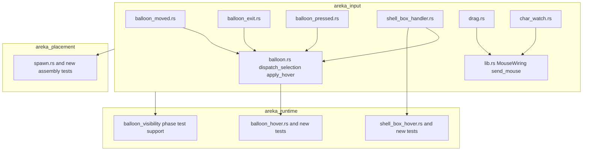
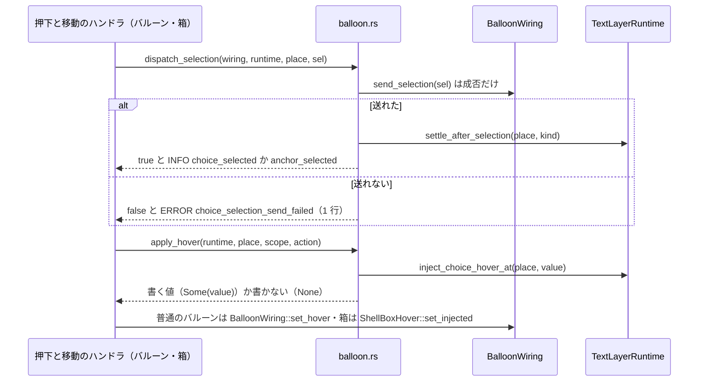

# 設計: audit-areka-input-menu（入力の出来事の crate `areka-input` の見直し）

## Overview

**目的**: `crates/areka-input/` に `/ponytail:ponytail-audit` をかけて出た 77 件の指摘（必ず直す 0・直したほうがよい 52・できれば 25）と、brief に預かった件 1〜11 を、要件の討議の結論（`requirements.md` の「要件の討議で確定したこと（2026-11-21）」）どおり全部直す。残すと裁定した指摘は 0 件、後の spec へ回した指摘も 0 件（指摘 31〜33 は持ち主の crate へ今回移す）。直し方はどれも「いちばん小さい完全な直し」で、消せるものは消し、使うテスト・検体・呼び出し元まで直し切る。

**使う人**: 開発者。テストが守っているつもりの枝（拡大率で割らないこと・折り返した選択肢の強調・ホイールの溜めの起こし直し・中断が運ぶトークの番号・選択の知らせの記録）を本当に守るようになり、本番の写し（選択の送り出し 2 か所・強調の当て方 3 か所・送出の警告 4 か所）が 1 か所ずつになり、古い説明（本体の中にあった頃の言い方・設計の札・変わった経緯の語）が消える。

**変わること**: SHIORI へ送るイベントの名・参照・送る条件、カーソルの形、本体が使う公開の項目の名と形は変わらない。外から見える変化はログの行だけで、次の 3 つ。⑴ 選択の送り出しが失敗したとき、WARN と ERROR の 2 行が ERROR 1 行になる（指摘 14・議題 6 の裁定）。⑵ バルーンの窓の離脱で結線が漏れているとき、`balloon_wiring_missing` が「1 行＋スコープの数」から 1 行になる（指摘 17）。⑶ 寄せた記録の出所（モジュールの道）が「設計の段で決めた事項」の表のとおり変わる（記録の名と名前つきの欄は変わらない・範囲の外の読み手は 0）。

### Goals

- 確定した 77 件と預かった件 1〜11 を全部直す。直したバグと危ない所の 1 件ずつに、壊れたら落ちる決定論のテストを置く（要件 4.1）。テストの弱さの指摘は、テストそのものが直し。
- 範囲の外へは、要件 7.4 に挙げたファイルと、直しに要る説明の文だけに触る。C24 の兄弟の触るファイルは申し送る（要件 7.9）。
- 直し終えたら同じ作法で audit をかけ直して新しい指摘 0 件、全体テスト緑（要件 9）。
- タスクは 16 前後（1 本の spec のまま・要件 2.6・確定の議題 9）。

### Non-Goals

- 新しい機能・依存の追加・`Cargo.lock` の変更・clippy の機械的な直し。
- 本体（`crates/areka/`）のファイルの変更（右クリックメニュー `menu/`・`file_drop*`・`app_exit_escape_tests.rs` を含む）。本体の説明の古びは申し送る（「並走の兄弟と申し送り」）。
- `areka-runtime`・`areka-placement`・wintf の、要件 7.4 に挙げたほかのファイルの変更（両方の `lib.rs`・`Cargo.toml` を含む）。挙げたファイルの中の古い doc（`shell_box_hover.rs:19` の `areka_input::shell_box::next_box_hover` の名指し）は、同じファイルを触るので一緒に直す。挙げたほかのファイルの古びは、見つけたら持ち主の brief へ申し送る（要件 7.6・7.11）。
- `areka-emo-text` の公開の面を増やすこと（強調の注入の値を読む口は足さない・設計の討議の確定 5）。
- `crash_report_tests.rs` の `install`・`installed` の使い方の変更（要件 7.12）。直すのは 7 行の説明の括弧だけ（指摘 42）。

## Boundary Commitments

### This Spec Owns

- `crates/areka-input/` の全部（`src/` の 49 ファイル・`Cargo.toml`・`cursor/README.md`）の、確定した指摘の直しと、そのためのテストの追加・直し・削除・名の変更。
- 本番の 3 つの寄せ先: 選択の送り出し（`balloon.rs` の `dispatch_selection`）・強調の当て方（`balloon.rs` の `apply_hover`）・マウスの送出（`lib.rs` の `MouseWiring::send_mouse`）。どれも crate の中の私有の関数で、公開の面は増えない。
- テストの支えの 3 ファイル（`balloon_test_support.rs`・`pointer_test_support.rs`・`drag_test_support.rs`）への寄せ。`pointer_test_support` に足す項目は `#[cfg(test)] pub(crate)` にし、本体が `*` で読む面を広げない（`test-support` だけの組み立てで使われない項目の警告も出さない）。
- 範囲の外の、要件 7.4 に挙げたファイルだけ: `areka-runtime` の `examples/collision-probe.rs`（63・66 行）・`examples/collision-probe/setup.rs`（75〜76 行）・`src/balloon_hover.rs` と `src/shell_box_hover.rs` の末尾のテストの mod の行と兄弟の新しいテストのファイル、`areka-placement` の `src/spawn.rs` の末尾のテストの mod の行と兄弟の新しいテストのファイル、`areka-runtime` の `src/shell_cursor_table.rs` の `CursorRows::get` とそのテスト（指摘 74）、移すテストの名を doc コメントで指す 3 行（`areka-placement` の `spawn_zorder_pair_deferred_tests.rs`・wintf の `zorder_pair_maintain_always_on_top_tests.rs`）。
- 申し送りの書き足し: `.kiro/specs/audit-areka-app/brief.md`（本体の名指し 2 件）と、`session-module-gather` のセッションへの伝言（`doc/COMPAT_ARCHITECTURE.md:412` のパス）。

### Out of Boundary

- 本体（`crates/areka/`）・`crates/real-run-kit/`・`crates/log-capture-kit/`・`vendors/`・`Cargo.lock`（要件 7.3・7.5・7.13）。
- `areka-runtime`・`areka-placement`・wintf の上に挙げたほかのファイル（要件 7.4）。`BalloonHover`・`ShellBoxHover`・`settle_box_hover`・`spawn_ghost_windows`・`RuntimeWiring`・`CursorRows` の公開の欄の形は変えない（`CursorRows` はメソッドを 1 つ足すだけ）。
- `areka-emo-text`・`areka-sylphya`・`wintf` ほかの crate（読むだけ）。
- `doc/COMPAT_ARCHITECTURE.md` の §8（`session-module-gather` が書き換える・要件 7.9）。向こうの着地の後なら 412 行のパスの 1 語だけをこちらで直す（「並走の兄弟と申し送り」）。
- 記録の名と名前つきの欄、範囲の外に読み手のある 4 つの出所（`areka_input::user_break`・`areka_input::char_watch::cursor_answer`・`areka_input::hover_region::cursor_pick`・`areka_input::throttle`）（議題 5）。

### Allowed Dependencies

- 今の依存だけ（`Cargo.toml` は触らない）: 本番は `wintf`・`areka-runtime`・`areka-placement`・emo 3 段・`areka-ghost`・`areka-kanade`・`areka-sakura`・`bevy_ecs`・`tracing`・`windows`。テストは今の dev-dependency（`log-capture-kit`・`areka-parsers`・`areka-sylphya`・`areka-seriko`・`areka-emo-atlas`・`test-support` つきの `areka-runtime`・`areka-placement`）。
- テストから使う既存の口: `areka_runtime::spine::{join_bounded, SPIN_WAIT, GpuPermit}`・`areka_runtime::balloon_visibility::phase::run_balloon_visibility_phase`・`areka_placement::spawn::test_support::{two_scope_placements, titles, ghost_window_entities}`・`SylphyaPublisher::barrier_within`・`wintf::ecs::world::tick_wake::take`・`log_capture_kit::{capture, capture_lines}`。
- 依存の向きは今のまま: `areka-input` → `areka-runtime` → `areka-placement`。移したテストは持ち主の crate の中だけを使う（`areka-input` を引かない）。
- 新しい依存は足さない。要ると分かったら直さずに議題にする（要件 6.6・6.7）。

### Revalidation Triggers

- **ログの出所（指摘 14・15・16）**: 「設計の段で決めた事項」の表の記録の出所が変わる。`RUST_LOG` に `areka_input::balloon::pressed`・`::moved`・`::exit`・`::shell_box_handler`・`::drag` を書いて記録を絞る手順を後から足す人は、この表で読み直す。
- **ログの行の数**: 選択の送り出しの失敗は ERROR 1 行（WARN は出ない）、離脱の結線漏れは 1 行。行の数を数える読み手はこれで読み直す。
- **`BalloonWiring::send_selection`**: 記録を出さず成否だけを返す（`pub(crate)`・crate の外の呼び手は 0）。
- **テストのファイル名**: `input_events_tests.rs`・`input_events_menu_tests.rs`・`input_events_char_clamp_tests.rs` が `char_pointer_tests.rs`・`char_pointer_menu_tests.rs`・`char_clamp_tests.rs` になる。`balloon_pass_through_tests.rs`・`user_break_talk_id_tests.rs` は消える。ファイルの名で指す説明は読み直す（範囲の外の読み手は「並走の兄弟と申し送り」の 3 件）。
- **テストの置き場**: `BalloonHover`・`settle_box_hover`・`spawn_ghost_windows` を試すテストは持ち主の crate（`areka-runtime`・`areka-placement`）に移る。持ち主の crate の見直しや分割をする spec は、これらも自分のテストとして数える。

## Architecture

### Existing Architecture Analysis

- `areka-input` は平らな置き方（`src/<name>.rs`）で、子モジュールは `#[path]` で兄弟のファイルに置く（`balloon` の下に `exit`・`moved`・`pressed`、`char_watch` の下に `cursor_answer`、`hover_region` の下に `cursor_pick`）。テストは `#[cfg(test)] #[path = "<name>_tests.rs"] mod tests;` の兄弟のファイル。ログの出所は既定の `module_path!()`（`target:` を書く呼び出しは 0）。
- バルーンの窓と箱の押下は、同じ純関数（`click_selection`・`hit_choice_row`・`hover_action`）で決め、送り出しと強調の当て方を各ハンドラが写して持つ（指摘 14・15）。マウスの送出は `MouseWiring` の私有の欄 `sender` を 4 か所が直に呼ぶ（指摘 16）。
- 本体は `use areka_input as input_events;` で出し直して使い、`pointer_test_support` を `*` で読む（要件 7.3 で名と形を変えない）。

### Architecture Pattern & Boundary Map



- **選んだ形**: 今の形のまま、写しを親のモジュール（`balloon.rs`・`lib.rs`）へ寄せる（research.md 8 節の案 A＋議題 3）。新しい本番のモジュール・型・機能は作らない。
- **寄せの決まり**: 寄せた関数は場所（`PlaceKey`・`MouseInput`）を引数に取り、記録の名は場所から決める。自前の記録の置き場が場所ごとに違う強調は、関数が書く値を返し、呼び手が書く。
- **守る既存の形**: 借用の順（`RuntimeWiring` から `Rc` を複製して World の借用を解く → 文字の層の不変借用で写しを取って解く → 持ち物へ書く・送る）・ログの先に立つ失敗（`error!` と戻り値）・UI スレッドの排他の系。
- **steering**: 依存を足さない・GPU の当たりを CPU へ戻さない（触らない）・イベントを投げて台本を待つ仕組みに判断を足さない（触らない）。

### Technology Stack

| Layer | Choice / Version | Role in Feature | Notes |
|---|---|---|---|
| 入力の層 | `areka-input`（ワークスペースの中）・`bevy_ecs`・`tracing`・`windows` 0.62.2 | 直しの本体 | 依存は変えない。`WHEEL_PAGESCROLL` は 0.62.2 に無いので自前の定義を残す（指摘 75） |
| テスト | `log-capture-kit`・`areka-runtime`（`test-support`）・`areka-placement`（`test-support`）・`areka-sylphya` | 落ちる力のあるテスト・待ちの上限 | `join_bounded`・`barrier_within(SPIN_WAIT)`・`run_balloon_visibility_phase`・`GpuPermit` を使う |

## File Structure Plan

### Directory Structure

```
crates/areka-input/src/
├── balloon.rs                    # dispatch_selection・apply_hover を置く（指摘 14・15）。mod 行から pass_through を外し gpu_hit を足す
├── balloon_gpu_hit_tests.rs      # 新: 実 GPU のハンドラ通し（拡大率 2.0・折り返し）（指摘 1・5）
├── char_pointer_tests.rs         # 名の変更: input_events_tests.rs（指摘 52）
├── char_pointer_menu_tests.rs    # 名の変更: input_events_menu_tests.rs（指摘 52）
├── char_clamp_tests.rs           # 名の変更: input_events_char_clamp_tests.rs（指摘 52）
├── balloon_pass_through_tests.rs # 消す（指摘 18）
└── user_break_talk_id_tests.rs   # 消す（user_break_tests.rs へ寄せる・指摘 51）
crates/areka-runtime/src/
├── balloon_hover_tests.rs        # 新: BalloonHover のテスト 2 本（指摘 31）
└── shell_box_hover_tests.rs      # 新: settle_box_hover のテスト 2 本（指摘 33）
crates/areka-placement/src/
└── spawn_assembly_tests.rs       # 新: spawn_ghost_windows だけを見る 13 本（指摘 32）
```

### Modified Files（範囲の中・本番）

| ファイル | 変えること | 指摘 |
|---|---|---|
| `balloon.rs` | `dispatch_selection`・`apply_hover` を足す。`BalloonWiring::send_selection` は記録を消し成否だけ。doc の削り・経緯の語・札・私有へのリンク。mod の行: `pass_through_tests` を消し `gpu_hit_tests` を足す。`capture_logs` などの支えは `balloon_test_support.rs` | 14・15・18・36・37・45・46・47・49 |
| `balloon_pressed.rs` | 送り出しの写し（155〜191）を `dispatch_selection` の呼び出しに替える。doc の削り・札 | 14・46・47・49 |
| `balloon_moved.rs` | 強調の適用（133〜166）を `apply_hover` に替える。doc の削り・札 | 15・47・49 |
| `balloon_exit.rs` | 結線の確かめを頭で 1 回にし、適用（143〜176）を `apply_hover` に替える。doc の削り・札・本体の名指し | 15・17・37・47・49 |
| `shell_box_handler.rs` | `send_selection`（318〜359）を `dispatch_selection` の呼び出しへ、`apply_highlight`（188〜224）を `apply_hover` の呼び出しへ。冒頭の `mod.rs`・本体の名指し・私有へのリンク | 14・15・36・37・45 |
| `shell_box.rs` | `#[cfg(test)] pub(crate) use … settle_box_hover;` の 2 行を消す。冒頭の `mod.rs` | 33・36 |
| `lib.rs` | `plan_and_send_move`・`send_double_click` の送出を `send_mouse` 経由に。`RegionSource::Mock` の `#[allow(dead_code)]` と理由の 2 行を消す。冒頭・508 行・本体の名指し・札・経緯の語・私有へのリンク・`with_clock` の解けないリンク。テストの mod の `#[path]` を新しい名へ | 16・35・36・37・45・46・47・52・68 |
| `drag.rs` | 送出を `wiring.send_mouse(..)` に。`notify_drag` は記録の名 `kind_name: &'static str` を引数に取り `kind_name` の `match` を消す。設計の札・経緯の語 | 16・46・47・69 |
| `balloon_wheel.rs` | `fn wheel_lines_from(lines: u32) -> WheelLines` に分け、`os_wheel_lines` はそれを呼ぶ。本体の名指し | 37・62・75 |
| `char_watch.rs` | 窓の巡回の前に `hover` を写し、`get_non_send` を 1 回にする。経緯の語（258・270 の文） | 37・46・73 |
| `choice_drain.rs` | `forward_all` の戻り値を外す。私有へのリンク・札・本体の名指し。中のテストは `crate::balloon::test_support::capture_logs` を使い、私有の写し（240〜256）を消す | 24・37・45・46・47・49・72・件 10 |
| `throttle.rs` | 3 つの分岐を `MouseMoveThrottle { last_pos: Some(pos), ..state.clone() }` の形に。doc の削り | 49・70 |
| `user_break.rs` | `press_with_visibility` の早い戻り（270）を外し、`balloon_break_detected` の trace は判定が `NotDoubleClick` でないときだけ出す。201・220 のパスを関数の名へ。本体の名指し・私有へのリンク。`talk_id_tests` の mod の行を消す | 37・38・45・51・71・件 9 |
| `hover_region.rs` | `send` の包みを消し `HoverSend { edge, surface, region }` を直に書く（呼び手 6 か所）。札（47 行） | 47・76 |
| `cursor_pick.rs`・`click.rs`・`wheel.rs`・`hooks.rs`・`cursor_answer.rs` | 札・本体の名指し・経緯の語だけ | 37・46・47 |
| `crash_report_tests.rs` | 7 行の「（とプロセスの寿命の MTA）」を消す（`install`・`installed` の使い方は変えない） | 42 |
| `crates/areka-input/cursor/README.md` | 69 行のパスを `crates\areka-input\cursor\` に、50 行の「（要件 6.2）」を消す | 44・50 |

### Modified Files（範囲の中・テスト）

| ファイル | 変えること | 指摘 |
|---|---|---|
| `balloon_test_support.rs` | 足す: `empty_runtime`・`bubble_move`・`left_press`・`insert_wiring`（`BalloonWiring`＋`BalloonHover`）・`plain_model(origin)`・`gpu_balloon_world`・`runtime_wiring_showing_talk`・`box_name(shell, name)`・`events_named`。`capture_logs` は `pub(crate)`。説明の塊（169〜182）と経緯の語・札を消す | 3・5・10・24・25・43・46・47・65・66 |
| `balloon_choice_settle_tests.rs` | GPU の組み立てを `gpu_balloon_world` に。1 回目の押下を `capture_logs` で包み INFO `choice_selected` が 1 行出ることを見る。`left_press` は支えから | 8・25・47 |
| `balloon_gpu_hit_tests.rs`（新） | 拡大率 2.0 のハンドラ通し 1 本・折り返しの強調 1 本（下の Testing Strategy） | 1・5 |
| `balloon_pure_core_tests.rs` | ÷k の檻 (b)（247〜253）と持ち上げの檻（186〜212）を消す。stale の 2 本（434〜472）を消す。`row_with_refs` を構造体の更新に。`apply_hover` の単体テスト（注入の到達・`ResetOwnState` は注入しない・借用の失敗は ERROR 1 行で書かない）。札・経緯の語 | 1・3・15・19・26・46・47 |
| `balloon_pointer_handler_tests.rs` | `try_borrow_mut().is_ok()` の表明 3 か所を消す。シナリオ表と重なる 6 本（43〜107・289〜391 の 6 本）を消す。組み立ての写しは支えから。古い説明（9〜14・263〜267・304〜305・509〜526）と札を消す | 3・20・25・43・47・77 |
| `balloon_leave_tests.rs` | `try_borrow_mut().is_ok()` を消す。`hover_flag_tests` と同じ離脱の組み立て（131〜155）を 1 本にまとめ両方の持ち物を表明する。組み立ての写しは支えから。離脱のスコープの重複除けと借用の失敗の記録のテストを足す | 3・25・27・47・63 |
| `balloon_hover_flag_tests.rs` | 独立のテスト（125〜152）を消す。`BalloonHover` だけを見る 2 本（62〜68・306〜324）を `areka-runtime` へ移す。同じ離脱の組み立て（257〜280）は `leave_tests` へまとめる。組み立ての写しは支えから。説明「下 2 本」と札 | 4・25・27・31・43・47 |
| `balloon_wiring_tests.rs` | derive の 3 本（20〜64）と系の数の重なり（295〜310）を消す。`BalloonHover`・`ShellBoxHover` の在の表明を足す。配置の支えの写し（157〜191）を `areka_placement::spawn::test_support` の import に。本体の名指しと札 | 6・21・22・23・25・47・48 |
| `balloon_wheel_tests.rs`・`balloon_pressed_tests.rs` | 「Moved」の後に `ScrollChange::Stopped` を表明。`wheel_lines_from` のテスト 1 本。押下の借用の失敗の記録のテスト（`balloon_pressed_tests.rs`）・ホイールの借用の失敗の記録のテスト（`balloon_wheel_tests.rs`）。経緯の語・札 | 7・25・46・62・63 |
| `char_pointer_tests.rs`（旧 `input_events_tests.rs`） | `ghost_count` の表明を `!AppExit.is_requested()` に替え説明を直す。メニュー側と重なる Ctrl＋左の 1 本（368〜414）・Ctrl なしの 1 本（416〜442）・右版の送出（154〜185）を消す。362 の説明を「強制退避は本体の強制退避のテストが見る」に。`mouse_send_failed` の記録のテスト 1 本。本体の名指し・札・経緯の語 | 2・29・30・39・46・47・48・52・63・67・件 3・件 4 |
| `char_pointer_menu_tests.rs`（旧 `input_events_menu_tests.rs`） | 支えの写し 3 つ（23〜63）を消し `pointer_test_support::*` を使う。`ghost_count` の表明（198）を `!AppExit.is_requested()` に・161〜162 の説明を直す。165〜166 の本体の名指し・経緯の語とテスト名 `…_old_immediate_path` | 2・28・46・48・52・件 3 |
| `char_clamp_tests.rs`（旧 `input_events_char_clamp_tests.rs`） | `MouseWiring::new` を `world_with_wiring` に | 52・64 |
| `pointer_test_support.rs` | `bubble_pointer` を `bubble_pointer_mods(.., false)` の 1 行に（名と形は変えない）。足す（`#[cfg(test)] pub(crate)`＝`test-support` だけで組む本体のテストの組み立てで使われない項目にしない）: `fake_hit`（`scaled`・`fake_hit` の写像）・`drain_mouse`。24〜25 の経緯の語 | 46・53・55・56 |
| `click_tests.rs` | `scaled` と drain を支えから。落ちようの無い 1 本（128〜139）を消す。大きさの無い窓の解放のテストを足す。`MouseWiring::new` を `world_with_wiring` に。テスト名 `keeps_its_return_value` と経緯の語 | 46・53・55・58・60・64 |
| `char_watch_tests.rs` | drain を支えから。`rig()` がファイルの中の錠を持つ。溜めの起こし直しの表明を足す | 9・55 |
| `drag_test_support.rs` | `close()` は `join_bounded` を、`saved()` は `barrier_within(SPIN_WAIT)` を使う。`fake_hit`・drain を `pointer_test_support` から。`offset`・`add`・`sub`・`begin_drag` を受け、`WORK_AREA` は `pub(super)`。経緯の語 | 34・46・53・54・55・57・件 11 |
| `drag_tests.rs`・`drag_sticky_tests.rs` | 写し（`offset`・`add`・`sub`・`begin_drag`・`begin`・`1200`）を支えから。札（A1〜A9・2.1）・経緯の語 | 46・47・54・57 |
| `cursor_pick_tests.rs`・`hover_region_tests.rs` | `pick` の包みを消し `pick_shape` を直に。札（表の行・要件の番号）とテスト名の `row01_`〜`row13_` を外す | 47・59 |
| `cursor_answer_tests.rs` | 同梱の手の形を `assert_eq` で比べる。2 段目（descript の差し替え）を区別するテストを足す | 12・61 |
| `shell_box_handler_tests.rs` | 組み立てを `world_with_wiring` に替え 383 を `== 1` に。`lines_of` を `events_named` に。`name`・`row` の写しを支えから。結線漏れ 3 枝（`shell_box_hover_missing`・`balloon_wiring_missing`・`box_break_no_wiring`）のテスト。`mod.rs` と経緯の語 | 11・46・48・63・65・66 |
| `shell_box_tests.rs` | 487 の後半・504〜508 を消す。`settle_box_hover` の 2 本（471〜509）を `areka-runtime` へ移す。`name`・`row`・`anchor_row` の写しを支えから。経緯の語 | 13・33・46・66 |
| `spawn_assembly_tests.rs` | `spawn_ghost_windows` だけを見る 13 本を `areka-placement` へ移し、ハンドラの装着の 1 本（175）だけを残す（名の `t_i1_` を外す）。167〜173 の言い方を `crate::` に | 32・40・47・件 5 |
| `user_break_tests.rs` | `user_break_talk_id_tests.rs` の 1 本を末尾へ寄せる。トークの番号の結線のテスト 1 本を足す。`named` を `events_named` に。5〜16 の一覧の言い直し（18〜21 の GPU の理由は残す）・札（87・109・361・387）・本体の名指し（713） | 10・47・48・49・51・65 |
| `wheel_tests.rs`・`hooks_tests.rs`・`throttle.rs` の中のテスト | 経緯の語と札だけ（見つかれば） | 46・47 |

### Modified Files（範囲の外）

| ファイル | 変えること | 根拠 |
|---|---|---|
| `crates/areka-runtime/examples/collision-probe.rs` | 63 行の理由を依存の向き（`areka-input` が `areka-runtime` に依存するので example から使えない）に。66 行のファイル名を `char_pointer_tests.rs` に | 件 6・指摘 41・52・要件 7.4 の 1 |
| `crates/areka-runtime/examples/collision-probe/setup.rs` | 75〜76 行の理由を依存の向きに | 件 6・指摘 41 |
| `crates/areka-runtime/src/balloon_hover.rs` | 末尾に `#[cfg(test)] #[path = "balloon_hover_tests.rs"] mod tests;` の 3 行 | 指摘 31・要件 7.4 の 2 |
| `crates/areka-runtime/src/balloon_hover_tests.rs`（新） | `balloon_hover_defaults_to_false_for_every_scope`・`clear_balloon_hover_clears_that_scope_only_and_is_idempotent` | 指摘 31 |
| `crates/areka-runtime/src/shell_box_hover.rs` | 末尾に `#[cfg(test)] #[path = "shell_box_hover_tests.rs"] mod tests;` の 3 行・`//!` の「入力の側は `pub(crate) use` で出し直す」（再輸出を消すと古びる）と 19 行の `areka_input::shell_box::next_box_hover` の名指しを今の事実に | 指摘 33 |
| `crates/areka-runtime/src/shell_box_hover_tests.rs`（新） | `settle_drops_vanished_box`・`hover_mark_does_not_survive_vanished_text`（滞在は `ShellBoxHover::set` で直に置く形に書き直す）。箱の名前は `fold_boxes`＋`parse_boxes` で作る（`shell_box_assets_tests.rs` と同じ作法） | 指摘 33 |
| `crates/areka-placement/src/spawn.rs` | 末尾の mod の並びに `#[cfg(test)] #[path = "spawn_assembly_tests.rs"] mod assembly_tests;` の 3 行 | 指摘 32 |
| `crates/areka-placement/src/spawn_assembly_tests.rs`（新） | 13 本を移す。import は `super::…`・`super::test_support::…`・`crate::…` に。名の札 `t_i1_`〜`t_i3_` と中の札・経緯の語は移すときに消す | 指摘 32・47 |
| `crates/areka-placement/src/spawn_zorder_pair_deferred_tests.rs` | 17・152 行の doc コメントのテストの名の 1 語 | 指摘 47・設計の討議の議題 4 |
| `crates/wintf/src/ecs/window/zorder_pair_maintain_always_on_top_tests.rs` | 342 行の doc コメントのテストの名の 1 語 | 指摘 47・設計の討議の議題 4 |
| `crates/areka-runtime/src/shell_cursor_table.rs` | `CursorRows::get`（借りた `&str` で引く）と私有の鍵の trait。公開の欄の型は変えない | 指摘 74・設計の討議の議題 3 |
| `crates/areka-runtime/src/shell_cursor_table_tests.rs` | `get` のテスト 1 本 | 指摘 74 |
| `.kiro/specs/audit-areka-app/brief.md` | 件を 2 つ書き足す（「並走の兄弟と申し送り」） | 要件 7.9〜7.11 |

### 1,000 行の見通し（要件 6.1）

| ファイル | 今 | 直した後の見込み |
|---|---|---|
| `balloon_pointer_handler_tests.rs` | 874 | 約 690（6 本と古い説明と組み立ての写しを消す） |
| `user_break_tests.rs` | 853 | 約 920（寄せる 1 本＋足す 1 本・説明の削り） |
| `shell_box_handler_tests.rs` | 719 | 約 770（結線漏れのテスト 3 本） |
| `char_pointer_tests.rs`（旧 `input_events_tests.rs`） | 699 | 約 590 |
| `balloon_test_support.rs` | 197 | 約 330 |
| `balloon.rs` | 429 | 約 420（関数 2 つを足し、doc を削る） |
| `crates/areka-placement/src/spawn_assembly_tests.rs`（新） | — | 約 520 |
| `crates/areka-placement/src/spawn.rs` | 788 | 791 |

越えそうなら足すテストを新しい兄弟のファイルへ置く。番人の上限越えの表（`log-capture-kit`）には足さない。

## System Flows

### 寄せた後の選択の押下と強調（指摘 14・15）



- 箱の押下の `balloon_wiring_missing`（結線漏れ）は、`BalloonWiring` を引く呼び手（`shell_box_handler.rs`）に残る。普通のバルーンの押下は今どおり上で確かめ済み。
- 強調の適用の前の、文字の層の不変借用で写しを取る段（`balloon_runtime_borrow_failed` の「スナップショット」の記録）は呼び手に残る。

## Requirements Traceability

| 要件 | 要約 | 設計の要素 |
|---|---|---|
| 1.1・1.2・1.3・1.4・1.5・1.6・1.7 | audit の洗い出し・数え直し・行の当て直し | ギャップ分析で済み（research.md 1〜5 節）。設計は 1〜77 と件 1〜11 をそのまま入力にする（「指摘ごとの直し」） |
| 2.1 | 確定した一覧を残す | requirements.md の確定の節（済み）。設計は全件を「指摘ごとの直し」に持つ |
| 2.2・2.3 | 裁定を仰ぐ 3 種類・ukadoc で確かめる | 当たるものは 0 件（SSP 互換・SHIORI へ送るものはどれも変えない）。設計の段で見つかった判断は設計の討議で確定した（末尾の節） |
| 2.4 | 当たらないものは直す | 全件を作業の組 G1〜G16 に割り当てた |
| 2.5 | 残す裁定の記録 | 残す裁定は 0 件（指摘 74 も直す＝設計の討議の確定 3） |
| 2.6 | 20 タスクを越えるなら 2 本目 | 「タスクの見込み」16 前後 |
| 3.1・3.2 | 3 つの組を全部直す | 「指摘ごとの直し」の 77 行 |
| 3.3 | 使う所まで直し切る | File Structure Plan の 3 つの表・「消す・名を変えるときの照合」 |
| 3.4 | 消す前にツリー全体で確かめる | 「消す・名を変えるときの照合」（`git grep` の的を列挙） |
| 3.5 | いちばん小さな完全な変更 | 「Architecture」の選んだ形・新しいモジュールと依存を作らない |
| 4.1・4.2 | 直したものに落ちるテスト・赤を先に | Testing Strategy の「壊れたら落ちるテスト」（どの本番の行を壊すと赤になるかを書く） |
| 4.3 | 決定論 | 注入の時計（`world_with_wiring`）・錠で順に回す起こしの確かめ・`GpuPermit`・前提の表明 |
| 4.4 | 全体テストの中で回る | 新しいテストはどれも `#[test]` の兄弟のファイル（`cargo test` の通常の走行） |
| 4.5 | 一時フォルダは `target` の下 | 新しいテストはファイルを書かない（カーソルの検体はメモリのバイト列・記憶は偽の IO） |
| 4.6 | GPU は実 GPU | `balloon_gpu_hit_tests.rs` と `balloon_choice_settle_tests.rs` は `GraphicsCore::new` の実 GPU |
| 4.7 | 古びたテストを改める | 指摘 2・7・11・12 の表明の差し替え・消すテストは名指しの照合つき |
| 5.1・5.2・5.3・5.4・5.5・5.6・5.7・5.8・5.9・5.10・5.11 | 件 1〜11 | 「預かった件の片づけ」の表 |
| 5.12 | 件の記録 | G15（`research.md` の新しい節に、件ごとの出どころと直した所を残す＝完了した audit の spec と同じ置き場） |
| 6.1 | 1,000 行 | 「1,000 行の見通し」 |
| 6.2 | 記録の無い失敗の道を作らない | 寄せた関数は失敗の記録を持ったまま（`balloon_runtime_borrow_failed`・`choice_selection_send_failed`・`mouse_send_failed`）。`join_bounded`・`barrier_within` は失敗を `expect` で落とす |
| 6.3 | 終了の道を正規に | 書き手のスレッドの後始末を有界の join に（指摘 34）。強制退避の口は触らない |
| 6.4 | 1 フレーム遅らせない | 状態の順を変える直しは無い（指摘 71 の trace の位置替えも同じ巡の中で記録の順が同じ） |
| 6.5 | 文字化けをコンソールで逃げない | 当たる直しは無い |
| 6.6・6.7・6.8 | 依存を足さない・フォークしない | Allowed Dependencies（`Cargo.toml`・`Cargo.lock` は触らない） |
| 6.9 | GPU の当たりを CPU へ戻さない | 当たりの解決の道（`resolve_hit_owned`）は触らない |
| 6.10 | イベントを投げる仕組みに判断を足さない | 足す判断は無い（寄せと説明とテストだけ） |
| 7.1 | 呼び出し元を全部直す | 形を変えるのは私有の関数だけ（`send_selection`・`notify_drag`・`forward_all`・`hover_region::send`）。呼び手は crate の中（File Structure Plan） |
| 7.2 | 兄弟と申し合わせてから触る | 「並走の兄弟と申し送り」 |
| 7.3 | 本体のファイルと公開の項目の名と形 | 本体は 0 行。`pointer_test_support` の既存の項目は名と形を保ち、足す項目は `#[cfg(test)] pub(crate)` |
| 7.4 | `areka-runtime`・`areka-placement` は挙げた所だけ | File Structure Plan の「範囲の外」の表 |
| 7.5 | `Cargo.lock`・`log-capture-kit` | 0 行 |
| 7.6 | 範囲の外は要る変更だけ | 範囲の外の古びは申し送り（直さない） |
| 7.7・7.8 | 外への約束の変化は裁定の分だけ・読み手を直す | ログの行の変化は議題 6 の 1 件と指摘 17（設計の討議の確定 2）。出所の変化の表（読み手 0） |
| 7.9・7.10・7.11 | 申し送り | 「並走の兄弟と申し送り」 |
| 7.12 | `crash_report_tests.rs` の使い方 | 7 行の説明の括弧だけ（指摘 42） |
| 7.13 | `vendors/` | 0 行 |
| 8.1・8.2・8.3・8.4・8.5 | 副作用の大きい操作をしない | 実機の確かめも SSP の測りも要らない（どの直しも決定論のテストで確かめる）。重い走行は G16 の全体テスト 1 回と、赤になったテストだけの回し直し |
| 9.1・9.2・9.3・9.4・9.5・9.6・9.7・9.8 | かけ直しと仕上げ | G16（「確かめの段」）。9.6〜9.8 の打ち切り・Fable での総括・連鎖のまとめは要件のとおり |

## Components and Interfaces

### 一覧

| 部品 | 置き場 | 役目 | 要件 | 契約 |
|---|---|---|---|---|
| `dispatch_selection` | `balloon.rs` | 選択の送り出し・済み・記録を 1 か所に | 3.1・6.2・7.7 | Service |
| `apply_hover` | `balloon.rs` | 強調の決定を場所へ当てる | 3.1・6.2 | Service |
| `MouseWiring::send_mouse` | `lib.rs`（既にある） | マウスの送出と `mouse_send_failed` | 3.1・6.2 | Service |
| `wheel_lines_from` | `balloon_wheel.rs` | OS の行数を `WheelLines` へ写す純関数 | 4.1 | Service |
| バルーンのテストの支え | `balloon_test_support.rs` | 組み立て・GPU の World・番号を見せる結線・記録の捕捉 | 4.1・4.3・4.6 | State |
| ポインタのテストの支え | `pointer_test_support.rs` | 写像・取り出しの 1 か所 | 3.1 | State |
| ドラッグのテストの支え | `drag_test_support.rs` | 有界の後始末・写しの受け | 5.11・6.3 | State |
| 移したテスト | `areka-runtime`・`areka-placement` の新しい兄弟 | 持ち主の crate で持ち物を試す | 7.4 | — |

### `dispatch_selection`（指摘 14）

```rust
/// 選択を送り、送れたら場所の選択肢を済みにして記録する。送れたら `true`。
pub(super) fn dispatch_selection(
    wiring: &BalloonWiring,
    runtime: Option<&Rc<RefCell<TextLayerRuntime>>>,
    place: &PlaceKey,
    sel: ChoiceSelection,
) -> bool;

impl BalloonWiring {
    /// 発行シンクへ送る（記録はしない）。受け口が無ければ `false`。
    pub(crate) fn send_selection(&self, selection: ChoiceSelection) -> bool;
}
```

- 事前: 呼び手が `BalloonWiring` を引き終えている（箱は引けなければ今どおり `balloon_wiring_missing` を出して `false`）。
- 送れた: `runtime` が在れば `settle_after_selection(runtime, place, kind)`。INFO を 1 行（名は `selection_events(kind).0`・欄は `scope`・`id`・`label`・`references_len`、場所が箱なら続けて `box`）。
- 送れない: ERROR を 1 行（名は `selection_events(kind).1`・欄は `scope`・`id`）。WARN は出さない。
- `box` の欄は `Option<&str>`（`place.place` が `TextPlace::Box(name)` なら `Some(name.as_str())`）で書き、普通のバルーンでは欄が出ない（tracing は `None` の欄を書かない）。文は今の 2 つの字面を場所で選ぶ（設計の討議の確定 1）。
- 普通のバルーンの呼び手は `Some(&runtime)` と `PlaceKey::balloon(&actor)`、箱の呼び手は `runtime_of(world).as_ref()` と `box_place(scope, &hit.name)` を渡す。

### `apply_hover`（指摘 15・3）

```rust
/// 強調の決定を場所へ当てる。自前の記録に書く値を返す（`None` は書かない）。
pub(super) fn apply_hover(
    runtime: &RefCell<TextLayerRuntime>,
    place: &PlaceKey,
    scope: usize,
    action: HoverAction,
) -> Option<Option<usize>>;
```

- `NoopInactive`・`Keep` → `None`（何もしない）。`ResetOwnState` → `Some(None)`（注入しない・上流が正本）。
- `Inject(value)` → `try_borrow_mut` に失敗したら ERROR `balloon_runtime_borrow_failed`（欄 `scope`）を 1 行出して `None`。借りられたら `inject_choice_hover_at(place, value)`、DEBUG を 1 行（普通のバルーンは `choice_hover_inject`・欄 `scope`・`ordinal`、箱は `box_choice_hover_inject`・欄 `scope`・`box`・`ordinal`）、`Some(value)`。
- 呼び手: `balloon_moved.rs`・`balloon_exit.rs` は `Some(v)` なら `BalloonWiring::set_hover(scope, v)`、`shell_box_handler.rs` は `ShellBoxHover::set_injected(scope, v)`。`moved` は今どおり処理の後 `false` を返し、`exit` は次のスコープへ進む。

### `send_mouse` への寄せ（指摘 16・69）

- `plan_and_send_move` は `self.send_mouse(MouseInput { .., kind: Move }, "move")` の戻り値を返す。`send_double_click` は `self.send_mouse(.., "double_click");`。
- `drag.rs` の `notify_drag(world, entity, target, screen, kind, kind_name: &'static str)`: 呼び手（ドラッグの始めと終わりの 2 か所）が `"drag_start"`・`"drag_end"` を渡し、6 腕の `match` を消す。送出は `wiring.send_mouse(input, kind_name);`（`send_mouse` は crate の根の私有のメソッドで、子のモジュールから呼べる）。`&mut` は要らないので `get_non_send` で足りる。

### テストの支え（指摘 10・25・53〜57・65・66）

```rust
// balloon_test_support.rs（すべて #[cfg(test)]・pub(crate) か pub(super)）
pub(crate) fn empty_runtime() -> Rc<RefCell<TextLayerRuntime>>;
pub(crate) fn bubble_move(x: i32, y: i32) -> Phase<PointerState>;
pub(crate) fn left_press(x: i32, y: i32) -> Phase<PointerState>;
pub(crate) fn insert_wiring(world: &mut World) -> mpsc::Receiver<ChoiceSelection>;
pub(crate) fn plain_model(origin: (i32, i32)) -> BalloonModel;
/// 実 GPU の World に普通のバルーンの窓（scope 0）と差し込み口を置き、文字の層を拡大率 `scale` で
/// 登録して 1 回提示する。COM の MTA は呼ぶ側のスレッドで初期化する。`GpuPermit` は呼ぶ側が持つ。
pub(crate) fn gpu_balloon_world(
    rt: &Rc<RefCell<TextLayerRuntime>>,
    scale: f32,
    image: (u32, u32),
    origin: (i32, i32),
) -> (World, Entity);
/// トークの番号 `talk_id` を見せている `RuntimeWiring`（装着前・GPU 不要）。
/// 表示の線へ `TalkStarted` を積み、可視性の相を 1 回回して置く。
pub(crate) fn runtime_wiring_showing_talk(talk_id: TalkId) -> RuntimeWiring;
pub(crate) fn box_name(shell: &str, name: &str) -> BoxName;
pub(crate) fn events_named<'a>(events: &'a [CapturedEvent], name: &str) -> Vec<&'a CapturedEvent>;
pub(crate) fn capture_logs<F: FnOnce()>(f: F) -> Vec<String>;

// pointer_test_support.rs（足すものは #[cfg(test)] pub(crate)・既存の pub の名と形は変えない）
pub(crate) fn fake_hit(scope: u32, x: i64, y: i64) -> HitRegion;
pub(crate) fn drain_mouse(rx: &mpsc::Receiver<KanadeMsg>) -> Vec<MouseInput>;
```

- `runtime_wiring_showing_talk` は `headless_runtime_wiring` と同じ組み立てで、表示の線の受け口だけを自分で作った送り手と組にする（`headless_runtime_wiring` の形は変えない）。中で `areka_runtime::balloon_visibility::phase::run_balloon_visibility_phase(&mut wiring, &mut World::new())` を回し、`wiring.shown_talk_id() == Some(talk_id)` を表明してから返す（組めないときに黙って `None` のまま進まない）。
- `drain_mouse` は「マウス以外が来たら panic」の今の扱いを保つ。`fake_hit` は `click_tests.rs:246-252` の `scaled` と `drag_test_support.rs:52-58` の `fake_hit` の同じ写像。

### ドラッグのテストの後始末（指摘 34・件 11）

- `close(self)`: `self.parts.publisher.close();` の後、`areka_runtime::spine::join_bounded("sylphya", self.parts.handle).expect("sylphya のアクターが panic せずに終わる")`。30 秒（`SPIN_WAIT`）で終わらなければ `join_bounded` が panic する。
- `saved(&self)`: `self.parts.publisher.barrier_within(areka_runtime::spine::SPIN_WAIT).expect(..)`。期限越えは `ReplyError::Timeout` と `error!` 1 件で、`expect` がテストを落とす。

## 指摘ごとの直し

作業の組（G）は「タスクの見込み」の単位。「テスト」の列は壊れたら落ちるテスト（新しく立てる・強める）か、テストそのものが直しのもの。

| # | 組 | 直し方 | テスト |
|---|---|---|---|
| 1 | G5 | ÷k の檻 (b) と持ち上げの檻を消し、拡大率 2.0 で移動と押下のハンドラを通す 1 本を足す。`balloon.rs:208-211` の doc の「檻が固定する」を消す | `balloon_gpu_hit_tests.rs` の拡大率 2.0 の 1 本 |
| 2 | G6 | `ghost_count` の表明を `!AppExit.is_requested()` に替え、説明を「枝へ入れば終わりの指示が立ち、`try_recv` も空になる」に | 差し替えた表明（`hooks::escape` の枝へ入れば赤） |
| 3 | G2 | 4 か所の `try_borrow_mut().is_ok()` を消す。注入の到達と場所の取り違えは `apply_hover` の単体テストで見る（下の Testing Strategy の「場所を見分ける注入」） | `apply_hover` の単体テスト |
| 4 | G8 | 独立のテスト（125〜152）を消す | — |
| 5 | G5 | 長い選択肢を狭い画像で折り返させ、index と ordinal が食い違う行の上の移動で `hover(0) == Some(row.ordinal)` を見る | `balloon_gpu_hit_tests.rs` の折り返しの 1 本 |
| 6 | G6 | `wire_inserts_both_non_sends` に `BalloonHover`・`ShellBoxHover` の在の表明を 2 行 | 表明（入れ忘れで赤） |
| 7 | G6 | 各テストの最後に `matches!(newer_by_one(..), ScrollChange::Stopped(_))` | 表明（2 行送りで赤） |
| 8 | G5 | `balloon_choice_settle_tests.rs` の 1 回目の押下を `capture_logs` で包み、INFO `choice_selected` が 1 行 | 表明 |
| 9 | G6 | 溜めの残る `Wait` の後で `tick_wake::take(Instant::now() + 40ms)` の `deadline_due` を見る（直前に 1 回 `take` で倒す）。`rig()` がファイルの中の錠を持ち、溜めを作るテストを順に回す | 表明（`char_watch.rs:250-254` を消すと赤） |
| 10 | G7 | `runtime_wiring_showing_talk(TalkId(7))` を置き、`press_with_visibility`（可視を `Some(true)` で渡す既存のテストの形・GPU 無しでは可視のバルーンを作れないため）と `on_box_press` の中断が `KanadeMsg::UserBreak { talk_id: Some(TalkId(7)) }` を運ぶことを 1 本で見る | `user_break_tests.rs` の 1 本（入口が `None` を渡すと赤） |
| 11 | G6 | 組み立てを `world_with_wiring` に替え、383 を `== 1` | 表明 |
| 12 | G6 | `assert_eq!(bundled(0, BUNDLED[0].1, cursor_size_for_dpi(96)), ..)` で比べる | 表明 |
| 13 | G6 | 487 の後半と 504〜508 を消す（離脱は `shell_box_handler_tests.rs:415` が見る） | — |
| 14 | G1 | `dispatch_selection` へ寄せ、`send_selection` は成否だけ | 受け口を落とした `dispatch_selection` で ERROR 1 行・WARN 0 行（選択肢とアンカーの 2 種類）。成功の INFO は指摘 8 と拡大率 2.0 の 1 本 |
| 15 | G2 | `apply_hover` へ寄せる（3 か所） | 既存の `choice_hover_inject` の表明（`balloon_pointer_handler_tests`・`balloon_leave_tests`）と箱の強調のテスト＋指摘 3 の単体テスト |
| 16 | G3 | 残り 3 か所を `send_mouse` 経由に | 受け口を落とした `MouseWiring` で移動・ダブルクリック・ドラッグの始めの送出が `mouse_send_failed` を 1 行ずつ（`kind` の欄つき） |
| 17 | G1 | 離脱の系の頭で `BalloonWiring` を 1 回確かめ、無ければ記録して戻る。ループの中は `.expect` | 2 スコープの離脱で `balloon_wiring_missing` が 1 行（既存の `leave_without_balloon_wiring_reports_error` を強める） |
| 18 | G5 | `balloon_pass_through_tests.rs` と `balloon.rs:415-417` を消す | — |
| 19 | G8 | stale の 2 本を消す | — |
| 20 | G8 | シナリオ表と重なる 6 本を消す | — |
| 21 | G8 | derive の 3 本を消す | — |
| 22 | G8 | 295〜310 を消す | — |
| 23 | G8 | 写しを消し `areka_placement::spawn::test_support::{two_scope_placements, titles}` を import | — |
| 24 | G8 | `choice_drain` のテストが `crate::balloon::test_support::capture_logs`（`pub(crate)`）を使い、写しと説明の塊を両方消す | — |
| 25 | G8 | (a)(b)(c) を `balloon_test_support.rs` の 4 つに寄せる | — |
| 26 | G8 | `ChoiceHitRow { references, ..row(..) }` | — |
| 27 | G8 | 2 本を `balloon_leave_tests.rs` の 1 本にし、`BalloonHover` と `BalloonWiring` の両方を表明 | — |
| 28 | G9 | `use super::pointer_test_support::*` にして 3 つを消す | — |
| 29 | G9 | `char_pointer_tests.rs` の 368〜414 を消し、メニュー側の 1 本に残す | — |
| 30 | G9 | 416〜442 を消す。本体 `app_exit_escape_tests.rs:73` の名指しは申し送り（議題 4） | — |
| 31 | G10 | 2 本を `crates/areka-runtime/src/balloon_hover_tests.rs` へ移す | 移した 2 本 |
| 32 | G10 | 13 本を `crates/areka-placement/src/spawn_assembly_tests.rs` へ移す | 移した 13 本 |
| 33 | G10 | 2 本を `crates/areka-runtime/src/shell_box_hover_tests.rs` へ移し、`shell_box.rs:18-19` の再輸出を消す | 移した 2 本 |
| 34 | G11 | `join_bounded`・`barrier_within(SPIN_WAIT)`（上の「ドラッグのテストの後始末」） | アクターの panic と詰まりが `expect` で落ちる |
| 35 | G12 | `lib.rs:508` を「右クリックメニューは本ハンドラでは扱わない（引き金は右ボタンの解放）」だけに | — |
| 36 | G12 | 本体の中にあった頃の説明を、crate の根の受け手・依存の向き `areka_input → areka_placement` で書き直す | — |
| 37 | G12 | 本体の呼び手の道つきの名指しを役目で書く（名で指すなら関数名だけ） | — |
| 38 | G12 | 201・220 のパスを `fn wire_readme`・`EcsWorld::new` に | — |
| 39 | G13 | 362 を「強制退避は本体の強制退避のテストが見る」に | — |
| 40 | G13 | 167〜171 を `crate::`・「この crate」に（残す 1 本の説明） | — |
| 41 | G14 | `collision-probe.rs:63`・`setup.rs:75-76` の理由を依存の向きに | — |
| 42 | G13 | 括弧を消す | — |
| 43 | G13 | 古い説明を消す（`balloon_pass_through_tests.rs` の分はファイルごと消える） | — |
| 44 | G14 | `crates\areka-input\cursor\` に | — |
| 45 | G12 | 私有へのリンク 18 と解けないリンク 1 を名だけ（バッククォート）にするか doc を短く | `cargo doc -p areka-input --no-deps` の警告 0（G16 で確かめる） |
| 46 | G12・G13 | 本番の分は G12、テストの分は G13（ほかの組が同じファイルを触るなら、その組で一緒に直す）。ログの文（`char_watch.rs:270`）も直す。テスト名 `keeps_its_return_value`・`…_old_immediate_path` を今の振る舞いの名に | — |
| 47 | G12・G13 | 札と番号を消して文だけに。テスト名の `row01_`〜`row13_` を外す。`t_i1_`〜`t_i3_` は、入力に残る 1 本も移す 13 本も外す。名指す範囲の外の doc コメント 3 行（`areka-placement` の `spawn_zorder_pair_deferred_tests.rs` 17・152 行、wintf の `zorder_pair_maintain_always_on_top_tests.rs` 342 行）の名の 1 語も同じ変更で直す（設計の討議の議題 4） | — |
| 48 | G13 | 役目で書く | — |
| 49 | G12・G13 | `/comment-cleanup` の作法で理由だけを残す（÷k をしない理由・借用の順の理由・ログの非対称の理由・GPU の理由）。`pub` の項目の 1 行目と `//!` の 1 行目は残す | — |
| 50 | G14 | 「（要件 6.2）」を消す | — |
| 51 | G7 | `user_break_tests.rs` の末尾へ移し、ファイルと `#[path]` を消す | 移した 1 本 |
| 52 | G14 | 3 ファイルの名を変え、`lib.rs` の `#[path]`・ファイルの中の相互の名指し（旧 `input_events_menu_tests.rs:4`・旧 `input_events_tests.rs:155`）・`collision-probe.rs:66` を直す | — |
| 53 | G9 | `pointer_test_support::fake_hit` に 1 つ | — |
| 54 | G9 | `drag_test_support` へ寄せる | — |
| 55 | G9 | `pointer_test_support::drain_mouse` に 1 つ | — |
| 56 | G9 | `bubble_pointer` を 1 行の呼び出しに（名と形は変えない） | — |
| 57 | G9 | `WORK_AREA` を `pub(super)` にして使う | — |
| 58 | G9 | 128〜139 を消す | — |
| 59 | G9 | `pick_shape` を直に | — |
| 60 | G6 | 大きさの無い窓で押して放すと ButtonUp が 1 件届くテスト | 新しい 1 本（`click.rs:145-152` を `false` にすると赤） |
| 61 | G6 | 壊れたブレスのファイル＋作れる `assets.ghost.finger` のファイルで、2 段目のカーソルが 3 段目（`IDC_HAND`）と違うことを見る（ファイルはメモリのバイト列・同梱の `.cur`） | 新しい 1 本 |
| 62 | G4 | `wheel_lines_from` に分ける | `u32::MAX` → `Page`・`5` → `Lines(5)` の 1 本 |
| 63 | G1・G2・G3・G6 | 送出の失敗は指摘 16 のテスト。箱の 3 枝（`shell_box_hover_missing`・`balloon_wiring_missing`・`box_break_no_wiring`）・借用に失敗する枝（ホイール・押下・離脱）・離脱のスコープの重複除けに 1 本ずつ | 新しいテスト（各枝の `error!`／`trace!` の行を消すと赤） |
| 64 | G9 | `world_with_wiring` に | — |
| 65 | G9 | `events_named` に 1 つ | — |
| 66 | G9 | `row`・`anchor_row` は `balloon::test_support` のものを構造体の更新で、箱の名前は `box_name(SHELL, ..)` で | — |
| 67 | G9 | 154〜185 を消す | — |
| 68 | G4 | 2 行を消す | `cargo build`（警告が出ない） |
| 69 | G3 | `notify_drag` に記録の名を渡す | 指摘 16 のテスト（`kind=drag_start`） |
| 70 | G4 | 構造体の更新の形 | 既存の `throttle` のテスト |
| 71 | G4 | 早い戻りを外し、trace を判定の後（`NotDoubleClick` でないとき）に。記録の順は今と同じ | 既存の `single_press_sends_nothing_and_is_not_recorded_as_detected` |
| 72 | G4 | 戻り値を外し、テストは受け手の `try_recv` で数える | 既存の `forward_all_*` |
| 73 | G4 | 巡回の前に `hover` を写す | 既存の `char_watch` のテスト |
| 74 | G4 | `areka-runtime` の `CursorRows` に、借りた `&str` で引く `pub fn get(&self, scope: u32, region: &str, scene: CursorScene) -> Option<&Shape<F>>` を足し、`cursor_pick.rs:176` はそれで引く（複製 0）。公開の欄 `rows` の型 `BTreeMap<(u32, String, CursorScene), Shape<F>>` は変えない（本体の `switch_cursor_tests.rs` が欄を直に使い、`session-module-gather` がそのファイルを書き換えるため）。引き方は `dyn` の鍵の `Borrow`（`(u32, &str, CursorScene)` と `(u32, String, CursorScene)` が同じ順で比べられる私有の trait を `shell_cursor_table.rs` に置く） | `shell_cursor_table_tests.rs` の 1 本（`get` が `rows.get(&(.., String, ..))` と同じ行を返す・無い鍵は `None`）と既存の `cursor_pick` のテスト（設計の討議の議題 3） |
| 75 | G4 | 自前の定義を残す（`windows` 0.62.2 に無いと確かめた・説明「windows クレートに無い」は正しい） | 指摘 62 の 1 本 |
| 76 | G4 | `HoverSend { .. }` を直に書く | 既存の `hover_region` のテスト |
| 77 | G8 | 指摘 20 で減らし、足すテストは新しいファイルへ（`balloon_gpu_hit_tests.rs`） | — |

### 消す・名を変えるときの照合（要件 3.4）

消す・名を変える前に、ツリー全体で `git grep -n` をかけ、当たりが下の既知のものだけであることを確かめる。

| 的 | 既知の当たり | 扱い |
|---|---|---|
| `balloon_pass_through_tests`・`pass_through_tests` | `balloon.rs:416-417` | 同じ変更で消す |
| `user_break_talk_id_tests`・`talk_id_tests` | `user_break.rs:406-408` | 同じ変更で消す |
| `input_events_tests`・`input_events_menu_tests`・`input_events_char_clamp_tests` | `lib.rs:592,599,603`・旧 `input_events_menu_tests.rs:4`・旧 `input_events_tests.rs:155`・`collision-probe.rs:66`・本体 `app_exit_tests.rs:182`・`doc/COMPAT_ARCHITECTURE.md:412` | 範囲の中と `collision-probe.rs` は直す。本体と `COMPAT_ARCHITECTURE.md` は申し送り |
| 消すテストの名（指摘 4・19・20・21・22・29・30・58・67） | `handler_left_double_click_without_ctrl_does_not_despawn_and_sends` を本体 `app_exit_escape_tests.rs:73` が名指す | 申し送り（議題 4） |
| 移す 13 本の名（`t_i2_no_window_has_ws_ex_topmost` ほか） | `areka-placement/src/spawn_zorder_pair_deferred_tests.rs:17,152`・`wintf/src/ecs/window/zorder_pair_maintain_always_on_top_tests.rs:342` | 札を外した名へ、同じ変更で 3 行とも直す |
| 名を変えるテスト（`row01_`〜・`keeps_its_return_value`・`…_old_immediate_path`・`t_i1_all_windows_…`） | 範囲の外の読み手 0（research.md 10.2） | 直す前に grep で 0 を確かめる |
| `settle_box_hover` の再輸出 | `shell_box_tests.rs` の 2 本だけ | 2 本を移した後に消す |
| `RegionSource::Mock` の `allow` | 本体のテストが `Mock` を構築する（`pub` の列挙の腕） | 腕は残し、`allow` と理由の 2 行だけ消す |

## 預かった件の片づけ（要件 5）

| 件 | 出どころ | 直し | 組 |
|---|---|---|---|
| 1 | `collisionex-regions` | 指摘 35 | G12 |
| 2 | `input-crate-split` | 指摘 36 | G12 |
| 3 | `input-crate-split` | 指摘 2・29・30（説明と表明） | G6・G9 |
| 4 | `input-crate-split` | 指摘 39（パスを書かない） | G13 |
| 5 | `input-crate-split` | 指摘 40（167〜173） | G13 |
| 6 | `input-crate-split` | 指摘 41（範囲の外の説明の文だけ） | G14 |
| 7 | `input-crate-split` | 指摘 45（19 件 → 0） | G12・G16 |
| 8 | `input-crate-split` | 狭める項目 0（開けた項目は全部、本体の本番か本体のテストに使い手あり＝research.md 6 節 (4)）。記録して閉じる | G15 |
| 9 | C24 の約束 ⑶ | 指摘 37・38 | G12 |
| 10 | `audit-areka-app` の brief のサ | 指摘 24 | G8 |
| 11 | `audit-areka-app` の brief のコ | 指摘 34 | G11 |
| 12 | — | 件ごとの出どころと直した所の記録 | G15 |

## 設計の段で決めた事項

### 1. ログの出所の変化（議題 5・要件の討議で表にすると決めたもの）

記録の名・名前つきの欄・水準は変えない（変わるのは下の「出所」の列と、議題 6 の 1 行の減りだけ）。範囲の外に読み手のある 4 つの出所は動かさない。

**指摘 14（選択の送り出し → `balloon.rs` の `dispatch_selection`）**

| 記録の名 | 水準 | 呼ぶ所 | 今の出所 | 直した後の出所 |
|---|---|---|---|---|
| `choice_selected`・`anchor_selected` | INFO | 普通のバルーンの押下 | `areka_input::balloon::pressed` | `areka_input::balloon` |
| `choice_selected`・`anchor_selected`（`box` の欄つき） | INFO | 箱の押下 | `areka_input::shell_box_handler` | `areka_input::balloon` |
| `choice_selection_send_failed`・`anchor_selection_send_failed` | ERROR | 普通のバルーンの押下 | `areka_input::balloon::pressed` | `areka_input::balloon` |
| 同上 | ERROR | 箱の押下 | `areka_input::shell_box_handler` | `areka_input::balloon` |
| 同上 | WARN | `BalloonWiring::send_selection` | `areka_input::balloon` | 出なくなる（議題 6） |
| `balloon_wiring_missing` | ERROR | 箱の押下（`BalloonWiring` が無い） | `areka_input::shell_box_handler` | 変わらない |
| `balloon_runtime_borrow_failed` | ERROR | 押下の後の済み（`settle_after_selection`） | `areka_input::balloon` | 変わらない |

**指摘 15（強調の当て方 → `balloon.rs` の `apply_hover`）**

| 記録の名 | 水準 | 呼ぶ所 | 今の出所 | 直した後の出所 |
|---|---|---|---|---|
| `choice_hover_inject` | DEBUG | 普通のバルーンの移動 | `areka_input::balloon::moved` | `areka_input::balloon` |
| `choice_hover_inject` | DEBUG | 普通のバルーンの離脱 | `areka_input::balloon::exit` | `areka_input::balloon` |
| `box_choice_hover_inject` | DEBUG | 箱の移動 | `areka_input::shell_box_handler` | `areka_input::balloon` |
| `balloon_runtime_borrow_failed`（注入の可変借用） | ERROR | 移動・離脱・箱 | `::balloon::moved`・`::balloon::exit`・`::shell_box_handler` | `areka_input::balloon` |
| `balloon_runtime_borrow_failed`（写しの不変借用） | ERROR | 移動・離脱 | `::balloon::moved`・`::balloon::exit` | 変わらない（呼び手に残る） |

**指摘 16（マウスの送出 → `lib.rs` の `MouseWiring::send_mouse`）**

| 記録の名 | 水準 | `kind` の欄 | 今の出所 | 直した後の出所 |
|---|---|---|---|---|
| `mouse_send_failed` | WARN | `move`・`double_click` | `areka_input` | 変わらない |
| `mouse_send_failed` | WARN | `release` ほか（既に `send_mouse`） | `areka_input` | 変わらない |
| `mouse_send_failed` | WARN | `drag_start`・`drag_end` | `areka_input::drag` | `areka_input` |

**動かさない 4 つ**: `areka_input::user_break`（指摘 71・38 は同じファイルの中で出所は変わらない）・`areka_input::char_watch::cursor_answer`・`areka_input::hover_region::cursor_pick`（触るのは説明とテストだけ）・`areka_input::throttle`（指摘 70 は記録を持たない分岐の組み方だけ）。

### 2. ログの行の数の変化（要件 7.7）

- 選択の送り出しの失敗: 2 行（WARN＋ERROR・同じ名）→ ERROR 1 行。議題 6 の裁定（範囲の外の読み手 0）。
- 離脱の結線漏れ: 1＋スコープの数 → 1 行（指摘 17・範囲の外の読み手 0＝本体 `ghost_session.rs:41` は名を説明に書くだけ）。確定した指摘の直しの結果で、議題 6 と同じ扱いで記録する（設計の討議の確定 2）。

### 3. そのほか

1. **新しいテストのファイル**は `balloon_gpu_hit_tests.rs` 1 つ（範囲の中）。実 GPU のハンドラ通しを `balloon_choice_settle_tests.rs`（済みの判断の檻）から分け、組み立ては支えの `gpu_balloon_world` で共有する。
2. **拡大率 2.0 の 1 本の前提**: 原点を `(20, 20)` 前後に置き、行の中心を 2 で割った点が行の外になることをテストの中で表明してから移動・押下する（字の大きさで外れたら原点を大きくする）。
3. **折り返しの 1 本の前提**: 「index と ordinal の食い違う行がある」をテストの中で表明してから移動する。
4. **トークの番号の置き方**: `areka-runtime` を触らず、表示の線と可視性の相（test-support の `pub mod phase`）で置く（research.md 10.1）。
5. **起こしの旗**: プロセス共有なので、`char_watch_tests.rs` の中の錠で溜めを作るテストを順に回す。期限を預けるのは crate の中でこのファイルのテストだけ。
6. **新しい名**: `char_pointer_tests.rs`・`char_pointer_menu_tests.rs`・`char_clamp_tests.rs`（mod の名 `tests`・`menu_tests`・`char_clamp_tests` は変えない）（設計の討議の確定 5）。
7. **移すテスト**: 中身を変えない移動（import と札・経緯の語だけ直す）。名の札 `t_i1_`〜`t_i3_` は外し、名指す範囲の外の doc コメント 3 行も同じ変更で直す。`shell_box_tests.rs` の 2 本目だけは入力の関数を使わない形（滞在を `ShellBoxHover::set` で直に置く）に書き直す。移した先のテストが、持ち主の crate の既にあるテストと同じことを見ていれば、移した側を消す（G10 で照合）。
8. **`WHEEL_PAGESCROLL`**: `windows` 0.62.2 に無い。自前の定義と説明を残す（指摘 75 は「確かめて今の形」で閉じる）。

## Error Handling

- 寄せた関数は、写す前と同じ失敗の扱いを持つ: 文字の層の借用の失敗は ERROR と「何もしない」、送出の失敗は記録と `false`。panic を足さない（テストの支えの `expect` を除く）。
- テストの支えの待ちは有界（`join_bounded` 30 秒・`barrier_within(SPIN_WAIT)`）で、アクターの panic と詰まりはテストを落とす（今は黙って緑）。
- 支えの `runtime_wiring_showing_talk` は番号が置けなかったら表明で落ちる（黙って `None` のまま進まない）。

## Testing Strategy

### 壊れたら落ちるテスト（要件 4.1・4.2）

どのテストも、直す前（または支えを足しただけの状態）に「下の列の本番の行を壊すと赤」を一度確かめ、直した後に緑を確かめる。テストそのものが直しの指摘（1・5・9・10・60・61）は、本番の行を壊した写しで赤を確かめてから戻す。

| テスト | 置き場 | 壊すと赤になる本番の行 |
|---|---|---|
| 拡大率 2.0 のハンドラ通し（移動で `hover(0)` が行の ordinal・押下で選択が届き INFO が 1 行） | `balloon_gpu_hit_tests.rs` | `balloon_moved.rs`・`balloon_pressed.rs` の座標に `/k` を足す |
| 折り返しの強調（index と ordinal の食い違う行） | `balloon_gpu_hit_tests.rs` | `balloon_moved.rs:120` の `.map(|i| rows[i].ordinal)` を `.map(|i| i)` に |
| 1 回目の押下の INFO `choice_selected` | `balloon_choice_settle_tests.rs` | `dispatch_selection` の INFO の行 |
| `dispatch_selection` の失敗の記録（ERROR 1・WARN 0・選択肢とアンカー） | `balloon_pressed_tests.rs` | ERROR の行・WARN を戻す |
| `apply_hover` の場所を見分ける注入（`runtime_with_active_choice` で普通のバルーンにだけ ordinal 0 を持たせ、ordinal 0 を注入する。普通のバルーンの場所では `areka_emo_text::actor` の DEBUG が 0 行、箱の場所では 1 行。target・水準・`ordinal` の欄で照合し、文では照合しない） | `balloon_pure_core_tests.rs`（`hover_action` のテストの隣） | `inject_choice_hover_at` の呼び出しを消す・渡す場所を取り違える（どちらの向きでも赤） |
| 離脱の結線漏れが 1 行（2 スコープ） | `balloon_leave_tests.rs` | 頭の確かめを外して写しへ戻す |
| `mouse_send_failed`（移動・ダブルクリック・ドラッグの始め） | `char_pointer_tests.rs`・`drag_tests.rs` | 各送出の失敗の枝 |
| 起こしの預け直し | `char_watch_tests.rs` | `char_watch.rs:250-254` |
| トークの番号の結線（2 つの入口） | `user_break_tests.rs` | `shown_talk_id(world)` を `None` に |
| 大きさの無い窓の解放 | `click_tests.rs` | `click.rs:145-152` の「中とみなす」を `false` に |
| カーソルの 2 段目 | `cursor_answer_tests.rs` | 段の並びの 2 段目を消す |
| `wheel_lines_from` | `balloon_wheel_tests.rs` | `WHEEL_PAGESCROLL` の比べ |
| 結線漏れと借用の失敗の枝（指摘 63） | `shell_box_handler_tests.rs`・`balloon_pressed_tests.rs`・`balloon_wheel_tests.rs`・`balloon_leave_tests.rs` | 各枝の記録の行 |
| 強めた表明（指摘 2・6・7・11・12） | 各ファイル | `hooks::escape` の枝・`wire_balloon_choice` の挿入・ホイールの持ち越し・2 打目・同梱の並び |

### 振る舞いが変わらないことの確かめ

- 寄せ（14・15・16）の前後で、範囲の中の既存のテスト（記録の名と欄を見るもの）が同じ表明のまま緑であること。本体のテスト（`runtime_tests/`・`app_exit_escape_tests.rs` ほか）は G16 の全体テストで確かめる。
- 移したテスト（31〜33）は、移した先の crate の `cargo test -p` で緑。

### 決定論（要件 4.3）

- 時計は注入（`world_with_wiring`・`rig()` の `Cell`）。壁の時計を読む `MouseWiring::new` はテストから外す（指摘 11・64）。
- 起こしの旗の確かめは錠で順に回す。GPU のテストは `GpuPermit` で順を取る。
- 字の大きさに依る前提（拡大率 2.0・折り返し）は表明してから進む。

### 確かめの段（要件 9・G16）

1. `cargo doc -p areka-input --no-deps` の警告 0（件 7）。
2. 同じ範囲へ audit をかけ直す（上限なし・全部読む）。新しい指摘が出たら直してかけ直す。回ごとの組ごとの件数と判定を `research.md` の新しい節へ（要件 9.3）。打ち切りは要件 9.6〜9.8 のとおり。
3. 既定のブランチとの差分で、本体・`Cargo.lock`・`log-capture-kit`・`vendors/` が 0 行、`areka-runtime`・`areka-placement` が File Structure Plan の「範囲の外」の表のファイルだけであることを確かめて `research.md` に記録する（要件 9.5）。
4. 全体テスト `pwsh -NoProfile -File tools/test-all.ps1` を 1 回。赤なら赤のテストだけを短く回し直す（要件 8.4）。

## 並走の兄弟と申し送り（要件 7.2・7.9〜7.11）

| 相手 | 件 | 扱い |
|---|---|---|
| `test-crash-report-merge` | `crash_report_tests.rs` の `install`・`installed` | 向こうが名と働きを `areka-runtime` に残す（議題 1）。こちらは 7 行の説明だけ |
| `test-crash-report-merge` | `spawn.rs` の末尾の mod の行・新しいテストのファイル | 要件の討議で申し合わせ済み（向こうは 350 行の説明の 1 行だけ・`spawn_*_tests.rs` に触らない） |
| `window-resetwindowpos-hold` | `balloon_hover.rs`・`shell_box_hover.rs` と新しいファイル | 知らせ済み・重なり 0（向こうは `frame/`・`frame_*tests.rs`） |
| `session-module-gather` | `doc/COMPAT_ARCHITECTURE.md:412` の `input_events_char_clamp_tests.rs` | 向こうが §8 を書き換えるので触らない。G14 の時点で向こうのセッションへ「新しい名は `char_clamp_tests.rs`」を伝える。向こうが先に着地していれば（ファイルを触るセッションが居なければ）、こちらでパスの 1 語だけ直す |
| `audit-areka-app`（brief へ書き足し） | 本体 `app_exit_escape_tests.rs:73` が消すテストを名指す（指摘 30） | 件として書き足す（議題 4） |
| `audit-areka-app`（brief へ書き足し） | 本体 `app_exit_tests.rs:182` の「`input_events_tests.rs` の `world_with_wiring` は私有」（名の変更で古び、私有の記述は既に誤り） | 件として書き足す（設計の段で見つけた件・要件 7.11） |

`audit-areka-app` の brief は C24 の兄弟の持ち物でない（同じウェーブに居ない）ので、書き足すのに申し合わせは要らない。書き足す前に `completed/` でないことを確かめる（要件 7.10）。

## タスクの見込み（要件 2.6）

| 組 | 中身 | 主なファイル |
|---|---|---|
| G1 | 選択の送り出しを 1 つに・離脱の結線漏れを 1 回に（14・17・63 の一部） | `balloon.rs`・`balloon_pressed.rs`・`balloon_exit.rs`・`shell_box_handler.rs` と各テスト |
| G2 | 強調の当て方を 1 つに（15・3・63 の一部） | `balloon.rs`・`balloon_moved.rs`・`balloon_exit.rs`・`shell_box_handler.rs` と各テスト |
| G3 | 送出を `send_mouse` に（16・69・63 の一部） | `lib.rs`・`drag.rs` と各テスト |
| G4 | 小さな本番の直し（62・68・70〜76） | `balloon_wheel.rs`・`lib.rs`・`throttle.rs`・`user_break.rs`・`choice_drain.rs`・`char_watch.rs`・`hover_region.rs` |
| G5 | 実 GPU のハンドラ通し（1・5・8・18） | `balloon_test_support.rs`・`balloon_gpu_hit_tests.rs`・`balloon_choice_settle_tests.rs`・`balloon_pure_core_tests.rs` |
| G6 | 表明の直しと抜けたテスト（2・6・7・9・11・12・13・60・61・63 の残り・件 3 の一部） | テストの各ファイル |
| G7 | トークの番号の結線（10・51） | `balloon_test_support.rs`・`user_break_tests.rs`・`user_break.rs` |
| G8 | バルーンのテストの写しと削除（4・19〜27・77・件 10） | `balloon_*_tests.rs`・`choice_drain.rs` |
| G9 | ポインタ・ドラッグ・箱のテストの写しと削除（28〜30・53〜59・64〜67・件 3 の残り） | `pointer_test_support.rs`・`drag_test_support.rs`・各テスト |
| G10 | 範囲の外の持ち物のテストを移す（31〜33） | `areka-runtime` の 2 つ・`areka-placement` の 1 つと各テストのファイル |
| G11 | テストの支えの待ちの上限（34・件 11） | `drag_test_support.rs` |
| G12 | 本番の説明（35〜38・45・46〜49 の本番の分・件 1・2・7・9） | 本番の各ファイル |
| G13 | テストの説明（39・40・42・43・46〜49 のテストの分・件 4・5） | テストの各ファイル |
| G14 | ファイル名と範囲の外の説明・README（41・44・50・52・件 6） | 3 ファイルの名・`lib.rs`・`collision-probe*`・`cursor/README.md` |
| G15 | 預かりの記録と申し送り（件 8・12・30 と本体の名指しの申し送り） | `research.md`・`.kiro/specs/audit-areka-app/brief.md` |
| G16 | `cargo doc`・かけ直しの audit・差分の確かめ・全体テスト（要件 9） | `research.md` |

- **順**: 本番の寄せ（G1→G2→G3→G4）と G11 を先に、テストの強め（G5〜G7）、テストの削り（G8・G9）、移し（G10）、説明（G12・G13）、名の変更（G14）、記録（G15）、確かめ（G16）。同じファイルを触る組が多いので、組は順に回す（並べない）。G12・G13 の説明の直しは、先の組がそのファイルを触るときに一緒に直してよい（残った分を G12・G13 が拾う）。
- 見込みは 16 タスク（20 を越えない）。

## 未解決の危うさ

- `runtime_wiring_showing_talk` が装着前の `RuntimeWiring` で回らなければ、指摘 10 のテストが組めない（要件 7.4 の範囲では置く口を足せない）。そのときは議題に戻す（設計の討議の確定 5）。
- 実 GPU のテストの前提（拡大率 2.0 の原点・折り返しの幅）は字の大きさに依る。前提の表明で黙って空振りしない形にしてある。
- 寄せで出所が変わる記録を、後から出所で絞る手順を作る人は表を読む必要がある（Revalidation Triggers）。

## 設計の討議で確定したこと（2026-11-21）

開発者の答え: 「議題３：今かぶるセッションが無いなら全部直すべき。他は承認」。議題 3 は開発者の指定どおり、ほかの 4 件は推奨案で確定した。

1. **寄せた記録の文**（指摘 14・15）: 記録の名・名前つきの欄・水準は変えない。選択の送り出しは今の 2 つの文（普通のバルーン・箱）を場所で選んで保ち、強調の注入と借用の失敗の文は場所ごとに 1 つへそろえる（文の読み手は完了した spec の記録だけ）。
2. **離脱の結線漏れの行の数**（指摘 17）: 1＋スコープの数 → 1 行。外への約束（ログの行）の変化として、要件 7.7 の裁定に記録する（範囲の外の読み手 0）。
3. **指摘 74（`WM_SETCURSOR` ごとの文字列の複製）**: 直す。`CursorRows::get`（借りた `&str` で引く）を `areka-runtime` の `shell_cursor_table.rs` に足し、`cursor_pick.rs` はそれで引く。公開の欄 `rows` の型は変えない（本体の `switch_cursor_tests.rs` が欄を直に使い、`session-module-gather` がそのファイルを書き換える）。触る 2 ファイルは C24 のどの兄弟の持ち場でもない（ロードマップの C24 の行）。`areka-runtime` を触る 2 本（`test-crash-report-merge`・`window-resetwindowpos-hold`）へ知らせた。
4. **移すテストの名の札**（指摘 47）: 外す。名を doc コメントで指す範囲の外の 3 行（`areka-placement` の `spawn_zorder_pair_deferred_tests.rs` 17・152 行、wintf の `zorder_pair_maintain_always_on_top_tests.rs` 342 行）も同じ変更で直す。`test-crash-report-merge`（wintf と `areka-placement` を触る）へ知らせた。
5. **細かい確定**:
   - 指摘 52 の新しい名は `char_pointer_tests.rs`・`char_pointer_menu_tests.rs`・`char_clamp_tests.rs`。`doc/COMPAT_ARCHITECTURE.md:412` は `session-module-gather` へ新しい名を伝え、向こうの着地の後ならこちらで 1 語直す。
   - 本体 `app_exit_tests.rs:182` の古い説明は `audit-areka-app` の brief へ件として書き足す（要件 7.11）。
   - 指摘 9 は `char_watch_tests.rs` の中の錠で溜めを作るテストを順に回す（本番は変えない）。
   - 指摘 10 の番号の置き方（可視性の相を装着前に回す）が実装で組めなければ、実装を止めて議題に戻す（設計の検証でも組めるとコードで確かめた）。
   - 指摘 3 の見方は設計の検証の指摘 1 で直した（場所を見分ける注入・Testing Strategy）。
