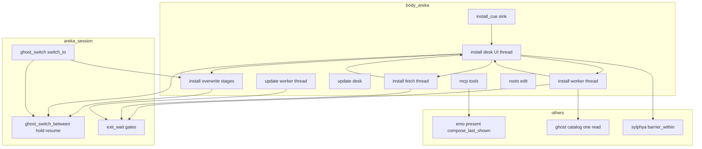
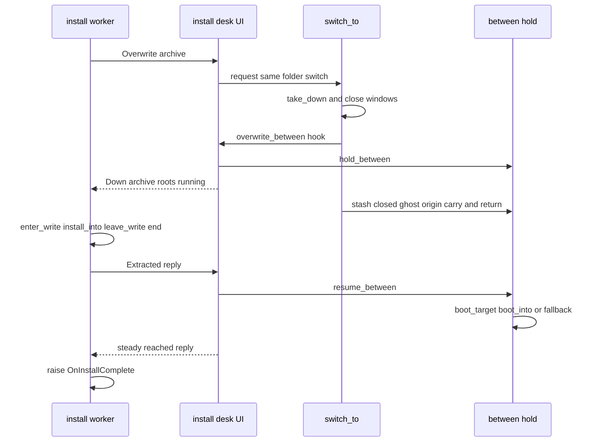
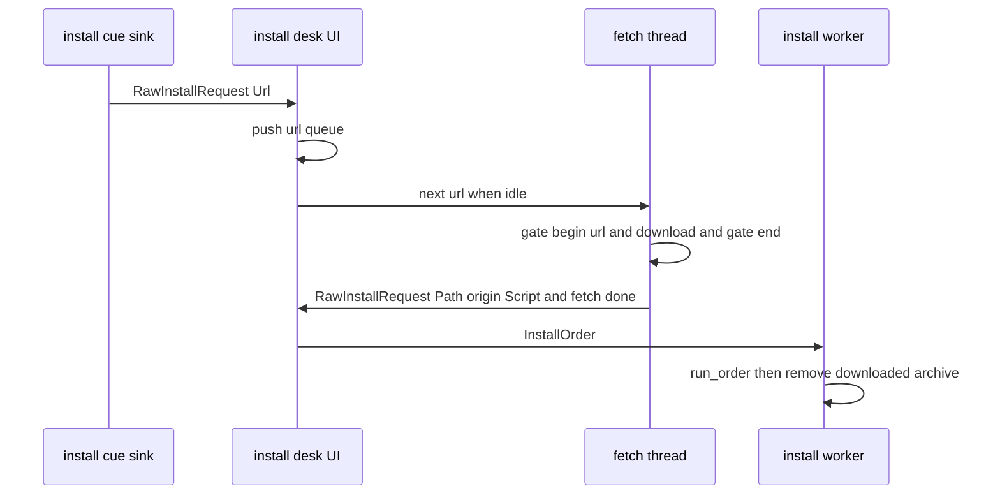

# 設計: audit-areka-install-update（インストール・ネットワーク更新・MCP の受け口・根の一覧・説明書の見直し）

## Overview

**目的**: 本体（`crates/areka/src/`）の `install/`・`update/`・`mcp/`・`roots/`（と `roots.rs`・`session_tests/readme_body_tests.rs`）と、`areka-session` の `roots/`・`readme*` に `/ponytail:ponytail-audit` をかけて出た 103 件の指摘を直す。直すのは、要件の討議で確定した 102 件（必ず直す 4・直したほうがよい 56・できれば 42）で、91 は裁定で残す。あわせて brief に預かった件 1〜8 を片づける。直し方はどれも「いちばん小さい完全な直し」で、消せるものは消し、使うテスト・検体・呼び出し元まで直し切る。

**使う人**: 開発者と、areka を使う人。
- areka を使う人には次のことが起きなくなる。
  - インストールの後の記録で UI が止まる。
  - URL からの取得が終了で黙って消える。
  - 隠れたキャラクターの `dump_surface` が失敗する。
  - 置き場を変えるたびに UI が根を全部見に行く。
  - 起動中のゴーストへの上書きで、UI スレッドが展開の終わりまで止まる。
- 開発者には次のことが起きる。
  - 背景のスレッドが倒れても、窓口が「仕事中」のまま固まらない。
  - 期限の無いテストの待ちが無くなる。
  - テストの写しが 1 か所ずつになる。
  - 作業文書の番号と古い説明が消える。

**変わること**: SHIORI へ送るイベントの名・参照・送る条件、台本のタグの意味、MCP のツールの名と引数は変わらない。外から見える変化は次の 2 つ。
- 要件の討議で裁定した外への約束の変更（議題 10 の (a)〜(h)・議題 8・9）。
- 新しい失敗の道に足す記録の語（「設計の段で決めた事項」の 1）。

### Goals

- 確定した 102 件と預かった件 1〜8 を全部直す。直したバグと危ない所の 1 件ずつに、壊れたら落ちる決定論のテストを置く（要件 4.1・4.2）。テストの弱さの指摘は、テストを直すこと自体が直しになる。
- 範囲の外へは「Boundary Commitments」に挙げたファイルだけに触る。C26 のほかの 2 本の持ち物は申し送るか、相手と申し合わせた形で入れる（要件 7.2）。
- 直し終えたら、同じ作法で audit をかけ直して新しい指摘 0 件を確かめ、全体テストを緑にする（要件 9）。
- タスクは 25 前後（1 本の spec のまま・要件 2.6）。

### Non-Goals

- 新しい機能、依存の追加、`Cargo.toml`・`Cargo.lock` の変更、clippy の機械的な直し。
- `NO_BODY` と本体の「窓口が無い」受け口の振る舞いをそろえる直し（要件 5.8・議題 1）。
- 91（`roots_memory_write_failed` の 2 行）の直しと、`link_destinations` の先送りの印の削除（要件 2.5・議題 11）。
- `install/judge.rs` が `http://` を受けることの変更（指摘ではない・完了した spec の決め）。
- `ghost_switch.rs` の切替の入口が `update_busy` を見ないこと（範囲の外・持ち主へ回す）。

## Boundary Commitments

### This Spec Owns

- 範囲の 124 ファイル（要件の Boundary Context の In scope）の、確定した指摘の直しと、そのためのテストの追加・直し・削除・名の変更。
- 範囲の中に新しく置くファイル（「File Structure Plan」の新しいファイルの表）。
- 範囲の外の、次の変更だけ。
  - `crates/areka-session/src/ghost_switch.rs` の `switch_to` の後半と doc（597〜708 行）、末尾の `mod` の行 1 つ、新しい子のファイル `ghost_switch_between.rs`・`ghost_switch_between_tests.rs`（指摘 13）。
    - `ghost_switch.rs` はほかの部分が `audit-emo2-boot-switch` の持ち物である。`switch_to`・`take_down`・`boot_into` はこの spec が入れると申し合わせ済みで、向こうが触る行（40〜44・66〜90・111・250〜333・423・522）とは重ならない。先に着地した側の後で、もう片方が `main` を取り込んでから直す。
  - `crates/areka-emo-present/src/presenter/snapshot.rs` に公開の関数 `compose_last_shown` を 1 つ足し、`snapshot_tests.rs` にテストを 1 本足す（指摘 3）。見直しは完了しており、C26 の 2 本の持ち物でもない。
  - `crates/areka-ghost/src/catalog.rs` に、`master/descript.txt` を 1 回読んで sakura の名前と `install.accept` を返す公開の関数を 1 つ足し、`catalog_tests.rs` の `install_accept` のテストを寄せる（指摘 60）。持ち主の見直しは完了している。
  - 文書の既にある行: `doc/COMPAT_ARCHITECTURE.md` 344 行（§8・指摘 12・68）・`doc/ukadoc-coverage/ledger/sakura-script.toml` 1398〜1418 行（12・66・68）・`doc/ukadoc-coverage/ledger/shiori.toml` 7188 行（25）・`doc/ssp-mcp/areka-tools.md` 6 行（39）。
  - 申し送りのための brief の書き足し: `.kiro/specs/audit-areka-app/brief.md`、`.kiro/specs/audit-emo2-boot-switch/brief.md`、`.kiro/specs/link-context-copy/brief.md`、`.kiro/specs/balloon-link-hover/brief.md`（要件 7.9・7.10）。

### Out of Boundary

- 本体の `main.rs`（`BODY_SYSTEMS`・`body_cue_sinks` を含む）・`file_drop*`・`menu/`・`png_image*`・`shiori_host*`・`runtime_tests/`・`session_tests/` の `readme_body_tests.rs` でないもの。
- `areka-session` の `body_systems*`・`log_history*`・`reload*`・`alert*`・`exit_wait*`・`lib.rs`・`Cargo.toml`。これらは `audit-areka-app` の持ち物で、この spec は公開の口を呼ぶだけ。
- `areka-session` の `ghost_switch*` のうち上に挙げた所でないもの、`shell_balloon_switch*`、本体の `session_tests/shell_balloon_switch*`（`audit-emo2-boot-switch` の持ち物）。
- `crates/areka-nar/`・`areka-update/`・`areka-mcp/`・`areka-mcp-bridge/`・`areka-sylphya/`・`areka-runtime/`・`dola/`・`wintf/`・`vendors/`。例外は `areka-runtime/src/consumer_ledger.rs:77` の doc の 1 語だけで、OPEN QUESTION 6 の答えしだい。
- 記録の分け方（`log_history.rs` の `RULES`・`UNKEPT_TARGETS`）と `NO_BODY` の doc（向こうが直す・要件 5.2・5.8）。

### Allowed Dependencies

- 今の依存だけを使う（`Cargo.toml` には触らない）。
- テストから使う既存の口:
  - `areka_runtime::spine::{join_bounded, join_thread_bounded, wait_recv, SPIN_WAIT, GpuPermit}`（`test-support`）
  - `areka_session::reload::test_support::boot_context`・`areka_session::ghost_switch_test_support`（`test-support`）
  - `areka_runtime::consumer_ledger::test_support::carrier_cue`
  - `log_capture_kit::{capture, capture_lines}`・`temp_path_kit::TempPath`
  - `areka_sylphya::{spawn_sylphya, PersistIo}`
  - `RuntimeWiring::apply_present`（`test-support`）・`PresentCommand::InvalidateCache`
- 本番から使う既存の口:
  - `SylphyaPublisher::barrier_within`
  - `areka_session::exit_wait::{register_gate, WorkGate, EXIT_WAIT_LIMIT}`
  - `areka_session::alert::suppressed`
  - `areka_ghost::prop_get_sink::PropGetCueSink`（テストの組み立てに使う）
- 依存の向きは変えない。本体 → `areka-session` → `areka-runtime`・`areka-ghost`・`areka-emo-present` の向きのままで、`areka-session` から本体の型は引かない（指摘 13 の口は `areka-session` の側の型だけで組む）。

### Revalidation Triggers

- **ログの語**（「設計の段で決めた事項」の 1 の表）: 改名 1・足す語・水準の変わる語。実機の確かめや `tools/` で語を読む手順を足す人は、この表で読み直す。
- **MCP の `reload` の断りの文**: `(another switch, reload, update or install is in progress)` に変わる。
- **起動中のゴーストへの上書きの段**: 展開の間は窓とゴーストの無いフレームが回る。`switch_to` の段を読むテストや spec（`audit-emo2-boot-switch`・今後の切替を触る spec）は、待ちを表す NonSend `BetweenHold` の有無を読み直す。
- **`switch_to` の分け方**: `BodySystems::overwrite_between` の形（`fn(&mut World)`）は変えない。待つかどうかは、本体が同じ呼び出しの中で `ghost_switch::hold_between` を呼んだかで決まる。
- **`RawInstallRequest` の形**: パスと URL の 2 つの腕になる（範囲の中だけで使う型）。
- **`SwitchVerdict` の腕**: `audit-emo2-boot-switch` が `SwitchVerdict::Updating` を足すと、`install/overwrite.rs:129` の `NotFound | NoContext` の腕に名を足す要がある（「並走の兄弟と申し送り」）。

## Architecture

### Existing Architecture Analysis

- インストールの仕組み:
  - 窓口 `InstallDesk` は UI スレッドの NonSend で、`drain` が毎 tick、生の要求と背景のスレッドの頼み（`DeskAsk`）を汲む。
  - 背景のスレッド `install` は `areka_actor::run_inbox` で依頼を 1 件ずつ回し、kanade とのイベントの往復と書き込みは `DeskPorts` を通して窓口へ頼む。
  - 終了の門は `WorkGate`（`exit_wait::register_gate`）で表し、書く段だけを終了が上限まで待つ。
- ネットワーク更新は、窓口 `UpdateDesk` と背景のスレッド `update` の同じ形である。
- MCP の受け口は、UI スレッドの Input の段で要求を汲む。重い仕事（`dump_surface` の符号化）は名前つきのスレッドへ出し、`Pending` に答えを返す。
- 置き場の編集は UI スレッドでメニューから呼ばれる（`roots/edit.rs` の `apply`）。
- 起動中のゴーストへの上書きは、`switch_to` が全窓を閉じた直後に `BodySystems::overwrite_between`（本体の `install::desk::run_overwrite_between`）を呼び、UI スレッドで同期に展開する。

### Architecture Pattern & Boundary Map



- **選んだ形**: 今の窓口と背景のスレッドの形のまま直す（research.md 8 節の案 A）。新しい本番のスレッドは、長く生きる取得のスレッド 1 本（12）だけ。短命のスレッドは、記録だけを持つもの（4）と答えだけを持つもの（28）の 2 つ。
- **守る既存の形**: 重い仕事は UI の外へ出す。失敗は `error!` と `Err`（または `NG:`）で表す。書く段だけを終了が上限まで待つ。イベントを投げ、台本が返ったら再生する。
- **steering**: GPU の描画を CPU へ移さない（3 は合成を GPU の `Composer` で組み直す）。1 フレーム遅らせて逃げない（13 は状態の持ち方で解く）。ベースウェアに判断やモードを足さない（13 は既存の切替の段を待たせるだけ）。

### Technology Stack

| Layer | Choice / Version | Role in Feature | Notes |
|---|---|---|---|
| 本体 | `areka`・`bevy_ecs`・`tracing`・`std::thread`・`std::sync::mpsc` | 直しの本体 | 依存は変えない |
| 集めた層 | `areka-session`（`exit_wait`・`ghost_switch`・`alert`） | 門・切替の段・告知の決まり | `ghost_switch.rs` の `switch_to` だけを申し合わせて触る |
| 表示 | `areka-emo-present` の `EmoPresenter` | 最後に見せた絵の合成し直し（3） | 公開の関数を 1 つ足す |
| 目録 | `areka-ghost` の `catalog` | descript の 1 回読み（60） | 公開の関数を 1 つ足す |
| テスト | `log-capture-kit`・`temp-path-kit`・`areka-runtime`（`test-support`）・`areka-sylphya` | 落ちる力のあるテスト・待ちの上限 | `GpuPermit` で実 GPU のテストの順を取る |

## File Structure Plan

### 新しいファイル

| パス | 役目 | 指摘 |
|---|---|---|
| `crates/areka-session/src/ghost_switch_between.rs` | `switch_to` の「降ろした」と「起こす」の間の待ち（`BetweenHold`・`hold_between`・`resume_between`・起こす後半 `boot_target`） | 13 |
| `crates/areka-session/src/ghost_switch_between_tests.rs` | 待ちのテスト（待つ・起こす・待たない・既定へ戻す） | 13 |
| `crates/areka/src/install/desk_worker_gone_tests.rs` | 背景のスレッドが倒れたときの窓口と守り手のテスト、kanade へ送れないときのテスト（`desk_tests.rs` は 788 行） | 5・7 |
| `crates/areka/src/install/desk_overwrite_between_tests.rs` | 上書きの 2 往復（降ろした → 展開 → 起こす → 定常で返す）のテスト | 13 |
| `crates/areka/src/install/fetch_queue_tests.rs` | 取得のスレッド 1 本・順に落とす・終了で積んだ残りを記録・門のテスト | 2・12 |
| `crates/areka/src/update/worker_panic_tests.rs` | 背景のスレッド `update` が倒れたときのテスト（`worker_tests.rs` は 967 行） | 23 |
| `crates/areka/src/update/homeurl_tests.rs` | `homeurl` の空の決まり（照会の写し・窓口の写し） | 24 |
| `crates/areka/src/update/update_test_support.rs` | `update/` のテストの支え: 名を取る `boot_context`・`write_descript`・イベント名で絞る補助・`run`・`ids`・`refs_of` | 27・74 |
| `crates/areka/src/mcp/kanade_fake_test_support.rs` | 偽の kanade の足場（`ghost`・`rig`・`answer`・`warn_or_worse`・`text`・`record_one`） | 38 |
| `crates/areka/src/roots/roots_test_support.rs` | `roots` のテストの補助（`roots_of`・`events_named`・既にある補助と上書きによる `world`） | 45・93 |

### Modified Files（範囲の中・本番）

- `install/desk.rs`:
  - 1: `barrier_within` を使う `settle_record` に切り出す。
  - 6: 綴り直した値を受けるだけにする。
  - 12: URL の待ち行列と取得のスレッドを持つ。
  - 13: `DeskAsk::Extracted` を受けたら切替を続ける。
  - 5: 倒れた知らせを受けて `worker = None` にする。
  - 40: 選ぶ画面の共通の関数を置く。
  - 60: 素性は `dir` だけを答える。
- `install/worker.rs`:
  - 5: 守り手を置く。
  - 6: 綴り直しを背景で行う。
  - 13: 上書きを 2 往復にし、展開を背景で行う。
  - 68: 落とした書庫を消す。
  - 69: `OrderDone` の欄を消す。
  - 103: 告知の決まりの関数を使う（向こうの着地の後）。
- `install/fetch_url.rs`:
  - 2・12: 長く生きるスレッドと門を持たせる。
  - 65: 先頭の大文字小文字をそろえる。
  - 66: 消した数が 0 なら記録しない。
  - 67: 書きかけを消す。
  - doc を直す。
- `install/install_cue.rs`: 12（URL を窓口の生の要求として送る）・`StartFetch` を消す。
- `install/mod.rs`: `RawInstallRequest` に URL の腕を足す。2（門を登記する）。8（doc）。
- `install/overwrite.rs`: 13（段 `Extracting`・`Resumed`、`run_between` は降ろした知らせを返すだけ）。10（7 行目の doc）。
- `install/procedure.rs`: 14（書いた後に閉じたら `Installed`）。
- `install/judge.rs`: 60（`GhostFacts` に `dir` を足す）。65（`eq_ignore_ascii_case`）。
- `install/destination.rs`: 10（doc）。61（`copied_root` の項目の根を使う）。
- `install/names.rs`: 70（doc）。
- `install/startup.rs`: 103（向こうの関数ができてから写しを消す）。
- `update/worker.rs`:
  - 23: 守り手を置く。
  - 24: `trim` してから空を判定する。
  - 76: 列の型の別名を使う。
  - 77: doc を直す。
- `update/desk.rs`:
  - 23: 倒れた知らせで段を戻す。
  - 24: `trim` してから空を判定する。
  - 76: 列の型の別名を使う。
  - 77: なぞるだけのコメントを消す。
- `update/procedure.rs`:
  - 24: 重ねた `filter` を消す。
  - 25: `update_reload_asked` に改める。
  - 76: 列の型の別名を使う。
  - 77: なぞるだけのコメントを消す。
- `update/refs.rs`: 76（`Tail` を `Ref34` に改める）。
- `update/mod.rs`: 71（doc）・75（`update_tests` の mod の行を消す）・76（列の型の別名）。
- `update/update_cue.rs`・`update/readonly_refusal.rs`: 77。
- `mcp/dump_surface.rs`: 3（`_` の腕を分け、`compose_last_shown` を呼ぶ）。
- `mcp/dump_balloon.rs`: 3（同じ）・78（`check_size` に寄せる）。
- `mcp/get_expression_table.rs`: 28（名前つきのスレッドで読む）。
- `mcp/get_status.rs`・`mcp/sakurascript.rs`・`mcp/resolve.rs`: 35（`script_target` を `resolve.rs` へ移し、写しを消す）。
- `mcp/check_script_judge.rs`: 39（別名の定数を消す）。
- `mcp/get_log.rs`・`mcp/mod.rs`: 81（doc）・82・83（`active` を渡す）。
- `mcp/reload.rs`: 88（断りの文）。
- `mcp/sakurascript.rs`: 85（据え付けを消す・向こうの着地の後）。
- `roots/edit.rs`:
  - 4: 記録の段を短命のスレッドへ移す。
  - 41・43: doc を直す。
  - 42: `roots_removed` を記録する。
  - 90: 包みを消す。
- `roots/desk.rs`: 40（選ぶ画面を共通の関数へ寄せる）・89（列挙を消す）。
- `roots.rs`: 92（3 つの名前だけを出す）。
- `areka-session/src/roots/`:
  - `user_root.rs`: 46・95。
  - `report.rs`: 47・95。
  - `mod.rs`: 48。
  - `resolve.rs`: 48・94（向こうの着地の後）・96。
- `areka-session/src/readme.rs`: 49・50。
- `areka-session/src/readme/readme_cue.rs`: 51・52。
- `areka-session/src/readme/os_port.rs`: 53・54・55・97。

### Modified Files（範囲の中・テスト）

- `install/`:
  - `desk_tests.rs`: 11・63・69（262・279 行）・13（690 行のテストを書き直す）。
  - `desk_record_tests.rs`: 1・9・10・64。
  - `desk_overwrite_tests.rs`: 10・62・13。
  - `desk_exit_tests.rs`: 11（`boot_context`）・13（展開中の終了）。
  - `install_cue_tests.rs`: 12・18・20。
  - `names_tests.rs`: 19・70。
  - `worker_tests.rs`: 21・69。
  - `fetch_url_tests.rs`: 22・65・66・67。
  - `procedure_tests.rs`: 15。
  - `procedure_branch_tests.rs`: 14・16。
  - `procedure_skip_tests.rs`: 14。
  - `terms_tests.rs`: 17。
  - `judge_tests.rs`: 65。
  - `destination_tests.rs`: 10。
  - `startup_flow_tests.rs`: 103。
- `update/`:
  - `worker_tests.rs`: 26・73。
  - `desk_tests.rs`: 26・27・74・77。
  - `desk_resolve_tests.rs`: 27・74。
  - `readonly_refusal_tests.rs`: 27。
  - `update_cue_tests.rs`: 27・74。
  - `desk_reload_tests.rs`: 72・74。
  - `procedure_tests.rs`: 74。
  - `procedure_reload_tests.rs`: 25・74。
  - `worker_path_tests.rs`: 25・26・74。
  - `procedure_test_support.rs`: 76・77。
  - `update_tests.rs`: 75（消す）。
- `mcp/`:
  - `dump_surface_tests.rs`: 30。
  - `dump_surface_gpu_test_support.rs`: 31・32・33・79。
  - `dump_surface_gpu_tests.rs`・`dump_balloon_gpu_tests.rs`: 3・79。
  - `get_expression_table_tests.rs`: 28・29。
  - `get_status_tests.rs`: 34・38。
  - `raise_event_tests.rs`・`sakurascript_tests.rs`: 38・84。
  - `check_script_tests.rs`: 36・86。
  - `check_script_judge_tests.rs`: 86・87。
  - `get_property_tests.rs`: 37・102。
  - `get_log_tests.rs`: 82。
  - `reload_tests.rs`: 88。
  - `mcp_tests.rs`: 80。
  - `sakurascript_log_tests.rs`: 85（向こうの着地の後に消す）。
- `roots/`:
  - `edit_tests.rs`: 42・44・45・56・93。
  - `edit_write_failure_tests.rs`: 45。
  - `desk_tests.rs`: 40・45・93。
  - `edit_temporary_tests.rs`: 90。
  - `pick_tests.rs`: 40。
- `areka-session`:
  - `roots/resolve_tests.rs`: 96。
  - `roots/report_tests.rs`・`user_root_tests.rs`: 46・95。
  - `readme_tests.rs`: 50・56・57。
  - `readme/readme_cue_tests.rs`: 52・56・57・98。
  - `readme/opener_submit_tests.rs`: 58・99。
  - `readme/opener_tests.rs`・`opener_execute_tests.rs`: 99。
  - `readme/opener_test_support.rs`: 99・100。
  - `readme/destination_tests.rs`: 101。
  - `readme/os_port_tests.rs`: 97。

### Modified Files（範囲の外）

- `crates/areka-session/src/ghost_switch.rs`: `switch_to`（597〜708 行）の後半を新しい子のファイルの `boot_target` へ移し、全窓を閉じて上書きの口を呼んだ後に `BetweenHold` が立っていれば待って戻る。末尾に `#[path = "ghost_switch_between.rs"] mod between;` と、テストの mod の行を 1 つ足す。`take_down`・`boot_into` の中身は変えない。
- `crates/areka-emo-present/src/presenter/snapshot.rs`・`snapshot_tests.rs`: 3。
- `crates/areka-ghost/src/catalog.rs`・`catalog_tests.rs`: 60。
- 文書 4 つと brief 4 つ（上の「This Spec Owns」）。
- `crates/areka-runtime/src/consumer_ledger.rs` 77 行の doc の 1 語（OPEN QUESTION 6 で直すと決まったときだけ）。

### 1,000 行の見通し（要件 6.1）

| ファイル | 今 | 見込み | 扱い |
|---|---|---|---|
| `update/worker_tests.rs` | 967 | 約 940 | 26 の置き換えは同じくらいの長さ・73 で約 −30 |
| `areka-session/src/ghost_switch_tests.rs` | 982 | 982 | 触らない（13 のテストは新しいファイル） |
| `areka-session/src/ghost_switch.rs` | 927 | 約 900 | 後半を `ghost_switch_between.rs` へ移す |
| `install/startup_tests.rs` | 854 | 854 | 触らない |
| `install/desk_tests.rs` | 788 | 約 760 | 足すテストは新しいファイル・11 で −25 |
| `mcp/get_expression_table_tests.rs` | 808 | 約 810 | 29 は名の付け直しだけ |
| `install/desk_overwrite_tests.rs` | 688 | 約 700 | 13 で表明を書き直す（増える分は新しいファイルへ） |

## System Flows

### 起動中のゴーストへの上書き（指摘 13）



- **待つかどうかの決まり**: `switch_to` は上書きの口を呼んだ後で `BetweenHold` があるかを見る。本体が同じ呼び出しの中で `hold_between` を呼んだときだけ待つ。呼ばなければ今のまま続けて起こす（ほかの切替・`NO_BODY`・預かった宛先でない切替）。`BodySystems::overwrite_between` の形は変えない。
- **待ちを必ず解く道**:
  - 展開の答え（`DeskAsk::Extracted`）。
  - 背景のスレッドが倒れた知らせ（5 の守り手）。
  - 「降ろした」の返信が送れなかった（背景が既に居ない）ときは、待ちを立てずにその場で続けて起こす。
  - 終了: 窓口の `discard_for_exit` が待ちを解かずに捨てる。プロセスは終わるので起こさない。今の写し待ち（`CopyWait`）と同じ扱いである。
- **段の語**: `SwitchStage` に新しい腕を足さない。待ちの間は予約の段が `SendOff` のまま残り、`BetweenHold` の有無が待ちを表す。kanade は降ろし終えているので、停止の通知は来ない。この形にすると、向こうの持ち物の `on_ghost_stopped` の照合（423 行の当たり）に触れずに済む。
- **展開の成否**: 今と同じく、成否によらず切替を続ける。展開の失敗は背景のスレッドが記録し、手続きの失敗の道（`fail_nar`）へ進む。
- **終了が展開の最中に始まったとき**: 背景のスレッドは `enter_write` の中に居るので、`begin_close` は書き終えるまで `EXIT_WAIT_LIMIT` の上限まで待つ（今の `exit_wait` の意味のまま）。

### URL からの取得（指摘 2・12・68）



- 窓口が URL の待ち行列（`VecDeque<String>`）を持ち、取得のスレッドへは一度に 1 件だけ渡す。取得のスレッドは最初の URL のときに起こし、終了まで生かす。
- 終了が始まったとき:
  - 取得中の URL は、門の名として `exit_wait_abandoned` に 1 件残る。書く段に入らないので待たない（完了 `areka-P0-network-update` の要件 7.5 のまま）。
  - 積んだ残りの URL は、`discard_for_exit` が `warn!(install_fetch_abandoned, url)` で 1 件ずつ残す。
  - 取得のスレッドへの送出端を落とすので、スレッドは今の取得を終えると抜ける（join はしない）。
- 窓口が無いとき（本番では通らない）は、URL の生の要求が送れずに `warn!(install_cue_send_failed)` で終わり、取りに行かない。これは件 8 の事実の 1 つ（本体の「窓口が無い」の `url` の腕）を変える。OPEN QUESTION 2 で扱う。

## Requirements Traceability

| Requirement | Summary | Components / 置き場 | Flows |
|---|---|---|---|
| 1.1・1.2・1.3・1.4・1.5・1.6・1.7 | 洗い出し（範囲・上限なし・全部読む・番号と組・重なり・数え直し・行番号） | research.md 1〜5 節（ギャップ分析で済み）。行番号の動きは research.md 10.1（37 の行 103・318） | — |
| 2.1 | 確定した一覧を requirements へ | requirements.md「確定した指摘の一覧」（済み） | — |
| 2.2・2.3・2.4 | 3 種類の扱いと ukadoc の確かめ | 議題 8〜11 で裁定済み。設計で新しく 3 種類に当たったものは 0（「設計の段で決めた事項」の 3） | — |
| 2.5 | 残す裁定を記録し数から外す | 91・`link_destinations` の印（G24・G25） | — |
| 2.6 | 2 本目へ切らない | 「タスクの見込み」25 タスク | — |
| 3.1・3.2 | 確定した指摘を全部直す | 「指摘ごとの直し」の表（102 件） | — |
| 3.3・3.4 | 呼び出し元まで直し、消す前にツリー全体を確かめる | 「消す・名を変えるときの照合」 | — |
| 3.5 | いちばん小さな完全な変更 | 「設計の段で決めた事項」の 2（退けた案） | — |
| 4.1・4.2 | 1 件ごとに落ちるテスト・赤を先に | 「Testing Strategy」の表 | — |
| 4.3 | 決定論 | 門で止める偽の IO・偽の取得口・`join_thread_bounded`（Testing Strategy の「決定論」） | — |
| 4.4 | 全体テストの中で回る | 新しいテストはどれも `#[cfg(test)]` の兄弟のファイル | — |
| 4.5 | `target` の下 | `TempPath`・取得の一時フォルダは引数で渡す（68 の `remove_downloaded`） | — |
| 4.6 | 実 GPU | 3・36 は `GpuPermit` で順を取る既存の足場 | — |
| 4.7 | 外のホストへつながない | 偽の `MakeFetch`・`NewFetch` | 取得 |
| 4.8 | 古びたテストを改める | 「指摘ごとの直し」の「テスト」の列 | — |
| 5.1 | 件 1 `barrier_within` | 指摘 1（G1） | — |
| 5.2 | 件 2 `info!` を足さない | 「預かった件の片づけ」（足す `info!` は update_cue・readme_cue に 0） | — |
| 5.3 | 件 3 呼び手の説明 | 8・70・71・81・49（G22） | — |
| 5.4 | 件 4 `join_bounded` | 19（G2） | — |
| 5.5 | 件 5 `capture_logs` | 57（G20） | — |
| 5.6 | 件 6 `boot_context` の写し 9→0〜1 | 11・45・58・27（G21・G18・G20・G11）と G23 | — |
| 5.7 | 件 7 `BODY_SYSTEMS` の 1 行を残す | 59（G24 で記録） | — |
| 5.8 | 件 8 そろえない・申し送る | 「並走の兄弟と申し送り」・OPEN QUESTION 2 | — |
| 5.9 | 記録 | G24 | — |
| 6.1 | 1,000 行 | 「1,000 行の見通し」 | — |
| 6.2 | `error!`＋`Err` | 「Error Handling」 | — |
| 6.3 | 終了の道 | 2・12・13・4・28 の終わり方（System Flows・Error Handling） | 上書き・取得 |
| 6.4 | UI を塞がない | 1・4・6・13・28・60 | 上書き |
| 6.5 | 信頼の境界 | 22・65（受ける形を広げるだけ）・68（消すのは `download_dir()` の下で出どころが `Script` の物だけ） | — |
| 6.6 | メッセージボックスを足さない | 新しい告知は 0 | — |
| 6.7 | 1 フレーム遅らせない | 13 は段の持ち方で解く（`BetweenHold`） | 上書き |
| 6.8 | 文字化け | 触らない（新しい端末への出力は 0） | — |
| 6.9・6.10・6.11 | 依存を足さない・フォークしない | 「Allowed Dependencies」 | — |
| 6.12 | OS の既定のアプリ | 説明書・フォルダの開き方は変えない（49〜55・97 は説明と符号の切り出しだけ） | — |
| 6.13 | 判断やモードを足さない | 13 は既存の切替を待たせるだけ・12 は順に落とすだけ | — |
| 7.1 | 呼び出し元を全部直す | 「消す・名を変えるときの照合」 | — |
| 7.2・7.12 | 並走の約束・102 の順 | 「並走の兄弟と申し送り」 | — |
| 7.3・7.4・7.5・7.11 | `Cargo`・`COMPAT_ARCHITECTURE`・dola/wintf・vendors | 「Boundary Commitments」・G25 の差分の確かめ | — |
| 7.6 | 範囲の外は要る所だけ | 「Modified Files（範囲の外）」 | — |
| 7.7・7.8 | 外への約束を変える直しと読み手 | 「設計の段で決めた事項」の 1 | — |
| 7.9・7.10 | 回す件・範囲の外の件を brief へ | G24 | — |
| 8.1・8.2・8.3・8.4・8.5 | 副作用の大きい操作を回さない | 「Testing Strategy」の「回さないもの」 | — |
| 9.1・9.2・9.3・9.4・9.5・9.6・9.7・9.8 | かけ直し・全体テスト・差分・打ち切り | G25 | — |

## Components and Interfaces

### 一覧

| Component | Domain | Intent | Req | Key Dependencies | Contracts |
|---|---|---|---|---|---|
| `BetweenHold`・`hold_between`・`resume_between` | `areka-session` の切替 | 降ろした後・起こす前の待ち | 6.4・6.7・7.2 | `switch_to`（P0）・`BodySystems::overwrite_between`（P0） | State |
| 上書きの 2 往復 | 本体 `install` | 展開を背景のスレッドへ出す | 6.3・6.4 | `BetweenHold`（P0）・`WorkGate`（P0） | State |
| 取得の待ち行列 | 本体 `install` | URL を 1 本のスレッドで順に落とす | 6.3・6.2 | `exit_wait::register_gate`（P0） | State |
| 倒れの守り手 | 本体 `install`・`update` | 背景のスレッドの panic で窓口を戻す | 6.2・6.3 | `WorkGate`（P0） | State |
| `settle_record` | 本体 `install` | 入れた後の記録の期限つきの待ち | 5.1・6.4 | `barrier_within`（P0） | Service |
| `compose_last_shown` | `areka-emo-present` | 最後に見せた絵を合成し直す | 3.1 | `Composer`（P0） | Service |
| `master_install_keys`（仮の名） | `areka-ghost` | descript を 1 回読む | 3.1 | — | Service |
| テストの支え 4 つ | 本体のテスト | 写しを 1 か所に | 3.1・5.6 | `reload::test_support`（P1） | — |

### `BetweenHold`（指摘 13）

| Field | Detail |
|---|---|
| Intent | `switch_to` が全窓を閉じた後で、起こす前に止まり、本体の答えで続きを走らせる |
| Requirements | 6.4・6.7・6.3・7.2 |

**Responsibilities & Constraints**
- 置き場: `crates/areka-session/src/ghost_switch_between.rs`（`ghost_switch` の子の私有のモジュール）。公開の関数を 2 つ持つ。
- 起こす後半（`origin` と `GhostDecision` を受けて `boot_into` → `shell_carry::hand_over` → `set_stage`、失敗なら既定へ戻すか致命）を `boot_target` として 1 か所に置く。`switch_to` は待たないときに、`resume_between` は待った後に、これを呼ぶ。
- 待ちの間は NonSend `BetweenHold` に起こす材料（`WindowsClosed`・`GhostDecision`・`BootOrigin`・`ShellCarry`・切替先の名とフォルダ）を持つ。

```rust
/// 本体の上書きの口の中から呼ぶ: 起こすのを答えが来るまで待たせる。
pub fn hold_between(world: &mut World);
/// 待たせた切替を続けて起こす。待ちが無ければ warn を 1 件残して何もしない。
pub fn resume_between(world: &mut World);
```
- 事前条件: `hold_between` は `switch_to` の上書きの口の中でだけ意味を持つ。外で呼ぶと、次の `switch_to` まで印が残る。そのため `switch_to` は、上書きの口を呼ぶ前に古い印を消す。
- 事後条件: `resume_between` の後は `BetweenHold` が無く、起こしたか、既定へ戻したか、致命の道へ渡したかのどれかになる。
- 不変条件: 待ちの間も予約 `SwitchInFlight` は在る（ほかの切替・読み直し・MCP の `reload` は今の「切替中」の断りのまま）。

**Implementation Notes**
- 統合: 本体の `install::overwrite::run_between` が `hold_between` を呼ぶ。返信の送出に失敗したら、呼んだ印を消す（待たない）。
- 確かめ: `ghost_switch_between_tests.rs` で次の 4 つを見る（上書きの口は試験用の `BodySystems` で差す）。
  - 待つ。
  - 続けて起こす。
  - 呼ばなければ待たない。
  - 起こせなければ既定へ戻す。
- 危うさ: 待ちの間は、窓とゴーストの無いフレームが回る。置き場を読む系はどれも `Option` で受ける（research.md 10.1 の R5）。tick が窓の無い間も回ることは、実装の最初に確かめる（OPEN QUESTION 3）。

### 上書きの 2 往復（指摘 13・本体）

**State Management**
- `overwrite::Stage` は 5 つの腕を持つ: `Held` → `Busy` → `Requested`（ここまで今のまま）→ `Extracting`（降ろしたと返した・背景が展開中）→ `Resumed(ReplySender<()>)`（起こし直した・定常を待つ）。今の `Ran(Result)` は消す。
- 背景のスレッドとの約束（`DeskPorts::overwrite_running` の中）:
  1. `DeskAsk::Overwrite { archive, target_ghost, reply: ReplySender<OverwriteAnswer> }` を頼む。
  2. 答え `OverwriteAnswer::Down { archive, roots, running }` を受けたら、`gate.enter_write()` → `install_into` → `gate.leave_write()` → `gate.end()` を行う。答えが `NotRunning(archive)` なら、今と同じくよそへ入れる。`Closed` なら閉じた扱いで止める。
  3. `DeskAsk::Extracted { reply: ReplySender<()> }` を頼み、定常到達の返事を待ってから `Overwritten::Ran(result)` を手続きへ返す。返事が閉じても `Ran(result)` を返す（書き終えている＝14 の「書いた後の Closed」と同じ扱い）。
- 終了（`overwrite::discard`）: `Extracting` は段の語 `"extracting"` を返す（背景は書く段に居るので門が上限まで待つ）。`Resumed` は返信端を落とす（背景は閉じた扱いで `Ran(result)` を返す）。どちらも `BetweenHold` は解かずに捨てる。
- 窓口が `Extracted` を受けたとき段が `Extracting` でなければ（終了の後・切替の中止の後）、`warn!(install_overwrite_unexpected)` を 1 件残してその場で返事をし、`resume_between` は呼ばない。
- `install_overwrite_done`（`ms`・`ok`）は背景のスレッドが残す。出所は `areka::install::worker` に変わるが、`areka::install` の前方一致の下のままで、読み手は範囲の中のテストだけ。
- `InstallPorts::overwrite_running` の形（`-> Overwritten`）と、手続きの側（`procedure.rs`）は変えない。`OverwriteAnswer` は `worker.rs` と `overwrite.rs` だけが使う `pub(super)` の型。

### 取得の待ち行列（指摘 2・12）

**State Management**
- `RawInstallRequest` を `enum RawInstallRequest { Path { path, origin }, Url(String) }` にする。台本の受け口は、URL を窓口へ送るだけにする（読み取りだけの断りは今のまま受け口の中に残す）。`StartFetch` と `fetch_for` の閉包は消し、`readonly: bool` を持つ。
- 窓口（`InstallDesk`）が持つもの:
  - `fetch_queue: VecDeque<String>`
  - `fetch_tx: Option<Sender<String>>`
  - `fetching: bool`
  - `fetch_gate: Arc<WorkGate>`
- 取得のスレッド（名 `install-fetch`・`thread::Builder`）が URL ごとに行うこと:
  - `gate.begin(url)` が偽なら、`warn!(install_fetch_closing)` を残して抜ける。
  - 真なら、今の `fetch_and_send` で落とし、`RawInstallRequest::Path { origin: Script }` と取得の終わりの知らせを送る。
  - どの道で抜けても `gate.end()` を行う。
- 起こせなければ、今と同じく `error!(install_fetch_failed)` を残し、その URL を捨てる。
- 門は `install::register` が `register_gate(world, "install-fetch", gate, |_| {})` で登記する。積んだ残りは窓口の `discard_for_exit` が記録する。
- `MakeFetch` は 1 回ずつの `FnOnce` から、作り口 `Arc<dyn Fn() -> Result<Box<dyn Fetch>, ..>>` にする（長く生きるスレッドが URL ごとに作るため）。テストは偽の作り口を差す。

### 倒れの守り手（指摘 5・23）

- `install`: `run_inbox` の閉包の中で、依頼ごとに守り手を作る。欄は `gate: Arc<WorkGate>` と `desk: Sender<DeskAsk>`。Drop で `std::thread::panicking()` なら、次を行う。
  - `error!(install_worker_panicked)` を残す。
  - `gate.end()` を行う。
  - `DeskAsk::WorkerPanicked` を送る。
- 窓口は `WorkerPanicked` を受けると、次を行う。
  - `busy = false`・`worker = None` にする（次の依頼で起こし直す）。
  - 上書きの段が `Extracting` なら `resume_between` を呼ぶ。
- 倒れたときに素の `OrderDone` を送らないのは、死にかけのスレッドの受信端がまだ生きている間に次の依頼を送ると、依頼が黙って消えるためである（research.md 10.1 の R10）。`install_worker_gone` の腕でも `worker = None` にする。
- `update`: 依頼ごとに守り手を `ports` より先に作る（落ちる順は逆なので、`ports` が先に落ちて通信中の数が戻る）。守り手は Drop で `error!(update_worker_panicked)` → `gate.end()` → `DeskAsk::WorkerPanicked` の順に行う。窓口は今の `WorkerGone` の腕と同じく `worker = None` にし、段を `Idle` に戻す（`OrderDone` と同じ後始末）。92 行の `ask_desk(OrderDone)` は、倒れない道でだけ送る。

### `settle_record`（指摘 1・件 1）

```rust
/// 今のゴーストの記憶の書き手の反映を、上限まで待つ。待てなければ error を 1 件残して続ける。
fn settle_record(publisher: &SylphyaPublisher);
```
- 期限は `areka_session::exit_wait::EXIT_WAIT_LIMIT`（3 秒・UI を止めてよい長さとして既にある値）とする。期限切れは `barrier_within` 自身が `error!` を出し、呼び手は今の `install_record_unsettled` を残す。期限の値は OPEN QUESTION 1。

### `compose_last_shown`（指摘 3）

```rust
impl EmoPresenter {
    /// 最後に見せた絵（surface・着せ替え・アニメーションの段）を新しく合成し直す。未登録・未表示は None。
    pub fn compose_last_shown(&self, target: TargetId) -> Option<Result<ComposedSurface, ComposeError>>;
}
```
- 中身は `compose_alone` と同じ形で、控え `last_show`（`(u32, BindSet, PatternState)`）をそのまま `Composer::new().compose` に渡す。
- `dump_surface.rs:280` の `_` の腕を、`None`（一度も見せていない）と `Some((_, None))`（控えが捨てられた）に分ける。後者で `compose_last_shown` を呼ぶ。`dump_balloon.rs:56` も同じにし、合成し直した絵は手元の束縛に置いてから `check_size` へ渡す。

### `areka-ghost` の 1 回読み（指摘 60）

- `catalog.rs` に `pub fn master_install_keys(ghost_dir: &Path) -> MasterInstallKeys { sakura_name: Option<String>, install_accept: Vec<String> }` を足す（前例 `standard_balloon_keys`）。名は実装で同じファイルの流儀に合わせてよい。
- `install_accept` の呼び手は `install/desk.rs:499` だけなので、`install_accept` は消して新しい関数に寄せ、テスト（`catalog_tests.rs:506-531`）も寄せる。`sakura_name` は残す（呼び手が `ghost_switch.rs`・`same_folder_pin.rs` にもある）。
- 窓口は素性の問い合わせに `dir` だけを答え（`GhostFacts` に常に在る `dir` を足す・6 と共用）、背景のスレッドが新しい関数で読む。

## 指摘ごとの直し

組（G）は「タスクの見込み」の単位である。「テスト」の列は、壊れたら落ちるテスト（新しく立てるもの・強めるもの）か、テストそのものが直しのものを書く。「—」は、説明・名・写しの寄せ・削りなど、落ちるテストが要らない直し（要件 4.1 の「バグと危ない所」でない）。

| # | 組 | 直し方 | テスト |
|---|---|---|---|
| 1 | G1 | `settle_record` に切り出して `barrier_within(EXIT_WAIT_LIMIT)` | 門で止める偽の `PersistIo` で単独の書き手を起こし、`settle_record` を別のスレッドで呼んで `join_thread_bounded` で待つ（今の `barrier()` なら止まって赤）。`install_record_unsettled` の error が 1 件 |
| 2 | G5 | 取得のスレッドに門 `install-fetch`（取得の待ち行列）。1〜5 行の doc と 146 行のコメントを直す | 取得の途中で `begin_close` すると `exit_wait_abandoned` に URL が 1 件（`fetch_queue_tests.rs`） |
| 3 | G12 | `compose_last_shown` を足し、2 つの腕から呼ぶ | `snapshot_tests.rs`: 控えを捨てた後に `Some(Ok)`。本体の実 GPU: 隠した target に `InvalidateCache` を送ってから `dump_surface`（surface の省略）と `dump_balloon` が `OK` で絵を返す |
| 4 | G16 | `apply` の記録の段（`status`・`survey`・`log_roots`・`log_hidden`）を短命のスレッド `roots-log` へ移す。今の dispatcher を持たせ、テスト用に最後の JoinHandle を NonSend に控える | 置き場の変更が記録の段を待たずに戻ることを、控えた JoinHandle が `apply` の戻りの時点で在る（記録の段が別のスレッドに居る）ことで確かめる。今の `root_listed`・`roots_hidden_count` の表明は、控えを `join_thread_bounded` で待った後へ移す |
| 5 | G4 | 守り手・`WorkerPanicked`・`install_worker_gone` でも `worker = None` | 守り手を持たせたスレッドで panic → `WorkerPanicked` が届き、門の名が空。窓口に `WorkerPanicked` を流すと `is_busy` が偽・次の依頼で起こし直す（`desk_worker_gone_tests.rs`） |
| 6 | G8 | 綴り直しと隠れの判定を `DeskPorts::record` へ移し、`DeskAsk::Record` で運ぶ | 既存の `desk_record_tests` の 6 本を新しい形に合わせる（UI の側が目録を読まないことは、窓口に根を持たせない形で記録が正しく残ることで見る） |
| 7 | G9 | テストを足す | `put_ghost` の受信端を落としてから `ask_raise` → `drain` で、答えが Err・`install_event_send_failed` の warn が 1 件 |
| 8 | G22 | 「`BODY_SYSTEMS` の `after_input` から」 | — |
| 9 | G21 | 括弧の番号を消す | — |
| 10 | G21 | 変える前と比べた言い方を振る舞いの文に・テスト名を `unmarked_list_answers_the_bundled_root` に | — |
| 11 | G21 | 写しを消し、`areka_session::reload::test_support::boot_context(root.dir(), &root)` を呼ぶ（8 か所・`desk_exit_tests.rs` の 2 つを含む） | — |
| 12 | G5 | 取得の待ち行列（上の Components） | 取得中に 2 本目を投げても作り口は同時に 1 つ・2 本とも順に依頼になる。終了で積んだ残りが `install_fetch_abandoned` で 1 件ずつ |
| 13 | G7 | 上書きの 2 往復と `BetweenHold`（System Flows） | `ghost_switch_between_tests.rs` の 4 本。`desk_overwrite_between_tests.rs`: 降ろした → 展開 → 起こす → 定常で返す、展開中の終了、背景が倒れたときに切替が続く |
| 14 | G9 | 書いた後の `Closed` で `Installed(items)`・残りの書庫だけを止める（`archive_steps` が止めるかの旗を添える）。doc を直す | `procedure_branch_tests.rs:549`・`procedure_skip_tests.rs:307` の期待を `Installed` に（今は `Abandoned` で赤） |
| 15〜17 | G21 | 番号を消し、文がまるごと番号の行は平文に | — |
| 18 | G9 | `queued_orders` で比べ、doc の 3 行と記録の数えを消す | 表明そのもの（運ぶパスが化けると赤） |
| 19 | G2 | `join_bounded("sylphya", parts.handle).expect(..)` | 表明そのもの |
| 20・21 | G2 | `join_thread_bounded`・`recv_timeout`・`wait_recv`・`join_bounded` | — |
| 22 | G6 | テストを足す | `https://example.com/a/..\\..\\x:y.nar` の名前が `.._.._x_y.nar` で、置き場が一時フォルダの直下 |
| 23 | G4 | 守り手（`ports` より先）・`WorkerPanicked` | 偽の `NewFetch` の `get` が panic → `WorkerPanicked` が届く・門が書く段に残らない・段が `Idle`（`worker_panic_tests.rs`） |
| 24 | G10 | 2 か所で `trim` してから空を None・手続きの `filter` を消す | `homeurl_tests.rs`: 照会の写しで `" "` が None・`"https://x/ "` が `"https://x/"`。窓口の写しも同じ |
| 25 | G10 | 手続きの側を `update_reload_asked` に。`procedure_reload_tests.rs:88・175` を新しい語へ・`worker_path_tests.rs:200-205` の出所の絞りを外す・`:323` の無いことの列に新しい語を足す・台帳 `shiori.toml:7188` | 表明（2 つの語が別々に 1 件ずつ） |
| 26 | G3 | 既にある道具に置き換え | — |
| 27 | G11 | `update_test_support.rs` に `boot_context(temp, root, ghost, balloon)` と `write_descript`（charset の頭と末尾の改行を付ける形に統一し、`desk_resolve_tests.rs` の呼び手は頭を外す） | — |
| 28 | G12 | 名前つきのスレッドで `load` と `render`、起こせなければ `error!` と `NG:`（`encode_elsewhere` と同じ形） | 実ユニットのテストを `wait_answer` で待つ形に。UI の側で読まないことは、`handle` の戻りの時点で答えがまだ来ていない（`try_answer` が `None`）ことで見る |
| 29 | G14 | 番号を消し、名と定数を中身で付け直す | — |
| 30 | G12 | テストを足す | `check_size` の (0,1,空)・(1,0,空)・(2,2,長さ 15) が Err、(1,1,長さ 4) が Ok |
| 31 | G23 | 申し送り（向こうの `png_image_tests.rs` を `pub(crate)` に）。着地の後に写しを消す | — |
| 32 | G14 | `TempPath` に | — |
| 33 | G23 | doc の行を直す。向こうが `spawn_windows(rig, dpi)`・`pump_messages` を `pub` にした後で写しを消す | — |
| 34 | G14 | `mN_` と「MN:」を消す | — |
| 35 | G13 | `script_target` を `resolve.rs` へ移して 3 本で使う | — |
| 36 | G15 | 本物のシェルを装着させ、`\s[99999]` に `missing_surface` が 1 件（実 GPU） | 新しいテスト |
| 37 | G1 | `barrier_within(SPIN_WAIT)`（今の行 103・318） | — |
| 38 | G14 | `kanade_fake_test_support.rs` へ寄せる | — |
| 39 | G13 | 別名を消し、`strict::MSG_*` を直に。`doc/ssp-mcp/areka-tools.md:6` を直す | — |
| 40 | G16 | 選ぶ画面の関数を `install/desk.rs` に 1 つ置く（旗・スレッド名・抑止・選ぶ口・送り方を受ける）。抑止の記録は info・`reason = "no_alert"`（語は変えない） | 両方の窓口のテストで、抑止の行が INFO で `reason = no_alert`（今のインストールの側は WARN で赤） |
| 41・43 | G16 | コメント・見出しを事実に | — |
| 42 | G16 | `info!(roots_removed, path)` | 外すと `roots_removed` が 1 件で `path` が外した根 |
| 44 | G18 | `add_takes_effect_and_logs_error_when_memory_unwritable` を消す | — |
| 45 | G18 | `roots_test_support.rs` の `world` が既にある補助＋`roots_origin: Default`・`app_profile_dir` の上書き。名 `ga` の表明 3 か所は呼ぶ前の `current` との比べに | — |
| 46 | G17 | `CopyPlan::Copy` に書ける根の `dir` を載せ、`let … else` を消す | 型で届かない道を消す（`plan_copy` のテストが新しい欄を見る） |
| 47 | G17 | 番号を消す | — |
| 48 | G17 | doc を事実に | — |
| 49 | G19 | 「呼び手は `runtime_boot::install_lines`」 | — |
| 50 | G19 | `set_path` で `missing_logged` を戻す・doc を直す | 読み直しの後に別の無いファイルで `readme_missing` が 1 件（今は 0 で赤） |
| 51・52 | G19 | 文を直す（`event` は変えない） | — |
| 53・55 | G19 | doc と SAFETY の文を事実に（`// SAFETY:` は残す） | — |
| 54 | G19 | 5 つの `allow` と説明を消す。`cargo clippy -p areka-session --tests` で警告 0 を確かめる | — |
| 56 | G20 | 番号の部分だけを消す | — |
| 57 | G20 | 2 つの包みを消し、`capture_lines(..).1` に | — |
| 58 | G20 | `crate::reload::test_support::boot_context(tmp.path(), &root)` に | — |
| 59 | G24 | 残し、理由を記録（件 7） | — |
| 60 | G8 | `master_install_keys` を足して背景で読む | `catalog_tests` で 1 回の読みが 2 つを返す。読めない descript で warn が 1 件 |
| 61 | G8 | `copied_root` の項目の根を答えに使う | 既存の `destination_tests` の書ける根の印の場合が同じ答え |
| 62 | G7 | 13 で展開が背景へ移るので、doc と 582〜605 の表明をまとめて直す | 表明を新しい形に |
| 63 | G9 | `install_order_refused` が 1 件・`verdict` が `Empty`／`NoDesk`／`Closing` | 表明そのもの |
| 64 | G9 | テストを足す | 置き場が空の窓口で `remember_balloon` → `install_balloon_not_remembered` の warn が 1 件 |
| 65 | G6 | `eq_ignore_ascii_case`（`judge.rs`・`fetch_url.rs`） | `HTTPS://example.com/a.nar` が受けられる（今は `BadUrl` で赤） |
| 66 | G6 | `if removed > 0` | 古いファイルが無いとき `install_fetch_swept` が 0 件 |
| 67 | G6 | `fs::write` の Err の腕で書きかけを消し、消せなければ `debug!` | 書き込みが失敗する偽の口（書き先をフォルダにする）で、失敗の後にファイルが残らない |
| 68 | G6 | `fn remove_downloaded(order, dir)` を `install/worker.rs` に置き、`run_order` の後に `download_dir()` で呼ぶ。出どころが `Script` で `dir` の下の物だけを消す。文書 2 つを直す | `TempPath` の `dir` で、`Script` の下の物は消え、`dir` の外と `Script` でない物は残る |
| 69 | G4 | 欄と `allow` を消し、欄の無い腕に | — |
| 70・71 | G22 | 説明を事実に | — |
| 72 | G11 | `super::ask_reload_for_test` を呼ぶ | — |
| 73 | G3 | `run_one` に `roots`・`exe_dir` を足す | — |
| 74 | G11 | 支えのファイルへ寄せる | — |
| 75 | G11 | `update_tests.rs` と mod の行を消す | — |
| 76 | G10 | 列の型の別名 `UpdateTail`（仮の名）を `mod.rs` に置いて 7 か所で使い、`refs::Tail` を `Ref34` に改める | — |
| 77 | G10 | 書いたとおりに直す（`desk_tests.rs:3-5` の見出しを含む） | — |
| 78 | G12 | `check_size(TOOL, scope, &bytes, *w, *h)?` | 30 のテストが同じ関数を縛る |
| 79 | G14 | `differing` を支えへ・`read_picture` に寄せる | — |
| 80 | G14 | テストを消す | — |
| 81 | G22 | 説明を直す | — |
| 82・83 | G13 | 余分な腕を消す・`active` を渡す | 既存の `get_log_tests.rs:392` が同じ答えを縛る |
| 84 | G14 | 2 本と `strict_records` を消す | — |
| 85 | G23 | 申し送り。向こうの `log_history` のテストに中身ができた後で、ファイルと据え付けを消す | — |
| 86 | G14 | `Table`・`ghost()` を `pub(super)` にして `ByHand` を消す | — |
| 87 | G14 | 「1〜13 行目」に | — |
| 88 | G13 | 文に `install` を足す・`reload_tests.rs:135・205` | 表明（インストールの途中の断りの文） |
| 89・90・92 | G16 | 列挙を消す・包みを消す・3 つの名前だけを出す | — |
| 91 | — | 裁定で残す | — |
| 93 | G18 | 支えへ寄せる | — |
| 94 | G23 | 申し送り（`alert.rs:150`・`alert_tests.rs:51` が同じ変更で要る） | — |
| 95 | G17 | `kind_name` を `pub(super)` にして使う | — |
| 96 | G17 | テストを足す | `decode_memory(r"\\?\C:\x", None)` が項目 1 つ・控え 0 |
| 97 | G19 | `fn win32_code(hr: i32) -> u32` を切り出す | `0x80070002 → 2`・`0x80004005 → そのまま` |
| 98 | G20 | 表の各行に「送った件数 0」を足し、5 本を消す | 表の判定 |
| 99 | G20 | `opener_test_support.rs` に `dest_of(name, args)`・`dest_url(url)` と文脈の補助を置く（`dest` の形が 2 つあるので 2 つの関数） | — |
| 100 | G20 | `mod tests` を消す | — |
| 101 | G20 | 名を `…_returns_open_forms_in_order_…` に | — |
| 102 | G15 | `PropGetCueSink::new(reader, asker, tx)` でゴーストの道を組み直し、`carrier_cue` の `NAMES` の合図を 1 つ流して `KanadeMsg::PropertyEvent` の references を読む。値の無いものは MCP では `PropertyNotFound`、ゴーストでは空の文字列（区別しないのがゴーストの道の約束）と書き直す | 表明（MCP とゴーストの値の突き合わせを本番の道で） |
| 103 | G23 | 向こうが `alert.rs` に関数を足したら、`raise` と起動の前の道がそれを呼び、`before_boot_alert_suppressed` と `startup_flow_tests.rs:264-267` を消す | 決まりのテストは向こうの `alert.rs` の側 |

### 消す・名を変えるときの照合（要件 3.4・7.1）

- 消すテスト・関数・ファイル（`update_tests.rs`・`mcp_tests.rs` の 1 本・`strict_records`・`ByHand`・`opener_test_support` の `mod tests`・`readme_cue_tests.rs` の 5 本・`edit_tests.rs` の 1 本・`install_accept`・`is_temp`・`PickedFolder`・`StartFetch`・`fetch_for`・`DeskAsk::OrderDone` の欄）は、消す前に `git grep` で `.rs`・`doc/`・`tools/`・`.kiro/steering/` の字面を確かめる。
  - 設計の段で確かめた結果、範囲の外の読み手は 0 件である。例外は、`install_accept` を使う `areka-ghost` の自分のテストだけ。
- 名を変える語は `update_reload_requested` → `update_reload_asked`（背景の側だけ）と `refs::Tail` → `Ref34` の 2 つ。
  - `update_reload_requested` の読み手は research.md 10.1 の R6 の表のとおり。範囲の外は台帳 `shiori.toml:7188` だけで、本体の `session_tests/shell_balloon_switch_session_update_tests.rs:243` は窓口の側を数えるので変わらない。
  - `Tail` の読み手は `update/` の中だけ。
- 名を変えるテスト（10・29・34・101）は、範囲の外の doc が名で指していないことを実装で `git grep` する（設計の段の grep では 0 件）。

## 預かった件の片づけ（要件 5）

| 件 | 扱い | 組 |
|---|---|---|
| 1 `barrier()` | 指摘 1 | G1 |
| 2 `UNKEPT_TARGETS` | 確定した直しのうち、`update_cue`・`readme_cue` に `info!` を足すものは 0。新しく足す `info!` は `roots_removed`（`areka::roots::edit`）・`install_fetch_*` の既存の出所の下だけ。足す物が無いことを記録し、`audit-areka-app` へ伝える | G24 |
| 3 呼び手の説明 | 8・70・71・81・49。直したことを `audit-areka-app` へ知らせる | G22・G24 |
| 4 `let _ = join()` | 19 | G2 |
| 5 `capture_logs` | 57 | G20 |
| 6 `boot_context` の写し 9 | 名が効かない 5 つ（11 の 1・45 の 3・58 の 1）は既にある補助へ。名が効く `update/` の 4 つは `update_test_support.rs` の 1 つへ。範囲の中の写しは 1 になる。向こうが既にある補助に名の引数を足せば（4 引数の形）、`update_test_support.rs` の補助も消して 0 にする。足さなければ 1 を残して理由を記録し、向こうの brief へ件として書く | G11・G18・G20・G21・G23 |
| 7 `BODY_SYSTEMS` の 1 行 | 3 本とも残し、理由を記録 | G24 |
| 8 `NO_BODY` | そろえない。doc の直しは向こうへ申し送る（12 の直しで本体の側の `url` の腕も取りに行かなくなる＝OPEN QUESTION 2 の答えを添えて伝える） | G24 |

## 設計の段で決めた事項

### 1. 外への約束の変わる所（要件 7.7・7.8）

| 語・文 | 変わり方 | 根拠 | 範囲の外の読み手 |
|---|---|---|---|
| `install_abandoned`（warn） | 書いた後に締めが閉じたときは出ない | 議題 10 (a) | 0 |
| `install_fetch_swept`（info） | 消した数 0 では出ない | 議題 10 (b) | 台帳の文はそのまま正しい |
| `update_reload_requested`（背景の側） | `update_reload_asked` に改める | 議題 10 (c) | 台帳 `shiori.toml:7188`（直す） |
| `install_pick_suppressed` | warn → info・`reason = "no_alert"` を持つ | 議題 10 (d) | 0 |
| `roots_pick_cancelled` | 水準は info のまま・形を共通の関数にそろえる | 議題 10 (d) | 0 |
| `roots_removed`（info・新しい語） | 外した根の `path` | 議題 10 (e) | 0 |
| MCP の `reload` の断りの文 | `install` を足す | 議題 10 (f) | 0 |
| 取得の仕組み | 長く生きるスレッド 1 本・順に落とす | 議題 10 (g) | `COMPAT_ARCHITECTURE.md:344`・台帳（直す） |
| `install_fetch_abandoned`（warn・新しい語） | 終了で積んだ残りの URL | 議題 10 (g) の「残りも記録に残る」 | 0 |
| URL のスキーム | 大文字も受ける | 議題 10 (h) | 0 |
| 落とした書庫 | 入れ終えたらその場で消す | 議題 9 | `COMPAT_ARCHITECTURE.md:344`・台帳 1416〜1418 行（直す） |
| `install_worker_panicked`・`update_worker_panicked`（error・新しい語） | 背景のスレッドの panic | 要件 6.2（新しい失敗の道の記録） | 0 |
| `install_fetch_closing`（warn・新しい語） | 終了が始まって取りに行かない URL | 要件 6.2 | 0 |
| `roots_log_spawn_failed`・`expression_table_spawn_failed`（error・新しい語） | 短命のスレッドを起こせない | 要件 6.2 | 0 |
| `install_overwrite_unexpected`（warn・新しい語） | 段の合わない展開の答え | 要件 6.2 | 0 |
| `install_overwrite_done` の出所 | `areka::install::overwrite` → `areka::install::worker` | 13（展開する場所が変わる） | 0（前方一致 `areka::install` の下のまま・`UNKEPT_TARGETS` の `areka::install::install_cue` とは別） |

新しい語は、どれも本番で通らない失敗の道か、裁定で足すと決めた記録である。名の決めは、同じファイルの既にある語の形（`<所>_<出来事>`）に合わせた。

### 2. 退けた案（要件 3.5）

- **13 を範囲の中だけで済ませる**（展開をメッセージを汲みながら UI スレッドで待つ）: 入れ子のメッセージの巡回になり、終了の道を正規にする決まり（要件 6.3）に反する。
- **13 で `BodySystems::overwrite_between` の戻り値を変える**: `body_systems.rs`・`main.rs`（`audit-areka-app`）に触る。同じ呼び出しの中で `hold_between` を呼ぶ形なら、口の形はそのままで済む。
- **13 で `SwitchStage` に待ちの腕を足す**: 向こうの持ち物の `on_ghost_stopped` の照合を直すことになる。待ちの間は停止の通知が来ないので、腕は要らない。
- **12 で `raw_sender` の戻りを 2 つの送出端の構造にする**: 積んだ残りの URL が取得のスレッドの中の `mpsc` に入り、終了の受け口（`fn(&mut World)`）から届かない。窓口に積む形なら、記録が `discard_for_exit` で残せる。
- **12 で取得中の 2 本目を断る**: ゴーストから見た振る舞い（2 本目が入る）が変わる（要件の討議で退けた）。
- **4 で survey の前に止める試験用の口を作る**: 本番の形を試験のために曲げる。JoinHandle を控えるだけで足りる。
- **1 で期限を呼び手から渡す**: 期限を変えたい呼び手は居ない。定数 1 つで足りる。テストは門で止めた書き手で、待ちが上限で抜けることを見る（3 秒かかる）。
- **27 を `ghost_switch_test_support` に向こうが足す `boot_context(root, current)` で寄せる**: 呼び手が `CurrentGhost` を丸ごと組むので写しが減らない（research.md 10.1 の R3）。

### 3. 要件 2.2 の 3 種類目の確かめ

設計で決めた直しのうち、SSP との互換や ukadoc の正典に新しく関わるものは 0 件。
- 12・68 は台本の `\![execute,install,url]` の意味（落として入れる）を変えない。
- 13 は `OnInstallComplete` などのイベントを送る時（新しいゴーストの定常の後）を変えない。
- 65 は areka 裁量の行の中にある。

## Error Handling

- **新しい失敗の道**（「設計の段で決めた事項」の 1 の新しい語）:
  - 背景のスレッドの panic は守り手が `error!` を残し、窓口が起こし直す。
  - 短命のスレッドを起こせないとき: 4 は記録の行だけを失い、`error!` を残す。28 は `NG:` を返す。
  - 取得のスレッドを起こせないとき: 今と同じく `error!(install_fetch_failed)` を残す。
- **終了**:
  - 取得は待たず、取得中の 1 件と積んだ残りを記録に残す。
  - 起動中のゴーストへの展開は書く段として上限まで待つ。
  - 記録だけの短命のスレッドと答えだけの短命のスレッドは門に乗せない（失うのは記録の行と、相手が居ない答えだけ・research.md 10.1 の R8）。
- **待ちの上限**:
  - 本番の UI の待ちは 1 の `EXIT_WAIT_LIMIT` だけ。
  - テストの待ちはどれも `SPIN_WAIT` か `join_bounded` の上限で、赤で終わる。
- **ログの先に立つ失敗**: 消した `let … else`（46）は型で届かなくする。`Option` の黙った返し（`resume_between` の待ち無し）は `warn!` を 1 件残す。

## Testing Strategy

### 壊れたら落ちるテスト（要件 4.1・4.2）

上の表の「テスト」の列が正本である。赤を先に立てるもの（今のコードで赤になる）は次のとおり。

- 1: 今の `barrier()` は止まって `join_thread_bounded` で赤。
- 3: 今は `NG:` で赤。
- 14: 今は `Abandoned` で赤。
- 24: 今は写しが `Some(" ")` で赤。
- 40: 今は WARN で赤。
- 50: 今は 0 件で赤。
- 65: 今は `BadUrl` で赤。
- 66: 今は 1 件で赤。
- 67: 今は残って赤。
- 68: 今は残って赤。
- 2・12: 今は門に名が載らず、作り口が 2 つできて赤。
- 5・23: 今は `WorkerPanicked` の腕が無くコンパイルで赤。表明を先に書き、腕を足して緑にする。
- 13: 今は `run_between` が UI で展開し、`hold_between` が無くて赤。
- 42・88・96・97・22・30・7・64: テストを足して緑を確かめる（これらは危ない所の檻で、今のコードが正しいので赤を先に立てられない。立てるときは直しの的を一時に崩して赤を見る）。

### 決定論（要件 4.3）

- 書き手の待ちは、門で止める偽の `PersistIo` を単独の `spawn_sylphya` に差して作る。門はテストの中で必ず開く（前例 `areka-sylphya` の `actor_barrier_within_tests.rs`）。
- 取得は偽の作り口で、門（`mpsc` の受信端）で止めて「取得の途中」を作る。時刻の長さには頼らない。
- panic は偽物の中で起こす。human-panic のフックはテストでは入らない（`main.rs` だけが入れる）。crash-report-kit の初回の受け手は ACCESS_VIOLATION だけを拾うので、std の panic では動かない（research.md 10.1 の R10）。
- 背景のスレッドの記録を見るテストは、`capture` の窓の中でスレッドを起こす（`spawn_actor` が dispatcher を持たせる・4 の短命のスレッドも同じく持たせる）。

### 回さないもの（要件 8）

- 実機の areka・SSP の MCP、本物の置き場へのインストール、外のホストからの取得、画面の操作は回さない。
- 実機の確かめ（emo2・pasta）は全体テストの段の中でだけ回す。
- 実 GPU のテスト（3・36）は既存の足場で `GpuPermit` の順を取る。
- 重い走行が赤になったら、2 回目からは赤のテストだけを回す。

### 確かめの段（要件 9・G25）

1. 同じ範囲（124 ファイルに、新しく置いた範囲の中のファイルを足したもの）へ、同じ作法で audit をかけ直す。
2. 回ごとの組ごとの件数を research.md に残す。数えないものは次のとおり。
   - 91・`link_destinations` の印（裁定で残すもの）。
   - 申し送りで残したもの（相手が着地しなかった 31・33・85・94・103 と件 6 の 1）。
3. 5 回目の打ち切りと、Fable による総括は要件 9.6〜9.8 のとおり。
4. 既定のブランチとの差分で次を確かめる。
   - `Cargo.toml`・`Cargo.lock`・`crates/dola/`・`crates/wintf/`・`vendors/` の差分が 0。
   - 範囲の外の差分が「Modified Files（範囲の外）」の分だけ。
   - `doc/COMPAT_ARCHITECTURE.md` の差分が 344 行だけ。
   - `install/judge.rs` が名指す文書の名が変わっていない。
5. 全体テスト（`pwsh -NoProfile -File tools/test-all.ps1`）を 1 回回して緑を確かめる。

## 並走の兄弟と申し送り（要件 7.2・7.9〜7.12）

| 相手 | 件 | 扱い |
|---|---|---|
| `audit-emo2-boot-switch` | 13 の `switch_to` の分け方 | **この spec が入れる**（申し合わせ済み）。触るのは `ghost_switch.rs` の `switch_to`（597〜708 行）と末尾の mod の行と新しい子のファイルだけで、向こうの行と重ならない。先に着地した側の後で、もう片方が `main` を取り込んでから直す |
| `audit-emo2-boot-switch` | `SwitchVerdict::Updating` の腕（向こうが足す・メニューからの切替を更新中に断る） | `install/overwrite.rs:129` の `NotFound \| NoContext` の腕が当たる腕であることを確かめた。この spec の頼みは出どころ `Automatic` なので、`Updating` は返らない。足すのはコンパイルのためで、断れば書庫をよそへ回す warn の腕で正しい。**推す扱い（OPEN QUESTION 5）**: 向こうが列挙を足す同じ変更で、この 1 つの腕に名を足す（ビルドが緑のまま・この spec のファイルに 1 語だけ） |
| `audit-emo2-boot-switch` | 33 `spawn_windows(rig, dpi: u16)`・`pump_messages` を `pub` に | 向こうが受けた。向こうの着地の後で、こちらの写しと定数を消す |
| `audit-emo2-boot-switch` | R6（`update_reload_requested` の読み手） | 答え: 向こうの `shell_balloon_switch_session_update_tests.rs:243` は窓口の側（`update/desk.rs:206`・Accepted の info）を数える。背景のスレッドは回らない（`ask_reload_for_test` が窓口へ直に送る）。改名の後も 1 件のままで、向こうのファイルの直しは要らない。この答えを伝える |
| `audit-emo2-boot-switch`（brief へ書き足し） | `ghost_switch.rs` の切替の入口が `update_busy` を見ない（範囲の外の件） | 件として書き足し、セッションへも知らせる |
| `audit-areka-app` | 102（脳の削除より前か同時） | この spec が直す。G15 を先の組に置く。間に合わなければ向こうは `shiori_host.rs` だけを残す |
| `audit-areka-app` | 103 の関数（例 `alerts_suppressed_in_this_run()` を `alert.rs` に） | 向こうの答え待ち。**足す**なら G23 で写しを消す。**足さない**なら写しを残し、理由を記録して向こうの brief へ件として書く。選ぶ画面の 3 か所は寄せない（OPEN QUESTION 4） |
| `audit-areka-app` | 件 6 の 4 引数の `boot_context(temp, root, ghost, balloon)` | 向こうの答え待ち。**足す**なら `update_test_support.rs` の補助を消す。**足さない**なら補助を残して記録する |
| `audit-areka-app` | 31 `png_image_tests.rs` の `wic_decode_rgba` を `pub(crate)` に | 申し送り。着地の後に写しを消す |
| `audit-areka-app` | 85 `sakurascript_log_tests.rs` の中身を `log_history` のテストへ | 申し送り。着地の後にこちらを消す |
| `audit-areka-app` | 94 `ExeLocationUnavailable` の欄を消すと `alert.rs:150`・`alert_tests.rs:51` が要る | 申し送り。向こうが `completed/` へ移った後なら、こちらで 3 ファイルを同じ変更で直す。それまでは欄を残して記録する |
| `audit-areka-app` | 件 2・件 3・件 8・議題 1 の決め | 決めを伝える。件 8 には、12 の直しで本体の「窓口が無い」の `url` の腕も取りに行かなくなること（OPEN QUESTION 2）を添える |
| `audit-areka-app`（brief へ書き足し） | `log_history.rs:335` の `snapshot` の排他・`menu/roots_frame.rs` にしかない決まり | 件として書き足す |
| `link-context-copy`・`balloon-link-hover`（brief へ書き足し） | 古いパスの直し（議題 11） | 件として書き足す（`completed/` でないことを確かめる） |
| 持ち主の無い件 | `areka-runtime/src/consumer_ledger.rs:77` の「本体の `readme::readme_cue::ReadmeCueSink`」 | C26 の 3 本の受け持ちに `consumer_ledger.rs` は無く、前の持ち主の見直しは完了している。**推す扱い（OPEN QUESTION 6）**: 名指す先がこの spec のモジュールなので、この spec が 1 語だけ直す |

申し送りの宛先が着地しないまま、この spec の実装が終わるときは、写しや古い形を残して理由を記録し、相手の brief へ件として書く（要件 7.2・7.9）。

## タスクの見込み（要件 2.6）

| 組 | 中身 | 主なファイル |
|---|---|---|
| G1 | 記録の待ちの上限（1・37・件 1） | `install/desk.rs`・`desk_record_tests.rs`・`mcp/get_property_tests.rs` |
| G2 | `install/` のテストの期限の無い待ち（19〜21・件 4） | `names_tests.rs`・`install_cue_tests.rs`・`worker_tests.rs` |
| G3 | `update/worker_tests.rs` ほかの待ちと手順の寄せ（26・73） | `update/worker_tests.rs`・`desk_tests.rs`・`worker_path_tests.rs` |
| G4 | 背景のスレッドの倒れ方（5・23・69） | `install/worker.rs`・`desk.rs`・`update/worker.rs`・`desk.rs`・新しいテストのファイル 2 つ |
| G5 | 取得の待ち行列と門（2・12） | `install/fetch_url.rs`・`install_cue.rs`・`mod.rs`・`desk.rs`・`fetch_queue_tests.rs` |
| G6 | 取得の小さな直し（22・65〜68） | `fetch_url.rs`・`judge.rs`・`worker.rs`・文書 2 つ |
| G7 | 起動中のゴーストへの展開を背景へ（13・62） | `areka-session/src/ghost_switch.rs`・`ghost_switch_between*.rs`・`install/overwrite.rs`・`worker.rs`・`desk.rs`・テスト |
| G8 | インストールの UI の読み（6・60・61） | `install/desk.rs`・`worker.rs`・`judge.rs`・`destination.rs`・`areka-ghost/src/catalog.rs` |
| G9 | 手続きの終わり方とテスト（7・14・18・63・64） | `procedure.rs`・`procedure_*_tests.rs`・`desk_*_tests.rs` |
| G10 | 更新の本番（24・25・76・77） | `update/` の本番・台帳 |
| G11 | 更新のテストの写し（27・72・74・75） | `update_test_support.rs`・`update/` のテスト |
| G12 | MCP の本番の重い所（3・28・30・78） | `dump_surface.rs`・`dump_balloon.rs`・`get_expression_table.rs`・`areka-emo-present` |
| G13 | MCP の小さな本番（35・39・82・83・88） | `resolve.rs`・`get_status.rs`・`check_script_judge.rs`・`get_log.rs`・`reload.rs` |
| G14 | MCP のテストの写しと削り（29・32・34・38・79・80・84・86・87） | `mcp/` のテスト・`kanade_fake_test_support.rs` |
| G15 | MCP の本番の道のテスト（36・102） | `check_script_tests.rs`・`get_property_tests.rs` |
| G16 | 根の本番（4・40〜43・89・90・92） | `roots/edit.rs`・`roots/desk.rs`・`roots.rs`・`install/desk.rs` |
| G17 | 根の芯（46〜48・95・96） | `areka-session/src/roots/` |
| G18 | 根のテスト（44・45・93） | `roots_test_support.rs`・`roots/` のテスト |
| G19 | 説明書の本番（49〜55・97） | `areka-session/src/readme*` |
| G20 | 説明書のテスト（56〜58・98〜101・件 5） | `readme_tests.rs`・`readme/` のテスト |
| G21 | `install/` のテストの写しと説明（9〜11・15〜17・59） | `install/` のテスト |
| G22 | 呼び手の説明（8・70・71・81・件 3） | `install/mod.rs`・`names.rs`・`update/mod.rs`・`mcp/mod.rs` |
| G23 | 相手の着地に依る寄せ（31・33・85・94・103・件 6 の残り） | 上の各所 |
| G24 | 預かった件の記録と申し送り（件 2・7・8・5.9・7.9・7.10） | `research.md`・brief 4 つ |
| G25 | かけ直しの audit・差分の確かめ・全体テスト（要件 9） | `research.md` |

- **順**:
  1. 本番の芯（G1・G4・G5・G7）を先に回す。G15（102）は `audit-areka-app` の脳の削除と順を合わせるため、早い組に置く。
  2. 続けて、本番の小さな直し（G6・G8〜G10・G12・G13・G16・G17・G19）。
  3. 続けて、テストの寄せと削り（G2・G3・G11・G14・G18・G20・G21）。
  4. 続けて、説明（G22）。
  5. 最後に、相手の着地に依る寄せ（G23）、記録（G24）、確かめ（G25）。
- G4・G5・G7 は `install/desk.rs`・`worker.rs` を分け合うので、順に回す。
- 見込みは 25 タスク（研究の見込み 22〜26 の中）。

## Open Questions / Risks

設計の討議で決める問いと、仮に置いた答え（下書きはこの答えで書いた）。

1. **1 の期限の値**: 仮に `EXIT_WAIT_LIMIT`（3 秒）とした。UI を止めてよい長さとして既にある値で、新しい数を作らない。短くするなら、新しい定数を 1 つ `install/desk.rs` に置く。
2. **12 の直しで、本体の「窓口が無い」の `url` の腕が取りに行かなくなること**（件 8 の事実が 1 つ変わる）: 仮に、そのまま変わってよいとした。どちらも本番で通らず、記録も残る（`install_cue_send_failed`）。要件 5.8 の「そろえない」は、そろえる仕事をしないという決めで、ほかの直しのついでに近づくことは妨げないと読んだ。`audit-areka-app` の `NO_BODY` の doc の直しの文は、この事実に合わせてもらう。
3. **13 の待ちの間に tick が回るか**（窓とゴーストが 0 のフレーム）: 仮に回るとした。置き場を読む系はどれも `Option` で受ける（R5）。実装の最初に、窓 0 の間に窓口の `drain` が回ることをテストで確かめる。回らなければ、背景の `Extracted` の頼みで wintf の公開の起こしの口を叩く形を足す（wintf は触らない）。あわせて、窓 0 の間は OS の終了の知らせ（`WM_ENDSESSION` は窓の手続きで受ける）を受けられない。これは今の同期の展開（窓 0・汲み上げも止まる）と同じで、悪くはならない。
4. **103 で選ぶ画面の 3 か所も同じ決まりへ寄せるか**（R12）: 仮に寄せないとした。今の使われ方で困る走行は無い（real-run-kit は自動終了の走行で必ず `AREKA_NO_ALERT` を立てる）。ただし寄せると、自動終了の走行で選ぶ画面・利用条件・警告の箱が出なくなり、振る舞いが変わる。指摘 103 の的は起動の前の写しだけである。
5. **`SwitchVerdict::Updating` の腕を誰が足すか**: 推す答えは、向こうが列挙を足す同じ変更で、`install/overwrite.rs:129` の腕に名を足すこと（ビルドを緑に保つ）。代わりの形は、この spec が先に着地して、向こうが取り込んだ後で向こうが足すこと（結果は同じ）。
6. **`areka-runtime/src/consumer_ledger.rs:77` の古い説明**: 仮に、この spec が 1 語だけ直すとした。生きた持ち主が居ない。
7. **4 の記録の段をスレッドへ出したときのテスト**: 仮に、最後の JoinHandle を NonSend に控え、`#[cfg(test)]` の補助で待つ形とした。本番は控えを置き換える（前のスレッドは手放す＝記録だけを持つので失うのは行だけ）。

**危うさ**:
- 13 は、範囲の外の `switch_to` の後半を分ける。待ちの間の材料（`WindowsClosed`・`ShellCarry`）が NonSend に置けること（どちらも借用を持たない値であること）は、実装の最初に確かめる。
- 12 は `RawInstallRequest` の形を変える。範囲の外の使い手は 0（`main.rs` は `raw_sender` の戻りの型を名指さない・`zorder_wiring_tests.rs:56` の字面の檻の行は変わらない）。
- 3 は、実 GPU のテストで隠した target の控えを捨てる。`InvalidateCache` を `apply_present` で送る形が、本物の `refresh_after_device_change` と同じ状態を作ること（控えの surface は残り、絵だけが無い）を表明してから呼ぶ。
