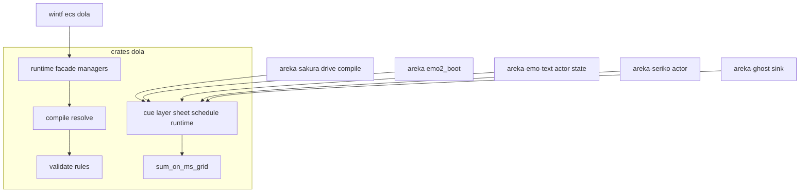
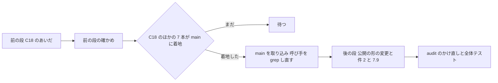
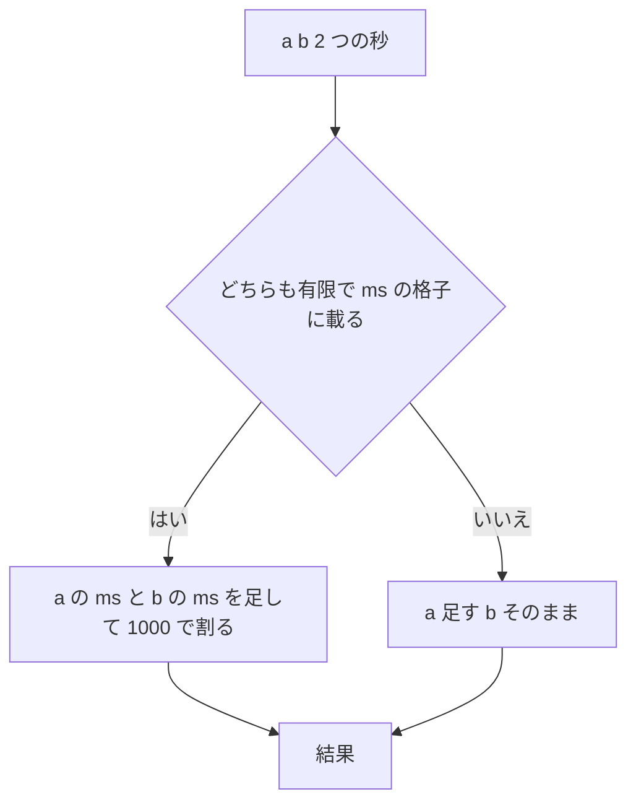
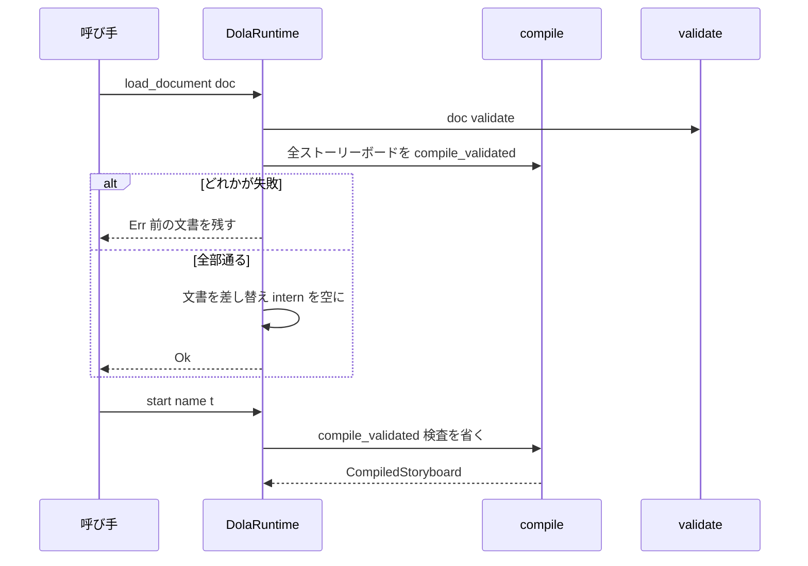

# 設計: audit-dola

## Overview

**目的**: dola（絶対時刻の台本の再生）を受け持つクレート `crates/dola/` に ponytail の audit をかけて出た 88 件の指摘（`research.md` §3 の #1〜#88）と、ほかの spec から申し送られた 3 件（件 1〜3）を、決めた 3 件の残しを除いて全部直す。直し方は ponytail の「いちばん小さな完全な変更」に従う。消せるものは消し、呼び手・テスト・fixture まで直し切る。

**使う人**: 開発者（直った dola の上で `dola-yaml-backend`・`dola-interrupt-ticks` を進める）と、dola を呼ぶ本番のコード（`areka-sakura` の台本の再生・本体 areka・`areka-emo-text`・`areka-seriko`・`areka-ghost`・wintf の `ecs/dola`）。

**変わること**: cue の層（本番で毎トーク動く）は、整数 ms で組んだ台本の終わりが ms の格子に載り、トークの終わりの合図が 1 刻み遅れなくなる。並べ替えが panic しうる比べ方がなくなる。storyboard の層（本番に結線されていない公開の口）は、トリガーの時刻・周回の待ち・値の保持・長さ・依存の順・循環の検出・競合の判定・数値の検証が正しくなる。使われていない公開の口は、C18 のほかの 7 本が着地した後の段で消す。テストは、落ちようのないテストと重複を消し、直したバグごとに壊れたら落ちるテストを 1 本ずつ持つ。

### Goals

- 88 件のうち要件 11.3 で残すと決めた 3 件のほかを、3 つの組とも全部直す（要件 3.1・11.1）。
- 件 1（ms の格子）・件 2（`CuePlayer::stop`）・件 3（clippy の `-D warnings`）を片づける（要件 7〜9）。
- 直したバグと危ない所の 1 件ごとに、壊れたら落ちるテストを 1 本持たせる（要件 4.1）。
- 直した後の audit のかけ直しで新しい指摘が 0 件、全体テストが緑（要件 10）。

### Non-Goals

- `crates/dola/` の外のファイルの見直し（ほかの見直しの spec の持ち物）。
- 新しい機能。時刻の型を秒の `f64` から替えること（`dola-interrupt-ticks`）。YAML の読み書きの土台の取り替えと機能 `yaml`（`dola-yaml-backend`）。
- clippy の指摘のうち `crates/dola/` の外のもの（`clippy-199-lints`）。
- DolaRuntime（storyboard の層）を消すこと（2 つのアニメエンジンの決め・`research.md` §4）。

## Boundary Commitments

### This Spec Owns

- `crates/dola/` の全ファイル（本番のコード・テスト・`Cargo.toml`・`README.md`）の直し。
- 件 1 の和の決まり（関数 `sum_on_ms_grid`）と、それを使う 7 か所の時刻の和。
- storyboard の層の正しさ（トリガーの時刻・周回・値の保持・長さ・依存の順・循環の検出・競合・検証）と、読み込みで通った文書が start で落ちない約束。
- 直しのために要る、範囲の外の呼び手の直し（下の「範囲の外で触るファイル」の表に挙げたものだけ）。
- `clippy-199-lints` の brief への「dola の分は済んだ」の記録（要件 9.4）。

### Out of Boundary

- 範囲の外のファイルで見つけた指摘（その範囲の spec の持ち物として残す・要件 6.2）。
- C18 のあいだの、本体 `crates/areka/` の全部・`areka-emo-text` の `sink*`／`actor*`・wintf の `ecs/mod.rs`／`ecs/world/mod.rs`・`placement-crate-split` が触る外のファイル（要件 6.3）。
- C18 のあいだの、dola の公開の形の変更（足すことのほか・要件 6.4）。
- `vendors/` の下（要件 6.6）。
- 残すと決めた 3 件: #4 の付随（最後の区切りより後のトリガーは発火しない）・#11 の `WaitForInput` と `resolve_click`・#25 の機能 `yaml`（要件 11.3）。

### Allowed Dependencies

- dola の今の依存（`serde`・`thiserror`・`interpolation`・`rand`・`windows`、任意の `serde_yaml`）と Rust の標準ライブラリだけ。**依存は 1 つも足さない**（要件 5.6）。記録の依存（`tracing`）も足さない（要件 5.2・11.6）。
- 後の段で外す依存: `toml` 0.8（任意）・`serde_json` を通常の依存から `[dev-dependencies]` へ（#25）。
- 範囲の外の呼び手が dola へ向かう向きは今のまま（dola は外のクレートを呼ばない）。wintf の `tick_dola_animators` は今ある `tracing` で記録する。

### Revalidation Triggers

- **後の段の公開の形の変更**（#11〜#19・#25・#26・#52・#56・#66・#70・#73・#77・#78・件 2）: dola を使うクレート（`areka-sakura`・`areka-seriko`・`areka-emo-text`・`areka-ghost`・本体 `areka`・wintf）は、`main` へ着地した後の全体テストで確かめ直す。待っている `dola-yaml-backend`・`dola-interrupt-ticks` は、設計の前にこの spec の着地を取り込む。
- **`sum_on_ms_grid` の公開**（後の段）: `dola-interrupt-ticks` が時刻を整数へ替えるとき、この関数とその `shortcut:` の注を消し、要件 7.6 のテストを型を替えた後の振る舞いの檻として残す。
- **`Cargo.lock` の変更**（後の段の #25）: そのときのウェーブで `Cargo.lock` の席を使う spec と申し合わせる（要件 6.1）。
- **storyboard の層の振る舞いの変更**（読み込みで壊れた文書を拒む・数値の検証・値のクランプ・競合の判定）: wintf の `DolaAnimator` を使い始める spec は、新しい検証の規則を前提にする。

## Architecture

### Existing Architecture Analysis

- dola は 2 つのエンジンを持つ。**cue の層**（`src/cue/`）は台本 `CueSheet` を `TimedSchedule<TalkCue>` へ直し（`to_talk_schedule`）、受け身の再生機 `CuePlayer` が外から渡された時刻で進めて受け手（`CueSink`）へ配る。本番で毎トーク動く。**storyboard の層**（`src/compile/`・`src/validate/`・`src/runtime/`）は宣言的アニメの文書を検証・コンパイルし、時刻で値を評価して差分を配る。本番には結線されていない（wintf の `DolaAnimator` は再公開だけ）が、公開のクレートの口である。
- 時刻はどちらの層も秒の `f64`。本番の cue のアンカー（最初の Tick）は必ず 0.0、後の Tick は `n / 1000.0`（`research.md` §11.1 の 1）。
- 守る形: 記録は呼び手の境目（`src/cue/sink.rs` の注と同じ作り）・canonical 変換 `to_talk_schedule` が台本から予定への唯一の変換・2 フェーズ API（`tick` → `ready`／`last_result`）。

### Architecture Pattern & Boundary Map



- 選んだ形: **今のファイルの中で直す**（`research.md` §8 の案 A）。新しい本番のファイルは作らない。テストの道具は層ごとに 1 か所へ寄せる。
- 層の境目: cue の層と storyboard の層は互いを呼ばない（今のまま）。件 1 の関数は cue の層の中に置く。
- 依存の向き（変えない）: `value`・`error` → `validate` → `compile` → `runtime`。`cue` は `value` だけに頼る。範囲の外は dola を呼ぶだけ。
- steering との合い方: 時刻は丸めない（格子に載る値どうしの和だけを整数 ms で足す）・記録の無い失敗の道を作らない・1,000 行の番人・依存を足さない。

### 2 つの段



- **前の段**（C18 のあいだ・要件 11.2）: 公開の形を変えない直しと、件 1・件 3。公開の口を**足す**直し（`has_instances`・`DolaError::InvalidNumber`）はここで取る。公開の口を消す直しのうち、テストだけの読み替え（`update` → `tick`＋`last_result`・`CuePlayer::ready()` → 記録する受け手）もここで済ませる。
- **後の段**（C18 のほかの 7 本＝`wintf-visual-tree`・`placement-crate-split`・`audit-wintf-layout-widget`・`audit-emo-text-state-actor`・`audit-emo-text-layout-draw`・`audit-kanade`・`audit-sylphya-actor` がすべて `main` に着地した後）: 公開の形を変える 18 件（#11〜#19・#25・#26・#52・#56・#66・#70・#73・#77・#78）と件 2（要件 8.2・8.3）と要件 7.9。後の段の最初のタスクの頭で、7 本の着地を `git log origin/main` で確かめ、`main` を枝へ取り込み、消す口の呼び手をツリー全体で grep し直し、本体 `crates/areka/` などに触るそのときのセッションと申し合わせる（要件 6.1）。
- 1 本の spec・1 本の枝・1 本の PR のまま（要件 11.1）。前の段の直しも、完了の PR で `main` へ入る。

### Technology Stack

| 層 | 使うもの | この spec での役目 | 注 |
|---|---|---|---|
| 言語 | Rust（edition 2024・作業場の rustc 1.99.1） | 全部 | `Vec::pop_if` は 1.86 から（MSRV の宣言は無い） |
| 標準ライブラリ | `f64::total_cmp`・`f64::round`・`std::sync::OnceLock`・`BTreeMap`／`BTreeSet` | #10・件 1・#79・#36・#69 | 依存を足さない |
| 既にある依存 | `thiserror`（ワークスペース 2 系） | #34 の derive | `Cargo.lock` は変わらない |
| 範囲の外の記録 | wintf の `tracing`・テストの `log-capture-kit` | #38 の `error!` とその檻 | wintf の既存の依存 |

## File Structure Plan

### Directory Structure

```
crates/dola/
├── Cargo.toml                 # 後の段: 機能 json/toml と任意の toml を消し serde_json を dev-dependencies へ (#25)
├── README.md                  # 後の段: 書式の機能と PlaybackState の行を直す (#25・#26)
├── src/
│   ├── lib.rs                 # 後の段: playback の再公開を消す (#26)
│   ├── playback.rs            # 後の段: ファイルごと消す (#26)
│   ├── error.rs               # thiserror の derive (#34)・InvalidNumber を足す (#29)・後の段で場所の欄 (#70)
│   ├── value.rs               # 等しさとハッシュを同じ鍵で (#28)
│   ├── builder.rs             # build で全ストーリーボードを compile にかける (#32)
│   ├── storyboard.rs          # loop_count の説明を検証に合わせる (#29)
│   ├── cue/
│   │   ├── mod.rs             # 説明の数 (#84)・後の段で sum_on_ms_grid を再公開 (7.9)
│   │   ├── sheet.rs           # 件1 の和と相対の終わりの 1 本化 (#8・#9)・total_cmp (#10)・後の段で 3 つの口を消す (#18)
│   │   ├── schedule.rs        # sum_on_ms_grid の置き場 (#8)・到達と完了の和・pop_if (#80)・後の段で Routing と時間切れと extend を消す (#11・#12・#14・#78)
│   │   ├── runtime.rs         # 後の段: ready/remaining/skip_barrier/stop/from_schedule の公開/PendingChoice.text を消す (#13・#15・#19・#77・件2)
│   │   ├── command.rs         # 後の段: timeout 欄/Timeout/Routing/EntityKey/Window/EntityRef を消す (#11・#12・#16・#17)
│   │   ├── sink.rs            # 後の段: EntityRef の枝を消す (#17)
│   │   └── command_tests.rs   # 落ちないテストを消す (#81)・Cursor を足す (#82)・後の段で消える値のテスト
│   ├── validate/
│   │   ├── mod.rs             # V7 の両向き (#32)・トリガー以外の trigger_start_offset を拒む (#31)・clippy
│   │   └── rules.rs           # 数値の規則 (#29)・予約名 (#30)・循環の検出の反復化 (#6・#49)・clippy
│   ├── compile/
│   │   ├── mod.rs             # 長さ (#4)・total_cmp (#10)・compile_validated (#58)・重なりの報告 (#69)
│   │   ├── resolve.rs         # 依存の辺 (#5)・between (#31)・値域 (#33)・閉路 (#68)・通らない枝 (#71)・複製 (#72)・expect (件3)
│   │   └── types.rs           # 後の段: serde の derive を消す (#73)
│   └── runtime/
│       ├── mod.rs             # document_store を外す (#57)・後の段で Interpolator の再公開を消す (#56)
│       ├── facade.rs          # トリガーの時刻 (#1)・文書を直に持つ (#57)・読み込みで compile (#32)・trigger_store の後始末 (#35)・has_instances (#39) ほか
│       ├── facade_tests.rs    # 新: DolaRuntime の中の欄を見るテストの置き場 (#35・#43・#57)
│       ├── document_store.rs  # ファイルごと消す (#57)
│       ├── conflict_resolver.rs  # 競合の判定 (#7)・BTreeSet (#36)・let-else (#61)・clippy
│       ├── clock.rs           # FREQ を 1 度だけ (#79)・壁時計のテストを消す (#27)
│       ├── types.rs           # 説明の直し (#45)・後の段で Display を消す (#66)
│       ├── instance_manager/  # BTreeMap (#36)・create_instance を消す (#60)・pause を 1 段に (#59)
│       ├── timeline_manager/  # 値を保つ (#3)・クランプ (#33)・intern を通す (#37)
│       ├── loop_controller/   # 周回の起点 (#2)・イージング表を共用 (#55)・clippy (tests.rs)
│       ├── interpolator/      # 重複のテスト (#67)
│       └── subscription_manager/ # 表の後始末 (#62)・複製を減らす (#63)・clippy
└── tests/                     # 層ごとの束（cue・compile・runtime・trigger・validation・general）を直す（下の Modified Files）
```

### Modified Files（テスト）

- `tests/cue.rs` — `tick_last_result_test` の行を消し（#22）、cue の道具（`runtime_test_test_support.rs` の中身）を直下の mod へ上げる（#86）。
- `tests/cue/sheet_test.rs` — 件 1 の檻 4 本と #9・#10 の檻を足す。後の段で #18 の 64 行を消す。
- `tests/cue/schedule_test.rs` — 先に #24・#85・#86 で減らしてから #20 の檻を足す。clippy の `assertions_on_constants` は `const { assert!(..) }`。後の段で #12・#14・#78 の分を直す。
- `tests/cue/runtime_test_*.rs`・`sink_test.rs`・`runtime_test.rs` — #21・#23・#24・#88。`CuePlayer::ready()` を読む 23 か所を記録する受け手へ（#13 の前ぶれ）。#19 の同値テストを消す。後の段で `stop`・`skip_barrier` の呼び手を直す。
- `tests/cue/tick_last_result_test.rs` — 消す。意味のある 1 本を `tests/runtime/facade_test/diff_delivery.rs` へ（#22）。
- `tests/runtime/**` — #40〜#47・#50 の一部。`update` を `tick`＋`last_result` へ（#52 の前ぶれ・6 つの `#![allow(deprecated)]` を外す）。`linear(..)` の道具を `conflict_resolution_test/mod.rs` か共通の所に 1 本（#46）。`module_inception`（件 3）。
- `tests/trigger/**`・`tests/compile/**`・`tests/validation/**`・`tests/general/**` — #29〜#33 の特性化を「拒まれる」へ、#48〜#51・#74・#75・#76・#83。後の段で #25・#26・#73 の分を消す。

### 範囲の外で触るファイル

| ファイル | 段 | 指摘 | 変えること |
|---|---|---|---|
| `crates/areka-sakura/src/compile_sheet_tests.rs` | 前 | 件 1（#8） | 2 本（`trailing_explicit_wait_remains_in_sheet_and_extends_extent`・`append_epilogue_appends_carrier_at_tail_horizon_without_extending`）の期待を格子の値か `absolute_end_time()` から作る |
| `crates/wintf/src/ecs/dola/mod.rs` | 前 | #38・#39 | `tick_dola_animators` で `TriggerResult::Error` を `error!` に・旗の判断に `has_instances()`・旗の説明（175-181 行目）を直す・檻 1 本 |
| `crates/areka/src/emo2_boot/frame/window_state_tests.rs` | 後 | 件 2 | 496 行目の `player.stop()` を、player を捨てる形（`drive.rs` の `drop(player)` と同じ）へ |
| `crates/areka/src/emo2_boot/talk_lifecycle.rs` | 後 | 7.9 | 288 行目の `cue.at + cue.duration` を `dola::cue::sum_on_ms_grid(cue.at, cue.duration)` へ・286-287 行目の注も |
| `crates/areka-seriko/src/actor.rs`・`actor_dispatch_tests.rs` | 後 | #17 | `EntityRef` の守りの枝（742-752 行目）と、その記録の檻（157-212 行目ほか・注の語）を消す |
| `crates/areka-emo-text/src/actor.rs`・`state.rs`・`state_cue_apply_tests.rs` | 後 | #17 | `EntityRef` の腕（actor.rs:412・state.rs:674）とテスト（581 行目）を消す |
| `crates/areka-ghost/src/sink.rs` | 後 | #17 | `command_kind` の `EntityRef` の腕（120 行目）とテスト（252 行目）を消す |
| `crates/areka-sakura/src/drive_delivery_tests.rs` | 後 | #77 | `PendingChoice { .. }` の `text` の欄（613-621 行目）を消す |
| `Cargo.lock` | 後 | #25 | `toml` 0.8 の項と dola の依存の行（cargo が書く） |
| `.kiro/specs/clippy-199-lints/brief.md` | 前 | 件 3（9.4） | 「dola の段 1 の 21 件と統合テストの 3 件・lib test の 2 件は audit-dola が直した」の節を足す |

- `areka-sakura/src/drive.rs` は #11 の後も `other =>` の腕で受けるので書き換えない（後の段で grep して確かめる）。`areka-ghost/src/dispatcher.rs:235`・`areka-kanade` の注にある `skip_barrier` の語は「外から届ける口を新設しない」という文脈の説明なので、そのセッションの持ち物として残す（要件 6.2）。

## System Flows

### 件 1: 時刻の和



- 格子に載るとは `(x * 1000.0).round() / 1000.0 == x` かつ有限（NaN・±inf は載らない＝今と同じ f64 の和）。ms どうしの和は 2^53 未満の整数の和なので丸めが無く、結果は Tick の式 `n as f64 / 1000.0` と同じ値になる。
- 使う 7 か所: ⑴ 合図ごとの相対の終わり `start_time + clamp(duration)`（`absolute_end_time` と `to_talk_schedule` が共有する私的な関数の中）⑵ `absolute_end_time` のアンカー＋相対の終わり ⑶ `absolute_fire_time` のアンカー＋始まり ⑷ `TimedSchedule::tick` の到達（アンカー＋オフセット）⑸ `is_completed`（アンカー＋horizon）⑹ `occupancy_horizon`（同）⑺ horizon の fold は ⑴ の値の max（足し算ではない）。
- 時間切れの期限（`schedule.rs:203・249`）は後の段の #11 で消えるので、前の段では和を替えない（直してもすぐ消える）。

### storyboard の読み込みと開始



- `DolaDocumentBuilder::build` も同じく全ストーリーボードを compile にかけ、通らなければ `Err(Vec<DolaError>)`。公開の `compile_storyboard` は今のまま「validate してから compile」。
- 読み込みで通った文書は start で compile の失敗をしない（#32 の檻）。

### 周回と値の保持（#2・#3・#4）

- 長さ（#4）: `base_duration = segments.last().end_time - compile の起点`（先頭の遅れを含む）。インスタンスの終わり＝始まり＋長さ／time_scale。
- 値の保持（#3）: 最後のセグメントを過ぎた変数は、インスタンスが生きている間は最後の値を出し続ける。項目を消すのは `remove_entries`（Conclude・Cancel・競合の終わり）だけ。
- 周回（#2）: 周回の終わりで、待ち `delay`（loop_offset・min==max なら固定）を先に求め、新しい起点＝前の終わり＋`delay`−一時停止の累計、新しい終わり＝前の終わり＋1 周の長さ＋`delay`。待ちの間は #3 で最後の値を保つ。待ち 0 なら今と同じ値。
- トリガー（#1）: 壁時計の発火時刻＝`loop_start_time + pause_accumulated + fire_time / time_scale`（評価の式 `calculate_effective_time` の逆）。

## Components and Interfaces

| 部品 | 層 | 役目 | 要件 | 契約 |
|---|---|---|---|---|
| `sum_on_ms_grid` | cue（`src/cue/schedule.rs`） | 2 つの秒を件 1 の決まりで足す | 7.1〜7.9 | 関数 |
| 相対の終わり（私的） | cue（`src/cue/sheet.rs`） | `absolute_end_time` と `to_talk_schedule` が共有する `max(sum_on_ms_grid(start, clamp(duration)))` | 7.1・7.2・#9 | 関数 |
| 数値の検証の規則 | validate（`src/validate/rules.rs`） | 有限・符号・範囲 | 11.9 | `Vec<DolaError>` |
| `DolaError::InvalidNumber` | error | 数値の規則の違反の種類（足す） | 11.9・5.2 | 型 |
| `compile_validated` | compile（`src/compile/mod.rs`・crate の中） | 検査済みの文書を検査を省いて compile | #58・#32 | 関数 |
| 依存のグラフ | compile（`src/compile/resolve.rs`） | 配列順の辺を足す | 11.7 | 内部 |
| `DolaRuntime::has_instances` | runtime（`src/runtime/facade.rs`） | 生きたインスタンスがあるか（足す） | #39 | 関数 |
| 競合の判定 | runtime（`src/runtime/conflict_resolver.rs`） | 同じ変数に生きた項目があれば競合 | 11.8 | 内部 |
| 値のクランプ | runtime（`src/runtime/timeline_manager/mod.rs`） | Float・Integer の評価値を `min_value`／`max_value` へ | 11.11 | 内部 |
| `DynamicValue` の等しさ | value（`src/value.rs`） | 等しさとハッシュを同じ鍵で | #28 | trait の実装 |
| トリガーの失敗の記録 | 範囲の外（`crates/wintf/src/ecs/dola/mod.rs`） | `TriggerResult::Error` を `error!` | 11.6・5.2 | 記録 |

### cue の層

#### `sum_on_ms_grid`

```rust
/// 2 つの秒を足す。どちらも有限で ms の格子に載るなら ms の整数で足してから秒に直し、
/// 載らなければ f64 の和そのもの（時刻を丸めない）。
// shortcut: f64 の秒のあいだだけの継ぎ。dola-interrupt-ticks で時刻が整数になったら消す
pub(crate) fn sum_on_ms_grid(a: f64, b: f64) -> f64;
```

- 事前条件: なし（NaN・±inf・負を受ける）。
- 事後条件: `a`・`b` がどちらも格子に載るとき、結果は `(a_ms + b_ms) as f64 / 1000.0` と等しい（例 0.15＋0.8＝0.95）。どちらかが載らないとき、結果は `a + b` とビット単位で等しい（要件 7.4）。
- 後の段（要件 7.9）: `pub` にし、`src/cue/mod.rs` で `pub use schedule::sum_on_ms_grid;`。

#### `CueSheet`・`to_talk_schedule`・`TimedSchedule`（形は変えない）

- `absolute_end_time()` = `sum_on_ms_grid(absolute_start_time, 相対の終わり)`。相対の終わりは `to_talk_schedule` の horizon と同じ私的な関数から出す＝clamp を通す（#9）。そのため、非有限や負の長さの合図に対しても `absolute_end_time() == occupancy_horizon()` が成り立つ。長さが有限で非負の値では、格子に載らないとき今と同じ値（要件 7.4）。要件 7.4 の「今と同じ値」は「格子へ丸めない」の意味と読む＝非有限・負の長さの合図は #9（要件 11.1 で直すと確定）で clamp を通り、`absolute_end_time` だけは今と違う値（`occupancy_horizon` と同じ値）になる。本番の台本は `areka-sakura/src/compile.rs:43` の事後条件（有限で非負）でこの形を作らない。
- `absolute_fire_time(cue)` = `sum_on_ms_grid(absolute_start_time, cue.start_time)`。
- `TimedSchedule::tick` の到達: `pop_if(|e| !(sum_on_ms_grid(start_time, e.offset()) > current_time))`（NaN の扱いを今と同じにするため `!(>)`・#80）。
- `is_completed`: `current_time >= sum_on_ms_grid(start_time, horizon)`。`occupancy_horizon()` も同じ式。
- 並べ替えは 5 か所とも `total_cmp`（降順は `b.offset().total_cmp(&a.offset())`）。NaN を含む並びは、NaN が符号で両端に分かれる形に決まる（負の NaN が昇順の先頭・正の NaN が末尾。x86 で計算から生まれる NaN＝`inf - inf`・`0.0 / 0.0` は符号の桁が立った負の NaN）（#10）。

### storyboard の層

#### 数値の検証（#29・要件 11.9）

| 欄 | 規則 |
|---|---|
| `delay`・`duration`（遷移） | 有限・0 以上（負の delay は拒む） |
| `offset`（at の時刻）・`trigger_start_offset` | 有限 |
| `time_scale` | 有限・0 より大きい |
| `loop_count` | 1 以上か −1 |
| `loop_offset` の値（Scalar・Range の min／max） | 有限（負は今の V14／V15 が拒む） |
| 変数の `initial`・`min`・`max`、遷移の `from`・`to`・`relative_to`（数の値） | 有限 |

```rust
// src/error.rs に足す（足すだけ）
InvalidNumber {
    /// 例 "storyboard 'fade' entry 2"・"variable 'opacity'"・"transition 'slide'"
    location: String,
    /// 例 "duration"
    field: String,
    value: f64,
},
```

- 規則は `src/validate/rules.rs` の 1 つの関数にまとめ、`validate()` の中から呼ぶ。違反は全部集めて `Vec<DolaError>` で返す（今の作り）。
- `storyboard.rs:79-81` の `loop_count` の説明を、validate が拒む形に合わせる。

#### 読み込みで通った文書は start で落ちない（#32・#57・#58）

- `DocumentStore` を消し、`DolaRuntime` が `Option<DolaDocument>` を持つ。`load_document` は `validate()` の後、全ストーリーボードを `compile_validated(&doc, name, 0.0)` にかけ、1 つでも失敗すれば前の文書を残して `Err(RuntimeError::CompileError(errors))`。通れば差し替え、Object の値の intern の表を空にする（#62）。
- V7 を「`variable` と `transition` は両方あるか両方無いか」にする（片方だけは `InvalidEntry`）。
- `DolaDocumentBuilder::build` も `validate()` の後に全ストーリーボードを compile にかける。
- `compile_storyboard`（公開）は今のまま validate してから `compile_validated` を呼ぶ。`start_internal`・`calculate_end_time` は `compile_validated` を使う。

#### コンパイル（#4・#5・#31・#33・#68・#69・#71・#72）

- **依存の辺**（#5・要件 11.7）: at も between も無いエントリに辺を足す。変数を持つ遷移は、同じ変数の配列上の直前のエントリへ。変数を持たないエントリ（純粋なキーフレーム・トリガー）は配列の 1 つ前のエントリへ。78-79 行目の注を直す。
- **between**（#31・要件 11.10）: トリガーと純粋なキーフレームに書いた `between` は、`between.from` の時刻で発火・配置する（`resolve_pure_keyframe_time` に 1 分岐）。トリガー以外のエントリの `trigger_start_offset` は validate で `InvalidEntry`。
- **値域**（#33・要件 11.11）: `resolve_to_value` の後に、変数の値域と比べて `ValueOutOfRange` を積む（`relative_to` の結果も拾う）。
- **閉路**（#68）: `KeyframeCycle` は、解けずに残った節から閉路を 1 本たどって、その節だけを出す。
- **重なりの報告**（#69）: `var_segments` を `BTreeMap` にし、セグメントの横に元の `entry_idx` を持って報告に使う。
- **通らない枝**（#71）: V4・V5 が先に落とす枝と「start は必ず在る」の枝を消し、前提は `debug_assert!` で表す。

#### ランタイム（#1・#2・#3・#7・#33・#35・#36・#37・#39 ほか）

- 競合の判定（#7・要件 11.8）: `detect_overlaps` のセグメントの二重ループを消し、「新しいインスタンスが触る変数のどれかに、ほかのインスタンスの生きた項目があれば競合」。集めた集合は `BTreeSet`（#36）。
- `instances` を `BTreeMap<u64, _>` にする（#36）。同じ tick の自然終了・トリガー・競合は group_id の昇順に処理される。
- 競合で終わったインスタンスの `trigger_store` を `start_internal` の競合の解決の直後に消す（#35）。
- 値のクランプ（#33・要件 11.11）: タイムラインの項目にコンパイル結果の `min_value`／`max_value` を持たせ、Float と Integer の評価値（補間・イージングの行き過ぎを含む）をその範囲へ収める。
- 最終値の取り出し（#37）: `collect_final_values`・`collect_current_segment_final_values` を `&mut self` にして intern を通す。

```rust
// src/runtime/facade.rs に足す（足すだけ）
/// 終わっていないインスタンス（一時停止中を含む）が 1 つでもあれば true。
pub fn has_instances(&self) -> bool;
```

- wintf の `tick_dola_animators` は `active |= !result.changes.is_empty() || !result.triggered.is_empty() || animator.runtime().has_instances();` とし、同じループで `TriggerResult::Error { source_storyboard, target_storyboard, error }` を `tracing::error!` で記録する（要件 11.6）。各トリガーは発火の印が先に立つので、同じ失敗の記録は 1 回だけ出る。

#### `DynamicValue` の等しさ（#28）

- 私的な関数 `float_key(v: f64) -> u64`（0.0 と −0.0 を同じ値・どの NaN も 1 つの値・ほかは `to_bits`）を作り、`Hash` と手書きの `PartialEq`（Float の腕だけ鍵で比べ、ほかの腕は今の derive と同じ）の両方で使う。`Eq` の注「実用上ない前提」を消す。

## 指摘ごとの直し方

表の見方: **段**＝前（C18 のあいだ）／後（C18 のほかの 7 本の着地の後）。**縛るテスト**＝新（足す）・改（改める）・—（バグや危ない所でない・消す直しなどで要らない）。ファイルの道は `crates/dola/` から（範囲の外は crate 名から）。

### Must fix

| # | 段 | 直し方（消すものを含む） | 範囲の外 | 縛るテスト |
|---|---|---|---|---|
| 1 | 前 | `process_triggers` の発火時刻を `loop_start_time + pause_accumulated + fire_time / time_scale` の 1 式に。430-432 行目の古い注を直す | — | 新 `trigger_fires_at_parent_start_plus_keyframe`（start 10.0・kf 1.0 → 10.9 で未発火・11.0 で発火）・新 `trigger_fire_time_counts_pause`（0.5 で pause・5.0 で resume → 5.4 で未発火・5.5 で発火）（`tests/trigger/runtime_test.rs`） |
| 2 | 前 | `advance_loop` で待ちを先に求め、起点＝前の終わり＋待ち−一時停止の累計・終わり＝前の終わり＋1 周＋待ち（`loop_start_time += loop_duration` の行を置き換える） | — | 改 #44 の e2e（`Range{2,2}`・各時刻の値を `expect`）（`tests/runtime/loop_offset_test/loop_offset_compile.rs`） |
| 3 | 前 | `evaluate_segments` の早期 `return None`（268-274 行目）を消し、`evaluate` の期限切れの項目の削除（104-114 行目）を消す。116 行目の注も | — | 新 `shorter_variable_holds_final_value_until_instance_ends`（x 1 秒・y 2 秒・t=1.008 で x=1.0・t=2.0 の Conclude の後も x=1.0）（`tests/runtime/facade_test/update_flow.rs`）・改 `expired_entry_auto_removal`・`evaluate_multi_segment_progression`（`src/runtime/timeline_manager/tests.rs`） |
| 4 | 前 | `base_duration = segments.last().end_time - start_time`（compile の起点から）。付随（最後の区切りより後のトリガー）は残す（要件 11.3） | — | 新 `leading_delay_counts_in_storyboard_duration`（delay 0.5・duration 1.0 → `end_time` 1.5・t=1.0 で x=0.5）（`tests/runtime/facade_test/load_start.rs`）・改 `compilation_flow.rs:121` を 1.5 |
| 5 | 前 | 依存のグラフに配列順の辺（上の「コンパイル」）。78-79 行目の注を直す | — | 新 2 本: 前方参照のある連結（期待 [5,6] 0→1・[6,7] 1→2）と、at の無い keyframe を挟む正しい文書が通る（`tests/compile/time_resolution_test/sequential.rs`） |
| 6 | 前 | 根ごとの呼び出しの後で `path`・`in_stack` を空に、根は `doc.storyboard.keys()`（`BTreeMap` の順）で回す。DFS は #49 で反復 | — | 新 `trigger_cycle_reported_once_without_bystander`（{a→b, b→a, c→a} で `TriggerCycle` がちょうど 1 件・中身 [a,b,a]）・改 `validation_test.rs:377-385` の集合の比べ（`tests/trigger/validation_test.rs`） |
| 7 | 前 | `detect_overlaps` の 153-180 行目を消し、同じ変数に生きた項目があれば競合（要件 11.8）。176 行目の P 番号の注も | — | 新 `never_blocks_overlap_on_wall_clock`（A Never を t=0・x は delay 5、B を t=5.0 → B は `Err(Conflict)`）（`tests/runtime/conflict_resolution_test/conflict_detection.rs`） |
| 8 | 前 | 件 1: `sum_on_ms_grid` を足し、上の 7 か所で使う | 前: `areka-sakura/src/compile_sheet_tests.rs` の 2 本。後: `areka/src/emo2_boot/talk_lifecycle.rs:288`（7.9） | 新 4 本（下の「テストの方針」の件 1）・改 T1 の 1 本を `tick(0.95)` に（`runtime_test_broadcast_tests.rs:210-250`）・ほかの T1 は期待を `absolute_end_time()` から |

### Should fix（cue の層）

| # | 段 | 直し方 | 範囲の外 | 縛るテスト |
|---|---|---|---|---|
| 9 | 前 | 相対の終わりを私的な関数 1 本にし、`absolute_end_time` と `to_talk_schedule` の両方が呼ぶ（clamp を通す）。`schedule.rs:356-366` の説明を事実に合わせる | — | 新 `end_time_equals_occupancy_horizon_for_non_finite_durations`（長さ [NaN, +inf, −3]）（`tests/cue/sheet_test.rs`） |
| 10 | 前 | `sheet.rs:41-46`・`schedule.rs:142-146・165-169`・`compile/mod.rs:229-233・290-295` を `total_cmp` に。「panic しない」の注を直す | — | 新 `sort_with_many_nan_follows_total_order`（`f64::NAN` と `f64::INFINITY - f64::INFINITY`（負の NaN）を合わせて 24 件含む `CueSheet::new` と `to_talk_schedule`）（`tests/cue/sheet_test.rs`）・新 compile の並べ替えの 1 本（`tests/compile/boundary_test.rs`） |
| 11 | 後 | `WaitForInput` の `timeout` 欄・`BarrierKind::Timeout`・`barrier_timeout_offset`・時間切れの枝（`schedule.rs:199-215・236-254`）・`BarrierReached::Timeout` を消す。`WaitForInput` と `resolve_click` の説明に「`talk-fast-forward` の `\x` の受け皿」と書く（要件 11.4） | `areka-sakura/src/drive.rs` は `other =>` で受ける＝変更なし | —（消す直し。残る口は既存の `resolve_click` のテストが縛る） |
| 12 | 後 | `RoutingCommand`・`EntityKey`・`CuePayload::Routing`・`Entry::Routing`・`routing_buffer`・`next_routing` を消す（要件 11.5）。`schedule.rs` の冒頭の説明「3 種」を直す | なし（grep 0） | — |
| 13 | 後 | `filtered_ready`・`CuePlayer::ready`・`CuePlayer::remaining` を消し、配送の門の中で `self.schedule.ready()` から直に配る。テストの読み替えは前の段で済ませる | なし | — |
| 14 | 後 | `TimedSchedule::extend` と、それを使う 3 本と NaN の `extend` の debug_assert のテストを消す。`sheet.rs:151` の説明の `extend` の行を消す | — | — |
| 15 | 後 | `skip_barrier` を消し、`runtime.rs:262-264` の注を「上流が player を捨てて抜ける」へ（要件 8.3） | — | —（件 2 と同じ檻 8.4） |
| 16 | 後 | `CueTarget::Window` と `command_tests.rs:792-818`・対応表の行を消す（要件 11.5） | — | — |
| 17 | 後 | `CueCommand::EntityRef` と `sink.rs:129` の腕を消す（要件 11.5） | 上の「範囲の外で触るファイル」の seriko・emo-text・ghost | — |
| 18 | 後 | `filter_by_actor`・`actors`・`len` と `sheet_test.rs:110-173` を消す。`sheet.len()` を使うテストは `sheet.cues().len()` へ | — | — |
| 19 | 後 | `from_schedule` を非公開の中身として `from_sheet` へ畳む。同値のテスト（`runtime_test_barrier_tests.rs:264-299`）は前の段で消す | — | — |

### Should fix（cue の層のテスト）

| # | 段 | 直し方 | 範囲の外 | 縛るテスト |
|---|---|---|---|---|
| 20 | 前 | 同じ時刻の解決の檻を足す（`schedule_test.rs` を #24・#85・#86 で減らした後） | — | 新 `resolve_then_same_time_tick_collects_after`（payload@1.0 → WaitForChoice@1.0 → "after"@1.0・`tick(1.0)` → 解決 → `tick(1.0)` で `ready()==["after"]`） |
| 21 | 前 | 選択待ちでの `resolve_click` が何もしない檻を足す | — | 新 `resolve_click_is_noop_while_waiting_for_choice`（状態も `pending_choices` も変わらない）（`runtime_test_barrier_tests.rs`） |
| 22 | 前 | `tests/cue/tick_last_result_test.rs` を消し、`tick_updates_last_result` だけを `tests/runtime/facade_test/diff_delivery.rs` へ（そこの `simple_float_doc` を使う） | — | — |
| 23 | 前 | `sink_test.rs:99-171・264-313` を消し、`default_emit_with` を小さな受け手で書き直す | — | — |
| 24 | 前 | research の組の後ろの方を消す（約 −110 行） | — | — |

### Should fix（クレートの設定・時計・値の型）

| # | 段 | 直し方 | 範囲の外 | 縛るテスト |
|---|---|---|---|---|
| 25 | 後 | 機能 `json`・`toml` と任意の `toml` を消し、`serde_json` を `[dev-dependencies]` へ。`#[cfg(feature = "json")]` を外し、toml の往復と `feature_json_enabled_by_default` を消し、README（13・17 行目）を直す。機能 `yaml` と任意の `serde_yaml` は残す（要件 11.3） | `Cargo.lock` | — |
| 26 | 後 | `src/playback.rs`・`lib.rs` の `mod playback` と再公開・`storyboard_playback.rs:147-180`・README 19 行目を消す（要件 11.5） | — | — |
| 27 | 前 | `clock.rs` の `now_call_overhead_is_negligible` を消す（ほかの 3 本は残す） | — | —（決定論でないテストの撤去） |
| 28 | 前 | 上の「`DynamicValue` の等しさ」 | — | 改 `dynamic_value.rs:111-138` を「等しければ同じハッシュ」（0.0 と −0.0・NaN どうし）へ・新 `nan_object_value_is_interned_once`（同じ NaN 入りの Object を 2 回評価して表の件数が 1）（`src/runtime/interpolator/tests.rs`） |

### Should fix（storyboard の層の検証とコンパイル）

| # | 段 | 直し方 | 範囲の外 | 縛るテスト |
|---|---|---|---|---|
| 29 | 前 | 上の「数値の検証」。`InvalidNumber` を足す。固定していたテストを「拒まれる」へ。`facade.rs:196-203`・`compile/mod.rs:43-51` ほかの NOTE を消す。dola は戻り値で返し、記録は呼び手の境目（要件 11.6。今、storyboard の文書を読む本番の呼び手は無い） | — | 新 `invalid_numbers_are_rejected`（time_scale 0／−1／NaN・duration NaN／−3・delay −1・loop_count 0・loop_offset NaN・initial +inf を 1 つずつ拒む表）（`tests/validation/schema_test.rs`）・改 `boundary_test.rs:49-232`・`transition_v13_nan.rs`・`schema_test.rs:112-124`・`loop_offset_validation.rs:148-194`・`load_start.rs:261-388` |
| 30 | 前 | V3 で `__implicit_` で始まる名を予約に | — | 改 `boundary_test.rs:253` を「拒まれる」へ |
| 31 | 前 | 上の「between」（要件 11.10） | — | 新 `trigger_between_fires_at_from_keyframe`（[a at 1, b at 3, c at 10, trigger between{a,b}] → 1 秒で発火）（`tests/trigger/compile_test.rs`）・新 `trigger_start_offset_on_non_trigger_is_rejected`（`tests/trigger/validation_test.rs`） |
| 32 | 前 | 上の「読み込みで通った文書は start で落ちない」 | wintf のテストの文書はどれも正しい（実装のときに wintf のテストを回して確かめる） | 新 `load_rejects_compile_failing_document_and_keeps_previous`（transition の無い variable・`"at": []`・keyframe の循環の 3 例・前の文書で start が通る）（`tests/runtime/facade_test/load_start.rs`）・新 前のエントリの失敗が連鎖するエラーの 1 本（`tests/compile/error_test.rs`） |
| 33 | 前 | 上の「値域」と「値のクランプ」（要件 11.11） | — | 新 `relative_to_out_of_range_is_rejected`（opacity [0,1]・initial 0.5・relative_to 0.8）（`tests/compile/error_test.rs`）・新 イージングの行き過ぎがクランプされる（`src/runtime/timeline_manager/tests.rs`） |
| 34 | 前 | `DolaError`・`RuntimeError` に `#[derive(thiserror::Error)]` と `#[error("...")]`（文は今と一字一句同じ）を付け、手書きの `Display` と `impl std::error::Error` を消す（約 −190 行）。依存は消さない | — | —（`error.rs` の既存の文字列のテストが縛る） |

### Should fix（storyboard の層のランタイム）

| # | 段 | 直し方 | 範囲の外 | 縛るテスト |
|---|---|---|---|---|
| 35 | 前 | 競合の解決の後に `for g in &affected { self.trigger_store.remove(g); }`。`facade.rs:417-422` の SAFETY の注を事実に合わせる | — | 新 `conflict_termination_drops_trigger_store`（`src/runtime/facade_tests.rs`）・改 `error_handling.rs:92-196` |
| 36 | 前 | `instances` を `BTreeMap`、集合を `BTreeSet`（補助の関数も合わせる）。`conflict_detection.rs:239` の `sort_unstable` の逃げを外す | — | 新 `simultaneous_triggers_resolve_in_group_order`（親 P1・P2 が t=1 で同じ x を触る子を起こす → 子の group_id は親の group_id の順に振られ、残る子と `affected_group_ids` が 20 回回して毎回同じ）（`tests/trigger/runtime_test.rs`） |
| 37 | 前 | 上の「最終値の取り出し」 | — | 新 `object_conclude_twice_reports_no_change`（"a"→"b" を 2 回・2 回目の Conclude で change 0）（`tests/runtime/facade_test/diff_delivery.rs`） |
| 38 | 前 | dola は今のまま `TriggerResult::Error` を返す。wintf の `tick_dola_animators` で `error!`（要件 11.6） | `wintf/src/ecs/dola/mod.rs` | 新 `trigger_error_on_never_conflict`（`tests/trigger/runtime_test.rs`）・新 `trigger_error_is_logged`（`log-capture-kit` で `error!` の 1 行を見る・`wintf/src/ecs/dola/mod.rs` のテスト） |
| 39 | 前 | `has_instances()` を足し、旗の判断に使う | `wintf/src/ecs/dola/mod.rs:187` | 新 `has_instances_stays_true_during_delay`（delay 1.0 の台本で、変化 0 件の tick の間も真・Conclude の後は偽）（`tests/runtime/facade_test/update_flow.rs`）。旗は大域の値で並ぶテストから見えない＝檻は dola の側（`research.md` §11.1 の 5） |

### Should fix（storyboard の層のテスト・両方の層）

| # | 段 | 直し方 | 範囲の外 | 縛るテスト |
|---|---|---|---|---|
| 40 | 前 | 4 つの戦略のテストを、新しい SB が触らない変数 y と 2 セグメントの SB で、各戦略の値を `expect` する形へ | — | 改 4 本（`termination_strategy.rs`） |
| 41 | 前 | `if let Some`／`_ => {}` の 12 か所を `.expect("…")`＋`assert_eq!` に（`termination.rs:87` は件 3 の `single_match` も消える） | — | 改 12 か所 |
| 42 | 前 | 許し幅 0.05 の 25 か所を 1e-9 に | — | 改 |
| 43 | 前 | 1 本目は schema_version "99.0" で `Err` の後に `start("fade_in")` が通る・2 本目は 2 枚目の読み込みの後 start せずに tick して差分 0・3 本目は `instances` の件数を `facade_tests.rs` で見る | — | 改 2・新 1（`facade_tests.rs`） |
| 44 | 前 | `Scalar(5.0)` を min==max の Range にし、各時刻の値を `expect`（#2 の檻） | — | 改（#2 と共用） |
| 45 | 前 | `start_result_fields`・`start_result_infinity` を消し、`types.rs:132-133` の説明を「無限ループでも 1 周分」に | — | — |
| 46 | 前 | `tests/runtime` の共通の所に `linear(var, from, to, dur) -> StoryboardEntry` を 1 本、文書は `DolaDocumentBuilder` で組む（約 −400 行） | — | — |
| 47 | 前 | 2 秒の親・kf 1.0 で発火する文書で、t=1.0 → 1 件・t=1.016 → 0 件に差し替える | — | 改 `trigger_fires_only_once_per_loop` |
| 48 | 前 | 遅く発火するトリガーを配列の前に置く文書と、同時刻の 1 本 | — | 新 2 本（`tests/trigger/compile_test.rs`） |
| 49 | 前 | `dfs_detect_cycle` を明示のスタックの反復に。2 本を `std::thread::Builder::new().stack_size(64 * 1024)` のスレッドの中で深い鎖を回す形に | — | 改 `long_dependency_chain_compiles_without_stack_exhaustion`（`boundary_test.rs:320`）・`validation_test.rs:300-345`（再帰に戻すと落ちる） |
| 50 | 前 | 386 行目は親を `cancel` してから子の changes を見る。419 行目と 111 行目は消す。262 行目は `assert_eq!(len, 1)` | — | 改 |
| 51 | 前 | 「含まれる」側を消し、`with_transition` と `sb(entries)` を `transition_test/mod.rs` に 1 つずつ（約 −500 行）。`Compiled*` の serde の分は #73 で後の段に消す | — | — |
| 52 | 後 | `DolaRuntime::update` を消し、`clock.rs:13`・`facade.rs:29` の説明を直す。テストの約 125 か所の読み替えと 6 つの `#![allow(deprecated)]` は前の段で済ませる | なし | — |
| 53 | 前（後の段の分は後） | P 番号と古いテストの道を引く 35 か所を、同じ所の指摘を直すときに消すか今の道へ直す。前の段の最後のタスクで `proposals`・`P[0-9]` の grep が範囲で 0 件 | — | —（grep の 0 件を記録） |

### Nice to have

| # | 段 | 直し方 | 範囲の外 | 縛るテスト |
|---|---|---|---|---|
| 54 | 前 | 理由の無い `#[allow(dead_code)]` 3 つを `#[cfg(test)]` に。読まれない `group_id`・`base_duration` の欄を消す（`get_storyboard` は #57 で消える） | — | — |
| 55 | 前 | `loop_controller/mod.rs:44-88` の表を消し `interpolator::apply_easing` を使う | — | — |
| 56 | 後 | `runtime/mod.rs:22` の `pub use interpolator::Interpolator` を消し `pub(crate)` に | — | — |
| 57 | 前 | `DocumentStore` を消し、facade が文書を直に持つ。`document_store.rs` の意味のあるテストは `facade_tests.rs` へ | — | — |
| 58 | 前 | `compile_validated` を足し、start と子の start はそれを使う | — | —（#32 の檻が「通った文書は start で落ちない」を縛る） |
| 59 | 前 | `instance_manager` の `pause` に時刻を渡して 1 段に。`set_pause_start`・防御の分岐（`timeline_manager/mod.rs:245`・resume の分）とそのテストを消す | — | — |
| 60 | 前 | `create_instance` を消し、facade で `StoryboardInstance` を組んで `insert`（件 3 の `too_many_arguments` も消える・要件 11.12） | — | — |
| 61 | 前 | `let Some(terminal_state) = InstanceState::from_policy(policy) else { continue };` を値の match の前へ。Never の腕・`unreachable!`・`expect` を消す | — | — |
| 62 | 前 | `unsubscribe`／`unsubscribe_all` で `id_to_name` も消す。`load_document` で intern の表を空に | — | 新 `unsubscribe_forgets_name`（解除と登録を 3 回繰り返して表の件数が増えない）（`src/runtime/subscription_manager/tests.rs`） |
| 63 | 前 | `subscribed_ids` を直に回して `&str` で評価（毎フレームの `String` の複製と `Vec`・`HashMap` を作らない） | — | — |
| 64 | 前 | `finish` の引数名を `deadline` に（説明も） | — | — |
| 65 | 前 | `compiled.triggers.clone()` を `std::mem::take` に | — | — |
| 66 | 後 | `EvaluatedValue` の `Display` を消す（テストの使い手を直す） | — | — |
| 67 | 前 | `instance_manager/tests.rs:139-147` と `interpolator/tests.rs:495-542` を消し、イージングの既知の値を 2〜3 個確かめる | — | 改 |
| 68 | 前 | 上の「閉路」 | — | 新 `keyframe_cycle_lists_only_cycle_members`（a↔b と c at a で cycle は a と b だけ）（`tests/compile/error_test.rs`） |
| 69 | 前 | 上の「重なりの報告」 | — | 新 `overlap_error_points_to_offending_entry_in_name_order`（`tests/compile/error_test.rs`） |
| 70 | 後 | `ValueOutOfRange`（遷移の分）と `ReservedKeyframeName` に `storyboard` と `entry_index` を足す。Scalar の `loop_offset` では V16 を飛ばす | なし（外で match する所 0） | 新 場所が載る・`loop_offset = -1` で 1 件だけ（`tests/validation/schema_test.rs`） |
| 71 | 前 | 上の「通らない枝」（約 −30 行） | — | — |
| 72 | 前 | `compile/mod.rs:203`・`resolve.rs:241-271` の複製を move と借用に | — | — |
| 73 | 後 | `compile/types.rs` の `Serialize`／`Deserialize` の derive と、`tests/compile/serde_test.rs`（ファイルごと）・`compilation_flow.rs:285-319`・`tests/trigger/serde_test.rs:57-85`・`loop_offset_compile.rs:81-93` を消す | — | — |
| 74 | 前 | `tests/compile/common` に `float_var`・`transition_entry` を置き `..Default::default()` を使う。統合テストの中の効かない `#[cfg(test)] mod` 14 か所を消す。`extract_float` の写しは #41 の後に 1 つへ（約 −600 行） | — | — |
| 75 | 前 | ちょうどの値の 1e-9 の比べを `assert_eq!` に | — | — |
| 76 | 前 | 状態遷移の 25 本を期待の表 1 本（49 組）に。`from_policy_results_are_terminal` は残す | — | 改 |
| 77 | 後 | `PendingChoice.text` の欄を消す | `areka-sakura/src/drive_delivery_tests.rs:613-621` | — |
| 78 | 後 | `notify_barrier_resolved` の引数を消す（`runtime.rs:316-317`・`schedule_test.rs` の 10 か所） | なし | — |
| 79 | 前 | `QueryPerformanceFrequency` を `static FREQ: OnceLock<f64>` で 1 度だけ | — | — |
| 80 | 前 | 到達の取り出しを `pop_if` に（上の「cue の層」）。`unwrap` と SAFETY の注を消す | — | —（既存の到達のテストと件 1 の檻） |
| 81 | 前 | `command_tests.rs:12-77・438-447・571-585` を消す | — | — |
| 82 | 前 | `CueCommand::Cursor { .. }.into()` の 1 行を足す | — | 改 `duration_is_uniform_envelope_field_across_all_payloads` |
| 83 | 前 | `.build().unwrap()` の後の `assert!(doc.validate().is_ok())` 8 行を消す | — | — |
| 84 | 前・後 | `cue/mod.rs:11` の数を前の段で 13 に、後の段で #17 の後の 12 に | — | — |
| 85 | 前 | 落ちようのない assert を消す。`schedule_test.rs:315-323` は「`tick(1.0)` の後に解決しても `ready()==["x"]` のまま」を見る形に | — | — |
| 86 | 前 | `runtime_test_test_support.rs` の道具を `tests/cue.rs` 直下の mod へ上げ、`wait()` を足して sheet と schedule でも使う。`schedule_test.rs:842-867` の `Times` を消す（約 −250 行） | — | — |
| 87 | 前 | `schedule_test.rs` は #24・#85・#86 で減らしてから足す（下の 1,000 行の計画） | — | —（番人） |
| 88 | 前 | `tests/cue/runtime_test.rs` の効かない `#[cfg(test)]` 6 行を消す | — | — |

### 件 2・件 3・要件 7.9

- **件 2**（要件 8）: 前の段では `CuePlayer::stop` に触らない（8.1）。後の段で `stop` を消し、`window_state_tests.rs:496` の `player.stop()` を player を捨てる形（`drop(player)`）に直す（8.2）。`skip_barrier` も消す（8.3・#15）。dola の中の呼び手（`runtime_test_broadcast_tests.rs:293`・`runtime_test_occupancy_horizon_tests.rs:168`）も捨てる形へ。中断した台本で状態が変わらないことは `script_stopped_before_the_directive_leaves_the_state` が捨てる形で縛り続ける（8.4）。audit は `stop` を別の指摘にしていない＝件 2 と同じものとして扱う（8.5）。
- **件 3**（要件 9）: 26 か所。`collapsible_if` 18（`validate/rules.rs` 11・`validate/mod.rs` 3・`timeline_manager/mod.rs` 2・`subscription_manager/mod.rs`・`conflict_resolver.rs`）は振る舞いを変えずに畳む。`too_many_arguments` は `instance_manager/mod.rs:71` を #60 で消し、`compile/resolve.rs:284` に `#[expect(clippy::too_many_arguments, reason = "...")]`（理由＝「解決の途中の表を 1 か所で受ける私的な関数で、束の型を作ると同じ欄の写しが増える」・要件 11.12）。`manual_range_contains` 2（`loop_controller/tests.rs`）・`doc_lazy_continuation`（`facade.rs:323` の字下げ）・`assertions_on_constants`（`schedule_test.rs:827` を `const { assert!(..) }`）・`module_inception`（`conflict_detection.rs:6` の入れ子の mod を外す）・`single_match`（#41）。公開の関数の引数の数は変えない（9.3）。`clippy-199-lints` の brief に済んだ記録を足す（9.4）。
- **要件 7.9**（後の段）: `sum_on_ms_grid` を `pub` にして `dola::cue` から再公開し、`talk_lifecycle.rs:288` を `dola::cue::sum_on_ms_grid(cue.at, cue.duration)` にする（直後の非有限の守りはそのまま）。

## タスクの束と見立て

束は触るファイルのまとまり。同じファイルに触る束は上から順に取る（並べない）。

| 束 | 段 | 指摘 | 主なファイル |
|---|---|---|---|
| 1 件 1 | 前 | #8・#9・要件 7.1〜7.8 | `src/cue/sheet.rs`・`schedule.rs`・`tests/cue/sheet_test.rs`・`runtime_test_broadcast_tests.rs`・`runtime_test_occupancy_horizon_tests.rs`・`areka-sakura/src/compile_sheet_tests.rs` |
| 2 cue の本番の小さな直し | 前 | #10・#80・#84・#53（cue の注） | `src/cue/sheet.rs`・`schedule.rs`・`mod.rs`・`src/compile/mod.rs` |
| 3 cue のテスト（減らす） | 前 | #24・#85・#86・#87・#88・#20・件 3（`assertions_on_constants`） | `tests/cue.rs`・`tests/cue/*.rs` |
| 4 cue のテスト（直す・読み替え） | 前 | #21・#22・#23・#81・#82・#13 と #19 のテストの読み替え | `tests/cue/*.rs`・`src/cue/command_tests.rs`・`tests/runtime/facade_test/diff_delivery.rs` |
| 5 storyboard の Must | 前 | #1・#2・#3・#4・#44・#47 | `src/runtime/facade.rs`・`loop_controller/mod.rs`・`timeline_manager/`・`src/compile/mod.rs`・関わるテスト |
| 6 検証 | 前 | #6・#49・#29・#30・#31（検証の半分）・#32（V7） | `src/validate/`・`src/error.rs`・`src/storyboard.rs`・検証のテスト |
| 7 コンパイル | 前 | #5・#31（コンパイルの半分）・#33（コンパイル）・#48・#68・#69・#71・#72 | `src/compile/`・コンパイルとトリガーのテスト |
| 8 読み込み | 前 | #32・#57・#58・#43（1・2 本目） | `src/runtime/facade.rs`・`document_store.rs`（消す）・`mod.rs`・`facade_tests.rs`（新）・`src/builder.rs`・`src/compile/mod.rs` |
| 9 競合とインスタンス | 前 | #7・#35・#36・#60・#61・#43（3 本目）・#54（instance_manager） | `conflict_resolver.rs`・`instance_manager/`・`facade.rs`・`facade_tests.rs` |
| 10 評価と周回と購読 | 前 | #33（クランプ）・#37・#55・#59・#62・#63・#67・#54（残り） | `timeline_manager/`・`interpolator/`・`loop_controller/`・`subscription_manager/`・`instance_manager/` |
| 11 facade の小さな直しと wintf | 前 | #38・#39・#45・#64・#65 | `facade.rs`・`runtime/types.rs`・`wintf/src/ecs/dola/mod.rs` |
| 12 時計・値・エラー | 前 | #27・#28・#34・#79 | `clock.rs`・`value.rs`・`error.rs`・`runtime/types.rs` |
| 13 ランタイムのテスト | 前 | #40・#41・#42・#46・#52 のテストの読み替え | `tests/runtime/**`・`tests/trigger/runtime_test.rs` |
| 14 ほかのテスト | 前 | #50・#51・#74・#75・#76・#83 | `tests/trigger/**`・`tests/compile/**`・`tests/validation/**`・`tests/general/**`・`tests/runtime/core_types_test.rs` |
| 15 件 3 の残りと注の掃除 | 前 | 件 3・#53・要件 9.4 | 上の件 3 の場所・`.kiro/specs/clippy-199-lints/brief.md` |
| 16 前の段の確かめ | 前 | — | `cargo test -p dola`・`-p areka-sakura`・`-p wintf`（`ecs::dola`）・clippy |
| 17 cue の値と区切り | 後 | #11・#12・#14・#16・#17・#78・#84（12） | `src/cue/command.rs`・`schedule.rs`・`runtime.rs`・`sink.rs`・`sheet.rs`・`command_tests.rs`・cue のテスト・seriko／emo-text／ghost |
| 18 CuePlayer の口 | 後 | #13・#15・件 2・#18・#19・#77 | `src/cue/runtime.rs`・`sheet.rs`・cue のテスト・`window_state_tests.rs`・`drive_delivery_tests.rs` |
| 19 和の公開 | 後 | 要件 7.9 | `src/cue/mod.rs`・`schedule.rs`・`talk_lifecycle.rs` |
| 20 storyboard の公開の口 | 後 | #25・#26・#52・#56・#66・#70・#73 | `Cargo.toml`・`README.md`・`lib.rs`・`playback.rs`（消す）・`facade.rs`・`runtime/mod.rs`・`types.rs`・`error.rs`・`validate/rules.rs`・`compile/types.rs`・`Cargo.lock`・テスト |
| 21 audit のかけ直し | 仕上げ | 要件 10.1〜10.3・10.5・10.6 | 範囲全部 |
| 22 全体テスト | 仕上げ | 要件 10.4 | `pwsh -NoProfile -File tools/test-all.ps1` |

- **見立て: 約 22 タスク**（前の段 16・後の段 4・仕上げ 2）。20 を越えるが、1 本の spec のまま進める（要件 11.1）。束 17 の頭で、後の段に入る条件（C18 のほかの 7 本の着地・`main` の取り込み・呼び手の grep のし直し・持ち場のセッションとの申し合わせ）を確かめる。
- 束 5 と束 9 と束 10 と束 11 はどれも `facade.rs` に触るので順に取る。束 1〜4 は cue の層・束 5〜14 は storyboard の層で、互いのファイルが重ならない（束 2 の `compile/mod.rs` の並べ替えだけは束 5・束 7 より前に取る）。

## Requirements Traceability

| 要件 | 要約 | 受ける所 |
|---|---|---|
| 1.1・1.2・1.3・1.4・1.5・1.6・1.7 | 洗い出し（範囲・測り直し・上限なし・全部読む・番号・件との対応・公開の形） | 済み（`research.md` §1〜§7）。本書はその 88 件の番号で直し方を引き、1.7 の「公開の形」の欄を「段」の欄に写した |
| 2.1 | 全件を直す対象に | 「指摘ごとの直し方」の 88 行 |
| 2.2・2.5 | 残すのは裁定した 3 種だけ・記録 | Out of Boundary の 3 件（要件 11.3 の記録） |
| 2.3 | ⑶ は ukadoc を添えて | #11 の `\x` の確かめ（`research.md` §9 の 3）。⑶ に当たる指摘は 0 |
| 2.4 | 裁定を覆す直しはしない | #4 の付随を残す・#5 と #31 は完了した spec の定めに合わせる・#33 は欄を使う側を作る |
| 2.6 | 切り分けの議題 | 討議で「分けない」（要件 11.1）＝「タスクの束と見立て」 |
| 3.1 | 全部直し切る | 「指摘ごとの直し方」・「タスクの束と見立て」 |
| 3.2 | 呼び手まで直す | 「範囲の外で触るファイル」・後の段の頭の grep のし直し |
| 3.3 | 消す前にツリー全体で確かめる | 消す行ごとの「範囲の外」の欄（設計の段で grep 済み）＋各タスクで消す直前にもう一度 grep |
| 3.4 | 新しい機能を足さない | 足す口は `has_instances`（#39）・`InvalidNumber`（#29）・`sum_on_ms_grid` の公開（7.9）だけで、どれも指摘の直し |
| 4.1 | バグごとに檻 1 本 | 「縛るテスト」の欄・「テストの方針」 |
| 4.2 | 決定論 | #27 を消す・#44 の乱数を固定・#36 と #6 の順を決める |
| 4.3 | 根と一時フォルダは `target` の下 | 範囲のテストはファイルに触らない（`research.md` §4）。足すテストも触らない |
| 4.4 | GPU は実 GPU | 範囲に GPU のテストは無く、足さない |
| 4.5 | 古びたテストを改める | 「改」の行（#3・#4・#6・#29・#30・#35・#47 ほか）・件 1 の T1 |
| 5.1 | 1,000 行の番人 | 「テストの方針」の 1,000 行の計画 |
| 5.2 | 記録の無い失敗の道を作らない | 「Error Handling」・#38 の wintf の `error!`・#12 の黙って捨てる道を消す |
| 5.3 | 終了の道は正規に | 件 2 の直しは本番と同じ「player を捨てる」形。終了を省く小細工は入れない |
| 5.4 | 文字化けを読む側で直す | 文字の出力に触る直しは無い（範囲のコードは端末へ文を出さない。#27 の `eprintln!` も消える） |
| 5.5 | 時刻を丸めない | `sum_on_ms_grid` は格子に載る値どうしだけ ms で足し、ほかは今の和 |
| 5.6・5.7 | 依存を足さない | Allowed Dependencies・Technology Stack。依存が要る直しは無い |
| 6.1 | 範囲の外は申し合わせて | 後の段の頭の申し合わせ・`Cargo.lock` の席 |
| 6.2 | 要る変更のほかは触らない | 「範囲の外で触るファイル」の表だけ |
| 6.3 | C18 で触れない所 | 前の段の範囲の外は `areka-sakura/src/compile_sheet_tests.rs`・`wintf/src/ecs/dola/mod.rs`・clippy の brief だけ |
| 6.4・6.5 | 公開の形は C18 で足すだけ・変える直しは後の段 | 「2 つの段」・表の「段」の欄 |
| 6.6 | `vendors/` に触らない | 触るファイルに無い |
| 7.1・7.2 | 終わりと占有の終わりを格子に | `sum_on_ms_grid`・相対の終わりの 1 本化 |
| 7.3 | ちょうど届いたら完了 | `is_completed` の和 |
| 7.4 | 格子外は今と同じ | `sum_on_ms_grid` の事後条件 |
| 7.5 | dola の中で閉じる・形を変えない | `absolute_end_time` の形のまま・`append_epilogue` を変えない |
| 7.6 | 7.1〜7.4 の檻 | 「テストの方針」の件 1 の 4 本 |
| 7.7 | アンカーとの和にも | 到達・完了・占有の終わり・発火の時刻 |
| 7.8 | 1 つの関数と `shortcut:` の注 | `sum_on_ms_grid` の契約 |
| 7.9 | 範囲の外の写しを寄せる | 束 19 |
| 8.1〜8.5 | 件 2 | 「件 2・件 3・要件 7.9」 |
| 9.1・9.2・9.3・9.4 | 件 3（緑・振る舞いを変えずに直すか理由つきで許す・公開の形を守る・記録） | 同上・束 15・束 16 |
| 10.1・10.2・10.3・10.6 | かけ直し・0 件まで直す・記録・5 回目の打ち切り | 束 21 |
| 10.4 | 全体テスト | 束 22 |
| 10.5 | clippy の結果の記録 | 束 16（前の段）と束 21（仕上げ） |
| 11.1・11.2 | 1 本の spec・2 つの段 | 「2 つの段」・「タスクの束と見立て」 |
| 11.3 | 残す 3 件 | Out of Boundary |
| 11.4 | #11 | 表の #11 |
| 11.5 | #12・#16・#17・#26 | 表の各行 |
| 11.6 | 記録は呼び手の境目 | #29・#38・「Error Handling」 |
| 11.7 | #5 | 「コンパイル」の依存の辺 |
| 11.8 | #7 | 「ランタイム」の競合の判定 |
| 11.9 | #29 | 「数値の検証」 |
| 11.10 | #31 | 「コンパイル」の between |
| 11.11 | #33 | 「値域」と「値のクランプ」 |
| 11.12 | 件 3 の `too_many_arguments` | 「件 3」 |

## Error Handling

- **dola の中**: 失敗は戻り値で返す（記録の依存を足さない・要件 5.2・11.6）。検証の失敗は `Vec<DolaError>`（`InvalidNumber` を足す）、読み込み・開始の失敗は `RuntimeError`、トリガーの子の起動の失敗は `TriggerResult::Error`。新しい panic の道は作らない。`#61` の `unreachable!`／`expect` と `#71` の通らない枝は消し、前提は `debug_assert!` に置く。
- **呼び手の境目**: wintf の `tick_dola_animators` が `TriggerResult::Error` を `error!` で記録する（今、唯一の消費者）。storyboard の文書を読む本番の呼び手は今は無い＝`load_document` の `Err` を記録する境目は、使い始める spec が作る（Revalidation Triggers）。
- **黙って捨てる道を消す**: Routing（#12）は台本に入れても記録なく捨てられていた＝口ごと消す。壊れた文書を読み込みで受け取って start で落ちる道（#32）は読み込みで拒む。
- **cue の層の非有限**: 今の守り（`drive.rs` の `is_finite`・compile の有限で非負の保証・`clamp_duration`）はそのまま。#9 で `absolute_end_time` も clamp を通る。

## Testing Strategy

### 件 1 の檻（要件 7.6・`tests/cue/sheet_test.rs`）

1. `end_time_of_ms_grid_cues_is_exact`（7.1）: 150 ms に始まる 800 ms の合図で `absolute_end_time() == 950.0 / 1000.0`（ビット単位で等しく、0.9500000000000001 でない）。
2. `occupancy_horizon_matches_ms_grid_end`（7.2）: 同じ台本の `to_talk_schedule(..).occupancy_horizon() == 0.95`。
3. `completes_exactly_at_ms_grid_end`（7.3・7.7）: 同じ台本にアンカー 1.0 を刻み、`tick(1950.0 / 1000.0)`（Tick の式の値）で `is_completed()` が真・最後の合図の到達も同じ和で届く（直す前は `1.0 + 0.9500000000000001` が 1.95 を越えて完了しない＝直しを外すと赤）。
4. `off_grid_values_keep_plain_sum`（7.4）: 始まり 0.1234567・長さ 0.3 で `absolute_end_time() == 0.1234567 + 0.3`（ビット単位）。

### バグと危ない所の檻（要件 4.1）

- 「指摘ごとの直し方」の「新」「改」の行が、それぞれ直したバグ・危ない所を縛る（Must fix の 8 件・#9・#10・#20・#21・#28〜#33・#35〜#39・#47〜#49・#62・#68〜#70）。どれも、直しを外すと赤になる形（今の誤りの値で期待を書かない）にする。実装のタスクは、直しの前に檻が赤になることを 1 度確かめる。

### 範囲の外のテスト

- 前の段: `cargo test -p areka-sakura`（`compile_sheet_tests.rs` の 2 本が直った期待で緑）・`cargo test -p wintf --lib ecs::dola`（#38・#39）・dola を使うほかのクレート（`areka-emo-text`・`areka-seriko`・`areka-ghost`）は件 1 で結果が変わらない見込み（`research.md` §11.1 の 2）を束 16 で 1 度回して確かめる。本体 `areka` は束 22 の全体テストで確かめる（C18 のあいだは触れない）。
- 後の段: 束 17〜20 の各タスクで、触った範囲の外のクレートのテストを回す。最後は全体テスト 1 回（束 22）。

### 1,000 行の計画（要件 5.1）

| ファイル | 今 | 計画 |
|---|---|---|
| `tests/cue/schedule_test.rs` | 960 | 束 3 で #24・#85・#86 を先に消して約 870 以下へ。その後に #20 の檻（約 +20）。後の段の #12・#14・#78 でさらに減る |
| `src/cue/command_tests.rs` | 830 | #81 で約 −80・#82 で +1。後の段の #16・#17 で減る |
| `tests/cue/sheet_test.rs` | 783 | 件 1・#9・#10 の檻で約 +110（約 895）。束 3 の #86（`Cue {` の手書きを道具へ）で減る。後の段の #18 で −64 |
| `src/runtime/facade.rs` | 522 | #57 で文書を直に持つ分（+約 15）・#60 で `create_instance` の呼び出しを組み立てに（ほぼ同じ）。中の欄のテストは新しい `facade_tests.rs` へ |
| `crates/wintf/src/ecs/dola/mod.rs` | 503 | #38 の檻と結線で約 +40 |

- 足すテストは、置き場が 900 行を越えるなら兄弟のファイルへ置く。

### 確かめの手順

- 各束: `cargo test -p dola`（触った束のテストの束だけでよい）と `cargo clippy -p dola --all-targets --no-deps -- -D warnings`。
- 束 16・束 21: clippy を警告 0 で通した出力を記録に残す（要件 10.5）。
- 束 21: 同じ範囲へ `/ponytail:ponytail-audit` を、要件 1 と同じ作法（上限なし・全部読む）でかけ直し、新しい指摘を直して 0 件になるまで繰り返す（5 回目の打ち切りは要件 10.6）。
- 束 22: `pwsh -NoProfile -File tools/test-all.ps1` を 1 回（高負荷のテストを何度も回さない）。

## 残る危うさ

- **#3 と #7 の組**: 項目が生きている間は消えない形（#3）に替えると、「同じ変数に生きた項目があれば競合」（#7）が、最後のセグメントを過ぎて値を保っているだけのインスタンスも相手に数える。これは要件 11.8 の決めどおり（生きたインスタンスの値は大きい group_id が勝つ）で、Never の台本は相手が終わるまで始まらない。既存の競合のテストの大半はもともとこの結果（`research.md` §3 #7）。
- **#32 の読み込みの重さ**: 読み込みのたびに全ストーリーボードを compile する。代わりに start ごとの検査を省く（#58）ので、読み込み 1 回・start 多数の使い方では軽くなる。
- **後の段の待ち**: C18 のほかの 7 本の着地が遅れると、後の段も遅れる。前の段でテストの読み替えを済ませておくことで、後の段の差分は公開の口を消す所と範囲の外の数ファイルに絞られる。
