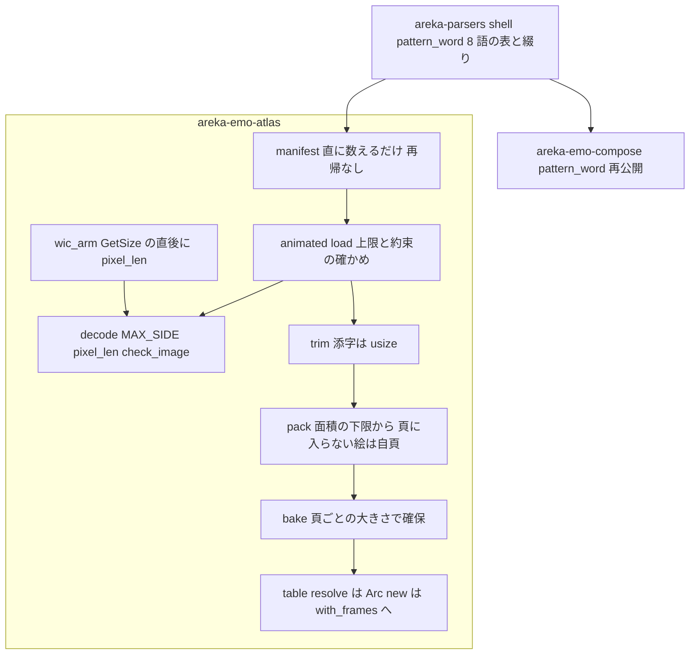
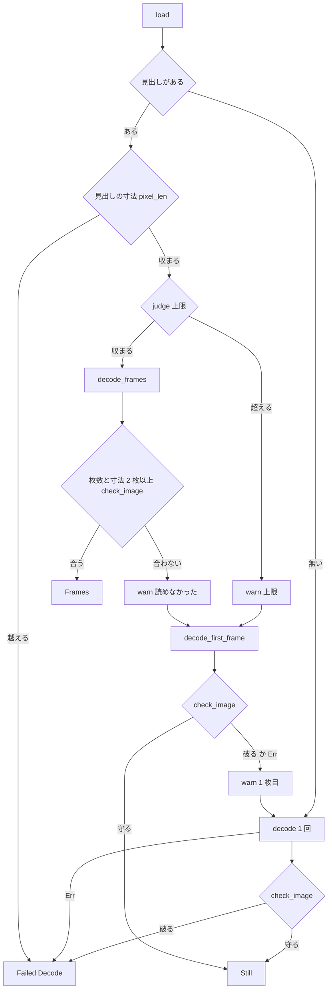

# 設計: audit-emo-atlas（絵の焼き込みとアトラスの見直し）

## Overview

**目的**: 絵の焼き込みとアトラスのクレート（`crates/areka-emo-atlas/`）に `/ponytail:ponytail-audit` をかけて出た 22 件の指摘を、要件の討議の結論（`requirements.md` の「確定した直す対象」）どおり全部直す。残すと裁定した指摘は 0 件、C20 へ回した指摘も 0 件。直し方はどれも「いちばん小さい完全な直し」で、消せるものは消し、使うテスト・検体・呼び出し元まで直し切る。

**使う人**: 開発者。壊れた・意地の悪いシェルの絵（見出しに巨大な寸法を書いた PNG・何万段も参照をつないだ `surfaces.txt`）を入れても、焼きの段でアプリが落ちない・固まらないこと、頁に入らない大きな絵が黙って消えないこと、テストが守っているつもりの分岐を本当に守っていることを得る。

**変わること**: 外から見た振る舞いの変化は 4 点だけ。⑴ 一辺が 16,384 画素を越える絵は、画素の入れ物を確保する前に読めなかった絵（`DecodeError::Decode`）になる。⑵ 余白込みで頁（2,048）に入らない大きな絵は、その絵だけの頁に載って見えるようになる（今は見えない）。⑶ 読み手が約束（`bgra.len() == stride * height`）を破った絵は、焼きの中で panic せず読めなかった絵になる。⑷ アトラスの公開の型のうち範囲の外に使い手の無い 9 つが `pub(crate)` に下がる（要件 6.8）。ほかは中の作りとテストの直しで、普通の大きさの絵の焼き上がりは 1 バイトも変わらない（emo2 の golden も変わらない）。

### Goals

- 確定した 22 件を全部直す。直したバグと危ない所（1・2・3・8 の `with_frames`・11・18・6 の ⑶）の 1 件ずつに、壊れたら落ちる決定論のテストを置く。
- 範囲の外へ及ぶのは指摘 13 の 2 クレート（`areka-parsers` に足す・`areka-emo-compose` の `pattern_word.rs` と `method.rs` をそれを使う形へ）だけ。`crates/areka/` には触らない。
- 直し終えたら同じ作法で audit をかけ直して新しい指摘 0 件・全体テスト緑。
- タスクは 22 前後（1 本の spec のまま・要件 8.1 の討議で「切らない」と確定済み・見込みは 20〜23）。

### Non-Goals

- 新しい機能・依存の追加・`Cargo.lock` の変更・clippy の機械的な直し。
- `areka-emo-compose` の振る舞いの変更（指摘 13 は表の置き場を移すだけ）。着せ替えの中の 8 語を ukadoc の新しい版が「overlay として扱う」と書く件は、この spec では直さず範囲の外の気づきとして残す（「設計の段で決めた事項」の 4）。
- 動く絵の「頁の一辺を超えたら 1 枚へ縮める」決め（完了した `areka-P0-animated-image-decode` 要件 6）の変更。
- `vendors/` の下（`examples/` の道具が書き出す `vendors/sample_ghost/` の検体を含む）。道具の出力のバイト列は変えない。
- 根の `Cargo.toml` の `[patch.crates-io]` の `image-webp` の固定と `webp_pin_tests.rs`（外す条件はまだ満たされない・設計の段で決めた事項の 9）。

## Boundary Commitments

### This Spec Owns

- `crates/areka-emo-atlas/` の全ファイル（ソース・テスト・`examples/` の道具・`src/testdata/` の検体）の、確定した 22 件の直し。
- 絵の一辺の上限 `MAX_SIDE`（16,384）と、読み手の答えの約束の確かめ（`decode.rs` の `pixel_len`・`check_image`）。
- 頁ごとの大きさ（`PackOutput.pages`）と、その絵だけの頁（自頁）の作り方。
- テストの部品の置き場（`src/test_support.rs`）と道具の共有の部品（`examples/common/png.rs`・`examples/common/riff.rs`・`examples/gen_default_balloon/cli.rs`）。
- 範囲の外の、直しに要る最小の箇所（指摘 13 だけ）:
  - `crates/areka-parsers/src/shell/` に 8 語の表と綴りの比べ方を置く（公開の形に足す）。
  - `crates/areka-emo-compose/src/pattern_word.rs`・`pattern_word_tests.rs`・`method.rs` を parsers の表を使う形へ（compose の公開の形は再公開で保つ）。

### Out of Boundary

- `crates/areka/` の全部（C19 の約束 ⑴・要件 6.1）。本体の使い手（`emo2_boot/`・`offline_dump/`・テスト約 20 本）は、アトラスの残る公開の形しか使わないので書き換えない。
- `crates/areka-placement/`（C20 の `audit-placement-core`）。`FirstFrameDecoder` は正しい長さを返すので変更は要らない。
- `crates/areka-emo-present/`・`crates/areka-seriko/` のコード（説明の文の中の `ManifestDeriver` の名指し 2 か所は事実として残るので触らない・要件 5.4）。
- `crates/areka-emo-text/`（新しいファイルを足さない・触る用事も無い・要件 6.6）。
- `crates/wintf/tests/com/wic_test.rs`（`palette/` を読むが、検体を足すだけなので壊れない）。
- 根の `Cargo.toml`・`Cargo.lock`・`deny.toml`（要件 6.4）。
- 着せ替えの中の 8 語を overlay として描くかの決め（完了した `seriko-pattern-calls` 要件 5.3 の持ち物・起票は `/kiro-discovery`）。

### Allowed Dependencies

- 今の依存だけ: `areka-parsers`・`image`（`png`・`webp`）・`rectangle-pack`・`tracing`・`windows`、テストは `log-capture-kit`・`sample-ghost-kit`。依存の向き parsers → atlas → compose → present／seriko は変えない。
- `areka-emo-compose` は今も `areka-parsers` に依存している（`bind_steps.rs` の `Interval`）。指摘 13 で依存は増えない。
- 標準ライブラリ（`std::sync::Arc`・`std::borrow::Cow` ほか）。
- 新しい依存は足さない。要ると分かったら直さずに議題にする（要件 6.5）。

### Revalidation Triggers

- **公開の形を下げる（指摘 22）**: `Packer`・`PackOutput`・`PackedEntry`・`Baker`・`Trimmer`・`TrimResult`・`Trimmed`・`ManifestDeriver`・`Manifest` が `pub(crate)` になり、`pub mod` の 8 つが `mod` になる（範囲の外からモジュールのパスを使う所は 0）。範囲の外のコードの使い手は 0（2026-11-13 にツリー全体を grep・`areka-update` の `Manifest` と `dola` の `Trimmed` は別の型）。実装の前にもう一度 grep し、`runtime-module-untangle` のセッションへ型の名を知らせる（要件 6.8）。
- **parsers の公開の形に足す（指摘 13）**: `areka_parsers::shell::{PatternWord, pattern_word, canonical_method_name, same_canonical}`。`areka_emo_compose::{PatternWord, pattern_word}` は parsers の型と関数の再公開になる（パスは変わらない）。使い手 `areka-seriko`（`table_calls.rs`・`table_calls_dot_sakura_tests.rs`）はそのままビルドできる。
- **新しい読めなかった絵**: 一辺が 16,384 を越える絵・約束を破った読み手の絵が `BakeResult::errors` に `DecodeError::Decode` として入る。形は今の失敗と同じで、呼び手（`areka-emo-present` の `shell_target.rs`・`balloon.rs`）はもう全部を `error!` で出す。
- **頁の大きさが頁ごとになる（指摘 3）**: 自頁は正方でなく、その絵の大きさ＋余白。下流はどれも `AtlasPage` の `width`・`height`・`stride` で引く（`areka-emo-compose` の `blit.rs` の `uv_fits`・本体の `balloon_background.rs`）＝壊れない。大きな絵 1 つにつき頁 1 枚ぶん（最大で約 1 GiB）メモリが増える。
- **`AtlasTable::new` の同じ鍵**: 後の番号でなく先の番号が `resolve` の答えになる（`with_frames` と揃う）。範囲の外の呼び手（compose のテスト・本体のテスト 18 か所）に同じ鍵を 2 つ渡す所は無い（実装でもう一度 grep）。
- **`AtlasTable::with_frames` の確かめが 1 つ増える**: `frames[0]` が親でないと panic する（説明の約束どおり）。範囲の外の呼び手は `areka-emo-compose/src/film_tests.rs:231` だけで、3 つとも `frames[0]` に親を置く（設計の段で読んで確かめた）。
- **本体が数える読み手の呼び出し回数**（`crates/areka/src/placement_tests/measure_bake_count_tests.rs`）は変わらない。上限と長さの確かめは読み手を呼ばない。
- **範囲の外のテストが `MemoryDecoder` に登録する絵**（`MemoryDecoder` を使う範囲の外のファイルは 39）: 約束（`stride >= width * 4`・`bgra.len() == stride * height`）を破る絵は、焼くと読めなかった絵になる。行の詰め物つきの stride（`areka-emo-present/src/balloon_marker_load_tests.rs:198` の幅 2・stride 12）は約束の内なので通る。指摘 18 のタスクで、範囲の外の `insert` の呼び出しを grep して全部が約束を守ることを確かめる。`crates/areka/` の中に破る所が見つかったら、直さずに止めて `runtime-module-untangle` と申し合わせる（C19 の約束 ⑴ で本体は触れない）。

## Architecture

### Existing Architecture Analysis

- 焼きは直列の 6 段: マニフェスト（`manifest.rs`）→ 読み（`decode.rs` の trait `ElementDecoder`・静止画は `decode/wic_arm.rs`・動く絵は `decode/image_arm.rs`・見出しは `decode/sniff.rs`）→ 透過（`normalize.rs`）→ 切り詰め（`trim.rs`）→ 詰め（`pack.rs`）→ 焼き（`bake.rs`）。入口 3 つ（`bake`・`bake_with_limits`・`bake_quiet`）は `lib.rs` の `bake_core` 1 本を共有する。
- 鍵 1 つの読みの段取りは `animated.rs` の `load`（見出しが無ければ 1 枚読み・あれば上限を判定して全コマ・駄目なら 1 枚へ縮める 3 段）。上限は `limits.rs`。
- 成果物の正本は `table.rs`（`AtlasTable`・`AtlasEntry`・`AtlasPage` ほか）。下流は `AtlasTable` の関数と `AtlasPage` の欄だけで頁を引く。
- 失敗は `BakeResult::errors` に集めて呼び手へ返す（呼び手が `error!` を出す）。前提の崩れ（pack・bake の中の矛盾）だけはアトラスが `error!` を出す。
- 記録の出し分けは `Records`（`Emit`／`Quiet`）。

### Architecture Pattern & Boundary Map



- **選んだ形**: ギャップ分析 5 節の案 A（今のファイルの中で直す）。指摘 22 を C19 のうちに直すと決まったので、`Packer`・`Baker` が内に下がった後に指摘 3 の頁ごとの大きさを入れる（案 C の「22 を C19 で直すなら 3 を寄せる」の小さい形）。pack と bake を 1 つにまとめる案 B はしない（下げた後は形を変えても公開の形に響かないので、まとめる得が無い）。
- **守る形**: 6 段の直列・入口 3 つが 1 本の `bake_core` を共有・失敗は `errors` に集めて呼び手が記録・`Records` の出し分け・`AtlasTable` の公開の関数と `AtlasPage` の欄。
- **新しく足すもの**: `MAX_SIDE`・`pixel_len`・`check_image`（3 つとも `pub(crate)`・`decode.rs`）。テストの部品と道具の部品のファイル（移すだけ）。parsers の `shell::pattern_word` モジュール（compose から移すだけ）。どれも直しに要る最小のもの。

### Technology Stack

| 層 | 選ぶもの | 役目 | 備考 |
|---|---|---|---|
| 言語 | Rust（ワークスペースの版） | 全部 | 新しい依存なし・`Cargo.lock` 不変 |
| 静止画の読み | `windows` の WIC | 寸法を聞いた直後に上限を確かめる | 変換と写しの手順は変えない |
| 動く絵の読み | `image` 0.25.10 | 変えない | `PngDecoder::new` は `Limits::no_limits()`・`WebPDecoder::new` も上限なし（読んで確かめた）＝アトラスが見出しで断る |
| 詰め | `rectangle-pack` | 変えない | 頁の数を面積の下限から試す |
| 記録 | `tracing` | 今の文言を変えない（pack の大きすぎる矩形の `error!` は起きなくなるので消す） | 対象 `areka_emo_atlas` |
| テスト | `log-capture-kit`・`sample-ghost-kit`・`MemoryDecoder` | 記録の捕まえ・検体・読み手の替え玉 | 決定論 |

## File Structure Plan

### Directory Structure

```
crates/areka-emo-atlas/
├── src/
│   ├── test_support.rs            # 新: テストの部品（COM の with_com・with_arm、面と集まりの組み立て、
│   │                              #     画像の組み立て、索引表の読み出し full/view/dump、emo2 のシェルの読み込み、
│   │                              #     読み手のテストの検体の引き方、正規化のテストの部品、記録の文言の定数）（指摘 4・10）
│   ├── bake_entry_tests.rs        # 新: lib.rs の mod bake_entry_tests を移す（指摘 19。9・10 の整理も同じタスクで）
│   ├── bake_guard_tests.rs        # 新: 信用できない読み手の答えを焼きの段で断るテスト
│   │                              #     （指摘 2 の静止画と動く絵の見出し・3 の自頁・18 の長さ・6⑶ の 1 コマ）
│   └── testdata/palette/
│       ├── idx1_trns.png          # 新: 1 ビットのパレット・tRNS で番号 1 を透明（指摘 6⑷）
│       └── idx2_mixed.png         # 新: 2 ビットのパレット・idx8_mixed と同じパレット（指摘 6⑷）
├── examples/
│   ├── common/
│   │   ├── png.rs                 # 新: crc32・png_chunk（gen_animated_samples と gen_palette_samples の写しを 1 つに・指摘 17）
│   │   └── riff.rs                # 新: WebP の旗の定数・riff_chunk・u24・encode_vp8l（指摘 17）
│   └── gen_default_balloon/
│       └── cli.rs                 # 新: main.rs の parse_args・Mode・first_difference・write_replacing・io_text と
│                                  #     そのテスト 4 本を移す（指摘 5）
crates/areka-parsers/src/shell/
├── pattern_word.rs                # 新: PatternWord・pattern_word・canonical_method_name（compose から移す・指摘 13）
└── pattern_word_tests.rs          # 新: compose の pattern_word_tests.rs の 8 語の 2 本を移す（指摘 13）
```

- `examples/common/` は `main.rs` を持たないので cargo の example として拾われない。読み手は `#[path]` で読む（`webp.rs` の `#[path = "../common/riff.rs"]` は `webp.rs` のある所から解決されるので、道具からもずれの見張りからも同じファイルを指す）。
- `png.rs` と `riff.rs` を 2 つに分けるのは、読み手ごとに使わない項目を作らないため（`gen_palette_samples` は `png.rs` だけ、`gen_default_balloon` は `riff.rs` だけ、`gen_animated_samples` は両方）。読み手のどれかで使われない項目が出たら、その項目は使う読み手の側へ戻す（`#[allow(dead_code)]` は置かない）。

消すファイル:
- `crates/areka-emo-atlas/tests/atlas.rs`（指摘 15・中身もテストも無い・ツリー全体で名前の参照は 0。完了した spec の検証の表 `areka-P0-file-slimming/verification/scan_raw.csv` の行は過去の記録なので触らない。`structure.md` の「`tests/{domain}.rs` は束ね役」は一般の慣行で、このファイルを名指さないので直さない）。
- `crates/areka-emo-atlas/src/decode/wic_arm_test_support.rs`（指摘 4・`with_arm` を `src/test_support.rs` へ移す）。

### Modified Files

ソース（`crates/areka-emo-atlas/src/`）:
- `lib.rs` — `bake_core` の `pages_vec` と `survivor_keys` を数えるだけの回し方を消す（15）。`mod bake_entry_tests` の中身を兄弟のファイルへ（19）。`mod test_support`・`mod bake_guard_tests` を足す。再公開から指摘 22 の 9 つを外し、`pub mod` の 8 つを `mod` に下げる（22）。モジュールの説明「本タスクでは雛形のみ」「間接参照解決」を事実に（14・1）。
- `manifest.rs` — `resolve_indirect`・`by_id`・`visited` と `HashMap` の取り込みを消す（1）。`bind_only_paths` の 8 語の写しを `areka_parsers::shell::pattern_word` へ（13）。間接参照の 3 本のテストを長い鎖の 1 本に替える（1）。`elem`・`surface` を `test_support` から引く（10）。`ManifestDeriver`・`Manifest` を `pub(crate)` へ（22）。説明（14）。
- `decode.rs` — `MAX_SIDE`・`pixel_len`・`check_image` を足す（2・18）。
- `decode/wic_arm.rs` — `decode_inner` を「変換器を作るまで」と「寸法を聞いて確かめてから写す所」に分け、`GetSize` の直後に `pixel_len`（2）。中のテストの `with_com_initialized` を消して `test_support::with_arm` へ（4）。`mod test_support` の宣言を消す（4）。説明 212 行・282〜288 行（14）。
- `decode/image_arm.rs` — `delay_ms` の `.unwrap_or(u32::MAX)` を `as u32` にし、届かない説明を消す（15・14）。
- `decode/sniff.rs` — `sniff_webp` の `|| 20 + len > total` を消す（8・15）。
- `animated.rs` — `load` の頭で見出しの寸法を `pixel_len` で確かめ、越えたら縮めずに `Failed`（2）。`still`・`shrink` の読めた絵を `check_image` に通す。全コマの `fits` に `check_image` を足す（18）。説明「呼び手（`bake_with_limits`）」を `bake_core` に（14）。
- `trim.rs` — 添字と長さの掛け算を `usize` で（2）。`Trimmer`・`TrimResult`・`Trimmed` を `pub(crate)` へ（22）。
- `pack.rs` — 頁に入らない矩形を自頁に載せる（3）。頁の数を面積の下限から試す（12）。`PackOutput.page_count` を `pages: Vec<Size>` に替える（3）。`Packer`・`PackOutput`・`PackedEntry` を `pub(crate)` へ（22）。大きすぎる矩形の `error!` を消す（3）。説明 7 行・95〜98 行（14）。
- `bake.rs` — `bake_pages` から `page_size` 引数を消し、頁ごとの大きさで確保する。掛け算は `usize`（3・2）。`Baker` を `pub(crate)` へ（22）。説明 8〜9 行・32〜37 行（14）。テストの `PackOutput` の組み方を新しい欄に（3）。
- `table.rs` — `new` を `with_frames(keys, entries, pages, Vec::new())` の 1 行に（11）。`with_frames` に `frames[0] == 親` の確かめ（8）。`resolve` を `Arc<HashMap<..>>` に（16）。説明 22〜23 行・112 行（14・16）。テストの `table_is_send_sync_and_cheap_clone` を事実の名前に（8）。同じ鍵の答えを確かめる 1 本を足す（11）。
- `limits.rs` — `from_env` の中身を `from_env_with(lookup)` に切る（6⑸）。
- `normalize.rs` — 変えない（`Normalizer`・`NormalizedImage` は公開のまま）。

テスト（`crates/areka-emo-atlas/src/`・各件の場所は `research.md` 3 節）:
- `animated_tests.rs`（838 行）— 足すテストは置かない。6⑵ の並びの確かめ（604 行付近の数行）・7 の 1 本の直し・9 の 496〜505 行を消す・10 の部品の写し（155〜193 行・348〜351 行・398〜405 行・716 行）を消す。直した後の行数は減る。
- `bake_quiet_tests.rs` — 6⑴ の 1 本を足す。部品の写し（14〜17 行・25〜70 行・114〜129 行）を `test_support` へ（10）。
- `limits_tests.rs` — 6⑸ の 1 本を足す。
- `table_frames_tests.rs` — 4 本の `#[should_panic]` に `expected` を付け、`frames[0]` が親でない 1 本を足す（8）。
- `decode_animation_tests.rs` — 既定の 3 メソッドの 1 本（66〜74 行）と、`bake` が頼る替え玉の約束の確かめだけを残し、替え玉の登録をなぞるだけの本と `dyn` 越しの 1 本（169〜178 行）を消す（8）。
- `decode/sniff_tests.rs` — 304〜308 行を消す。225・295 行の数える包みと `<=` の比べを消す（195 行の `< 64` は残す）（8）。
- `decode/wic_arm_tests.rs` — 16,385×1 と 16,384×1 の本物の PNG の 2 本を足す（2）。93〜119 行（`image_arm_tests.rs` と同じ 2 本）を消す（9）。部品の写し（13〜31 行）を `test_support` へ（10）。冒頭の説明（14）。
- `decode/wic_arm_palette_tests.rs` — 1・2 ビットの 2 本を足す（6⑷）。155〜167 行の名の渡し方を `HSTRING::from(png.as_path())`、検体を `testdata/animated/basic.apng` に（20）。部品の写し（12〜25 行）を `test_support` へ（10）。
- `decode/image_arm_tests.rs` — 197 行の `"Rgba16"` を外し `"frame 0"` だけ（21）。279 行の説明を「飽和は届かない」に（15）。部品の写し（15〜27・45〜49 行）を `test_support` へ（10）。252〜267・181〜188 行は残す（9 の消す側は `wic_arm_tests.rs`）。
- `normalize_key_color_tests.rs`・`normalize_rule_tests.rs` — 9 の重なり（key_color の 39〜54・88〜102・187〜220 行）を消し、部品（11〜30 行・空の `DecodedImage` の 3 か所）を `test_support` へ（10）。`normalize_rule_tests.rs:234` の説明を `[9, 9, 9, 0]` に（14）。
- `emo2_e2e.rs` — COM の写し（30〜41 行）を `test_support::with_com` へ（4）。最初の本物の焼き（93〜200 行）を記録の捕まえの中で焼き、204〜239 行の 2 度目を消して `null.png` の確かめを足す（9）。364〜376 行を件数と名前を見る形に（8）。emo2 の読み込みの数行を `test_support` へ（10）。説明 31・34 行（14）。
- `emo2_golden.rs` — COM の写し（43〜54 行）を `with_com` へ（4）。159〜192 行（2 回焼いて比べる）を消す（9）。emo2 の読み込みを `test_support` へ（10）。説明 44・47 行（14）。
- `samples_e2e_tests.rs` — COM の写し（80〜89 行）を `with_com` へ（4）。`full`・`view`（102〜127 行）・文言の定数（50〜52 行）・検体の引き方（56 行）を `test_support` へ（10）。
- `bake_entry_tests.rs`（新・lib.rs から移す）— 553〜586 行（全透明は空エントリ・633〜677 行が確かめ直す）と 857〜872 行と 624 行を消す（9・8）。部品（386〜455 行・744〜782 行）を `test_support` へ（10）。

範囲の中の道具（`crates/areka-emo-atlas/examples/`・`tests/`）:
- `examples/gen_animated_samples.rs` — `crc32`・`png_chunk`・`riff_chunk`・`u24`・`encode_vp8l`・旗の定数を `common/` から `#[path]` で読む（17）。
- `examples/gen_palette_samples.rs` — `crc32`・`png_chunk` を `common/png.rs` から（17）。1・2 ビットの 2 本を書く（6⑷）。
- `examples/gen_default_balloon/main.rs` — `mod cli;` にして 5 つの関数とテストを移す（5）。
- `examples/gen_default_balloon/webp.rs` — 写しを `common/riff.rs` から（17）。4 行目の説明（14）。
- `examples/gen_default_balloon/draw.rs` — 238〜263 行・355〜360 行を消す（9）。
- `tests/default_balloon_drift_test.rs` — `#[path = "../examples/gen_default_balloon/cli.rs"] mod cli;` を足す（5）。8 行目の説明が全部の子に当てはまるようになる（14）。
- `src/testdata/palette/README.md` — 8 本の表にし、「1 ビットは作らない」の行を事実に（6⑷）。

範囲の外（指摘 13 だけ）:
- `crates/areka-parsers/src/shell/mod.rs` — `mod pattern_word;` と `pub use pattern_word::{PatternWord, canonical_method_name, pattern_word, same_canonical};` の 2 行。
- `crates/areka-emo-compose/src/pattern_word.rs` — `PatternWord` と `pattern_word` を消し `pub use areka_parsers::shell::{PatternWord, pattern_word};`。`call_targets`・`UnreadableTarget`・`number` は残す。冒頭の説明の「上流の emo-atlas は写しを持つ」を「表は parsers」に。
- `crates/areka-emo-compose/src/pattern_word_tests.rs` — 8 語の 2 本（`words_are_compared_like_compose_methods`・`other_words_are_draw`）を parsers へ移す。`call_targets` の本は残す。
- `crates/areka-emo-compose/src/method.rs` — `canonical_method_name` と `same_canonical`（確保しない同じ規則・199〜205 行）を消し、`use areka_parsers::shell::{canonical_method_name, same_canonical};`。説明のリンクを直す（綴りの規則の写しを compose に残さない・設計の検証の重い指摘 1）。

1,000 行の番人の見通し（要件 7.1）: 上限に近いのは `lib.rs`（873 → 約 370）と `animated_tests.rs`（838 → 減る）。新しいテストはこの 2 つに足さず、`bake_guard_tests.rs`・`bake_entry_tests.rs` ほか兄弟のファイルへ置く。`bake_entry_tests.rs` は移した後に消す行と部品を抜くので約 400 行。番人の例外表には足さない。

### 触るファイル（並走のセッションが確かめる一覧）

| クレート | ファイル | 新／変／消 | 指摘 |
|---|---|---|---|
| areka-emo-atlas | `src/lib.rs` | 変 | 1・14・15・19・22 |
| areka-emo-atlas | `src/manifest.rs` | 変 | 1・10・13・14・22 |
| areka-emo-atlas | `src/decode.rs` | 変 | 2・18 |
| areka-emo-atlas | `src/decode/wic_arm.rs` | 変 | 2・4・14 |
| areka-emo-atlas | `src/decode/image_arm.rs` | 変 | 14・15 |
| areka-emo-atlas | `src/decode/sniff.rs` | 変 | 8・15 |
| areka-emo-atlas | `src/animated.rs` | 変 | 2・14・18 |
| areka-emo-atlas | `src/trim.rs` | 変 | 2・22 |
| areka-emo-atlas | `src/pack.rs` | 変 | 3・12・14・22 |
| areka-emo-atlas | `src/bake.rs` | 変 | 2・3・14・22 |
| areka-emo-atlas | `src/table.rs` | 変 | 8・11・14・16 |
| areka-emo-atlas | `src/limits.rs` | 変 | 6⑸ |
| areka-emo-atlas | `src/test_support.rs` | 新 | 4・10 |
| areka-emo-atlas | `src/bake_entry_tests.rs` | 新 | 8・9・10・19 |
| areka-emo-atlas | `src/bake_guard_tests.rs` | 新 | 2・3・6⑶・18 |
| areka-emo-atlas | `src/decode/wic_arm_test_support.rs` | 消 | 4 |
| areka-emo-atlas | `src/animated_tests.rs`・`src/bake_quiet_tests.rs`・`src/limits_tests.rs`・`src/table_frames_tests.rs`・`src/decode_animation_tests.rs`・`src/emo2_e2e.rs`・`src/emo2_golden.rs`・`src/samples_e2e_tests.rs`・`src/normalize_key_color_tests.rs`・`src/normalize_rule_tests.rs` | 変 | 4・6・7・8・9・10・14 |
| areka-emo-atlas | `src/decode/wic_arm_tests.rs`・`src/decode/wic_arm_palette_tests.rs`・`src/decode/image_arm_tests.rs`・`src/decode/sniff_tests.rs` | 変 | 2・6⑷・8・9・10・14・15・20・21 |
| areka-emo-atlas | `src/testdata/palette/idx1_trns.png`・`idx2_mixed.png` | 新 | 6⑷ |
| areka-emo-atlas | `src/testdata/palette/README.md` | 変 | 6⑷ |
| areka-emo-atlas | `examples/common/png.rs`・`examples/common/riff.rs` | 新 | 17 |
| areka-emo-atlas | `examples/gen_default_balloon/cli.rs` | 新 | 5 |
| areka-emo-atlas | `examples/gen_animated_samples.rs`・`examples/gen_palette_samples.rs`・`examples/gen_default_balloon/main.rs`・`webp.rs`・`draw.rs` | 変 | 5・6⑷・9・14・17 |
| areka-emo-atlas | `tests/default_balloon_drift_test.rs` | 変 | 5・14 |
| areka-emo-atlas | `tests/atlas.rs` | 消 | 15 |
| areka-parsers | `src/shell/mod.rs` | 変 | 13 |
| areka-parsers | `src/shell/pattern_word.rs`・`src/shell/pattern_word_tests.rs` | 新 | 13 |
| areka-emo-compose | `src/pattern_word.rs`・`src/pattern_word_tests.rs`・`src/method.rs` | 変 | 13 |

`Cargo.toml`（どのクレートも）・`Cargo.lock`・`crates/areka/`・`crates/areka-emo-text/`・`crates/areka-placement/`・`vendors/` は 0 ファイル。

## System Flows

### 鍵 1 つの読み（`animated::load`・指摘 2・18・6⑶）



- 見出しの寸法で断るのは、`image` の読み手が既定で確保の上限をかけず（`PngDecoder::new` は `Limits::no_limits()`）、重ねたコマを絵の全体の大きさで作るから。縮める道（段 1・段 2）も同じ寸法で読むので、縮めずに失敗にする。
- `judge` の「頁の一辺を超えたら縮める」（`Exceeded::PageSide`）は今のまま。2,048 を越えて 16,384 以下の動く絵は 1 枚へ縮み、その 1 枚は指摘 3 の自頁に載る。
- `fits` の `frames.len() >= 2` の守りは残す（6⑶ のテストがこれを固定する）。

### 詰めと焼き（`Packer::pack`・`Baker::bake_pages`・指摘 3・12）

1. 余白込みの寸法が頁（`cfg.page_size`）に入らない矩形と入る矩形に分ける（今と同じ分け方）。
2. 入る矩形の余白込みの面積の合計（`u64`）を頁の面積で割って切り上げた数（1 以上・矩形の数以下）から頁の数を試す。それより少ない頁では面積が足りず必ず入らないので、最初に入る頁の数とその配置は今と同じ（出力は 1 バイトも変わらない）。
3. 普通の頁は `page_size` 四方で、頁の番号 0 から。その後ろに、入らない矩形を `ElementId` の昇順で 1 つずつ自頁に載せる。自頁の大きさは（幅＋余白×2）×（高さ＋余白×2）、uv は（余白, 余白）。一辺は指摘 2 の上限（16,384）＋余白×2 まで。
4. `PackOutput.pages` に頁ごとの大きさを順に入れる。`Baker::bake_pages` は頁ごとに `width * 4 * height` を `usize` で確保して写す（`stride = width * 4`）。

## Requirements Traceability

| 要件 | 中身 | 実現する所 |
|---|---|---|
| 1.1 | 範囲だけに audit | ギャップ分析で済み（`research.md` 1〜3 節） |
| 1.2 | 件数の上限なし | 同上（22 件・省いた件なし） |
| 1.3 | 全部読む | 同上（63 ファイル）。設計の段でも直す行を開き直した（`research.md` 13 節） |
| 1.4 | 番号と組を付けて残す | `research.md` 3 節 |
| 1.5 | 確定した一覧を要件へ | `requirements.md` の「確定した直す対象」（22 件・全部「直す」） |
| 1.6 | 申し送りの 3 件を数え直さない | 15・125・130 は数えない（130 の写しは新しい指摘 4 として直す） |
| 2.1 | 3 つの組とも全部直す | 「Components and Interfaces」の 22 件の直し |
| 2.2 | 裁定のほかは残さない | 残すと裁定した指摘は 0・C20 へ回した指摘も 0 |
| 2.3 | 使う所まで直し切る | 各件の「波及」・File Structure Plan のテストと範囲の外 |
| 3.1 | 3 種類は議題に | 議題 1〜4 は討議で確定済み。設計で見つけた 3 種類に当たる件は、範囲の外の気づき 1 件（直さない・起票） |
| 3.2 | ukadoc で確かめてから | 指摘 13 の ukadoc の 2 つの版の引用（「設計の段で決めた事項」の 4） |
| 3.3 | 3 種類でなければ直す | 22 件とも議題にせず直す（2・3・13・22 は討議で直し方まで確定） |
| 3.4 | 裁定と理由を残す | 残す指摘が 0 件なので書き足すものは無い |
| 4.1 | もう一度 audit | 確かめの段（タスクの最後の 2 つ） |
| 4.2 | 0 件まで直す | 同上 |
| 4.3 | 5 回目で打ち切ってよい | 同上（打ち切ったら記録に書く） |
| 4.4 | かけ直しの記録 | 同上（`research.md` に回ごとの組ごとの件数） |
| 4.5 | 全体テスト緑 | 同上（`pwsh -NoProfile -File tools/test-all.ps1`） |
| 4.6 | 1 件ずつに壊れたら落ちるテスト | Testing Strategy の表 |
| 4.7 | 決定論のテスト | Testing Strategy（時間・乱数・環境変数・画面に依らない） |
| 5.1 | 形を変えたら呼び手を全部 | Revalidation Triggers（grep 済み・実装でもう一度） |
| 5.2 | 走っている spec と申し合わせ | 「並走の兄弟との申し合わせ」 |
| 5.3 | 消す前に使われていないか | 指摘 1・4・8・9・15・22 の消す前の確かめ（grep 済み・実装でもう一度） |
| 5.4 | 要らない所を直さない | 範囲の外は指摘 13 の 5 ファイルの決めた箇所だけ |
| 6.1 | `crates/areka/` に触らない | 触るファイルの表（0 ファイル） |
| 6.2 | 公開の形は足すだけ | 足すのは 0（`MAX_SIDE` ほかは `pub(crate)`）。変えるのは 22 だけ（6.8） |
| 6.3 | 公開の形を変えずに直せない件は議題 | 22 のほかに無い（3 は 22 の後に入れるので公開の形に響かない） |
| 6.4 | 依存を足さず `Cargo.lock` を変えない | Allowed Dependencies・どの `Cargo.toml` も変えない（指摘 5 は関数を移す形にした） |
| 6.5 | 要る依存は議題に | 要る依存は無い（`crc32` は道具の中で 1 つにまとめ、`areka-nar` は足さない） |
| 6.6 | emo-text に新しいファイルなし | 触らない |
| 6.7 | `vendors/` に触らない | 道具の出力のバイト列は変えない・検体を作り直さない |
| 6.8 | 22 は確かめ直して知らせてから下げる | 指摘 22 の節（タスクの頭で grep と知らせ） |
| 7.1 | 1,000 行の番人 | File Structure Plan の見通し（`lib.rs` は減る・新しいテストは兄弟のファイルへ） |
| 7.2 | 記録の無い失敗を作らない | Error Handling（新しい失敗は `errors` へ・呼び手が `error!`） |
| 7.3 | 終了の道は正規 | 終了の道に触らない |
| 7.4 | 実機の根と一時フォルダは `target` の下 | 指摘 2 の WIC のテストの PNG は `target/emo_atlas_side_limit_test/`（`wic_arm_tests.rs` の前例と同じ置き方） |
| 7.5 | GPU のテストは実 GPU | 焼きは CPU と WIC だけ。GPU のテストを足さない |
| 7.6 | 文字化けは読む側を直す | 道具の端末への出力は変えない（ASCII のまま） |
| 8.1 | 20 タスクを越えそうなら議題 | 討議で「切らない」と確定済み。見込み 22（「タスクの見込み」） |

## Components and Interfaces

### 一覧

| 部品 | 層 | 役目 | 指摘 | 契約 |
|---|---|---|---|---|
| マニフェスト（`manifest.rs`） | 列挙 | 直に数えるだけ（再帰なし） | 1 | 振る舞い不変 |
| 絵の約束の確かめ（`decode.rs`・`animated.rs`・`decode/wic_arm.rs`・`trim.rs`・`bake.rs`） | 読み | 上限を越える絵と約束を破る絵を確保の前・焼きの前に断る | 2・18・6⑶ | Service |
| 自頁と頁ごとの大きさ（`pack.rs`・`bake.rs`） | 詰め・焼き | 頁に入らない絵を見えるようにする | 3・12 | State |
| 索引表（`table.rs`） | 成果物 | 2 つの組み立て口を 1 本に・逆引きを共有・`frames[0]` の確かめ | 8・11・16 | 公開 API（形は不変） |
| 8 語の表（`areka-parsers`） | 語彙 | 表と綴りの比べ方を 1 つに | 13 | 公開 API（足す） |
| 公開の形の整理（`lib.rs` ほか） | 公開の形 | 使い手の無い 9 つを下げる | 22 | 公開 API（減らす） |
| テストの部品（`test_support.rs`） | テスト | 写しを 1 つにする・COM の手伝いを正しい形に | 4・10 | — |
| 道具の部品（`examples/common/`・`cli.rs`） | 道具 | 写しを 1 つにする・走らないテストを走らせる | 5・17 | — |

### 必ず直す

#### 指摘 1: マニフェストの間接参照のたどりを消す

| 欄 | 中身 |
|---|---|
| 役目 | 二乗の手間と深い再帰を、結果を変えずに消す |
| 要件 | 2.1, 4.6 |

- `ManifestDeriver::derive` から `resolve_indirect`・`by_id`・`visited` を消す。参照先は同じセットの `set.surfaces` の中の面だけで、その絵は「全部の面の絵を直に数える」で入っているので、結果（`Manifest.keys`）は今と同じ。`surface_ids` は `bind_only_paths` が使うので残す。
- モジュールの説明（1〜9 行）と `derive` の説明の「間接参照解決・循環検出」を「全部の面の element を直に数える（参照先も同じセットの面なので数え漏れは無い）」に替える。`lib.rs:14` の一覧の行も同じ。
- テスト: 間接参照の 3 本（`manifest.rs:312-366`）を消し、1 本に替える＝面 0 → 1 → … → 49,999 を `overlay` のアニメーションでつないだ 5 万面のセットを、スタックを 256 KiB にしたスレッド（`std::thread::Builder::stack_size`）の中で `derive` し、終わって鍵が 5 万個（絵を 1 度ずつ）であることを確かめる。直す前は再帰が 5 万段になってスタックがあふれ、テストのプロセスが落ちる（赤）。
- **波及**: なし（`derive` の形と結果は変わらない）。

#### 指摘 2・18: 絵の一辺の上限と、読み手の答えの約束の確かめ

| 欄 | 中身 |
|---|---|
| 役目 | 確保の前に巨大な寸法を断る・約束を破った絵で焼きの中が panic しない |
| 要件 | 2.1, 4.6, 7.2 |

**`decode.rs` の契約（3 つとも `pub(crate)`）**

```rust
/// 絵の一辺の上限（Direct3D 11 の機能水準 11 の 2D テクスチャの一辺・areka-emo-compose の MAX_EXTENT と同じ値）。
pub(crate) const MAX_SIDE: u32 = 16_384;

/// 一辺の上限を確かめ、BGRA の画素の入れ物の長さ（width * 4 * height）を usize で返す。
/// 幅か高さが MAX_SIDE を越えたら Err（寸法と上限を書いた文）。掛け算はあふれない（最大 2^30）。
pub(crate) fn pixel_len(width: u32, height: u32) -> Result<usize, String>;

/// 読み手の答えが約束を守るか: 一辺が MAX_SIDE 以下・stride >= width * 4・bgra.len() == stride * height
/// （比べは u64）。破れば Err（寸法・stride・長さを書いた文）。
pub(crate) fn check_image(img: &DecodedImage) -> Result<(), String>;
```

- 値は討議の議題 1 の結論（16,384・静止画の画素の合計には上限をかけない）。compose の `MAX_EXTENT` は `pub(crate)` で、アトラスは compose に依存できないので、値を写して根拠を 1 行の説明に書く（`ponytail:` の注釈は要らない・値の出所が同じ定めなので食い違いの種にならない）。
- **WIC の腕（`decode/wic_arm.rs`）**: `decode_inner` を 2 つに分ける。⑴ `CreateDecoderFromFilename` から変換器を作るまで（`windows::core::Result<(IWICBitmapSource, bool)>`・中身は今のまま）。⑵ `GetSize` で寸法を聞き、`pixel_len` で確かめ、通ったときだけ入れ物を確保して `CopyPixels`（`Result<DecodedImage, String>`）。WIC の失敗の文は今と同じ `e.to_string()`。`decode` は両方の失敗を今と同じ `DecodeError::Decode { path, source }` に包む。
- **鍵 1 つの読み（`animated.rs`）**: System Flows の図のとおり。⑴ 見出しがあれば `judge` の前に `pixel_len(info.width, info.height)` を見て、越えたら縮めずに `Loaded::Failed(DecodeError::Decode)`（`warn!` は出さない・失敗は `errors` に入る）。⑵ `still` と `shrink` の段 1 で読めた絵を `check_image` に通す小さな関数（`accept`）を 1 つ置き、破ったら今の「読めなかった」と同じ道（`still` は `Failed`・`shrink` は段 2 へ）。⑶ 全コマの `fits` に「全部のコマが `check_image` を通る」を足す（破れば今の「frames do not match」と同じ道＝`warn!` して縮める）。
- **切り詰めと焼き**: `trim.rs` の添字（`y * stride`・`out_stride * size.h`・`src_y * stride + min_x * 4`）と `bake.rs` の頁の長さと添字を `usize` で掛ける。上の確かめで長さは確保済みの入れ物と一致するので、添字はあふれない。
- **波及**: 新しい失敗は今の `DecodeError::Decode` と同じ形（`BakeError` に種類は増えない）。普通の大きさの正しい絵は答えも読み手の呼び出し回数も変わらない。`MemoryDecoder::insert` は確かめないまま（替え玉は約束を破る絵を作れる方が試しやすい・焼きの段が確かめる）。

#### 指摘 3: 頁に入らない大きな絵を自頁に載せる

| 欄 | 中身 |
|---|---|
| 役目 | 一辺が 2,046 を越える絵が黙って見えなくなるのを直す（完了した `areka-P0-emo-atlas` の設計 D7「頁を超える矩形は自頁」に戻す） |
| 要件 | 2.1, 2.3, 4.6 |

**`pack.rs` の形（指摘 22 で `pub(crate)` に下げた後）**

```rust
pub(crate) struct PackOutput {
    /// 頁ごとの大きさ（頁の番号の順）。普通の頁は page_size 四方、自頁はその矩形＋余白。
    pub pages: Vec<Size>,
    /// 各矩形の配置（ElementId 昇順・golden 安定）。
    pub entries: Vec<PackedEntry>,
}
```

```rust
impl Baker {
    /// 頁ごとの大きさ（pack.pages）で入れ物を確保して写す。stride は頁ごとに width * 4。
    pub(crate) fn bake_pages(
        &self,
        items: &[(ElementId, Trimmed)],
        pack: &PackOutput,
    ) -> (Vec<AtlasPage>, Vec<(ElementId, Placement)>);
}
```

- `page_count` は `pages.len()` で引けるので欄を替える（足すのでなく替える。22 の後なので公開の形には響かない）。`bake_pages` の `page_size` 引数は要らなくなり、それを足した経緯の説明（32〜37 行）も消える。
- 詰めの手順は System Flows の「詰めと焼き」。自頁は普通の頁の後ろ・`ElementId` の昇順。余白は自頁でも同じに取り、uv は余白を含まない（5.3 の約束を自頁でも守る）。
- 大きすぎる矩形の `error!`（`pack.rs:103-112`）は起きなくなるので消す。`pack.rs:161-175` の「全部を入れられない」の `error!` は前提の崩れとして残す。
- emo2 と検体の絵はどれも 2,046 以下なので、golden と今のテストの期待は変わらない（`grep` で頁に入らない絵を期待に持つテストは 0）。
- **波及**: 自頁は正方でない。下流は `AtlasPage` の欄で引く（Revalidation Triggers）。大きな絵 1 つにつき頁 1 枚ぶんのメモリ（16,384 四方なら約 1 GiB。読みの入れ物と切り詰めの写しを合わせると、その絵の焼きの間は約 3 GiB）。討議の議題 2 で「一辺は上限まで」と決まった範囲の中の重さ。

### 直したほうがよい

#### 指摘 4・10: テストの部品を 1 つにする（`src/test_support.rs`）

- `#[cfg(test)] pub(crate) mod test_support;` を `lib.rs` に置き、次を集める。`decode/` のテストからも `crate::test_support::…` で引く（`decode/` に 2 つ目の部品のファイルは置かない＝置き場は 1 つ）。
  - COM: `with_com(f)`（`CoInitializeEx` の答えを見て、入れた apartment だけ `CoUninitialize`・`RPC_E_CHANGED_MODE` はそのまま使う・ほかの失敗は落とす）と `with_arm(f)`（`with_com` の中で `WicDecoderArm::new` を組んで渡す）。中身は 130 で直した `decode/wic_arm_test_support.rs` の `with_arm` を、腕を作らない形と作る形の 2 つにしただけ。写し 4 か所（`wic_arm.rs` のテスト・`emo2_e2e.rs`・`emo2_golden.rs`・`samples_e2e_tests.rs`）はこれを呼び、写しと「RPC_E_CHANGED_MODE 許容」の説明を消す。
  - 組み立て: `elem`・`surface`・`params`・`set`・`register`・`opaque_2x2`・`transparent_2x2`・`zero_sized`・着せ替えのシェル（面 3000 を `overlay` で参照）。
  - 読み出し: `full`・`view`・`dump`（`bake_quiet_tests.rs` の `fingerprint` は `dump` に寄せる・違いは頁の画素を含むかだけなので、含む形 1 つにする）。
  - emo2: シェルのフォルダ・`on_params`・`surfaces.txt` を読んで解く数行。
  - 読み手のテスト: 検体のパスの引き方（`testdata/animated/` と `testdata/palette/`）・見出し `info`・画素を読む関数。
  - 正規化のテスト: `image`・`params`・空の `DecodedImage`。
  - 記録の文言: `OVER`・`BIND_DEBUG`・`CLEAR_WARN` ほか、2 つ以上のテストファイルが比べる文言の定数。
- 文言の定数はテストの側に 1 つだけ置く（本番の側には置かない）。ギャップ分析の案（本番の側に定数）から変えた理由: 本番の文言がうっかり変わったときに、テストが本番の定数を使っていると赤にならない。範囲の外の数えるテスト（`crates/areka/src/placement/measure_bake_log_tests.rs` ほか）が頼る文言を守るのはテストの側の定数。
- `decode/wic_arm_test_support.rs` を消し、`wic_arm.rs` の `mod test_support` の宣言を消す。
- **テスト**: 部品の直しなので足さない。COM の手伝いの正しさは 130 の直しで確かめた形をそのまま使う（STA に入ったスレッドを作って確かめるテストは、部品のためのテストになるので置かない）。

#### 指摘 5: 道具の `main.rs` のテストを走らせる

- `examples/gen_default_balloon/main.rs` の `Mode`・`parse_args`・`first_difference`・`write_replacing`・`io_text` とテスト 4 本を、新しい子のファイル `cli.rs` へそのまま移す。`main.rs` は `mod cli;` と `use cli::…` にする。
- ずれの見張り（`tests/default_balloon_drift_test.rs`）に `#[path = "../examples/gen_default_balloon/cli.rs"] mod cli;` を 1 行足す。これで 4 本は見張りのターゲットで走る。見張りの説明「道具の子のファイルのテストも一緒に走る」が全部の子に当てはまるようになる。
- `[[example]] test = true` の案は取らない: 子のファイルのテスト 20 本が見張りと道具の 2 つのターゲットで 2 度走り、テストの実行体が 1 つ増える（ビルドと結び付けの手間が毎回増える）。関数を移す形はどの `Cargo.toml` も変えない。
- **テスト**: 移した 4 本がそのまま走る（今は一度も走らない）。

#### 指摘 6: 檻の無い分岐に檻を置く

| 枝 | テスト（置き場） | 壊すと |
|---|---|---|
| ⑴ `bake_quiet` でも動く絵の `warn!` は出る | 全コマも 1 枚目も `Err` で 1 枚読みも無い動く絵を 1 つ登録し、`bake_quiet` と `bake` の記録のうち「bake: 動く絵」を含む `WARN` の行が同じで 1 行以上（`bake_quiet_tests.rs`）。どの行が出るかは比べないので、環境変数で上限が変わっても同じ結果 | 3 本の `warn!` を `records.emits()` で包むと `bake_quiet` が 0 行になって赤 |
| ⑵ 複数の動く絵のコマの並び | `animated_tests.rs:604` 付近の最初の焼きで、2 つの動く絵の `frames` の番号が親の番号の昇順・コマの番号の昇順に並ぶことを数で比べる | `append_frames` の並びを逆にすると赤 |
| ⑶ `frames.len() >= 2` の守り | `insert_animated` で `frame_count: 1` の見出しと 1 コマの中身を登録し、`bake` が panic せず 1 枚へ縮み（`animation` は `None`）、「読めなかった」の `warn!` が 1 行（`bake_guard_tests.rs`） | 守りを消すと `with_frames` が panic して赤 |
| ⑷ 1・2 ビットの番号つきの形式 | `gen_palette_samples` で `idx1_trns.png`（番号 0＝赤 不透明・1＝緑 透明度 0・画素 0,0,1,1）と `idx2_mixed.png`（`idx8_mixed` と同じパレット・画素 0,0,1,2）を足し、WIC の腕の `has_alpha` が true の 2 本（`wic_arm_palette_tests.rs`） | 表から片方を落とすと赤（下の確かめ） |
| ⑸ `from_env` の `warn!` | `from_env` の中身を `from_env_with(lookup)`（`from_lookup` の答えを `warn!` で出して上限を返す）に切り、`from_env` は `OnceLock` で `from_env_with(std::env::var)` を 1 回だけ呼ぶ。テストは読めない値を 1 つ返す `lookup` で `from_env_with` を記録の捕まえの中で呼び、`WARN` が 1 行（変数の名と値を含む）で、その項目が既定であること（`limits_tests.rs`） | `warn!` を消すと赤 |

- ⑷ の確かめ: WIC が 1・2 ビットの PNG を `Indexed1`・`Indexed2` で答えるかは、走らせないと分からない。実装の段で、表（`INDEXED_FORMATS`）から 1 ビットの項を一時に外すと 1 ビットのテストが赤になること、2 ビットも同じことを 1 度ずつ確かめて記録に残す。赤にならない（WIC が `Indexed8` で答える）なら、その項は届かないので、表から消す直しに替える（テストは残す）。
- ⑷ の検体の README（`src/testdata/palette/README.md`）を 8 本の表にし、「番号 3 種を持てない 1 ビットは作らない」を「1 ビットは不透明と透明の 2 つの番号」に直す。作り手は圧縮しないので何度走らせても同じバイト列（既存の 6 本も変わらないことを `git diff` で確かめる）。

#### 指摘 7: 環境変数で赤になるテスト

- `animated_tests.rs` の `bake_without_limits_uses_the_default_limits` を、`bake(..)` の結果と `bake_with_limits(.., AnimationLimits::from_env())` の結果が同じ（`dump` が等しい）ことを確かめる形にする（環境に依らずに「`bake` は `from_env` を使う」を確かめる）。名前と説明を事実に（「環境の上限を使う」）。
- ほかに動く絵を登録して `bake`・`bake_quiet` を呼ぶテストは、指摘 6⑴ の新しい 1 本だけ（環境に依らない比べ方にした）。実装で grep して確かめる。

#### 指摘 8: 失敗しえないテスト・弱いテスト

- `emo2_e2e.rs:364-376`: 失敗が「ちょうど 1 件」で、それが無い名前の `DecodeError::NotFound`（パスも比べる）であることを確かめる（`bake_entry_tests` の `decode_failure_skipped_others_continue` と同じ形）。
- `decode/sniff.rs:70` の `|| 20 + len > total` を消し、`sniff_tests.rs:304-308` を消す。長さが残りより長い `VP8X` は、続く読みが残りの外を指して読めず `None` になる（守りの有無で答えが変わらないことを設計の段で読んで確かめた）。
- `decode/sniff_tests.rs:225,295` の数える包みと `reader.read <= 長さ` を消す（`Cursor` は残りしか読まないので働かない）。195 行の `< 64` は残す。
- `lib.rs:857-872` と `:624` の `let _ = …` を消す（`bake_entry_tests.rs` へ移すときに）。
- `table.rs` の `table_is_send_sync_and_cheap_clone` は名前を `table_and_page_are_send_sync` にし、clone の比べを消す（指摘 16 で安価になるが、手間はテストで測らない）。
- `decode_animation_tests.rs`: 本番の既定の 3 メソッドの 1 本（66〜74 行）と、`bake` が頼る替え玉の約束（見出しと中身を照合せず登録どおりに返す・未登録は既定と同じ失敗）の確かめだけを残す。替え玉の登録をなぞるだけの本と `dyn` 越しの 1 本（169〜178 行・`decode.rs:366-370` と同じコンパイルの事実）を消す。
- `table_frames_tests.rs:110-139`: 4 本の `#[should_panic]` に、`with_frames` の `assert!` の文の一部を `expected` で付ける。
- `table.rs` の `with_frames` に「`frames[0]` が親」の `assert!` を足す（説明 102 行の約束）。`table_frames_tests.rs` に親でない並びで panic する 1 本を足す。範囲の外の呼び手 `areka-emo-compose/src/film_tests.rs:231` は 3 つとも `frames[0]` に親を置くので直さない（「設計の段で決めた事項」の 5）。

#### 指摘 9: 同じことを 2 度確かめるテスト

`research.md` 3 節の 9 の行のとおり、後ろの側（または重い側）を消す。本物の WIC の焼きは `emo2_e2e.rs` で 2 回から 1 回、`emo2_golden.rs` で 3 回から 1 回になる。`emo2_e2e.rs` の最初の 1 本は記録の捕まえの中で焼き、消す 2 本目が見ていた `null.png` の確かめをそこへ足す。`decode/wic_arm_tests.rs:93-119` は `image_arm_tests.rs` の同じ 2 本を残して消す（パス付きの包みは `wic_arm_tests.rs:121-128` が見る）。`examples/gen_default_balloon/draw.rs:238-263`・`:355-360` は `build.rs:95-100`・`:146` とずれの見張りが覆うので消す。

#### 指摘 11: 索引表の 2 つの組み立て口を 1 本に

- `AtlasTable::new` の中身を `Self::with_frames(keys, entries, pages, Vec::new())` の 1 行にする（長さの `assert!` も `with_frames` の 1 つになる。panic の文は `with_frames` のものになる）。
- テスト: 同じ鍵を 2 つ渡した表で、`new` と `with_frames` の `resolve` が同じ（小さい方の番号）であること（`table.rs` のテスト）。直す前は `new` が大きい方を返して赤。

#### 指摘 12: 頁の数を面積の下限から試す

- System Flows の「詰めと焼き」の 2。下限は小さな関数（`fn first_bins(rects: &[(ElementId, Size)], cfg) -> usize`・`pack.rs` の中）に切る。
- テスト: `first_bins` が「余白込みの面積の合計 ÷ 頁の面積」の切り上げ（1 以上・矩形の数以下）を返すこと（`pack.rs` のテスト）。今の `multi_page_split` ほか全部と golden がそのまま緑＝出力は変わらない。
- 効き目の測りは要らない（「設計の段で決めた事項」の 8）。

#### 指摘 13: 8 語の表を `areka-parsers` へまとめる

**`crates/areka-parsers/src/shell/pattern_word.rs`（新・`shell` から再公開）**

```rust
/// pattern定義の描画メソッドの語の種類（8 語の見分けの唯一の正本）。
#[derive(Debug, Clone, Copy, PartialEq, Eq)]
pub enum PatternWord { Draw, Start, Stop, AlternativeStart, AlternativeStop, ParallelStart, ParallelStop, Insert, Move }

/// 描画メソッドの語を、前後の空白・大文字・`-`・`_` を問わずに比べる形へ直す（正規化済みなら借りて返す）。
pub fn canonical_method_name(name: &str) -> std::borrow::Cow<'_, str>;

/// 描画メソッドの語を、正規化した綴り canon と確保せずに比べる（canonical_method_name(name) == canon と同じ答え）。
pub fn same_canonical(name: &str, canon: &str) -> bool;

/// 描画メソッドの語が 8 語のどれかを答える（綴りの比べ方は canonical_method_name・記録は出さない）。
pub fn pattern_word(method: &str) -> PatternWord;
```

- 中身は compose の `pattern_word.rs` の `PatternWord`・`pattern_word`（ukadoc の URL の注記ごと）と `method.rs` の `canonical_method_name`・`same_canonical` をそのまま移す。移した `pattern_word_tests.rs` に「`same_canonical(n, c)` と `canonical_method_name(n) == c` が同じ答え」の 1 本を足す（2 つの比べ方が同じ規則であることを固定する）。綴りの比べ方も parsers の 1 つにする（compose の合成メソッドの名前引き `ComposeMethod::from_name` も同じ関数を使う＝写しが残らない）。
- `crates/areka-parsers/src/shell/mod.rs` に `mod pattern_word;` と `pub use pattern_word::{PatternWord, canonical_method_name, pattern_word, same_canonical};`。テストは compose の 8 語の 2 本を `pattern_word_tests.rs` へ移す。
- **compose**: `pattern_word.rs` は `pub use areka_parsers::shell::{PatternWord, pattern_word};` を置き、`call_targets`・`UnreadableTarget`・`number` を残す。`lib.rs` の `pub use pattern_word::{PatternWord, UnreadableTarget, call_targets, pattern_word};` は変えない＝`areka_emo_compose::PatternWord`・`pattern_word` のパスは変わらず、使い手 `areka-seriko` は直さない。`method.rs` は `canonical_method_name` の定義を消して parsers から取り込む。`bind_steps.rs`・`nesting.rs`・`plan_extent.rs`・`plan_issues.rs`・`world.rs` は `crate::pattern_word::…` のまま（再公開を通る）で変わらない。
- **アトラス**: `manifest.rs` の `bind_only_paths` の 8 語の `matches!` と綴りの直しを `areka_parsers::shell::pattern_word(pattern.method.as_str()) != PatternWord::Draw` に替え、「emo-compose の写し」の説明を消す。
- **波及**: parsers の公開の形に足す 3 つ。compose の公開の形は再公開で同じ。どちらのクレートも C19 で走っている spec の範囲ではなく、見直しは完了済み。
- **テスト**: 表を移すだけで振る舞いは変わらない。parsers に移した 2 本と、compose・アトラスの今のテスト（`bind_only_paths` の 8 語を外すテスト・compose の `bind_steps` ほか）がそのまま緑。

### できれば

#### 指摘 14・15: 古くなった説明と要らない小さなコード

- 14: `research.md` 3 節の 14 の行を全部、事実に合わせるか消す。指摘 1・3・4・5・15 の直しで正しくなる行（`pack.rs:7`・`tests/default_balloon_drift_test.rs:8` ほか）は、その直しと同じタスクで直す。
- 15: `tests/atlas.rs` を消す。`image_arm.rs:146` は `as u32`（`(2n+d)/(2d) <= n <= u32::MAX`）。`sniff.rs:70` は指摘 8。`lib.rs:291` の `pages_vec` を消し、`lib.rs:281-289` は `survivor_originals` を直に回す。

#### 指摘 16: `AtlasTable` の逆引きの表を `Arc` で共有

- `resolve: Arc<HashMap<AtlasKey, ElementId>>`（`with_frames` で作った表を `Arc::new` で包む）。`clone` は 5 つの `Arc` を写すだけになり、説明「`Arc` 共有ゆえ `Clone` は安価」が事実になる。テストは足さない（手間の直し・バグではない）。

#### 指摘 17: 道具の中の写し

- File Structure Plan の `examples/common/png.rs`・`riff.rs`。`encode_vp8l` は `gen_animated_samples` の形（色の形式を受ける）に揃え、`webp.rs` は `ExtendedColorType::Rgba8` を渡す。
- 出力のバイト列は変えない。確かめ: `gen_animated_samples`・`gen_palette_samples` を走らせて `git diff --exit-code crates/areka-emo-atlas/src/testdata`（指摘 6⑷ で足す 2 本のほか差分 0）、`gen_default_balloon -- --check` が 0 で終わる（書庫と同じ）。`vendors/sample_ghost/` は書かない。

#### 指摘 19: `lib.rs` の中のテストを兄弟のファイルへ

- `mod bake_entry_tests { … }` を `src/bake_entry_tests.rs` へ移し、`lib.rs` は `#[cfg(test)] mod bake_entry_tests;` の 1 行にする。移すタスクで指摘 8・9・10 の該当行も直す（中身を 2 度動かさない）。

#### 指摘 20・21: パレットのテストと `image` の失敗の文

- 20: `wic_arm_palette_tests.rs:160` を `HSTRING::from(png.as_path())` にし、番号つきでない PNG の検体を `testdata/animated/basic.apng`（RGBA の PNG・WIC は 1 枚目を読む）にする。`sample-ghost-kit` 越しの emo2 のバルーンは読まなくなる。
- 21: `image_arm_tests.rs:197` は `"frame 0"`（こちらの文）だけを見る。

#### 指摘 22: 使い手の無い公開の型を `pub(crate)` へ

- 下げる 9 つ: `Packer`・`PackOutput`・`PackedEntry`（`pack.rs`）・`Baker`（`bake.rs`）・`Trimmer`・`TrimResult`・`Trimmed`（`trim.rs`）・`ManifestDeriver`・`Manifest`（`manifest.rs`）。`lib.rs` の再公開 4 行（321・330・333・336 行の該当部分）から外す。`PackConfig`・`SurfaceSet`・`Normalizer`・`NormalizedImage`・`AlphaParams` ほか使い手のある型は公開のまま。
- `lib.rs:24-32` の `pub mod` の 8 つ（`bake`・`decode`・`error`・`manifest`・`normalize`・`pack`・`table`・`trim`）も `mod` に下げる。指摘 22 の場所に入っている行で、範囲の外から `areka_emo_atlas::<モジュール>::` の形で使う所は 0（2026-11-13 にツリー全体を grep）。外の使い手は根の再公開（`areka_emo_atlas::AtlasTable` ほか）だけを使う。根から再公開しない公開の項目は、クレートの中で使われていれば `pub(crate)` にし、使われていなければ消す（`#[allow(dead_code)]` は置かない）。`decode::wic_arm` の `WicDecoderArm` は根の再公開のまま。`lib.rs` の冒頭の説明の `[`table`]` ほかのリンクは、下げたモジュールを指すので、根の再公開の型を指す形に直す。設計の検証の重い指摘 2（残すと、かけ直しの audit が同じ所を指し、実装の終わりに公開の形の議題が出直す）。
- タスクの頭で: ⑴ ツリー全体で 9 つの名前と 8 つのモジュールのパス（`areka_emo_atlas::<モジュール>::`）を grep し、範囲の外のコードの使い手が 0 であることを確かめ直す（説明の文の名指しは `areka-emo-present` の 2 か所だけで、事実として残るので触らない）。⑵ `runtime-module-untangle` のセッションへ、下げる型とモジュールの名を知らせる（要件 6.8）。
- 指摘 3 より前に入れる（3 は `PackOutput` の欄を替え、`bake_pages` の引数を減らすので）。
- **テスト**: 公開の形の整理なので足さない。範囲の外のビルド（全体テスト）が壊れないことで確かめる。

## Data Models

| 型 | 今 | 直した後 | 指摘 |
|---|---|---|---|
| `PackOutput`（`pub(crate)`） | `page_count: u32`・`entries` | `pages: Vec<Size>`・`entries` | 3・22 |
| `AtlasPage` | `width`・`height`・`stride`・`bytes` | 変わらない（自頁は正方でない値が入る） | 3 |
| `AtlasTable` | `resolve: HashMap<AtlasKey, ElementId>` | `resolve: Arc<HashMap<AtlasKey, ElementId>>` | 16 |
| `PatternWord` | compose の型 | parsers の型（compose は再公開） | 13 |

`AtlasTable` の公開の関数・`AtlasEntry`・`Placement`・`Animation`・`BakeResult`・`BakeError`・`DecodeError` の形は変わらない。

## Error Handling

| 起きること | 記録 | 返すもの |
|---|---|---|
| 静止画の寸法が `MAX_SIDE` を越える（WIC の腕） | アトラスは出さない。呼び手が `errors` を `error!` で出す（今の読めなかった絵と同じ） | `DecodeError::Decode`（文に寸法と上限）。入れ物は確保しない |
| 動く絵の見出しの寸法が `MAX_SIDE` を越える | 同上（縮めないので `warn!` も出ない） | 同上。読み手の `decode_frames`・`decode_first_frame`・`decode` は呼ばない |
| 読み手の答えが約束を破る（1 枚読み） | 同上 | `DecodeError::Decode`（文に寸法・stride・長さ） |
| 読み手の答えが約束を破る（動きの 1 枚目・全コマ） | 今の「読めなかった」の `warn!`（理由の文に寸法と長さ） | 今の縮める道（段 2 へ） |
| 頁に入らない矩形 | 出さない（正しい入力の扱いになった） | 自頁に載せる |
| 全部の矩形を入れられない（前提の崩れ） | 今のまま `error!` | 今のまま |

- どの失敗も panic しない（今の非 panic の約束を、巨大な寸法と約束を破る読み手にまで広げる）。
- 記録の無い失敗の道は作らない（要件 7.2）。アトラスの焼きの失敗は `errors` に集めて呼び手が記録する形で、ギャップ分析で呼び手（`areka-emo-present` の `shell_target.rs:477`・`balloon.rs:811`）が全部を `error!` で出すことを確かめた。新しい失敗もこの道を通る。
- 記録の文言は変えない（pack の大きすぎる矩形の `error!` は起きなくなるので消す・ツリー全体でこの文言を比べるテストは 0）。

## Testing Strategy

### 壊れたら落ちるテスト（要件 4.6）

| 指摘 | テスト（置き場） | 直す前の結果 |
|---|---|---|
| 1 | 5 万面の参照の鎖を 256 KiB のスタックのスレッドで `derive` して終わり、鍵が 5 万個（`manifest.rs` のテスト） | 再帰でスタックがあふれて落ちる |
| 2 | `image` の PNG の書き手で作った 16,385×1 の PNG（`target/emo_atlas_side_limit_test/` の下）を WIC の腕で読むと `DecodeError::Decode` で、文に上限が出る。16,384×1 は読めて幅 16,384（`decode/wic_arm_tests.rs`）。WIC が巨大な見出しの PNG をどこで断るかに依らない大きさで、上限の確かめそのものを固定する | 16,385×1 が読めて赤 |
| 2 | `pixel_len(40000, 30000)`・`pixel_len(16385, 1)` が `Err`、`pixel_len(16384, 16384)` が `Ok(1 << 30)`（`decode.rs` のテスト・あふれの確かめ） | —（新しい関数） |
| 2 | 見出しが 16,385×1・2 コマの動く絵（1 枚目と 1 枚読みも登録）を焼くと、その鍵は表に無く `errors` に `Decode` が 1 件、「1 枚だけ読みます」の `warn!` が 0 行（`bake_guard_tests.rs`） | 頁の一辺で縮めて 1 枚目が表に載り赤 |
| 2 | `MemoryDecoder` で 16,385×1 の静止画を登録して焼くと `errors` に 1 件・表に無い（同） | 表に載って赤 |
| 3 | 1×2,100 の不透明の絵を焼くと `placement` があり、頁の大きさが 3×2,102、uv の画素が元の画素と同じ。普通の絵と一緒に焼くと普通の頁が 0 番・自頁が後ろ（`bake_guard_tests.rs`）。`Packer` の単体でも、頁に入らない矩形が自頁を得る 1 本（`pack.rs` のテスト） | `placement` が `None` で赤 |
| 6⑶ | `frame_count: 1` の見出しと 1 コマの中身の動く絵を焼くと、panic せず 1 枚へ縮み（`animation` は `None`）、「読めなかった」の `warn!` が 1 行（`bake_guard_tests.rs`） | 守りを消すと `with_frames` が panic |
| 8 | `frames[0]` が親でない `with_frames` が panic する（`table_frames_tests.rs`）。4 本の `should_panic` に `expected` | 確かめが無く panic しないので赤 |
| 11 | 同じ鍵を 2 つ渡した `new` と `with_frames` の `resolve` が同じ（`table.rs` のテスト） | `new` が後の番号を返して赤 |
| 18 | `MemoryDecoder::insert(p, 2, 2, 8, 12 バイト, true)` で 2 行目に α を置いた絵を焼くと、panic せず `errors` に `Decode` が 1 件（文に長さ）。動く絵のコマの長さが合わないと縮める道へ（`bake_guard_tests.rs`） | 切り詰めの写しで添字が外れて panic |

- 6 の ⑴〜⑸ はテストそのものが直し（「指摘 6」の表）。5 は移した 4 本が走ること、7 は環境に依らない形にした 1 本、20・21 はテストの直しそのもの。
- テストを足さない指摘とその理由: 4・10（テストの部品の直し）・9（消す側だけ）・12（出力が変わらない・下限の関数のテストだけ置く）・13（表を移すだけ・今のテストが守る）・14（説明だけ）・15（届かない・使われないコードを消すだけ）・16（手間の直し）・17（道具の出力のバイト列が同じことを走らせて確かめる）・19（移すだけ）・22（公開の形の整理・全体のビルドで確かめる）。

### 振る舞いが変わらないことの確かめ

- emo2 の golden（`emo2_golden.rs` の固定の値との一致）と `emo2_e2e.rs`・`samples_e2e_tests.rs` が、どのタスクの後も緑。
- 詰め: `pack.rs` の今のテスト全部（`multi_page_split` の 4 頁ほか）がそのまま緑。
- `bake_quiet` と `bake` の戻り値が等しいこと（`bake_quiet_tests.rs` の今のテスト）。
- 道具: `gen_default_balloon -- --check` が 0・検体の作り手を走らせて `src/testdata` の差分が足した 2 本だけ。

### 決定論（要件 4.7）

- 時間・乱数・画面・GPU に依らない。本物の WIC のテストは CPU で、検体はクレートの中か `target/` の下に作る。
- 環境変数に依らない: 動く絵を `bake`・`bake_quiet` で焼くテストは、上限の値に依らない比べ方（指摘 6⑴・7）。`from_env` のテストは `from_env_with` に `lookup` を渡す（本物の環境を読まない）。
- 記録の確かめは `log-capture-kit`（`log_capture.rs`）で捕まえる。

### 確かめの段（要件 4.1〜4.5）

- 確定した直しを全部入れた後、同じ範囲（`crates/areka-emo-atlas/` の全ファイル）に、件数の上限なし・全部読む作法で `/ponytail:ponytail-audit` をかけ直す。新しい指摘が出たら直してかけ直す。5 回目で 0 件に収まらず、5 回目の指摘に「必ず直す」と本番の振る舞いに関わるものが 1 件も無ければ、開発者に一言知らせて 5 回目の指摘を直したところで打ち切る（要件 4.3）。回ごとの組ごとの件数と判定を `research.md` に書く。
- 最後に `pwsh -NoProfile -File tools/test-all.ps1` を 1 回。触っていないクレートだけが赤なら、そのクレートだけを 1 回回し直す（開発の決まり）。

## 並走の兄弟との申し合わせ（要件 5.2）

このセッションからは相手に触れない。実装の段で次を行う。

| 相手 | 何を | いつ |
|---|---|---|
| `runtime-module-untangle`（`crates/areka/` ほか） | 指摘 22 で下げる 9 つの型と 8 つのモジュールの名を知らせる（本体はどれも使っていない）。新しい失敗（一辺の上限・約束を破る読み手）は今の `DecodeError::Decode` と同じ形で、本体の触る所は無いことも添える | 指摘 22 のタスクの頭 |
| `dola-yaml-backend`（`Cargo.lock` の席） | 知らせることは無い（依存も `Cargo.toml` も変えない） | — |
| `emo-text-reveal-incremental`（emo-text の新しいファイルの席） | 知らせることは無い（`crates/areka-emo-text/` に触らない） | — |
| `areka-parsers`・`areka-emo-compose` の持ち主 | C19 で走っている spec は無い（見直しは完了済み）。実装の前に roadmap の台帳で、両クレートに触る spec が走っていないことを確かめ直す。走っていれば申し合わせてから触る | 指摘 13 のタスクの頭 |
| SSP の測り | 要らない（議題 2 は測りを待たないと討議で確定） | — |

## タスクの見込み（要件 8.1）

| 組 | 中身 | 見込み |
|---|---|---|
| 準備 | 4＋10 テストの部品（COM と組み立て 1・読み手と正規化の部品と文言 1）・19＋8＋9 の `lib.rs` のテストの移し（1） | 3 |
| 必ず直す | 1（1）・2＋18（静止画と WIC の腕 1・鍵 1 つの読みと切り詰め 1）・22（1・3 の前）・3（1） | 5 |
| 直したほうがよい | 5（1）・6 ⑴⑵⑶⑸（1）・6⑷ 検体（1）・7（1）・8（1）・9 の残り（1）・11＋16（1）・12（1）・13（1） | 9 |
| できれば | 14＋15（1）・17（1）・20＋21（1） | 3 |
| 確かめ | audit のかけ直し（1）・全体テスト（1） | 2 |
| 計 | | **22** |

並べる順: 4＋10 → 19（＋8・9 の `lib.rs` の分）→ 1 → 2＋18 → 22 → 3 → 12 → 11＋16 → 6 → 6⑷ → 7 → 8 → 9 → 13 → 5 → 17 → 14＋15 → 20＋21 → 確かめ。部品を先に上げると、テストを足す・消す手間が 1 度で済む。22 を 3 の前に置くと、`PackOutput` と `bake_pages` の形を変えても公開の形に響かない。2 を 3 の前に置くと、自頁の一辺が上限で抑えられている前提でテストできる。

## 設計の段で決めた事項（`research.md` 12 節の 9 項目）

1. **指摘 5 の走らせ方**: 関数とテストを子のファイル `cli.rs` へ移し、ずれの見張りが `#[path]` で読む。`[[example]] test = true` は子のテストが 2 度走りテストの実行体が増えるので取らない。どの `Cargo.toml` も変えない。
2. **指摘 2 のテストの組み方**: `image` 0.25.10 の `PngDecoder::new` は `Limits::no_limits()` を渡し、`WebPDecoder::new` も確保の上限をかけない（`image-webp` 0.2.4 の `memory_limit` の既定は `usize::MAX`）＝レジストリのソースを読んで確かめた。だから動く絵は見出しの寸法で断る。WIC が巨大な見出しを `GetSize` まで通すかは走らせないと分からないので、テストはそれに依らない大きさ（16,385×1 の本物の PNG）で上限の確かめそのものを固定し、あふれは純な関数 `pixel_len` のテストで固定する。
3. **指摘 3 の形**: `PackOutput.page_count` を頁ごとの大きさ `pages: Vec<Size>` に替え、`bake_pages` の `page_size` 引数を消す。指摘 22 を先に入れるので公開の形に響かない。
4. **指摘 13 のまとめ方**: parsers の `shell::pattern_word`（`PatternWord`・`pattern_word`・`canonical_method_name`）。compose は `pub use` で公開のパスを保つ（使い手 `areka-seriko` は直さない）。ukadoc の件: compose は着せ替えの中の 8 語を overlay として描かない（`bind_steps.rs` は `start`・`stop` ほか 6 語を手順に入れず、`insert` は差し込みとして扱う）。これは完了した `seriko-pattern-calls` 要件 5.3（「その語に何もさせず…記録を残す」・根拠は ukadoc の手引きの版の「着せ替え・elementでの使用不可」）に従った振る舞いで、ukadoc の定めの版（<https://ukatech.shillest.net/ukadoc-spec/descript_shell_surfaces.html#introduction_drawmethod>）の「着せ替え定義中では、画像の合成でないメソッド（move、insert、start、stop、alternativestart、alternativestop）は無効である（overlayとして扱われる）。」と食い違う。外から見た描画が変わり、完了した spec の要件にも反するので、この spec では直さず、範囲の外の気づきとして `/kiro-discovery` で起票する（SSP の MCP の `dump_surface` で、着せ替えの中の `start` の行がその面を overlay として描くかを測ってから決める）。アトラスの `bind_only_paths` は compose と同じ表を使うので、compose の決めに従う。
5. **`film_tests.rs:231`**: 3 つの動く絵とも `frames[0]` に親（0・2・4）を置く。`with_frames` の確かめを足しても壊れない。親でない並びの確かめ（①）は表を作った後に入れ替えて作るので、これも壊れない。
6. **指摘 6⑸**: 試す。`from_env_with(lookup)` を切り、`warn!` の出し方を `lookup` を渡して確かめる（`OnceLock` に触らない）。
7. **部品の置き場**: テストの部品は `src/test_support.rs` の 1 つ（`decode/` のテストもここから引く・`decode/wic_arm_test_support.rs` は移して消す）。`sample_test_support.rs`（検体の窓口）はそのまま。道具の部品は `examples/common/png.rs` と `examples/common/riff.rs`（読み手ごとに使わない項目を作らないため 2 つ）。
8. **指摘 12 の効き目の測り**: 要らない。出力は 1 バイトも変わらず、試す頁の数が減るだけなので、測らなくても悪くならない。下限の関数のテストで形を固定する。
9. **`image-webp` 0.2.5**: 2026-11-13 に `cargo search image-webp` で crates.io の最新が 0.2.4 であることを確かめた。`tech.md` の外す条件（0.2.5 以上が crates.io に出たら）は満たさないので、起票しない。
