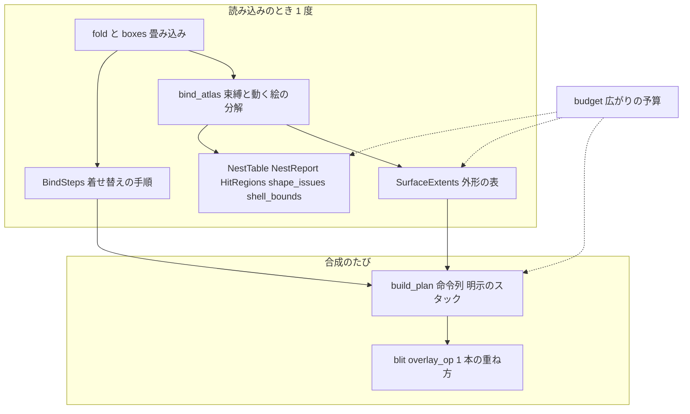
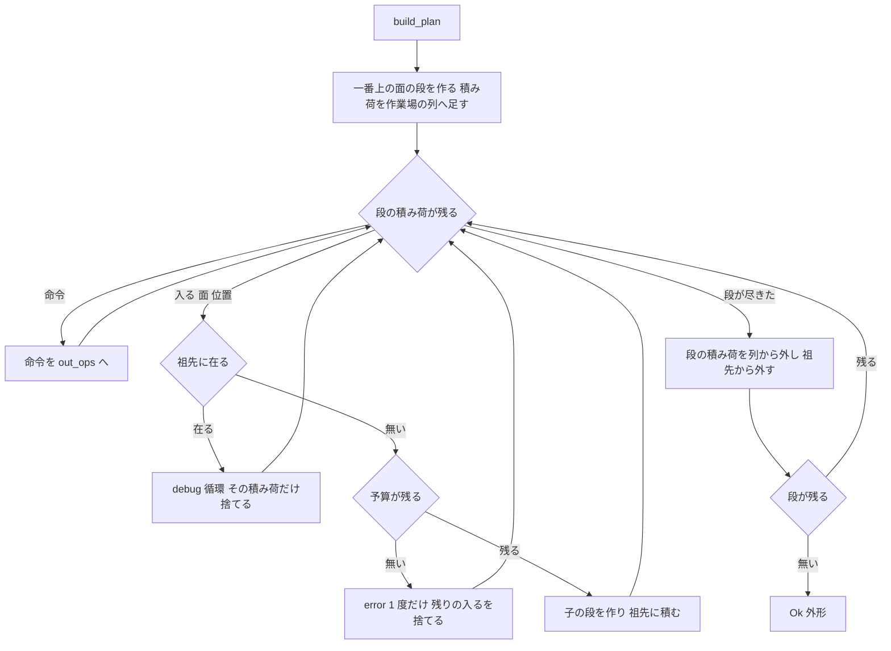

# 設計: audit-emo-compose（面の合成の見直し）

## Overview

**目的**: 面の合成のクレート（`crates/areka-emo-compose/`）に `/ponytail:ponytail-audit` をかけて出た 20 件の指摘のうち、要件の討議で「直す」と決めた 18 件（1⑴⑵・2〜4・6〜19）を、いちばん小さな完全な直しで直す。指摘 5 と 20 は裁定で残す。指摘 1⑶ は `audit-parsers-sakura` が読む側で受け持つ。

**使う人**: 開発者。壊れたシェル・意地の悪いシェルを入れても、合成でアプリが落ちない・固まらないこと、同じ規則が 2 か所で食い違わないこと、テストが守っているつもりの分岐を本当に守っていることを得る。

**変わること**: 合成の外から見た形は 3 点だけ変わる。⑴ `ComposeError` に「外形が大きすぎる」が 1 つ増える。⑵ 本番で使われていない公開関数 `hit::hit_region`・`hit::hit_region_scaled` が消える。⑶ 入れ子の表の「見える部品」が、コマの無い `bind+random` の先を数えなくなる（合成と揃う）。ほかは中の作りの直しで、絵は変わらない。

### Goals

- 確定した 18 件を全部直し、直したバグと危ない所（1・2・3・4・19）の 1 件ずつに、壊れたら落ちる決定論のテストを置く。
- 入れ子をたどる走査を全部、明示のスタックで回す（深さの上限は置かない）。菱形の広がりは 1 つの予算で打ち切る。
- 直し終えたら同じ作法で audit をかけ直して新しい指摘 0 件・全体テスト緑。
- タスクは 21 前後（1 本の spec のまま）。

### Non-Goals

- 指摘 5（外形が element定義の X,Y を数えない）: 持ち主の spec `extent-element-offset` の裁定待ち。触らない。
- 指摘 20（`BlitOp.method`・`Transform.linear`・`RegionPriority`）: 合成メソッドを広げる予定の口として残す。
- 指摘 1⑶（`surface0-N` の新設の範囲の上限）: `audit-parsers-sakura` が読む側でかける。fold では上限をかけない。
- 新しい機能・依存の追加・`Cargo.lock` の変更・clippy の機械的な直し。

## Boundary Commitments

### This Spec Owns

- `crates/areka-emo-compose/` の全ファイル（ソース・テスト・`tests/fixtures/`・`Cargo.toml`）の、確定した指摘の直し。
- 合成の失敗の種類 `ComposeError` に足す 1 つ（`ExtentTooLarge`）と、その記録（`error!`）。
- 入れ子をたどる走査の形（明示のスタック）と、広がりの予算（`budget.rs`）。
- 外形の前計算の表（面ごとの `Extent` を束縛のときに 1 度求めて面の表に置く）。
- 範囲の外の、直しに要る最小の箇所: `crates/log-capture-kit/tests/file_length_guard_test.rs:63` の例外表の 1 行を消す（指摘 13）。

### Out of Boundary

- `crates/areka-emo-present/` のコード（`ExtentTooLarge` を受けた表示の側の扱いは `audit-emo-present` の持ち物。申し合わせで決める）。
- `crates/areka-seriko/` のコード（`src/parts_tests.rs` の期待の直しは `audit-seriko` と申し合わせてから。下の「並走の兄弟」）。
- `crates/areka-parsers/`（範囲の展開の上限・`ShellBoxes` の形は `audit-parsers-sakura`）。
- `crates/areka-emo-atlas/`（表の不変条件を作る側で確かめるかは `audit-emo-atlas`）。
- `crates/areka-emo-text/` には新しいファイルを足さない（触る用事も無い）。
- `doc/`・`docs/` のパスを名指す行は足さない・変えない。
- SSP そのものの測り（実装の段で、開発者の許可を 1 回ずつ取ってから行う）。

### Allowed Dependencies

- 今の依存だけ（`areka-parsers`・`areka-emo-atlas`・`bevy_ecs`・`tracing`・`thiserror`、テストは `log-capture-kit`・`sample-ghost-kit`）。依存の向き parsers → atlas → compose → present／seriko は変えない。
- 標準ライブラリ（`std::collections::BTreeMap`・`BTreeSet` ほか）。
- 新しい依存は足さない。要ると分かったら直さずに議題にする（要件 6.8）。

### Revalidation Triggers

- `ComposeError` に `ExtentTooLarge` が増える → `areka-emo-present`・`crates/areka`（`emo2_boot/assets.rs`・`mcp/dump_surface.rs`・`offline_dump`・examples）は `#[non_exhaustive]` なのでビルドは壊れないが、表示の側の扱いを `audit-emo-present` が確かめる。
- `NestTable::visible_parts` の答えから、コマの無い `bind+random` の先が抜ける → `areka-seriko` の部品の時計と `parts_tests.rs` の期待。
- `hit::hit_region`・`hit::hit_region_scaled` が消える（ツリー全体の呼び手は 0。説明の文 2 行が `areka-emo-present/src/presenter_read_accessor_tests.rs:373,383` に残る＝壊れない）。
- 外形を求める時点が合成のたびから `bind_atlas` のときへ移る → `bind_atlas` を呼ぶ前に合成すると外形 0×0（`EmptyComposition`）になる。これは今の前提（束縛の後に合成）と同じ。
- `SurfaceIndex` の中身が `HashMap` から `BTreeMap` へ変わる（公開の欄だが、ツリー全体でこのクレートの外の使い手は 0）。

## Architecture

### Existing Architecture Analysis

- 合成は 3 段: 畳み込み（`fold.rs`・`boxes.rs`）→ 命令列（`plan.rs`・`plan_extent.rs`・`bind_steps.rs`・`plan_always.rs`）→ 画素の転写（`blit.rs`・`blit_rect.rs`）。ほかに読み込みのときに 1 度作る表（`nesting.rs` の `NestTable`・`NestReport`、`hit_import.rs` の `HitRegions`、`plan_bounds.rs` の `shell_bounds`、`plan_issues.rs` の `shape_issues`）。
- 入れ子は今、再帰で書かれている（`plan.rs` の `flatten_surface` ⇄ `push_static_element_ops` ⇄ `push_contribution` ⇄ `bind_steps::push_bind_contribution`、`plan_extent.rs` の `flatten_extent`、`plan_bounds.rs` の `walk`、`hit_import.rs` の `regions_of`、`nesting.rs` の `walk`／`enter`、`bind_steps.rs` の `claim_from`）。循環は「祖先の列」で止めるが、深さと菱形には何も無い。
- 合成器 `Composer` は結果の絵を持たない約束（要件 9.4・前の spec）。持つのは走査の作業場（`ops`・`visited`・`base_ops`）だけ。
- 読み込みのときに 1 度作る値は、面の表（bevy の `World`）のリソースに置く（`BindSteps` の形）。外形の前計算もこの形に従う。

### Architecture Pattern & Boundary Map



- **選んだ形**: ギャップ分析の案 C（混ぜる）。直しは今のファイルの中で閉じる（案 A）。ただし入れ子の走査を明示のスタックへ変える命令列の走査だけは、作業場を 1 つの型 `PlanScratch` にまとめる（案 B の型を小さく入れる）。理由は下の「案の選び方」。
- **守る形**: 3 段の直列・依存の向き・合成器は絵を持たない約束・読み込みの値は面の表のリソース・`Records` による記録の出し分け・`#[non_exhaustive]` の列挙。
- **新しく足すもの**: `budget.rs`（広がりの予算・6 か所の走査が共有する）と `SurfaceExtents`（外形の前計算の表）と `ComposeError::ExtentTooLarge`。どれも直しに要る最小のもの。

### 案の選び方（ギャップ分析 5 節）

| 案 | 中身 | 採るか |
|---|---|---|
| A | 全部を今のファイルの中で直す | 大部分はこれ |
| B | 走査の文脈を 1 つの型にまとめてから直す | 命令列の走査の作業場だけ（`PlanScratch`） |
| C | A と B を混ぜる | **推す** |

- 明示のスタックに変えると、再帰の引数（9 本前後）は「段ごとの積み荷」に変わる。そのため作業場を 1 つにまとめないと、`Composer` の欄と `build_plan` の引数が増える。まとめると `#[allow(clippy::too_many_arguments)]` の許しも消える。
- 走査の形を全部 1 つの型へ寄せる（案 B を全部に）のはしない。外形・シェルの外形・当たり判定の持ち込み・見える部品は、たどる辺も積み荷も違い、1 つにまとめると条件分岐が増えるだけ。
- 並走の衝突: 今のウェーブ（C17）で `plan.rs` に触る spec は無い（`draw-methods-canon` ほかは未着手）。

### Technology Stack

| 層 | 選ぶもの | 役目 | 備考 |
|---|---|---|---|
| 言語 | Rust（ワークスペースの版） | 全部 | 新しい依存なし・`Cargo.lock` 不変 |
| 面の表 | `bevy_ecs` の `World`・`Resource` | `SurfaceExtents` を置く | `BindSteps` と同じ形 |
| 記録 | `tracing`（`error!`・`warn!`・`debug!`） | 予算切れ・外形の上限・uv のはみ出し | 対象 `areka_emo_compose` |
| 失敗の型 | `thiserror` | `ExtentTooLarge` | `#[non_exhaustive]` のまま |
| テスト | `log-capture-kit`・`sample-ghost-kit` | 記録の捕まえ・検体 | 決定論 |

## File Structure Plan

### Directory Structure

```
crates/areka-emo-compose/src/
├── budget.rs                    # 新: 広がりの予算（Budget）。6 か所の走査が共有する（指摘 3）
├── plan_frame_merge_tests.rs    # 新: plan_ops_tests.rs の 857 行目から後（コマの合流の門）を移す（指摘 13）
├── fold_range_tests.rs          # 新: 1⑴⑵ の壊れたら落ちるテスト（面と箱の追記の範囲・除外）。fold_tests.rs が 976 行のため（fold.rs で宣言）
├── walk_limits_tests.rs         # 新: 3 の深い鎖・菱形・insert の連鎖のテスト。5 つの走査へ同じ検体を通すので 1 つにまとめる（lib.rs で宣言）
└── （ほかは既存ファイルの変更だけ）
```

### Modified Files

ソース:
- `src/lib.rs` — `mod budget;` を足す。`plan_test_support` をクレートの直下の `#[cfg(test)] pub(crate) mod` に上げる（12）。`hit_region`・`hit_region_scaled` の再公開を消す（6）。`Composer` の作業場 `visited` を `PlanScratch` に替える（3・8）。`Composer::new` を `Self::default()` に（16）。「確保なし」の説明を事実に合わせる（8・15）。
- `src/error.rs` — `ComposeError::ExtentTooLarge { surface: u32, w: u32, h: u32 }` を足す（2）。
- `src/composed.rs` — `stride` 欄を消し `stride()` は `width * 4` を返す（18）。長さの掛け算を `usize` で（2）。
- `src/fold.rs` — 追記の範囲は「今ある番号」だけを引く・除外は範囲のまま比べる（1⑴⑵）。`upsert_surface` を `pub(crate)` に（17）。`fold_shell` を消す（16）。指摘 9 の測りの結果に従う直し（9）。古い説明（15）。
- `src/boxes.rs` — 追記の範囲は `existing` の範囲引き（1⑴）。指摘 9 の結果に従う（9）。
- `src/world.rs` — `SurfaceIndex` を `BTreeMap` に（1⑴の範囲引きのため）。`surface_ids` の並べ直しを消す。`SurfaceExtents` を `bind_atlas` の最後で作る口と `extent(id)` の引き口（8）。古い説明（15）。
- `src/base_image.rs` — 面の新設を `fold::upsert_surface` へ寄せる（17）。
- `src/plan.rs` — 命令列の走査を明示のスタックへ（3）。`PlanScratch`（3・8⑷）。外形は表から引き、上限を見る（2・8⑴）。毎回の並べ直しを消す（8⑶）。`animation_sort` は走査の頭で 1 度だけ読む（8⑸）。古い説明（15）。
- `src/plan_extent.rs` — 外形の走査を明示のスタックへ（3）。外形を飽和で `u32` へ（2）。上限の定数 `MAX_EXTENT`（2）。全部の面の外形の表を作る `build_extents`（8）。
- `src/plan_bounds.rs` — 走査を明示のスタックへ（3）。外形は表から引く（8）。
- `src/bind_steps.rs` — `bind+random` の手順を作らない（4）。`claim_from` を明示のスタックへ（3）。`push_bind_contribution` の `bind+random` の早い戻りを消す（4）。
- `src/nesting.rs` — `walk`／`enter` を明示のスタックへ（3）。`reaches` に予算を通す（3・注釈は残す）。説明「合成と同じ辺」を事実に（4・15）。
- `src/plan_issues.rs` — `reaches` を呼ぶ所に予算を渡す（3）。
- `src/hit_import.rs` — `regions_of` を明示のスタックへ・予算を通す（3・注釈は残す）。
- `src/hit.rs` — `hit_region`・`hit_region_scaled` を消し、テストは `_in` へ渡す形に（6）。
- `src/normalized.rs` — 説明のリンクを `hit_region_in` へ（6）。
- `src/blit.rs` — 重ね方の式と「1 命令を矩形で切って重ねる」`overlay_op` を 1 つにする（7）。uv が頁に収まるかを命令ごとに 1 度見る（19）。
- `src/blit_rect.rs` — 式の写しと二重ループを消し、`blit::overlay_op` を呼ぶ（7）。
- `src/method.rs`・`src/scale.rs` — 古い説明（15）。

テスト（10〜16 の直しの置き場。各件の場所は `research.md` 3 節）:
- `src/plan_test_support.rs` — クレートの直下から引ける部品にし、写しの元にする（12）。`frame`・`coll`・`page_1px`・`single_entry_table`・`solid`・`px`・`png_size`・大きさ指定の焼き・動く絵の焼き・記録の読み取り・命令の名前引き・`ops()` をここへ集める（12）。
- `src/plan_ops_tests.rs` — 前半（1〜855 行）を残し、`derive_ops` の塊を `ops()` に（12）、後半を `plan_frame_merge_tests.rs` へ（13）。
- `src/scale_test_support.rs` — 消す（定数 1 つを `scale_ratio_tests.rs` の頭へ・16）。
- 写しを持つテスト（`composer_tests.rs`・`log_firing_tests.rs`・`atlas_bind.rs` のテスト・`film_tests.rs`・`fold_tests.rs`・`base_image_tests.rs`・`nesting_kind_tests.rs`・`nesting_visible_tests.rs`・`pattern_cell_tests.rs`・`plan_always_tests.rs`・`nesting_film_tests.rs`・`pattern.rs` のテスト・`plan_bind_tests.rs`・`plan_nesting_tests.rs`・`plan_nesting_extent_tests.rs`・`pattern_parts_tests.rs`・`hit_in_tests.rs`・`hit_import_tests.rs`・`blit.rs` のテスト・`plan_extent_film_tests.rs`・`golden_tests_frame_extent_tests.rs`・`nesting_fixture_tests.rs`・`plan_extent_tests.rs`・`plan_bounds_tests.rs`・`plan_bind_random_tests.rs`）— 写しを消して `plan_test_support` から引く（12）。
- 失敗しえないテスト・名前と違うテスト・2 度確かめるテスト・古い説明（10・11・14・15）は `research.md` 3 節の行のまま直す。
- `tests/fixtures/animated-playback/README.md` — 27 行目の説明（`charset,UTF-8`）を事実に（15）。
- 1,000 行の番人の見通し（要件 6.1・着手のときの行数）: テストを足す先のうち上限に近いのは `fold_tests.rs`（976）・`composer_tests.rs`（897）・`nesting_visible_tests.rs`（837）・`boxes_tests.rs`（792）・`blit.rs`（782）。1⑴⑵ のテストは `fold_range_tests.rs`、3 のテストは `walk_limits_tests.rs`、19 のテストは `blit_rect_tests.rs`（536）に置き、この 5 つには指摘 4・11 の数行の直しだけを入れる。指摘 16 の `fold_shell` の書き換え（23 か所）は行を増やさない。各タスクは直した後の行数を確かめ、越えるなら兄弟のファイルへ分ける。

範囲の外:
- `crates/log-capture-kit/tests/file_length_guard_test.rs` — 63 行目（`plan_ops_tests.rs` の例外）を消す（13）。
- `crates/areka-seriko/src/parts_tests.rs` — 指摘 4 で期待が変わる所（`bind+random` を持つテスト: 245 行・400〜460 行・576 行・777 行の付近）。**`audit-seriko` と申し合わせてから**触る。触るのは期待の値と説明だけ。
- `crates/areka/src/placement/measure_bake_log_tests.rs` — 指摘 9 で `append が既存 animation id を再定義` の `warn!` を消す結果になったときだけ、31・234〜255 行の数えを直す（そのとき、その範囲の見直しの spec が走っていれば申し合わせる）。

## System Flows

### 命令列の走査（明示のスタック・指摘 3）



- 「段を作る」は今の `push_static_element_ops` と層 (ii) の手順（`merged_ids`・`claim_inserts`・`push_contribution`）と同じ規則で、再帰していた所（element定義の子・コマ・`always` の経過 0・着せ替えの描くコマ）に「入る（面・位置）」の積み荷を置く。命令はその場の順で積み荷に置く。だから出てくる命令の並びは今の再帰と同じになる（画家のアルゴリズムの順を守る）。
- 祖先の確かめは、積み荷を取り出す時点で行う。その時点の祖先の列は再帰の入口の時点と同じ（子の段は取り出す前に全部終わって外れている）。element定義の子の「面の表に無い」「先祖へ戻る」の `debug!` は今どおり段を作る時点で出す（記録の文言は変えない）。
- 同じ段の中の `insert` の連鎖（`push_contribution` ⇄ `push_bind_contribution`）と `claim_from` も、段の中の小さなスタックで回す（ukadoc は `insert` の入れ子を許す＝深い連鎖もありうる）。
- 段の積み荷は `PlanScratch` の 1 本の列に足し、段が終わったら切り詰める（列は使い回すので定常状態で確保しない）。

### 外形・シェルの外形・当たり判定の持ち込み・見える部品・到達の確かめ

- 外形（`plan_extent.rs`）とシェルの外形（`plan_bounds.rs`）: 積み荷は「入る（面・位置）」と「出る」の 2 種。最大を取るだけなので順は結果に効かないが、決定性のため今と同じ順で積む。
- 当たり判定の持ち込み（`hit_import.rs`）: 帰りがけに子の列を親へ渡す形なので、段ごとに「element の読み位置」と「その段の列」を持つスタックで回す。子の段が終わったら、親の直接の領域と同じ名前を除き、element定義の X,Y を飽和で足して親の列へ足す（今の `regions_of` と同じ規則）。
- 見える部品（`nesting.rs`）: 今も各面を 1 度しか訪れない（`out` が訪れた印）。再帰を「これから見る面」の列に置き換えるだけ。予算は要らない。
- 到達の確かめ（`nesting.rs` の `reaches`）: 今も反復で書かれている。`ponytail:` 注釈（辺 1 本ごとに全体をなめる）は残し、取り出した面の数を予算で数える（下）。

### 広がりの予算（指摘 3）

- 予算は「1 回の走査の範囲でたどってよい面の数」。範囲は次のとおり。根の面そのものは数えない（予算が尽きても、根の面の自分の層は必ず数える）。

| 走査 | 範囲（予算 1 つ） | いつ |
|---|---|---|
| 命令列（`build_plan`） | 合成 1 回 | 毎フレーム |
| 外形の表（`build_extents`） | 根の面 1 つ（合成 1 回と同じ範囲） | `bind_atlas` |
| シェルの外形（`shell_bounds`） | 根の面 1 つ | 読み込み |
| 当たり判定の持ち込み（`attach_hit_regions`） | 根の面 1 つ | 読み込み |
| 到達の確かめ（`NestReport::from_world`・`shape_issues`） | `reaches` の呼び出し 1 回 | 読み込み |

- 予算は、どの走査でも根の面 1 つ（到達の確かめは呼び出し 1 回）につき 1 つ。シェル全体の合計にはかけない（面の多い正しいシェルを面の数で切らないため・設計の討議の議題 1）。外形の表と命令列は同じ範囲・同じ打ち切り位置になる。

- 予算が尽きたら、その範囲で `error!` を 1 行だけ出し（何の走査か・根の面の番号・予算の値）、まだ入っていない枝を捨てる。結果は今の循環の打ち切りと同じ「部分の結果」の形。シェルは全体として読む（上限の決め方「上限を越えた枝だけを捨て、シェルは全体として読む」）。到達の確かめで尽きたら、残りの辺は循環として報告しない（合成のたびの祖先の確かめが循環を止めるので、描く側は安全なまま）。
- 深さには上限を置かない（明示のスタックなので深い鎖でもスタックはあふれない）。予算は深さではなく「たどった面の総数」を数える。
- **予算の値（設計の議題 1）**: 元からある頭打ちから導ける値は見つからなかった（`research.md` 11 節）。推す案は「1 フレーム（16.667 ms・60 Hz）の中で回りきれる面の数」。実装の段で `tools/perf/perf-loop.ps1` を使い、深い菱形のシェルで 1 面あたりの時間を測り、16.667 ms に収まる数を 2 のべき乗に切り下げて `budget.rs` の定数 `VISIT_BUDGET` に置く。決定論のテストは値そのものに依らない形にする（2^30 の菱形は必ず切れ、検体と golden のシェルは必ず切れない）。

## Requirements Traceability

| 要件 | 中身 | 実現する所 |
|---|---|---|
| 1.1 | 範囲だけに audit | ギャップ分析で済み（`research.md` 1〜3 節） |
| 1.2 | 件数の上限なし | 同上（20 件・省いた件なし） |
| 1.3 | 全部読む | 同上（97 ファイル）。設計の段でも行の番号を測り直した（`research.md` 11 節） |
| 1.4 | 番号と組を付けて残す | `research.md` 3 節 |
| 1.5 | 確定した一覧を要件へ | `requirements.md` の「要件の討議で確定した事項」 |
| 2.1 | 3 つの組とも全部直す | 「Components and Interfaces」の 18 件の直し |
| 2.2 | 裁定のほかは残さない | 残すのは 5・20 だけ（Non-Goals） |
| 2.3 | 使う所まで直し切る | 各件の「波及」欄・File Structure Plan のテストと範囲の外 |
| 3.1 | 3 種類は議題に | 5・20 は討議で裁定済み。9 は種類 3＝SSP の測りに従う（指摘 9 の節） |
| 3.2 | ukadoc で確かめてから | 指摘 9 の ukadoc の引用（`research.md` 3 節の 9） |
| 3.3 | 3 種類でなければ直す | 1⑴⑵・2〜4・6〜8・10〜19 は議題にせず直す |
| 3.4 | 裁定と理由を残す | `requirements.md` に済み。0 件の数から 5・20 を外す（確かめの節） |
| 4.1 | もう一度 audit | 確かめの節（タスクの最後の 2 つ） |
| 4.2 | 0 件まで直す | 同上 |
| 4.3 | 全体テスト緑 | 同上（`pwsh -NoProfile -File tools/test-all.ps1`） |
| 4.4 | 1 件ずつに壊れたら落ちるテスト | Testing Strategy の表（1・2・3・4・19） |
| 4.5 | 決定論のテスト | Testing Strategy（時間・乱数・実の画面に依らない） |
| 5.1 | 形を変えたら呼び手を全部 | 指摘 2・6・8・18 の波及欄（grep 済み） |
| 5.2 | 走っている spec と申し合わせ | 「並走の兄弟との申し合わせ」 |
| 5.3 | 消す前に使われていないか | 指摘 6・16・12 の確かめ（grep 済み・実装でもう一度） |
| 5.4 | 要らない所を直さない | 範囲の外は 3 ファイルの決めた行だけ |
| 6.1 | 1,000 行の番人 | 指摘 13 の分割・例外表の行を消す。`plan.rs` は明示のスタックにしても 1,000 行の下（古い説明を消して減る）。上限に近いテストのファイルへは足さず `fold_range_tests.rs`・`walk_limits_tests.rs` へ（File Structure Plan の見通し） |
| 6.2 | 記録の無い失敗を作らない | 予算切れ・外形の上限・uv のはみ出しはどれも記録を出す（Error Handling） |
| 6.3 | 終了の道は正規 | 終了の道に触らない |
| 6.4 | 実機の根は `target` の下 | 実機の根を使わない（SSP の試しのシェルは SSP の側に置く・開発者の許可） |
| 6.5 | GPU のテストは実 GPU | 合成は CPU だけ。GPU のテストを足さない |
| 6.6 | 文字化けは読む側を直す | 道具の出力を変えない |
| 6.7 | 依存を足さない | Allowed Dependencies |
| 6.8 | 要る依存は議題に | 要る依存は無い（全部 std と既存の依存） |
| 6.9 | `doc/`・`docs/` の行 | 足さない・変えない（説明の直しでも名指さない） |
| 6.10 | emo-text に新しいファイルなし | 触らない |
| 7.1 | 20 タスクを越えそうなら議題 | 討議で「切らない」と確定済み。見込み 21（「タスクの見込み」） |

## Components and Interfaces

### 一覧

| 部品 | 層 | 役目 | 指摘 | 契約 |
|---|---|---|---|---|
| 追記の範囲引き（`fold.rs`・`boxes.rs`） | 畳み込み | 範囲を広げずに今ある番号を引く | 1⑴⑵ | Service |
| 外形の上限（`plan_extent.rs`・`plan.rs`・`error.rs`・`composed.rs`） | 命令列 | 大きすぎる外形を `Err` にする | 2・18 | Service・型 |
| 明示のスタックの走査と予算（`budget.rs` ほか 6 か所） | 命令列・読み込みの表 | 深さであふれず・広がりで固まらない | 3 | Service・State |
| 着せ替えの手順（`bind_steps.rs`） | 読み込み | `bind+random` の手順を作らない＝見える部品と合成を揃える | 4 | 振る舞い |
| 当たり判定の 2 関数の削除（`hit.rs`・`lib.rs`） | 公開の形 | 使われない口を消す | 6 | 公開 API |
| 1 本の重ね方（`blit.rs`・`blit_rect.rs`） | 転写 | 式と転写を 1 か所に・uv のはみ出しを飛ばす | 7・19 | Service |
| 外形の表（`world.rs`・`plan_extent.rs`） | 読み込み | 外形を束縛のときに 1 度求める | 8 | State |
| 追記の規則（`fold.rs`・`boxes.rs`） | 畳み込み | SSP に合わせるか規則を書き残す | 9 | 振る舞い |
| テストの部品の置き場（`plan_test_support.rs`） | テスト | 写しを 1 つにする | 12 | — |

### 畳み込み

#### 追記の範囲引き（指摘 1⑴⑵）

| 欄 | 中身 |
|---|---|
| 役目 | `surface.append` の範囲を番号の列に広げず、今ある番号のうち範囲に入るものだけを引く。除外は範囲のまま比べる |
| 要件 | 2.1, 3.3, 4.4, 5.1 |

**決め**
- `SurfaceIndex` を `BTreeMap<u32, Entity>` に替え、範囲引き（`range(lo..=hi)`）で「今ある番号」を昇順に引く。画像だけの面（`SurfaceImages`・もとから `BTreeMap`）も同じ範囲で引き、2 つの昇順の列を重ねて重複を除く。`surface_ids` は並べ直しが要らなくなる。
  - 引きの手間は O(1) から O(log 面の数) に変わる。毎フレームの引き（`surface_and_binding`）は数百の面で 8〜9 回の比べ。`HashMap` のままだと追記 1 つごとに全部の面をなめ、追記の行が多いシェルで読み込みが二乗になる。
- 展開の口を 2 つにする（どちらも `fold.rs`・`pub(crate)`）。
  - `expand_targets(targets) -> Vec<u32>`: 新設（plain の `surface*` と箱の `surface*`）用。今のまま範囲を広げる（1⑶ は `audit-parsers-sakura` が読む側で上限をかける）。除外だけは集合に広げず、記述子を順に見て「入るか」を比べる。
  - `expand_existing(targets, existing) -> Vec<u32>`: 追記用。単一の番号はそのまま積む（無ければ今どおり呼び手が「未存在」の `warn!` を出す）。範囲は `existing` の範囲引き。除外は上と同じ比べ方。記述順と重複の扱いは今と同じ（範囲の中は昇順）。
- 箱（`boxes.rs` の `distribute`）は、手元の `existing: BTreeSet<u32>` をそのまま `expand_existing` に渡す。

**事前・事後の条件**
- 結果は今の `expand_targets` の結果から「無い番号」を除いたものと同じ並び（範囲の中の無い番号は、もともと追記では何もしなかった）。
- 範囲の中の無い番号ごとの `warn!`（「surface.append 対象 id が未存在」）は出なくなる。単一の番号の `warn!` は今のまま（範囲 40 億の分だけ記録を出すのは、それ自体が固まる元なので）。範囲の外のテスト `crates/areka/src/placement/measure_bake_log_tests.rs:30,234,255` は単一の番号だけを使うので数は変わらない。

**波及**: `expand_targets` の呼び手は `fold.rs` と `boxes.rs` だけ（ツリー全体を grep 済み）。`audit-parsers-sakura` の指摘 76 が `boxes.rs:226,236` の同じ行に触る＝後から着いた側が rebase で合わせる。

#### 追記の規則（指摘 9）

| 欄 | 中身 |
|---|---|
| 役目 | 同じ番号の行を追記で書いたときの勝ち負けを、SSP に合わせるか、今のままにして規則を書き残す |
| 要件 | 2.1, 3.1, 3.2 |

**決め**: 実装の段の測りのタスク（開発者の許可を 1 回ずつ取る）で、SSP の MCP を使って次の 3 つを別々に測る。測る前にウェーブの兄弟へ知らせる。試しのシェルを SSP に入れること・reload は、そのつど許可を取る。

| 種類 | 測ること | SSP が波括弧と同じ（後勝ち）なら | SSP が今の areka と同じなら |
|---|---|---|---|
| element | `surface.append0` の `element0` が前の `element0` を置き換えるか、両方重なるか | 追記も `merge_brace` と同じ「同じ element番号の前の行を除いてから足す」。箱の追記も同じ規則 | 今のまま。規則を `fold_append`・`distribute` の説明に書く |
| collision | 同じ collision番号 | 追記も「前の行を除いてから末尾へ」 | 今のまま。説明に書く |
| animation | `animation1.pattern3` だけの追記が、前の pattern0〜2 を残すか消すか | 追記も `merge_brace` の animation の規則（同じ pattern番号だけ置き換え・interval は書いたときだけ）。`merge_animations` と、その `warn!`（「de-facto」）を消す | 今のまま（丸ごと置き換え＋`warn!`）。説明に「SSP で測った」と書く |

- 3 つとも波括弧と同じなら、`fold_append` は追記の行から `SurfaceMaster` を作って `merge_brace` を 1 回呼ぶ形にまとめる（1 本にする）。
- 測れなかった（許可が出ない・答えが読めない）なら、3 つとも今のままにし、規則を説明に書き残す（要件の討議の決め）。
- `merge_animations` の `warn!` を消すときは、その文言を数える範囲の外のテスト（`measure_bake_log_tests.rs` の `ANIM_REDEFINED`）を直す。

### 命令列

#### 外形の上限（指摘 2・18）

| 欄 | 中身 |
|---|---|
| 役目 | GPU の面の最大寸を越える外形を `error!`＋`Err` にし、確保と桁あふれを起こさない |
| 要件 | 2.1, 4.4, 6.2 |

**決め**
- 上限 `MAX_EXTENT: u32 = 16_384`（`plan_extent.rs`・`pub(crate) const`）。根拠は Direct3D 11 の機能水準 11 の 2D テクスチャの一辺の最大（`D3D11_REQ_TEXTURE2D_U_OR_V_DIMENSION`）。areka の GPU の機器は `wintf/src/ecs/graphics/core.rs` の `create_device_3d` が機能水準を指定せず（既定の並び＝11_0 から）ハードウェアで作る。合成の絵は `areka-emo-present` の `display.rs` が `ID2D1DeviceContext::CreateBitmap` で原寸のまま GPU へ上げるので、この寸を越える絵は表示できない。このクレートは `windows` に依存しないので、値は定数として写し、根拠を 1 行の説明に書く。ツリーの中に同じ値の定数は無かった（grep 済み）。
- `compute_extent` は `i64` の最大を `u32::try_from(..).unwrap_or(u32::MAX)` で飽和させる（`as u32` の切り詰めをやめる）。位置の足し算は `saturating_add`。
- `build_plan` は外形を引いた直後（`EmptyComposition` の判定の隣）で、幅か高さが `MAX_EXTENT` を越えたら `error!`（面の番号・幅・高さ・上限）を出して `Err(ComposeError::ExtentTooLarge { surface, w, h })` を返す。命令は積まず、絵の確保もしない（`blit::execute` まで行かない）。
- `ComposedSurface` は `stride` 欄を消す。`stride()` は `self.width * 4`（幅は合成で `MAX_EXTENT` 以下に抑えるので `u32` で足りる）。`new`・`resize_and_clear`・`resize_from` の長さは `width as usize * 4 * height as usize`。

```rust
#[non_exhaustive]
pub enum ComposeError {
    SurfaceNotFound(u32),
    EmptyComposition(u32),
    /// 外形が GPU の面の最大寸（一辺 16,384）を越える。
    #[error("surface {surface} extent {w}x{h} exceeds the maximum")]
    ExtentTooLarge { surface: u32, w: u32, h: u32 },
}
```

**波及**: `ComposeError` は `#[non_exhaustive]`。範囲の外で名指しで比べるのは `EmptyComposition` だけ（`areka-emo-present` の `balloon.rs` ほか・`crates/areka` の `assets.rs`・`offline_dump_tests.rs`）＝壊れない。`ExtentTooLarge` を受けた表示の側の扱い（隠すか・前の絵のままか）は `audit-emo-present` と申し合わせる（このクレートからはコードを変えない）。`stride()` の形は変えない。

#### 明示のスタックの走査と予算（指摘 3）

| 欄 | 中身 |
|---|---|
| 役目 | 入れ子をたどる 6 か所の走査を明示のスタックで回し、広がりを 1 つの予算で打ち切る |
| 要件 | 2.1, 3.3, 4.4, 6.2 |

**`budget.rs` の契約**

```rust
/// 1 回の走査の範囲でたどってよい面の数（値は設計の議題 1）。
pub(crate) const VISIT_BUDGET: usize = /* 実装の段で決める */;

pub(crate) struct Budget {
    left: usize,
    reported: bool,
}

impl Budget {
    pub(crate) fn new(limit: usize) -> Self;
    /// 面に 1 つ入る前に呼ぶ。残りがあれば減らして true。尽きていれば、範囲で初めての
    /// ときだけ `error!`（`walk`＝走査の名前・`root`＝根の面）を出して false。
    pub(crate) fn enter(&mut self, walk: &'static str, root: u32) -> bool;
}
```

- テストは `Budget::new(小さな数)` を渡せる形にする（走査の入口に `limit` を受ける `pub(crate)` の内側の関数を置き、本番の口は `VISIT_BUDGET` を渡す）。
- 記録の出し分け（`Records::Quiet`）がある読み込みの走査では、黙らせる組み方のとき `error!` も出さない（今の `warn!` と同じ扱い）。

**`PlanScratch`（`plan.rs`・`pub(crate)`）**

```rust
#[derive(Debug, Default)]
pub(crate) struct PlanScratch {
    visited: Vec<u32>,          // 祖先の列（今と同じ）
    steps: Vec<Step>,           // 段の積み荷を足していく 1 本の列
    frames: Vec<FrameMark>,     // 段ごとの (積み荷の始まり, 読み位置, 面の番号)
    merged_ids: Vec<u32>,       // 層 (ii) の id（今は段ごとに確保）
    claims: Vec<(u32, u32)>,
    done: Vec<u32>,
    expanded: Vec<u32>,
    claim_stack: Vec<u32>,
}

enum Step {
    Op(BlitOp),
    Enter { surface: u32, x: i64, y: i64 }, // 部品の段（is_top_level=false）へ入る
}
```

- `Composer` の `visited: Vec<u32>` を `scratch: PlanScratch` に替える。`build_plan(out_ops, scratch, world, atlas, surface_id, binds, pattern)` の形にする（`pub(crate)`・呼び手は `lib.rs` とテスト）。テストの呼び出しは指摘 12 の `ops()` 1 つに集まるので、形の変更はそこだけ直せばよい。
- 段を作る処理（今の `push_static_element_ops` と層 (ii)）は、再帰していた所で `Step::Enter` を積み、命令は `Step::Op` を積む。段の中の `insert` の連鎖は `done` と小さなスタックで回す。`claim_from` は `expanded` と `claim_stack` で回す。
- `merged_ids`・`claims`・`done`・`expanded`・`claim_stack` を 1 本ずつで足りるのは、1 つの段の積み荷を全部作り終えてから子の段へ入るため（段を作る途中で別の段を作らない）。
- 残る重さ（指摘に無い・かけ直しの audit で見る）: 1 つの段の中の `merged_ids.contains`・`claims.iter().any`・`done.contains` は、1 つの面の animation の数の二乗。今の直しでは形を変えない。かけ直しの audit が指したら、その指摘として直す。
- 走査の流れは System Flows の図。結果の命令の並びは今の再帰と同じ（テスト `plan_ops_tests.rs`・`plan_nesting_tests.rs`・`plan_bind_tests.rs`・golden がそのまま守る）。

**ほかの 5 か所**: 外形（`flatten_extent`）・シェルの外形（`walk`）・当たり判定の持ち込み（`regions_of`）・見える部品（`walk`／`enter`）・`claim_from` は、それぞれのファイルの中で `Vec` のスタックに置き換える。`reaches` は形を変えず予算を受ける。走査ごとの予算の範囲は System Flows の表。

**`ponytail:` 注釈**: `nesting.rs:401`・`hit_import.rs:53` の注釈は残す（要件の討議の決め）。壊れたシェルでの重さは、この予算で覆う（どちらも読み込み 1 回ごとの予算の範囲に入る）。

#### 着せ替えの手順（指摘 4）

| 欄 | 中身 |
|---|---|
| 役目 | 「見える部品」の表と合成を、件 26 の決め（コマの無い `bind+random` は描かない）に揃える |
| 要件 | 2.1, 2.3, 4.4, 5.2 |

**決め**: 食い違いの根は 1 か所。`BindSteps::build` が `bind+random` にも pattern0 の手順を作り、`NestTable::from_world` がそれを「描く」辺として数える。合成は `push_bind_contribution` の早い戻りでその手順を使わない。

- `BindSteps::build` は純 `bind` だけの手順を作る（`Interval::BindRandom { .. } => continue`）。これで `pure` の変数・`p.index == 0` の絞り・`if pure` が要らなくなる。
- `push_bind_contribution` の `bind+random` の早い戻りを消す（手順が空なので、今ある「有効な着せ替えに描く手順が無い」の `debug!` を通って戻る）。
- `nesting.rs` のコードは変えない（`bind_steps` が空を返すので `bind_targets` に入らない）。説明（97〜98 行・137 行）を「純 `bind` の全部のコマ（`bind+random` はコマがあるときだけ③で数える）」に直す。
- `claim_inserts` の「手順は insert の行き先の数えに残す」という説明を消す（`bind+random` の手順に `Insert` は入らない）。
- 外形（`plan_extent.rs`）の「`bind+random` は番号の最も小さい 1 つを大きさに数える」は変えない（再生のコマが出たときに切れないための大きさで、描くかとは別）。

**波及**: `NestTable::visible_parts` の答えが変わる。`areka-seriko/src/parts_tests.rs` の `bind+random` を持つテストの期待（乱数の呼び出し回数・欄に入る部品）が変わりうる。`audit-seriko` と申し合わせてから、期待の値と説明だけを直す（`parts.rs` のコードは変えない見込み）。

### 公開の形

#### 当たり判定の 2 関数の削除（指摘 6）

- `hit.rs` の `hit_region`・`hit_region_scaled` と `lib.rs` の再公開を消す。本番の呼び手は 0（`areka-emo-present` の `presenter/hit.rs` は `hit_region_in`・`hit_region_scaled_in` を使う。`EmoPresenter::hit_region` は別のメソッド）。
- `hit.rs` のテストは `&m.collisions` を `_in` へ渡す形に直す。`hit_in_tests.rs` は答えを固定した 1 本（130〜154 行）だけ残す。`normalized.rs:83` の説明のリンクを `hit_region_in` へ。
- `areka-emo-present/src/presenter_read_accessor_tests.rs:373,383` の説明の文は古い名前のまま残る（壊れない・`audit-emo-present` へ伝える）。

### 転写

#### 1 本の重ね方（指摘 7・19）

| 欄 | 中身 |
|---|---|
| 役目 | premultiplied SourceOver の式と「1 命令を矩形で切って重ねる」処理を 1 か所に置き、uv が頁をはみ出す命令を落ちずに飛ばす |
| 要件 | 2.1, 4.4, 6.2 |

```rust
// blit.rs
#[derive(Clone, Copy)]
pub(crate) struct Area { pub x0: i64, pub y0: i64, pub x1: i64, pub y1: i64 }  // blit_rect.rs から移す
pub(crate) fn op_area(op: &BlitOp, atlas: &AtlasTable) -> Area;                 // 同上
/// `op` を `clip`（合成先の中の矩形）で切って `dst` へ重ねる。
pub(crate) fn overlay_op(dst: &mut [u8], stride: usize, clip: Area, op: &BlitOp, atlas: &AtlasTable);
```

- `overlay_op` の中: 置き場が無い（全透明）なら何もしない → 頁が無ければ `warn!`（今の文言）で飛ばす → **uv が頁に収まらなければ `warn!` で飛ばす**（19）→ 置き場の矩形と `clip` の重なりだけを回して重ねる。
  - 収まる条件: `uv.x + uv.w <= page.width`・`uv.y + uv.h <= page.height`・`page.width * 4 <= page.stride`・`page.stride * page.height <= page.bytes.len()`（掛け算と足し算は `u64`）。
- `blit::execute` = 外形へ消して合わせる → 命令ごとに描画メソッドの門（今の `debug!`）→ `overlay_op(画面全体)`。画面の外の画素は回らなくなる（7 の後半）。
- `blit_rect::execute_reusing` = 下敷きを写す → 矩形の行を消す → 命令ごとに `overlay_op(矩形)`。`div255`・`source_over_channel`・`Area`・`op_area` の写しを消す。`Overlay` 以外を矩形の道に入れない決めは今のまま。
- 表の不変条件そのもの（`AtlasTable::new` が uv と頁を照らすか）は `audit-emo-atlas` の持ち物。こちらは表を信じずに転写の手前で守る（申し合わせで、表を作る側の確かめと重ねるかを伝える）。

### 読み込み

#### 外形の表（指摘 8）

| 欄 | 中身 |
|---|---|
| 役目 | 束縛の後で変わらない外形を面ごとに 1 度だけ求め、合成のたびのたどり直しと文字列の確保をなくす |
| 要件 | 2.1, 3.3 |

**決め**
- `world.rs` に `#[derive(Resource, Default)] pub(crate) struct SurfaceExtents(BTreeMap<u32, Extent>)` を置く。`EmoWorld::bind_atlas` の最後（動く絵の分解の後）で `plan_extent::build_extents(world, atlas)` が全部の面の外形を求めて入れる（予算は表 1 回の範囲）。
- `EmoWorld::extent(id) -> Extent`（`pub(crate)`）は表から引く。表に無い（`bind_atlas` の前）なら `Extent { w: 0, h: 0 }`＝今と同じく `EmptyComposition`。
- `build_plan` と `shell_bounds` は `compute_extent` を呼ばず表を引く。`compute_extent` は表を作る関数と、外形を直に確かめるテスト（`golden_tests_frame_extent_tests.rs` ほか）だけが使う。
- これで外形の中の描画メソッドの語の正規化（`targets_animation_id`・`is_move_name` の文字列の確保・⑵）も毎フレームから消える。
- ⑶ `push_static_element_ops` の添字の並べ直しを消す（`SurfaceMaster.elements` は畳み込みで element番号の昇順に安定ソート済み＝不変条件。`fold.rs` の `merge_brace`・`fold_append`・`normalize_surface` の 3 か所が保つ）。
- ⑷ 段ごとの `merged_ids`・`claims`・`done`・`expanded`・`stack` は `PlanScratch` へ移る（指摘 3 の形で自然に済む）。
- ⑸ `animation_sort()` は合成 1 回につき走査の頭で 1 度だけ読む。
- 説明（`lib.rs:92-94`・`plan.rs` の頭）は、直した後の事実に合わせて書く（定常状態で確保しないと言えるのは、直した後に `golden_tests_determinism_budget_tests.rs` の容量の確かめで確かめた範囲だけ）。
- 効き目の計測（`tools/perf/`）は、予算の値を測るタスクで一緒に前後を測り、記録に残す（効かなくても直しは戻さない＝毎フレームの余分な仕事を消すこと自体が指摘の直し）。

**波及**: `compute_extent` は `pub(crate)`。`shell_bounds` の形は変えない。外部の呼び手の順（`build` → `bind_atlas` → 合成）は今の前提どおり。

### テスト

#### テストの部品の置き場（指摘 12）

- `plan_test_support.rs` を `plan.rs` の中の非公開の部品から、`lib.rs` で宣言するクレートの直下の `#[cfg(test)] pub(crate) mod plan_test_support` に上げる（ファイル名は変えない＝新しいファイルを作らない）。中の `use super::*` は `crate::plan::…` を名指す形に直す。
- 写しを消して引く: 面の組み立て（`elem`・`surface`・`surface_with_anims`・`shell_of`・`bake_atlas` ほか）・`frame`・`coll`・`page_1px`・`single_entry_table`・`solid`・`px`・`png_size`・大きさ指定の焼き・動く絵の焼き・記録の読み取り・命令の名前引き・`ops_to_paths`。
- `derive_ops(...)` の 9 行の塊と `push_static_element_ops(...)` の 11 行の塊は `fn ops(world, atlas, surface, binds, pattern) -> Vec<BlitOp>` 1 つにする（指摘 3 の `build_plan` の形の変更もここで受ける）。
- `bind_anim_xy` を消す（`bind_anim` をそのまま呼ぶだけ）。写しが持たない pattern5（無い面 999999）の違いは、使うテストを確かめてから 1 つに揃える。

#### そのほかのテストの直し（指摘 10・11・13・14・15・16・17）

- 10: `research.md` 3 節の 7 か所を消す。`plan_extent_tests.rs:107-125` だけは、別々の `BindSet` を `build_plan` に渡して外形が同じことを確かめる形に直す。
- 11: 各テストの入力か比べ方を 1〜数行直す（`research.md` 3 節の例のとおり）。`bind_steps_tests.rs:78-89` は指摘 4 で `bind+random` の手順が空になるので「`bind+random` は手順を持たない」を確かめる形に変わる。`plan_ops_tests.rs:894-925` は純 `bind` に直す。`composer_tests.rs:617-636` の走査の表に `plan_extent.rs`・`plan_always.rs`・`blit_rect.rs` を足す。
- 13: `plan_ops_tests.rs` の 857 行目から後を `plan_frame_merge_tests.rs` へ移す（`plan.rs` に `#[cfg(test)] #[path = "plan_frame_merge_tests.rs"] mod frame_merge_tests;`）。どちらも 1,000 行の下。例外表の 63 行目を消す。
- 14: 弱い方を消し、固有の 1〜2 行だけを強い方へ移す。
- 15: 説明を今のコードに合わせる。作業の経緯の段落（「本 task」「後続 task」）は消す。
- 16: `fold_shell` を消してテストは `fold_shell_with(.., Records::Emit)` を呼ぶ（23 か所）。`_type_anchor`・`let _ = &atlas;` を消す。`scale_test_support.rs` を消して定数を `scale_ratio_tests.rs` の頭へ（`lib.rs` の宣言も消す）。`Composer::new` は `Self::default()`（名前は残す＝範囲の外の呼び手は壊れない）。
- 17: `base_image.rs:75-83` の面の新設を `fold::upsert_surface` の呼び出しにする。

## Data Models

| 型 | 変わること |
|---|---|
| `ComposeError` | `ExtentTooLarge { surface, w, h }` を足す |
| `ComposedSurface` | `stride` 欄を消す（公開の口は同じ） |
| `SurfaceIndex` | `HashMap<u32, Entity>` → `BTreeMap<u32, Entity>`（面の集合と一対一の不変条件は同じ） |
| `SurfaceExtents`（新・`pub(crate)`） | 面の番号 → 外形。`bind_atlas` で 1 度作る。以後は読むだけ |
| `BindSteps` | `bind+random` の行を持たなくなる |
| `PlanScratch`（新・`pub(crate)`） | 命令列の走査の作業場。`Composer` が持つ（絵は持たない約束のまま） |
| `Budget`（新・`pub(crate)`） | 走査 1 回の範囲の残りの数と、報告済みの印 |

## Error Handling

| 場面 | 記録 | 返し方 |
|---|---|---|
| 外形が `MAX_EXTENT` を越える | `error!`（面・幅・高さ・上限）。合成のたびに出す（`SurfaceNotFound`・`EmptyComposition` と同じ） | `Err(ExtentTooLarge)`。絵は確保しない |
| 広がりの予算が尽きた | `error!` を範囲で 1 行（走査の名前・根の面・予算） | 部分の結果（`Ok`）。シェルは全体として読む |
| uv が頁に収まらない | `warn!`（element・頁・uv）を命令ごと（頁の欠けと同じ扱い） | その命令だけ飛ばす |
| 範囲の追記の中の無い番号 | 出さない（単一の番号は今どおり `warn!`） | 何もしない（今と同じ） |
| 循環 | 今のまま（`debug!`） | 今のまま |

- どの失敗もパニックしない（今の非パニックの約束を、深さ・広がり・uv にまで広げる）。
- 位置の足し算は、走査の累積も転写の置き場（`op_area`・`overlay_op`）も `saturating_add` で行う（`i64` の端の位置でも試験の作りで panic しない）。
- 予算切れを `error!` にするのは、壊れたシェルでしか起きない誤り（定義だけで決まる）で、絵が欠けることを開発者と作者が気付けるようにするため。合成のたびの範囲でも 1 回の合成で 1 行に抑える。

## Testing Strategy

### 壊れたら落ちるテスト（要件 4.4）

| 指摘 | テスト（置き場） | 直す前の結果 |
|---|---|---|
| 1⑴ | 面 0・1・5 が在るシェルに `surface.append0-4294967295` の追記。3 つに行が届き、ほかは新設されず、結果が単一の番号で書いたときと同じ（`fold_range_tests.rs`） | 約 16 GB の確保で落ちる |
| 1⑴ 箱 | 箱の `surface.append0-4294967295`（`fold_range_tests.rs`） | 同上 |
| 1⑵ | `!0-4294967295` を含む plain の `surface0,!0-4294967295` が何も新設しない・追記の除外も同じ（`fold_range_tests.rs`） | `BTreeSet` に 40 億を入れて固まる・落ちる |
| 2 | pattern を (100000, 100000) に置く純 `bind` の面が `Err(ExtentTooLarge)` を返し、`out.bytes_capacity()` が 0 のまま・`error!` が 1 行（`plan_extent_tests.rs`） | 約 40 GB の確保で落ちる |
| 2 | element定義の子を `u32::MAX + 10` の位置に置く面が、小さな外形に化けず `Err(ExtentTooLarge)`（同） | `as u32` で小さな外形に化けて通る |
| 3 深さ | 面 0 → 1 → … → 10000 の element定義の鎖を、スタックを 256 KiB にしたスレッドの中で、合成・外形・シェルの外形・当たり判定の持ち込み・見える部品の 5 つに通して終わる（`walk_limits_tests.rs`）。確かめるのは「落ちずに終わる」ことだけで、予算の記録が出るかは見ない（予算の値に依らないため） | 小さいスタックがあふれて落ちる |
| 3 広がり | 30 段の菱形（各段が次の段を 2 か所に置く）を同じ 5 つ（見える部品は除き、`reaches` を通す `NestReport` を足す）に通し、`error!` が範囲ごとに 1 行・2 回の合成の命令列が同じ（同） | 2^30 の命令で固まる |
| 3 予算の境 | `Budget::new(3)` を渡した走査が 3 つ目の子まで入り 4 つ目で切れる（`budget.rs` のテスト） | — |
| 3 insert の連鎖 | 1 つの面に 5000 本の有効な純 `bind` が `insert` で連なるシェルを、スタックを 256 KiB にしたスレッドの中で合成して終わる（`walk_limits_tests.rs`） | 小さいスタックがあふれて落ちる |
| 4 | 一致のテスト（`nesting_visible_tests.rs:694-728`）の入力に「pattern0 を持つ有効な `bind+random`・コマ無し」を足し、`visible_parts` と合成の命令の先が一致する。`nesting_visible_tests.rs:331,334,335` の期待を「数えない」に直す | 一致のテストが落ちる |
| 19 | `AtlasTable::new` で uv が頁の右へ 1 画素はみ出す表を作り、`compose_into` と `compose_into_reusing` の両方がパニックせず、その命令だけ飛ばして `warn!` を出す（`blit_rect_tests.rs`） | 添字が外れて panic |

### 振る舞いが変わらないことの確かめ

- 命令列の並び: `plan_ops_tests.rs`・`plan_frame_merge_tests.rs`・`plan_nesting_tests.rs`・`plan_bind_tests.rs`・`plan_bind_random_tests.rs`・golden の全部が、明示のスタックにした後もそのまま緑（期待を変えるのは指摘 4・10・11 の決めた所だけ）。
- 画素: `blit_rect_tests.rs` の「いちからの合成と矩形の重ね直しが同じ画素」を残す（7 の直しで式が 1 つになっても守る）。
- 外形: `golden_tests_frame_extent_tests.rs` が、表から引く形にした後も同じ値。
- 追記: `fold_tests.rs:259-330`（範囲の中の無い番号を新設しない）がそのまま緑。指摘 9 で規則を変えたときは、変えた規則の期待を足す。

### 決定論（要件 4.5）

- 時間・乱数・実の画面・GPU に依らない（合成は CPU の整数だけ）。記録の確かめは `log-capture-kit` で捕まえる。
- 予算の値に依らない形: 2^30 の菱形は `VISIT_BUDGET` がどの値でも切れる（議題 1 のどの案でも 2^30 より十分小さい）、検体と golden のシェルは切れない、を確かめる。

### 確かめの段（要件 4.1〜4.3）

- 確定した直しを全部入れた後、同じ範囲（`crates/areka-emo-compose/` の全ファイル）に、件数の上限なし・全部読む作法で `/ponytail:ponytail-audit` をかけ直す。5 と 20 は数から外す。新しい指摘が出たら直してかけ直す。
- 最後に `pwsh -NoProfile -File tools/test-all.ps1` を 1 回。触っていないクレートだけが赤なら、そのクレートだけを 1 回回し直す（開発の決まり）。

## 並走の兄弟との申し合わせ（要件 5.2）

このセッションからは相手に触れない。実装の段で、触る前に次を申し合わせる。

| 相手 | 何を | いつ |
|---|---|---|
| `audit-seriko`（`crates/areka-seriko/`） | 指摘 4 で `src/parts_tests.rs` の `bind+random` を持つテスト（245・400〜460・576・777 行付近）の期待が変わる。直すのはどちらか・どちらが先に着くか | 指摘 4 のタスクの前 |
| `audit-emo-present`（`crates/areka-emo-present/`） | 指摘 2 の `ExtentTooLarge` を表示の側でどう扱うか（`EmptyComposition` と同じ隠す縮退か）。指摘 6 で古くなる説明 2 行（`presenter_read_accessor_tests.rs:373,383`） | 指摘 2 のタスクの前 |
| `audit-parsers-sakura`（`crates/areka-parsers/`・`crates/areka-sakura/`） | 1⑶ の範囲の上限は読む側（申し合わせ済み）。そちらの指摘 76 が `boxes.rs:226,236` に触る＝後から着いた側が rebase。指摘 12 でテストの部品の置き場が `plan_test_support` に動く | 指摘 1 のタスクの前に状況を確かめる |
| `audit-emo-atlas`（`crates/areka-emo-atlas/`） | 指摘 19 は転写の手前で守る。表を作る側の確かめと重ねるか | 指摘 19 のタスクの前（そちらが走っていれば） |
| SSP の測り（開発者） | 指摘 9 の 3 つ・予算と外形の上限の参考に巨大な外形と深い菱形を SSP がどう扱うか。試しのシェルを入れること・reload は 1 回ずつ許可を取る。測る前にウェーブの兄弟へ知らせる | 指摘 9 の測りのタスク |

## タスクの見込み（要件 7.1）

| 組 | 中身 | 見込み |
|---|---|---|
| 準備 | 12 テストの部品の置き場（2）・13 分割（1） | 3 |
| 必ず直す | 1⑴⑵（1）・2＋18（1）・3 走査（命令列 1・ほか 5 か所 1・予算と値 1）（3）・4（1） | 6 |
| 直したほうがよい | 6（1）・7＋19（1）・8（1）・9 測り（1）・9 直し（1）・10（1）・11（1） | 7 |
| できれば | 14（1）・15（1）・16＋17（1） | 3 |
| 確かめ | audit のかけ直し（1）・全体テスト（1） | 2 |
| 計 | | **21** |

並べる順: 12 → 13 → 1 → 2＋18 → 4 → 3 → 8 → 7＋19 → 6 → 9 測り → 9 直し → 10・11 → 14・15・16＋17 → 確かめ。12 を先に置くと、3 の `build_plan` の形の変更を `ops()` 1 か所で受けられる。2 を 3 と 8 の前に置くと、外形の上限の確かめが表へ移るときに同じテストで守れる。

## 設計の討議で確定した事項（2026-11-05）

- **議題 1（推奨案で確定）**: 予算の値は、実装の段で `tools/perf` を使って「1 フレーム（16.667 ms）で回りきれる面の数」を測り、2 のべき乗に切り下げた定数にする。範囲は根の面 1 つ（`reaches` は呼び出し 1 回）につき 1 つ（上の表）。
- **議題 2（推奨案で確定）**: 外形の上限は定数 `MAX_EXTENT = 16_384`。
- **議題 3（推奨案で確定）**: `ExtentTooLarge` は、表示の側で `EmptyComposition` と同じく面を隠す。実装の前に `audit-emo-present` と申し合わせる。
- **議題 5（推奨案で確定）**: 面でも箱でも、範囲の追記の中の無い番号は報告しない（`warn!` も `BoxIssue::AppendTargetMissing` も積まない）。単一の番号は今どおり報告する。`boxes_tests.rs:775-792` の期待を直し、`areka-emo-present/src/shell_target.rs:804` の `warn!` が出なくなることを `audit-emo-present` に伝える。
- **議題 4**: 個別に議論する。
- **議題 6**: 開発者「都度計るのは困る。計りはまとめるか、今行え」＝指摘 9 の SSP の測りは設計の段でまとめて行い、結果をこの設計に書く（実装の段の測りのタスクは無くす）。

## 設計の議題（設計の討議へ）

1. **広がりの予算の値**（指摘 3）。元からある頭打ちから導ける値は無い（`research.md` 11 節）。
   - 案ア（推す）: 1 フレーム（16.667 ms）の中で回りきれる面の数を実装の段で測り、2 のべき乗に切り下げた定数にする。根拠は 1 フレームの長さ（`crates/areka/src/placement/transition_judge_verdict.rs` の `FLUSH_TOTAL_US_MAX = 16_667` と同じ値）。
   - 案イ: シェルの大きさから導く（面の数 × 参照の行の数）。見立てを含まないが、ダミーの面を足して水増しした壊れたシェルでは上限が 10^10 まで膨らみ、固まりを防げない。読み込みの 2 か所（`reaches`・`regions_of`）の長い鎖の二乗の重さも覆えない。
   - 案ウ: 見立ての固定の数（例 65,536）。上限の決め方に反する。
2. **外形の上限を定数で持つか**（指摘 2）。推す: 定数 16,384（機能水準 11 の最大）。もう 1 つの案は、表示の側が GPU から `GetMaximumBitmapSize` をもらって合成器へ渡す形（正確だが `Composer` の形と `areka-emo-present` に及ぶ）。機能水準 10 以下の GPU では 16,384 未満で `CreateBitmap` が失敗するが、それは表示の側の今の失敗の道（記録つき）が受ける。
3. **`ExtentTooLarge` の表示の側の扱い**（指摘 2）。`audit-emo-present` との申し合わせ。推す: `EmptyComposition` と同じ「隠す」縮退。
4. **`SurfaceIndex` を `BTreeMap` に**（指摘 1⑴）。推す: 替える（追記の範囲引きの二乗を避ける・`surface_ids` の並べ直しが消える）。毎フレームの引きは O(log 面の数) になる。
5. **範囲の追記の中の無い番号の `warn!` を出さない**（指摘 1⑴）。推す: 出さない（単一の番号は今どおり）。
6. **指摘 9 の測りの許可**。実装の段で、試しのシェルを SSP に入れて reload することを、1 回ずつ開発者に頼む。
