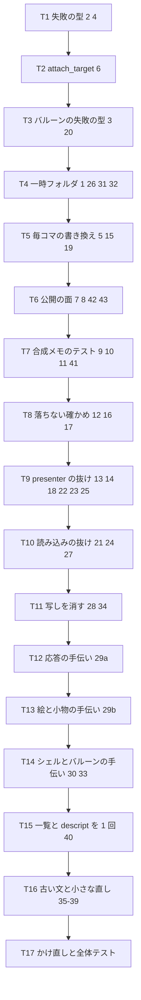

# 設計書: audit-emo-present

## 概要

**目的**: `crates/areka-emo-present/`（面とバルーンの提示）に ponytail の audit をかけて出た 43 件の指摘を、要件 9 の決めどおりに全部直す。直しはどれも ponytail の「いちばん小さな完全な変更」で行い、消せるものは消し、範囲の外の呼び手・テスト・fixture まで直し切る。

**使う人**: 開発者（直した後の同じ範囲へ audit をかけ直して新しい指摘 0 件・全体テスト緑を確かめる）と、この範囲の上に設計を載せる v0.2.0 の 6 本の spec。

**変わること**: 新しい機能は足さない。外から見える変化は、⑴ 失敗の型が原因ごとに分かれる（`PresentError` に 2 変位・バルーンの読み込みは新しい `BalloonLoadError`）、⑵ `attach_target` の署名から使わない引数と常に `Ok` の `Result` が消える、⑶ 外で使われていない公開の口がクレートの中へ狭まる、⑷ 動く面のコマ送りで wintf へ毎コマ投げていた無駄な変更の印が立たなくなる、⑸ テストが約 1,200〜1,600 行減り、`cache_tests.rs` が 1,000 行の番人の例外表から外れる、の 5 つだけである。

### Goals
- 43 件を要件 9 の決めどおりに直す（`CLICKWAIT_FAMILY` だけ残す・9.2・9.8）。
- 直したバグ・危ない所（1〜6・38・ほか表の「守るテスト」の欄）に、壊れたら落ちるテストを 1 本ずつ置く（4.1）。
- 依存を足さない・`Cargo.lock` を変えない・新しいファイルを作らない（6.5・7.4）。
- 最後に同じ範囲へ audit をかけ直して新しい指摘 0 件、全体テスト緑（5.1〜5.4・4.5）。

### Non-Goals
- 新しい機能。v0.2.0 の 6 本（`draw-methods-canon` ほか）の先取り。
- `surfaces.txt` の解析の回数（40 番のシェルの側）と `build_shell_target_with_boxes` の署名（`audit-parsers-sakura` の持ち物・9.6・9.7）。
- `crates/areka-emo-compose/src/nesting_fixture_tests.rs:4` のコメント（9.5）。
- clippy の指摘の機械的な直し・`vendors/`・範囲の外の見直し（7.6）。

## Boundary Commitments

### This Spec Owns
- `crates/areka-emo-present/` の全部のファイル（本番 26・テスト 64・`Cargo.toml`）の直し。
- 直しで形が変わる口の範囲の外の呼び手の直し（下の「範囲の外に及ぶ所」の表のファイルだけ）。
- `crates/log-capture-kit/tests/` の 2 つの例外表のうち、この spec の直しで古びる 2 項目の削除と、それに伴う件数・自己検査の 1 件の差し替え（要件 7.7 の限り）。

### Out of Boundary
- `crates/areka-parsers/` と、`shell_target.rs` の `surfaces.txt` の解析の呼び出し（390〜392 行・440 行）と `build_shell_target_with_boxes` の署名（`audit-parsers-sakura`）。テストの `Surface { id: .. }` の字面も、あちらが変えるなら触らない。
- `crates/areka-emo-compose/` の全部（読むだけ・25 番の調べで読んだ）。
- `crates/areka/src/placement/`（43 番の判定側は語を直に名指しており、触らない）。
- 例外表の doc の文章の中の数（要件 7.7 は項目・件数・自己検査の 1 件だけを許す）。
- `crates/pilot/examples/pilot-balloon-asset-swap/README.md` の「引数の World は使われていない」などの記述（先進坑の当時の記録で、署名の参照ではない）。

### Allowed Dependencies
- 今ある依存だけ: `areka-parsers`・`areka-emo-atlas`・`areka-emo-compose`・`areka-actor`・`wintf`・`bevy_ecs`・`windows`・`windows-numerics`・`thiserror`・`tracing`、dev の `log-capture-kit`・`sample-ghost-kit`・`temp-path-kit`。
- bevy の `DetectChangesMut::set_if_neq`（`HitTest` は `PartialEq`・`Visual` は `is_visible` を直に比べる）。
- 依存の向き `areka-parsers → emo-atlas → emo-compose → emo-present` を変えない。

### Revalidation Triggers
- `PresentError` に変位が増える（`#[non_exhaustive]` なので外の `match` は壊れないが、`TargetNotAttached` を「未表示」の意味で読んでいた呼び手は読み直す）。
- バルーンの読み込みの失敗の型が `PresentError` から `BalloonLoadError` へ替わる（`BootWiringError::Balloon` の中身が替わる）。
- `attach_target` の署名（引数 5 つ・戻り値なし）。
- 公開の面の縮み（下の 7 番の名前は外から使えなくなる）。v0.2.0 の 6 本はこの形の上で設計する。
- 記録の文言 `D3D/DXGI 呼び出しが失敗` → `D2D 呼び出しが失敗`（35 番）。
- 例外表の件数（`OVER_LIMIT_ALLOWED_COUNT` 9→8・`ALLOWED_COUNT` 19→18・`PROCESS_UNIQUE_COUNT` 16→15）と自己検査の 1 件。

## Architecture

### 今の形と、守るもの
- 単一の漏斗 `apply_show`（`presenter/show.rs`）が表示成立点を 1 つに持つ。失敗はすべて成立点の手前で早く戻り、前の表示を保つ。この形は変えない。戻り値の渡し方（応答の口 → 戻り値）だけを変える。
- 全透明の合成（`EmptyComposition`）は `apply_show` の中で Hide へ縮退して `Ok` を返す（完了した `areka-P0-emo-present` の設計の討議 #1）。この扱いは変えない。
- 読み込みの権威（`shell_target.rs`・`balloon.rs`・`balloon_definitions.rs`・`balloon_marker.rs`）は失敗を `error!` ＋ `Err` で返す（ログの規律）。この規律は変えず、失敗の型だけを原因ごとに分ける。
- テストは本番の兄弟ファイル（`#[path]` の子モジュール）に置く。テストの支えも既存の 3 つ（`presenter_test_support.rs`・`shell_target_test_support.rs`・`balloon_test_support.rs`）へ寄せ、新しいファイルは作らない。

### 直しの順（タスクの依存）



- 型を変える直し（2・3・4・6）を先頭に置く（範囲の外に及ぶものを先に着地させ、後のテストの直しを新しい型の上で書く・research.md 5 章の案 C）。
- 直列にする。同じファイル（`hub.rs`・`presenter_display_tests.rs` など）を複数のタスクが順に触るためで、並べる利点より取り違えの危うさが大きい。

### 技術の選び

| 層 | 選び | 役 | 注記 |
|---|---|---|---|
| 失敗の型 | `thiserror`（既存） | `PresentError` の 2 変位・`BalloonLoadError` | `ShellLoadError` と同じ書き方 |
| 変更の印 | bevy_ecs の `set_if_neq`（既存） | 5 番・15 番 | wintf でも同じ書き方が既にある |
| 一時フォルダ | `temp_path_kit::TempPath`（既存の dev 依存） | 1・26・31 番 | `target\test-roots` の下 |
| ログの捕捉 | `log_capture_kit::capture`（既存の dev 依存） | 18〜21・40 番の新テスト | 既存の支えの `capture_events` を通す |

## File Structure Plan

新しいファイルは作らない（7.4 と同じ向きで、このクレートにも足さない）。例外は 1 つだけで、10 番の削除の後でも `cache_tests.rs` が 1,000 行を切らなかったときに限り、「容量 3・LRU」の節を兄弟の `cache_lru_tests.rs` へ移す（research.md 10 番の案 (c)）。読みの見積もりでは削除後に約 930〜980 行になり、この例外は起きない見込み。

### 直すファイル（本番）
- `src/command.rs` — `PresentError` に `NotShown`・`EntryEvicted` を足す（2）。落ちようがないテスト 3 本を消す（12）。古いコメントと記録の文言を直す（35）。
- `src/presenter/show.rs` — `apply_show` が `PresentOutcome` を返す（4）。`author_dpi()` を読む（42）。`display_buffer` の呼び方（41）。`stamp_of(world).frame` を載せる（39）。
- `src/presenter/hub.rs` — `attach_target` の署名（6）。`show_or_hold` が戻り値を応答へ渡す（4）。
- `src/presenter/visibility.rs` — `show_target` が戻り値を読み、`NotShown` を返し、届かない 2 枝を `expect` にする（2・4）。
- `src/presenter/refresh.rs` — `refresh_scale` が戻り値で成否を読む（4）。
- `src/presenter/replace.rs` — 届かない枝を消す（6）。`DetachedState`・`detach_target` を `pub(super)` に（7）。
- `src/presenter/read.rs` — `read_back` が `NotShown`・`EntryEvicted` を返す（2）。
- `src/presenter.rs` — 再輸出から `DetachedState`・`SURFACE_REASON_ALL` を外す（7・43）。`reply_channel` の取り込みを `#[cfg(test)]` へ（4）。`mod test_support` を `pub(crate)` に（29）。古い数のコメント（35）。
- `src/presenter/budget.rs` — `#[cfg(test)]` へ（8）。`display_buffer` を関連関数に（41）。古いコメント（35）。
- `src/presenter/timing.rs` — `#[cfg(test)]` へ（8）。`Unknown` の名前をハッシュに混ぜる（38）。doc の出どころを直す（39）。
- `src/presenter/transition_record.rs` — `SURFACE_REASON_ALL` を `#[cfg(test)] pub(super)` に（43）。`frame_of` を消す（39）。
- `src/mount.rs` — 同値なら書かない（5）。
- `src/cache.rs` — `CAPACITY` を `pub(crate)`（11）。`insert` の戻り値を `()`（41）。
- `src/scale.rs` — 欄を私有に・正規化を `new` の 1 か所に（42）。
- `src/balloon.rs` — `BalloonLoadError`（3）。`BALLOON_FAMILY`・`select_faces` を `pub(crate)`（7）。`mod test_support` を `pub(crate)`（1・31）。descript の本文を受ける私有の核（40）。古いコメント（35）。
- `src/balloon_definitions.rs` — 面のループの前に descript と一覧を 1 回だけ取る（40）。
- `src/balloon_marker.rs` — 7 番の名前を `pub(crate)`。一覧を受ける核と今の公開の包みに分ける（40）。
- `src/shell_target.rs` — 7 番の 4 つの名前を `pub(crate)`。古いコメント（35）。**行は足さない**（951 行・6.1）。`surfaces.txt` の解析の呼び出しと `build_shell_target_with_boxes` の署名は触らない。
- `src/lib.rs` — 再輸出を縮める（7）。`BalloonLoadError` を再輸出（3）。crate doc の名指しを直す。
- `Cargo.toml` — dev 依存の `windows` の 1 行と誤ったコメントを消す（37）。

### 直すファイル（テスト）
表の「触るファイル」の欄が正本。テストの支えの置き場は次のとおり。
- `src/presenter_test_support.rs` — presenter のテストの手伝いを 1 つずつ置く（29）。`presenter.rs` の `pub(crate) mod test_support` により `cache_tests.rs`（`cache` の子）からも `crate::presenter::test_support::…` で届く。
- `src/shell_target_test_support.rs` — シェルの読み込みのテストの手伝い（30）と、`EMO2` を `pub(crate)` で 1 つに（32）。既に `pub(crate) mod` なので `balloon` の子から届く。
- `src/balloon_test_support.rs` — 一時フォルダ `TempDir`（中身を `TempPath` に・1）と、バルーンのテストの小物（31）。`balloon.rs` の `pub(crate) mod test_support` により `balloon_marker`・`balloon_definitions` の子から `crate::balloon::test_support::…` で届く。

### 範囲の外に及ぶ所（要件 7.1）

| 指摘 | ファイル | 変えること |
|---|---|---|
| 1 | `crates/log-capture-kit/tests/temp_path_guard_test.rs` | `balloon_test_support.rs` の項目を消す・`ALLOWED_COUNT` 19→18・`PROCESS_UNIQUE_COUNT` 16→15 |
| 10 | `crates/log-capture-kit/tests/file_length_guard_test.rs` | `cache_tests.rs` の項目を消す・`OVER_LIMIT_ALLOWED_COUNT` 9→8・`CALIBRATION_DROPPED_ENTRY` を `crates/areka/src/emo2_boot/frame_transition_branch_tests.rs` へ |
| 3 | `crates/areka/src/emo2_boot/mod.rs` | `BootWiringError::Balloon(#[from] areka_emo_present::BalloonLoadError)`（doc の 1 行も） |
| 3 | `crates/areka/src/emo2_boot/assets.rs` | 483〜485 行を `BalloonLoadError::NoFace0` に。使われなくなる `PresentError`・`ComposeError` の取り込みを消す。214 行の doc |
| 6 | `crates/areka/src/emo2_boot/frame/attach.rs` | 呼び 2 か所の `if let Err … continue` を外して素の呼び出しに。182・389 行のコメントの言い回し |
| 6 | `crates/areka/src/emo2_boot/` の 7 ファイル（`balloon_visibility_lifecycle_e2e_tests.rs`・`balloon_visibility_phase_tests.rs`・`balloon_visibility_phase_test_support.rs`・`film_playback_e2e_tests.rs`・`frame/status_report_stage_tests.rs`・`frame_move_hold_tests.rs`・`skin_facts_copy_tests.rs`） | 第 1 引数の World と `.expect(..)` を外す |
| 6 | `crates/areka/examples/window-placement.rs`・`emo-present/systems.rs`（2 か所）・`collision-probe/probe.rs` | 第 1 引数と `match`／`if let Err` を外す。それで使われなくなる手伝いは、ツリー全体で他に使われていなければ消す |
| 6 | `crates/areka/examples/emo-present.rs:111-115`・`emo-present/systems.rs:40` | doc の「`attach_target`／`apply` は `&mut World` で呼ぶ（要する）」から `attach_target` を外す（`&mut World` を要するのは `apply` だけになる） |
| 6 | `crates/areka-emo-text/tests/attach_wiring_test.rs`（3 か所）・`box_attach_test.rs`・`draw_readback_test.rs` | 第 1 引数と `.expect(..)` を外す（ファイルは足さない・7.4） |
| 6 | `crates/areka-emo-text/examples/emo-text-typewriter-demo.rs`・`emo-text-layer/drive.rs` | 第 1 引数と `if let Err` を外す。`fail_attach`・`setup_abort` の呼びが他に無くなれば消す |
| 6 | `crates/pilot/examples/pilot-balloon-asset-swap/swap.rs` | `attach` は作り置きの資産が尽きると失敗するので `Result` は残し、`world` 引数だけを外す（呼び 6 か所も） |

`attach_target` の呼び手は範囲の外に上の 17 ファイル（`crates/areka` 11＝`src/` 8・実行例 3、`crates/areka-emo-text` 5＝`tests/` 3・実行例 2、`crates/pilot` 1・`.attach_target(` で数えた）。クレートの中は 29 ファイル・約 80 か所。

## 指摘ごとの直し（43 件・要件 9 の決めどおり）

「守るテスト」はその直しが壊れたら落ちるテスト（4.1）。バグ・危ない所でない指摘（テストの写し・コメントなど）には要らず、`—` とした。「消すもの」はどれも `crates/` 全体を grep して、ほかに使い手が無いことを確かめた（2.4・研究の 1 章と本書の調べ）。実装の段で消す直前にもう一度 grep する。

### 必ず直す

| # | 直し | 触るファイル | 守るテスト | 消すもの | T |
|---|---|---|---|---|---|
| 1 | `TempDir` の中身を `temp_path_kit::TempPath::new("emo-present-balloon")` にする。型名と `new`・`path`・`touch`・`write` は残す（呼び手 5 ファイルは触らない・欄 `.path` の直読みがあれば `.path()` へ）。例外表の項目と件数を直す | `balloon_test_support.rs`・`balloon.rs`（mod 宣言）・`log-capture-kit/tests/temp_path_guard_test.rs` | 番人 `temp_path_guard_test.rs`（`std::env::temp_dir` がこのファイルへ戻れば、表に無い入口として赤） | 自前の連番 `TEMP_COUNTER`・自前の `Drop` | T4 |
| 2 | `PresentError` に `NotShown(TargetId)` と `EntryEvicted { target, surface_id }` を足す。`show_target`・`read_back` の「一度も表示していない」は `NotShown`、`read_back` の「メモから追い出された」は `EntryEvicted`。`show_target` の「再通過後に消えた」「確立済みなのに装着が無い」は届かない（`apply_show` は登録を消さない・装着を作ってから `current_surface_id` を立てる）ので `expect` にする。「応答が失われた」2 枝は 4 番で消える | `command.rs`・`presenter/visibility.rs`・`presenter/read.rs`・`presenter_visibility_tests.rs`・`presenter_read_accessor_tests.rs` | `show_target_before_any_established_display_is_err` の期待を `NotShown` へ。`read_back` に 2 本（未表示 → `NotShown`・`InvalidateCache` の後 → `EntryEvicted`） | 届かない `error!`＋`Err` の 2 枝 | T1 |
| 3 | `balloon.rs` に `BalloonLoadError`（`List{path, source}`・`NoFace0{path, scope}`・`Empty{path}`・`Bake{path}`）を置き、`enumerate_file_names`・`resolve_balloon_faces(_quiet)`・`build_balloon_target`・`build_balloon_target_from_faces(_quiet)` が返す。`lib.rs` で再輸出。冒頭 doc（24〜27 行）と 367〜371・616・690 行の「`EmptyComposition` へ畳む」の説明を書き直す | `balloon.rs`・`lib.rs`・`balloon_quiet_tests.rs`・`balloon_series_tests.rs`・`balloon_target_tests.rs`・`areka/src/emo2_boot/{mod.rs, assets.rs}` | 4 つの変位に 1 本ずつ（既存の `matches!` 6 か所を新しい変位へ書き換え、`Empty`・`Bake` のうち無い方を足す） | `balloon.rs` の `PresentError`・`ComposeError` の取り込み（他に使わなければ） | T3 |

### 直したほうがよい

| # | 直し | 触るファイル | 守るテスト | 消すもの | T |
|---|---|---|---|---|---|
| 4 | `apply_show` が `PresentOutcome` を返し、`reply` 引数を外す（`Self::reply(reply, X); return;` → `return X;`）。`show_or_hold` は戻り値を応答へ。`show_target` は `Err` なら `error!` して返し、`Ok` で `current_surface_id` が無ければ可視化しない。`refresh_scale` は `Err` なら今の `error!` を出して `None`、`Ok` で `current_surface_id` が無ければ今の `debug!` で `None`、それ以外は `take_pending_resize`。差し替えは捨てる（失敗は `apply_show` が `error!` 済み） | `presenter/{show, hub, visibility, refresh, replace}.rs`・`presenter.rs` | 既存の `refresh_scale_failure_keeps_previous_display_and_k`・`presenter_display_failure_tests.rs` の 3 本（失敗の値が戻り値で届く）・2 番の新テスト | チャンネル 2 本・届かない枝 2 つ・`refresh_scale` の `applied` の後追い | T1 |
| 5 | `apply_visibility` は `Visual` を `is_visible` と比べてから `set_visible`、`HitTest` は `set_if_neq` | `mount.rs`・`mount_visibility_tests.rs` | 新 1 本: 見えている装着へ `set_visible(true)` → `clear_trackers` → もう一度 `set_visible(true)` で、面と文字層の両 entity とも `Visual`・`HitTest` の変更の印が立たない（`mount_tests.rs:413` と同じ書き方） | — | T5 |
| 6 | `attach_target(&mut self, target, window, emo_world, atlas, author_dpi)`・戻り値なし。呼び手は上の表 | `presenter/hub.rs`・`presenter/replace.rs`・クレートの中の 29 ファイル・範囲の外の 17 ファイル | 型が守る（届かない枝が無くなる）。置き換えの成否は既存の `presenter_replace_tests.rs` | `_world`・`Result`・`apply_replace` の「登録し直せなかった」枝・`attach.rs` の 2 つの `error!`＋`continue`・呼び手で使われなくなる手伝い | T2 |
| 7 | `pub(crate)` へ狭める: `cache` モジュール（`pub(crate) mod cache`・`CacheEntry`・`ComposeCache` の再輸出を消す）・`build_shell_target`・`build_shell_target_with_boxes`（可視性だけ・9.7）・`select_surface_images`・`SurfaceImageSelection`・`DetachedState`・`detach_target`（`pub(super)`）・`marker_chain`・`MarkerChain`・`MarkerNames`・`MarkerName`・`select_marker_names`・`select_single_marker_name`・`resolve_single_marker`・`SingleMarker`・`select_faces`・`BALLOON_FAMILY` | `lib.rs`・`presenter.rs`・`presenter/replace.rs`・`shell_target.rs`・`balloon.rs`・`balloon_marker.rs` | —（公開の面の話・コンパイルが守る） | `lib.rs` の再輸出 7 名・`presenter.rs` の再輸出 1 名。`nesting_fixture_tests.rs:4` のコメントは触らない（9.5） | T6 |
| 8 | `#[allow(dead_code)]` を `#[cfg(test)]` へ（`AllocSite::ALL`・`BudgetDelta::count`・`BudgetCounters::count`・`FrameBudget::cumulative`・`PERF_LINE_MESSAGE`） | `presenter/budget.rs`・`presenter/timing.rs` | —（読み手のテストがそのまま残る） | 抑止の指示 5 つ | T6 |
| 9 | 自分の数えた回数を確かめるだけの 4 本を消す（`miss_computes_once_hit_does_not_recompute`・`dynamic_show_reissue_different_binds_recomposes`・`dynamic_show_reissue_same_binds_returns_cached`・`invalidate_all_forces_recompute`）。同じ主張は `apply_show` を通る `presenter_cache_capacity_tests.rs` ほかが持つ（消す前に 1 件ずつ確かめる） | `cache_tests.rs` | — | 4 本と、それだけが使う手伝い | T7 |
| 10 | 部分集合の 3 本（`invalidate_all_clears_regardless_of_pattern`・`different_surface_ids_coexist_until_the_capacity_is_exceeded`・`take_recycled_yields_one_entry_only_when_the_cache_is_full` のうち 950〜1017 行と同じ手順の部分）を消し、29 の写し（66〜94 行）と 33 の `transparent_surface` を消して、1,000 行未満にする。例外表から外す | `cache_tests.rs`・`presenter.rs`（mod の可視性）・`presenter_test_support.rs`（3 つを `pub(crate)`）・`log-capture-kit/tests/file_length_guard_test.rs` | 番人 `file_length_guard_test.rs`（表から外れたので、1,000 行以上へ戻れば赤） | 上のテストと写し | T7 |
| 11 | `cache.rs` の `CAPACITY` を `pub(crate)` にし、3 つのファイルの `CACHE_CAPACITY = 3` を `crate::cache::CAPACITY` へ。常に真の確かめ（`presenter_budget_equivalence_tests.rs:533-536`）を消す | `cache.rs`・`presenter_budget_equivalence_tests.rs`・`presenter_budget_steady_state_tests.rs`・`presenter_cache_capacity_tests.rs` | 写しが消えるので、容量を変えると `ROTATING_FACES > CAPACITY` の確かめが本物の値で判定する | 写し 3 つ・常に真の確かめ | T7 |
| 12 | 落ちようがない確かめを消す（research.md 12 番の全部の場所）。網羅の `match` で守れているものは `match` だけ残す。`command.rs` は 3 本を消し、`present_command_is_send_static` と `device_error_displays_hex_hresult` は残す | `presenter_display_failure_tests.rs`・`display_fault_tests.rs`・`presenter/budget_tests.rs`・`presenter/snapshot_tests.rs`・`shell_target_base_image_tests.rs`・`presenter_fractional_scale_tests.rs`・`balloon_series_tests.rs`・`command.rs` | — | 該当の確かめとテスト | T8 |
| 13 | `presenter_blink_stop_tests.rs:125` の事前の表示を消す（1 周目は 3 段とも外れ、2 周目が当たる＝105 行の doc どおり） | `presenter_blink_stop_tests.rs` | テストそのものがいちからの合成を通るようになる | 事前の表示 1 行 | T9 |
| 14 | 負の対照に `show(.., 99)` の後の `mask_of(&presenter, 99) != before` を足す | `presenter_cache_capacity_tests.rs` | テストそのもの | — | T9 |
| 15 | 1 回目の表示は今の挿入の見張りのまま。2 回目からは表示の前に `clear_trackers`、後で両 entity の `Visual` に変更の印が立たないことを確かめる（5 番の直しで同値は書かないので、同じ呼び出しの中で見える→消えるの往復があれば印が立つ）。doc（15〜16 行）を「1 回目は挿入の値・2 回目からは書き換え無し」へ | `presenter_hide_contract_tests.rs` | テストそのもの（往復を入れると赤） | — | T5 |
| 16 | 3 つ目の組と 840〜842 行の doc を消す | `presenter_dpi_scale_tests.rs` | — | 3 つ目の組 | T8 |
| 17 | 「行の幅は本物の stride」のうたいを doc と確かめの文言から外す | `display_tests.rs` | — | うたい | T8 |
| 18 | 新 1 本: 表示 → 面の entity から `AlphaMaskResource` を外す → 同じ面をもう一度出す → `warn!` 1 件 | `presenter_display_tests.rs` | この 1 本 | — | T9 |
| 19 | 新 1 本: 装着 → 面と文字層の entity を先に消す → `set_visible`・`set_layout`・`set_display`・`despawn` → 5 つの文言（`Visual` が無い・`HitTest` が無い・`Arrangement` が無い・entity が無い・既に居ない）がそれぞれ 1 件以上 | `mount_tests.rs` | この 1 本 | — | T5 |
| 20 | 新 2 本: `build_balloon_target_from_faces(dir, &dec, &[], ..)` → `Err(BalloonLoadError::Empty)`＋`error!` 1 件。`load_scope_balloon_definitions(dir, 0, &[], ..)` → `error!` 1 件＋面 0 が空の定義 | `balloon_target_tests.rs`・`balloon_definitions_tests.rs` | この 2 本 | — | T3 |
| 21 | 新 1 本: 無いフォルダを `resolve_marker_pair` へ → `warn!` 1 件＋`MarkerPair::default()` | `balloon_marker_load_tests.rs` | この 1 本 | — | T10 |
| 22 | ⑵ の `hide` の後に `last_binds(SHOWN) == Some(&bound())`、`NEVER_SHOWN`・`UNREGISTERED` で `None` を足す | `presenter/snapshot_tests.rs` | 足した確かめ | — | T9 |
| 23 | 新 1 本: 表示 → `InvalidateCache` → `matches!(last_shown(SHOWN), Some((BASE, None)))` | `presenter/snapshot_tests.rs` | この 1 本 | — | T9 |
| 24 | 1 回目の `take_world()` の面の表から面を 1 つ合成し（`Composer::new().compose(&first, target.atlas(), ..)`）、`Ok` で外形が 0 でないことを確かめる | `shell_target_shape_issues_tests.rs` | 足した確かめ（`take_world` の 1 回目の `bind_atlas` を外すと赤・実装の段で確かめる） | — | T10 |
| 25 | `build_assets` に同じ寸の 2 つ目の下の面を足し、`frame(0)` → `frame(2)` → 同じコマのまま面を替える → 絵が新しい合成器でいちから合成した絵と同じ（`assert_picture`） | `presenter_partial_recompose_tests.rs` | この 1 本 | — | T9 |
| 26 | `C:\areka-test\...` を `TempPath::new("..").child("missing")` に（`TempPath` は束縛して生かしておく）。fs を触らない鍵としての `C:\areka-test` は残す | `shell_target_load_tests.rs`・`shell_target_quiet_tests.rs` | —（テストの置き場の直し） | — | T4 |
| 27 | 写しの `ARROW_FAMILY` を消し `crate::balloon_marker::ARROW_FAMILY` を使う。「本仕様は吹き出し族のみ実装する」の古い文を消す | `balloon_series_tests.rs` | 本物の表が変わればこのテストが追う | 写し | T10 |
| 28 | 部分集合・写しのテスト 15 か所を消す（research.md 28 番の一覧）。`shell_target_load_tests.rs` の一覧の失敗のパスの確かめだけは `:433` の `matches!` へ移す。消す前に、残るテストが同じ主張を持つことを 1 件ずつ確かめる | research.md 28 番の各ファイル | — | 15 か所 | T11 |
| 29 | presenter のテストの手伝いを `presenter_test_support.rs` に 1 つずつ置き、写しを消す。T12＝応答の手伝い（`show_with(.., binds, pattern) -> PresentOutcome`・`hide_ok`・`invalidate_ok`・`show_with_armed_fault`）。T13＝絵と小物（`gradient(w, h, salt)`・`bake_world(..)`・`arrangement_of`・`surface_entity_of`・`mask_bit_counts`・文言の定数 `RANGE_LINE_MESSAGE`・`INFO_LINE_MESSAGE`・`transition_record_tests.rs` の `attach` の写し） | `presenter_test_support.rs` と research.md 29 番の各ファイル | — | 写し（約 200〜400 行） | T12・T13 |
| 30 | `describe`・`decoder_with`・`SHELL_TARGET`・`layer0_path`・`pixel`・`insert_solid`・検体のパスと絵の名前の一覧を `shell_target_test_support.rs` へ寄せ、写しを消す。3〜6 行の古い数と一覧を消す | `shell_target_test_support.rs` と research.md 30 番の各ファイル | — | 写し | T14 |
| 31 | `balloon_marker_load_tests.rs:15-57`・`balloon_definitions_tests.rs:20-50` の自前の一時フォルダを消し `crate::balloon::test_support::TempDir` を使う。`size()`・`ALPHA` を `balloon_test_support.rs` に 1 つ、クロージャ `count` は同じファイルの関数へ、引用符の外しは `FieldUnquoted` へ、`balloon_model_tests.rs` の同じ 3 行は手伝い 1 つへ | `balloon_marker_load_tests.rs`・`balloon_definitions_tests.rs`・`balloon_model_tests.rs`・`balloon_test_support.rs` | —（`target\test-roots` の下へ寄る） | 写し 2 つと小物の写し | T4 |
| 32 | `shell_target_test_support.rs` の `EMO2` を `pub(crate)` にし、`balloon_test_support.rs` の `EMO2` を消して `emo2_balloon_root` はそれを使う | `shell_target_test_support.rs`・`balloon_test_support.rs` | — | 2 つ目の `EMO2`（検体の 2 度目の複製） | T4 |

### できれば

| # | 直し | 触るファイル | 守るテスト | 消すもの | T |
|---|---|---|---|---|---|
| 33 | 渡すだけの手伝いを消して呼び元へ直に書く（`capture_events` の 2 つ・`scale_tests.rs` の `capture_events`・`ExpectField`・crate doc の写し 30 行・`pattern_overlay`・`opaque_1x1`。`cache_tests.rs` の `transparent_surface` は T7） | `shell_target_test_support.rs`・`balloon_test_support.rs`・`scale_tests.rs`・`presenter_compose_input_tests.rs`・`balloon_target_tests.rs` | — | 手伝い 8 つ | T14 |
| 34 | `assert_quiet_matches_emit` が探す文言の列を受け、1 回の読み込みで済ませる | `shell_target_quiet_tests.rs` | — | 約 8 回の余分な読み込み | T11 |
| 35 | 本番の古いコメントを直すか、数・タスク番号を消す（research.md 35 番の 8 か所）。`device_err` の記録の文言を `D2D 呼び出しが失敗` へ変え、照合する 4 つのテスト（`command_device_err_tests.rs`・`display_fault_tests.rs`・`presenter_failure_note_tests.rs`・`presenter_perf_log_tests.rs`）も同じ文言へ。テストの文脈 `"CreateSwapChain"` を今の呼び出しの名前へ | `command.rs`・`presenter.rs`・`presenter/budget.rs`・`balloon.rs`・`shell_target.rs` と上の 4 テスト | — | 古い文 | T16 |
| 36 | テストの古いコメントを直す（research.md 36 番の全部）。`presenter_display_tests.rs:785` の `expect` の文言の行継ぎ（`\`）を戻す | research.md 36 番の各ファイル | — | 古い文 | T16 |
| 37 | dev 依存の `windows` の 1 行と誤ったコメント 3 行を消す。実装の段で `cargo build -p areka-emo-present --tests` の後に `git diff --exit-code -- Cargo.lock` で差分 0 を確かめる（6.5） | `Cargo.toml` | — | dev 依存の 1 行 | T16 |
| 38 | `compose_key_hash` で `ComposeMethod::Unknown(name)` のとき `name.hash(..)` も混ぜる | `presenter/timing.rs`・`presenter/timing_tests.rs` | 新 1 本: 名前の違う `Unknown` は違う `key_hash`・同じ名前は同じ | — | T16 |
| 39 | `frame_of` を消し、perf の行の `frame` は `stamp_of(world).frame` を載せる（出どころが 1 つになる）。`frame_of` の単体テスト（`transition_record_tests.rs:730-735`）を消し、`timing.rs:104` の doc を直す | `presenter/transition_record.rs`・`presenter/show.rs`・`presenter/timing.rs`・`presenter/transition_record_tests.rs` | —（出どころが 1 つなので食い違いようがない。本番の `EcsWorld::new` は両方の資源を入れる） | `frame_of` | T16 |
| 40 | バルーンの側だけ: `load_scope_balloon_model` を「descript の本文を受ける `pub(crate)` の核」と今の公開の包みに分け、`load_scope_balloon_definitions` は面のループの前に descript を 1 回読む（`read_descript_layer` を `pub(crate)`）。`resolve_marker_pair`・`resolve_single_marker` を「フォルダの一覧を受ける `pub(crate)` の核」と今の公開の包みに分け、definitions はフォルダの一覧を 1 回取って核へ渡す（`crates/areka/src/emo2_boot/shell_box_assets.rs` の呼び手は包みを使うので触らない）。シェルの解析の回数は触らない（9.6）。「1 回だけ」は 1 つの入口の中（面ごと・印の名前ごと）の繰り返しを消すことと読む。入口をまたぐ共有（`load_balloon_use_self_alpha`・`resolve_balloon_faces`・`load_scope_balloon_definitions` の間）は公開の口の形を変え、範囲の外の呼び手（起動・採寸・emo-text の fixture の 10 か所以上）に及ぶので取らない | `balloon.rs`・`balloon_definitions.rs`・`balloon_marker.rs`・`balloon_definitions_tests.rs` | 新 1 本: `descript.txt` の無いバルーンで上書きを持つ面が 2 つ → descript が読めない `warn!` が 1 件 | 面ごとの descript の読み直し・印の名前ごとの一覧の取り直し | T15 |
| 41 | `ComposeCache::insert` の戻り値を `()` にする（末尾の `expect` も消える）。`FrameBudget::display_buffer` を `self` を取らない関連関数に。テストで戻り値を読む所は `get` で読み直す | `cache.rs`・`presenter/budget.rs`・`presenter/show.rs`・`cache_tests.rs`・`presenter/budget_tests.rs` | — | 戻り値・`&mut self` | T7 |
| 42 | `ScalePolicy` の欄を私有にし、`pub(crate) fn author_dpi(&self) -> u16` を置く。`classify` の `author_dpi_normalized` と `derive_scale` の `warn!` を消す（分母は `new` と `Default` が必ず 0 でなくする）。構造体の字面で迂回する檻は消すか `new` へ | `scale.rs`・`scale_tests.rs`・`presenter/show.rs`・`presenter_dpi_scale_tests.rs` | 既存の `ScalePolicy::new(0, ..)` の正規化のテストが守る | 2 つ目の正規化と `warn!`・迂回の檻 | T6 |
| 43 | `SURFACE_REASON_ALL` を `#[cfg(test)] pub(super)` にし、`presenter.rs` の再輸出から外す（判定側は `SURFACE_REASON_INVISIBLE` を直に名指しており、この定数を読まない）。`CLICKWAIT_FAMILY` は残す（9.2・9.8） | `presenter/transition_record.rs`・`presenter.rs` | —（読み手のテストが残る） | 再輸出 1 名 | T6 |

## 型と口の決め（Components and Interfaces）

| 部品 | 層 | 決め | 要件 |
|---|---|---|---|
| `PresentError` | 指令の契約 | 変位を 2 つ足す（下） | 9.1・2.5 |
| `BalloonLoadError` | バルーンの読み込み | 新しい型（下）・`ShellLoadError` と同じ形 | 9.2 |
| `apply_show` | 提示の漏斗 | `PresentOutcome` を返す | 9.1 |
| `attach_target` | 登録 | 引数 5 つ・戻り値なし | 9.3 |
| `ScalePolicy` | 拡大の政策 | 欄を私有・正規化は `new` の 1 か所 | 9.2 |
| テストの支え 3 つ | テスト | 既存のファイルへ寄せる・`pub(crate)` で兄弟の子から届く | 9.1 |

### 失敗の型

```rust
// command.rs（足すのは 2 つ・`#[non_exhaustive]` のまま）
pub enum PresentError {
    Compose(#[from] ComposeError),
    TargetNotAttached(TargetId),
    /// 装着はあるが、表示が一度も成立していない（show_target・read_back）。
    #[error("target {0:?} has never been shown")]
    NotShown(TargetId),
    /// 表示中の絵が合成メモに無い（LRU の追い出し・InvalidateCache の後・read_back）。
    #[error("target {target:?} surface {surface_id} is not in the compose cache")]
    EntryEvicted { target: TargetId, surface_id: u32 },
    Device { hresult: i32, context: &'static str },
}

// balloon.rs（新しい型・ShellLoadError と同じ書き方）
#[derive(Debug, thiserror::Error)]
pub enum BalloonLoadError {
    #[error("balloon フォルダの一覧に失敗: {path}")]
    List { path: PathBuf, #[source] source: std::io::Error },
    #[error("balloon の面 0 がどの接頭辞でも見つからない: {path} scope {scope}")]
    NoFace0 { path: PathBuf, scope: u32 },
    #[error("balloon の採用面列が空: {path}")]
    Empty { path: PathBuf },
    #[error("balloon の面画像を焼けなかった: {path}")]
    Bake { path: PathBuf },
}
```

- **3 番で新しい型を採る理由**: `PresentError` は「指令を適用して観測し得る失敗」の型で、読み込みの失敗はそこに入らない（シェルは既に `ShellLoadError` で分けている）。要件 9.2 の「読み込みの失敗の型を分け」にもそのまま合う。
- **穏当な縮退は保たれる**: 範囲の外の呼び手はどれも、失敗を `?` で包み直すか（起動は `BootWiringError::Balloon`）、`{e}` で記録するか、`Ok` の型で受けるだけで、変位を見ない（`crates/` 全体を grep・下の調べ 3）。だから呼び手の縮退の仕方（バルーン未配線・起動窓を開けない告知・採寸の見送り）は今と同じである。真の原因の `error!` は今どおり権威の側が出す。
- **2 番の `expect` 2 つ**: 到達しない枝である（`apply_show` は `targets` を消さない。表示成立点は装着を作った後に `current_surface_id` を立て、`Hide`・全透明の縮退は装着を消さない）。`replace.rs` の `expect("直上で登録済み")` と同じ書き方にする。

### `apply_show` と呼び手

```rust
pub(super) fn apply_show(&mut self, world: &mut World, target_id: TargetId,
    surface_id: u32, binds: BindSet, pattern: PatternState, reveal: bool) -> PresentOutcome;
```
- 事前・事後の条件は今と同じ（失敗はすべて成立点の手前で戻り、前の表示・`failure_note` の扱いを保つ）。全透明は `Ok(())` で、`current_surface_id` は `None`。
- 呼び手の読み方は 1 通り（戻り値）になる。`apply` の入口（`show_or_hold`）だけが `reply` へ送る。
- `presenter.rs` の `reply_channel` の取り込みは本番で使われなくなるので、`WucGraphicsResource` と同じく `#[cfg(test)]` で畳む（テストが `use super::*;` で拾う）。

### `attach_target`

```rust
pub fn attach_target(&mut self, target: TargetId, window: Entity,
    emo_world: EmoWorld, atlas: AtlasTable, author_dpi: u16);
```
- 遅延の装着（初回の `ShowSurface` で原寸が決まってから装着を作る）は今と同じ。doc から「将来の system 化のために World を受ける」の段を消す。

### テストの支えの置き場

| 置き場 | 可視性の変更 | 届く先 |
|---|---|---|
| `presenter_test_support.rs` | `presenter.rs` の `mod test_support` → `pub(crate) mod`（`cache_tests.rs` が使う 3 つだけ `pub(crate)`・ほかは今の `pub(super)`） | `presenter` の子と `cache` の子 |
| `shell_target_test_support.rs` | 既に `pub(crate) mod`。`EMO2` を `pub(crate)` に | `shell_target` の子と `balloon` の子 |
| `balloon_test_support.rs` | `balloon.rs` の `mod test_support` → `pub(crate) mod`。`TempDir`・小物を `pub(crate)` に | `balloon`・`balloon_marker`・`balloon_definitions` の子 |

## 調べが要る点の答え（research.md 8 章）

1. **3 番**: 完了した `areka-P0-emo-present` の design.md（420・641 行）の設計の討議 #1 は、`apply_show` が合成の全透明（外形 0×0）を Hide へ縮退して `Ok` を返す扱いだけを決めている。バルーンの読み込みの失敗は `attach_target` より前に呼び手へ返り、`apply_show` へは届かないので、その縮退の対象ではない（`balloon.rs:24-27` の「下流で Hide 縮退として許容される」は読み込みの失敗には当てはまらない）。読み込みの失敗を `EmptyComposition` に畳めという裁定は無い。
2. **24 番**: `crates/areka/src/offline_dump/offline_dump_tests.rs:66` と `render_tests.rs:44` は `build_world` を使い、`take_world` を通らない。`take_world` を使う本番は `offline_dump/mod.rs:193` だけで、それを通る exe のテストは書いたファイルの名前と記録の行を見る。だからこのクレートの中に確かめを置く。
3. **25 番**: `crates/areka-emo-compose/src/blit_rect.rs` の `dirty_area` は、前の命令列と今の命令列の違う所（前後で一致する頭と尻を除いた両方の中ほど）の矩形の和を、絵の範囲で切って重ね直す。外形が違う・`Overlay` でない命令がある・下敷きが無いときはいちから合成する。着せ替えや面を替えて命令列が変わればその矩形は覆われる。提示の側の確かめ（25 番の新テスト）は、この契約を提示の漏斗を通して絵で確かめる。
4. **37 番**: 同じパッケージ・同じ機能の重複なので依存の解決は変わらない見込み。T16 で `cargo build -p areka-emo-present --tests` の後に `git diff --exit-code -- Cargo.lock` が差分 0 であることを確かめ、記録に残す。
5. **39 番**: `crates/wintf/src/ecs/world/mod.rs` の `EcsWorld::new` は `FrameCount`（76 行）と `TickStart`（102 行）を必ず両方入れる。本番では食い違わない。食い違うのはテストの World だけで、出どころを 1 つにすれば食い違いようがない。
6. **43 番**: 判定側（`crates/areka/src/placement/transition_judge.rs:58, 664`・テスト 4 ファイル）は `SURFACE_REASON_INVISIBLE`・`SURFACE_REASON_K_UNCHANGED` を名前で取り込み、`SURFACE_REASON_ALL` は読まない。外の使い手は 0。

## 失敗の扱い

- 失敗の道はどれも今と同じく `error!`（または今の `warn!`・`debug!`）を残してから `Err` を返す（6.3）。新しい型は、今 `EmptyComposition(0)` や `TargetNotAttached` で返していた所を、原因どおりの変位で返すだけで、記録の行は減らさない。
- 到達しない枝は `expect` にする（2 番の 2 つ）か消す（4 番・6 番）。届く失敗の道を `expect` にしない。
- 終了の道は触らない（6.4）。
- 記録の文言を変えるのは 35 番の 1 つ（`D2D 呼び出しが失敗`）だけ。欄（`hresult`・`context`）と水準は変えない。

## Testing Strategy

- **新しく足すテスト（壊れたら落ちる・4.1）**: 2（3 本）・3（変位ごと・足りない変位）・5・18・19・20（2 本）・21・22・23・24・25・38・40。どれも決定論（同じ入力で同じ結果・時刻や順を読まない・4.2）。
- **書き換えて守りにするテスト**: 2（`show_target_before_any_established_display_is_err`）・13・14・15・1（番人の表）・10（番人の表）。
- **GPU のテスト**: 2 の `EntryEvicted`・18・22・23・25 は既存の `make_world_with_gpu`（HARDWARE だけ・無ければ `expect` で落ちる）で実 GPU に載せる。WARP は使わない（4.3）。
- **一時フォルダ**: 新テストも直したテストも `TempPath`（`target\test-roots` の下）か、それを包む `TempDir` を使う（4.4）。
- **消すテストの確かめ**: 9・10・12・16・28 は、消す前に「残るテストが同じ主張を持つ」ことを 1 件ずつ確かめ、タスクの記録に残す（2.4）。
- **かけ直しと全体テスト**: 最後のタスクで `crates/areka-emo-present/` へ要件 1 と同じ作法（最大 20 件を外す・読まなかった所を残さない）で audit をかけ直し、新しい指摘が 0 になるまで直し、`pwsh -NoProfile -File tools/test-all.ps1` を 1 回回して緑を確かめる（4.5・5.1〜5.4）。文字化けが出たら読む側を直す（4.6）。

## タスクの切り方（要件 8・17 本）

各タスクは「直し＋守るテスト＋そのまとまりのテストの緑」。境界は触ってよいファイル。

| T | 指摘 | 境界（触るファイル） |
|---|---|---|
| T1 | 2・4 | `command.rs`・`presenter.rs`・`presenter/{show, hub, visibility, refresh, replace, read}.rs`・`presenter_visibility_tests.rs`・`presenter_read_accessor_tests.rs` |
| T2 | 6 | `presenter/{hub, replace}.rs`・`attach_target` を呼ぶクレートの中の 29 ファイル・範囲の外の 17 ファイル（上の表）・`crates/areka/examples/emo-present.rs`（doc だけ） |
| T3 | 3・20 | `balloon.rs`・`lib.rs`・`balloon_{quiet, series, target, definitions}_tests.rs`・`crates/areka/src/emo2_boot/{mod.rs, assets.rs}` |
| T4 | 1・26・31・32 | `balloon.rs`（mod 宣言）・`balloon_test_support.rs`・`balloon_{marker_load, definitions, model}_tests.rs`・`shell_target_test_support.rs`・`shell_target_{load, quiet}_tests.rs`・`crates/log-capture-kit/tests/temp_path_guard_test.rs` |
| T5 | 5・15・19 | `mount.rs`・`mount_visibility_tests.rs`・`mount_tests.rs`・`presenter_hide_contract_tests.rs` |
| T6 | 7・8・42・43 | `lib.rs`・`presenter.rs`・`presenter/{replace, budget, timing, transition_record, show}.rs`・`shell_target.rs`・`balloon.rs`・`balloon_marker.rs`・`scale.rs`・`scale_tests.rs`・`presenter_dpi_scale_tests.rs` |
| T7 | 9・10・11・41（＋33 の `transparent_surface`） | `cache.rs`・`cache_tests.rs`・`presenter.rs`（mod 宣言）・`presenter_test_support.rs`・`presenter/{budget, show}.rs`・`presenter/budget_tests.rs`・`presenter_{budget_equivalence, budget_steady_state, cache_capacity}_tests.rs`・`crates/log-capture-kit/tests/file_length_guard_test.rs` |
| T8 | 12・16・17 | `command.rs`・`presenter_display_failure_tests.rs`・`display_fault_tests.rs`・`display_tests.rs`・`presenter/budget_tests.rs`・`presenter/snapshot_tests.rs`・`shell_target_base_image_tests.rs`・`presenter_fractional_scale_tests.rs`・`presenter_dpi_scale_tests.rs`・`balloon_series_tests.rs` |
| T9 | 13・14・18・22・23・25 | `presenter_blink_stop_tests.rs`・`presenter_cache_capacity_tests.rs`・`presenter_display_tests.rs`・`presenter/snapshot_tests.rs`・`presenter_partial_recompose_tests.rs` |
| T10 | 21・24・27 | `balloon_marker_load_tests.rs`・`shell_target_shape_issues_tests.rs`・`balloon_series_tests.rs` |
| T11 | 28・34 | research.md 28 番の 13 ファイル・`shell_target_quiet_tests.rs` |
| T12 | 29（応答の手伝い） | `presenter_test_support.rs`・research.md 29 番の「表示」「隠す」「捨てる」「装置の失敗の注入」の各ファイル |
| T13 | 29（絵と小物） | `presenter_test_support.rs`・research.md 29 番の「絵の生成＋焼き＋組み」「そのほか」の各ファイル |
| T14 | 30・33 | `shell_target_test_support.rs`・`shell_target_*_tests.rs`・`balloon_test_support.rs`・`scale_tests.rs`・`presenter_compose_input_tests.rs`・`balloon_target_tests.rs` |
| T15 | 40 | `balloon.rs`・`balloon_definitions.rs`・`balloon_marker.rs`・`balloon_definitions_tests.rs` |
| T16 | 35・36・37・38・39 | `Cargo.toml`・`command.rs`・`presenter.rs`・`presenter/{budget, timing, transition_record, show}.rs`・`presenter/{timing, transition_record}_tests.rs`・`balloon.rs`・`shell_target.rs`・35 の 4 テスト・research.md 36 番の各ファイル |
| T17 | 検証 | ファイルは直さない（かけ直しで出た指摘は、その指摘のファイルを境界に足して直す） |

- 17 本で 20 以下（8.1）。要件 8.5 の 2 本目の切り出しは要らない。かけ直しで新しい指摘が出ても T17 の中で直す。20 を越える見込みになれば、要件 8.5 のとおり 33〜43 番と 29〜31 番を 2 本目へ出す。
- 指摘の組とファイルのまとまりで切った（8.3）。最後が検証（8.4）。

## 守る決まり

- **1,000 行**: `shell_target.rs`（951 行）は可視性とコメントだけで行を足さない。`balloon.rs`（795 行）は約 840 行、`presenter_test_support.rs`（451 行）は約 550 行の見込み。足す側で 1,000 行に近づいたら兄弟の新しいファイルへ置く（6.1）。
- **`cache_tests.rs`**: 行は減るだけ。足す行は、消した写しの代わりの `use` の行と、41 番で戻り値の代わりに `get` で読む行だけで、どのコミットでも前より少ない（6.2）。
- **依存と `Cargo.lock`**: 足さない・変えない（6.5）。37 番は消すだけ。
- **`doc/`・`docs/`**: 名指す行を足さず変えない（7.3）。直す行にそれを名指す行は無い。
- **`crates/areka-emo-text/`**: 既存の 5 ファイルを直すだけ（7.4）。
- **例外表（要件 7.5・7.7）**: 持ち主の `audit-test-kits` は C17 に居ないので、項目の削除と件数・自己検査の 1 件だけを触り、触った行を各タスクの記録に残す。自己検査の 1 件は `crates/areka/src/emo2_boot/frame_transition_branch_tests.rs`（1,271 行・持ち主の `audit-emo2-boot-frame` は C17 に居ない）にする。上限との余裕が大きく、少しの編集で表から外れない。`plan_ops_tests.rs`・`actor_bind_loop_tests.rs`・`inproc_e2e_test.rs` は C17 の兄弟の範囲で表から外れる見込みがあり、`pilot-clickthrough-alpha-toggle/main.rs`（1,006 行）は余裕が 6 行しかないので選ばない。兄弟が同じ件数の行を先に変えて着地していたら、手で書いた数を信じず、着地の前に表の項目を数え直して合わせる（両方が同じ誤った数を書くと git は黙って通す）。番人は件数と表の長さの一致を確かめるので、食い違えば赤になる。
- **兄弟との申し合わせ（7.2）**: `build_shell_target_with_boxes` は可視性だけ変える。`audit-parsers-sakura` が先に署名を変えて着地していたら、その形のまま `pub(crate)` にする。こちらが先なら、あちらが合わせる（9.7）。

## Requirements Traceability

| 要件 | 要約 | 設計の受け皿 |
|---|---|---|
| 1.1・1.2・1.3・1.4 | audit の洗い出し | research.md 3 章（済み・43 件・Not checked なし） |
| 1.5 | 討議で確定 | 要件 9（本書は要件 9 の決めどおり） |
| 2.1・2.2 | 全部直す | 「指摘ごとの直し」の 43 行（`CLICKWAIT_FAMILY` だけ残す） |
| 2.3 | いちばん小さな完全な変更 | 各行の直し・範囲の外の表 |
| 2.4 | 消す前にツリー全体で確かめる | 「消すもの」の欄・Testing Strategy の「消すテストの確かめ」 |
| 2.5 | 根の 1 か所を直す | 2・3・4・5 は型と漏斗と装着の 1 か所で直す |
| 3.1・3.2・3.4 | 残す例外は 3 種類・裁定 | 残すのは `CLICKWAIT_FAMILY` だけ（9.2 の裁定） |
| 3.3 | ukadoc の確かめ | ⑶ に当たる直しは 0 件（どの直しも表示・当たり・正典の解釈を変えない） |
| 3.5 | 残す裁定の記録 | 43 番の行・9.8 |
| 4.1 | 直しを守るテスト | 各行の「守るテスト」 |
| 4.2・4.3・4.4 | 決定論・実 GPU・`target` の下 | Testing Strategy |
| 4.5 | 全体テスト | T17 |
| 4.6 | 文字化けは読む側 | Testing Strategy |
| 5.1・5.2・5.3・5.4 | かけ直しで 0 件 | T17 |
| 6.1・6.2 | 1,000 行・`cache_tests.rs` | 守る決まり |
| 6.3・6.4 | 記録の無い失敗を作らない・終了の道 | 失敗の扱い |
| 6.5・6.6 | 依存・`Cargo.lock` | 守る決まり・37 番 |
| 7.1 | 範囲の外の呼び手 | 範囲の外に及ぶ所の表 |
| 7.2・7.5・7.7 | 申し合わせ・例外表 | 守る決まり（例外表・兄弟との申し合わせ） |
| 7.3・7.4 | `doc/`・emo-text に足さない | 守る決まり |
| 7.6 | 新しい機能を足さない | Non-Goals・Out of Boundary |
| 8.1・8.2・8.3・8.4・8.5 | 20 以下・切り方・最後は検証 | タスクの切り方 |
| 9.1 | 43 件を直しの案の向きで | 指摘ごとの直し |
| 9.2 | 例外の札の 5 件 | 1・3・8・42・43 の行 |
| 9.3 | `attach_target` | 6 番・範囲の外の表 |
| 9.4 | `cache_tests.rs` を 1,000 行未満にし表から外す | 10 番 |
| 9.5 | `nesting_fixture_tests.rs:4` を触らない | Out of Boundary・7 番 |
| 9.6 | 40 番はバルーンの側だけ | 40 番 |
| 9.7 | `build_shell_target_with_boxes` は可視性だけ | 7 番・守る決まり |
| 9.8 | `CLICKWAIT_FAMILY` を残してよいものとして扱う | 43 番・T17 |

## 危うさと手当て

- **テストを消して守りを取りこぼす**: 消す前に、残るテストが同じ主張を持つことを 1 件ずつ確かめて記録する。
- **`attach_target` の呼び手の取りこぼし**: `.attach_target(` を `crates/` 全体で grep した 46 ファイルが母数。コンパイルが残りを捕まえる（実行例も `cargo test --workspace` で組まれる）。
- **兄弟との重なり**: `shell_target.rs`（`audit-parsers-sakura`）と例外表の件数（ほかの見直し）。上の「守る決まり」のとおり、後に着地する方が数え直して合わせる。
- **`cache_tests.rs` が 1,000 行を切らない**: 見積もりでは切る。切らなければ File Structure Plan の例外（`cache_lru_tests.rs`）を使う。
