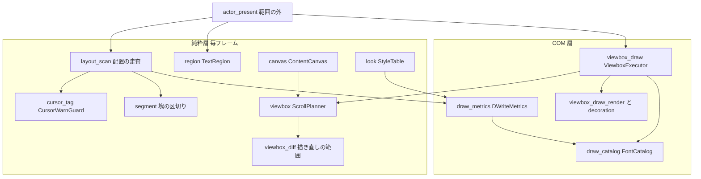
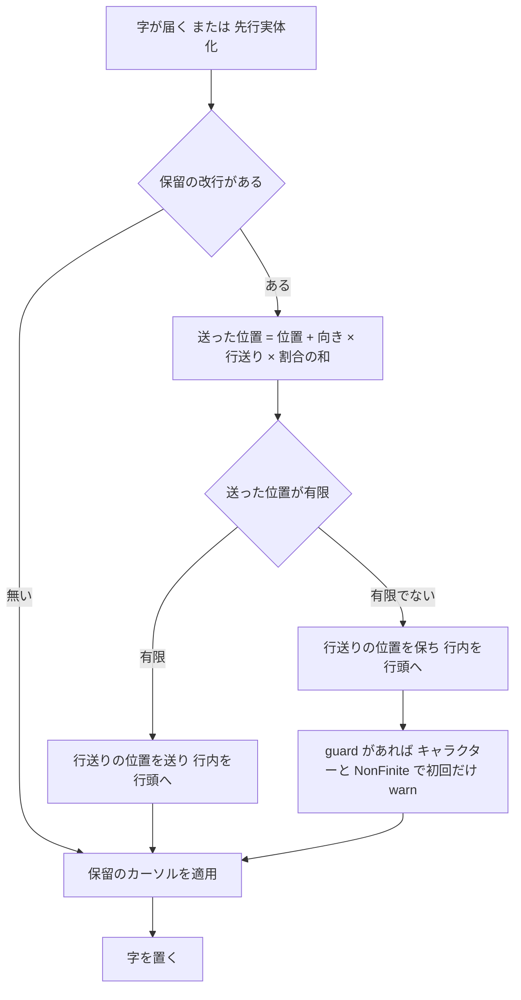
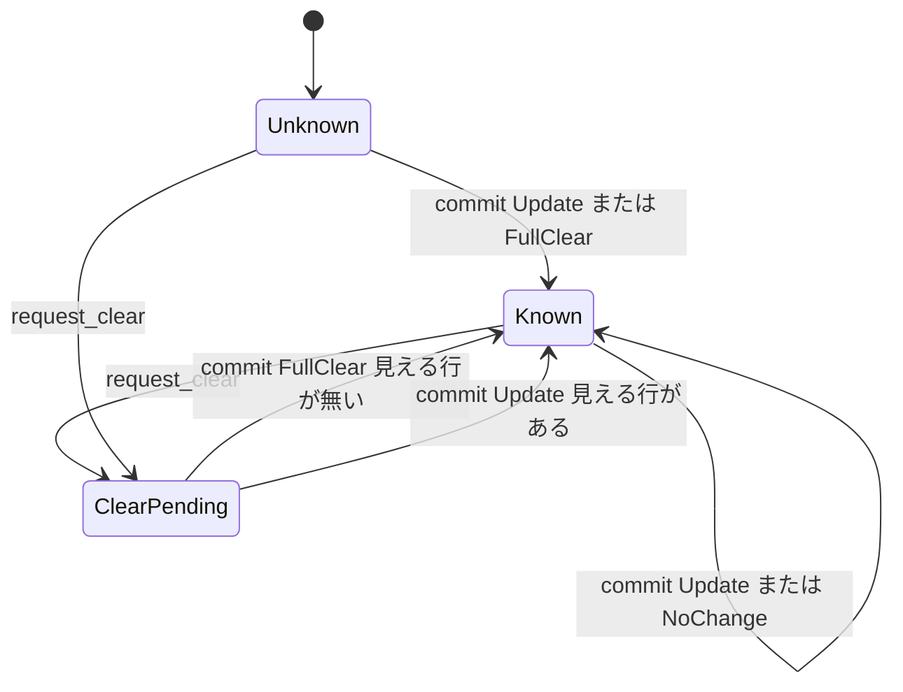

# 設計: audit-emo-text-layout-draw（文字の層のレイアウトと描画の見直し）

## Overview

**目的**: 文字の層のうちレイアウトと描画を受け持つ 81 ファイル（`crates/areka-emo-text/src/` の `layout*`・`segment*`・`region*`・`wrap*`・`lookahead*`・`cursor_tag*`・`writing*`・`draw*`・`canvas*`・`viewbox*`・`look*`・`color*`・`underline*`・`place*`）に `/ponytail:ponytail-audit` をかけて出た 35 件のうち、要件の討議で「直す」と決めた指摘を、いちばん小さな完全な直しで全部直す。申し送り R17（大きな有限の割合の改行で位置が壊れる）は指摘 1 として直す。

**使う人**: 開発者。ネットから入れたゴーストの台本とバルーンの書き損じひとつで、文字の位置が無限大になる・試験の作りで落ちる・巨大な面を作ろうとする・表が際限なく育つ、が起きないこと。決めごと（空行を出さない・バルーンの既定の下線を描く・1 フレーム遅らせない）とコードが食い違わないこと。テストが守っているつもりの分岐を本当に守っていること。

**変わること**: 外から見える振る舞いは次だけが変わる。⑴ バルーンの `font.underline,1`・`font.strike,1` が飾りの無い字にも描かれる（指摘 6・完了 spec の要件 5.5 へ戻す）。⑵ `\_l` の直後の塊の前に出ていた字の無い行が出なくなる（指摘 5）。⑶ 書き損じの `\f[cursor…]`・`\f[anchor…]` が「無視」でなく「不明」（`warn!`）になる（指摘 21）。⑷ 消去と同じフレームで見えるようになった字が、そのフレームで描かれる（指摘 17）。⑸ 位置が有限でなくなる改行と `\_l` は、その送りを捨てて `warn!` を残す（指摘 1・2）。ほかは中の作りとテストと説明の直しで、絵は変わらない。

### Goals

- 「直す」と確定した指摘（1〜18・21〜35、19 は説明だけ）を全部直し、直したバグと危ない所の 1 件ずつに、壊れたら落ちる決定論のテストを、範囲の今ある兄弟のテストのファイルへ置く。
- 新しいソースファイルを足さず、`lib.rs` と `crates/areka/` に触らず、依存を足さない（`Cargo.lock` 不変）。
- 直し終えたら同じ作法で audit をかけ直し、残すと裁定した指摘を除いて新しい指摘 0 件（5 回目で区切ってよい）・全体テスト緑。
- 大きなタスク 15・細かいタスクはその下（1 本の spec のまま）。

### Non-Goals

- 指摘 19 の振る舞い（`\_l` で跳んだ直後の最初の字が validrect の外に置かれる）。完了 spec `areka-P0-cursor-tag-canon` の要件 2.6 が決めている。説明だけ直す。
- 指摘 20（`\f[height,N]` の上限）。ukadoc が上限を書かない。困る場面は 1・11・12 の直しで消す。
- 指摘 28 のうち `look_tests.rs`・`color_tests.rs` の calibration の組、指摘 30 のうち `RegionTransform` の行列の口、指摘 31 のうち `\_l` の範囲外の毎フレームの `debug!`。どれも裁定で残す。
- 指摘 30 のうち `ScaleContract::author_dpi` と `new` の第 2 引数。このウェーブでは消さず、`crates/areka` に触れてよいウェーブへ申し送る（`crates/areka/src/input_events/balloon_pure_core_tests.rs:156` が使う＝要件 7.6・2026-11-06 開発者「推奨案を承認」・下の「設計の段で確定した事項」）。
- validrect の近い辺（left・top）が画像の外へ負に解ける場合の面の寸。この spec では遠い辺だけを画像の大きさで切り、近い辺の場合は申し送る（同じ裁定）。
- 新しい機能・clippy の機械的な直し・`vendors/` の変更・`doc/COMPAT_ARCHITECTURE.md` を名指す行の改名。

## Boundary Commitments

### This Spec Owns

- 範囲の 81 ファイル（着手のときに測り直した一覧・要件 1.3）の、確定した指摘の直しと、そのテストの追加・直し・削除。
- `\_l` の縮退の種類に足す 1 つ（`CursorDegrade::NonFinite`）と、改行と `\_l` の送りを有限に保つ規則（配置の 1 か所）。
- 描き直しの計画者（`ScrollPlanner`）の「前の行」の状態の形（分からない／分かっている）と、消去のフレームの計画。
- 書体と見た目の表の寿命（「1 つの台詞のあいだ」＝消去と台詞の頭の `ClearAll` で空にする）。
- 範囲の外の、直しに要る最小の箇所（申し合わせの後で触る）: `actor_present.rs:244-247`（指摘 7）・`state_decoration_tests.rs:424,438` の 1 語（指摘 21）。

### Out of Boundary

- `audit-emo-text-state-actor` の持ち物（`actor*`・`state*`・`choice*`・`sink*`・`surface*`・`lib.rs`・`balloon_overrides*`・`inline_marker*`・`marker_surface*`・`scroll_marker*`・`tests/`・`examples/`・`Cargo.toml`）の、上の 2 か所以外。伝えるだけのもの（直さない）は「並走の兄弟との申し合わせ」に挙げる。
- `crates/areka/` の全部と、`crates/areka/` が使う公開の口の形（消す・変える）。
- `crates/areka-parsers/`（改行の割合の読み・`audit-parsers-sakura` で完了）。
- `vendors/`・`doc/`・`docs/`。
- SSP の測り（推奨案はどれも測りに頼らない）。

### Allowed Dependencies

- 今の依存だけ（`windows`・`tracing`・`thiserror`・`bevy_ecs` ほか、テストは `log-capture-kit`）。標準ライブラリ（`HashMap`・`HashSet`・`Cell`・`slice::binary_search_by_key`・`i32::saturating_*`）。
- 依存の向きは今のまま: 純粋層（`layout*`・`segment`・`region`・`wrap`・`cursor_tag`・`writing`・`lookahead`・`look`・`color`・`underline`・`canvas`・`viewbox`・`viewbox_diff`）→ COM 層（`draw*`・`viewbox_draw*`）。純粋層は `windows` に依らない（`lib.rs` の構造の檻）。
- 範囲の外の関数は呼ぶだけ（`crate::inline_marker::is_marker_carrier`）。

### Revalidation Triggers

- `CursorDegrade` に `NonFinite` が増える → この型を網羅で `match` する所（今はツリー全体で 0）。`crates/areka` は使わない（grep 済み）。
- `TextRegion::surface_extent` が増える（足すだけ）→ `actor_present.rs` の面の寸がこれを使う。
- `classify_font_tag` の答えが、ukadoc に無い `cursor…`・`anchor…` のキーで `Unowned` から不明へ変わる → `crates/areka` の `check_script_judge.rs:135`・`strict_judges.rs:34` が出す判定の語（`ignored` → `unknown_tag`）。形は変わらない。
- `ScrollPlanner` の消去の計画が変わる → 範囲の外の actor のテストが見る `stats.full_clears` は数え方を保つ（消去に由来するフレームを 1 と数える）。
- `LayoutEngine::layout_with_cursor_warn`・`DrawExecutor::line_layout`・`ChoiceDraw` が消える（ツリー全体の本番の呼び手 0・`crates/areka` 0）。

## Architecture

### Existing Architecture Analysis

- 流れは「台本の字の列（`TextItem`）→ 配置（`LayoutEngine::layout_styled`・毎フレーム）→ 住人の canvas（`ContentCanvas::from_layout`）→ 描き直しの計画（`ScrollPlanner::plan_with_overhangs`・純粋）→ GPU の面へ描く（`ViewboxExecutor::render_styled`）→ 確定（`commit`）」。配置と計画は毎フレーム UI スレッドで走る。
- 本番の配置の呼び手は `actor_present.rs:624` の `layout_styled` 1 か所で、`\_l` の縮退の一回化の guard（`CursorWarnGuard`・鍵は（キャラクター, 縮退の種類））を `&mut` で渡す。guard は `actor.rs` の `TextLayerRuntime` が持ち、フレームをまたいで残る。
- 書体の台帳（`FontCatalog`）は場所ごとに 1 つ作られ、計測器（`DWriteMetrics`）と描き手（`ViewboxExecutor`）が `Rc` で共有する。台本の頭には必ず `ClearAll` が付き、`\c` は `Clear`。どちらも `ViewboxExecutor::request_clear`（範囲の中）を呼ぶ。
- 1 ファイル 1,000 行の番人は `crates/log-capture-kit/tests/file_length_guard_test.rs`。範囲のファイルは例外表に無い。

### Architecture Pattern & Boundary Map



- **選んだ形**: ギャップ分析の案 A（今のファイルの中で直す）。指摘 1 の守りは新しい型を作らず、指摘 26 の「下見の写し」を片づけて、保留の改行の適用を 1 つの関数に寄せたところへ置く。理由は下の「案の選び方」。
- **守る形**: 純粋層と COM 層の分け・`plan`（状態不変）と `commit`（成功の後だけ）の 2 相・guard による縮退の記録の一回化・失敗は `error!`＋`Err`・`#[cfg(test)]` の見本（`DrawExecutor`）。
- **新しく足すもの**: `CursorDegrade::NonFinite`・`TextRegion::surface_extent`・`ScrollPlanner` の「前の行が分からない」の状態（`Option`）・台帳の「台詞の番号」（`FontCatalog` の数え 1 つ）。どれも直しに要る最小のもの。

### 案の選び方（ギャップ分析 5 節）

| 案 | 中身 | 採るか |
|---|---|---|
| A | 全件を今のファイルの中で直す | **採る** |
| B | 位置を有限に保つ小さな型を `layout_scan.rs` に置き、4 か所を通す | 採らない |
| C | A で先に入れ、下見の片づけで B の型を小さく入れる | 採らない |

- 位置が有限でなくなりうるのは、保留の改行の適用（`apply_pending_newline`）・`\_l` の解決・折り返しの送り（`layout_scan_glyph.rs:159`）・字の送り（同 `:169`）の 4 か所。後ろの 2 つは、指摘 20 で `\f[height,N]` に上限を置かないと決めたため、行送りや字幅が 1e38 にもなりうる（`\f[height,1e38]` の字が 4 行に折れると位置が無限大＝設計の検証の問題 1）。送りの 3 か所（改行・折り返し・字）は「足した結果が有限なら足し、有限でなければ位置を保って `false`」の私有の関数 1 つ（`try_advance`）を通し、`\_l` は解決の側で 1 行確かめる。型は要らない。
- 指摘 26 の下見（`layout_scan.rs:230-245`）を、保留の改行と保留のカーソルの適用の関数を写しの局所変数へ呼ぶ形に直すと、改行の守りは 1 か所（`apply_pending_newline`）だけになる。案 B が狙った「2 か所が同じ規則で動く」はこれで得られる。
- 案 B は `layout_scan*.rs` の行の数えの檻（`finish_line(` の数 4 など）を触り、差分が広がる。

### Technology Stack

| 層 | 選ぶもの | 役目 | 備考 |
|---|---|---|---|
| 言語 | Rust（ワークスペースの版） | 全部 | 新しい依存なし・`Cargo.lock` 不変 |
| 記録 | `tracing`（`error!`・`warn!`・`debug!`） | 非有限の送り・書体の失敗・`\f` の不明のキー | 一回化は今ある guard と台帳の型で |
| 描画 | DirectWrite・Direct2D（`windows` クレート） | 線を焼く・書式・ブラシ | GPU のテストは実 GPU |
| テスト | `log-capture-kit`・見本（`DrawExecutor`）との画素の比べ | 記録の檻・読み戻し | 決定論 |

## File Structure Plan

### Directory Structure

```
crates/areka-emo-text/src/
├── （新しいファイルは足さない・lib.rs に触らない＝要件 7.3）
├── layout_scan.rs / layout_scan_glyph.rs / layout_line_ops.rs / layout.rs / layout_styled.rs   # 配置（1・2・5・9・26・30）
├── cursor_tag.rs / segment.rs / region.rs / lookahead.rs / writing.rs                          # 解決・区切り・領域・先渡し（2・5・7・9・13・23・26・33）
├── look.rs / color.rs / underline.rs / canvas.rs                                               # 見た目・線（10・14・21・24・32）
├── viewbox.rs / viewbox_diff.rs                                                                 # 計画（3・4・15・16・17・18・31）
├── viewbox_draw.rs / viewbox_draw_plan.rs / viewbox_draw_render.rs / viewbox_draw_decoration.rs / viewbox_draw_underline.rs  # 描き手（6・8・11・17・18・23・26・30・31）
├── draw.rs / draw_catalog.rs / draw_metrics.rs / draw_line_store.rs                             # 書体と計測（11・12・26・30・31・34・35）
└── *_tests.rs / *_test_support.rs                                                               # テスト（各件の檻・22〜25・27・28・30）
crates/areka-emo-text/src/（範囲の外・申し合わせの後に触る）
├── actor_present.rs            # 244-247 の面の寸を TextRegion::surface_extent へ（7）
└── state_decoration_tests.rs   # 424・438 の "cursorbrush" を ukadoc のキーへ（21）
```

### Modified Files

ソース（範囲の中）:
- `layout_scan.rs` — `apply_pending_newline` が送った結果の有限を確かめ、送れなかったら位置を保って `true` を返す（1）。保留の改行の和（`:204`）はそのまま（和の非有限も適用の確かめで拾う）。`Scan` が送れなかった改行を guard へ渡して `warn!` する（1）。下見（`:230-245`）を 2 つの適用の関数を写しへ呼ぶ形に（26）。走査が「今の字の番号に対応するアイテムの位置」を持つ（9）。古い説明（29）。
- `layout_scan_glyph.rs` — 折り返しの送り（`:159`）と字の送り（`:169`）を `try_advance` に通し、送れなければ `NonFinite` で 1 回 `warn!`（1・20 の前提）。塊の頭の送りの枝に `&& !self.current.is_empty()`（5）。`segment_advance_sum` へ `&items[今の位置..]` を渡す（9）。説明（5・29）。
- `layout_line_ops.rs` — `segment_advance_sum` の説明を「渡された列の先頭から数える」に（9）。
- `layout.rs` — `layout_with_cursor_warn` を消す（30）。説明 `:36-39`（19）・`:80-86`・`:344-345`（5・29）。
- `layout_styled.rs` — 消した関数へのリンクを直す（30）。
- `cursor_tag.rs` — `CursorDegrade::NonFinite` を足す（1・2）。`resolve_cursor_axis` が有限でない結果を `Err(NonFinite)` にする（2）。`CursorWarnGuard::should_warn` を `pub(crate)` に（1）。`should_warn` は既出なら複製しない（31）。説明 `:90`・`:106-107`（2・29）。
- `segment.rs` — `segment_starting_at` を `binary_search_by_key` に（9）。塊の合計と run の長さの `debug_assert_eq!`（33）。`CursorMove` で区切る腕の説明（23）。
- `region.rs` — `TextRegion::surface_extent` を足す（7）。軸の名を割り当てと同じ `match` から（26）。説明（29）。
- `writing.rs`・`wrap.rs` — 内側のテストの重複と失敗しえない半分を消す（24・28）。説明 `writing.rs:14`（29）。
- `lookahead.rs` — 「内容を足した」合図に印の字（`is_marker_carrier`）を足す（13）。
- `look.rs` — `StyleTable` に `HashMap` の索引（10）。`TextLook` に `Hash`・`Eq`（10）。`cursor*`・`anchor*` を ukadoc の一覧で数え上げる（21）。
- `color.rs` — 失敗の理由の文と u64 の読み（32）。
- `underline.rs` — 丸ごと面の外の線は寄せない（14）。
- `canvas.rs` — 失敗しえない内側のテストを消す（24）。説明（29）。`RegionTransform` の行列の口は残す。
- `viewbox.rs` — `resolve_position`・`blit_vector` の飽和とずらし量の頭打ち（3）。`prev_lines` を `Option` に（16）。消去の要求中の計画（17）。指紋を 1 度だけ求める（31）。説明（3・29）。
- `viewbox_diff.rs` — 描き直しの範囲の足し引きを飽和に（4）。全域の道を「前の行が分からない」専用の関数に分け、面と重なる行だけ描く（16・18）。送ったフレームで前の最下行を描き直す（15）。
- `viewbox_draw.rs` — `request_clear` が台帳の台詞の番号を進め、ブラシの記憶を空にする（11）。消去由来のフレームを数える（17）。`#[cfg(test)]` の再公開を消す（30）。`device_err`／`none_err` は `draw` の側から引く（26）。説明 `:256-257` ほか（17・29）。
- `viewbox_draw_plan.rs` — 全域の縮退をはみ出し込みで面と重なる行に絞る（18）。`draw_lines.contains` を `binary_search` に（31）。
- `viewbox_draw_render.rs` — 既定の見た目の行でも線が要れば線を焼く道を通す（6）。帯の超過分を行の丈と比べる（8）。消去と字が同じフレームの描画（17）。`ChoiceDraw` を畳む・`apply_color_ranges` の戻り値（30）。既定の色のブラシを欄で覚える（31）。
- `viewbox_draw_decoration.rs` — 下線の区間を `look.underline` だけで選ぶ・打ち消し線は `look.strike` で焼く（6）。`BrushCache::clear`（11）。
- `draw.rs` — 既定の書体の名と高さの定数を `crate::look::UKADOC_*` の別名に（26）。`device_err`／`none_err` を `pub(crate)` に（26）。既定の書体での作り直しを消す（35）。`DrawExecutor` が台帳で書体を解いてから書式を作る（34・テストだけ）。`DrawExecutor::line_layout` を消す（30）。説明（29）。
- `draw_catalog.rs` — 台詞の番号と `forget_talk`（11）。
- `draw_metrics.rs` — 台詞の番号が進んだら既定の鍵以外の表を空にする（11）。作れなかった書式・測れなかった字を覚える（12）。`degraded_advance` を `FixedMetrics` の式へ寄せる（26）。字ごとの鍵の複製をやめる（31）。

テスト（各件の置き場と行の余白は「Testing Strategy」の表）:
- 支えのファイル（`viewbox_draw_test_support.rs`・`viewbox_test_support.rs`・`layout_test_support.rs`・`draw_test_support.rs`・`cursor_tag_test_support.rs`）— 写しを集める（25）。
- 写しを持つテスト（`research.md` 3 節の 25 の場所の全部）— 写しを消して支えから引く（25）。
- 重複するテスト（同 28 の場所の全部・calibration の組を除く）— 弱い方を消す（28）。
- 失敗しえないテスト（同 24 の場所の全部）— 消すか確かめを直す（24）。
- `viewbox_draw_choice_hover_tests.rs`・`viewbox_draw_line_gap_band_tests.rs` — `#[ignore]` の記録だけのテストと部品を消す（30）。
- `viewbox_draw_png_dump_tests.rs` — 既定の出力先を `target` の下に（27）・使わない部品（30）。
- `viewbox_draw_live_diff_tests.rs`・`viewbox_draw_scroll_retain_tests.rs` — `rig` を `_rig` にして `#[allow(dead_code)]` を外す（30）。器の使い回し（31）。
- `draw_format_metrics_tests.rs` — 「呼び出しはここだけ」の檻に `draw_metrics.rs` を数える（22）。作り直しの期待（35）。字面の檻（26）。

範囲の外（申し合わせの後）:
- `actor_present.rs:244-247` — 面の寸を `resolved.region.surface_extent()` から求める（7）。触るのはこの 2 行の式だけ。
- `state_decoration_tests.rs:424,438` — `"cursorbrush"` を ukadoc のキー `"cursorbrushcolor"` へ（21）。触るのはこの 1 語（2 か所）だけ。

## System Flows

### 保留の改行の適用（指摘 1・26）



- 割合の和そのもの（`acc + ratio`）は確かめない。和が無限大や数でない値になっても、送った位置の確かめで同じく拾う（要件 5.3）。行送りは字の高さ＋2 で正なので、和が有限なら結果の有限は掛け算のあふれだけで決まる。
- `\_l` の実効位置の下見は、同じ 2 つの適用の関数を写しの局所変数へ呼ぶ。下見は記録しない（同じ改行は後の本当の適用で 1 度だけ記録される）。
- ふつうの大きさの割合では、送った位置はいつも有限なので、位置は今と 1 ビットも変わらない（要件 5.4）。

### 描き直しの計画者の状態（指摘 16・17）



- `Unknown`＝`prev_lines` が `None`（初めのフレーム）。計画は全域の描き直し（面と重なる行だけ・指摘 18）。
- `Known`＝`Some(行)`。空の列も「何も描いていないと分かっている」。空 → 空は `NoChange`（指摘 16）。
- `ClearPending`＝`clear_requested` が真で `prev_lines` は `None`。見える行が無ければ今の `FullClear`、あれば全域の `Update`（全面を消してから見える行を描く＝0 フレーム・指摘 17）。どちらの commit も要求を下ろし、`prev_lines` を `Some` にする。描き手は消去の要求が立っていたフレームを `stats.full_clears` に 1 と数える（範囲の外の actor のテストの数えを保つ）。

## Requirements Traceability

| 要件 | 中身 | 実現する所 |
|---|---|---|
| 1.1 | 範囲を数えて記録 | ギャップ分析で済み（`research.md` 2 節・81 ファイル）。大きなタスク 1 で測り直す |
| 1.2 | 他 spec の持ち物を含めない | Boundary Commitments の Out of Boundary |
| 1.3 | 増減したら測り直す | 大きなタスク 1 と 15（`git ls-files` で一覧と数を記録し直す） |
| 2.1 | 範囲だけに audit | ギャップ分析で済み。かけ直しも同じ範囲（タスク 15） |
| 2.2 | 最大 20 件を外す | 同上（35 件・省いた件なし） |
| 2.3 | 全部読む | 同上（81 ファイル）。かけ直しの記録にも数を書く |
| 2.4 | 番号と組を付ける | `research.md` 3 節。本設計の番号もそのまま |
| 2.5 | 組ごとの件数 | `research.md` 1 節（8・19・8）。かけ直しも同じ形 |
| 2.6 | プラグインを写さない | リポジトリに `.claude/plugins` を足さない（タスクの約束） |
| 3.1 | 確定した一覧を正本に | `requirements.md` の「確定した指摘の一覧」。本設計の「指摘ごとの直し」はそれに従う |
| 3.2 | 残すのは 3 種類だけ | 残すのは 19（振る舞い）・20・28 の calibration・30 の行列の口・31 の毎フレームの `debug!`・30 の `author_dpi`（Non-Goals・申し送り） |
| 3.3 | ⑶ は ukadoc を引いて議題に | 6・7・19・20・21 は要件の討議で済み。21 のキーの一覧は ukadoc を引いた（`research.md` 12 節） |
| 3.4 | `crates/areka` が使う口は議題に | 指摘 30 の `ScaleContract::new` の第 2 引数（`crates/areka/src/input_events/balloon_pure_core_tests.rs:156` が使う）を議題にし、開発者が「申し送る」と裁定（2026-11-06） |
| 3.5 | 残す裁定を記録 | `requirements.md` に済み。かけ直しの 0 件から外す番号は「確かめの段」 |
| 3.6 | 3 種類でなければ外さない | 1〜18・21〜35 を全部直す |
| 3.7 | 20 タスクを越えそうなら切る案 | 討議で「切らない」と確定済み。大きなタスク 15（「タスクの見込み」） |
| 4.1 | 3 つの組とも全部直す | 「指摘ごとの直し」の全件 |
| 4.2 | 最小の完全な直し・呼び手まで | 各件の「直し」と「範囲の外」の欄・File Structure Plan |
| 4.3 | 消す前に使われていないか確かめる | 30・35・24・28 を消すタスクの完了条件に「ツリー全体の grep（テスト・支え・設定・文字列を含む）の命令と結果をタスクの記録に残す」を置く。設計の段で 30 を grep し直し、`ScaleContract::new` の範囲の外の呼び手を見つけた（「設計の段で確定した事項」の 1） |
| 4.4 | 裁定を覆さない | 5（空行を出さない）・6（要件 5.5）・14（最下行だけ寄せる）・17（1 フレーム遅らせない）は裁定に沿う。19・20・28・30・31 は残す |
| 5.1 | R17 を一覧に載せる | 指摘 1（`research.md` 3 節に出どころ付き） |
| 5.2 | 大きな有限の割合で位置を有限に・`warn!` | 「保留の改行の適用」の流れ・`apply_pending_newline` |
| 5.3 | 割合の和が非有限でも同じ | 同上（送った位置の確かめで拾う） |
| 5.4 | ふつうの割合は今と同じ | 同上・今ある改行のテストが全部緑のまま |
| 5.5 | 守りが外れたら落ちるテスト | `layout_wrap_tests.rs`・`layout_visible_window_tests.rs` の檻（Testing Strategy） |
| 6.1 | 1,000 行を越えない | Testing Strategy の余白の表・各タスクの完了条件に行数の確かめ |
| 6.2 | 記録なしの失敗を作らない | Error Handling（非有限・書式の失敗・`\f` の不明は記録を出す） |
| 6.3 | 終了の道は正規 | 終了の道に触らない |
| 6.4 | 実機の根・一時フォルダは `target` の下 | 指摘 27（PNG の出力先）。新しいテストは一時フォルダを使わない |
| 6.5 | GPU のテストは実 GPU | 6・15・17 の読み戻しは今の実 GPU の支え（`Rig`）を使う |
| 6.6 | 文字化けは読む側を直す | 道具の出力を変えない |
| 6.7 | 依存を足さない | Allowed Dependencies |
| 6.8 | 要る依存は議題に | 要る依存は無い |
| 7.1 | 形を変えたら呼び手を全部 | 各件の「範囲の外」欄（grep 済み・実装でもう一度） |
| 7.2 | 走っている spec と申し合わせ | 「並走の兄弟との申し合わせ」 |
| 7.3 | 新しいファイルを足さない・`lib.rs` に触らない | File Structure Plan |
| 7.4 | 檻は今ある兄弟のファイルへ | Testing Strategy の表 |
| 7.5 | 1,000 行を越えるなら申し合わせ | 同上（越える見込みは無い・越えたら止まって申し合わせる） |
| 7.6 | `crates/areka` に触らず、使う口を変えない | 足すだけ（`surface_extent`・`NonFinite`）。`ScaleContract::new` は形を変えずに申し送る |
| 7.7 | `actor*`・`state*` から呼ばれる関数の形を変えるなら申し合わせ | 形を変える関数は無い（`layout_styled`・`resolve`・`request_clear` の形は保つ）。`ScaleContract::new` を残すので actor の呼び手も変わらない |
| 7.8 | `wintf-visual-tree` の改名 | 25 で GPU の支えを寄せても `ecs::graphics::Visual` の名を使い続ける。改名が及びそうなら申し合わせ |
| 7.9 | 範囲の外は呼び手の直しだけ | 範囲の外は 2 か所だけ。古い説明などは伝えるだけ |
| 7.10 | clippy と同じ所 | audit の指摘として直す所だけ |
| 7.11 | `vendors/` を変えない | 触らない |
| 8.1 | 1 件ずつに壊れたら落ちるテスト | Testing Strategy の表 |
| 8.2 | 決定論 | 時刻・乱数・順に依らない（`BTreeSet`・固定の入力・見本との画素の比べ） |
| 8.3 | 全体テスト緑 | タスク 15（`pwsh -NoProfile -File tools/test-all.ps1`） |
| 9.1 | 同じ作法でかけ直す | タスク 15 |
| 9.2 | 新しい指摘も直す | 同上（残すと裁定した番号を除いて 0 件まで） |
| 9.3 | 5 回目で区切ってよい | 同上（区切る条件と開発者への知らせ） |
| 9.4 | かけ直しの記録 | 同上（読んだ数・組ごとの件数・外した番号・区切ったときの回と理由を `research.md` へ） |

## Components and Interfaces

### 一覧

| 部品（ファイル） | 層 | 役目 | 指摘 | 契約 |
|---|---|---|---|---|
| 配置の位置の守り（`layout_scan.rs`・`cursor_tag.rs`・`layout_line_ops.rs`） | 純粋 | 改行と `\_l` の送りを有限に保つ | 1・2・26 | Service・型 |
| 塊の折り返し（`layout_scan_glyph.rs`・`segment.rs`） | 純粋 | 空行を出さない・2 乗をやめる | 5・9・23・33 | 振る舞い |
| 文字の面の寸（`region.rs`＋範囲の外 `actor_present.rs`） | 純粋 | 面を画像の大きさで頭打ち | 7 | Service |
| 描き直しの計画者（`viewbox.rs`・`viewbox_diff.rs`・`viewbox_draw_plan.rs`） | 純粋 | あふれない・空を描き直さない・消去を 0 フレームで・面の外を描かない | 3・4・15・16・17・18・31 | State |
| 線（`viewbox_draw_decoration.rs`・`viewbox_draw_render.rs`・`underline.rs`） | COM・純粋 | 既定の線を描く・面の外の線を寄せない | 6・14・15 | 振る舞い |
| 帯（`viewbox_draw_render.rs`） | COM | 帯の超過を行の丈と比べる | 8 | 振る舞い |
| 書体と見た目の表（`look.rs`・`draw_catalog.rs`・`draw_metrics.rs`・`viewbox_draw.rs`・`viewbox_draw_decoration.rs`・`draw.rs`） | 純粋・COM | 表を台詞の寿命にする・失敗を覚える・線形探索をやめる | 10・11・12・31・34・35 | State |
| 台本の読み（`lookahead.rs`・`look.rs`・`color.rs`） | 純粋 | 合図の数え・`\f` のキー・記録の文 | 13・21・32 | 振る舞い |
| 写しと要らないコード（多数） | 全部 | 同じ規則を 1 か所に・使われない口を消す | 22・26・27・30・31 | — |
| テスト（`*_tests.rs`・`*_test_support.rs`） | テスト | 写し・重複・失敗しえないテスト・檻の無い分岐 | 23・24・25・28 | — |
| 説明（多数） | 全部 | 事実に合わせる | 17・19・29 | — |

### 配置の位置の守り（指摘 1・2・26）

| 欄 | 中身 |
|---|---|
| 役目 | 保留の改行と `\_l` の解決が、位置を有限でない値にしない |
| 要件 | 4.1, 4.2, 5.1, 5.2, 5.3, 5.4, 5.5, 6.2, 8.1 |

**契約**: Service [x] / State [ ]

```rust
// cursor_tag.rs（足すだけ・網羅の match はツリー全体で 0）
pub enum CursorDegrade {
    Unparsable,
    CenterAxisMismatch,
    /// 解決や送りの結果が有限の数でない（その軸・その送りは動かさない）。
    NonFinite,
}
impl CursorWarnGuard {
    /// 初回なら記録して true。既出なら鍵を複製せずに false（指摘 31）。
    pub(crate) fn should_warn(&mut self, actor: &ActorKey, degrade: CursorDegrade) -> bool;
}
pub fn resolve_cursor_axis(coord: CursorCoord, axis: CursorAxis, basis: &CursorBasis)
    -> Result<Option<f32>, CursorDegrade>; // 形は同じ。Absolute と Relative の結果が有限でなければ Err(NonFinite)

// layout_scan.rs（私有）
/// `pos + delta` が有限なら足して true。有限でなければ pos を保って false（改行・折り返し・字の送りが共有）。
fn try_advance(pos: &mut f32, delta: f32) -> bool;
/// 送れなかった（結果が有限でない）とき位置を保ち true を返す。行内は今どおり行頭へ戻す。中で try_advance を使う。
fn apply_pending_newline(pending: &mut Option<f32>, inline_pos: &mut f32, block_pos: &mut f32,
    inline_start: f32, block_dir: f32, pitch: f32) -> bool;
// layout_scan_glyph.rs: 折り返しの送り（:159）と字の送り（:169）も try_advance を通し、
// false なら should_warn(actor, NonFinite) で 1 回だけ warn!（改行と同じ種類・同じ guard）。
```

- 事前条件: 行送り `pitch` は正の有限（字の高さ＋2）。
- 事後条件: 走査の後、どの行の矩形もどのグリフの位置も有限。改行の送りと `\_l` の解決が有限なら、位置は今と同じ。
- 一回化（項目 (a) の決め）: `CursorWarnGuard`（鍵＝（キャラクター, 縮退の種類））に種類 `NonFinite` を 1 つ足して通す。guard は `TextLayerRuntime` がフレームをまたいで持つので、毎フレーム配置し直しても `warn!` は「キャラクターごと・種類ごとに 1 回」になる（字ごとより少ない側＝記録があふれない）。改行の非有限は `Scan` が `self.cursor_warn` の guard で `should_warn(actor, NonFinite)` を見て `warn!` を出す（構造化の欄は `actor`・`block_pos`・`ratio_sum`）。`\_l` の非有限は今の `warn_cursor_degrade` の道を通る（新しい道は作らない）。guard が無い配置（`LayoutEngine::layout`・本番の呼び手 0）では毎回 `warn!` を出す（記録なしの失敗を作らない・要件 6.2）。
- 下見（`cursor_move` の実効位置）: `let mut p = self.pending; let (mut i, mut b) = (self.inline_pos, self.block_pos); apply_pending_newline(&mut p, …, line_pitch_of(self.metrics, self.heights.peek())); apply_pending_cursor(&mut self.pending_cursor.clone(), &mut i, &mut b);` の形で、写しの式を消す。下見の戻り値（送れなかった）は記録しない。
- 範囲の外: ア なし（どれも私有か、形の同じ公開の関数）。イ なし。

### 塊の折り返し（指摘 5・9・23・33）

- 指摘 5: `layout_scan_glyph.rs:111-116` の「今の行には収まらないが行頭からなら収まる」枝の条件に `&& !self.current.is_empty()` を足す。行が空（`\_l` の直後）なら今ある「長い塊は文字の規則へ」の枝へ落ちる（`\_l` の x はそのまま・続く字は折り返し基準で 1 字ずつ折れる）。説明 `:112-114` と `layout.rs:344-345` を事実に。`layout_cursor_overflow_tests.rs` の `finish_line(` の数え（4）は変わらない。
- 指摘 9: ⑴ `Scan` に「今の字の番号に対応する `items` の位置」（`item_cursor: usize`・`serial_at_cursor: usize`）を持たせ、字を置くたびに進める。`segment_advance_sum(&items[item_cursor..], start_serial - serial_at_cursor, len, …)` と呼ぶ（関数の形は変わらない・渡す列の先頭から数える）。⑵ `segment_starting_at` は `self.segments.binary_search_by_key(&glyph_index, |s| s.start).ok().map(|i| self.segments[i])`。
- 指摘 23（区切り）: `segment.rs` の内側のテストに `[字, 字, CursorMove, 字]` の区切りを足し、`CursorMove` で区切りが始め直されることを確かめる。説明 `:3,12-14,36,53,98-100` に `CursorMove` の腕を書く。
- 指摘 33: `segment.rs:163-165` に `debug_assert_eq!(塊の長さの合計, run_text.len())` を置く（本番では記録を出さない＝届いた字の腕で毎フレーム走るため・説明はそのまま）。

### 文字の面の寸（指摘 7）

```rust
// region.rs（足すだけ）
impl TextRegion {
    /// 文字の面の寸（image px）: 遠い辺（right・bottom）を画像の寸で頭打ちにした validrect の寸。
    /// 並べ方（折り返し・位置）には使わない。0 未満は 0。
    pub fn surface_extent(&self) -> (f32, f32);
}
```

- 中身: `((self.right().min(w) - self.left()).max(0.0), (self.bottom().min(h) - self.top()).max(0.0))`（`(w, h)` は `image_size()`）。
- 範囲の外の呼び手: `actor_present.rs:244-247` の `physical_size` を `contract.physical_extent(ImagePx(ext.0))`・`(ext.1)`（`let ext = region.surface_extent();`）に替える。面の位置（`physical_offset`）は変えない。触る前に `audit-emo-text-state-actor` と申し合わせる（要件 7.2）。
- 見た目: 近い辺が画像の中（left・top ≥ 0）なら、面は validrect と画像の重なりをちょうど覆う＝画像の中の字は今と同じに見え、画像の外の字は今も見えない。近い辺が画像の外のとき（面が画像より大きく残りうる）は、この spec では直さず申し送る（「設計の段で確定した事項」の 2）。
- 確かめ（実装のタスク）: 面の寸を読むほかの所（`viewbox` の計画の `surface_size`・面の作り直しの比べ）が、面の実際の寸を使っていて validrect の寸を使っていないことを grep で確かめ、タスクの記録に残す。

### 描き直しの計画者（指摘 3・4・15・16・17・18・31）

**契約**: State [x]

```rust
// viewbox.rs
pub struct ScrollPlanner {
    committed: i32,
    pos: f32,
    /// None＝前に描いた中身が分からない（初め・消去の後）＝全域を描き直す。
    /// Some(空)＝何も描いていないと分かっている。
    prev_lines: Option<Vec<CommittedLine>>,
    clear_requested: bool,
}
impl ScrollPlanner {
    pub(crate) fn clear_pending(&self) -> bool; // 描き手が full_clears を数えるため
}
// viewbox_diff.rs
impl ScrollPlanner {
    /// 全域の描き直し: 面全域 1 枚。描く行は見える窓の行のうち、はみ出し込みで面と重なる行だけ（18）。
    pub(crate) fn full_domain(canvas: &ContentCanvas, window: &VisibleWindow, mode: WritingMode,
        contract: &ScaleContract, surface_size: (u32, u32), overhangs: &[LineOverhang])
        -> (Vec<DirtyRect>, Vec<usize>);
    // derive_dirty / derive_dirty_with_overhangs は形を保つ。空の prev は「何も描いていない」の意味になり、
    // 先頭の `if prev_lines.is_empty()` の全域の枝は full_domain へ移る。
}
```

- 指摘 3: `resolve_position` の `pos.round() as i32` は飽和のまま（Rust の `as` は飽和）。`blit_vector` は `target.committed.saturating_sub(self.committed)`。`plan_with_overhangs` はずらし量の各成分を ±面の寸（`surface_size` の行送りの軸）で頭打ちにする（|ずらし| ≥ 面の寸は「全部送り出された」と同じ意味で、露出の帯と写しの結果は変わらない・向きは保つ）。これで `surface.rs:568,571`（範囲の外）の `-dy`・`h - dy` もあふれなくなる。説明の不変条件（`:32,52-53,60`）を「|pos| ≤ i32::MAX の間」に直す。
- 指摘 4: `expand_guard_clamp`（`viewbox_diff.rs:426-429`）の 4 つの足し引きを `saturating_sub`／`saturating_add` に。
- 指摘 15: 送り（`blit ≠ (0,0)`）のあるフレームで、ずらす前の位置（今の位置 − ずらし量）で矩形（はみ出し込み）が面の行送りの向きの遠い端に届いていた行を、変わった行と同じくダーティに入れる（寄せた線が残りうる行＝前の最下行）。最下行だけを寄せる裁定（2026-10-16）は変えない。
- 指摘 16: 計画は `prev_lines` が `None` なら `full_domain`、`Some(prev)` なら今の差分。commit は `FullClear` で `Some(vec![])`、`Update` で `Some(新しい行)`。`request_clear` は `None` にする。
- 指摘 17: `clear_requested` の間、`full_domain` の描く行が空なら `FullClear`、空でなければ `Update { blit: (0,0), dirty: 全域, draw_lines }`。commit（どちらでも）が `clear_requested` を下ろす。描き手（`ViewboxExecutor::render_styled`）は計画の前に `clear_pending()` を読み、真なら `stats.full_clears += 1`。説明 `viewbox_draw.rs:256-257` の「透明フラッシュは FullClear の 1 フレームのみ」を「消去と同じフレームで見える字も描く」へ直す。
- 指摘 18: 後ろ向きの縮みと古い側への送り（`viewbox.rs:244-262`）と `viewbox_draw_plan.rs` の全域の縮退（`degrade_if_needed`／`full_domain_update`）は、どれも `full_domain` を使い、はみ出しを渡す（`viewbox_draw_render.rs:136` の呼び出しがはみ出しを渡す形に変わる）。
- 指摘 31（計画の分）: 住人の指紋は `plan` で 1 度求めて差分へ渡す（`viewbox.rs:241,313`・`viewbox_diff.rs:175` の 3 回を 1 回に）。`viewbox_draw_plan.rs:125-127` の `draw_lines.contains` は `binary_search`（列は昇順）。
- 範囲の外: ア なし（`pub(crate)`・呼び手は viewbox とテストだけ）。イ なし。`tests/viewbox_scroll_test.rs` ほかは `FullClear` の変種と `full_clears` の数えが残るので触らない。

### 線（指摘 6・14・15）

- 指摘 6: 下線は areka が自分で塗るので、区間の選び方を直すだけ＝解決した見た目の `look.underline` だけで選ぶ（`StyleId::DEFAULT` の区間も対象・`!= default.underline` を外す・`viewbox_draw_decoration.rs:129-138`）。打ち消し線は DirectWrite に焼く。`apply_font_ranges` は既定の区間を `continue` で飛ばす（`:174-176`）ので、**既定の見た目が打ち消し線つきなら、ループの前に行の全体へ `SetStrikethrough(true)` を 1 回焼き**、ループの中は今の `look.strike != default.strike` の比べのまま（`\f[strike,0]` で外した区間には `false` を焼く）。範囲の呼び出しの数の檻（`note_range_call`）は、この全体の 1 回も 1 と数える＝既定に打ち消し線の無い行では今どおり 0 件、既定に打ち消し線のある行では既定だけの行で 1 件（檻の期待をこの 2 つに分けて書く）。既定の見た目だけの行でも、既定の見た目が下線か打ち消し線を持つときは、線を焼く道（`line_layout_with_strokes`）を通す（`viewbox_draw_render.rs:503-508` の早い抜けの条件に足す）。`viewbox_draw_decoration_tests.rs:641-669` の「既定と同じ下線の区間は選ばない」は向きを逆に直す。
- 指摘 14: `underline.rs` の `pull` の頭で、線が丸ごと面の外（`lo > limit || hi < 0`）ならそのまま返す。
- 指摘 15: 上の計画者の節。

### 帯（指摘 8）

- `viewbox_draw_render.rs:725-758` の帯の超過分を求める関数は、`font.height`（既定の字の高さ）の代わりにその行の丈（`resident_rect` と同じ `run.size` の行送りの軸）を受ける。関数は `pub(super)` にして純粋なテストで確かめる。説明 `:729` を直す。

### 書体と見た目の表（指摘 10・11・12・31・34・35）

**契約**: State [x]

```rust
// look.rs
impl Hash for TextLook { /* 全欄・height は to_bits */ }
impl Eq for TextLook {} // height は常に正の有限（欄の説明「常に正の有限値」・look.rs の確かめが守る）なので == と to_bits は食い違わない
pub struct StyleTable {
    looks: Vec<TextLook>,
    index: HashMap<TextLook, StyleId>, // clear() で一緒に空にする
}
// draw_catalog.rs
impl FontCatalog {
    /// 台詞の切れ目（消去・台詞の頭）: 候補列の記憶を空にし、台詞の番号を進める。warned は残す。
    pub(crate) fn forget_talk(&self);
    pub(crate) fn talk_epoch(&self) -> u64;
}
// draw_metrics.rs（DWriteMetrics の欄）
seen_epoch: Cell<u64>,
probe_formats: RefCell<HashMap<FontKey, Option<IDWriteTextFormat>>>, // None＝作れなかった（error! は 1 回）
cache: RefCell<HashMap<FontKey, HashMap<Arc<str>, Option<f32>>>>,     // None＝測れなかった（error! は 1 回）
```

- 指摘 10: `TextLook` の欄の型 `Script`（`look.rs:53`）にも `Hash`・`Eq` を derive する。`intern` は `index.get(look)` で引き、無ければ `looks` に足して `index` に入れる。`starts_with`・`resolve` の形は変わらない。説明 `:287-288` を直す。
- 指摘 11（項目 (b) の決め）: 上限の数は置かない。表の寿命を「1 つの台詞のあいだ」に揃える。元からある頭打ちは「今の台詞が使う見た目の数」で、これは `StyleTable`（台詞ごとに空になる）と行の書式の記憶（`LineLayoutStore`・`\c` で空になる）がすでに従っている寿命と同じ。台本の頭には必ず `ClearAll` が付き、`\c` は `Clear` で、どちらも `ViewboxExecutor::request_clear` を通る。そこで `request_clear` が `self.fonts.forget_talk()` と `self.brushes.clear()` を呼ぶ。計測器は同じ台帳を `Rc` で持つので、`advance`・`advance_styled` の頭で `talk_epoch()` が `seen_epoch` と違えば、`probe_formats` を空にし、`cache` から既定の鍵以外を消し、既定の鍵の中の `None`（測れなかった字）を消してから `seen_epoch` を揃える。既定の鍵の成功した字幅は残す（字の種類の数＝Unicode の数が元からある頭打ち・台詞ごとに測り直すと台詞の頭のフレームが重くなる）。`warned`（器の一生に 1 回の記録・`draw_catalog.rs:126-133` の決め）は残す。
- 指摘 12: `probe_format_for` は失敗も `None` で覚え、`error!` は作れなかったときの 1 回だけ。`measure` は `probe_advance` の失敗を `None` で覚え、縮退の値（`degraded_advance`）を返す。覚えた失敗は次の台詞の切れ目まで試し直さない（記録は台詞ごとに高々 1 回）。`cached_probe_count`（テスト観測）は成功の数だけ数える。
- 指摘 31（鍵の分）: `advance_styled` は `look.font_key()` の `Vec<String>` を作らずに既定の鍵と欄で比べ（`TextLook` の欄と `default_key` の欄を直接比べる小さな関数）、既定でないときだけ鍵を作る。既定の色のブラシは `ViewboxExecutor` の別の欄で覚える（`BrushCache` を通すと要件 14.2 の「区間の呼び出し 0 件」の檻が鳴るため）。
- 指摘 34: 見本 `DrawExecutor::ensure_format`（`#[cfg(test)]`）は自分の `FontCatalog` で `pick` してから書式を作る（本番の `ViewboxExecutor::ensure_format` と同じ規則）。
- 指摘 35: `draw.rs:411-433` の「既定の書体で作り直す」を消す。`draw_format_metrics_tests.rs:296-314` の記録の数の期待を 1 件に直す。完了 spec の R4.2 の作り直しは開発者の裁定（要件の討議）で改めた。

### 台本の読み（指摘 13・21・32）

- 指摘 13: `lookahead.rs:254-262` の `matches!` の後に `|| crate::inline_marker::is_marker_carrier(&cue.command)`。
- 指摘 21: `look.rs:545-547` の前方一致を消し、ukadoc の一覧のキーを数え上げた表を「他の持ち物」の表に入れる。`cursor…` は 12（`cursorstyle`・`cursorcolor`・`cursorbrushcolor`・`cursorpencolor`・`cursorfontcolor`・`cursormethod`・`cursornotselectstyle`・`cursornotselectcolor`・`cursornotselectbrushcolor`・`cursornotselectpencolor`・`cursornotselectfontcolor`・`cursornotselectmethod`）、`anchor…` は 19（`anchorstyle`・`anchorcolor`・`anchorbrushcolor`・`anchorpencolor`・`anchorfontcolor`・`anchormethod`、同じ 6 つの `anchornotselect…`・`anchorvisited…`、`anchor.font.color`）。出どころは <https://ukatech.shillest.net/ukadoc-spec/list/sakura-script/#f-cursorstyle> ほか「選択肢マーカー変更コマンド」の各項目（`research.md` 12 節）。一覧に無いキーは不明（`warn!`）＝完了 spec の要件 2.5 と 2.6 の食い違いは 2.6 の側で解く。説明（`:540-544` の「10・17」）を数に合わせる。`look_font_tag_tests.rs` §10 の行の名前を ukadoc と照らす。範囲の外の `state_decoration_tests.rs:424,438` は ukadoc に無い `"cursorbrush"` を使っていて、この直しで赤になる＝申し合わせの後で `"cursorbrushcolor"` に替える。
- 指摘 32: `color.rs` の失敗の理由の文を「3 桁か 6 桁の 16 進でない」に、10 進の成分は u64 で読む（`256` も `4294967296` も「範囲外」になる）。

### 写しと要らないコード（指摘 22・26・27・30・31 の残り）

- 指摘 22: ⑴ `direction_recipe_factory_has_exactly_one_call_site_inside_create_text_format` は `draw_metrics.rs` も数え、`probe_format_for` の中の 1 つを許す（名前と説明を事実に）。⑵ `viewbox_draw_decoration.rs` を `@` の檻に入れる小さな表を足す（`DRAW_FACADE_SOURCES` には足さない）。説明を「入口 3 つ」に。⑵ が `draw_format_metrics_tests.rs` の余白に入らなければ `draw_metrics_styled_tests.rs` へ。
- 指摘 26: `draw.rs` の `DEFAULT_FONT_NAME`・`DEFAULT_FONT_HEIGHT` は `crate::look::UKADOC_DEFAULT_FONT_*` の別名にし（名前は残す＝`tests/staysee_balloon_fixture/region.rs:46` が使う）、揃えのテスト `look_tests.rs:70-73` を消し、`draw_format_metrics_tests.rs:771-779` の字面の檻を直す。`device_err`／`none_err` は `draw` の側を `pub(crate)` にして `viewbox_draw` の写しを消す。`degraded_advance` は `FixedMetrics` の式を呼ぶ。下見は上の「配置の位置の守り」。軸の名（`region.rs:225-230`）は割り当て（`:318-327`）と同じ `match` から返す。
- 指摘 27: `viewbox_draw_png_dump_tests.rs:152,384` の既定の出力先を `concat!(env!("CARGO_MANIFEST_DIR"), "/../../target/areka-diag")` にして `create_dir_all`（どのカレントからでもワークツリーの `target` の下）。説明 `:17,380` を直す。
- 指摘 30（直す分）: `LayoutEngine::layout_with_cursor_warn` を消し、テスト 3 か所（`layout_cursor_tests.rs:481,555`・`layout_cursor_wiring_tests.rs:350`）を `layout_styled` に、説明のリンク（`layout.rs:257,370`・`layout_scan.rs:47`・`layout_styled.rs:29`・`layout_styled_tests.rs:174`）を直す。`viewbox_draw.rs:77-81` の `#[cfg(test)]` の再公開、`ChoiceDraw`、`apply_color_ranges` の `bool` の戻り値、`DrawExecutor::line_layout` と重ねた `#[cfg(test)]`、`viewbox_draw_png_dump_tests.rs` の `mk` と捨てられる戻り値を消す。`rig` は `_rig` にして許しを外す。`#[ignore]` の記録だけのテスト（`viewbox_draw_choice_hover_tests.rs:484,606`・`M_FONTS`、`viewbox_draw_line_gap_band_tests.rs:288` と部品）を消す。`RegionTransform` の行列の口は残す。`ScaleContract::author_dpi` と `new` の第 2 引数は残して申し送る（「設計の段で確定した事項」の 1）。
- 指摘 31（残り）: 描き先の bitmap とブラシを毎フレーム作らない（既定の色は欄で・`viewbox_draw_render.rs:144,264-271,362-366,576-579`）。テストの速さ（`viewbox_draw_scroll_retain_tests.rs:345` の器と `vertical_band_case` の `FontCatalog` を使い回す）。

### テストと説明（指摘 17・19・23・24・25・28・29）

- 25: 写しを今ある支えのファイルへ寄せて `pub(super)`／`pub(crate)` で引く（場所は `research.md` 3 節の 25 の全部）。見本と viewbox の対の描画と読み戻し（`render_pair`）と行の比べ（`diff_rows`）は `viewbox_draw_test_support.rs`、配置の部品（`rect_of`・`glyph`・`cursor_px`・`newline`）は `layout_test_support.rs`、領域の部品（`model`・`IMAGE`）は `layout_test_support.rs`、`broken_lines`・`canvas_for` は `viewbox_test_support.rs`、書体の確かめ（`require_yu_gothic`・`face_of`）は `draw_test_support.rs`。テストのファイルどうしの取り込み（`line_gap:11,13`・`choice_hover:5`）は支えからの取り込みに替える。範囲の外の写しは触らない（要件 7.9）。
- 28: 弱い方を消し、固有の 1〜2 行だけを強い方へ移す（場所は `research.md` 3 節の 28 の全部）。`look_tests.rs`・`color_tests.rs` の calibration の組は残す。`cursor_tag_resolve_tests.rs:846-850` の一覧と `layout_cursor_vertical_canon_tests.rs` の頭の「重複させない」の文も直す。
- 24: 消すか、確かめを直す（不透明の画素の数とスクロールの有無・行ごとの帯の墨・ふつうの差分が全体より少なく描く入力・`Origin::new(None, None)`・u32 の引き算は `checked_sub` の確かめ）。場所は `research.md` 3 節の 24 の全部。
- 23: 各テストに 1〜数行の確かめを足す（太字・斜体だけの変化で戻り値と描画の回数・GPU 無しの `degrade_if_needed` の単体・後ろ向きの縮みの 2 本・下線と送りを一緒に描く 1 本・`CursorMove` の区切り・`classify_font_tag` の表の `default`・`disable` の 2 行（配列 14→16）・item の列に `%` と `@`）。説明 `look_font_tag_tests.rs:413-419`・`viewbox_draw_frame_render_tests.rs:503` を直す。
- 29・17・19: 説明を今のコードに合わせ、作業の経緯の段落を消す（場所は `research.md` 3 節の 29 の全部・17 の `viewbox_draw.rs:256-257`・19 の `layout.rs:36-39`）。`cursor_tag.rs:90` は説明だけ（振る舞いは変えない）。`doc/COMPAT_ARCHITECTURE.md` を名指す行は変えない。

## Data Models

- 新しい永続のデータは無い。状態の形が変わるのは 3 つ: `ScrollPlanner::prev_lines`（`Option`・計画者の節）、`StyleTable::index`（台詞の寿命の索引）、`DWriteMetrics` の表の値（`Option`＝失敗の覚え）と `seen_epoch`。どれも UI スレッドだけで使う（`Cell`・`RefCell` のまま）。
- 不変条件: `StyleTable` の `looks[i]` と `index[looks[i]] == StyleId(i+1)` は常に揃う（`intern` と `clear` だけが書く）。`DWriteMetrics` は `seen_epoch == fonts.talk_epoch()` の後でだけ表を引く。

## Error Handling

| 場面 | 記録 | その後 |
|---|---|---|
| 改行・折り返し・字の送りが有限でない（1） | `warn!`（キャラクターと種類で 1 回・guard が無ければ毎回） | 行送りの位置を保ち、行内を行頭へ。続けて配置する |
| `\_l` の解決が有限でない（2） | `warn!`（今の縮退の道・1 回） | その軸を動かさない |
| ずらし量・描き直しの範囲のあふれ（3・4） | なし（失敗ではなく飽和で正しい値になる） | 全域の描き直しと同じ結果 |
| 書式が作れない・字が測れない（12） | `error!`（鍵ごと・字ごとに台詞あたり 1 回） | 縮退の字幅で続ける |
| `\f` の不明のキー（21） | `warn!`（今の不明の道） | 無視して続ける |
| 区切りの前提が崩れる（33） | 試験の作りで `debug_assert!` が落ちる | 出荷の作りは今どおり |

- 失敗を記録なしに捨てる道は作らない（要件 6.2）。デバイスの失敗は今どおり `error!`＋`Err`。

## Testing Strategy

### 壊れたら落ちるテスト（要件 5.5・8.1）

余白は着手のときの「1,000 − 行数」（`research.md` 9 節）。各タスクは足した後の行数を確かめる。

| 指摘 | 確かめること | 置き場（余白） |
|---|---|---|
| 1 | `\n[3e38]`×10＋字・`\n[-3e38]`×20＋字で、どの行の位置も有限・`warn!` が 1 件。ふつうの割合（1.0・0.5・1.5）は今と同じ位置 | `layout_wrap_tests.rs`（264） |
| 1 | 同じ台本から見える窓まで通して、`block_offset` が有限 | `layout_visible_window_tests.rs`（634） |
| 1 | `\f[height,1e38]` で 4 行以上折れる台本で、どの行の位置もグリフの位置も有限（折り返しの送りと字の送り）・`warn!` が 1 件 | `layout_wrap_tests.rs` |
| 2 | `resolve_cursor_axis` が `3e38em` で `Err(NonFinite)`・有限の結果は今と同じ | `cursor_tag_tests.rs`（426） |
| 2 | `\_l[3e38em,]あ`・`\_l[3e38em,]\_l[@-3e38em,]あ`・`\_l[,3e38lh]あ` で行の位置に非有限が無い・`warn!` が 1 件 | `layout_cursor_wiring_tests.rs`（451） |
| 3 | 飽和した確定位置からのずらしが ±面の寸に収まる | `viewbox_axis_tests.rs`（853） |
| 3 | ±3e9 の位置で plan → commit → plan が panic せず全面の描き直しになる | `viewbox_plan_commit_tests.rs`（252） |
| 4 | 位置が ±1e30・±inf の行の範囲が panic せず面の中へ切られる（か無い） | `viewbox_dirty_tests.rs`（230） |
| 5 | `\_l[50,]` の直後の塊で空行が出ず、最初の字が x＝50 | `layout_segmented_tests.rs`（217） |
| 6 | 既定が下線つき・打ち消し線つきのバルーンで、飾りの無い行に線が出る（読み戻し・実 GPU） | `viewbox_draw_underline_tests.rs`（503）・打ち消し線は `viewbox_draw_decoration_tests.rs`（141） |
| 7 | 画像より大きい validrect の `surface_extent` が画像の縁で切られる・画像の中の validrect は今と同じ寸 | `region_tests.rs`（433） |
| 8 | 行の em が既定より小さい選択肢の行で、帯の超過が行の丈で求まる（純粋） | `viewbox_draw_frame_render_tests.rs`（352） |
| 9 | 大きな全文の区切り（塊 数千）で、配置の結果が直す前の式と同じ。`segment_starting_at` が全部の塊の頭で正しい | `layout_segmented_tests.rs`・`segment.rs` の内側 |
| 10 | 1 万の色を登録して番号が往復する・同じ見た目は同じ番号・`clear` の後は新しい番号 | `look_tests.rs`（461） |
| 11 | 台詞の番号が進むと、既定の鍵以外の書式を作り直す（作り直しの数が増え、測った値は同じ）。ブラシの記憶が `request_clear` で空になる | `draw_metrics_styled_tests.rs`（383）・`draw_catalog_tests.rs`（385）・`viewbox_draw_frame_render_tests.rs` |
| 12 | 作れない鍵で 2 回測って `error!` が 1 件 | `draw_metrics_styled_tests.rs` |
| 13 | `\0\![*]\1かき` で本体側の場所が `added` に入る | `lookahead_tests.rs`（122・約 25 行） |
| 14 | 丸ごと面の外の線を寄せない（横書きと縦書きの 1 本ずつ） | `underline_tests.rs`（791） |
| 15 | 寄せた最下行の後に送り、1 フレームで全部描いた面とバイトで比べる（実 GPU） | `viewbox_draw_underline_tests.rs` |
| 16 | 空の canvas を commit した次の plan が `NoChange` | `viewbox_plan_commit_tests.rs` |
| 17 | 消去と字が同じフレームの plan が全域の `Update`・その commit で要求が下りる（純粋）。描いた面が見本と画素で一致・`full_clears` が 1（実 GPU） | `viewbox_plan_commit_tests.rs`・`viewbox_draw_frame_render_tests.rs` |
| 18 | 全域の道で面の下の行は外れ、上のはみ出しが面へ入る行は残る | `viewbox_dirty_tests.rs` |
| 21 | ukadoc の 31 のキーは「他の持ち物」・`cursorcolour`・`anchorx` は不明 | `look_font_tag_tests.rs`（350） |
| 22 | 3 つ目の呼び出し・`@` の入口を足すと赤になる（字面の檻の陽性の相棒） | `draw_format_metrics_tests.rs`（78・約 5 行）・`draw_metrics_styled_tests.rs` |
| 27 | 既定の出力先がワークツリーの `target` の下 | `viewbox_draw_png_dump_tests.rs` の中 |
| 32 | `#gggggg` と `4294967296` の記録の理由の文 | `color_tests.rs`（587） |
| 34 | 見本が台帳で解いた顔で描く（「Yu Gothic Medium」で見本と viewbox が一致） | `draw_oracle_tests.rs`（163） |
| 35 | 高さ 0 の書式の失敗で記録が 1 件 | `draw_format_metrics_tests.rs` |

- 狭い 5 本（余白 160 未満）に足すのは 22⑴・13・6 の打ち消し線・23 の `%` と `@`・35 の期待の直しだけ。`layout_cursor_tests.rs`（158）は 28 で約 60 行空けてから 23 を足す。越えそうなら止まり、新しいファイルの席の持ち主（`audit-emo-text-state-actor`）と置き場を申し合わせる（要件 7.5）。

### 振る舞いが変わらないことの確かめ

- 指摘 9・10・26・31・33 は振る舞いを変えない。今ある配置・計画・見本との画素の比べのテストが全部緑のまま、を確かめにする。
- 効き目の前後の測り（項目 (d) の決め）: 測らない。9 は「塊ごとに先頭からたどり直す」を「今の位置から」に、10 は線形探索を表引きに替える直しで、手間の次数が下がることはコードの形から決まる。要件に性能の目標の数は無く、負荷の机を使う測りは開発の道具の負荷（記憶「トークン負荷を極力抑える」）に見合わない。決定論の檻は「大きな入力で結果が直す前と同じ」（上の表）に置く。

### 決定論（要件 8.2）

- 時刻・乱数・並びの順に依らない。記録の数えは `log-capture-kit` の檻。guard は `BTreeSet`、新しい `HashMap` は引くだけで順を出さない。GPU の読み戻しは実 GPU の今の支え（`Rig`）を使い、WARP には替えない。

### 確かめの段（要件 8.3・9.1〜9.4）

- 直し終えたら、要件 1 の範囲（着手の後の増減を含め `git ls-files` で測り直す）へ、全件を出し全部読む作法で audit をかけ直す。かけ直しの記録（`research.md` に節を足す）には、読んだファイルの数＝範囲の数・3 つの組の件数（0 件も数字）・0 件の数から外した番号（19 の振る舞い・20・28 の calibration の組・30 の `RegionTransform` の口・31 の毎フレームの `debug!`・30 の `author_dpi`）・区切ったときの回と理由を書く。
- 新しい指摘はこの設計と同じ扱いで直し、0 件までかけ直す。5 回目で 0 件に収まらず、5 回目に「必ず直す」と本番の振る舞いに関わる指摘が 1 件も無ければ、開発者に知らせて 5 回目の指摘を直したところで区切ってよい（記憶「audit のかけ直しは 5 回目で区切ってよい」）。
- 最後に `pwsh -NoProfile -File tools/test-all.ps1` を 1 回回して緑を確かめる。

## 並走の兄弟との申し合わせ（要件 7.2・7.7・7.8）

| 相手 | 触る所・伝える所 | いつ・どう |
|---|---|---|
| `audit-emo-text-state-actor`（同じクレート・同じウェーブ） | 指摘 7: `actor_present.rs:244-247` の 2 行の式。指摘 21: `state_decoration_tests.rs:424,438` の 1 語 | 大きなタスク 13 と 11 の該当の細かいタスクを後ろの方に置き、触る前にあちらのセッションへ「触る行と直しの中身」を知らせて了承を得る。あちらが先に `main` へ着いたら、取り込んでから触る。あちらがその行を自分で直すと答えたら、こちらは `surface_extent` と表だけを持つ |
| 同上（伝えるだけ・直さない） | `actor_present.rs:616` の BudouX の区切りの毎フレームのかけ直し（9）・`state_decoration.rs:296-297,334-336` の古い説明（23）・`surface.rs:568,571` の負の数の桁あふれ（3 の直しで届かなくなる）・`actor_decoration_frame_tests.rs:115` の消した関数を名指す説明（30） | 実装の始めに 1 回まとめて知らせる（共有の記録 `side-session-notes` へも書く） |
| 同上（触らない） | `ScaleContract::new` の呼び手 `actor.rs:91`・`actor_present.rs:236,506`・`actor_box.rs:228,377` と `tests/` の 4 本 | `author_dpi` は申し送りと決まったので触らない。申し合わせも要らない。近い辺の面の寸（指摘 7 の残り）は面の位置の持ち主として伝える |
| `wintf-visual-tree` | 25 で寄せる GPU の支え（`draw_oracle_tests.rs:30,79`・`viewbox_draw_test_support.rs:22,75`）は `ecs::graphics::Visual` の名を使う | 名を変えない約束を頼る。改名が及びそうなら、あちらに `ecs::visual` の側を改名してもらうよう申し合わせる |
| `placement-crate-split`・ほかの見直し 5 本 | 触らない（`crates/areka/` にも触らない） | — |

## タスクの見込み（要件 3.7）

| 大きなタスク | 中身 | 細かいタスクの見込み |
|---|---|---|
| 1 | 着手の確かめ（範囲の測り直し・行数の表・兄弟への伝言）とテストの部品の寄せ（25） | 3〜4（配置と領域・カーソル・viewbox の純粋・GPU と書体） |
| 2 | 重複するテストの削り（28）と記録だけのテストの削除（30 の `#[ignore]`） | 3 |
| 3 | 失敗しえないテストの直し（24） | 2 |
| 4 | 配置の位置の守り（1・2・26 の下見） | 2〜3 |
| 5 | 描き直しのあふれ（3・4） | 2 |
| 6 | 塊の折り返し（5・9・23 の区切り・33） | 2〜3 |
| 7 | 線（6・14・15・23 の下線と送り） | 3 |
| 8 | 選択肢の帯（8） | 1 |
| 9 | 描き直しの計画（16・17・18・23 の計画の枝・31 の指紋と探し） | 3 |
| 10 | 書体と見た目の表（10・11・12・34・35・31 の鍵とブラシ） | 3〜4 |
| 11 | 台本の読み（13・21・32。21 の範囲の外の 1 語は申し合わせの後） | 2〜3 |
| 12 | 写しと要らないコード（22・26 の残り・27・30 の残り・31 の残り・23 の残り） | 3〜4 |
| 13 | 文字の面の寸（7。範囲の外の 2 行は申し合わせの後） | 1〜2 |
| 14 | 古い説明（29・17 と 19 の説明） | 2 |
| 15 | かけ直し（要件 9）と全体テスト（要件 8.3） | 2 |
| 計 | | 大きなタスク 15・細かいタスク 34〜41 |

- 並び（項目 (e) の決め）: テストの部品の寄せ（1）と重複の削り（2）と失敗しえないテストの直し（3）を先に置く。狭いファイルに場所が空き、写しを消した後に檻を足すので、檻を 2 度動かさずに済む。続いて必ず直す（4〜8）、直したほうがよい（9〜12）、範囲の外に触る 13、説明（14）、確かめ（15）。範囲の外に触る所（13 と 11 の 1 語）は、申し合わせの返事を待てるよう後ろに置く。
- 申し送り 2 件（`author_dpi`・近い辺の面の寸）は、大きなタスク 15 の中で記録に残す（`research.md` と兄弟への伝言・`crates/areka` に触れてよいウェーブの brief へ「件」として足す案を完了のときの棚卸に渡す）。

## 設計の段で確定した事項（2026-11-06・開発者「推奨案を承認」）

### 1. `ScaleContract::author_dpi` と `new` の第 2 引数（指摘 30）＝申し送る

- **分かったこと**: 要件の討議の裁定「消す」の前提（ギャップ分析 3 節の 30「`crates/areka` はどれも使わない」）が誤っていた。`crates/areka/src/input_events/balloon_pure_core_tests.rs:156` が `ScaleContract::new(CAGE_K, None)` を呼ぶ。第 2 引数を消すと `crates/areka` が組めなくなり、要件 7.6 に反する（要件 3.4 の議題）。欄 `author_dpi` を読む所は `crates/areka` に無い。
- **決め（案イ）**: このウェーブでは `new` の形と欄 `author_dpi` を残す（消さない）。かけ直しの 0 件の数から外す。`crates/areka` に触れてよいウェーブへ申し送る（そのとき直すのは `balloon_pure_core_tests.rs:156` と emo-text の呼び手 9 か所＝`actor*` 5・`tests/` 4）。この件で `audit-emo-text-state-actor` と申し合わせることは無くなった。
- 指摘 30 の残り（`layout_with_cursor_warn`・`#[cfg(test)]` の再公開・`ChoiceDraw`・`apply_color_ranges` の戻り値・`DrawExecutor::line_layout`・PNG の部品・`_rig`・`#[ignore]` の記録だけのテスト）は消す。`RegionTransform` の行列の口は残す（要件の討議のまま）。

### 2. validrect の近い辺が画像の外にあるときの面の寸（指摘 7 の残り）＝申し送る

- **分かったこと**: 遠い辺（right・bottom）を画像の縁で切ると、見た目を変えずに面を画像の大きさ以下にできる。近い辺（left・top）が負に解ける（`validrect.left,-100000` は「右の端から 10 万」で画像の左の外）と、面の位置は validrect の左上のままなので、面の寸は「画像の縁 − left」になり、画像より大きく残りうる。これを解くには面の中の座標の基準（`canvas.rs`・`choice.rs` の 5 か所・`actor_present.rs`）を変える必要がある。
- **決め（案甲）**: この spec では遠い辺だけを画像の大きさで切る（`TextRegion::surface_extent`）。近い辺が負になる場合は申し送る（面の位置の持ち主＝`audit-emo-text-state-actor` の持ち物に当たる）。かけ直しで同じ指摘が出たら、この裁定で残したものとして 0 件の数から外す。
