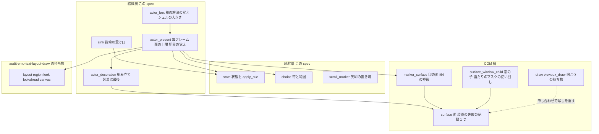
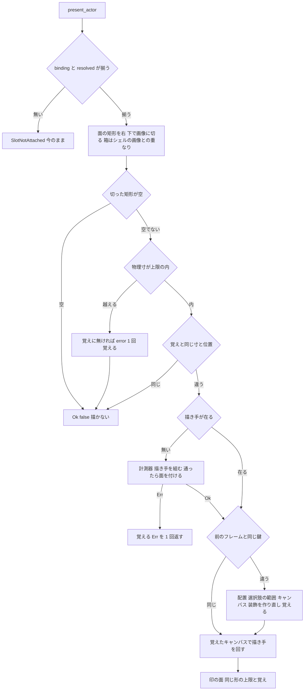

# 設計: audit-emo-text-state-actor（文字の層の状態・アクター・選択肢・窓の見直し）

## Overview

**目的**: 文字の層のクレート（`crates/areka-emo-text/`）のうち、配置と描画（`audit-emo-text-layout-draw` の持ち物）を除いた部分に `/ponytail:ponytail-audit` をかけて出た 30 件の指摘を、いちばん小さな完全な直しで全部直す。要件の討議で、残す指摘は 0 件と決まった。持ち込みの件（箱の位置の足し算があふれる）は指摘 1 として一緒に直す。

**使う人**: 開発者。壊れた・意地の悪いゴーストやバルーンやシェルを入れても、文字の層が落ちない・メモリを使い果たさない・記録が止まらなくならないこと、何も変わらないフレームで余分な仕事をしないこと、テストが守っているつもりの分岐を本当に守っていることを得る。

**変わること**: `crates/areka` が使う公開の形は 1 つも変えない（ウェーブ C18 の約束）。外から見た振る舞いが変わるのは次の 4 点だけ。⑴ 画像より大きい validrect・箱の大きさでも、面は画像の大きさまでしか作らない（見える画素は同じ）。⑵ 作れない面は、入力が変わるまで作り直さず、`error!` は 1 回。⑶ 箱のフォントの警告は、箱の表を入れたときに 1 回だけ。⑷ 使われていない公開の口（`sink::handle_text_msg`・`TextLayerRuntime::config`・`MarkerSurface` の 3 つ）が消え、`choice::highlight_band_offset` はテストだけの口になる。どれも `crates/areka` は使っていない。

### Goals

- 確定した 30 件を全部直す。直したバグと危ない所（1〜7・11・12）の 1 件ずつに、壊れたら落ちる決定論のテストを置く。
- 「1 つの World に文字の層は 1 つ」の前提を要らなくする（指摘 6）。
- 直し終えたら同じ作法（件数の上限なし・全部読む）で audit をかけ直して新しい指摘 0 件・全体テスト緑。
- 1 本の spec のまま進める（要件の討議で確定・設計の段の見込みは 30〜36 タスク）。

### Non-Goals

- 範囲の外の見直し（同じクレートの `audit-emo-text-layout-draw` の持ち物を含む）。字の大きさに上限が無い根（`look.rs`）・validrect の解決（`region.rs`）・`layout_scan.rs` の有限の検査は向こうの持ち物。
- `crates/areka/` の書き換え。新しい機能。依存の追加・`Cargo.lock` の変更。`vendors/`。clippy の機械的な直し。
- 決めごととして数えなかったもの（`#[allow(dead_code)]` と理由の説明を持つ口・`shortcut:`・開いている spec を名指す継ぎ目）を消すこと。継ぎ目 4 つに説明を書き足すだけはする（要件の討議）。

## Boundary Commitments

### This Spec Owns

- `crates/areka-emo-text/` のうち、`src/` の `state*`・`actor*`・`choice*`・`sink*`・`surface*`・`balloon_overrides*`・`inline_marker*`・`marker_surface*`・`scroll_marker*`・`lib.rs`、`tests/` の全部、`examples/` の全部、`Cargo.toml` の、確定した指摘の直し。
- 新しく足すファイル 4 つ（下の File Structure Plan）と、`lib.rs` の 2 つの一覧の席（このウェーブでこのクレートにファイルを足してよいのはこの spec だけ）。
- 文字の層の私的な欄として新しく持つもの: 装置の作り直しを見た時刻・作れなかった面の覚え・箱の解決の覚え・箱が乗るシェルの画像の大きさ・前のフレームの配置の覚え。

### Out of Boundary

- `crates/areka/` の全部（公開の形を変えない・ファイルを書き換えない）。
- `audit-emo-text-layout-draw` の持ち物（`src/` の `layout*`・`segment*`・`region*`・`wrap*`・`lookahead*`・`cursor_tag*`・`writing*`・`draw*`・`canvas*`・`viewbox*`・`look*`・`color*`・`underline*`・`place*`）。指摘 4（根）・15・19・21・28 で触る必要が出る所は、**向こうのセッションと申し合わせてから**触る（下の「並走の兄弟との申し合わせ」）。
- `crates/areka-parsers/`（`MarkerCoord::resolve` の形は変えない＝こちらで i64 の解き方を書く）・`crates/wintf/`（`AlphaMask::regenerate_from_pbgra32` を使うだけ）・`crates/dola/`。
- `crates/log-capture-kit/tests/file_length_guard_test.rs`・`temp_path_guard_test.rs`（`placement-crate-split` が触る）。
- 完了した spec の文書（スパイクを名指す経緯の行はそのまま）。

### Allowed Dependencies

- 今の依存だけ（`Cargo.toml` を変えない・説明の 1 行だけ直す）。`wintf` の公開の形（`Visual`・`VisualGraphics`・`Arrangement`・`HitTest`・`AlphaMaskResource`・`LayoutScale`・`AlphaMask`）は同じウェーブの相手が変えない約束なので、そのまま前提にする。
- 標準ライブラリ（`HashMap`・`BTreeMap`・`saturating_add`・`f32::max`／`min`）。
- 新しい依存は足さない。要ると分かったら直さずに議題にする（要件 6.10）。

### Revalidation Triggers

- 消す公開の口（`sink::handle_text_msg`・`TextLayerRuntime::config`・`MarkerSurface::read_back`／`size`／`window_child`）と、テストだけの口になる `choice::highlight_band_offset`: ツリー全体の範囲の外の呼び手は 0（設計の段で grep 済み・実装でもう一度）。範囲の外がこれを使い始める spec があれば、その spec が足し直す。
- `balloon_overrides::overrides` の引数から `base` が消える（指摘 19）: 呼び手は `draw.rs` だけ（向こうの持ち物＝申し合わせ）。
- 記録の文が 1 つに揃う（指摘 21 の装置の失敗の `error!`）: 文を数えるテストは emo-text には無い（`areka-emo-present` の同じ文は別のクレートで、変えない）。
- 面の大きさに上限が入る（指摘 3）: 画像より大きい validrect の面は画像の大きさになる。`crates/areka` の `dump_balloon` が読み戻す面の大きさが、壊れたバルーンでだけ小さくなる（普通のバルーンは同じ）。
- `lib.rs` の純粋層の一覧の母数が 83 から動く（指摘 28 と新しいファイル）: `audit-emo-text-layout-draw` がファイルを消すときは、同じ行を直す（申し合わせ）。

## Architecture

### Existing Architecture Analysis

- 文字の層は 3 つの層を一方向に重ねる（`lib.rs` の説明）。⑴ 純粋層（`state`・`scroll_marker` ほか・`windows` を取り込まない）⑵ COM 層（`surface`・`draw`・`viewbox_draw`・`marker_surface`）⑶ 結線層（`sink`・`actor` とその子 `actor_*`）。
- 毎フレームの入口は `actor::present_frame`（`actor_present.rs`）。場所（スコープ×普通のバルーンか箱か）ごとに、配置（`layout_styled`）→ 選択肢の範囲（`choice_ranges`）→ キャンバス（`ContentCanvas::from_layout`）→ 装飾（`decorate_canvas`）→ 描き手（`ViewboxExecutor`）の順に回す。描き手と面と計測器は場所ごとの `ActorRender` が持ち、拡大率の変化と装置の作り直しで捨てて作り直す。
- 状態（`TextLayerState`）は純粋で、`apply_cue` で台本の指令を受ける。スコープごとの中身は `ActorTextState`（`PartialEq` あり）、消した回数は別の表 `clears`（`crates/areka` が `clear_count` を読む）。
- 箱は `actor_box.rs` が、シェルの箱の表（`set_box_layout`）と毎フレームの置き場所（`sync_boxes`）から登録する。箱の面はシェルの窓の子として付く（`surface_window_child.rs`）。

### Architecture Pattern & Boundary Map



- **選んだ形**: ギャップ分析の案 C（混ぜる）。必ず直す 1〜4 と本番のコードの直したほうがよい（5〜11・19〜22）は今のファイルの中で直す（案 A）。テストの整理（12〜16）は、部品のまとめ（15・16）を先に置いてから個々のテスト（13・14・25）を直す（案 B の並び）。できれば（23〜30）を最後に。
- **守る形**: 層の一方向・純粋層に `windows` を入れない・`crates/areka` の公開の形・失敗は `error!`＋`Err`・記録の出し分けの今の文言（指摘 21 の 1 か所を除く）・`ActorTextState` の形と等しさ（消した回数を中身の欄にしない決め）。
- **新しく足すもの**: 私的な欄（`TextLayerRuntime` に 5 つ・`ActorRender` に 3 つ）と、ファイル 4 つ（テストとテストの部品だけ）。新しい公開の型・関数は無い（足すのは `pub(crate)` だけ）。

### Technology Stack

| 層 | 選ぶもの | 役目 | 備考 |
|---|---|---|---|
| 言語 | Rust（ワークスペースの版） | 全部 | 新しい依存なし・`Cargo.lock` 不変 |
| 状態 | `bevy_ecs` の `World`・`Tick` | 装置の作り直しの時刻（指摘 6） | 資源から文字の層の欄へ移す |
| 当たり | `wintf` の `AlphaMask::regenerate_from_pbgra32`・`AlphaMaskResource::set_shared` | マスクの使い回し（指摘 9） | 既にある口・`areka-emo-present` の `presenter/budget.rs` の 2 枚を入れ替える形に倣う |
| 記録 | `tracing`（`error!`・`warn!`・`debug!`） | 失敗と上限 | 対象 `areka_emo_text` |
| テスト | `log-capture-kit`・`sample-ghost-kit`・実 GPU | 記録の捕まえ・検体・面の読み戻し | 決定論 |

## File Structure Plan

### Directory Structure

```
crates/areka-emo-text/
├── src/
│   ├── actor_surface_limit_tests.rs  # 新: 指摘 3 の壊れたら落ちるテスト（大きな validrect・大きな箱・作れない面の記録 1 回・実 GPU）
│   ├── actor_frame_memo_tests.rs     # 新: 指摘 8 の鍵の欄ごとの「変えたら作り直す・変えなければ作り直さない」テスト
│   ├── choice_test_support.rs        # 新: 指摘 15 の選択肢のテストの部品（region・seg・ChoiceSpan・行の組み立て・「は い ⏎ い い え」の検体）
│   └── （ほかは既存ファイルの変更だけ）
└── tests/
    ├── support/mod.rs                # 新: 指摘 16 の tests/ の共有の部品（#[path] で引く・テストの実行ファイルにはならない）
    └── viewbox_blit_spike.rs         # 消す（指摘 17）
```

- `src/` の新しいファイル 3 つは `lib.rs` の一覧に載せる（要件 6.3）。`windows` を取り込まなければ `PURE_SOURCES`、取り込めば `SOURCES_OUTSIDE_THE_PURE_SCAN`。どちらも今の見込みでは `PURE_SOURCES`（`actor_test_support.rs` の組み立てを使い、`windows` を直に取り込まない）。
- `tests/support/mod.rs` は `src/` の外なので `lib.rs` の一覧に載らない。前例は `tests/decoration_readback_test.rs:44` の `#[path]`。`tests/` の直下に `.rs` を置くとテストの実行ファイルになるので、子のフォルダに置く。

### Modified Files

本番のソース（`src/`）:
- `actor.rs` — 私的な欄を足す: `seen_graphics: Option<Tick>`（6）・`surface_failed`（3）・`box_shell_size`（3）・`box_resolved`（7）・`lookahead_rev`（8）。`ActorRender` に `markers_failed`（3）・`frame_memo`（8）と `discard`（20）。`config()` を消す（24）。古い説明（27）。継ぎ目 `box_font_dirs` に「名指す spec が閉じたら消す」を書き足す（議題 6）。ClearAll の後に作りたてと同じ場所を外す呼び出し（11）。
- `actor_present.rs` — `SeenGraphicsCore` の資源を消し、文字の層の欄で比べる（6）。面の矩形を右・下で画像に切る・面の大きさの上限・作れなかった場所の覚え（3）。箱の場所の組み立ての順（5・`actor_decoration.rs` と組）。前のフレームと同じなら配置から装飾までを飛ばす・届いた字の区切りの覚え（8）。`resolved` を借りる（23⑴）。片付けを `ActorRender::discard` に（20）。印の面の大きさを切る（3）。
- `actor_box.rs` — 箱の当たりの矩形とはみ出しの判断を上限で止める足し算（1）。箱の解決を `set_box_layout` で名前ごとに 1 度だけ行い、`register_box` はそれを使う（7）。シェルの画像の大きさを覚える（3）。片付けと登録の後半の写しを 1 つに（20）。継ぎ目 `box_font_dirs` の説明（議題 6）。
- `actor_attach.rs` — 登録の後半を `actor_box.rs` と同じ私的な関数へ（20）。
- `actor_decoration.rs` — `build_actor_render` が面の装着を閉包で受け、組み立てが全部通ってから呼ぶ（5）。矢印の広がりを `i64` で渡す（3）。
- `actor_scroll.rs` — 変えない見込み（片付けの写しがあれば 20 で `discard` へ）。
- `balloon_overrides.rs` — 試しの通し（`probe_all`）と引数 `base` を消す（19・申し合わせ）。
- `choice.rs` — 帯の丈の式を `max`／`min` に（4）。`decorate_canvas` は範囲を先に見てから複製（23⑵）。`annotate_lines` は範囲の終わりで止まる（23⑶）。`style_has_underline` の腕を `_` の腕へまとめる（24・注釈は残す）。`highlight_band_offset` を `#[cfg(test)]` に（24）。古い説明（27）。継ぎ目 `default_font_color` の説明（議題 6）。
- `inline_marker.rs` — 変えない見込み（27 の古い説明があれば直す）。
- `lib.rs` — 説明の子の一覧（27）。純粋層の走査の禁じる字に `wintf::com` を足し、`wintf::ecs` は許すと説明に書く（28）。`inline_marker_tests.rs`・`underline_tests.rs` を走査する側へ（28・後者は申し合わせ）。新しいファイル 3 つを一覧へ（6.3）。母数 83 を動かした数だけ直す（見込み 88）。同じ `parse` を 2 回呼ぶ比べを消す（13）。
- `marker_surface.rs` — 矢印の矩形を `i64` で（2）。置き場所を `i64` に（3）。装置の失敗の記録の写しを消し `surface` の 1 つを使う（21）。`read_back`・`size`・`window_child` を消す（24）。
- `scroll_marker.rs` — 矢印の置き場の計算を `i64` に（`MarkerCoord` は parsers の形のまま、こちらで `i64` に解く）（3）。
- `sink.rs` — `handle_text_msg` を消す（22）。`pump_until_idle`・記録の取り出し・`with_log_cage` のテストの写しを共有の部品へ（15・24）。古い説明（27）。
- `state.rs` — 消した回数の引き口 `pub(crate) fn clears_at(&PlaceKey) -> u64`（8）。作りたてと同じで面を持たない場所を外す `pub(crate) fn forget_pristine_places`（11）。`\q` の字の数は表示の時刻の列の長さで（23⑷）。古い説明（27）。
- `state_anchor.rs` — `\_a` の字の数は表示の時刻の列の長さで（23⑷）。
- `state_decoration.rs` — 継ぎ目 `unowned_vocab`・`reset_decoration` の説明（議題 6）。
- `surface.rs` — 読み戻しの写し先（`staging`）の欄と作成を消し、`read_back` が呼ばれたときに作る（10）。面の大きさの掛け算を `usize` に（3）。装置の失敗の記録 `device_err`／`none_err` を `pub(crate)` にして共有の元にする（21）。古い説明（27）。行数は 995 → 約 991（増えない）。
- `surface_window_child.rs` — 当たりのマスクと BGRA の作業場を持ち続け、`regenerate_from_pbgra32` で作り直す（9）。

テスト（`src/` の `*_tests.rs`・`*_test_support.rs`、`tests/`）: 指摘 12〜16・25〜27・30 の直しは `research.md` 4 節の行のまま。壊れたら落ちるテストの置き場は Testing Strategy の表。上限に近いファイル（`actor_choice_contract_tests.rs` 991・`choice_tests.rs` 980）には、指摘 4 の数行のほかは足さず、15・13・14・25 の消しで減らす。

例（`examples/`）: `emo-text-layer/demo.rs`・`drive.rs`・`emo-text-layer.rs`（18・24・27・29）、`emo-text-typewriter-demo.rs`（29）。

`Cargo.toml` — 60 行目の説明だけ（27）。

範囲の外（申し合わせてから・向こうが直すか、向こうの許しを得てこちらが直す）:
- `src/draw.rs`・`src/viewbox_draw.rs` — 装置の失敗の記録の写しを消して `crate::surface::device_err`／`none_err` を使う（21）。`draw.rs:295-304` の試しの土台を消し `overrides(model)` を呼ぶ（19）。
- `src/look.rs` — `apply_overrides` が飛ばした値を、行の名前（`font.`／`disable.font.`）つきで 1 度だけ `warn!` する（19）。字の大きさの上限の根は向こうへ知らせるだけ（4）。
- `src/layout_test_support.rs` — `IMAGE`・`model_rect`・`broken_lines` を `pub(crate)` に（15）。
- `src/viewbox.rs:333` — 説明の「spike 実測」を完了した spec の記録へ（17・説明だけ）。
- `src/viewbox_draw_live_diff_tests.rs:455` — 古い説明（17・説明だけ）。

## System Flows

### 毎フレームの 1 つの場所（指摘 3・5・8）



- 鍵が同じでも、見える行の窓（`window_for`）・印・描き手（`render_styled`）は毎フレーム回す（スクロールと原点と矢印は飛ばす所より後で読むので鍵に入れない）。描き手は今どおり「変化なし」と答えて何も描かない。
- 作れなかった場所の覚えは、入力（物理寸と位置）が変わるか、装置が作り直されたら消える。上限を越えた寸も同じ覚えに入れる（記録は 1 回）。
- `Err` を返すのは作れなかった最初のフレームだけ。後のフレームは `Ok(false)` なので、`crates/areka` の `scale_text.rs:302` の記録も 1 回で止まる（`crates/areka` は変えない）。

## Requirements Traceability

| 要件 | 中身 | 実現する所 |
|---|---|---|
| 1.1 | 範囲だけに audit | ギャップ分析で済み（`research.md` 2・3 節） |
| 1.2 | 件数の上限なし | 同上（30 件・省いた件なし） |
| 1.3 | 全部読む | 同上（121 ファイル） |
| 1.4 | 番号と組を付けて残す | `research.md` 4 節 |
| 1.5 | 「1 つの World に文字の層は 1 つ」の前提を確かめる | `research.md` 6 節で確かめ済み。前提を要らなくする直しは指摘 6 |
| 1.6 | 確定した一覧を要件へ | `requirements.md` の「要件の討議で確定した事項」で済み |
| 2.1 | 3 つの組とも全部直す | Components and Interfaces の 30 件 |
| 2.2 | 裁定のほかは残さない | 残す裁定は 0 件。決めごととして数えなかったものは議題 6 で残すと確定 |
| 2.3 | 使う所まで直し切る | 各件の「波及」・File Structure Plan のテスト・例・範囲の外 |
| 3.1 | 3 種類は議題に | 30 件とも当たらないと討議で確定（指摘 3 は種類 3 を確かめ済み） |
| 3.2 | ukadoc で確かめてから | 指摘 3 の validrect（`requirements.md` の「面の大きさの上限」に URL と原文） |
| 3.3 | 3 種類でなければ直す | 30 件とも直す |
| 3.4 | 残す裁定と理由を残す | 0 件（`requirements.md`）。数から外すものは無い |
| 4.1 | もう一度 audit | 確かめの段 |
| 4.2 | 0 件まで直す | 確かめの段（直しのたびにかけ直す） |
| 4.3 | 5 回目で区切る | 確かめの段（5 回目の条件と開発者への一言・記録の文） |
| 4.4 | 全体テスト緑 | 確かめの段（`pwsh -NoProfile -File tools/test-all.ps1`） |
| 4.5 | 1 件ずつに壊れたら落ちるテスト | Testing Strategy の表（1〜7・11・12） |
| 4.6 | 決定論のテスト | Testing Strategy の決定論の節 |
| 5.1 | `crates/areka` に触らない・公開の形を変えない | 消す口はどれも `crates/areka` が使わない（`research.md` 5 節・設計の段で grep し直した）。`read_back` の形は残す |
| 5.2 | 書き換えなしに成り立たない直し | 30 件には無い。出たら「足すだけ」の形（討議の議題 4） |
| 5.3 | 形を変えたら呼び手を全部 | 各件の「波及」（`overrides`・`build_actor_render`・`PlacedMarker.at`・テストの部品） |
| 5.4 | 向こうの持ち物の形は申し合わせ | 「並走の兄弟との申し合わせ」（4 根・15・19・21・28） |
| 5.5 | 走っている見直しの持ち物に触る前に申し合わせ | 同上（範囲の外で触るのは `audit-emo-text-layout-draw` の持ち物だけ） |
| 5.6 | 消す前に使われていないか | 指摘 17・22・24 の確かめ（ツリー全体の grep・実装でもう一度） |
| 5.7 | 要らない所を直さない | 範囲の外は File Structure Plan の決めた行だけ |
| 6.1 | 1,000 行の番人 | `surface.rs` は 995 → 約 991。上限に近いテスト 2 つには足さない。各タスクは直した後の行数を確かめる |
| 6.2 | 例外表と一時の入口の番人に触らない | 触らない |
| 6.3 | 新しいファイルを一覧へ | `lib.rs` の 2 つの一覧（File Structure Plan） |
| 6.4 | 記録の無い失敗を作らない | Error Handling の表（面の上限・作れない面・例の失敗も `error!`） |
| 6.5 | 終了の道は正規 | 終了の道に触らない（例の `--hold` は判定を飛ばすだけで、閉じ方は今のまま） |
| 6.6 | 実機の根は `target` の下 | 実機の根を使わない（検体はリポジトリの中・一時のフォルダを作るテストは足さない） |
| 6.7 | GPU のテストは実 GPU | 指摘 3・5・12 の GPU のテストは `actor_test_support.rs` の実 GPU の World で回す |
| 6.8 | 文字化けは読む側を直す | 道具の出力を変えない |
| 6.9 | 依存を足さない | Allowed Dependencies |
| 6.10 | 要る依存は議題に | 要る依存は無い |
| 6.11 | `vendors/` に触らない | 触らない |
| 7.1 | 上限で止めて折り返さない | 指摘 1（`saturating_add`） |
| 7.2 | 当たりの矩形とはみ出しの判断の両方 | 指摘 1（236・237・427 の 3 か所） |
| 7.3 | 壊れたら落ちるテスト | Testing Strategy の指摘 1 |
| 7.4 | 二重に直さない | 指摘 1 と持ち込みの件を 1 つの直しにする |
| 8.1 | 20 タスクを越えそうなら議題 | 討議で「切らない」と確定済み。見込み 30（タスクの見込み） |

## Components and Interfaces

### 一覧

| 部品 | 層 | 役目 | 指摘 | 契約 |
|---|---|---|---|---|
| 箱と矢印の足し算（`actor_box.rs`・`marker_surface.rs`） | 結線・COM | あふれない矩形 | 1・2 | 振る舞い |
| 面の上限と作れない面の覚え（`actor_present.rs`・`actor_box.rs`・`marker_surface.rs`・`scroll_marker.rs`・`surface.rs`） | 結線・COM | 巨大な面を作らない・記録を止める | 3 | State |
| 帯の丈の式（`choice.rs`） | 純粋 | NaN で落ちない | 4 | 純関数 |
| 組み立ての順（`actor_decoration.rs`・`actor_present.rs`） | 結線 | 窓の子を残さない | 5 | Service |
| 装置の作り直しの印（`actor.rs`・`actor_present.rs`） | 結線 | 文字の層ごとに持つ | 6 | State |
| 箱の解決の覚え（`actor_box.rs`・`actor.rs`） | 結線 | 箱のフォントの警告を 1 回に | 7 | State |
| 配置の覚え（`actor_present.rs`・`actor.rs`・`state.rs`） | 結線 | 変わらないフレームで作り直さない | 8・23 | State |
| マスクの使い回し（`surface_window_child.rs`） | COM | 字ごとの確保をやめる | 9 | State |
| 読み戻しの写し先（`surface.rs`） | COM | 使わない GPU のメモリを持たない | 10 | 振る舞い |
| 作りたての場所を外す（`state.rs`・`actor.rs`） | 純粋・結線 | スコープの数が増え続けない | 11 | State |
| 上書きの記録 1 回（`balloon_overrides.rs`・`look.rs`・`draw.rs`） | 純粋 | 2 度通しをやめる | 19 | 申し合わせ |
| 片付けと登録の後半（`actor.rs`・`actor_box.rs`・`actor_present.rs`・`actor_attach.rs`） | 結線 | 写しを 1 つに | 20 | Service |
| 装置の失敗の記録（`surface.rs` ほか） | COM | 写しを 1 つに | 21 | 申し合わせ |
| 使われない口（`sink.rs`・`actor.rs`・`marker_surface.rs`・`choice.rs`） | 公開の形 | 消す・テストだけの口に | 22・24 | 公開 API |
| 純粋層の番人（`lib.rs`） | テスト | 走査が説明どおりに見張る | 28 | — |
| テストの部品（`actor_test_support.rs`・`state_test_support.rs`・`choice_test_support.rs`・`tests/support/mod.rs`） | テスト | 写しを 1 つに | 15・16 | — |

### 必ず直す

#### 箱と矢印の足し算（指摘 1・2・要件 7）

| 欄 | 中身 |
|---|---|
| 役目 | 設定ファイルに極端な数を書かれても、矩形が裏返らず、はみ出しの判断を誤らない |
| 要件 | 2.1, 4.5, 7.1, 7.2, 7.3, 7.4 |

- 指摘 1（持ち込みの件と 1 つの直し）: `actor_box.rs:236-237` を `site.x.saturating_add(i64::from(def.size.0))`・`site.y.saturating_add(i64::from(def.size.1))`、`:427` を `site.x.saturating_add(w) > sw || site.y.saturating_add(h) > sh`。上限で止まった値はシェルの画像より大きいので「はみ出す」と正しく読み、`warn!` が出る。`:197` の `site.x as f32` は直さない（討議の議題 3）。
- 指摘 2: `marker_surface.rs:137-138` の右端・下端を、当たり（`:194`）とマスク（`:236`）と同じく `i64` で足す。指摘 3 で `PlacedMarker.at` を `i64` にするので、`right: px(m.at.0 + i64::from(m.image.width))` の形になる（`at` は `i32` の範囲の値から作るので `i64` の足し算はあふれない）。`:192-194`・`:235-245` の `as i64` は要らなくなる。
- **波及**: なし（私的な計算）。

#### 面の上限と作れない面の覚え（指摘 3）

| 欄 | 中身 |
|---|---|
| 役目 | 画像より大きい validrect・箱の大きさでも面を画像の大きさまでしか作らず、作れない面は入力が変わるまで作り直さない |
| 要件 | 2.1, 3.2, 4.5, 6.4, 6.7 |

**決め**（要件の討議の「面の大きさの上限」を、設計の段で読んだコードに合わせた形。4 辺のうちどこを切るかは設計の議題 1）
- 切る所: 文字の面の矩形の**右と下**を、画像の右と下で切る（`actor_present.rs:245` で `right = region.right().min(lim.0)`・`bottom = region.bottom().min(lim.1)`）。`lim` は普通のバルーンなら `binding.image_size`、箱なら `(min(箱の幅, シェルの幅 − site.x), min(箱の高さ, シェルの高さ − site.y))` を `i64` で求めて `f32` へ。切った矩形が空なら `Ok(false)`（描かない＝窓の外なので見える画素は同じ）。
  - 左と上は切らない。面の原点が `region.left/top` であることを、`canvas.rs`・`choice.rs`・`viewbox_draw_render.rs`・印の描き方が前提にしているため（左と上を切るには原点のずれを向こうの持ち物まで通す＝議題 1 の別の案）。描き手は面の大きさ（`surface.size()`）から計画するので、右と下を切ってもスクロールで現れる帯は今どおり描き直される。
- 面の大きさの上限: 物理寸の一辺 `MAX_SURFACE_SIDE: u32 = 16_384`、面積 `MAX_SURFACE_AREA: u64 = 1 << 25`（どちらも `actor_present.rs` の `pub(crate) const`。値と根拠は兄弟の `audit-emo-compose` の `MAX_EXTENT`・`MAX_AREA` と同じ＝Direct3D 11 の機能水準 11 の 2D テクスチャの一辺の最大と、8K の画面より大きい面積）。左や上に大きな負の validrect を書かれた面は、ここで止まる。越えたら作らず、作れなかった場所の覚えに入れて `error!` を 1 回（場所・物理寸・上限）。
- 作れなかった場所の覚え: `TextLayerRuntime` に `surface_failed: HashMap<PlaceKey, ((u32, u32), (f32, f32))>`（物理寸と物理の位置）。物理の位置を求めた直後に、覚えと同じなら `Ok(false)`。覚えるのは**入力で答えが決まる失敗だけ**＝上限を越えたときと、その寸で面を付ける（`TextSurface::attach`／`attach_window_child`）のが `Err` だったとき。その回だけ `Err` を返す。面を作る前の資源の確かめ（`actor_present.rs:273-298` の Compositor・`GraphicsCore` が無いか無効）は覚えず、今どおり毎フレーム試し直す（wintf の `init_wuc_resource` は WUC の資源を `GraphicsCore` と別に作り直し、失敗すれば次の回に試し直すため、一時の失敗を覚えると文字が戻らない）。作れたら覚えを消す。`drop_renders_after_device_change` で全部消し（新しい装置で作り直してみる）、`WucGraphicsResource` の変わった時刻が進んだときも全部消す。
- 箱が乗るシェルの画像の大きさ: `TextLayerRuntime` に `box_shell_size: HashMap<PlaceKey, (u32, u32)>`。`register_box`（`actor_box.rs:453` 付近）で入れ、登録を外す所（`:460`）と表を替える所（`:70`）で消す。登録し直しの判断（`:337`）に「シェルの大きさが変わった」を足す。
- 印の面: `actor_present.rs:538-541` の `physical_extent(binding.image_size)` を、上の `lim` で切った大きさにする。`ActorRender` に `markers_failed: Option<(u32, u32)>`（作れなかった物理寸）。同じ寸なら作らず `Ok(())`。覚えるのは文字の面と同じく入力で答えが決まる失敗（上限越え・その寸での作成の `Err`）だけ。上限も同じ定数で見る。
- 矢印の広がり: `actor_decoration.rs:207` の `image_size.0 as i32` をやめ、`(i64::from(..), i64::from(..))` で渡す。`scroll_marker.rs` の `ResolvedMarkerPlacement::resolve`・`default_marker_position` と `marker_surface.rs` の `PlacedMarker.at` を `i64` にする。`MarkerCoord::resolve`（`areka-parsers`）は形を変えず、`scroll_marker.rs:290` で `FromEnd(v) => e + i64::from(v)` のようにこちらで解く。`w - 20` は `i64` の引き算になり落ちない。
- 掛け算: `surface.rs:96,99,163,478` の `width * height * 4`・`width * 4` を `width as usize * height as usize * 4` の形に。
- `region.rs`（validrect の解決）は変えない。
- **波及**: 公開の形は変わらない。`crates/areka` は変えない。壊れたバルーンでだけ、`dump_balloon` の読み戻しの面が画像の大きさになる。

#### 帯の丈の式（指摘 4）

- `choice.rs:139` を `line_box_height.max(font_height).min(upper)` にする（有限の値では `clamp` と同じ答え・NaN でも落ちない）。
- 道筋（大きな `\f[height]` で行の位置が無限大になる前に配置の側が止めるか・`research.md` 14 節の 3）は直しに効かない。テストは純関数を NaN で呼ぶ形にする。字の大きさに上限が無い根（`look.rs:757`）は `audit-emo-text-layout-draw` へ知らせる。
- **波及**: なし。

### 直したほうがよい（本番のコード）

#### 組み立ての順（指摘 5）

| 欄 | 中身 |
|---|---|
| 役目 | 描き手の組み立てが失敗しても、窓の子の entity を残さない |
| 要件 | 2.1, 4.5, 6.4 |

```rust
// actor_decoration.rs（呼び手は actor_present.rs の 1 か所だけ）
pub(super) fn build_actor_render(
    core: &GraphicsCore,
    attach: impl FnOnce() -> Result<TextSurface, TextLayerError>,
    font: &ResolvedFont,
    mode: WritingMode,
    config: &TextLayerConfig,
    actor: &ActorKey,
) -> Result<ActorRender, TextLayerError>;
```

- `dwrite_factory`・`FontCatalog::new`・`ViewboxExecutor::new_shared`・`DWriteMetrics::new_shared` を先に組み、全部通ってから `attach()` を呼ぶ。どれも面を要らない。
- 呼び手は `|| match child_index { None => TextSurface::attach(..), Some(i) => TextSurface::attach_window_child(..) }` を渡す。
- `attach()` が後で失敗した場合は、今と同じく何も残らない（`attach_window_child` は失敗の道で子を作らない・実装で確かめる）。
- **波及**: なし（`pub(super)`）。

#### 装置の作り直しの印（指摘 6）

- `actor_present.rs` の資源 `SeenGraphicsCore` を消し、`TextLayerRuntime` の私的な欄 `seen_graphics: Option<Tick>` へ移す。比べ方と時刻の進め方（`increment_change_tick`）は今のまま。印は文字の層ごとになるので、説明の「1 つの World に文字の層は 1 つの前提」を消し、「初めて呼んだ回は印を控えるだけ」が切り替えの後も事実になる。
- `actor_scroll_retain_tests.rs` の `oracle_frame`（同じ World の 2 つ目の文字の層）は、そのまま正しくなる（直さない）。
- **波及**: なし（私的な型が消えるだけ）。

#### 箱の解決の覚え（指摘 7）

- `TextLayerRuntime` に `box_resolved: BTreeMap<BoxName, ResolvedBalloonText>`。`set_box_layout` で、表に載る名前ごとに `ResolvedBalloonText::resolve_with_background(&def.model, def.size, DEFAULT_BALLOON_BACKGROUND)` を 1 度だけ呼んで入れる。`BoxTraits.looks` はその答えの `font.looks` から取る（今の `ResolvedFont::resolve_with_background` の 2 度目の解決をやめる）。
- `register_box` は覚えを複製して印を押すだけ（`stamp_inline_marker`）。解決は拡大率に依らない（箱の大きさは定義のもの）ので、覚えは表を替えるまで古びない。
- 表を替えるとき（`set_box_layout` の頭の片付け）に覚えも替える。
- 警告の文（`draw.rs`・`balloon_overrides.rs`）は変えない。出る回数が「表を入れたときに名前ごとに 1 回」になる。
- **波及**: なし。

#### 配置の覚え（指摘 8・23）

| 欄 | 中身 |
|---|---|
| 役目 | 入力が前のフレームと同じなら、配置・選択肢の範囲・キャンバス・装飾を作り直さない |
| 要件 | 2.1, 4.6 |

**鍵**（`ActorRender` の私的な欄 `frame_memo: Option<FrameMemo>` に、鍵と答え（行・区切り・帯・キャンバス）を一緒に持つ。拡大率と装置の作り直しで `ActorRender` ごと捨てるので、覚えも自然に消える）

| 鍵の欄 | 取る所 | なぜ要るか |
|---|---|---|
| 見える字の数 | `reveal().visible(t)` | 時刻で増える |
| 項目の数・選択肢の数・押した選択肢 | `place_state` の `items().len()`・`choices` の数・`settled` | 項目は消すまで増えるだけ。`\_a` の開きは項目を増やさない |
| 消した回数 | 新しい `TextLayerState::clears_at(&PlaceKey)`（箱の場所も） | 同じフレームで消して同じ数を書き直すと、項目の数が同じになる |
| 強調 | `choice_hover[place]` を押した選択肢で絞った後の値 | 外から入る |
| 今の見た目 | `current_look()` を値で比べる | `\f` だけで項目が増えずに変わる |
| 全文の先読み | 文字の層の新しい数 `lookahead_rev`（`install`（`actor.rs:433`）・`reinstall`（`actor.rs:609`）・`forget_boxes`（`actor_box.rs:79`）を呼ぶ 3 か所で 1 つ進める） | 外から入れ直される。`lookahead.rs`（向こうの持ち物）は変えない。場所ごとの区間の番号（`lookahead.number`）は `#[cfg(test)]` の読み口なので鍵にしない。`clears_at` と `lookahead_rev` で足りる＝描き手を持つ場所は全消しのとき必ず消した回数が進み、箱の回数・区間・描き手は `set_box_layout` の中で一緒に捨てられる（この理由を `FrameMemo` の説明に書く） |
| 配置の入力 | `layout_input[place]`（`ResolvedBalloonText`）を値で比べる（覚えに複製を持ち、外れたときだけ複製し直す） | 登録し直しで描き手を捨てずに替わる |

- 鍵が同じなら、覚えたキャンバスで描き手を回す。当たりの行の写し（`hit_rows`）は覚えた行・区切り・帯から作り直す（今の答えと同じ）。
- 届いた字で区切る道（`Basis::Arrived`・`actor_present.rs:616`）は、鍵が外れても項目が増えるたびに全文を区切り直さないよう、`ActorRender` に `(消した回数, 項目の数, 区切り)` を覚え、同じなら使う。項目は消すまで増えるだけで、表を替えると箱の `ActorRender` は捨てられるので、この 2 つで足りる。
- 鍵に入れないもの: スクロール・原点・`\_l` の手動の位置（飛ばす所より後で読む）。
- 鍵の欄を足し忘れると古い字を見せる。配置の側（向こうの持ち物）が読む値を増やしたときに備え、`FrameMemo` の説明に「配置が読む値を足したら鍵にも足す」と書き、鍵の欄ごとに「変えたら作り直す」テストを置く（Testing Strategy）。
- 指摘 24 の `state.rs:544,564`（箱の場所の `\c` の回数を数えるが読まれない）は、この鍵が読むようになるので、数えるのをやめない（読み手ができる）。
- 23 の小さな無駄: ⑴ `actor_present.rs:215` は `layout_input.get(place)` を借りる（`.cloned()` をやめる）。⑵ `decorate_canvas`（`choice.rs:566-594`）は、行の範囲を先に出し、空でないときだけ字の列を複製する。⑶ `annotate_lines`（`choice.rs:79-95`）の内側の繰り返しの頭に `if line_start >= span_end { break; }`。⑷ `state.rs:587-591`・`state_anchor.rs:33-37` の数え直しを `reveal.times().len()` に（字を足す所はいつも同じ数で `extend_chunk` を呼ぶ不変条件）。
- 効き目は、実装の段で 1 回だけ全体の計測（`tools/perf/invoke-perf-run.ps1 -Profile short`・静かな机）で前後を測って記録に残す。効かなくても直しは戻さない（毎フレームの余分な仕事を消すこと自体が指摘の直し）。`present_frame` だけを狙う計測の場面は今は無く、作らない。
- **波及**: なし（私的な欄と `pub(crate)` の引き口だけ）。

#### マスクの使い回し（指摘 9）

- `surface_window_child.rs` に `pub(super) struct HitMaskCache { cells: Vec<HitRectPx>, px: Vec<u8>, live: Option<Arc<AlphaMask>>, spare: Option<Arc<AlphaMask>> }` を置き、`TextSurface` の欄 `hit_cells: Vec<HitRectPx>` と置き換える（`surface.rs` の行は増えない）。
- 字の矩形が変わったら `px` を `clear` して `resize(w*h*4, 0)` で埋め直し、`spare` を `Arc::get_mut` で取れれば `regenerate_from_pbgra32(&px, w, h, w*4)`、取れなければ `Arc::new(AlphaMask::from_pbgra32(..))`。`AlphaMaskResource::set_shared(next.clone())` の後、`spare = live.replace(next)`。形は `areka-emo-present` の `presenter/budget.rs:320-345` と同じ。
- `hit_cells_mask`・`box_hit_components`・`set_child_hit_cells` は残す（`surface_hit_cells_tests.rs` が使う）。埋める処理を共有の関数に分ける。
- **波及**: なし。

#### 読み戻しの写し先（指摘 10）

- `TextSurface.staging` の欄と作成（`surface.rs:263-264,375,404`）を消す。`read_back` は `GetDevice` から写し先をその場で作る（`begin_read_back` と同じ作り方）。`read_back` の形は変えない（`crates/areka` のテスト 2 本と多くのテストが呼ぶ）。
- **波及**: なし。テストの読み戻しは 1 回ごとに写し先を作るようになる（遅くなるのはテストだけ）。

#### 作りたての場所を外す（指摘 11）

```rust
// state.rs
/// 全消しの後に呼ぶ。中身が作りたてと同じで、`keep` が偽の普通のバルーンの場所を外す。
/// 消した回数（`clears`）は外さない（`crates/areka` が `clear_count` の変化を見るため）。
pub(crate) fn forget_pristine_places(&mut self, keep: impl Fn(&PlaceKey) -> bool);
```

- 外す条件は「`*state == ActorTextState::default()`」かつ「面を持たない」（`keep` は `TextLayerRuntime` が `surfaces.contains_key` を渡す）。作りたてと同じなら、外しても次に字が来たとき `place_entry` が同じものを作り直すので、振る舞いは変わらない。登録で見た目の 2 層を入れたスコープ（`set_look_layers`）は作りたてと違うので外れない。面を持つ場所は外さない（次のフレームで画面を消すのがこの走査だから・`actor_present.rs:65-79` の説明）。
- 呼ぶ所は `TextLayerRuntime::apply_cue` の `ClearAll` の後（状態を進めた後）だけ。空回しの写し（`lookahead`）では呼ばない（写しは捨てられる）。
- スコープごとの行き先（`routes`）は、全消しで既定へ戻すだけの今のまま（全消しのたびの走査で、毎フレームではない）。
- 外した場所の消した回数（`clear_count`）がその後進まなくても困らない。登録したスコープは外さないので、`crates/areka` が回数を見る場所は残る。
- **波及**: なし。

#### 上書きの記録 1 回（指摘 19・申し合わせ）

- `look.rs` の `apply_overrides` が、`apply_font_tag` の `Err(FontTagIssue)` を、行の名前（基底は `font.`、無効表示は `disable.font.`）をつけて今と同じ文（`balloon_overrides.rs` の `SKIPPED`）で `warn!` する。`from_balloon` は 2 つの列に名前を渡す。
- `balloon_overrides::overrides(model)` は列を組むだけにし、`probe_all`・引数 `base` を消す。`draw.rs:295-304` の試しの土台（`&[]` で組む `from_balloon`）も消す（使い道は試しだけ）。
- 記録の回数は「解決 1 回に 1 回」。箱は指摘 7 で解決が表ごとに 1 回なので、合わせて 1 回になる。
- `look.rs`・`draw.rs` は向こうの持ち物＝形を変える前に申し合わせる。
- **波及**: `balloon_overrides::overrides` の引数（公開だが範囲の外の呼び手は `draw.rs` だけ・`crates/areka` は 0）。

#### 片付けと登録の後半（指摘 20）

```rust
impl ActorRender {
    /// 印の面を消してから面を外す（窓の子なら窓の子ごと消す）。
    fn discard(self, world: &mut World, slot: Option<Entity>);
}
impl TextLayerRuntime {
    /// 登録の後半（背景を引く → 解決 → 印を押す → 前の飾りの縮退を取る → 登録 → 入力を覚える）。
    fn finish_registration(&mut self, key: PlaceKey, binding: TextSlotBinding, resolved: ResolvedBalloonText);
}
```

- 5 か所の片付け（`actor_box.rs:58-63,469-474`・`actor_present.rs:164-177,226-231` ほか）を `discard` に。2 か所の登録の後半（`actor_attach.rs:356-408`）を 1 つの私的な関数に。注釈と `trace!` の文も 1 つになる。
- **波及**: なし。

#### 装置の失敗の記録（指摘 21・申し合わせ）

- `surface.rs` の `device_err`／`none_err` を `pub(crate)` にして、元にする（`surface.rs` は COM 層で `windows` を取り込む。`lib.rs` は走査の外だが純粋層の説明を持つので置かない）。
- 記録の文は `surface.rs` の今の文（「D3D/DXGI/WUC 呼び出しが失敗」）に D2D を足した 1 つに揃える。どこで失敗したかは今どおり `context` の欄が示す（例 `CreateBitmap(marker)`）。emo-text には文を数えるテストが無い（grep 済み）。
- `marker_surface.rs:309-315` の写しを消す。`draw.rs:817,830-836`・`viewbox_draw.rs:318,331-337` の写しは申し合わせの後に消す（向こうが消すか、許しを得てこちらが消す）。
- **波及**: 記録の文が変わる（数えるテストは無い）。

#### テストだけが使う公開の包み（指摘 22）

- `sink::handle_text_msg` を消す。`sink.rs` のテストと `tests/pipeline_test.rs:90` は `handle_text_msg_with(msg, |c, _| …, |_| Ok(()), |_| Ok(()))` を呼ぶ。事実と違う説明（`sink.rs:170-191`）も消える。
- **波及**: 公開の関数が 1 つ消える（`crates/areka` は 0・設計の段で grep 済み）。

### 直したほうがよい（テストと例）

#### テストの部品（指摘 15・16）

- `src/`: 実 GPU の World の組み立て・箱の表の組み立て（`EmoWorld::build`＋`fold_boxes`＋問題なしの確かめ）・箱の部品（`layout`・`fake_resolver`・`emote`／`text`・`boxed`・`items_at`）・画素の数え上げ `count_px(bytes, w, rect, pred)`・窓の子の列・記録の捕まえ方（対照の `error!` つき）・警告の文の定数・指令の部品（`cue`・`choice`・`balloon`・`pump_until_idle`・記録の取り出し・`REVEAL_INTERVAL`）は `actor_test_support.rs` へ。`state_*` の部品（`font`・`text`・`applied`・`spans`・`at`）は `state_test_support.rs` へ。選択肢の部品は新しい `choice_test_support.rs` へ（`choice.rs` に `#[cfg(test)]` で置く案より、ほかの 2 つの部品のファイルと同じ形を選ぶ）。写しを消して引く。名前を引くたびに組み直す `name()`・`boxed()` は 1 度組んだ表を渡す形に。
- `layout_test_support.rs` の `IMAGE`・`model_rect`・`broken_lines` を `pub(crate)` にして、`scroll_marker_tests.rs`・`state_marker_tests.rs` の写しを消す（向こうの持ち物＝申し合わせ）。
- `tests/`: `tests/support/mod.rs` に `make_world_with_gpu`・`spawn_reserved_slot`・`opaque_count`・読み戻しの包み・`pump_until_idle`・間隔つきの `cue`・presenter の検体（`elem`・`shell_of`・`build_target_assets`・`show_surface`）・強調の帯の確かめと PNG の書き出し・検体の置き場とバルーンのファイルの読み（本番と同じ ANSI の規則の 1 つ）・`menu.pasta` の本文の取り出し・`png_native_size`・DirectWrite の工場・本物のフォントの門・`read_decoded` を置き、各テストは `#[path = "support/mod.rs"] mod support;` で引く。2 つのバルーンの検体の組（`areka_balloon_fixture`・`staysee_balloon_fixture`）の α の数え上げ・COM の初期化・記録の確かめ・配置の道も同じ部品へ。期待値は `test_support.rs` の定数から引く（`EXPECTED_FACE0_FILES` を消す）。
- 写しのずれ（`count_in_rect` の切り詰めの有無）は、切り詰める形に揃える（正しい方）。`emo2_fixture_e2e_test.rs` の UTF-8 の読みは ANSI の規則に揃える。

#### そのほかのテストの直し（指摘 12・13・14・25・26・27・30）

- 12: `marker_surface_tests.rs` に「寸とバイト列が合わない絵」を実 GPU で渡して `Err` と印の面が変わらないことを確かめる 1 本。`choice_style_resolve_tests.rs` に `cursor.style,NONE` の 1 本。
- 13: `research.md` 4 節の場所のまま。`actor_box_tests.rs:226` は宛先を `"0"` に。k のテストは k のループと誤った説明を消し、絶対値の確かめ（`scale_invariance_test.rs:237-321,374-394,514-522`）だけ残す。staysee の画素の数え上げは元の画像の面積と比べる形（areka の `bake.rs:125-130` の形）に。ほかは消す。
- 14: 入力か比べ方を直す（箱の場所にも強調を入れて `\c` の後に消えたかを見る・書記素の入力に結合文字を足す・対照の `error!` を置く・`cluster_count` で数える）か、名前を今の確かめに合わせる。重なるもの（`choice_tests.rs:646-675`・`:515-560`・`state_cue_apply_tests.rs:38-51`）は消す。`actor_choice_settle_tests.rs` の `press_hits` の写しは、確かめられない主張（WARN 0 行）ごと消す。
- 25: 弱い方を消し、固有の 1〜2 行だけを強い方へ移す（`state_route_tests.rs:492-498` は carry へ移す）。
- 26: 飾りの無い絵は書字方向ごとに 1 度だけ描く。シェルの表は 1 本のテストで 1 度作って渡す。`shell_balloon_fixture_test.rs:257` を消す。
- 27: 説明を今のコードに合わせる。作業の経緯の文は消す。`Cargo.toml:60` も。
- 30: `staysee_balloon_fixture/script.rs:577-588` の手書きの読みを `areka_parsers::kv::parse_kv` に。

#### 役目を終えたスパイク（指摘 17）

- 設計の段で、`tests/viewbox_blit_spike.rs` の確かめを 1 つずつ照らした（`research.md` 15 節）。本番のコードを守る確かめは全部、`viewbox_draw_live_diff_tests.rs` が同じかより厳しく覆う（面の全体を `assert_eq!` で比べ、本物の `ViewboxExecutor` を通す）。覆わないのは、スパイク自身の写しの確かめ（`RowPitch >= stride`・計測した行にインクがある）と、印字するだけの AA のこぼれ幅（値は `viewbox_dirty_tests.rs:428` が固定）。半角の英数字を ずらして比べる場面だけは live-diff に無いが、ずらしの不変は字に依らず、比べ方の厳しい場面（字の大きさ・比例の書体・検体）が既にある。
- ファイルを消す（−649 行）。`Cargo.toml` に `[[test]]` の行は無い。古くなる説明 2 か所（`viewbox.rs:333`・`viewbox_draw_live_diff_tests.rs:455`）は向こうの持ち物＝説明の直しを向こうへ頼む（こちらの直しは消すことで閉じる）。
- **波及**: なし。

#### 例（指摘 18・29）

- 18: `drive_scenario` は `--hold` のときチェックポイントの確かめと PASS/FAIL の印字を飛ばす（`main` の終了コードも見ない）。説明（`examples/emo-text-layer.rs:57,62,73`）を合わせる。
- 29: タイプライターの例は `#[path]` で `emo-text-layer/fixture.rs`・`setup.rs` を引き、写しを消す。失敗は「`error!` を出して失敗の列に積む」1 つの関数を通す。

### できれば

#### 使われない口（指摘 24）

- `TextLayerRuntime::config()`（呼び手 0）を消す。
- `MarkerSurface::read_back`・`size`・`window_child` を消し、`marker_surface_tests.rs` は `surface()` を通す。
- `choice.rs:694` の `style_has_underline` の腕を `_` の腕にまとめ、注釈は残す。
- `choice::highlight_band_offset` は `#[cfg(test)]` にする（本番は `band_offset_on_char_box` を通る）。`highlight_band_extent` の説明のリンクを `band_offset_on_char_box` へ。
- `state.rs:544,564` は指摘 8 の鍵が読むので残す（上の配置の覚え）。
- `actor_decoration_tests.rs:210-211` の使わない `world` と差し込み口、`actor_runtime_frame_tests.rs:26-29`・`sink.rs:246` の `with_log_cage`、`examples/emo-text-layer/drive.rs:860-865` の `window_probe` を消し、呼び手は直に呼ぶ。

#### 純粋層の番人（指摘 28）

- `lib.rs` の `FORBIDDEN` に `"wintf::com"` を足す。走査の一覧の中に `wintf::com` を取り込むファイルは今 0（設計の段で確かめた）。`wintf::ecs` の資源（`GraphicsCore` ほか）を取り込む結線層のファイルは走査に残し、説明に「純粋層と結線層の走査は `windows` と `wintf::com` を禁じ、`wintf::ecs` の資源は許す」と書く（`actor_*` を純粋層と呼ぶ食い違いも説明で直す）。
- `inline_marker_tests.rs`・`underline_tests.rs`（どちらも `windows` を取り込まない）を `SOURCES_OUTSIDE_THE_PURE_SCAN` から `PURE_SOURCES` へ。`underline_tests.rs` は向こうの持ち物＝申し合わせ（一覧はこちらの `lib.rs`）。
- 母数 83 は、動かした数と新しいファイルの数だけ直す（見込み 88）。

## Data Models

| 型（置き場） | 変わること |
|---|---|
| `TextLayerRuntime`（`actor.rs`） | 私的な欄を足す: `seen_graphics: Option<Tick>`・`surface_failed: HashMap<PlaceKey, ((u32, u32), (f32, f32))>`・`box_shell_size: HashMap<PlaceKey, (u32, u32)>`・`box_resolved: BTreeMap<BoxName, ResolvedBalloonText>`・`lookahead_rev: u64` |
| `ActorRender`（`actor.rs`） | 私的な欄を足す: `markers_failed: Option<(u32, u32)>`・`frame_memo: Option<FrameMemo>`・`arrived_plan: Option<(u64, usize, SegmentPlan)>` |
| `FrameMemo`（新・私的・`actor_present.rs`） | 鍵（上の表）と答え（行・区切り・帯・キャンバス） |
| `SeenGraphicsCore`（`actor_present.rs`） | 消す（`seen_graphics` へ） |
| `TextSurface`（`surface.rs`） | `staging` を消す・`hit_cells` を `HitMaskCache` に替える |
| `PlacedMarker`（`marker_surface.rs`） | `at` を `(i64, i64)` に |
| `ResolvedMarkerPlacement`（`scroll_marker.rs`） | 置き場の計算と答えを `i64` に（`resolve`・`default_marker_position`） |
| `TextLayerState`（`state.rs`） | 形は同じ。`clears_at`・`forget_pristine_places`（`pub(crate)`）を足す |

## Error Handling

| 場面 | 記録 | 返し方 |
|---|---|---|
| 面の物理寸が上限（一辺 16,384・面積 2^25）を越える | `error!`（場所・物理寸・上限）を覚えに入れたとき 1 回 | 作らない。`Ok(false)`（描かない） |
| その寸で面を付けるのが失敗した | 源の `device_err` の `error!`（今どおり）。覚えに入れる | その回だけ `Err`、入力が変わるか装置・WUC の資源が作り直されるまで `Ok(false)`（`crates/areka` の記録も 1 回で止まる） |
| 面を作る前の資源（Compositor・`GraphicsCore`）が無いか無効 | 今どおり `error!` | 今どおり `Err`。覚えに入れず、次のフレームで試し直す（一時の失敗のため） |
| 印の面を作るのが失敗した・上限を越える | 同上（`markers_failed`） | その回だけ `Err`、以後は矢印を出さない |
| 描き手の組み立てが失敗した | 今どおり（源の `error!`）。窓の子は作らない | `Err`（今どおり） |
| 箱がシェルの画像からはみ出す（極端な数を含む） | `warn!` を箱ごとに 1 回（今どおり・上限で止める足し算で正しく出る） | 何もしない |
| 箱のフォントの指定が飛ばされる | `warn!` を表を入れたときに名前ごとに 1 回 | 既定のまま |
| バルーンの書体の指定が飛ばされる | `warn!` を解決 1 回に 1 回（`look.rs` の適用の所で） | 既定のまま |
| 例の読み戻しなどの失敗 | `error!`＋失敗の列に積む（29） | 今どおり失敗の列で終わる |

- どの直しもパニックしない形にする（足し算は上限で止める・`clamp` を `max`／`min` に・掛け算は `usize`・引き算は `i64`）。
- 記録の無い失敗の道を作らない（要件 6.4）。作れない面を `Ok(false)` にするのは、最初の 1 回を `error!`＋`Err` で知らせた後だけ。

## Testing Strategy

### 壊れたら落ちるテスト（要件 4.5・7.3）

| 指摘 | テスト（置き場） | 直す前の結果 |
|---|---|---|
| 1 | 置き場所 `i64::MAX` の箱で、箱の当たりの矩形が裏返らず（`right >= left`）、はみ出しの `warn!` が 1 回出る（`actor_box_tests.rs`） | 試験の作りは足し算で落ちる・出荷の作りは裏返り警告が出ない |
| 2 | `at.0` が `i32::MAX` に近い印で、描く矩形の右端が左端より大きく、当たりとマスクの矩形と一致する（`marker_surface_tests.rs`） | 試験の作りは足し算で落ちる |
| 3 | 300 画素の絵のバルーンに `validrect.right,20000` で、面の物理寸が画像の寸を越えない（実 GPU・`actor_surface_limit_tests.rs`） | swap chain を作れず毎フレーム `error!` |
| 3 | 箱の `size,16000,16000` で、箱の面と印の面が「箱とシェルの画像の重なり」を越えない（同） | 1 GB の面と CPU のマスク |
| 3 | 上限を越える面（左に大きな負の validrect）で `error!` が 1 回だけ、10 フレーム回しても増えない（同） | 毎フレーム記録 |
| 3 | 箱の大きさ `u32::MAX` で矢印の置き場の計算が落ちない（`scroll_marker_tests.rs`） | `as i32` で負・`w - 20` で落ちる |
| 3 | Compositor の資源が無いフレームの後に資源が入ると、同じ入力のままで面ができて字が出る（一時の失敗を覚えない・実 GPU・`actor_surface_limit_tests.rs`） | （新しい覚えの穴を塞ぐ確かめ） |
| 4 | `highlight_band_extent(f32::NAN, 1.0, 1.0)` が落ちない・有限の値で前と同じ答え（`choice_tests.rs`） | `clamp` が panic |
| 5 | `build_actor_render` に失敗する組み立てを渡すと、装着の閉包が呼ばれず、窓の子の数が増えない（`actor_box_present_tests.rs`） | 子が毎回 1 つ増える |
| 6 | 同じ World に 2 つの文字の層を置き、装置の資源を作り直すと、両方とも描き手を捨てて作り直す（実 GPU・`actor_runtime_frame_tests.rs`） | 後の方が古い装置の描き手を使い続ける |
| 7 | `font.height,0` の箱を、隠して登録し直す・拡大率を変える・サーフェスを切り替えるの 3 つの後で、WARN が表を入れたときの 1 回のまま（`actor_box_sync_tests.rs`） | 登録し直しのたびに増える |
| 11 | `\p[0]a`〜`\p[999]a` の後に全消し 2 回で、場所の数が登録したスコープの数へ戻る・`clear_count` は減らない（`state_clear_count_tests.rs`） | 1,000 のまま |
| 12 | 上の「そのほかのテストの直し」の 2 本 | 確かめを消しても緑 |

### 振る舞いが変わらないことの確かめ

- 8 の配置の覚え: 鍵の欄ごとに「その欄だけ変えたフレームで作り直す」テストを 1 つずつ（見える字の数・項目・消した回数（同じ数の書き直し）・選択肢・押した選択肢・強調・`\f` だけ・先読みの入れ直し・配置の入力の差し替え）と、「何も変えない 2 フレーム目は作り直さない」テスト（作り直しの回数は `#[cfg(test)]` の数で見る）。置き場は新しい `actor_frame_memo_tests.rs`。読み戻しの画素が覚えの有無で同じことも 1 本（実 GPU）。
- 9: `surface_hit_cells_tests.rs` の今の確かめ（マスクの中身）がそのまま緑。
- 10: 読み戻しを使う全部のテストがそのまま緑。
- 19・21・20・22・23・24: 今のテストがそのまま緑（記録の回数が変わる 19 は、回数を数えるテストの期待を「1 回」に直す）。
- 3 の右・下の切り: スクロールした後に面より大きい validrect の行が今と同じ画素で描かれる（実 GPU・`actor_surface_limit_tests.rs`）。

### 決定論（要件 4.6）

- 時刻は注入する（今のテストの形）。乱数・実の画面の位置に依らない。GPU のテストは実 GPU で、読み戻した画素か面の大きさを比べる。記録は `log-capture-kit` で捕まえ、0 件を言うテストには対照の `error!` を置く（このクレートの形）。

### 確かめの段（要件 4.1〜4.4）

- 確定した直しを全部入れた後、同じ範囲（Boundary Commitments の This Spec Owns のファイル）に、件数の上限なし・全部読む作法で `/ponytail:ponytail-audit` をかけ直す。新しい指摘が出たら直してかけ直す。公開の形を変えないと直せない指摘は「足すだけ」の形で直し、呼び手の書き換えは `crates/areka` の見直しの spec へ申し送る（討議の議題 4）。
- 5 回目でも 0 件にならず、その回の「必ず直す」と本番の振る舞いに関わる指摘がどちらも 0 件なら、その回の指摘を全部直したうえで、開発者に一言知らせて区切り、記録に「5 回目で区切った・残りは直し済み」と書く。
- 最後に `pwsh -NoProfile -File tools/test-all.ps1` を 1 回。触っていないクレートだけが赤なら、そのクレートだけを 1 回回し直す（開発の決まり）。実 GPU の重い走行を何度も回さず、2 回目からは赤のテストだけに絞る。

## 並走の兄弟との申し合わせ（要件 5.4・5.5）

設計のセッションからは相手に触れない。実装の段で、触る前に次を申し合わせる（相手の作業が先に着けば rebase して合わせる）。

| 相手 | 何を | いつ |
|---|---|---|
| `audit-emo-text-layout-draw` | ⑴ 指摘 4 の根（`look.rs:757` の `\f[height]` に上限が無い）を知らせる ⑵ 指摘 15 の `layout_test_support.rs` の 3 つを `pub(crate)` に ⑶ 指摘 19 の `look.rs` の `apply_overrides` が記録する形と `draw.rs:295-304` の試しの土台の削除 ⑷ 指摘 21 の `draw.rs`・`viewbox_draw.rs` の装置の失敗の記録の写しを消し、`crate::surface::device_err`／`none_err` を使う ⑸ 指摘 28 の `underline_tests.rs` を走査する側へ移すことと母数の行 ⑹ 指摘 17 で古くなる説明 2 か所（`viewbox.rs:333`・`viewbox_draw_live_diff_tests.rs:455`） ⑺ 指摘 3 の右・下の切りで、描き手が面の大きさから計画する前提（`viewbox_draw_render.rs:70`）を向こうが変えないこと | それぞれのタスクの前（⑴⑹⑺ は知らせるだけ） |
| `placement-crate-split` | `structure.md` の emo-text の主要ファイルの一覧に当たるファイルを足すときだけ（今の見込みは足さない） | 当たるときだけ |

- 向こうが断ったとき、または向こうの着地まで待てないとき: 向こうの持ち物に触る部分だけを止め、こちらの範囲の直し（例: 19 なら `balloon_overrides.rs` を変えない、21 なら `marker_surface.rs` の写しだけ消す）が単独で成り立つかを確かめて、成り立たない部分は残すか後の spec へ回すかを 1 件ずつ議題にする（設計の議題 4）。

## タスクの見込み（要件 8.1）

| 組 | 中身 | 見込み |
|---|---|---|
| 準備 | 15 `src/` のテストの部品（2）・16 `tests/` のテストの部品（2） | 4 |
| 必ず直す | 1（1）・2（1）・3（面の切りと上限と覚え 1・箱のシェルの大きさと印の面と矢印の `i64` 1）・4（1） | 5 |
| 直したほうがよい（本番） | 5（1）・6（1）・7（1）・8（鍵と覚え 1・届いた字の区切りと計測 1）・9（1）・10（1）・11（1）・19（1）・20（1）・21（1）・22（1） | 12 |
| 直したほうがよい（テストと例） | 12（1）・13（2）・14（1）・17（1）・18（1） | 6 |
| できれば | 23（1）・24（1）・25（1）・26＋30（1）・27（1）・28（1）・29（1） | 7 |
| 確かめ | audit のかけ直し（1）・全体テスト（1） | 2 |
| 計 | | **36（30〜36）** |

並べる順: 15 → 16 → 1 → 2 → 4 → 3 → 5 → 20 → 6 → 7 → 11 → 10 → 9 → 8 → 21 → 19 → 22 → 12 → 13 → 14 → 17 → 18 → 23〜30 → 確かめ。部品（15・16）を先に置くと、後のテストを部品から書ける。3 を 5・20 の前に置くと、作れない面の覚えと組み立ての順の直しが同じ箇所を 1 度ずつ触る。8 は 20・6・7・3 の後（`ActorRender` と登録の形が落ち着いてから鍵を決める）。申し合わせの要る 19・21 は後ろに置き、向こうの返事を待つ間に前を進める。

## 設計の議題（2026-11-06 設計の討議で全議題を推奨案で確定）

開発者「承認」。各議題は推奨案（案ア・推す形）で決まった: 1＝右と下だけ画像で切り、上限と入力で決まる失敗の覚えを置く／2＝鍵が同じなら配置から装飾まで全部飛ばし、届いた字の区切りも覚える／3＝`--hold` は 200% の画面で 1 回手で走らせて記録に残す／4＝相手が断る・待てないときは、こちらの範囲で成り立つ部分だけを入れ、残りは 1 件ずつ議題にする／5＝記録の文は 1 つに揃え、場所は `context` の欄で示す。

1. **指摘 3 の面のどの辺を切るか**（答えで作業が変わる）。
   - 案ア（推す）: 右と下だけ画像で切り、物理寸の上限（一辺 16,384・面積 2^25）と作れない場所の覚えを置く。描く式に触らず、見える画素は変わらない。左と上に大きな負の validrect を書いた壊れたバルーンは、上限で面を作らず `error!` 1 回（その場合は文字を描かない）。
   - 案イ: 4 辺とも切る（要件の討議の言葉どおり）。面の原点が `region.left/top` という前提を、`canvas.rs`・`choice.rs`・`viewbox_draw_render.rs`・印の描き方（多くが `audit-emo-text-layout-draw` の持ち物）に原点のずれとして通す。上限は要らなくなるが、差分と申し合わせが大きい。
2. **指摘 8 の覚えの広さ**。
   - 案ア（推す）: 鍵が同じなら配置から装飾までを全部飛ばし、届いた字の区切りも覚える。鍵の欄ごとにテストを置く。
   - 案イ: 届いた字の区切りの覚えだけ（古い字を見せる危うさは無いが、500 字を出し終えたバルーンで毎フレーム配置を作り直すのは残る）。
3. **指摘 18 の確かめ方**。例には自動のテストの足場が無い。
   - 案ア（推す）: `--hold` で判定を飛ばす分岐を入れ、200% の画面で例を 1 回手で走らせて「自分で閉じない」ことを記録に残す（画面の操作は排他テストの机で順を取る）。
   - 案イ: 判定の要否を例の中の小さな関数にして、例のテストを足す（`cargo test --examples` の足場を作ることになる）。
4. **向こうの持ち物に触る直しを、向こうが断ったとき・待てないとき**（19・21・15・28）。推す: 上の「並走の兄弟との申し合わせ」の終わりの形（こちらの範囲で成り立つ部分だけ入れ、残りは 1 件ずつ議題）。
5. **指摘 21 の記録の文**。推す: 1 つの文に揃え、どこで失敗したかは `context` の欄で示す（呼び出しの箇所を変えずに済む）。ほかの案: 文を引数で渡す（全部の呼び出しに 1 つ引数が増える）。
