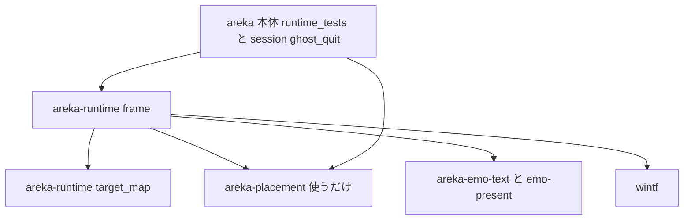
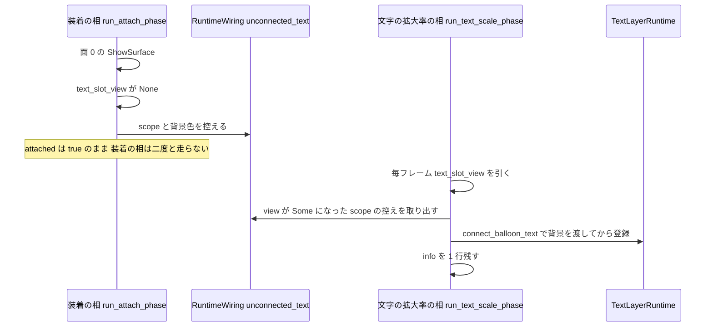

# 設計書: audit-emo2-boot-frame

## 概要

**目的**: areka の毎フレームの組み立て（`crates/areka-runtime/src/` の `frame.rs`・`frame/`・`frame_*.rs`、本体の `crates/areka/src/runtime_tests/` の `frame.rs`・`frame/`・`frame_*.rs`、本体の `crates/areka/src/session/ghost_quit*.rs`）に、ponytail の audit が出した 114 件（`research.md` の 2 節・番号 1〜114）を全部直す。直した後に同じ範囲へ audit をかけ直して、新しい指摘を 0 件にする。あわせて brief に預かった件 1〜14（要件 5）を片づけ、範囲の外で見つけた件（`research.md` の 6 節のア〜セ）を次の持ち主へ渡す（要件 7.10）。

**使う人**: 開発者。直しの形は ponytail の「いちばん小さい完全な変更」に従う。消せるものは消し、写しは既にある支えへ寄せ、呼び出し元・テスト・テストの支えまで直し切る。新しい機能は足さない。

**変わること**: 本番の振る舞いが変わるのは次の 5 つだけ。

1. バルーンの文字層の装着で文字の配置先（`text_slot_view`）が取れなかったスコープは、後のフレームで配置先が取れた最初のフレームに文字の拡大率の相が繋ぎ直す（3 番）。今は二度と繋がらず、そのゴーストの間ずっと文字が出ない。
2. 窓の印の scope が `i32::MAX` を越える窓は、表示対象の番号に直す所で `warn!` を残して読み飛ばす（4 番・件 9）。今は届かない（窓の scope は {0,1} だけ）。
3. 位置の指令の預かりの判定が、預かりの件数に比例する比べ（O(n²)）をしなくなる（2 番）。預かる・順を追い越さない・取りこぼさないの振る舞いは変わらない（確定 2）。
4. 作業領域の源の同期は、モニターの表が変わらないフレームでは源を作り直さない（49 番）。モニター 0 台の `warn!` は、毎フレームでなく、表が変わったフレームに 1 回出る。
5. 表示の指令の取り出しの上限の `warn!` の文が「上限に達した（残りがあれば次のフレームで）」になる（113 番）。出る条件は変えない。

ゴーストと SSP 互換の振る舞い（窓の位置と重なり・拡大率の変化の置き直し・SHIORI へ送るイベントの名前と順）は 1 つも変わらない（`research.md` の 4 節）。ほかはテストの直し・写しの寄せ・要らないコードの削除・公開の狭め・テストの置き場の移し替え・古い説明の直しで、外から見た振る舞いは変わらない。

### Goals

- 114 件を 3 つの組とも全部直す。直さずに残す指摘は 0 件（要件 2.7・確定 7）。
- 直したバグと危ない所の 1 件ごとに、壊れたら落ちるテストを 1 本ずつ持たせる（1・2・3・4・6・49・113 番は新しく立てるか赤から確かめるテスト。7・11〜17・79・97・104 番はテストそのものの強さの直し）。
- brief の件 1〜14 を片づける（件と指摘の対応は「要件の対応」の 5.1〜5.17）。
- タスクは案 C で 27 本に束ねる。規模は事実として記録するだけで、分けない・削らない（要件 2.6・確定 1）。
- 最後に同じ作法で audit をかけ直し、新しい指摘 0 件・全体テストの緑・既定の枝との差分の確かめを記録する。

### Non-Goals

- 範囲の外の見直し（`frame*` でない `areka-runtime` のファイル・本体の `session/` の `ghost_quit*` でないもの・`crates/areka-placement/`）。範囲の外で見つけたことは持ち主の brief へ渡す（要件 7.10）。
- 位置の指令の預かりの列が伸び続ける件（面を出さない窓への指令）。`window-resetwindowpos-hold` の brief へ渡す（確定 2）。
- 後の spec の仕事の先回り（`session-module-gather` のパスの直し・`window-resetwindowpos-hold` の `frame/move_hold.rs` の働き・`balloon-text-visual-tree` の `frame/{attach,wiring,scale_text,drain_resnap}.rs` の働き・`balloon-script-offset-align` の働き）。本体の `runtime_tests/frame_schedule_tests.rs` も今の置き場のまま直す（9 番・`session/` へ移さない）。
- 新しい依存（外の crate も、ワークスペースの中の crate への新しい依存も）。`Cargo.toml`・`Cargo.lock` は変えない。
- clippy の指摘の機械的な直し（`clippy-199-lints` の持ち物）。

## 境界の約束

### この spec が持つもの

- 受け持つ 103 ファイル（`research.md` の 1.1 の表）の直し。移すテストは移した先で範囲に数える。
- `areka-runtime` の公開の面の次の変化（どれも外の読み手 0 件か、読み手を同じ変更で直す）:
  - 狭める: `StageObservation` を私有へ。`collect_bindings`・`Transition`・`decide_transition` を私有へ。`reveal_pending`・`FaceCause`・`select_balloon_face`・`drain_move_directives` を `pub(super)` へ（114 番・確定 5）。
  - 足す（テストの支え・`#[cfg(any(test, feature = "test-support"))]`）: `target_map::window_scope`（本番の関数・4 番）・`frame::test_support::gpu_on`（31 番）・`frame::shared_test_support` の結線の補助と、写しから寄せた定数と補助（26・27・28 番）・`frame::persist_test_support`（33 番・本体の `frame_chain_finalize_persist_test_support.rs` の大半を移す）。
  - 消す: `FrameHarness::run_work_area_resnap`（71 番・外の読み手 0）。
- `RuntimeWiring` の私有の欄 `unconnected_text` を足す（3 番・`pub(super)`）。
- ログの行: 新しい `info!` 1 行（3 番の繋ぎ直し）・scope の上限の記録（4 番・`frame/dpi.rs` と `frame/scale_text.rs` の `error!` 2 行を消し、`target_map::window_scope` の `warn!` 1 行に寄せる）・取り出しの上限の文（113 番・`frame/drain_resnap.rs` の「…残りは捨てずに次のフレームで…」を「…残りがあれば次のフレームで…」へ）・`frame/work_area_sync.rs` の `[work_area_sync]` の `warn!` 1 行「見張りの印を進められない（次のフレームで 1 回作り直す）」（7.1 のかけ直しで足した・今の引数では届かない道）・`frame/attach.rs` の balloon 資産が無いときの `warn!` の文から「DD-12 」を外した（5.1 の 41 番）。どれも字面で読む実機の確かめ・`tools/perf/`・手順書は 0 件（`research.md` の 4 節と、この設計の時点の grep）。

### 範囲の外（持たないもの）

- 範囲の外で変えるのは、直しのために要る次のファイルだけ（要件 3.2・7.2）:
  - `crates/areka-runtime/src/target_map.rs` — 4 番の共通の関数 `window_scope` と上限の定数（持ち主 `audit-emo2-boot-spine` は完了済み）。
  - `crates/areka-runtime/src/spine_wait.rs` — `GpuPermit` の説明の 2 行（14 番で「2 つ取るテスト」が無くなるので事実に合わせる・セ）。
  - `crates/areka-runtime/src/assets.rs` — 83 行あたりの説明 1 行（64 番で消すテストを名指している）。
  - `crates/areka-runtime/src/move_cue_apply_move_tests.rs` — 248 行あたりの説明 1 行（63 番で消すテストを名指している・持ち主 `audit-emo2-boot-switch` は C23 で走っていない）。
  - `crates/areka/src/runtime_tests/zorder_wiring_tests.rs`（本体） — 説明 1 行（10 番で範囲の中の対照を消すので、`src/lib.rs` の対照の持ち主を `areka-runtime` の `zorder_wiring_tests.rs` の `t_zwi06` へ向け直す・要件 3.2）。
  - `crates/log-capture-kit/tests/file_length_guard_test.rs` — 上限越えの表から `frame_transition_branch_tests.rs` の 1 行を消し、件数を 3 から 2 にする（35 番・C23 の約束 ⑸・要件 7.4）。
  - brief（記録だけ）: `.kiro/specs/{extra-character-windows,test-crash-report-merge,audit-emo2-boot-switch,audit-areka-app,areka-test-wait-wording,window-resetwindowpos-hold}/brief.md`（要件 7.10・3.6）。
- 触らない（C23 の約束・要件 7.3）: `crates/areka-placement/` の全部（使うだけ）・`crates/areka-runtime/src/hit_region.rs`・本体の `input_events/`・`main.rs`・`ghost_session.rs`・`ghost_session_runtime.rs`・`app_exit.rs`（`close_windows_for_restart` は呼ぶだけ）・`menu/`・`placement_tests/spawn_assembly_tests.rs`・`Cargo.toml`・`Cargo.lock`・`crates/log-capture-kit/src/event.rs` とその試験・`doc/COMPAT_ARCHITECTURE.md` §8・`vendors/`。
- 触らない（範囲の外・持ち主へ渡すだけ）: `crates/areka-runtime/src/balloon_visibility_phase.rs`（ク・4 番の `window_scope` を使えばよいと書いて渡す）・`crates/areka-runtime/src/zorder_wiring_tests.rs`（10 番は範囲の中の重なりを消すだけ）・`crates/areka-runtime/src/placement_tests/transition_judge.rs`（ケは範囲の中の写しを `summarize` を呼ぶ形に替えるだけで、向こうは変えない）・本体の `runtime_tests/spine.rs`（GPU の World の写しはサ・`audit-areka-app` へ渡す）・`crates/areka-emo-text/`（3 番の説明の「次フレーム再試行」は直しで事実になるので変えない）。

### 使ってよい依存

- 今の依存だけ。`areka-runtime` の `[dependencies]`（`areka-placement`・`areka-actor`・`areka-ghost`・`areka-sylphya`・`areka-emo-*`・`areka-sakura`・`bevy_ecs`・`wintf`・`windows`・`tracing` ほか）と `[dev-dependencies]`（`log-capture-kit`・`temp-path-kit`・`sample-ghost-kit`・`areka-placement`〔test-support〕ほか）。
- テストの支え（`feature = "test-support"` の下）は dev-dependencies を使えない（本体のテストのビルドでは `areka-runtime` は普通のライブラリとしてビルドされ、dev-dependencies がリンクされない・`runtime-crate-split` の設計 D4）。だから `log_capture_kit`・`temp_path_kit` を引く補助は `#[cfg(test)]` に閉じる（前例 `frame_test_support.rs` の L16-L19）。
- 依存の向き（変えない）: 本体（`crates/areka`）→ `areka-runtime` → 下の crate。`areka-runtime` から本体を引く道は作らない。

### 見直しが要る変化（Revalidation Triggers）

- `areka_runtime::target_map::window_scope(usize) -> Option<u32>` が増え、窓の側の scope の上限の正本になる（4 番）。後から窓の scope を表示対象の番号へ直す spec（`extra-character-windows`・`audit-emo2-boot-switch` の `balloon_visibility_phase.rs`）はこれを使う。
- `RuntimeWiring` に私有の欄 `unconnected_text` が増える（3 番）。`balloon-text-visual-tree`（同じ `attach.rs`・`scale_text.rs`・`wiring.rs` を触る後の spec）は、装着で繋げなかったスコープを文字の拡大率の相が繋ぎ直す前提で組む。
- 作業領域の源の同期は、モニターの component（`wintf::ecs::Monitor`）の変化と数で「表が変わったか」を見る（49 番）。`MonitorSnapshot`・`MonitorDpiTable` の資源を手で置き替えても、モニターの component が変わらない限り同期は作り直さない。
- 公開の狭め（114 番）と `FrameHarness::run_work_area_resnap` の削除（71 番）。外の読み手は 0 件（grep）。
- テストの置き場: 本体の `runtime_tests/` から `areka-runtime` へ、`frame_chain_rule_tests.rs`（15 本）・`frame_chain_finalize_align_tests.rs`（6 本）・`frame_chain_finalize_clamp_tests.rs` の ⑴・`frame_chain_finalize_remembered_tests.rs` の ⑶⑷⑸・`frame/window_state_tests.rs` の 1 本が移る（33・99 番・確定 9）。本体の `frame_chain_finalize_persist_test_support.rs` の大半（`PersistStore` ほか）は `areka-runtime` の `frame::persist_test_support` へ移り、本体に残るのは `MinimalGhost` だけになる。`session-module-gather` が直すパスはその分だけ減る。
- `frame_transition_branch_tests.rs` が 2 本に分かれ、上限越えの表から出る（35 番）。
- ログの行の足し: `frame/work_area_sync.rs` の `[work_area_sync]` の `warn!`「見張りの印を進められない（次のフレームで 1 回作り直す）」（`SystemState::get` の失敗を捨てずに残す・今の引数では届かない道）。字面の読み手は 0 件。

## つくり

### 今の形と守るもの

- 毎フレームの組み立ては `frame.rs` の `frame_system` が相の並び（終了の門 → 作業領域の同期 → 装着 → 装置の作り直し → 拡大率の相 → … → 状態の報告 → 拡大率の知らせ・`research.md` の 3 節の件 13 の 2）を持つ。この並びは変えない。直すのは並びの説明（36 番）だけ。
- 相の関数は `RuntimeWiring` を `remove_non_send` で取り出して `&mut World` と一緒に渡す（donor 慣行）。フレームを跨いで生きる器は `RuntimeWiring` の欄に置く（前例 `dpi_state`・`text_scale_warned`）。3 番の `unconnected_text` も同じ形にする。
- scope を `TargetId` へ直す正本は `target_map.rs`（`shell_target`・`balloon_target`・`scope_of`）。窓の側の入口 `window_scope` も同じファイルに置き、上限の定数を 1 つにする（4 番）。
- テストの支えを 2 つの crate で写さない。両方の crate が使う補助は `areka-runtime` の `frame_*_test_support.rs`（`#[cfg(any(test, feature = "test-support"))] pub mod`）に 1 つだけ置く。片方の crate だけが使い、dev-dependencies を引く補助は `#[cfg(test)]` の兄弟に置く。
- x64 だけで回るテストは、`frame.rs` の宣言の `#[cfg(all(test, target_pointer_width = "64"))]` で守る（72 番で 1 つに寄せる形）。

### 依存の向き（変えない）



- 本体のテストが `areka-runtime` のテストの支えを引く向きだけを使う。`areka-runtime` のテストが本体を引く道は無い（だから本体の部品を使わないテストは `areka-runtime` へ移す・33・99 番）。
- `areka-placement` の関数（`reanchor_char_windows`・`apply_dpi_phase_gate`・`give_fake_handles` ほか）は呼ぶだけで、ファイルには触らない（C23）。

### 技術の層

| 層 | 使うもの | この spec での役目 | 注 |
|---|---|---|---|
| 言語 | Rust（ワークスペースの edition） | 全部 | 新しい言語機能は使わない |
| ECS | `bevy_ecs` 0.19（`SystemState`・`Changed`） | 49 番の変化の見張り・50 番の `Or` のフィルタ | 既存 |
| 記録 | `tracing` | 3・4・113 番の記録 | 既存 |
| テストの記録の捕捉 | `log-capture-kit`（dev） | 4・13・49・113 番の縛るテスト | 既存 |
| 一時の根 | `temp-path-kit`（dev） | 32 番の最小のゴースト | 既存。根はワークツリーの `target\` の下 |
| 待ち | `areka_runtime::spine::{wait_until, wait_recv, join_bounded}`（test-support） | 18・19・20・109 番 | 既存 |

## ファイルの構成

### 新しく作るファイル

```
crates/areka-runtime/src/frame/move_hold_tests.rs              # 2 番の縛るテスト（move_hold.rs の子・私有の Blocked を見る）
crates/areka-runtime/src/frame_transition_test_support.rs      # 29 番の寄せ先（#[cfg(test)]・writes_for・settle_at・scaled・warnings_containing・offset_of・follow_of・offset_lines・拡大率の定数・BALLOON_SPAWN_SIZE）
crates/areka-runtime/src/frame_transition_branch_wait_tests.rs # 35 番で分けた群 A（待ち）
crates/areka-runtime/src/frame_test_support_gpu_on_tests.rs    # 31 番の gpu_on が COM の初期化の失敗で止まることのテスト（T13 で足した）
crates/areka-runtime/src/frame_chain_finalize_remembered_tests.rs # 33 番で本体から移した remembered ⑶⑷⑸ の置き場（T18 で足した）
```

### 移すファイル（`git mv`・中身は直しに合わせて改める）

```
crates/areka/src/runtime_tests/frame_chain_rule_tests.rs                 -> crates/areka-runtime/src/frame_chain_rule_tests.rs                 # 33 番
crates/areka/src/runtime_tests/frame_chain_finalize_align_tests.rs       -> crates/areka-runtime/src/frame_chain_finalize_align_tests.rs       # 33 番（spawn_resolved ほかの補助も一緒に）
crates/areka/src/runtime_tests/frame_chain_finalize_persist_test_support.rs -> crates/areka-runtime/src/frame_persist_test_support.rs        # 33 番（MinimalGhost を除く。本体には MinimalGhost だけの同名ファイルを残す）
```

- 本体の `frame_chain_finalize_persist_test_support.rs` は、移した後に `MinimalGhost`（32 番で `TempPath` を包む形）だけを持つファイルとして残す（`temp-path-kit` は dev-dependency なので `areka-runtime` のテストの支えに置けない）。

### 消すファイル

- 本体の `runtime_tests/frame_chain_finalize_clamp_tests.rs`（7.1 のかけ直しで、残っていた 1 本を `areka-runtime` の `frame_chain_finalize_tests.rs` へ移して消した）。ほかは上の `git mv` で動かす。

消すテスト・補助・定数は、消す前にツリー全体（テスト・テストの支え・examples・fixture・設定・スキル・手順書・steering・文字列での参照・`#[path]`・本体の `placement_tests/zorder_group_branch_coverage_tests.rs` の `COVERAGE` のようなテストの名の文字列）で使われていないことを grep で確かめる（要件 3.3・各タスクの完了の条件）。

### 直すファイル（範囲の中・まとまりごと）

**`crates/areka-runtime/src/`（本番）**
- `frame.rs` — 5・36・41・42・49（L246 の文）・72・101（写しの注）番、33・35 番の宣言の付け替え、新しい支えの宣言。
- `frame/wiring.rs` — 3（`unconnected_text`）・5・37・114 番。
- `frame/attach.rs` — 3・4・39・64（説明）番。
- `frame/scale_text.rs` — 3・4・114 番。
- `frame/move_hold.rs` — 2 番（`Blocked.scopes` を `BTreeSet` に・子のテストの宣言）。
- `frame/dpi.rs` — 4・41・50・51 番。
- `frame/drain_resnap.rs` — 4・41・43〜45・47・113 番。
- `frame/move_shift.rs` — 4・40 番。`frame/switch.rs` — 4・53 番。`frame/zorder_drain.rs` — 4・46・52 番。`frame/zorder_descript.rs` — 46 番。
- `frame/work_area_sync.rs` — 48・49・71（名指し）番。`frame/balloon_offset_follow.rs` — 38 番。
- `frame/status_report.rs`・`frame/window_state.rs`・`frame/balloon_face.rs` — 114 番。

**`crates/areka-runtime/src/`（テストと支え）**
- `frame_text_scale_tests.rs` — 1・3・7・41 番。`frame/move_hold_tests.rs`（新）— 2 番。`frame_dpi_tests.rs` — 4・82（受け）・88・91 番。
- `frame_dpi_sync_hold_tests.rs` — 6・34・84 番。`frame_schedule_tests.rs` — 8・10・57 番。
- `frame_chain_finalize_tests.rs` — 11・12・22・33（clamp ⑴ を受ける）・41・43 番。`frame_attach_tests.rs` — 13・26・61〜65 番。
- `frame/zorder_drain_tests.rs`・`frame/zorder_descript_tests.rs`・`frame/zorder_drain_test_support.rs`・`frame/zorder_drain.rs`（`pub(super) mod test_support`）— 22・23・25・46・54・58 番。`frame_drain_text_tests.rs` — 24・26・36・63（名指し）番。
- `frame_shared_test_support.rs` — 26・27・28・33（remembered の材料）番。`frame_test_support.rs` — 26・29（`resnap_placements` の定数）・30・31・49（ハーネスは何も変えない見込み）・69・71・72・74 番。`frame_balloon_runtime_test_support.rs` — 31・70 番。
- `frame_chain_realign{,_arm,_adjacency,_exclusion}_tests.rs`・`frame_default_pos_track_tests.rs`・`frame_move_hold_tests.rs`・`frame_resnap_tests.rs`・`frame_window_link_drain_tests.rs` — 26・27・28・30・41・47・51（arm の単体のテスト）・79〜81・87 番。
- `frame_balloon_offset_{converge,follow,keyword_gate,roundtrip}_tests.rs`・`frame_transition_atomicity_tests.rs`・`frame_transition_branch_tests.rs`・`frame_transition_branch_wait_tests.rs`（新）・`frame_work_area_resnap{,_hold}_tests.rs`・`frame_work_area_sync_tests.rs` — 29・34・35・41・49・66・67・68・73・92〜97・ケ番。
- `frame_diag_route_tests.rs`・`frame_harness_tests.rs`・`frame_move_order_tests.rs`・`frame_dpi_reproject{,_none}_tests.rs` — 41・72・75〜78・82・83・85・86・89・90 番。
- `frame/drain_resnap_tests.rs`・`frame/balloon_face_tests.rs`・`frame/window_state_tests.rs`・`frame/window_state_test_support.rs`・`frame/status_report{,_stage}_tests.rs` — 55・56・57・59・60・70・99（受け）・113 番。
- `frame_chain_rule_tests.rs`・`frame_chain_finalize_align_tests.rs`（移した先）・`frame_chain_finalize_remembered_tests.rs`（新しく ⑶⑷⑸ を受ける・名は本体と同じ）・`frame_persist_test_support.rs`（移した先）— 17・33・106・110 番。

**本体 `crates/areka/src/`**
- `runtime_tests/frame.rs` — 33・101 番（宣言の削除と注）。
- `runtime_tests/frame_schedule_tests.rs` — 9・57 番（置き場は変えない）。`session/ghost_quit.rs` — 9 番（L116 の説明）。
- `runtime_tests/frame_visibility_integration_tests.rs` — 14・31・107 番。
- `runtime_tests/frame_shell_box_{arrow,integration,align}_tests.rs` — 15・16・21 番。
- `runtime_tests/frame_chain_finalize_{persist,persist_nowrite,persist_restart,remembered,clamp,restart}_tests.rs`・`frame_chain_finalize_persist_test_support.rs` — 17・32・33・101・105・106 番。
- `runtime_tests/frame/switch_tests.rs`・`switch_finish_tests.rs`・`switch_reload_tests.rs`・`switch_stay_on_top_tests.rs`・`status_report{,_stage}_tests.rs`・`window_state_tests.rs` — 18・20・57・98・99・100・102 番。
- `session/ghost_quit_logsink_tests.rs` — 19 番。
- `runtime_tests/frame_attach_carry_tests.rs`・`frame_balloon_timeout_notice_e2e_tests.rs`・`frame_move_order_tests.rs`・`frame_scale_notice_integration_tests.rs` — 57・103・104・108・109・111・112 番。

## 流れ

### 3 番 装着で繋げなかった文字層を繋ぎ直す



- view が `None` のまま続くフレームは今どおり `text_scale_warned` で 1 回だけ `warn!` する（変えない）。

## 新しい形を引く直し

### 3 番 文字層の繋ぎ直し（`frame/wiring.rs`・`frame/attach.rs`・`frame/scale_text.rs`）

| 項目 | 中身 |
|---|---|
| 目的 | 装着の時に文字の配置先が無かったスコープも、後で配置先ができたら文字が出るようにする（説明の「次フレーム再試行」を事実にする） |
| 要件 | 3.1・4.1・4.2・6.2・6.4 |
| 選んだ案 | 案 ⑴（文字の拡大率の相で繋ぎ直す）。案 ⑵（再試行をやめて `error!`）は、装着の時だけの装置の失敗や、面 0 だけが組めず後の面（面の切り替え・バルーンの切り替え）が組める場合に、文字が永久に出ないまま残る（`research.md` の 11 節） |

```rust
// frame/wiring.rs（RuntimeWiring の私有の欄・RuntimeWiring::new で空）
/// 装着で文字層を繋げなかった scope と、その面 0 の背景色（繋ぎ直す時に渡す）。
pub(super) unconnected_text: BTreeMap<u32, (u8, u8, u8)>,

// frame/attach.rs（run_attach_phase の中・今の connect_balloon_text の呼び出しを置き換える）
if !connect_balloon_text(&wiring.runtime, view, actor, &wiring.balloon_models[&scope], background_color) {
    wiring.unconnected_text.insert(scope, background_color);
}

// frame/scale_text.rs（run_text_scale_phase の走査の中・view が Some になった直後）
if let Some(background) = unconnected_text.remove(&scope) {
    connect_balloon_text(runtime, Some(view), actor, model, background); // Some なので必ず true
    info!(scope, "text-scale: 装着で繋げなかった文字層を、配置先ができたので繋ぐ");
    refreshed.push(scope);
    continue;
}
```

- 毎フレームの手間は、控えが空なら `BTreeMap::remove` の空振り 1 回だけ。
- `attach.rs` の説明（L160-L163・L413-L415・`connect_balloon_text` の doc）は「繋ぎ直しは文字の拡大率の相が行う」と書き直す。`connect_balloon_text` の `None` の腕の `warn!` の文は今のまま（事実になる）。
- 縛るテスト（`frame_text_scale_tests.rs`・実 GPU・決定論）`a_balloon_text_left_unconnected_at_attach_connects_on_the_first_frame_its_view_exists`: `gpu_attach_world` と emo2 の資産で装着した後、`wiring.runtime` を新しい `TextLayerRuntime` に替え、`wiring.unconnected_text` に scope 1 と背景を入れる（装着で `None` だった後の状態）。`run_text_scale_phase` を 1 回回すと、scope 1 の actor が登録され（`runtime.borrow().state().actors()` に在る）、控えが空になり、`info!` が 1 行出る。実装の順は ⑴ 欄と装着の側の控えだけを入れ、相の側を入れずに赤になることを見る → ⑵ 相の側を入れて緑（要件 4.2・前例 `audit-emo2-boot-spine` の 2 番の門の順）。
- 装着の側の控え（`if !connect_balloon_text(..)` の 1 行）を装着の相ごと通すテストは置かない。装着の相を文字の配置先の無い状態で通すには面 0 を組めないバルーン（`ExtentTooLarge`）が要り、決定論で作れない。`None` で `false` と `warn!` が返ることは 13 番で強めるテストが縛り、控えに入った後の繋ぎ直しは上のテストが縛る。
- `unconnected_text` は `text_scale_warned` と同じく `RuntimeWiring::new` で空にする（切り替えで新しい結線を作れば控えも新しくなる）。

### 4 番 窓の側の scope の上限（`target_map.rs`・範囲の中の 9 か所）

| 項目 | 中身 |
|---|---|
| 目的 | 窓の印の scope（`usize`）が `i32::MAX` を越えても、`2*scope` があふれず、桁を切り捨てて別の窓の寸を読まない |
| 要件 | 3.1・3.2・4.1・4.2・5.10・6.2 |

```rust
// crates/areka-runtime/src/target_map.rs
/// scope の上限（`balloon_target` の `2*scope+1` が u32 に収まる最大）。台本の側と窓の側の正本。
const MAX_SCOPE: u32 = i32::MAX as u32;

pub fn scope_of(key: &ActorKey) -> Option<u32> {
    key.as_str().parse::<u32>().ok().filter(|&s| s <= MAX_SCOPE)
}

/// 窓の印の scope（`CharWindowMarker.scope` ほか）→ scope 番号。`MAX_SCOPE` を越えると
/// `warn!` を 1 行残して `None`（呼び手は読み飛ばすだけでよい・記録はここ 1 か所）。
pub fn window_scope(scope: usize) -> Option<u32> {
    let s = u32::try_from(scope).ok().filter(|&s| s <= MAX_SCOPE);
    if s.is_none() {
        warn!(scope, "window scope が上限を越え target を採番できない → この窓を読み飛ばす");
    }
    s
}
```

- 記録を残すのは `window_scope` の中の 1 か所だけ（設計の討議 議題 2）。9 か所の呼び手は `None` を読み飛ばすだけで、記録の無い読み飛ばしは残らない。今は届かない道で、入口の上限は `extra-character-windows` が置くので、毎フレームの記録があふれる場面は来ない。

| 場所 | 今 | 直し |
|---|---|---|
| `frame/dpi.rs` L415 | `u32::try_from` と `error!` | `window_scope` で読み飛ばす。`error!` は消す（記録は `window_scope` の `warn!`＝台本の側と同じ扱い・要件 5.10） |
| `frame/scale_text.rs` L169 | `u32::try_from` と `error!` | 同上 |
| `frame/attach.rs` L105 | `u32::try_from` | `window_scope`（`None` は今どおり `missing_assets` へ）。変数名 `window_scope` は `scope_usize` に替える |
| `frame/attach.rs` L458 | `.filter_map(\|&s\| u32::try_from(s).ok())`（`skin_facts_copy::copy` へ渡り、上限の検査なしに `balloon_target` を呼ぶ） | `.filter_map(\|&s\| window_scope(s))`（設計の検証で見つけた 9 か所目） |
| `frame/drain_resnap.rs` L380 | `scope as u32` | `let Some(s) = window_scope(scope) else { continue };` |
| `frame/drain_resnap.rs` L675 | `scope as u32` | `let Some(s) = window_scope(scope) else { return Err(ChainDeferReason::NotShownYet { scope }) };`（対応する表示対象が無い窓は表示が成り立たない） |
| `frame/move_shift.rs` L53 | `scope as u32` | `let Some(s) = window_scope(scope) else { continue };` |
| `frame/switch.rs` L358・`frame/zorder_drain.rs` L198 | `.filter_map(\|s\| u32::try_from(s).ok())` | `.filter_map(window_scope)` |

- 範囲の外の `balloon_visibility_phase.rs` L464（ク）は触らない。`audit-emo2-boot-switch` の brief に「`window_scope` を使う」と書いて渡す（要件 7.10）。入口の `detect_scopes`（ア・`crates/areka-placement/`）は `extra-character-windows` の brief へ渡す。
- 縛るテスト:
  - `target_map.rs` の `mod tests` に `window_scope_rejects_scopes_past_i32_max`（`window_scope(2147483647) == Some(2147483647)` で記録 0 行・`window_scope(2147483648) == None`・`window_scope(usize::MAX) == None` でそれぞれ `warn!` 1 行）。
  - `frame_dpi_tests.rs` に `a_window_scope_past_i32_max_is_skipped_with_one_warning`: `GhostWindows` に scope `1 << 31` のキャラ窓を 1 つ置き、DPI を変えて拡大率の相を回す。**直しの前はデバッグのビルドで `2 * scope` があふれて panic＝赤**。直しの後は `warn!` 1 行・その窓への書き込み 0。

### 2 番 預かりの判定の手間（`frame/move_hold.rs`）

- `Blocked.scopes: Vec<u32>` を `BTreeSet<u32>` にする。`overlaps` は `ss.iter().any(|s| self.scopes.contains(s))`、`add` は `extend` のまま、`is_empty` もそのまま通る。集合の大きさは窓の数で頭打ちになり、1 フレームの判定は預かりの件数に比例する手間で済む。
- 振る舞い（預かる・順を追い越さない・取りこぼさない・並べ直しが前の移動を捨てる）は変えない。`frame_move_hold_tests.rs` の今のテストが全部同じ結果で通ることで確かめる。
- 縛るテスト（新しい `frame/move_hold_tests.rs`・`move_hold.rs` の子）`blocked_keeps_one_entry_per_window_however_many_cues_wait`: `Blocked::default()` へ `add(Some(vec![1]))` を 1,000 回 → `scopes.len() == 1`、`overlaps(&Some(vec![1]))` が真・`overlaps(&Some(vec![0]))` が偽。**直しの前は 1,000＝赤**。
- 列が伸び続ける件は `window-resetwindowpos-hold` の brief へ渡す（確定 2・要件 7.10）。

### 49 番 作業領域の源の同期を変化のあるフレームだけにする（`frame/work_area_sync.rs`）

| 項目 | 中身 |
|---|---|
| 目的 | 定常フレームで、モニターの表を集め、2 つの源を作り直し、clone して比べて捨てる手間をなくす |
| 要件 | 3.1・4.1・6.4 |
| 選んだ案 | 案 ⑴（範囲の中で済む）。案 ⑵（借りたまま比べる）は `same_monitors` の署名が `crates/areka-placement/` 側なので C23 の間は取らない |

```rust
// frame/work_area_sync.rs（私有）
/// フレームを跨いで生きるモニターの変化の見張り（World の資源・初回の同期で据える）。
#[derive(Resource)]
struct MonitorWatch {
    changed: SystemState<(Query<'static, 'static, (), Changed<Monitor>>, Query<'static, 'static, (), With<Monitor>>)>,
    /// 前に作り直したときのモニターの数（消えたモニターは Changed に出ないので数で見る）。
    /// `None` は一度も作り直していない（初回はモニターが 0 台でも必ず作り直しの道を通る）。
    seen: Option<usize>,
}
```

- `sync_monitor_snapshot(world)` の署名は変えない（`frame.rs` L249 と `frame_test_support.rs` L800 の呼び手・`frame_work_area_sync_tests.rs` L363 の字面の確かめはそのまま）。中で `MonitorWatch` を資源から取り出し（無ければ作る）、次の 3 つが全部そろうときだけすぐ `None` を返す。どれかが欠けたら今の `sync_monitor_snapshot_with` を呼び、`seen` を `Some(今の数)` にする。
  1. `seen` が `Some`（初回でない）。
  2. Monitor の変化が 0 件で、数が `seen` と同じ。
  3. 資源 `MonitorSnapshot`・`MonitorDpiTable` が前の同期の後に入れ直されていない（`SystemState` の組に `Res<MonitorSnapshot>`・`Res<MonitorDpiTable>` を足し `is_changed()` で見る）。本番の `prepare_ghost_windows`（`crates/areka/src/ghost_session.rs` L235・L287-L288・C23 で触らない）は、ゴーストの切り替えと再起動のたびに `enumerate_monitors()` で両方を入れ直す。そのフレームに今どおり揃え直すための条件（設計の検証の 2 件目）。
- 調べ（`research.md` の 11 節）: wintf の `apply_monitor_snapshot`（`crates/wintf/src/ecs/layout/systems/monitor_systems.rs` L299-L412）は、値が変わったモニターだけ `get_mut` で書き（`differs_in_value` のとき）、新しいモニターは `spawn`、消えたモニターは `despawn` する。だから Changed は値の変化のときだけ立ち、追加は Changed に入り、消去は数で見える。
- モニター 0 台のときの `warn!` は、作り直しの道を通るフレーム（表が変わったフレーム）にだけ出る（今は毎フレーム 60 行/秒）。
- `SystemState` の組が `Resource` の `Send + Sync` を満たさないと組んで分かったら、同じ形を `insert_non_send` で置く（振る舞いは同じ）。
- `frame.rs` L246 の「定常フレームは無操作」を、この形の事実（「モニターの component が変わらないフレームは表を集めない」）に直す。
- 前提: 資源 `MonitorSnapshot` を手で置き替えて同期に上書きさせるテストがあれば、モニターの component を書き替える形（本番の道）に改める（要件 4.7）。実装で見つけた本数を記録に書く。
- 縛るテスト（`frame_work_area_sync_tests.rs`）`an_unchanged_monitor_table_is_not_rebuilt_and_an_empty_one_warns_once`: モニター 0 台の World で `sync_monitor_snapshot` を 3 回 → `warn!` は 1 行。その後モニターを 1 台 `spawn` → 作り直す（`Some`）。そのモニターの作業領域を `get_mut` で変える → 作り直す。何も変えずにもう 1 回 → `None`。**直しの前は `warn!` が 3 行＝赤**。
- 縛るテスト（同じファイル）`a_reinserted_monitor_snapshot_is_resynced_on_the_next_call`: モニター 1 台で 1 回同期して `None` になる定常に入れた後、`MonitorSnapshot` を `insert_resource` で入れ直す（切り替えの `prepare_ghost_windows` と同じ形）→ 次の呼び出しが作り直す（`Some`）。条件 3 を外すと赤。

### 6 番 札が外れるフレームの書き込みのテスト（件 13・`frame_dpi_sync_hold_tests.rs`）

- 縛るテスト `a_window_held_through_a_shell_switch_is_written_on_the_frame_its_hold_lifts`（決定論・GPU なし・`FrameHarness`）: `research.md` の 2 節の 6 番の手順どおり。⑴ 等倍（96）で整地 ⑵ scope 0 へ拡大率の知らせだけを先に届けて札を付ける ⑶ `apply_shell_descript` で揃え方を `top` に入れ直し、`areka_placement::reseed::reanchor_char_windows` を呼ぶ（`reseed_held` の debug 1 行・書き込み 0） ⑷ 表を 192 に追いつかせて `run_placement_phases` → その窓の書き込みがちょうど 1 回で経路の語が `DpiReproject`・上辺が作業領域の上端・札が外れている。陽性の対として札の無い scope 1 は ⑶ で `AnchorChange` で動く。
- 50 番（`DpiChangedQuery` を `Or<(Changed<DPI>, With<DpiSyncHold>)>` にして和集合の 11 行を消す）は、このテストを先に入れてから行う（和集合を書き損じると赤になる檻）。

### 33・99 番 本体から `areka-runtime` への移し（`cfg(test)` の中に閉じる形）

- 調べ（`research.md` の 11 節）: 移すテストが使う crate は `bevy_ecs`・`wintf`・`areka_placement`・`areka_sylphya`・`areka_actor`・`areka_ghost`・`windows`（どれも `areka-runtime` の普通の依存）と `log_capture_kit`（dev）だけ。本体の項目は `PersistStore::wire` の中の `crate::insert_persist_wiring`（`main.rs` L816-L818 の 1 行の包み）と、remembered ⑵ の `crate::app_exit::close_windows_for_restart` だけ。`Cargo.toml` は変えずに組める。
- 置き方:
  - `frame_persist_test_support.rs`（`frame.rs` の `#[cfg(any(test, feature = "test-support"))] #[path] pub mod persist_test_support;`）: 本体の支えのうち `PersistStore`・`WORK_AREA`・`work_area_snapshot`・`persist_world`・`PREP_SIZES`・`prep_placements`・`SHOWN_SIZES`・`shown_sizes`・`spawn_shown` と、17 番の `boot_remembered`（窓を作る → 戻した集合に既定の位置の消去と覚えた隣り合いの印を据える → 置き直す）・106 番の `PersistStore::file_text`。dev-dependencies を使わない。`pub(super)` は `pub` にする。
  - `PersistStore::wire` は `world.insert_non_send(areka_placement::persist::PersistWiring { publisher: self.publisher.clone() })` にする（本番の継ぎ目は本体の `main_persist_wiring_seam_tests.rs` が守る）。`PersistStore::real` は `&MinimalGhost` の代わりに `ghost_master: &Path` を受ける。
  - 本体の `frame_chain_finalize_persist_test_support.rs` には `MinimalGhost`（32 番で `TempPath` を包む形）だけを残し、`PersistStore::real(&ghost.ghost_master())` で呼ぶ。
  - `frame_chain_rule_tests.rs`・`frame_chain_finalize_align_tests.rs` は `git mv`（`spawn_resolved`・`spawn_resolved_scopes`・`sizes`・`x_of`・`WA`・`SPAWN` は align と一緒に `cfg(test)` のまま）。clamp ⑴ は `areka-runtime` の `frame_chain_finalize_tests.rs` へ、remembered ⑶⑷⑸ は新しい `areka-runtime/src/frame_chain_finalize_remembered_tests.rs` へ移す。remembered の材料（`HIGH`・`LOW`・`PAIR_LINE`・`remembered_placements`・`pair_gap`）と `boot_from` の組み立ての半分（記録の捕捉の前まで）は `frame_shared_test_support.rs` へ置き、記録を捕捉する数行（`log_capture_kit` を使う）は両側のテストのファイルに残す。
  - 99 番: テストを `areka-runtime/src/frame/window_state_tests.rs` へ移す。`hooks::install` の行を消し、`[window_state]` の絞り込みはテストの中に 1 行で書き、`use log_capture_kit::capture;` を足す。`window_state_events` は本体の残り 4 本が使うので本体に残す（test-support へ出すと `CapturedEvent` で dev-dependency に触る）。本体の口 `ghost_folder` の `?` を通る確かめは失う（`research.md` の 2 節の 99 番に記録済み）。
- 移した先（`cargo test -p areka-runtime`）で同じ数のテストが同じ名前で緑になり、本体の側から消えたテストの数と合うことを、タスクの完了の確かめに書く。

### 14 番 切り替えのテストを同じ World で（本体の `frame_visibility_integration_tests.rs`）

- 調べ（`research.md` の 11 節）: 本番の `switch_to`（`session/ghost_switch.rs`）は同じ World のまま、`close_windows_for_restart` で窓を畳み、窓を開け直し、新しい `RuntimeWiring` を入れる。同じ窓に新しい presenter を装着し直すと、前の presenter の子の entity が残る。
- 直し: 1 つの `gpu_frame_world()` の World で前のゴーストを据えて回した後、`crate::app_exit::close_windows_for_restart(&mut world)` → `spawn_resnap_windows(&mut world)` と `dpi_world` と同じ `DPI(96)` と配置の component の付け足し → `seat_ghost` で次のゴーストを据え直し → `boot_wiring` を組み直して回す（前例 `frame_chain_finalize_restart_tests.rs` L90）。GPU の許可は 1 つになる。
- セ: `spine_wait.rs` L686-L687 の「2 つ取るテストは `new_ghost_holdings_start_with_a_fresh_ledger_after_a_switch` の 1 本だけ」を「1 つのテストで 2 つ取らない（同じことをするテストが並ぶと互いに待ち合って止まりうる）」に直す（範囲の外・直しに要る変更・要件 3.2）。`crash_report_test_support.rs` の自分の数えで 2 つ取る檻の行の説明は変わらない。

### 31 番 GPU の World の組み立て（`frame_test_support.rs`）

- 調べ（`research.md` の 11 節）: `areka-runtime` のテストのバイナリ（`crash_report_test_support.rs` L126-L153）と本体のテストのバイナリ（`runtime_tests/mod.rs` L10-L17）は、どちらもプロセスの寿命の MTA（`CoIncrementMTAUsage`）を始めに据えている。だから各所の `let _ = CoInitializeEx(..)` は要らない（本体の `runtime_tests/spine.rs` L92 は既にそう書いて呼ばない）。
- COM の初期化の行は消さない（設計の討議 議題 3）。支えの `manual_balloon_runtime` を使うテストを、C23 の `input-crate-split` が新しい crate `areka-input` へ移し、そのテストのバイナリにプロセスの MTA があるかは分からないため。代わりに `let _ =` で捨てていた結果を確かめる: `S_OK`／`S_FALSE` は通し、それ以外は `panic!`（テストの支えなので止める）。申し送りは要らない。
- 足す補助: `pub fn gpu_on(world: &mut World) -> crate::spine::GpuPermit`（COM を MTA で初期化して結果を確かめ、許可を取り、`GraphicsCore` と `WucGraphicsResource` を入れ、許可を返す）。呼び手は許可を先に束縛する（装置より後に捨てる・`spine_wait.rs` の決まり）。
- 呼ぶ所: `gpu_attach_world`（`resnap_world()` + `gpu_on`・署名は変えない）・`frame_balloon_runtime_test_support.rs`・本体の `gpu_frame_world`（`dpi_world()` + `gpu_on` + 本体の付け足し）。本体の `runtime_tests/spine.rs` の写しは範囲の外なのでサとして `audit-areka-app` へ渡す。

### 72 番 x64 の見張りを 1 つに

- `frame.rs` の宣言の `#[cfg(all(test, target_pointer_width = "64"))]` を見張りの形とする（32 bit ではそのテストが組まれないだけで、ハーネスを使わないテストは組める）。`frame_test_support.rs` L565-L570 の `const _: () = assert!(..)` を消し、字面の見張り `frame_harness_tests.rs` L420-L440 を消す。`frame.rs` と支えの注を「x64 だけで回すテストは宣言の cfg で外す」に合わせる。
- 完了した `areka-P0-dpi-transition-atomicity` の要件 7.5 は「x64 の決定論テストとして走る」だけで見張りの形を名指さない（確定 7）。

### 35 番 判断の分岐のテストの分割

- `frame_transition_branch_tests.rs`（1,271 行）を、群 A（待ち・L243-L547）の `frame_transition_branch_wait_tests.rs` と、残り（群 B〜D・本番の入口・観測の条件）の `frame_transition_branch_tests.rs` に分ける。共通の補助（L107-L241）は 29 番の `frame_transition_test_support.rs` へ寄せる。`frame.rs` の宣言を 2 本にする。
- 34 番（`frame_dpi_sync_hold_tests.rs` の 4 本を消す）・94 番（同じ本体を `[96, 120, 192]` で回す 1 本に）と同じタスクで、行の数を確かめながら進める。`L10` の「対テストの持ち主」の表を 2 本の名で直す。
- `crates/log-capture-kit/tests/file_length_guard_test.rs` の表から 1 行消し、件数を 3 から 2 にする（要件 6.1・7.4）。

## 指摘ごとの直し方（1〜114）

「束」はタスクのまとまり（次の節の T1〜T27）。「縛るテスト」は直したバグと危ない所が壊れたら落ちるテスト（要件 4.1）。「—」はテストの直しそのもの・写しの寄せ・削除・説明の直しで、今あるテストが同じ結果で通ることを確かめる（要件 4.7）。「research どおり」は `research.md` の 2 節のその番号の「直し方」をそのまま行う。行番号は `research.md` の時点のもの（実装で関数名から引き直す）。

**説明を直す指摘は、コードで分かる説明なら消し、理由だけを残す**（2026-11-20 開発者）。下の表で直し方が「説明を直す」「字面を直す」「事実に合わせる」「research どおり（説明の直し）」の行（36〜47・53・58・61・65・66・69・74〜77・81・85・88・90・93・95・96・101・107 番ほか）は、書き直す前にそのコメントがコードの言い直しかを見て、言い直しなら消す。コードだけでは分からない理由（外の制約・回避・選ばなかった案）を持つ行は、その理由だけに縮めて残す。spec の名や task の番号を指すだけの行（41・56 番・件 12・件 14）も同じ物差しで 1 行ずつ見る。範囲の外と、この spec が触らないコメントは掃除しに行かない。

### 必ず直す（1）

| 番号 | 直し方 | 縛るテスト | 束 |
|---|---|---|---|
| 1 | L210 の後ろに `.expect(..)`。直す前に観測器の結果を空にすると赤になることを見る | 直した表明そのもの | T1 |

### 直したほうがよい（2〜35）

| 番号 | 直し方 | 縛るテスト | 束 |
|---|---|---|---|
| 2 | `Blocked.scopes` を `BTreeSet`（上の節） | `blocked_keeps_one_entry_per_window_however_many_cues_wait` | T2 |
| 3 | 文字の拡大率の相で繋ぎ直す（上の節） | `a_balloon_text_left_unconnected_at_attach_connects_on_the_first_frame_its_view_exists` | T3 |
| 4 | `window_scope` と 9 か所（上の節） | `window_scope_rejects_scopes_past_i32_max`・`a_window_scope_past_i32_max_is_skipped_with_one_warning` | T4 |
| 5 | 3 つのビルドの測り（`research.md` の 11 節）で 3 種に分ける: どのビルドでも使わない 20 名は消す、テストでだけ使う名（`Entity`・`SystemState`・`PlacementRoute`・`connect_balloon_text`・`GhostWindowClass`・`classify_ghost_window`・`reproject_char_window_at_current_size`・`resnap_from_sizes`）は `#[cfg(test)] use`、テストと test-support の両方で使う名は `#[cfg(any(test, feature = "test-support"))] use`。`L153` の許可を外す。`wiring.rs` の `World`・`TargetId` も `#[cfg(any(test, feature = "test-support"))] use` にして許可を外す。許可は 0 本になる。実装の後に 3 つのビルド（lib・lib＋test-support・test）で `--force-warn unused_imports` を 1 回ずつ回して 0 件を確かめる | — | T5 |
| 6 | 札が外れるフレームのテストを足す（上の節） | 足したテストそのもの | T6 |
| 7 | 空撃ちを消し、2 回目も本番の経路で 1 窓だけ DPI を変えて拾った窓がその 1 窓だけであることを見る | 直したテストそのもの | T1 |
| 8 | research どおり（`register_like_the_boot` と L105-L110 を消し `crate::register_frame_system` を呼ぶ・説明を直す） | — | T8 |
| 9 | `wire_kanade_stop(&mut world, rx)` を直に呼び、`QUIT_REGISTRATION` と字面の確かめを消す。置き場は変えない（Non-Goals）。`ghost_quit.rs` L116 の説明を直す | 直したテストそのもの | T8 |
| 10 | 範囲の中の T-N10 ⑴ の字面の照合を消す（`t_zwi06` に任せる・範囲の外は触らない） | — | T8 |
| 11 | research どおり（`pos_of`／`size_of` で読んだ値から隙間を出す） | 直した表明 | T9 |
| 12 | `assert_ne!(moved_origin_x, Some(1483))` | 直した表明 | T9 |
| 13 | `runtime.borrow().state().actors().next().is_none()` と `capture_logs` で WARN 1 行 | 直した表明 | T9 |
| 14 | 同じ World で切り替える（上の節）・セ | 直したテスト | T10 |
| 15 | 2 段で向きを見る（`Moved` → `Stopped(ReachedAuto)`） | 直した表明 | T11 |
| 16 | `press(up)` の真と、lifecycle と kanade の受け手への中断の到着を表明 | 直した表明 | T11 |
| 17 | `persist_test_support::boot_remembered` を置き 3 か所で使う（`ghost_session.rs` は読むだけ） | 直したテスト 13 | T18 |
| 18 | `areka_runtime::spine::wait_until("seriko の閉鎖", Progress::Unknown, ..)` | — | T12 |
| 19 | `wait_until("停止通知が終了相へ届く", ..)` にし `BOUND` を消す | — | T12 |
| 20 | `join_bounded("sylphya", ..).expect(..)`・seriko の join も `join_bounded` | — | T12 |
| 21 | `Option<RuntimeWiring>` と `take()`（前例 `frame_scale_notice_integration_tests.rs` L30-L33） | — | T11 |
| 22 | 3 か所とも `frame_test_support::capture_logs` を使い写しを消す（`lines_of_level` は 2 か所のために残す） | — | T13 |
| 23 | `use crate::source_text_test_support::code_only;` | — | T13 |
| 24 | `use crate::talk_clock::{controllable_clock, set_now};` | — | T13 |
| 25 | `zorder_drain.rs` の宣言を `pub(super) mod test_support;` にし、`zorder_descript_tests.rs` は引いて写しを消す（ファイルの名とパスは変えない） | — | T13 |
| 26 | `frame_shared_test_support.rs` に受け口を既定で埋める結線の補助 `wiring_with(assets, runtime, presenter)` を 1 つ置き、`wiring()`・`headless_wiring_with` と 16 か所をそこへ寄せる | — | T14 |
| 27 | research どおり（写しを消し shared から引く・`high_sizes`・`raise_the_scale`・`default_x`・`drag_char_window_by` を shared へ・arm の私有の `settled_sizes` は別名に・shared の頭の使い手の説明を直す） | — | T15 |
| 28 | 3 体の鎖の支え 5 つを `frame_shared_test_support.rs` へ | — | T15 |
| 29 | `frame_transition_test_support.rs`（新・`cfg(test)`）へ `WindowKind` 受けの `writes_for`・強い方の `settle_at(dpi)`・`scaled`・`warnings_containing`・`offset_of`/`follow_of`/`offset_lines`・`pub const BALLOON_SPAWN_SIZE`・拡大率の定数を 1 つずつ置き、9 本から消す。`resnap_placements` もその定数を使う | — | T16 |
| 30 | 範囲の中の 5 か所を `areka_placement::test_support::give_fake_handles(world, &gw)` にし私有の `fake_handle` を消す（範囲の外の 2 か所はキで渡す） | — | T13 |
| 31 | `gpu_on` を置き 3 か所から呼ぶ・COM の初期化は残して結果を確かめる（上の節） | — | T13 |
| 32 | `MinimalGhost(TempPath)`・`TempPath::new(&format!("cpsoe-{label}"))`。`NEXT_GHOST`・自前の消去・`Drop` を消す | — | T17 |
| 33 | 本体から `areka-runtime` へ移す（上の節） | 移したテストそのもの | T17・T18 |
| 34 | research どおり（4 本を消し、向こうに無い 4 本を残す・表と見出しを直す） | — | T19 |
| 35 | 2 本に分け、表から出る（上の節） | — | T19 |

### できれば（36〜114）

| 番号 | 直し方 | 縛るテスト | 束 |
|---|---|---|---|
| 36 | `frame.rs` の頭と L207-L208・L31・L351 を 20 の相の並び（`research.md` の 3 節の件 13 の 2）に合わせる。テストの側は「各相」に | — | T20 |
| 37 | research どおり。L319・L295・L326 はファイルのパスを書かずに「本体の入力の層の `resolve_hit_owned`・`on_balloon_pointer_moved`」と名で指す（要件 5.1） | — | T20 |
| 38 | 「`resize_window_to` の手順 4」と名で指す | — | T20 |
| 39 | research どおり（`runtime attach: 装着計画を実行` の行は変えない） | — | T20 |
| 40 | 件 8 の文（要件 5.9） | — | T20 |
| 41 | `atom` を `areka-P0-dpi-transition-atomicity` に、task 番号の前に spec の名を書く（11 か所と task の 17 か所） | — | T20（本番）・T22〜T23（テスト） |
| 42 | 「櫯」を「檻」に | — | T20 |
| 43 | research どおり（L554・L281・テストの L204・要件 5.7） | — | T20 |
| 44 | 「確定の側の呼び手はここ。並べ直し（`reset_pos.rs`）も呼ぶ」 | — | T20 |
| 45 | 腕に 1 行「`collect_chain_states` は返さない（解き直し専用・網羅のため置く）」 | — | T20 |
| 46 | 3 か所を要件 5.3 の事実の文に | — | T20 |
| 47 | 「`PhysicalSizeSource`（本番は `target_physical_size`）を `shell_target` で引く」・テストの側も | — | T20 |
| 48 | 「例外は明示の操作と随伴（`deferral_covers_route` が正本）」 | — | T7 |
| 49 | 変化の見張り（上の節） | `an_unchanged_monitor_table_is_not_rebuilt_and_an_empty_one_warns_once` | T7 |
| 50 | `Or<(Changed<DPI>, With<DpiSyncHold>)>`（6 番の後） | 6 番のテスト | T6 |
| 51 | L450 の `before` と書いた後の `WindowPos.size` を比べ、`size_changed` と arm の単体のテストを消す | — | T20 |
| 52 | `compose_plan` の頭に `if ledger.groups().is_empty() { return None; }` | — | T20 |
| 53 | 説明を「順は本体のとおり」へ短くする | — | T20 |
| 54 | t_zdr09 の `here` を `zorder_drain.rs` と `zorder_descript.rs` の 2 本に | — | T21 |
| 55 | 適用の閉包に `assert!(applied <= MAX_DRAIN_PER_FRAME)`（目印の決めには触れない・確定 7） | — | T21 |
| 56 | 持ち主の spec の名は書かず、理由「自前の締切は負荷の下で赤になる」だけを残す（CLAUDE.md の `## Comments`・物差し。T21 で一度 `areka-test-binary-stability` の `load-repro.md` の ⑹ と書き、7.1 のかけ直しで消した・要件 5.13） | — | T21 |
| 57 | 両側の見出しを自分の持つテストだけにし、もう一方の側を 1 行で指す。本体の `frame_move_order_tests.rs`・`frame_schedule_tests.rs` の写しの見出しを中身に合わせる | — | T21（`frame/` の分）・T8（schedule）・T24（本体の残り） |
| 58 | 数を書かない | — | T21 |
| 59 | 束なしの結線で `select_balloon_face(.., 0, 2, FaceChange)` → `error` 1 行と表が空のまま | 足したテスト | T21 |
| 60 | 支えに `all_windows(gw)` を置き両方から呼ぶ | — | T21 |
| 61 | 説明と assert の文から「待機込み」を消す（テストの名は変えない） | — | T22 |
| 62 | 消す（`hit_region.rs` には触らない） | — | T22 |
| 63 | 消す。名を引く `frame_drain_text_tests.rs` L204 と範囲の外の `move_cue_apply_move_tests.rs` L248 の説明を直す（消すテストを名指すので、直しで壊れる所として直す・要件 3.2・3.3） | — | T22 |
| 64 | 消し、`attach.rs` L476 と範囲の外の `assets.rs` L83 の説明を実 GPU のテストへ向け直す（確定 7） | — | T22 |
| 65 | 字面を直す | — | T22 |
| 66 | 数を書かない | — | T22 |
| 67 | match の各腕が `ANCHORS` 上の添字を返し `ANCHORS[i] == anchor` を主張（網羅の檻を強める・確定 7） | 直した檻 | T22 |
| 68 | 探針の `assert_ne` 1 行を移して 1 本にし、受容した残余の名を残す（確定 7） | — | T22 |
| 69 | 字面を直す | — | T22 |
| 70 | doc に「手動なら自動へ戻す」と書き、`restart_manual` を支えへ移す | — | T22 |
| 71 | `run_work_area_resnap` を畳み、`work_area_sync.rs` L54 の名指しを直す | — | T22 |
| 72 | 宣言の cfg に寄せる（上の節） | — | T22 |
| 73 | 両方消す | — | T22 |
| 74 | 「装着の相にも渡る。空の値で装着は成り立つ」 | — | T22 |
| 75 | 「観測の境界は `log_capture_kit::capture` が捕まえる tracing のイベント」（件 14） | — | T22 |
| 76 | `frame/dpi.rs` の `run_dpi_phase` と書く | — | T22 |
| 77 | 名を直す | — | T22 |
| 78 | 消す | — | T22 |
| 79 | 条件に合う行を数えて `== 1` | 直した表明 | T23 |
| 80 | 陽性の対の呼び出しを 1 本に残す（確定 7） | — | T23 |
| 81 | 「離していなければ詰まる（詰め直しは生きている）」 | — | T23 |
| 82 | `frame_dpi_tests.rs` へ移す | — | T23 |
| 83 | `use super::super::source_text_test_support::{code_only, index_of};` | — | T23 |
| 84 | 5 本目の綴りの確かめを足し、「5 つ（＋シェルの切り替えの見送り）」に（件 14・placement の側の文はイで渡す） | 足した確かめ | T19 |
| 85 | L18 を相手のファイルの名で指し、⚠ の段落は片方を残す | — | T23 |
| 86 | `fn ground_all_at(world, gw, scopes, dpi)` に出し、`use` を先頭へ | — | T23 |
| 87 | 同寸と異寸を 1 本ずつに。「書かない」は `dpi_world` と `assert_no_write` で見る | 直した表明 | T23 |
| 88 | 理由の文を今の事実（`drain_window_pos_commands` がある）へ | — | T23 |
| 89 | 消す | — | T23 |
| 90 | 見出しに 1 行足す | — | T23 |
| 91 | `want.sort_unstable()` | — | T23 |
| 92 | `#[cfg_attr(not(debug_assertions), ignore = "debug_assert! に依る")]` を足し、`--release` の合否が変わることを記録に残す（件 7・確定 4）。`INVARIANT_WARNING` の手写しは、陽性の対で同じ文の `warn!` が出ることを数える 1 行を足して在ることを確かめる | 足した確かめ | T23 |
| 93 | 行番号をやめ関数名で指し、「12 語」を「13 語」に（件 2・`research.md` の 3 節の表） | — | T23 |
| 94 | 同じ本体を `[96, 120, 192]` で回す 1 本に。観測の条件のテストは支えの側に 1 本（確定 7） | — | T19 |
| 95 | 数を書かない | — | T23 |
| 96 | 「表明は変えていない」 | — | T23 |
| 97 | `diff.abs() <= MAX`・`len <= MAX` に。窓あたりの本数の陽性の対「1 本以上」を足す | 直した表明 | T23 |
| 98 | L479-L499 と L500-L514 の表明を消し、`plant_ghost_switch` もこの 1 本では外す | — | T24 |
| 99 | `areka-runtime` へ移す（上の節） | 移したテスト | T18 |
| 100 | 今のままが最小（research どおり）。直すのは説明だけ: 土台 `shell_built()` を本体の 4 本も使うので本体に置く理由を 1 行書く | — | T24 |
| 101 | 事実に合わせる（数は書かない） | — | T24 |
| 102 | 3 行を `switch_finish_tests.rs` の `mod` の並びへ移し、`super::super::*` を `super::*` に | — | T24 |
| 103 | ⑶ の 1 行を足す | — | T24 |
| 104 | 腕を `ExecutionState(ExecutionStateUpdate::Balloons(_))` に狭める | 直した腕 | T24 |
| 105 | 偽の保存先の半分を消し、実物のファイルの 1 回だけに | — | T24 |
| 106 | `PersistStore::file_text()`（`barrier` の後に読む）を置き `memory()` を消す | — | T18 |
| 107 | 行番号を外し関数名で指す。相の数は書かない。節の番号を詰める | — | T10 |
| 108 | 表と送り先の文に ⑸ を足す | — | T24 |
| 109 | 返事の待ちをやめ、フレームの後に同じ受け箱へ `KanadeMsg::Close` を送って `join_bounded` で待つ（受け箱は順に処理するので、止まった時点でイベントは処理済み。`ReplyReceiver` は `wait_recv` に渡せない。20 番と同じ形・目印は body の終わり）。`areka-test-wait-wording` の brief の同じ行（L13・L79）を「`audit-emo2-boot-frame` で済み」に書き換える（確定 8・要件 3.6） | — | T24 |
| 110 | 前者を消し、後者の記録の確かめを align の 1 本へ寄せる | — | T18 |
| 111 | 3 つ目の表明を消す | — | T24 |
| 112 | `use areka_runtime::scope_scale::scaling_text;` | — | T24 |
| 113 | `warn!` の文を「1 フレームに取り出す上限に達した（残りがあれば次のフレームで到着順に適用する）」に。`Receiver` は覗けないので、出る条件（ちょうど上限）は変えない | `frame/drain_resnap_tests.rs` に `exactly_the_cap_is_applied_in_one_frame_and_the_next_frame_has_nothing`（上限ちょうどで 1 フレームに全部当たり `warn!` 1 行・次のフレームは 0 件） | T20 |
| 114 | 可視性を狭める（`StageObservation`・`collect_bindings`・`Transition`・`decide_transition` は私有・`reveal_pending`・`FaceCause`・`select_balloon_face`・`drain_move_directives` は `pub(super)`） | — | T5 |

- ケ（範囲の中の写しの半分）: `frame_transition_atomicity_tests.rs` の `path_a_write_lines` を、`placement_tests::transition_judge::summarize`（`pub`）の `path_a_writes`・`sync_stage_writes` を読む形にして手写しの述語を消す（T16）。範囲の外の `transition_judge.rs` は変えないので、渡す件は残らない。

### 直さない・回した指摘（要件 2.5・7.8・7.10 の記録）

直さずに残す指摘は 0 件（確定 7）。回すのは次の範囲の外の件だけ（T25 で各 brief に件として書き足す。持ち主はどれも `completed/` でないことを 2026-11-20 に確かめた・確定 6）。

| 件 | 回し先 | 中身 |
|---|---|---|
| 2 番の列が伸び続ける件 | `window-resetwindowpos-hold` | 面を出さない窓への `\![move]` が預かられ続ける（確定 2） |
| ア | `extra-character-windows` | `detect_scopes` に `i32::MAX` の上限・窓の側は `target_map::window_scope` を使う |
| イ〜カ | `test-crash-report-merge` | `areka-placement` の古い注と写し（C23 の間は触らない） |
| キ | `audit-emo2-boot-switch` | `move_cue*` の偽の HWND の輪の写し（30 番と同じ形で `give_fake_handles`）。63 番の場所の誤りの文は、この spec が 63 番の直しで直すので渡さない |
| ク | `audit-emo2-boot-switch` | `balloon_visibility_phase.rs` L464 は `window_scope` を使う |
| オ（本体の分）・コ・サ・シ | `audit-areka-app` | `code_only` の写し・`let _ = parts.handle.join()`・本体の `capture_logs` と GPU の World の写し（`runtime_tests/spine.rs` は `frame_test_support::gpu_on` を使える）・`BootContext` の補助 |
| ス | `areka-test-wait-wording` | 古い道 `emo2_boot/…` の行は 109 番で済み（確定 8） |
| ケ | 回さない | 範囲の中で直す（上の注） |
| セ | 回さない | 14 番の直しに要る変更として触る |

## タスクの束と順

案 C で 27 本に束ねる。順は「必ず直すと本番の 2〜4・6・49 を先に独立のタスクに → 支えの寄せ（ほかの指摘の土台）→ 移しと分割 → 残りをファイルのまとまりで → 記録 → 仕上げ」。

| 束 | 中身（指摘） | 主なファイル | 先に要るもの |
|---|---|---|---|
| T1 | 落ちない表明: 1・7 | `frame_text_scale_tests.rs` | — |
| T2 | 預かりの判定: 2 | `frame/move_hold.rs`・`frame/move_hold_tests.rs`（新） | — |
| T3 | 文字層の繋ぎ直し: 3 | `frame/{wiring,attach,scale_text}.rs`・`frame_text_scale_tests.rs` | T1 |
| T4 | scope の上限（件 9）: 4 | `target_map.rs`・`frame/{dpi,scale_text,attach,drain_resnap,move_shift,switch,zorder_drain}.rs`・`frame_dpi_tests.rs` | T3 |
| T5 | import と可視性（件 4・件 5）: 5・114 | `frame.rs`・`frame/{wiring,status_report,window_state,scale_text,balloon_face}.rs` | T4 |
| T6 | 件 13 のテスト: 6・50 | `frame_dpi_sync_hold_tests.rs`・`frame/dpi.rs` | T4 |
| T7 | 作業領域の同期: 48・49 | `frame/work_area_sync.rs`・`frame.rs`（L246）・`frame_work_area_sync_tests.rs` | T5 |
| T8 | 登録と終わる相: 8・9・10・57（schedule） | `frame_schedule_tests.rs`（両側）・`session/ghost_quit.rs` | — |
| T9 | 確定と装着の空振り: 11・12・13 | `frame_chain_finalize_tests.rs`・`frame_attach_tests.rs` | — |
| T10 | 切り替えのテスト: 14・107・セ | 本体の `frame_visibility_integration_tests.rs`・`spine_wait.rs` | T13 |
| T11 | 箱の檻: 15・16・21 | 本体の `frame_shell_box_*_tests.rs` | — |
| T12 | 待ちと join: 18・19・20 | 本体の `frame/switch_tests.rs`・`frame/switch_finish_tests.rs`・`session/ghost_quit_logsink_tests.rs` | — |
| T13 | 写しの寄せ（件 11）と支え: 22〜25・30・31 | `frame_chain_finalize_tests.rs`・`frame/zorder_*`・`frame_drain_text_tests.rs`・`frame_test_support.rs`・`frame_balloon_runtime_test_support.rs`・偽の HWND の 5 か所・本体の `frame_visibility_integration_tests.rs`（`gpu_frame_world`） | T9 |
| T14 | 結線の手組み: 26 | `frame_shared_test_support.rs`・16 か所 | T9・T13 |
| T15 | 共有の支え: 27・28 | `frame_shared_test_support.rs`・`frame_chain_realign*`・`frame_default_pos_track_tests.rs`・`frame_move_hold_tests.rs`・`frame_resnap_tests.rs` | T14 |
| T16 | 書き込みの補助と整地: 29・ケ | `frame_transition_test_support.rs`（新）・9 本・`frame_test_support.rs`（`resnap_placements`） | T6・T15 |
| T17 | 一時フォルダと移し（その 1）: 32・33（rule・align・clamp ⑴） | 上の「移すファイル」・`frame_persist_test_support.rs`・本体の `runtime_tests/frame.rs`・`areka-runtime/src/frame.rs`・`frame_chain_finalize_tests.rs` | T15 |
| T18 | 移し（その 2）: 17・33（remembered ⑶⑷⑸）・99・106・110 | `frame_chain_finalize_remembered_tests.rs`（両側）・`frame_persist_test_support.rs`・`frame_shared_test_support.rs`・本体の persist の 3 本と restart・`frame/window_state_tests.rs`（両側） | T17 |
| T19 | 整合待ちの重なりと分割: 34・35・84・94 | `frame_dpi_sync_hold_tests.rs`・`frame_transition_branch{,_wait}_tests.rs`・`frame_work_area_resnap_tests.rs`・`frame_work_area_sync_tests.rs`・`frame_transition_atomicity_tests.rs`・`frame.rs`（宣言）・`file_length_guard_test.rs` | T16 |
| T20 | 本番の説明と小さな形: 36〜47・51〜53・113 | `frame.rs`・`frame/*.rs`・`frame/drain_resnap_tests.rs`・`frame_resnap_tests.rs`・`frame_chain_realign_arm_tests.rs` | T5・T7・T19 |
| T21 | `frame/` の下のテスト: 54〜60 | `frame/*_tests.rs`・`frame/*_test_support.rs`・本体の `runtime_tests/frame/` の見出し | T13 |
| T22 | `frame_*` のテスト（その 1）: 61〜78（41 のテストの分） | `frame_attach_tests.rs`・`frame_balloon_offset_*`・`frame_test_support.rs`・`frame_balloon_runtime_test_support.rs`・`frame_diag_route_tests.rs`・`frame_harness_tests.rs`・`frame.rs`（72）・範囲の外の `assets.rs`・`move_cue_apply_move_tests.rs` の説明 | T14・T16 |
| T23 | `frame_*` のテスト（その 2）: 79〜83・85〜93・95〜97（41 のテストの分） | `frame_chain_realign_*`・`frame_dpi*`・`frame_resnap_tests.rs`・`frame_move_order_tests.rs`・`frame_work_area_resnap_hold_tests.rs`・`frame_transition_*` | T19 |
| T24 | 本体のテストの残り: 57（本体）・98・100〜105・108・109・111・112 | 本体の `runtime_tests/frame*`・`.kiro/specs/areka-test-wait-wording/brief.md` | T11・T12・T18 |
| T25 | 預かった件と申し送りの記録: 件 1〜14 の片づけと出どころ（要件 5.17）・範囲の外の件を各 brief へ（要件 7.10）・`--release` の合否の記録（要件 5.8） | `research.md`（記録）・6 つの brief | T1〜T24 |
| T26 | かけ直しの audit（最大 5 回・要件 9.1〜9.3・9.6〜9.8） | 範囲の全部 | T25 |
| T27 | 全体テストと既定の枝との差分の確かめ（要件 9.4・9.5） | 範囲の全部 | T26 |

- 並べて進められる組: T1・T2・T8・T9・T11・T12 は互いにファイルが重ならない。`frame_text_scale_tests.rs` を触る T1 → T3、`frame/scale_text.rs` を触る T3 → T4 → T5、支えを触る T13 → T14 → T15 → T16 → T17 → T18、分割の T16 → T19 → T23 は直列。
- 規模の見立て: 27 タスク（ギャップ分析の見込み 24〜28・手間 L）。1 本のまま進める（要件 2.6・確定 1）。

## 1,000 行の番人

| ファイル | 今 | 直しの後の見立て | 守り方 |
|---|---|---|---|
| `crates/areka-runtime/src/frame_transition_branch_tests.rs` | 1,271（上限越えの表） | 約 650（群 A −305・補助 −135・94 番 −100・84 番 +5） | 表から出す（35 番）。分ける前より長くしない（要件 6.1） |
| `crates/areka-runtime/src/frame_transition_branch_wait_tests.rs`（新） | — | 約 330 | — |
| `crates/areka-runtime/src/frame_test_support.rs` | 955 | 約 925（30 番 −12・31 番 −8・`gpu_on` +12・72 番 −6・71 番 −4・26 番 −10） | 足すのは `gpu_on` だけ。ほかの補助は `frame_shared_test_support.rs` か `frame_transition_test_support.rs` へ |
| `crates/areka-runtime/src/frame_attach_tests.rs` | 947 | 約 720（26 番 −100・62 番 −36・63 番 −57・64 番 −40・13 番 +8） | 26 番（T14）より前に足すのは 13 番の数行だけ。3 番のテストは `frame_text_scale_tests.rs` へ置く |
| `crates/areka-runtime/src/frame_balloon_offset_follow_tests.rs` | 947 | 約 820（29 番 −110・73 番 −18・67 番 +5） | 足さない |
| `crates/areka/src/runtime_tests/frame/switch_tests.rs` | 886 | 約 860（18 番 −8・20 番 −2・98 番 −35） | 足さない |
| `crates/areka/src/runtime_tests/frame/switch_finish_tests.rs` | 818 | 約 820（102 番 +3・20 番 −3） | — |
| `crates/areka-runtime/src/frame/drain_resnap.rs` | 759 | 約 765（4 番 +4・44・45 番 +2） | — |
| `crates/areka-runtime/src/spine_wait.rs`（範囲の外） | 726 | 726（文 2 行） | — |
| `crates/areka-runtime/src/frame_dpi_sync_hold_tests.rs` | 565 | 約 480（34 番 −160・6 番 +75） | — |
| `crates/areka-runtime/src/frame_chain_finalize_tests.rs` | 475 | 約 470（22 番 −30・clamp ⑴ +50・11・12 番 ±0） | — |
| `crates/areka-runtime/src/frame_shared_test_support.rs` | 155 | 約 420（26〜28・33 番の材料） | 900 を越えそうなら鎖の支えを兄弟の新しい支えのファイルへ |
| `crates/areka-runtime/src/frame_text_scale_tests.rs` | 304 | 約 360（3 番 +45・7 番 +10） | — |

ほかのファイルは減るか、少し増えても 700 行を越えない。上限越えの表に載る範囲の中のファイルは直しの後 0 本（件数 3→2）。

## 要件の対応

| 要件 | 中身 | 受け持つ所 |
|---|---|---|
| 1.1・1.2・1.3・1.4・1.5・1.6・1.7・1.8 | 洗い出し | 済み（`research.md` の 1〜4 節）。T26 のかけ直しで同じ作法 |
| 2.1・2.2・2.3・2.4・2.5 | 討議で確定 | 済み（requirements.md の「要件の討議で確定したこと」）。⑶ に当たる指摘は 0 件で、2.3 の測りは要らない。直さずに残す指摘は 0 件（「直さない・回した指摘」） |
| 2.6 | 規模を記録だけ | 「タスクの束と順」の 27 タスクの記録 |
| 2.7 | 55・64・67・68・72・80・94 を直す | 各行（55・64・67・68・80 は T21〜T23、72 は T22、94 は T19） |
| 3.1 | 全部直す | 「指摘ごとの直し方」の 114 行・T1〜T24 |
| 3.2 | 呼び出し元まで | 「範囲の外（持たないもの）」の範囲の外で変えるファイル・4 番の 9 か所・33・99 番の宣言の付け替え。各タスクで形を変えた項目の名をツリー全体で grep |
| 3.3 | 消す前に確かめる | 「消すファイル」の節の grep・62〜64・73・78・89・98・105・110・111 番ほか |
| 3.4 | 新しい機能を足さない | 足すのは 3 番の繋ぎ直し（説明どおりの再試行を事実にする直し）・4 番の上限・49 番の見張り・テストの支えの部品だけ |
| 3.5 | 預かりの列は手間だけ | 2 番の節（振る舞いは変えない） |
| 3.6 | 109 番と brief | 109 番・T24 |
| 3.7 | 33・99 番の戻し | 33・99 番の節・T17・T18（依存は足さない） |
| 4.1 | 1 件 1 本のテスト | 各行の「縛るテスト」（1・2・3・4・6・49・113 番）とテストの強さの直し（7・11〜17・79・97・104 番） |
| 4.2 | 赤から立てる | 1・2・3・4・49 番の節に「直しの前は赤」を書いた。3 番は欄と控えを先に入れて赤を見る |
| 4.3 | 決定論 | 2・4・113 番は純関数か偽の受け口。6・49 番は `FrameHarness` と合成のモニター。3 番は実 GPU の上で同じ装着を 1 回 |
| 4.4 | 全体テストの中で回る | 移したテストは `areka-runtime` の `#[cfg(test)]`（`cargo test -p areka-runtime`）で回る |
| 4.5 | `target` の下 | 32 番の `TempPath`（ワークツリーの `target\test-roots\`） |
| 4.6 | 実 GPU | 3 番の縛るテストと GPU の World の 3 か所（31 番の `gpu_on`）は実 GPU |
| 4.7 | 古びたテストを改める | 8・9・14・49（手で置く源のテスト）・94 番ほか。消すテストは残るテストが同じ中身を守ることを行ごとに確かめる |
| 5.1 | 件 1 | 37 番・T20 |
| 5.2 | 件 2 | 93 番・T23 |
| 5.3 | 件 3 | 46 番・T20 |
| 5.4 | 件 4 | 5 番・T5 |
| 5.5 | 件 5 | 114 番・T5 |
| 5.6 | 件 5 の続き | 同じ名前のテストは 0 件（`research.md` の 3 節）。見出しの写しは 57 番・T8・T21・T24 |
| 5.7 | 件 6 | 43 番・T20 |
| 5.8 | 件 7 | 92 番・T23・T25（記録） |
| 5.9 | 件 8 | 40 番・T20 |
| 5.10 | 件 9 | 4 番の節・T4 |
| 5.11 | 件 10 | 99 番・T18 |
| 5.12 | 件 11 | 22・23・24 番・T13 |
| 5.13 | 件 12 | 56 番・T21 |
| 5.14 | 件 13 の確かめ | 済み（`research.md` の 3 節） |
| 5.15 | 件 13 のテスト | 6 番の節・T6 |
| 5.16 | 件 14 | 41・44・45・75・84 番・T19〜T23 |
| 5.17 | 出どころと一緒に記録 | T25 |
| 6.1 | 1,000 行 | 「1,000 行の番人」 |
| 6.2 | `error!`＋`Err` | 「失敗の扱い」・20・32 番（捨てていた失敗を捨てない） |
| 6.3 | 正規の終了 | 9 番（本番の `wire_kanade_stop` を通す）・14 番（本番と同じ窓の畳み方）・20 番。終了の道のコードは変えない |
| 6.4 | 1 フレーム遅らせない | 3 番は配置先ができたその同じフレームで繋ぐ（遅らせない）。49 番は変化のあるフレームで今どおり作り直す |
| 6.5 | 文字化け | 端末へ出す文を足さない |
| 6.6・6.7 | 依存を足さない | 「使ってよい依存」。33・99 番は dev-dependency を引く部分を `cfg(test)` に閉じた |
| 6.8 | フォーク・`[patch]` | しない |
| 7.1 | 走っている相手と申し合わせ | 範囲の外で触る持ち主（`audit-emo2-boot-spine`〔完了〕・`audit-emo2-boot-switch`〔C23 で走っていない〕）は走っていない。`file_length_guard_test.rs` は約束 ⑸ でこの spec だけが触る |
| 7.2 | 要る変更だけ | 「範囲の外（持たないもの）」の一覧だけ |
| 7.3 | C23 の約束 | 「範囲の外（持たないもの）」の触らない一覧・T27 で差分を確かめる |
| 7.4 | 上限越えの表 | 35 番（表から出るときだけ） |
| 7.5・7.6 | 外への約束 | 約束を変える指摘は 0 件（`research.md` の 4 節）。変わるログの文（3・4・113 番）は字面の読み手 0 件 |
| 7.7 | C23 の相手へ申し送り | 0 件（C23 の 3 本の触るファイルへ及ぶ直しは無い） |
| 7.8 | 後の spec へ回す | 「直さない・回した指摘」・T25 |
| 7.9 | `vendors/` | 触らない |
| 7.10 | 範囲の外の件を持ち主へ | 「直さない・回した指摘」・T25（ケ・セは範囲の中か直しで扱う） |
| 8.1・8.2 | 重い操作・SSP の測り | 回さない。SSP の測りは要らない |
| 8.3 | 実機の確かめは全体テストの中で | T27 |
| 8.4 | 赤は絞って回す | T27・各タスクの確かめ |
| 8.5 | 8.1 でしか確かめられない直し | 0 件 |
| 9.1・9.2・9.3・9.6・9.7・9.8 | かけ直し | T26（「仕上げの確かめ」） |
| 9.4 | 全体テスト | T27 |
| 9.5 | 差分で約束を確かめる | T27 |

## 失敗の扱い

- **3 番**: 装着で文字の配置先が無いときは今どおり `warn!` 1 行を残し、控えに入れる。配置先ができたフレームに繋いで `info!` 1 行。配置先が無いまま続くフレームは `text_scale_warned` で 1 回だけ `warn!`（今のまま）。
- **4 番**: 上限を越える窓の scope は、`window_scope` が `warn!` を 1 行残し、9 か所の呼び手が読み飛ばす。`drain_resnap.rs` の再スナップは読み飛ばし、連鎖の確定は `NotShownYet` で見送る（今の「表示が成り立たない」と同じ道）。panic も別の窓の寸の読み違いも起きない。
- **49 番**: モニター 0 台は今どおり `warn!` で今の源を保つ。表が変わらない間は記録を繰り返さない。
- **20・32 番**: テストの後片付けで、アクターの panic と消せなかった一時フォルダを捨てない（`join_bounded` が赤にし、`TempPath` が標準エラーへ 1 行書く）。
- **31 番**: COM の初期化の結果を捨てない（`S_OK`／`S_FALSE` のほかは止める）。GPU の装置が作れなければ今どおり `GraphicsCore::new` の失敗で赤。

## テストの方針

- **単体（`areka-runtime`）**: scope の上限（4 番・純関数）・預かりの集合（2 番）・取り出しの上限ちょうど（113 番）・面の書き手の束なし（59 番）。GPU も実時間も要らない。
- **フレームのハーネス（`FrameHarness`・決定論）**: 札が外れるフレームの書き込み（6 番）・上限を越える scope の読み飛ばし（4 番）・モニターの表の変化の見張り（49 番）・分けた分岐のテスト（35・94 番）。
- **実 GPU（`gpu_on`）**: 文字層の繋ぎ直し（3 番）・装着と可視性の通し（13・14 番）・箱の檻（15・16・21 番）。
- **移したテスト**: 移した先で同じ数のテストが同じ名前で緑になり、本体の側から消えた数と合うこと（33・99 番）。
- **消すテスト**: 残るテストが守る中身を縛っていることを、消す行ごとに確かめる（34・62〜64・73・78・89・98・105・110・111 番）。
- **番人**: 1,000 行の番人（表の件数 2）と `temp_path_guard_test.rs`（32 番の道は `TempPath` の入口を通る）が緑。
- **重い走行**: 赤が出たら 2 回目からは赤のテストだけに絞る（要件 8.4）。GPU のテストを何度も回さない。
- **`--release`**: 92 番の印で `cargo test --release` のときだけ 1 本が `ignore` になる。`--release` でテストを回す道は今は無い（`research.md` の 3 節の件 7）ので、全体テストの結果は変わらない。

## 仕上げの確かめ（T26・T27・要件 9）

1. `main` を取り込み、範囲のファイルの数と行数を測り直す（要件 1.2 と同じ作法）。移したファイルと新しいファイルは移した先で範囲に数える。
2. 範囲だけへ `/ponytail:ponytail-audit` をかけ直す。上限 20 件は外し、全部のファイルを全行読む（要件 9.1）。出た指摘は、直しが生んだ物も含めて直し、0 件になるまで繰り返す（要件 9.2）。5 回目で収まらず、5 回目に「必ず直す」と本番の振る舞いに関わるものが 1 件も無ければ、開発者に一言知らせて 5 回目の直しで打ち切る（要件 9.6）。同じ所から「必ず直す」が出続けるなら Fable で総括し直して議題にする（要件 9.7）。前の回の直しが呼んだ連鎖は Fable で関連の指摘をまとめて直す（要件 9.8）。回と結果を `research.md` の「かけ直しの結果」に残す（要件 9.3）。
3. `pwsh -NoProfile -File tools/test-all.ps1` が緑で終わる（要件 9.4）。赤なら赤のテストだけに絞って回し直す（要件 8.4）。
4. 既定の枝との差分で約束を確かめ、結果を検証の記録に残す（要件 9.5）:
   - `git diff --stat origin/main...HEAD -- crates/areka-placement/ crates/areka-runtime/src/hit_region.rs crates/areka/src/input_events/ crates/areka/src/main.rs crates/areka/src/ghost_session.rs crates/areka/src/ghost_session_runtime.rs crates/areka/src/app_exit.rs crates/areka/src/menu/ crates/areka-runtime/src/placement_tests/spawn_assembly_tests.rs crates/log-capture-kit/src/event.rs vendors/ Cargo.toml Cargo.lock 'crates/*/Cargo.toml'` が空。
   - `git diff origin/main...HEAD -- doc/COMPAT_ARCHITECTURE.md` が空。
   - `crates/log-capture-kit/tests/file_length_guard_test.rs` の差分が、`frame_transition_branch_tests.rs` の 1 行と件数の行だけ。
   - 範囲の外のファイルの差分が、「範囲の外（持たないもの）」の範囲の外で変えるファイルの一覧（`target_map.rs`・`spine_wait.rs`・`assets.rs`・`move_cue_apply_move_tests.rs`・本体の `zorder_wiring_tests.rs`・`file_length_guard_test.rs`・6 つの brief）だけ。
   - 外への約束の変わった所が「見直しが要る変化」に挙げた分だけ（公開の狭めを grep で示し、ログの文の変化を字面の読み手 0 件と一緒に示す）。

## 安全の考え

- 他人のゴーストの descript は信用できない入力。4 番は、窓の scope が大きくなる日（`extra-character-windows`）に、descript 1 行で毎フレームの相が落ちる（デバッグ）か別の窓の寸を書く（リリース）道を、窓の側の入口 1 か所の関数で閉じる。入口の `detect_scopes` の上限は `extra-character-windows` へ渡す。
- 3 番の繋ぎ直しは、他人のバルーンの面 0 が組めない（`ExtentTooLarge`）ときも、後の面が組めれば文字を出す。組めないままなら今どおり記録 1 行で、毎フレームの記録は増えない。

## 設計の討議で確定したこと

2026-11-20 の設計の討議で、開発者が 8 つの議題を全部推奨案で承認した（「設計を承認」）。

1. **3 番**: 案 ⑴（文字の拡大率の相で繋ぎ直す）。説明の「次フレーム再試行」を事実にする直しで、新しいモードではない。
2. **4 番の記録**: `window_scope` が `None` を返す前に自分で `warn!` を 1 行残す。9 か所の呼び手は読み飛ばすだけにし、`dpi.rs`・`scale_text.rs` の `error!` は消す。連鎖の確定（`drain_resnap.rs` L675）は `NotShownYet` で見送る。
3. **31 番の COM**: 初期化の行は消さず、捨てていた結果を確かめる（`S_OK`／`S_FALSE` のほかは止める）。C23 の `input-crate-split` が支えの使い手のテストを `areka-input` へ移すため。申し送りは要らない。
4. **49 番**: 見張りは World の私有の資源 `MonitorWatch`。`sync_monitor_snapshot` の署名は変えない。初回と、`MonitorSnapshot`・`MonitorDpiTable` の入れ直しでも作り直す（設計の検証の 2 件目）。モニター 0 台の `warn!` は表が変わったフレームに 1 回。
5. **72 番**: 宣言の `cfg(all(test, target_pointer_width = "64"))` に寄せ、支えの `const` の表明と字面の見張りを消す。
6. **9 番**: 本体の `runtime_tests/frame_schedule_tests.rs` は今の置き場のまま直す。
7. **33 番**: `PersistStore` ほかを `areka-runtime` の `frame::persist_test_support` へ移し、`MinimalGhost` だけを本体に残す。`boot_from` は組み立ての半分を共有の支えに、記録の捕捉の数行を両側に残す。
8. **63・64 番**: 消すテストを名指す範囲の外の説明 2 行（`move_cue_apply_move_tests.rs` L248・`assets.rs` L83）をこの spec で直し、キの申し送りからその分を外す。

設計の検証（`design-validation.md`）の 3 件は、1・2 件目を自明な直しとして設計へ入れ、3 件目を上の 3 で決めた。