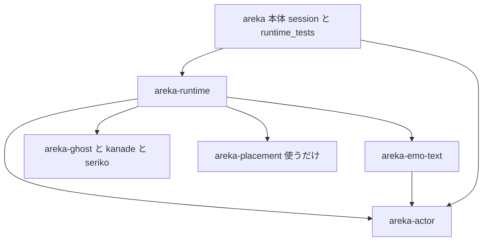
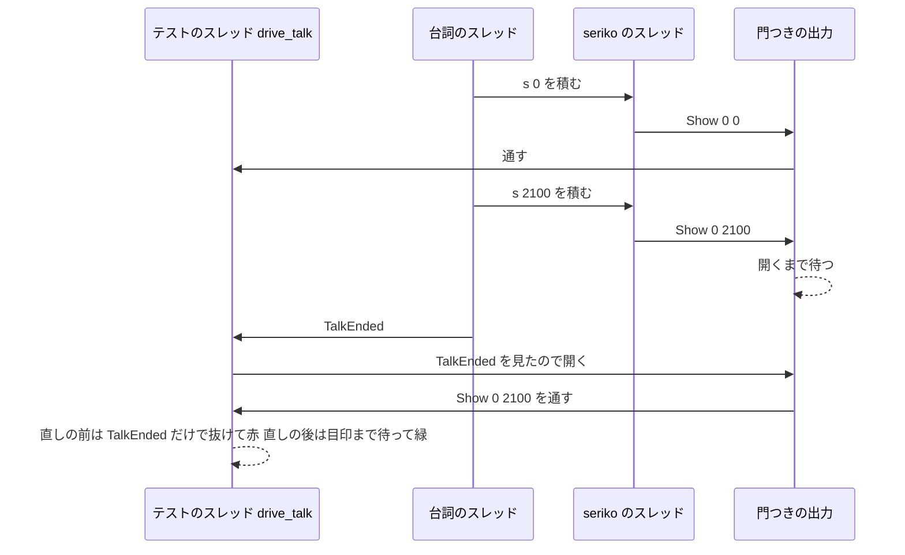

# 設計書: audit-emo2-boot-spine

## 概要

**目的**: areka の実行時の背骨（`crates/areka-runtime/` のうち `frame/`・`frame*.rs` と切替の見直しの持ち物を除いた分）と、本体の起動・読み直し・切替の写しの道（`crates/areka/src/session/` の受け持ちの分・本体の `runtime_tests/` の受け持ちの分）に、ponytail の audit が出した 102 件（`research.md` の 2 節・番号 1〜102）を直す。直した後に同じ範囲へ audit をかけ直して、新しい指摘を 0 件にする。あわせて brief に預かった件 1〜8（要件 5）を片づける。

**使う人**: 開発者。直しの形は ponytail の「いちばん小さい完全な変更」に従う。消せるものは消し、写しは既にある支えへ寄せ、呼び出し元・テスト・テストの支えまで直し切る。新しい機能は足さない。

**変わること**: 本番の振る舞いが変わるのは次の 4 つだけ。⑴ 台本の `\p[n]` の n が 2147483647（`i32::MAX`）を越えると、その表示の指令を `warn!` を 1 件残して捨てる（1 番。今はデバッグのビルドで seriko のスレッドが panic し、リリースのビルドではスコープ 0 の窓の絵が変わる）。⑵ `\v` を運ぶ cue の荷物が開けないとき、`debug!` でなく `warn!` を残す（15 番）。⑶ 読み直しの後の出し直しで seriko が無いとき、「出し直す」の info を出さずに、新しい event 名 `reload_shell_replay_unavailable` の `warn!` を 1 件だけ出す（62 番）。⑷ 読み直しの記録の文の言い回し（79 番・event と欄は同じ）。ゴーストと SSP 互換の振る舞い（SHIORI へ送るイベントの名前・順・Reference）は 1 つも変わらない（要件 7.6 の議題 4 で確定・`research.md` の 4 節）。ほかはテストの直し・写しの寄せ・要らないコードの削除・公開の狭め・テストの置き場の移し替え・古い説明の直しで、外から見た振る舞いは変わらない。

### Goals

- 要件の討議で直すと確定した 100 件（25 番・81 番を除く全部）を、3 つの組とも直す。25 番・81 番は ⑴ として直さずに残す（要件の討議の 2・3）。
- 直したバグと危ない所の 1 件ごとに、壊れたら落ちるテストを 1 本ずつ持たせる（1・2・3・15・62・78 番は新しく赤から立てるテスト。12・17・18・28・29・85・91・92 番はテストそのものの強さの直し）。
- brief の件 1〜8 を片づける（件 1＝4 番・件 2＝2 番と 31 番・件 3＝6 番・件 4＝5 番・件 5＝36 番ほか・件 6＝26・27・33 番・件 7 と件 8＝確かめ済みの記録）。
- タスクは案 C（必ず直す 3 件と、範囲の外に及ぶ 4 番を先に独立のタスクにし、残りをファイルのまとまりで切る）で 20 本に束ねる。規模は事実として記録するだけで、分けない・削らない（要件 2.6）。
- 最後に同じ作法で audit をかけ直し、新しい指摘 0 件・全体テストの緑・既定の枝との差分の確かめを記録する。

### Non-Goals

- 25 番（余韻の 300 反復）と 81 番（毎秒の変化通知の応答本数）は直さない（⑴・要件の討議の 2・3）。
- 範囲の外の見直し（`frame/`・`frame*.rs`・切替の見直しの持ち物・`placement_tests/transition_*`・install／update／readme の cue）。範囲の外で見つけたこと（`research.md` の 6 節のア〜ケ）は持ち主へ申し送り済みか、`/kiro-complete` の未解決の棚卸で扱う（要件の討議の 5）。
- 新しい依存（外の crate も、ワークスペースの中の crate への新しい依存も）。`Cargo.lock` は変えない。
- clippy の指摘の機械的な直し（`clippy-199-lints` の持ち物）。

## 境界の約束

### この spec が持つもの

- 受け持つ 125 ファイル（`research.md` の 1.1 の表）の直し: `crates/areka-runtime/` のうち `frame/`・`frame*.rs`・切替の見直しの持ち物・`placement_tests/transition_*` を除く全部（`Cargo.toml`・`examples/collision-probe*`・`placement_tests/mod.rs` の宣言の印を含む）、本体の `runtime_tests/` の受け持ちの分、本体の `session/` の `hooks.rs`・`reload*`・`runtime_boot*`・`switch_copy*`・`same_folder_pin*`・e2e の 2 本。
- `areka-runtime` の公開の面の次の変化（議題 4 で「読み手を同じ変更で全部直す」と確定した分）: `BootWiringError::SpawnUi` の削除（4 番）・`RuntimeBootError` の削除と `BootRuntimeFn` の戻りの形（48 番）・`BootRuntimeFn` を `pub` に（49 番）・外に使い手の無い 5 項目の狭め（36 番）・`DescriptNotes.empty` の削除（71 番）・使い手の無い `pub` の狭め（46・53・59・60・68・69・77 番）・新しい event 名 `reload_shell_replay_unavailable`（62 番）。
- テストの支え（`#[cfg(any(test, feature = "test-support"))]`）への足し算: `consumer_ledger::test_support::carrier_cue`（97 番）・`spine::settle_bounded`／`settle_bounded_with`（95 番）・`source_text_test_support::crate_path`（102 番・設計の討議の議題 1 で確定）。
- 本体の spine の足場（`crates/areka/src/runtime_tests/spine.rs`）の形の変化: 目印の面を止める門（2 番）・降ろしの失敗で落ちる後片付け（3 番）・装着の前提を 1 本にした `attach_all`（99 番）。

### 範囲の外（持たないもの）

- 範囲の外のファイルの見直し。範囲の外で変えるのは、この spec の直しで壊れる呼び手だけ（要件 3.2・7.2）:
  - 4 番（件 1）: `crates/areka-actor/src/{ui,lib}.rs`・`crates/areka-actor/tests/{toy_ui_pump_test,ui_span_test}.rs`・`crates/areka-emo-text/` の 13 ファイル（`research.md` の 3 節の表）・本体の `crates/areka/src/input_events/balloon_choice_settle_tests.rs`（持ち主 `audit-areka-input-menu` は走っていない・要件 5.1 で申し合わせなしと確定）。
  - 102 番（設計の討議の議題 1）: `crates/areka/src/crate_source_test_support.rs` の `crate_path` を `areka-runtime` の読み口の出し直しにする 1 行と、その説明（持ち主 `audit-areka-app` は走っていない）。
  - 54 番（設計の討議の議題 2）: `RecordedCall::Status` の枝を消して壊れる match の腕 1 行ずつ＝`crates/areka/src/update/worker_path_tests.rs`・`crates/areka/src/shell_balloon_switch_session_lap_tests.rs`・`crates/areka/src/ghost_session_switch_tests.rs`・`crates/areka/src/session/ghost_switch_talk_clock_tests.rs`（持ち主はどれも C22 で走っていない）。`RecordedCall` はテストのときだけ作られる型（`#[cfg(any(test, feature = "test-support"))]` の `spine`）で、本番の約束ではない。`crates/areka-ghost/tests/ghost/` の `RecordedCall` は別の型なので触らない。
  - 条件つき（実装で要ると分かったときだけ・条件が立ったことを検証の記録に書く）: 62 番の読み手 `crates/areka/src/session/ghost_switch_reload_tests.rs`（持ち主 `audit-emo2-boot-switch` は C22 で走っていない）。
- 触らない（C22 の約束・要件 7.3〜7.5）: `crates/areka-runtime/src/frame/`・`frame*.rs`（`frame_test_support::count_level` は使うだけ）・`crates/areka-placement/`（`test_support` は使うだけ）・`crates/log-capture-kit/tests/file_length_guard_test.rs`・`placement_tests/transition_*` の中身・`vendors/`。
- emo-text に新しいソースファイルを足さない（4 番は既にあるファイルを直すだけ）。
- 範囲の外で見つけたこと（`research.md` の 6 節）の直し。申し送りは要件の討議の 5 で済んだ（ア・イ・オ・ウ・キ・ク は各 brief へ書き足し、ケは `audit-ukadoc-survey` のセッションへ伝えた）。エ・カは `/kiro-complete` の未解決の棚卸で扱う件として検証の記録に残す。
- 件 6 の 3 本（`balloon_visibility_phase_tests.rs` の 2 本＝`audit-emo2-boot-switch`・`runtime_tests/frame/window_state_tests.rs` の 1 本＝`audit-emo2-boot-frame`）は触らない（申し送り済み・要件 5.6）。
- 件 7・件 8 は直さない（持ち主の brief に書かれていることを確かめ済み・要件 5.7・5.8）。

### 使ってよい依存

- 今の依存だけ。`areka-runtime` の `[dependencies]`（`areka-actor`・`areka-seriko`・`areka-parsers`・`areka-emo-*`・`areka-ghost`・`areka-kanade`・`areka-sakura`・`areka-placement`・`areka-sylphya`・`shiori-host`・`dola`・`wintf`・`bevy_ecs`・`thiserror`・`tracing`・`windows`）と `[dev-dependencies]`（`log-capture-kit`・`sample-ghost-kit`・`temp-path-kit`・`shiori-host32-host`・`areka-placement`〔test-support〕・`image`・`tracing-subscriber`・`async-io`）。
- テストの支え（`feature = "test-support"` の下）は dev-dependencies を使えない（本体のテストのビルドでは `areka-runtime` は普通のライブラリとしてビルドされ、dev-dependencies がリンクされない）。だから番人の crate（`log-capture-kit`・`sample-ghost-kit`・`temp-path-kit`）を引く補助は、テストの支えに置かない（runtime-crate-split の設計 D4 と同じ理由）。
- `Cargo.toml` で変えるのは 47 番の注釈の 1 行だけ。`Cargo.lock` は変えない。
- 依存の向き（変えない）: 本体（`crates/areka`）→ `areka-runtime` → 下の crate（`areka-actor`・`areka-emo-text`・`areka-ghost` ほか）。`areka-runtime` から本体を引く道は作らない（`BootRuntimeFn`・`SessionHooks` の関数のポインタだけ）。

### 見直しが要る変化（Revalidation Triggers）

- `areka_actor::spawn_ui` と `areka_emo_text::actor::spawn_emo_text` の戻りが `Result` でなくなり、`areka_actor::UiSpawnError` が消える（4 番）。呼び手は同じ変更で全部直す（23 ファイル）。後から `spawn_ui` を呼ぶ spec は `Ok`／`expect` を書かない。
- `areka_runtime::BootRuntimeFn` の戻りが `Result<GhostRuntime, GhostBootError>` になり、`RuntimeBootError` が消える（48 番）。`BootRuntimeFn` は `pub type` になる（49 番）。名前で読む所は本体の `session/runtime_boot.rs`・`runtime_boot_tests.rs` だけ。本番で `boot_runtime` を `wire_runtime` へ渡す `crates/areka/src/ghost_session.rs`（`wire_runtime(` の呼び出し）は型が合えば直しは要らない（変えずにコンパイルが通ることを確かめる）。
- `areka_runtime::reload_args::DescriptNotes` の欄 `empty` が消える（71 番）。読み手は本体の `session/reload.rs`・`reload_tests.rs`。
- 本体の spine の足場の `shutdown_bounded` が、ゴーストの降ろしの失敗（アクターのスレッドの panic）で赤になる（3 番）。使い手は本体の spine 系のテスト 11 ファイル（呼び出し 22 か所・`grep -rn "\.shutdown_bounded()" crates/areka/src` の数）。`ghost_session_restart_tests.rs` は自前の `shutdown_bounded` を持ち、既に `.expect("降ろすのは成功する")` にしている（使い手ではなく、同じ直しの前例）。後から足場を使う spec（`audit-emo2-boot-frame`・`audit-emo2-boot-switch` ほか）は、降ろしの失敗を隠せない。
- 偽の SHIORI（`areka_runtime::spine::ScriptedShioriBackend`）が `Status` を記録しなくなり、`RecordedCall::Status` の枝が消える（54 番・議題 2）。`non_status_calls`・`call_count` の結果は変わらない（今も `Status` を除いて返す）。後から偽の SHIORI の記録を match する spec は `Status` の腕を書かない。
- ログの行: `reload_shell_replay_unavailable` が増え、出し直しで seriko が無いときの `reload_shell_carry_unavailable` がそれへ替わる（62 番）。表示の指令の写像不能の `warn!` の文が「数でない・大きすぎる scope」を言う形へ替わる（1 番）。`\v` の荷物の開けない枝が `warn!` になる（15 番）。どれも字面で読む実機の確かめ・`tools/perf/`・手順書は 0 件（`research.md` の 2 節と、この設計の時点の grep）。読み手のテストは同じ変更で直す。
- テストの置き場: `switch_cue`・`shell_balloon_resolve`・`shell_carry` の純粋な 6 本・`wire`・`settle`・film の E2E が本体から `areka-runtime` へ移る（件 6・34・95・102 番）。本体の `runtime_tests/mod.rs` の宣言が減る。

## つくり

### 今の形と守るもの

- `areka-runtime` は「窓の側」（資産・presenter・文字の層・seriko・`RuntimeWiring`）と「実行系の側」（`BootRuntimeFn` で本体が渡す `boot_runtime`）の 2 段で起動を組む（`wire_runtime`）。この分け方と手順の番号は変えない。48 番が変えるのは、手順 5 の戻りの型だけ（`wire_runtime` は今どおり `let-else` で失敗を受けて後始末する）。
- 表示の指令は「seriko → `PresentBridge`（純変換 `map_display_command`）→ UI の取り出し」で流れる。scope を `TargetId` へ直す正本は `target_map.rs` の 3 つの関数（`shell_target`・`balloon_target`・`scope_of`）。1 番は入口の `scope_of` 1 か所で上限を見る（写像の正本を 1 つのままにする）。
- spine の足場は 2 つの crate に分かれている: 偽の SHIORI と待ちの芯は `areka-runtime` の `spine.rs`・`spine_wait.rs`・`spine_hold_support.rs`（`test-support`）、GPU の World と実の受け口を組む `SpineHarness` は本体の `runtime_tests/spine.rs`。この分け方は変えない。
- 待ちは「進みの目印のある `wait_until`（30 秒進まなければ打ち切り・総時間 300 秒）」に寄せる（35 番・議題 1 で R7.9「ハイブリッドは各呼び出し点の自前の輪」を改めた）。
- テストの支えを 2 つの crate で写さない（runtime-crate-split の設計 D4）。両方の crate が使う補助は `areka-runtime` の `*_test_support.rs`（`pub mod test_support`・`#[cfg(any(test, feature = "test-support"))]`）に 1 つだけ置く（前例: `shell_carry_test_support.rs`・`consumer_ledger_test_support.rs`・`source_text_test_support.rs`）。

### 依存の向き（変えない）



- 本体のテストが `areka-runtime` のテストの支えを引く向きだけを使う。`areka-runtime` のテストが本体を引く道は無い（だから本体の部品を使わないテストは `areka-runtime` へ移す・件 6）。
- 4 番は `areka-actor` → `areka-emo-text` → `areka-runtime` → 本体の順に、下から型を変えて上の呼び手を直す（1 つのタスクの中で全部）。

### 技術の層

| 層 | 使うもの | この spec での役目 | 注 |
|---|---|---|---|
| 言語 | Rust（ワークスペースの edition） | 全部 | 新しい言語機能は使わない |
| 記録 | `tracing`（`warn!`・`error!`） | 1・15・44・45・62 番の記録 | 既存の依存 |
| ECS | `bevy_ecs` | 足場の World（変えない） | 既存 |
| テストの記録の捕捉 | `log-capture-kit`（dev） | 12・15・62・78 番の縛るテスト | 既存の dev-dependencies |
| 一時の根 | `temp-path-kit`（dev） | 34 番の作らない子の道・26 番の検体 | 既存。根はワークツリーの `target\` の下 |
| 同期 | `std::sync::{Mutex, Condvar, Arc}` | 2 番の門 | std |

## ファイルの構成

範囲の中で新しく作るファイルは 0（移す 3 本は `git mv`）。範囲の外で変えるのは、4 番の 18 ファイル・102 番の 1 ファイル・54 番の 4 ファイルと、条件つきの 62 番の 1 ファイルだけ。

### 移すファイル（`git mv`・中身は直しに合わせて改める）

```
crates/areka/src/runtime_tests/switch_cue_tests.rs        -> crates/areka-runtime/src/switch_cue_tests.rs          # 27 番（import を crate::skin_switch::SkinKind に）
crates/areka/src/runtime_tests/spine_settle_tests.rs      -> crates/areka-runtime/src/spine_settle_tests.rs        # 95 番（settle の部品と一緒に）
crates/areka/src/runtime_tests/film_playback_e2e_tests.rs -> crates/areka-runtime/src/film_playback_e2e_tests.rs   # 102 番（議題 1）・96 番の CoInitializeEx も消す
```

### 消すファイル

- `crates/areka/src/runtime_tests/switch_cue.rs`（代わりの親・27 番）
- `crates/areka/src/runtime_tests/shell_balloon_resolve.rs`・`shell_balloon_resolve_tests.rs`（26 番。4 本と補助 `plant_ghost` は `areka-runtime/src/shell_balloon_resolve_tests.rs` へ移して 1 つにする）
- `crates/areka/src/runtime_tests/wire_tests.rs`（34 番。`areka-runtime/src/wire_tests.rs` へ移して 1 つにする）
- `crates/areka/src/runtime_tests/assets_shell_tests.rs`（89 番。`assets_tests.rs` へまとめる）

消す前に、ツリー全体（テスト・テストの支え・examples・fixture・設定・スキル・手順書・steering・文字列での参照・`#[path]`）でファイル名と中の関数名が使われていないことを grep で確かめる（要件 3.3・各タスクの完了の条件）。

### 直すファイル（範囲の中・まとまりごと）

**`crates/areka-runtime/`**
- `src/target_map.rs` — 1 番（`scope_of` の上限・境のテスト）。
- `src/adapter.rs` — 1 番（写像不能の `warn!` の文と注・大きな scope のテスト）・41 番。
- `src/lib.rs` — 4・7・8・48・49 番（`SpawnUi` の削除・説明・`entropy_seeds`・`RuntimeBootError` の削除・`pub type`）・95 番（`spine_settle_tests` の宣言は `spine_wait.rs` 側）・102 番（`film_playback_e2e_tests` の宣言）。
- `src/assets.rs`・`src/hit_region.rs` — 5・6・42 番。`src/assets_tests.rs`・`src/hit_region.rs` のテスト — 37〜40 番。
- `src/wire_tests.rs` — 8・34 番。`Cargo.toml` — 47 番の注釈。`src/sample_test_support.rs` — 46 番。
- `examples/collision-probe.rs`・`examples/collision-probe/{pointer,setup,smoke}.rs` — 43〜45 番。
- `src/spine.rs`・`src/spine_wait.rs`・`src/spine_wait_tests.rs`・`src/spine_hold_support.rs`・`src/talk_clock.rs`・`src/talk_lifecycle_tests.rs`・`src/crash_report_test_support.rs` — 9・10・36・50〜56・95 番。
- `src/consumer_ledger.rs`・`src/consumer_ledger_tests.rs`・`src/consumer_ledger_test_support.rs`・`src/consumer_ledger_agreement_tests.rs` — 11・13・57〜59・97 番。
- `src/shell_carry.rs`・`src/shell_carry_tests.rs`・`src/shell_balloon_resolve_tests.rs`・`src/shell_cursor_assets.rs`・`src/shell_cursor_table.rs`・`src/zorder_wiring_tests.rs` — 11・12・14・26・33・60〜62 番。
- `src/window_state_cue.rs`・`src/window_state_cue_tests.rs`・`src/zorder_cue.rs`・`src/zorder_cue_tests.rs`・`src/user_break_cue_tests.rs`・`src/user_break_cue_origin_tests.rs`・`src/reload_args.rs`・`src/reload_args_tests.rs`・`src/reload_cue.rs`・`src/script_restriction.rs`・`src/switch_cue.rs`（テストの宣言）・`src/placement_tests/mod.rs`（69 番の宣言の印だけ）・`src/placement_tests/{spawn_zorder_pair_deferred_tests,reset_balloon_pos_tests}.rs` — 14・15・27・63〜73 番。
- `src/source_text_test_support.rs` — 102 番（`crate_path` を足す・議題 1）。

**本体 `crates/areka/src/`**
- `runtime_tests/spine.rs` — 2（門）・3・4（`spawn_emo_text` の `expect` を消す）・9・20・21・24・35（説明）・83・84・87・95（settle を `areka-runtime` から引く）・98・99 番。
- `runtime_tests/spine_test_support.rs` — 29・30（`boot_finished`）・86 番。
- `runtime_tests/spine_third_scope_talk_tests.rs` — 2・31・35・100 番。
- `runtime_tests/spine_conformance_{script,judge,support,support_tests,support_stage_tests,lap_tests}.rs` — 17〜19・21〜23・30・80・82・84・85・87 番（25・81 番は根拠の文を残す）。
- `runtime_tests/spine_{display,move_cue,seriko_loop,close_wiring,talk_close,boot_smoke,text_scale}_tests.rs` — 28〜30・32・35・90〜94・99 番。
- `runtime_tests/{mod,assets,assets_tests,shell_carry,shell_carry_tests,consumer_ledger_agreement_tests,strict_judges_tests,zorder_wiring_tests}.rs` — 4・11・26・27・33・34・87〜89・96〜98・101・102 番（宣言の削除を含む）。
- `session/reload.rs`・`reload_tests.rs`・`reload_skin_tests.rs`・`hooks.rs`・`runtime_boot.rs`・`runtime_boot_tests.rs`・`script_security_e2e_tests.rs`・`readme_script_e2e_tests.rs` — 4・16・48・71・74〜79 番。

**範囲の外（直しで壊れる呼び手だけ）**
- 4 番: `crates/areka-actor/src/{ui,lib}.rs`・`tests/{toy_ui_pump_test,ui_span_test}.rs`・`crates/areka-emo-text/src/{actor,actor_test_support,sink,sink_probe_tests,sink_talk_end_tests,actor_tests,actor_lookahead_tests,actor_runtime_frame_tests}.rs`・`tests/{attach_wiring_test,draw_readback_test,pipeline_test,viewbox_scroll_test}.rs`・`examples/emo-text-layer/drive.rs`・本体の `input_events/balloon_choice_settle_tests.rs`。
- 102 番（議題 1）: `crates/areka/src/crate_source_test_support.rs`（`crate_path` を `areka_runtime::source_text_test_support::crate_path` の出し直しにし、説明の規則の文を合わせる）。
- 54 番（議題 2）: `crates/areka/src/{update/worker_path_tests,shell_balloon_switch_session_lap_tests,ghost_session_switch_tests,session/ghost_switch_talk_clock_tests}.rs` の `RecordedCall::Status` の腕 1 行ずつ。

## 流れ

### 2 番 揺れるテストを決定論で赤にする門



- 門は「目印の面 `Show { scope: "0", surface_id: 2100 }` を 1 回だけ止め、テストが `TalkEnded` を見たときに開く」。これで「`TalkEnded` が目印より先に届く」という、今は負荷のときにだけ起きる順を毎回起こす。
- 直しの前（終わりの条件が `TalkEnded` だけ）: `TalkEnded` を見た反復で門を開けても、その反復で `done` が真になって輪を抜けるので、目印は `seen` に入らず、`assert_ran_past_scope_two` の目印の表明で毎回赤。
- 直しの後（終わりの条件が表明と同じ式）: `TalkEnded` を見て門を開け、次の反復以降で目印が届いて緑。
- `research.md` の 2 番の「`drive_talk` が戻ってから門を開ける」形は、直しの後は `drive_talk` が目印を待ち続けて門が開かないので、30 秒の `［止まった］` で赤になる＝直しの後に緑にならない。設計ではこの形をやめ、開ける時点を「`TalkEnded` を見た時」にした（`research.md` の 12 節）。
- 前提: `TalkEnded` は台詞のスレッドが表示の寿命の線へ直に送り、seriko を待たない（`research.md` の 2 番の読み）。崩れて直しの前の形が赤にならない、または直しの後が緑にならないと分かったら、設計の討議へ戻す（要件 5.2）。

## 新しい形を引く直し

### 1 番 スコープの番号の上限（`target_map.rs`・`adapter.rs`）

| 項目 | 中身 |
|---|---|
| 目的 | 台本の `\p[2147483648]` などで `2*scope`・`2*scope+1` があふれないようにする |
| 要件 | 3.1・4.1・4.2・6.2 |

```rust
/// `ActorKey` → scope 番号。数でない key と、`balloon_target` が u32 に収まらない番号（`i32::MAX` を越える）は `None`。
pub fn scope_of(key: &ActorKey) -> Option<u32> {
    key.as_str().parse::<u32>().ok().filter(|&s| s <= i32::MAX as u32)
}
```

- 上限は `i32::MAX`（＝`(u32::MAX - 1) / 2`・`balloon_target` の `2*scope+1` が `u32::MAX` に届く最大）。SSP の測りは要らない（今の振る舞いは互換の振る舞いでなく欠陥で、「数でない key」と同じく捨てる形は ⑶ に当たらない・要件の討議で設計へ回した事項の 2）。
- 入口の `scope_of` 1 か所だけで見る。`shell_target`・`balloon_target` の説明に「`scope` は `i32::MAX` 以下（`scope_of` が守る）」を 1 行足す。ほかの呼び手（`frame/` の窓の側・`skin_facts_copy.rs`・`shell_carry.rs`）は窓の一覧や表から来る小さな数で、窓の側の `frame/dpi.rs` の写しは `audit-emo2-boot-frame` へ申し送り済み（ア）。
- `adapter.rs` の写像不能の `warn!` の文「非数値 scope の DisplayCommand を写像できず drop しました」を「数でない、または大きすぎる scope の DisplayCommand を写像できず drop しました」に直し、`scope` の欄を足さない（荷物は写像の前に消費される・文だけ）。字面で読む所は 0 件（設計の時点の grep）。
- 縛るテスト（`target_map.rs` の `mod tests`・`adapter.rs` の `mod tests`・純関数・決定論）:
  - `scope_of_rejects_a_scope_whose_balloon_target_overflows`: `scope_of("2147483647") == Some(2147483647)`・`balloon_target(2147483647) == TargetId(u32::MAX)`・`scope_of("2147483648") == None`・`scope_of("4294967295") == None`。**直しの前は赤**（`Some(2147483648)`）。
  - `a_show_for_a_too_large_scope_is_not_mapped`: `map_display_command(Show { scope: "2147483648", .. })` が `None`。直しの前はデバッグのビルドで panic（あふれ）＝赤。

### 2 番 揺れるテストの終わりの条件と門（本体の `runtime_tests/spine.rs`・`spine_third_scope_talk_tests.rs`）

| 項目 | 中身 |
|---|---|
| 目的 | 確かめたい中身（目印の面）が届くまで会話の輪を抜けない。負荷の順を門で毎回起こして赤から確かめる |
| 要件 | 4.1・4.2・4.3・5.2 |

**足場の形**（本体の `runtime_tests/spine.rs`・テスト専用）

```rust
/// 1 つの面の Show を 1 回だけ、開くまで止める門（seriko のスレッドの上で待つ）。
pub(crate) struct ShowGate {
    scope: &'static str,
    surface_id: u32,
    open: Arc<(Mutex<bool>, Condvar)>,
}
/// 門の鍵。`open` で開く。捨てても開く（テストが落ちても seriko を止めたままにしない）。
pub(crate) struct ShowGateKey(Arc<(Mutex<bool>, Condvar)>);
impl ShowGateKey { pub(crate) fn open(&self); }
impl Drop for ShowGateKey { fn drop(&mut self); } // open と同じ
pub(crate) fn show_gate(scope: &'static str, surface_id: u32) -> (ShowGate, ShowGateKey);

/// `PresentBridge` を包む出力。門が無ければ今と同じ（そのまま渡す）。
struct GatedOutput { inner: PresentBridge, gate: Option<ShowGate> }
impl SurfaceOutput for GatedOutput { fn send(&mut self, command: DisplayCommand); }

impl SpineHarness {
    /// 今の `boot_with` の中身。`spawn_seriko` へ `GatedOutput { inner: bridge, gate }` を渡す。
    fn boot_with_gate(backend: ScriptedShioriBackend, shiori_handle: ScriptedShioriHandle,
                      driver: LoopDriver, gate: Option<ShowGate>) -> SpineHarness;
    /// 今の呼び手 8 か所はそのまま（`boot_with_gate(.., None)` を呼ぶ）。
    fn boot_with(backend: ScriptedShioriBackend, shiori_handle: ScriptedShioriHandle,
                 driver: LoopDriver) -> SpineHarness;
}
```

- `GatedOutput::send`: 門が在り、`command` が `DisplayCommand::Show { scope, surface_id, .. }` で `scope.as_str() == gate.scope && surface_id == gate.surface_id` のとき、門が開くまで `Condvar` で待ってから `inner.send(command)` し、門を `None` にする（1 回だけ）。ほかはそのまま `inner.send`。
- 本番の `PresentBridge` と `wire_runtime` には触らない（門はテストの足場だけ）。

**テストの直し**（`spine_third_scope_talk_tests.rs`）
- 確かめの式を `fn ran_past_scope_two(seen: &TalkSeen, third_surface: u32) -> bool`（scope 2 の面が在り・目印がその後ろに在り・`TalkStarted → TalkEnded`）に出し、`assert_ran_past_scope_two` はそれを使って今の文で表明する。
- 起動の会話の `done` は `|seen, _| { if ended(seen) { key.open() } ran_past_scope_two(seen, 0) }`。終了の会話の `done` は `ran_past_scope_two(seen, MARKER_SURFACE) && Unload を見た`（門は起動の会話で使い切る）。
- `third_scope_backend()` は `show_gate("0", MARKER_SURFACE)` を作り、`boot_with_gate(.., Some(gate))` で起こし、鍵をテストへ返す。
- 31 番: 頭の説明の L16-L18・`TALK_SPAN_CAP_MS` の説明（L49-L51）・非空虚性の L180 から「終了挨拶の期限 30 秒」の話を消し、頭打ちが効くのは dispatcher の会話の起点の件（`drive_talk` の L116-L117 の注）だと書く。期限で畳まれる道は `TickerMode::Disabled` では起こらないので、「期限超過なら落ちる」の箇条は「止まれば `［止まった］` で落ちる」に直す。
- 縛るテスト: 直した `spine_third_scope_talk_runs_to_the_end_and_the_farewell_quits` そのもの。実装の順は、⑴ 門だけを先に入れ（終わりの条件は今のまま・`TalkEnded` を見た時に鍵を開ける）、毎回赤（目印の表明）になることを見る → ⑵ 終わりの条件を表明と同じ式に直し、緑になることを見る（要件 4.2）。⑴ で赤が立たなければ、設計の討議へ戻す（要件 5.2）。

### 3 番 足場の後片付けが降ろしの失敗で赤になる（本体の `runtime_tests/spine.rs`）

- `shutdown_bounded` のクロージャの中を `ghost.shutdown(CloseReason::User { scope: 0 }).expect("spine ghost shutdown");` にする。クロージャは `run_bounded_watching` の別のスレッドで動くので、panic は待つ側に `［相手が居ない］` の赤として届く。
- 縛るテスト（`spine_boot_smoke_tests.rs` に 1 本・実 GPU）`shutdown_bounded_fails_when_the_shiori_thread_panics`: `OnClose` を台本に入れない台本（`notify("OnClose")` を抜いた標準の台本）で起こし、`shutdown_bounded()` を呼ぶ → 偽の SHIORI が `OnClose` で panic し `shutdown` が `Err` → `#[should_panic(expected = "相手が居ない")]`（文言は `spine_wait.rs` の `run_bounded_watching` の失敗の文に合わせる）。**直しの前は panic せず緑で通る＝`should_panic` が赤**。
- 22 か所（11 ファイル）の呼び出しが全部緑のままであることを確かめてから入れる（降ろしは何度呼んでも同じ結果になる作り）。
- 前提: `notify("OnClose")` を台本に持たない 5 つの台本（`spine_close_wiring_tests`・`spine_conformance_script`・`spine_conformance_support_stage_tests` の 2 本・`spine_third_scope_talk_tests`）は、kanade が自分で止まるのを待ってから降ろすので緑で済んでいる。直しの後にこのどれかが赤になったら、降ろしの退行として根を調べる（台本へ `OnClose` を足して黙らせない）。

### 4 番 `spawn_ui` の戻りから `Result` を外す（件 1・4 つの crate）

```rust
// crates/areka-actor/src/ui.rs
pub fn spawn_ui<M, E>(
    name: &str,
    handler: impl FnMut(M) -> Result<ControlFlow<()>, E> + 'static,
) -> (UiSender<M>, wintf_winmsg_executor::JoinHandle<()>)
where M: Send + 'static, E: std::fmt::Display + 'static;
// UiSpawnError を消す。lib.rs の出し直しと crate の説明の一覧からも消す。

// crates/areka-emo-text/src/actor.rs
pub fn spawn_emo_text(runtime: Rc<RefCell<TextLayerRuntime>>)
    -> (EmoTextSink, wintf_winmsg_executor::JoinHandle<()>);

// crates/areka-runtime/src/lib.rs（wire_runtime の手順 4）
let (emo_text_sink, _emo_text_join) = spawn_emo_text(Rc::clone(&runtime));
// BootWiringError::SpawnUi とその説明（L190・L196-L198・L246-L254 ほか）を消す。
```

- `spawn_ui` の説明の「# Errors」節を消し、「# Risks」節（UI スレッドの外から呼んだときに黙って走らないこと・`debug!` の診断）は残す。「検出手段が用意され次第 `Err` 経路がここに接続される」の文は消す（検出できる口が要るようになったら、そのときの spec が戻りの形を変える）。
- 呼び手は `spawn_ui(`・`spawn_emo_text(`・`UiSpawnError` の grep で 23 ファイル（`research.md` の 3 節の表）。`.expect(..)`・`?`・`match … Err` をそれぞれ外す。説明の文で `spawn_ui` の `Err` に触れる所（`areka-emo-text/src/sink.rs` の 180 行あたりほか）も同じ変更で grep して直す。
- `RuntimeOutcome.seriko: Option<areka_actor::ActorHandle>` が残るので、`areka-runtime` の `areka-actor` への依存は今のまま要る。
- テスト: 消す枝なので新しい縛るテストは無い。4 つの crate のテストが今どおり緑であること（`toy_ui_pump_test.rs`・`ui_span_test.rs`・emo-text のテスト・spine 系）で確かめる。

### 48・49 番 実行系の起動の関数の型（`areka-runtime/src/lib.rs`・本体の `session/runtime_boot.rs`）

```rust
// crates/areka-runtime/src/lib.rs
pub type BootRuntimeFn = fn(
    &mut World,
    RuntimeInputs,
    &CueSinkSources,
    Sender<KanadeNotice>,
    Option<&str>,
) -> Result<areka_ghost::GhostRuntime, GhostBootError>;
// RuntimeBootError を消す。

// crates/areka/src/session/runtime_boot.rs
pub(crate) fn boot_runtime(world: &mut World, inputs: RuntimeInputs, sources: &CueSinkSources,
    kanade_stop: Sender<KanadeNotice>, shell: Option<&str>) -> Result<GhostRuntime, GhostBootError>;
// Err の腕は今どおり warn!／error! を 1 度残してから `return Err(err)`。
```

- 形を `Result<_, GhostBootError>` にした（`Option` にしない）理由: 失敗は記録（`warn!`／`error!`）と `Err` の両方で表す決まり（要件 6.2）と、呼び手のテストが失敗の種類（`GhostBootError::Mount`）まで確かめられること。腕が 1 つの包み（`RuntimeBootError::Boot`）は何も足していない。
- 読み手の直し: `session/runtime_boot.rs` の `pub(crate) use areka_runtime::{CueSinkSources, RuntimeBootError};` から `RuntimeBootError` を外す・L115・L148。`runtime_boot_tests.rs` の L221 を `assert!(matches!(result, Err(GhostBootError::Mount(_))));` にする（無いフォルダは `Mount` で落ちる）。`wire_runtime` の `let Ok(..) = .. else` は変えない。
- 49 番: `pub(crate) type` を `pub type` にする（公開の関数 `wire_runtime` の引数に出る型）。

### 33 番 shell_carry の純粋な 6 本と補助の分け方（件 6・D4）

- `decide_binds_*` の 6 本と、それだけが使う補助 `names`・`names_of`・`char2_names`・`wear` を、そのまま `areka-runtime/src/shell_carry_tests.rs` へ移す。`names_of` は `sample_ghost_kit::WorkDir` の下に descript を書いて本番と同じシェルの読み（`resolve_with_shell` → `BindResolver::from_groups`）で名前表を作る今の形のまま（`sample-ghost-kit` は `areka-runtime` の dev-dependencies にある）。
- 本体に残る `replay_shows_the_decided_surfaces_and_binds_through_seriko` は、名前表をファイルから読まず、その 1 本の中で `BindResolver::from_groups(&BindGroupDefaults::from([(0, ScopeBinds { names: vec![BindGroupName { id: 101, category: "服".into(), part: "B".into(), thumbnail: None, line: 1 }], ..Default::default() })]))` の 1 式で組み、`wear(..)` は `BindReplay { category: "服".into(), part: "B".into(), on: true }` と書く。このテストが確かめるのは送る順（着せ替えが面より先・最初の `Show` が着せ替えた集合を載せる）で、名前の読みではない。
- 補助をテストの支え（`shell_carry_test_support.rs`）へ置く形は取らない。`names_of` が `sample-ghost-kit` を使うので `test-support` の下に置けない（dev-dependencies がリンクされない）。依存を足せば置けるが、要件 6.6 に反する。
- 写しは生まれない（本体に残るのは 1 本だけが使う 1 式で、`names` の写しではない）。設計 D4 の「写しを作らない」を守る。

### 30 番 起動の系列の待ち（本体の `runtime_tests/spine_test_support.rs`）

```rust
/// 起動の系列が終わった（最後の basewareversion が記録された）。OnBoot が台詞を返すと 6 呼び出し・返さないと 5 呼び出し。
pub(super) fn boot_finished(calls: &[RecordedCall]) -> bool {
    calls.iter().any(|c| matches!(c, RecordedCall::Notify { id, .. } if id == "basewareversion"))
}
```

- `>= 5` の 5 か所（`spine_close_wiring_tests.rs`・`spine_talk_close_tests.rs`・`spine_conformance_lap_tests.rs`・`spine_conformance_support_stage_tests.rs`・`spine_conformance_support_tests.rs`）を `boot_finished(&calls)` にし、説明と失敗の文を「起動の系列（最後は basewareversion）」に直す。`>= 6` にしない理由: `spine_conformance_support_stage_tests.rs` の 2 本は `OnBoot` が台詞を返さず（`Ok(None)`）、`OnTranslate` が出ないので 5 呼び出しで終わる＝`>= 6` は永久に来ない（`research.md` の 12 節）。
- 一周のテストの段の台帳（`spine_conformance_script.rs` の `expected_calls`）は、「起動 5」を basewareversion としているが、`OnTranslate` を「起動 4」の後ろに `translated(..)` で挟んでいる＝呼び出しの列は 6 で、台帳と `spine_boot_smoke_tests.rs` の逐語の 6 呼び出しは食い違っていない（調べの結果）。台帳の番号の付け方は変えない。

### 35 番 自前の 30 秒の輪 10 か所を `wait_until` の形へ（議題 1）

各所を `drive_talk` と同じ形にそろえる。

```rust
let received = Cell::new(0u64);
let shiori = harness.shiori_handle.clone();
let probe = || shiori.call_count() + received.get();
wait_until(what, Progress::Count(&probe), || {
    // Tick を入れる・汲む（汲んだ数を received へ足す）・適用する
    if 条件 { return true; }
    std::thread::sleep(BACKOFF);
    false
})
.unwrap_or_else(|failure| panic!("{failure}／{what}"));
```

- 10 か所は `research.md` の 35 番の表のとおり（本体の `runtime_tests/` の display・move_cue・seriko_loop 4・close_wiring 2・third_scope 1・talk_close 1）。汲む物が無い輪（third_scope の終了相の輪）は `received` を持たず `shiori.call_count()` だけを目印にする（進みが無ければ今と同じく 30 秒で赤）。
- 足場に 1 本の部品（`drive_until`）は置かない。10 か所の輪の中身（dispatcher の Tick・seriko の Tick・終了相）がそれぞれ違い、共通にできるのは目印の 2 行だけだから。
- 本体の `runtime_tests/spine.rs` の L19-L22（R7.9「ハイブリッドの輪は `wait_until` を流用しない」）を「待ちはどれも `wait_until`（進みの目印つき）を使う・2026-11-17 の要件の討議で R7.9 を改めた」に直す（9 番の本体側）。
- seriko のループを動かす（`LoopDriver::Live`）輪では、まばたきの指令が出続けるので、受けた数を目印にすると進みが止まらない（退行しても 30 秒でなく総時間 300 秒で落ちる）。各所で、目印を「条件に向かう進み」（待っている呼び出し・面の数など）に絞れるかを確かめ、絞れるなら絞る。
- 縛るテスト: 消す枝なので新しいテストは無い。10 か所のテストが緑のままであること。

### 62 番 出し直しの記録（`areka-runtime/src/shell_carry.rs`）

- `replay` の頭（`shows.is_empty() && binds.is_empty()` の後）で seriko の送り手を確かめ、無ければ `warn!(event = "reload_shell_replay_unavailable", "置き場のゴーストの seriko が無いので、読み直しの前の面を出し直せない")` を 1 件出して戻る。`reload_shell_bind_restored`・`reload_shell_restored`・`fell_back`・`skipped`・`bind_dropped` の記録は、送り手が在るときだけ出す（「出し直す」と書いて出し直さない、を無くす）。
- 控え（`capture_for_reload`）と渡し（`hand_over`）の 2 つは `reload_shell_carry_unavailable` のまま。読み手の `crates/areka/src/session/ghost_switch_reload_tests.rs:L525` は控えの側の数を見るので、期待の数は変わらない（直しは要らない見込み・実装で確かめる）。手が要ると分かったら、持ち主 `audit-emo2-boot-switch` が C22 で走っていないことを記録して、範囲の外で触るファイルの一覧（「範囲の外（持たないもの）」）に足す。
- 縛るテスト（12 番と同じ 1 本に寄せる・`areka-runtime/src/shell_carry_tests.rs`）`replay_without_a_ghost_warns_once_and_restores_nothing`: 置き場の無い World で `replay(&world, &[(0, CarriedShow::Carried(0))], &[])` を `log_capture_kit::capture` で囲み、`reload_shell_replay_unavailable` の warn が 1 件・`reload_shell_restored` が 0 件。空の `replay(&world, &[], &[])` は記録 0 件。**直しの前は赤**（event 名が違う・restored の info が 1 件出る）。

### 78 番 kanade が落ちた後の読み直しの受け付け（本体の `session/reload.rs`）

- コードの直しは要らない見込み（`research.md` の 78 番は「固定するテストが無い」の指摘）。縛るテストを 1 本足す（`session/reload_skin_tests.rs`・結線と seriko の送り手のある組み立て）`reload_requests_after_kanade_died_fail_once_and_leave_no_mark`: 送る相手（kanade）の受信端を落としてから shiori・ghost・balloon を 1 回ずつ要求し（3 回目は `accept_skin` の送り損ねの道を通すため、実行系の要らないバルーンで回す・実装の段の差し戻しで改めた）、`reload_failed` の記録が各 1 件で、印 `ReloadInFlight` が World に残らない（4 回目の要求が `reload_in_flight` で断られない）。
- テストが赤になったら、印が残る道（`reload.rs` の L383-L386・L405-L407・L572-L573）を直す（要件 4.2）。

### 102 番 film の E2E を `areka-runtime` へ（設計の討議の議題 1 で確定）

- 読み口は 1 つのまま、置き場を `areka-runtime` へ下ろす: `crate_path(krate, path) -> PathBuf`（在ることを確かめ、無ければ panic）を `areka-runtime/src/source_text_test_support.rs`（`pub mod`・`test-support`）へ移し、本体の `crate_source_test_support.rs` の `crate_path` は `pub(crate) use areka_runtime::source_text_test_support::crate_path;` の出し直しにする。`crate_source!` のマクロ（呼び手の crate の `CARGO_MANIFEST_DIR` で展開される）は本体に残す。本体のファイルの説明の規則の文（「本体のテストが別の crate のファイルを読むときの、たった 1 つの読み口」）は「本体と `areka-runtime` のテストが別の crate のファイルを読むときの読み口は `areka-runtime` の `crate_path` 1 つ」に直す。
- `CARGO_MANIFEST_DIR` は `areka-runtime` でも `crates/areka-runtime` で、`..` の先の `crates/<krate>` は同じフォルダ＝読む道は今と同じ。
- film の E2E 3 本を `areka-runtime/src/film_playback_e2e_tests.rs` へ移し（`lib.rs` に `#[cfg(test)] #[path] mod film_playback_e2e_tests;`）、`fixture` は `crate::source_text_test_support::crate_path(..)` を呼ぶ。使う crate（emo-atlas・compose・present・sakura・seriko・dola・wintf・windows・bevy_ecs）はどれも `areka-runtime` の依存にある。96 番の `com_init` は消す（`areka-runtime` のテストの実行ファイルにも、プロセスの寿命の MTA を立てる `crash_report_test_support` の据え付けがある＝本体と同じ）。
- 選ばなかった案: 移さずに 102 番を ⑴（placement-crate-split 要件 5.4・5.5「読み口は 1 つ」）として残す。読み口は 1 つのまま置き場を下ろせるので、残す理由が無い（2026-11-17 の設計の討議）。

## 指摘ごとの直し方（1〜102）

「束」はタスクのまとまり（次の節）。「縛るテスト」は、直したバグと危ない所が壊れたら落ちるテスト（要件 4.1）。「—」はテストの直しそのもの・写しの寄せ・削除・説明の直しで、今あるテストが同じ結果で通ることを確かめる（要件 4.7）。行番号は `research.md` の 2 節の時点のもの（実装で関数名から引き直す）。

### 必ず直す（1〜3）

| 番号 | 直し方 | 縛るテスト | 束 |
|---|---|---|---|
| 1 | `scope_of` に上限（上の節） | `scope_of_rejects_a_scope_whose_balloon_target_overflows`・`a_show_for_a_too_large_scope_is_not_mapped` | T1 |
| 2 | 終わりの条件を表明と同じ式に・門で赤から（上の節） | `spine_third_scope_talk_runs_to_the_end_and_the_farewell_quits`（門つき） | T2 |
| 3 | `shutdown_bounded` を `.expect`（上の節） | `shutdown_bounded_fails_when_the_shiori_thread_panics` | T3 |

### 直したほうがよい（4〜36）

| 番号 | 直し方 | 縛るテスト | 束 |
|---|---|---|---|
| 4 | `spawn_ui`・`spawn_emo_text` の戻りから `Result` を外し、`UiSpawnError`・`BootWiringError::SpawnUi` を消す（上の節） | — | T4 |
| 5 | `hit_region.rs` の頭の「`crate::` フリー規律」の節を「probe は crate の公開面で `use` する（`#[path]` で取り込まない）ので、置き場所の制約は無い」の 1 文にする | — | T5 |
| 6 | `build_boot_assets` の `#[allow(dead_code)]` を `#[cfg(any(test, feature = "test-support"))]` に替える（呼び手は全部テスト＝型で示す）。理由の文は今の事実のまま残す | — | T5 |
| 7 | lib.rs の L8-L11 の依存の順の節を消し、L384（`is_benign_boot_error` は本体の `boot_config.rs`）・L436（`ClockedTextSink::new` は本体の `session/runtime_boot.rs`）・L571（`build_balloon_assets_with_limits`）を事実に合わせる | — | T5 |
| 8 | `fn entropy_seeds() -> (u64, u64)` を置いて `wire_runtime` が使い、`wire_tests.rs` は `.0 != .1` を見る | `pick_and_draw_seeds_differ`（今のテストを改める） | T5 |
| 9 | `spine.rs` の L13-L15・`spine_wait.rs` の L4-L5 を今の 3 通りの打ち切り方に直す。本体の `spine.rs` の L19-L22 は 35 番と一緒に直す | — | T8・T17 |
| 10 | `talk_clock.rs` の L7-L8 を消す | — | T8 |
| 11 | 分けたテストの頭の説明を、そのファイルに本当にあるテストだけに縮め、相手の分は「`<相手の crate>` の同じ名前のファイルにある」の 1 行にする。`consumer_ledger.rs` の L58-L60 は 2 つのファイルを名指す。`zorder_wiring_tests.rs` の「据える側（`mod.rs`）」は `lib.rs` へ | — | T15 |
| 12 | `replay_without_a_ghost_does_not_panic` を記録の確かめつきに改める（62 番の節） | `replay_without_a_ghost_warns_once_and_restores_nothing` | T10 |
| 13 | `canonical_has_move_and_bind_registered`・`canonical_registers_both_zorder_pairs` を消す | — | T9 |
| 14 | t_zwi03・t_zwi04・`raise_the_dirty_mark`・`wired_finalize_world`・t_zwi06 の `contains(FrameFinalize)` と、頭の説明の ⑵ と L16-L19 を消す | — | T11 |
| 15 | 開けない荷物の枝で `command == RAISE_TAG_CARRIER` のときだけ `warn!` にする。t_wsc10 の `\v` の分を「warn 1 件」に移す | t_wsc10（`\v` の分）。直しの前は debug なので赤 | T11 |
| 16 | `ghost_name` の本体を `listed_name(session.names().and_then(\|n\| n.name.as_deref()), session.ghost_dir())` にする | —（出力は 1 文字も変わらない・今の読み直しのテストが守る） | T12 |
| 17 | 起動の挨拶の `OnTranslate` の Ref0 を逐語の定数 `r"\0\s[0]アヒル、おはよう。\e"` で書き、L383 の文を消す | 一周のテストの期待値そのもの | T13 |
| 18 | 「1 件も増えない」の assert の前に `settle_bounded` を挟む（2 か所） | 2 本の檻そのもの | T13 |
| 19 | 判定の説明と `areka-runtime/src/spine.rs` の doc に「`OnBalloonTimeout`（台本に無ければ記録しない）だけは列の照合の外」と 1 行ずつ足す | — | T13 |
| 20 | `two_scope_placements()`・`titles()` を消して `areka_placement::spawn::test_support::{two_scope_placements, titles}` を使う | — | T14 |
| 21 | `fake_handle`・`attach_fake_window_handles` を `areka_placement::test_support::give_fake_handles` に、`count_level` を `areka_runtime::frame::test_support::count_level` に寄せる（使うだけ・`frame*` は変えない） | — | T14 |
| 22 | 出どころの注記から行番号を外し、関数名・定数名だけを残す。完了の条件は 6 ファイルで `\.rs:\d+` の grep が 0 件（設計の時点の測りは 88 か所・`research.md` の 12 節） | — | T13 |
| 23 | `#![allow(dead_code)]` と L34-L44 の段落と `CHOICE_MENU_CLOSE` を消し、古い数と記述（judge の 33 行・L120 の要素数・L222 の版・stage の `SpineHarness::new`・support_tests の余白・`DENSE_SPIN` の道）を今の値に直す | — | T13 |
| 24 | 「本番 13 本のうち、先頭 4 本だけを同じ順で渡す」と書き直す | — | T14 |
| 25 | 直さない（⑴・R2.9）。今の形と根拠の文を残す | — | — |
| 26 | `SwitchInFlight` の use と assert の 2 行を消し、4 本と `plant_ghost` を `areka-runtime/src/shell_balloon_resolve_tests.rs` へ移す。代わりの親と `mod.rs` の 1 行を消す | — | T15 |
| 27 | `switch_cue_tests.rs` を `areka-runtime` へ `git mv` し、import を `crate::skin_switch::SkinKind` に、`carrier_cue` は 97 番の支えへ。`switch_cue.rs` に `#[cfg(test)] #[path = "switch_cue_tests.rs"] mod tests;`。代わりの親と `mod.rs` の行を消す | — | T15 |
| 28 | `text_surface_opaque` を `rt.surface(actor).expect("装着済み").read_back().expect("読み戻せる")` の形にする | Clear の檻そのもの | T16 |
| 29 | `present_command_target`・`variant_name` の match に `ReplaceTarget`・`StageAck`・`MoveShift` の腕を足す | S4 の檻そのもの | T16 |
| 30 | `boot_finished` に寄せる（上の節） | — | T16 |
| 31 | 3 か所の説明を事実に合わせる（2 番の節） | — | T2 |
| 32 | まばたきのスモークを消す（`always_fire_rng` は残す） | —（golden が同じ壊れ方で落ちる） | T16 |
| 33 | 6 本を `areka-runtime` へ移す（上の節） | — | T15 |
| 34 | `boot_runtime` の代わりに `\|_, _, _, _, _\| unreachable!("壊れた根で起動まで行った")` を渡し、道は `TempPath::under_target(..)` の作らない子の道にして、`areka-runtime/src/wire_tests.rs` へ移す | — | T15 |
| 35 | 10 か所を `wait_until` の形へ（上の節） | — | T17 |
| 36 | `record_status`・`snapshot_status_calls` を `pub(crate)`、`wait_thread_end`・`HoldGate` を私有、`shell_carry::decide` を `pub(crate)` にする | — | T8 |

### できれば（37〜102）

| 番号 | 直し方 | 縛るテスト | 束 |
|---|---|---|---|
| 37 | 当たり判定の重なったテスト 2 本を消す | — | T7 |
| 38 | `assets_tests.rs` の L670-L716 を消す | — | T7 |
| 39 | 同じ等式の 2 回目を消す | — | T7 |
| 40 | 古い説明 4 か所を直す | — | T7 |
| 41 | 「4 写像」を消し、テストの名前 `all_variants` を見ている種類に合わせる | — | T5 |
| 42 | assets の説明 2 か所を直す | — | T5 |
| 43 | probe の説明を今の終わり方・`_with_shell`・`frame/` に直す | — | T6 |
| 44 | 自動終了の値が読めないとき `warn!` を 1 行出す | —（examples は全体テストでコンパイルまで・記録の足し・議題 3 で縛るテストを置かないと確定） | T6 |
| 45 | `let _ = tx.send(..)` の失敗で `error!` を出す | —（同上） | T6 |
| 46 | `acquire_emo2` を私有にし、説明の 1 つ目の箇条を消す | — | T5 |
| 47 | Cargo の注釈を「examples の購読者」にする | — | T5 |
| 48 | `BootRuntimeFn` の戻りを `Result<_, GhostBootError>` に（上の節） | `failed_boot_leaves_world_unchanged`（`Mount` まで見る形に改める） | T5 |
| 49 | `pub type BootRuntimeFn` | — | T5 |
| 50 | 1 行消す | — | T8 |
| 51 | 行番号を外し、関数名・定数名だけにする | — | T8 |
| 52 | `HOLDER_ROWS` の説明を「2 つずつ取る檻が 2 本で同時に 4 つ」に直す | — | T8 |
| 53 | `HOLDER_ROWS`・`NO_ROW` の `pub` を外す | — | T8 |
| 54 | `status()` は `HelperStatus::Running` を返すだけにし、`Status` の push・除く filter・欄 `status` を消す。`RecordedCall::Status` の枝も消し、読み手の match の腕（範囲の中の `spine_boot_smoke_tests.rs`・範囲の外の 4 ファイル）と `spine_conformance_judge.rs` の説明の文を直す（議題 2） | — | T8 |
| 55 | 子が自分で `use std::time::{Duration, Instant}` し、親の 3 行を消す | — | T8 |
| 56 | 3 行を消す | — | T8 |
| 57 | 正準台帳を表 `const CANONICAL: [(&str, Option<&str>, CommandConsumer); 43]` と `for` にし、各行は `try_register(..).unwrap_or_else(\|e\| panic!("正準台帳: ({name}, {selector:?}) は一意（重複・排他違反は編集ミス）: {e:?}"))`。説明の 3 つの手写しの一覧は消し、「表 `CANONICAL` が正本」と書く | —（`samples_cover_exactly_the_ledger_rows` が行の集合を守る） | T9 |
| 58 | 件数の assert と `entry_count` を消す | — | T9 |
| 59 | `pub const ABSOLUTE` を `const` に | — | T9 |
| 60 | `pub sized` を `pub(crate)` に | — | T10 |
| 61 | `PathReason` を `Option<Vec<PathBuf>>` にし、呼び手 1 か所とテスト 1 本を直す | — | T10 |
| 62 | 送り手の確かめを記録の前へ・新しい event 名（上の節） | `replay_without_a_ghost_warns_once_and_restores_nothing` | T10 |
| 63 | 「`MoveCueSink::emit` の宛名の規律」と名前で指す | — | T11 |
| 64 | 「開けない形の set/reset を警告する持ち主が本 sink だけ」に直す | — | T11 |
| 65 | 「本体」を「areka-runtime」に言い換える | — | T11 |
| 66 | `code_only` を `crate::source_text_test_support::code_only`、`count_level` を `crate::frame::test_support::count_level`（使うだけ）、`index_of` を 1 つに寄せる | — | T11 |
| 67 | 2 本を消す | — | T11 |
| 68 | `parse_window_state`・`ParsedWindowState` の `pub` を外す | — | T11 |
| 69 | `placement_tests/mod.rs` の `pub(crate) mod transition_judge_offset` を `mod` にする（宣言だけ・中身に触らない） | — | T11 |
| 70 | `if let Err(SendError(reload)) = self.tx.send(reload)` で、失敗のときだけ書く | — | T11 |
| 71 | `DescriptNotes.empty` を消し、読み手（本体の `session/reload.rs` の L267）は `ReloadTarget::Descript(p)` から判る（`p` の全部が偽）。`reload_tests.rs` の読み手も直す | —（「語が無い」の断りの今のテストが守る） | T11 |
| 72 | 実装の初めに `cargo check -p areka-runtime --lib` の警告で確かめ、`note`・`source`・`enforced` が「never read」なら構造体に `#[cfg_attr(not(test), expect(dead_code, reason = "表の照合テストだけが読む欄"))]` を付ける。警告が出なければ前提が崩れたので、検証の記録に書いて閉じる | — | T11 |
| 73 | `.join().expect(..)`・`unwrap_or_else(\|e\| panic!("…: {e:?}"))` にする | — | T11 |
| 74 | 「13 本」に直す | — | T12 |
| 75 | 親の `runtime_boot_tests.rs` に `emo2_inputs`・`shut_down` を置き、子の 2 本はそれを呼ぶ | — | T12 |
| 76 | 片方（`reload_tests.rs`）に置き、もう片方から呼ぶ | — | T12 |
| 77 | ファイルの中でしか使わない物の `pub(crate)`・`pub(super)` を外す | — | T12 |
| 78 | 固定するテストを足す（上の節） | `reload_requests_after_kanade_died_fail_once_and_leave_no_mark` | T12 |
| 79 | 記録の文と説明を「台詞の切れ目に達しなかった（理由は left 欄）」にする（`event`・`reason` の欄は変えない） | — | T12 |
| 80 | 注入時刻の上限を `LAP_STAGES[LAP_STAGES.len() - 1].limit_ms` から const で導く | — | T14 |
| 81 | 直さない（⑴・task 2.2 の本数の規則）。今の形と根拠の文を残す | — | — |
| 82 | 自己検査は残し、中の `Vec` をやめて `any` 1 回にする（議題 3） | — | T14 |
| 83 | `runtime` の欄の `#[allow(dead_code)]` を消す（コンパイルで確かめる・警告が出れば読み手の事実を確かめ直す） | — | T14 |
| 84 | `let _ = shiori_handle;`・`let _ = reached;` を消し、`\|\| String::new()` を `String::new` に | — | T14 |
| 85 | 1 本目と同じく印を立て、assert の文に出す | 2 本目の檻そのもの | T14 |
| 86 | `resource::<GhostWindows>().balloon_window(scope)`（`char_window`）で Entity だけ取る | — | T14 |
| 87 | 重ねた `#[cfg(test)]` を消す | — | T14 |
| 88 | 3 行を消す | — | T17 |
| 89 | `assets_shell_tests.rs` を `assets_tests.rs` へまとめ、代わりの親の宣言を 1 つ消す | — | T17 |
| 90 | 「二重に当てていない」の assert を消す | — | T16 |
| 91 | 集めた後に `settle_bounded` で残りを汲んで「ちょうど 2 件」を見る | S3 の檻そのもの | T16 |
| 92 | 同上（短い settle） | `seriko_tick_expect_one` そのもの | T16 |
| 93 | 進めるのを 1 か所にし、重なった if と説明を直す | — | T16 |
| 94 | 文を直す | — | T16 |
| 95 | `settle_bounded_with(now, pause, step)` に `pause` を足し、`settle_bounded` と一緒に `areka-runtime/src/spine_wait.rs` へ移す（`pub`・`test-support`）。本体の `spine.rs` は出し直しで引く。檻 4 本は `spine_settle_tests.rs` ごと `areka-runtime` へ移し、時計を差した檻は眠らない `pause` を渡す | — | T15 |
| 96 | `CoInitializeEx` の 3 か所を消す（film の分は 102 番の移しと一緒に） | — | T17 |
| 97 | `pub fn carrier_cue(name: &str, args: &[&str]) -> TalkCue` を `consumer_ledger_test_support.rs` に置き、範囲の中の 2 個（本体の `consumer_ledger_agreement_tests.rs`・`switch_cue_tests.rs`）を寄せる | — | T9 |
| 98 | 本体の中では `spine.rs` の `pump_until_idle` を `pub(super)` で使う | — | T17 |
| 99 | 足場に `fn attach_all(&mut self)`（`capture_logs(run_attach_phase)`・`planned=2 attached=2`・ERROR 0 の 3 つを確かめる）を 1 本置き、11 か所から呼ぶ | — | T17 |
| 100 | doc に「足場は emo2 の 2 scope」と書き、assert は「足場の窓の scope がえみりの形と同じ」に読み替えて残す | — | T17 |
| 101 | 本体の側の t_zwi05 の対照の 3 行を消す | — | T17 |
| 102 | 読み口を `areka-runtime` へ下ろし、film の E2E を移す（上の節・議題 1） | — | T15 |

### 直さない・回した指摘（要件 2.5・5.9 の記録）

| 番号 | 扱い | 根拠 |
|---|---|---|
| 25 | 直さずに残す（⑴） | 完了した spec の決め R2.9「製品のコードへ観測の口を作らない」（要件の討議の 2） |
| 81 | 直さずに残す（⑴） | 完了した spec の task 2.2「段の上限だけから導き、駆動器から借りない」（要件の討議の 3） |
| 件 7 | 直さない（持ち主の brief に既にある） | `audit-placement-follow-residue/brief.md` の 109 行（要件 5.7） |
| 件 8 | 直さない（持ち主の brief に既にある） | `audit-emo2-boot-switch/brief.md` の 98 行（要件 5.8） |
| 件 6 の 3 本 | 持ち主へ申し送り済み | `audit-emo2-boot-switch`（2 本）・`audit-emo2-boot-frame`（1 本）（要件 5.6・7.8） |
| ア〜ケ | 申し送り済み／`/kiro-complete` の棚卸 | 要件の討議の 5 |

かけ直しの audit で同じ件が出ても数えない（要件 9.2）。

## タスクの束と順

案 C で 20 本に束ねる。順は「必ず直す 3 件と 4 番を先に・本体の `runtime_tests/spine.rs` を触る束は続けて・移す束は移す先の支えを作る束の後・仕上げは最後」。

| 束 | 中身（指摘） | 主なファイル | 先に要るもの |
|---|---|---|---|
| T1 | スコープの番号の上限: 1 | `target_map.rs`・`adapter.rs` | — |
| T2 | 揺れるテスト: 2・31（門から） | 本体の `spine.rs`・`spine_third_scope_talk_tests.rs` | — |
| T3 | 足場の降ろし: 3 | 本体の `spine.rs`・`spine_boot_smoke_tests.rs` | T2 |
| T4 | `spawn_ui` の戻り（件 1）: 4 | `areka-actor` 4・`areka-emo-text` 13・`areka-runtime/src/{lib,strict_judges_tests}.rs`・本体 4 | T3 |
| T5 | lib.rs・assets・hit_region・wire: 5〜8・41・42・46〜49 | `lib.rs`・`assets.rs`・`hit_region.rs`・`adapter.rs`・`wire_tests.rs`・`sample_test_support.rs`・`Cargo.toml`・本体の `session/runtime_boot{,_tests}.rs` | T1・T4 |
| T6 | examples: 43〜45 | `examples/collision-probe*` | — |
| T7 | assets と当たり判定のテスト: 37〜40 | `assets_tests.rs`・`hit_region.rs` | T5 |
| T8 | spine の足場（`areka-runtime`）と公開の戻し: 9（runtime 側）・10・36・50〜56 | `spine.rs`・`spine_wait*.rs`・`spine_hold_support.rs`・`talk_clock.rs`・`talk_lifecycle_tests.rs`・`crash_report_test_support.rs`・`shell_carry.rs`（`decide`）・54 番の match の腕（本体の `spine_boot_smoke_tests.rs`・範囲の外の 4 ファイル） | T3（`spine_boot_smoke_tests.rs` を触る束の順） |
| T9 | 台帳: 13・57〜59・97 | `consumer_ledger*.rs`・本体の `consumer_ledger_agreement_tests.rs`・`switch_cue_tests.rs`（まだ本体） | — |
| T10 | シェルの資産: 12・60〜62 | `shell_carry*.rs`・`shell_cursor_*.rs` | T8 |
| T11 | cue と `placement_tests/`: 14・15・63〜73 | cue の各ファイル・`reload_args*.rs`・`script_restriction.rs`・`placement_tests/{mod,spawn_zorder_pair_deferred_tests,reset_balloon_pos_tests}.rs`・本体の `session/reload{,_tests}.rs`（71 番） | — |
| T12 | `session/`: 16・74〜79 | 本体の `session/` の受け持ちの分 | T5・T11 |
| T13 | 一周の適合のテスト（台本と判定）: 17〜19・22・23 | `spine_conformance_{script,judge,support,support_tests,support_stage_tests}.rs`・`areka-runtime/src/spine.rs`（19 番の doc） | T8 |
| T14 | 一周の適合のテスト（足場と駆動）: 20・21・24・80・82〜87（25・81 は根拠の文を残す） | 本体の `spine.rs`・`spine_conformance_{lap_tests,support,support_stage_tests,judge}.rs`・`spine_test_support.rs` | T4・T13 |
| T15 | 本体から `areka-runtime` への移し替え（件 6）: 11・26・27・33・34・95・102 | 上の「移すファイル」「消すファイル」・`areka-runtime` の受け側・本体の `runtime_tests/mod.rs`・`crate_source_test_support.rs` | T5・T9・T10・T14 |
| T16 | 本体の `runtime_tests/` の残り（その 1）: 28〜30・32・90〜94 | `spine_{talk_close,display,close_wiring,seriko_loop,move_cue,boot_smoke}_tests.rs`・`spine_test_support.rs`・一周の 3 ファイル（30 番） | T14・T15 |
| T17 | 本体の `runtime_tests/` の残り（その 2）: 35・9（本体側）・88・89・96・98〜101 | 本体の `spine.rs`・spine 系の 7 ファイル・`assets*.rs`・`zorder_wiring_tests.rs` | T16 |
| T18 | 預かった件の記録: 件 1〜8 の片づけと出どころ（要件 5.9）・申し送りの確かめ（エ・カ） | `research.md`（記録）・検証の記録 | T1〜T17 |
| T19 | かけ直しの audit（最大 5 回・要件 9.1〜9.3・9.6・9.7） | 範囲の全部 | T18 |
| T20 | 全体テストと既定の枝との差分の確かめ（要件 9.4・9.5） | 範囲の全部 | T19 |

- 並べて進められる組: T1・T6・T7（T5 の後）・T8（T3 の後）・T9・T11 は互いにファイルが重ならない。本体の `runtime_tests/spine.rs` を触る T2 → T3 → T4 → T14 → T15 → T16 → T17 は直列。
- 規模の見立て: 20 タスク（ギャップ分析の見込み 20〜24・手間 L）。1 本のまま進める（要件 2.6）。

## 1,000 行の番人

| ファイル | 今 | 直しの後の見立て | 守り方 |
|---|---|---|---|
| `crates/areka/src/runtime_tests/spine_conformance_lap_tests.rs` | 913 | 約 890（21 番 −20・84・87） | 足さない |
| `crates/areka/src/runtime_tests/spine_conformance_script.rs` | 894 | 約 880（23 番 −14・22 番は置き換え・17・80 は同じ行数） | 足さない |
| `crates/areka/src/session/reload_tests.rs` | 857 | 861（76 番 −35・78 番のテストは `reload_skin_tests.rs` へ置いた） | 950 を越えそうなら 78 番のテストを兄弟の新しいテストのファイルへ（本体の `session/` は emo-text でない） |
| `crates/areka-runtime/src/assets_tests.rs` | 810 | 約 745（38・39 番） | — |
| `crates/areka/src/session/reload.rs` | 774 | 約 760（16 番 −15） | — |
| `crates/areka-runtime/src/lib.rs` | 758 | 約 745（4 番 −15・8 番 +5・48 番 −8・102 番 +3） | — |
| `crates/areka/src/runtime_tests/spine.rs` | 659 | 約 650（2 番 +45・20 番 −38・21 番 −5・95 番 −30・99 番 +15） | — |
| `crates/areka-runtime/src/spine_wait.rs` | 632 | 約 670（95 番 +35・36 番 ±0） | — |
| `crates/areka-runtime/src/shell_balloon_resolve_tests.rs` | 173 | 約 410（26 番で 4 本と補助を受ける） | — |
| `crates/areka-emo-text/src/actor.rs` | 921 | 約 915（4 番で減る） | 足さない |

ほかのファイルは減るか、少し増えても 700 行を越えない。`file_length_guard_test.rs` の上限越えの表に載る範囲の中のファイルは 0 本（設計の時点の確かめ）。

## 要件の対応

| 要件 | 中身 | 受け持つ所 |
|---|---|---|
| 1.1・1.2・1.3・1.4・1.5・1.6・1.7 | 洗い出し | 済み（`research.md` の 1〜4 節）。T19 のかけ直しで同じ作法（範囲だけ・`main` を取り込んで測り直す・上限なし・全部読む・通し番号と組と場所・約束の印） |
| 2.1・2.2・2.3・2.4・2.5・2.6 | 討議で確定 | 済み（requirements.md の「要件の討議で確定したこと」）。この設計の「直さない・回した指摘」の表（2.5）・「タスクの束と順」の規模の記録（2.6）。⑶ に当たる指摘は 0 件で、2.3 の測りは要らない |
| 3.1 | 全部直す | 「指摘ごとの直し方」の 100 行・T1〜T17 |
| 3.2 | 呼び出し元まで | 4・48・71 番の読み手（「範囲の外」と各節）・移し替えの宣言（T15）。各タスクで形を変えた項目の名前をツリー全体で grep する |
| 3.3 | 消す前に確かめる | 「消すファイル」の節・13・14・23・32・37〜39・67・90 番ほか。各タスクの完了の条件 |
| 3.4 | 新しい機能を足さない | 足すのは 1 番の上限・15・44・45・62 番の記録・2 番の門（テストの足場）・テストの支えの 3 つの部品だけ（どれも指摘の直し） |
| 4.1 | 1 件 1 本のテスト | 各行の「縛るテスト」（1・2・3・15・62・78 番）とテストの強さの直し（12・17・18・28・29・85・91・92 番） |
| 4.2 | 赤から立てる | 1・2・3・15・62・78 番の節に「直しの前は赤」を書いた。2 番は門で順を作る |
| 4.3 | 決定論 | 1・15・62 番は純関数か記録の捕捉。2 番は門（`Condvar`）で順を固定。3 番は台本に無い呼び出しで必ず panic。78 番は受信端を落として決まった失敗。35 番は進みの目印で負荷に打ち切られない |
| 4.4 | 全体テストの中で回る | 移したテストは `areka-runtime` の `#[cfg(test)]`（`cargo test -p areka-runtime`）で回る。examples の 44・45 番はテストを持たない（議題 3 で確定・コンパイルは全体テストで通る） |
| 4.5 | `target` の下 | 34 番の作らない子の道は `TempPath::under_target`。26・33 番の検体は `temp-path-kit`・`sample-ghost-kit`（どちらもワークツリーの `target\` の下） |
| 4.6 | 実 GPU | 3 番の縛るテストと spine 系はどれも今の足場の実 GPU（`GpuPermit`） |
| 4.7 | 古びたテストを改める | 8・12・15・30・48・62 番のテストを的を外さずに改める。消すテスト（13・14・32・37〜39・67・90・101 番）は、残るテストが同じ中身を守ることを行ごとに確かめる |
| 5.1 | 件 1 | 4 番の節・T4 |
| 5.2 | 件 2 | 2 番の節・T2（赤が立たなければ設計の討議へ戻す） |
| 5.3 | 件 3 | 6 番・T5 |
| 5.4 | 件 4 | 5 番・T5 |
| 5.5 | 件 5 | 36 番（5 項目）・46・53・59・60・68・69・77 番の狭め・T8・T5・T9〜T12。(b) の 62 項目は戻さない（議題 4） |
| 5.6 | 件 6 | 26・27・33 番・T15。3 本は申し送り済み |
| 5.7・5.8 | 件 7・件 8 | 「直さない・回した指摘」の表 |
| 5.9 | 出どころと一緒に記録 | T18 |
| 6.1 | 1,000 行 | 「1,000 行の番人」 |
| 6.2 | `error!`＋`Err` | 「失敗の扱い」・48 番（`Result` のまま） |
| 6.3 | 正規の終了 | 3 番（降ろしの失敗を捨てない）・73 番（スレッドの後始末の失敗を捨てない）。終了の道のコードは変えない |
| 6.4 | 1 フレーム遅らせない | 遅らせる直しは 0。2 番は終わりの条件を直し、待つ時間で逃げない |
| 6.5 | 文字化け | 端末へ出す文を足さない（記録の文は `tracing` の欄だけ） |
| 6.6・6.7 | 依存を足さない | 「使ってよい依存」。33 番の分け方は依存を足さない形を選んだ |
| 6.8 | フォーク・`[patch]` | しない |
| 7.1 | 走っている相手と申し合わせ | 範囲の外で触る持ち主（`audit-sylphya-actor` の後の `areka-actor`・`areka-emo-text`・`audit-areka-input-menu`・`audit-areka-app`）はどれも C22 で走っていない。走っている 5 本の触るファイルとの重なりは 0 |
| 7.2 | 要る変更だけ | 「範囲の外（持たないもの）」の、範囲の外で触るファイルの一覧（条件つきの項を含む）だけ |
| 7.3・7.4・7.5 | C22 の約束 | 「範囲の外（持たないもの）」・69 番は宣言の印だけ・T20 で差分を確かめる |
| 7.6 | 外への約束 | 「見直しが要る変化」。議題 4 の裁定の分（4・36・48・62・71 番）と、ログの語を変える 1・15・79 番（字面の読み手 0 件・同じ変更で直す） |
| 7.7・7.8 | 申し送り | 済み（要件の討議の 5）。T18 で記録を確かめる |
| 7.9 | `vendors/` | 触らない |
| 8.1・8.2 | 重い操作・SSP の測り | 回さない。SSP の測りは要らない（1 番の上限は要件の討議で測らないと決めた） |
| 8.3 | 実機の確かめは全体テストの中で | T20 |
| 8.4 | 赤は絞って回す | T20・各タスクの確かめ |
| 8.5 | 8.1 でしか確かめられない直し | 0 件（どれも決定論のテストで確かめられる） |
| 9.1・9.2・9.3・9.6・9.7 | かけ直し | T19（「仕上げの確かめ」） |
| 9.4 | 全体テスト | T20 |
| 9.5 | 差分で約束を確かめる | T20 |

## 失敗の扱い

- **1 番**: 大きすぎる scope の表示の指令は、今の「数でない scope」と同じ道（`PresentBridge::send` の `warn!` と捨てる）に乗る。panic も別の窓の絵の変化も起きない。
- **15 番**: `\v` の荷物が開けないときは `warn!`（今は `debug!` で既定の水準では見えない）。`set` の debug の例外は今のまま。
- **44・45 番**: probe の自動終了の値が読めないときは `warn!`、送れなかったときは `error!`（今は黙って捨てる）。
- **48 番**: 実行系の起動の失敗は今どおり `boot_runtime` が `warn!`（起点が無い）か `error!`（それ以外）を 1 度残し、`Err(GhostBootError)` を返す。`wire_runtime` は記録し直さずに後始末して `fallback()` へ倒れる（変えない）。
- **62 番**: 出し直しで seriko が無いときは `reload_shell_replay_unavailable` の `warn!` を 1 件だけ。控えの側の `reload_shell_carry_unavailable` は今のまま。
- **3・73 番**: テストの後片付けで、アクターのスレッドの panic と後始末の失敗を捨てない（テストが赤になる）。
- **4 番**: `spawn_ui` は失敗を返さない（返せる失敗が無い）。UI スレッドの外から呼んだときの黙った失敗は、今どおり `debug!` の診断と説明の「Risks」で扱う。

## テストの方針

- **単体（`areka-runtime`）**: スコープの番号の境と大きな scope の写像（1 番）・`\v` の warn（15 番）・出し直しの記録（12・62 番）・種の 2 つ（8 番）・台帳の表（57 番は `samples_cover_exactly_the_ledger_rows` が守る）。どれも純関数か記録の捕捉で、GPU も実時間も要らない。
- **結合（本体の spine の足場・実 GPU）**: 門つきの揺れるテスト（2 番）・降ろしの失敗が赤になる（3 番）・起動の系列の待ち（30 番）・10 か所の待ち（35 番）・装着の前提（99 番）。足場の形を変える 2・3・99 番の後は spine 系の 12 ファイルと `ghost_session_restart_tests.rs` が全部緑であることを確かめる。
- **結合（本体の `session/`）**: kanade が落ちた後の読み直し（78 番）・`BootRuntimeFn` の失敗の種類（48 番）・`DescriptNotes` の欄を消した後の「語が無い」の断り（71 番）。
- **移したテスト**: 移した先（`cargo test -p areka-runtime`）で同じ数のテストが同じ名前で緑になること。本体の側から消えたテストの数と、`areka-runtime` の側に増えた数が合うことを、タスクの完了の確かめに書く（件 6・34・95・102 番）。
- **消すテスト**: 残るテストが守る中身を縛っていることを、消す行ごとに確かめる（13・14・32・37〜39・67・90・101 番）。
- **番人**: 1,000 行の番人と `temp_path_guard_test.rs`（34 番の道は `TempPath` の入口を通る）が緑。
- **重い走行**: 赤が出たら 2 回目からは赤のテストだけに絞る（要件 8.4）。GPU のテストを何度も回さない。
- **仕上げ**: 範囲へ audit をかけ直して新しい指摘 0 件・全体テストが緑・既定の枝との差分の確かめ（T19・T20）。

## 仕上げの確かめ（T19・T20・要件 9）

1. `main` を取り込み、範囲のファイルの数と行数を測り直す（要件 1.2 と同じ作法）。移したファイルは移した先で範囲に数える。
2. 範囲だけへ `/ponytail:ponytail-audit` をかけ直す。上限 20 件は外し、全部のファイルを全行読む（要件 9.1）。出た指摘は、直しが生んだ物も含めて直し、0 件になるまで繰り返す。数えないのは「直さない・回した指摘」の表の件だけ（要件 9.2）。5 回目で収まらず、5 回目に「必ず直す」と本番の振る舞いに関わるものが 1 件も無ければ、開発者に一言知らせて 5 回目の直しで打ち切る（要件 9.6）。同じ所から「必ず直す」が出続けるなら、打ち切らずに Fable で総括し直して議題にする（要件 9.7）。回と結果を `research.md` の「かけ直しの結果」に残す（要件 9.3）。
3. `pwsh -NoProfile -File tools/test-all.ps1` が緑で終わる（要件 9.4）。赤なら赤のテストだけに絞って回し直す（要件 8.4）。
4. 既定の枝との差分で約束を確かめ、結果を検証の記録に残す（要件 9.5）:
   - `git diff --stat origin/main...HEAD -- crates/areka-runtime/src/frame/ 'crates/areka-runtime/src/frame*' crates/areka-placement/ crates/log-capture-kit/tests/file_length_guard_test.rs vendors/ Cargo.lock` が空。
   - `git diff --name-only --diff-filter=A origin/main...HEAD -- crates/areka-emo-text/` が空（emo-text に新しいファイルが無い）。
   - `git diff origin/main...HEAD -- 'crates/areka-runtime/src/placement_tests/transition_*'` が空。`placement_tests/mod.rs` の差分は 69 番の 1 行だけ。
   - 範囲の外のファイルの差分が、「範囲の外（持たないもの）」の範囲の外で触るファイルの一覧（条件つきの項は、条件が立ったことを検証の記録に書いた分）だけ。
   - 外への約束の変わった所が、「見直しが要る変化」に挙げた分だけ（公開の名前の削除・狭めを grep で示し、ログの event 名と文の変化を字面の読み手 0 件と一緒に示す）。

## 安全の考え

- 他人のゴーストの台本は信用できない入力。1 番は、台本 1 行で seriko のスレッドが落ちる（デバッグ）か別の窓の絵が変わる（リリース）道を、入口の 1 か所で閉じる。
- 2 番の門はテストの足場の中だけにあり、本番の `PresentBridge` の道に入らない。鍵を捨てると門は開くので、テストが落ちても seriko のスレッドを止めたままにしない。

## 設計の討議で確定したこと（2026-11-17・全議題を推奨案で確定）

開発者が「推奨どおり承認」で 3 件を確定した。

1. **102 番の置き場**: 読み口 `crate_path` を `areka-runtime` のテストの支えへ下ろし、本体はその出し直しにして、film の E2E 3 本を `areka-runtime` へ移す（範囲の外の `crates/areka/src/crate_source_test_support.rs` は 1 行と説明だけ）。
2. **54 番の `RecordedCall::Status` の枝**: 消す。`RecordedCall` はテストのときだけ作られる型で本番の約束でなく、残すとかけ直しの audit で「作られない枝」と言われる。読み手の match の腕（範囲の外の 4 ファイル・範囲の中の `spine_boot_smoke_tests.rs`）を同じ変更で 1 行ずつ消す（要件 3.2・持ち主はどれも C22 で走っていない）。
3. **縛るテストを置く組の範囲（要件 4.1）**: 1・2・3・15・62・78 番の 6 件。examples の 44・45 番（手で動かす probe の記録の足し）には縛るテストを置かない（直す行よりテストが大きくなる・全体テストでコンパイルまでは通る）。
