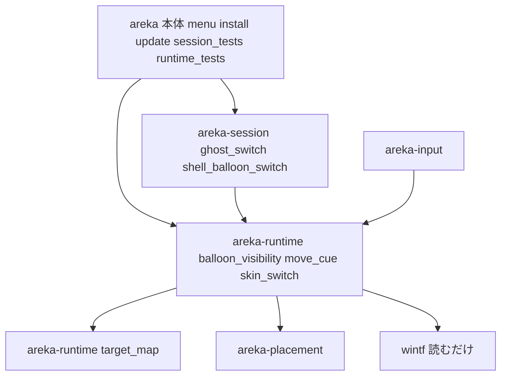
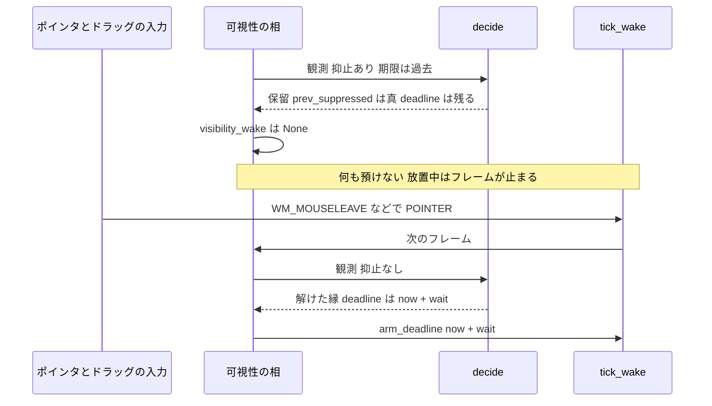

# 設計書: audit-emo2-boot-switch

## 概要

**目的**: areka のゴーストの切り替え・シェルとバルーンの切り替え・バルーンの見え方・ホバーの注入・`\![move]` と `\![change,…]` の cue（受け持つ 70 ファイル・`requirements.md` の Project Description）に、ponytail の audit が出した 76 件（`research.md` の 2 節・11 節・番号 1〜76）を全部直す。直した後に同じ範囲へ audit をかけ直して、新しい指摘を 0 件にする。あわせて brief に預かった件 1〜10・12（要件 5.1〜5.12）と、要件の討議で足した 5.13〜5.16 を片づけ、範囲の外で見つけた件（`research.md` の 6 節）を持ち主へ渡す（要件 7.8・7.9）。

**使う人**: 開発者。直しの形は ponytail の「いちばん小さい完全な変更」に従う。消せるものは消し、写しは既にある支えへ寄せ、呼び出し元・テスト・テストの支えまで直し切る。新しい機能は足さない。

**変わること**: 本番の振る舞いが変わるのは次の 7 つだけ。

1. 時間切れの満了の後も抑止（ドラッグか滞在）が続く間は、可視性の相が次の画面更新を予約しない（1 番・要件 5.13）。抑止が解けたフレームは、解けを起こした入力（ポインタ・ドラッグの終わり・cue）がそのフレームを起こし、そのフレームで待ちを `now + wait` から計り直して期限を預ける（今と同じ）。
2. 窓の印の scope が `i32::MAX` を越えるシェルの窓は、時間切れを止めるドラッグの判定で `warn!` を残して読み飛ばす（2 番・件 6）。今は届かない（窓の scope は {0,1} だけ）。
3. メニューからのシェル・バルーンの切り替えは、インストールの作業の途中なら `warn!(skin_switch_installing)` で断る（3 番・要件 5.16）。台本からの切り替えは断らない（「設計の決め」の D1・議題 1）。
4. シェル・バルーンの切り替えは、kanade へ台詞の切れ目の待ちを頼めたときだけ資産の組み立てを起こす（74 番）。頼めなかった回は組み立てが起きない。
5. メニューと台本からのゴーストの切り替えは、ネットワーク更新の途中なら `warn!(ghost_switch_updating)` で断る（76 番）。更新の手続き自身の読み直しと上書きのインストールの切り替えは断らない（D2・議題 2）。
6. 解けない同じ名前の切り替えの要求がまとめて届いても、目録を取り出しの 1 回につき 1 度だけ読む（34 番）。記録の件数と中身は変わらない。
7. 配置の crate の `scale_signed(i32::MIN, k)` が、`i32` に収まる答え（恒等比なら `i32::MIN`）を返す（5.15 ㋑・D3・議題 3）。収まらない答えの飽和（`±i32::MAX`）は変えない。

ゴーストと SSP 互換の振る舞い（SHIORI へ送るイベントの名前・順・Reference・`OnBalloonTimeout` の送り方・`\![move]` の着く位置・`\![change,…]` の読み）は 1 つも変わらない（`research.md` の 4 節）。3・5 番の断りは ukadoc の正典の外の、areka の中の断りで、正典はインストール中・更新中の切り替えを語らない。ほかはテストの直し・写しの寄せ・要らないコードの削除・公開の狭め・テストの置き場の移し替え・古い説明の直しで、外から見た振る舞いは変わらない。

### Goals

- 76 件を 3 つの組とも全部直す。直さずに残す指摘は 0 件（要件 2.1・2.2）。
- 直したバグと危ない所の 1 件ごとに、壊れたら落ちるテストを 1 本ずつ持たせ、直す前に赤を確かめる（1・2・3・74・76 番・5.15 ㋑ と、檻の強さの直し 14〜19・46〜48 番）。
- brief の件 1〜10・12 と要件 5.13〜5.16 を片づける（件と指摘の対応は「要件の対応」の 5.1〜5.16）。
- タスクは案 C で 20 本に束ねる。規模は事実として記録するだけで、分けない・削らない（要件 2.6・確定 1）。
- 最後に同じ作法で audit をかけ直し、新しい指摘 0 件・全体テストの緑・既定の枝との差分の確かめを記録する（要件 9）。

### Non-Goals

- 範囲の外の見直し（`areka-runtime` の受け持ちでないもの・`areka-session` の `ghost_switch*`・`shell_balloon_switch*` でないもの・本体の `runtime_tests/`・`session_tests/` の受け持ちでないもの・`crates/areka-placement/`〔5.15 ㋑ を除く〕）。
- 後の spec の仕事の先回り（`balloon-script-offset-align` の `move_cue*` の働き・`dola-interrupt-ticks` の時刻の型と合図・`doc-compat-architecture-rename` の文書の名・`ghost-switch-balloon-fallback` の切り替えのバルーンの決め方）。
- `BootContext` を組む補助の写しの範囲をまたぐまとめ（C26 の 3 本の着地の後・要件 5.8・確定 11）。
- インストールの作業の「書いている間」だけを示す新しい問い合わせ（議題 1 の別案。採るなら `audit-areka-app`・`audit-areka-install-update` の持ち物に及ぶ）。
- `switch_to` を展開の答えを待つ段に分けること（`audit-areka-install-update` の持ち物・議題 4）。
- 新しい依存。`Cargo.toml`・`Cargo.lock`・`crates/dola/`・`wintf`・`vendors/` は変えない（要件 6.6・7.4・7.10）。
- clippy の指摘の機械的な直し（`clippy-199-lints` の持ち物）。

## 境界の約束

### この spec が持つもの

- 受け持つ 70 ファイル（`requirements.md` の Project Description）の直し。移すテストと新しいファイルは移した先で範囲に数える。
- `areka-session` の公開の面の次の変化（どれも外の読み手を同じ変更で直す・要件 7.7）:
  - 狭める: `shell_balloon_switch.rs` の `areka_runtime::skin_switch` の出し直しを 5 型（`SkinKind`・`SkinOrigin`・`SkinRequest`・`SkinSpec`・`SkinVerdict`）に（4 番・件 1）。`SwapFinish` の出し直しを消す（5 番・件 2）。`ghost_switch.rs` の `NameResolution`・`resolve_special_name` の出し直しを私有の `use` に（6 番）。`ghost_switch_test_support` の `add_balloon_copy`・`plant_last_balloon` を `pub(crate)` に（39 番・件 2）。`pub(crate)` の 4 つを私有へ（38 番）。
  - 足す: `SwitchVerdict::Updating`（76 番）。`ghost_switch_test_support::boot_context(root, current)`（28 番・件 8）。`lap_test_support::lap_rig_on` が写す元のシェルの道を受ける形（29 番・件 9）。`lap_test_support` の `spawn_windows(rig, dpi)`・`pump_messages` を `pub` に（議題 5 で受けるとき）。
- `areka-runtime` の公開の面の次の変化:
  - 狭める: `shell_box_hover::settle_box_hover` を `pub(crate)` に（7 番・件 3）。`hover_inject` を `pub(crate) mod` に（36 番）。`move_cue` の `pub use geometry::{BaseposResolver, CanonDefaultBasepos}` を `use` に（37 番・シームは残す）。本体の可視性のテストを戻した後に使い手を失う渡し口・`test_open`・`test_support` の項目（24・40 番・件 3・件 4）。`pub(crate)` の 9 つを私有か `pub(super)` へ（38 番）。
  - 足す: `skin_switch::SkinVerdict::Installing`（3 番）。
- ログの行: 新しい `warn!` 2 行（`skin_switch_installing`・`ghost_switch_updating`）・`window_scope` の既にある `warn!` を 2 番の判定から通す・ログの文の spec の名と番号の削り（13 番・`move_cue.rs` 5 行・`hover_inject.rs` 2 行）・経緯の語「今日どおり」の言い換え（75 番・`ghost_switch.rs` 2 行）。語・target・欄は変えない。字面で読む実機の確かめ・`tools/perf/`・手順書は 0 件（`research.md` の 2 節の 13・75 番の grep）。

### 範囲の外（持たないもの）

- 範囲の外で変えるのは、直しのために要る次のファイルだけ（要件 3.2・7.2）:
  - `crates/areka-runtime/src/special_name.rs` — 新しい兄弟のテスト `special_name_tests.rs` の宣言 1 行（23 番・5.14）。
  - `crates/areka-runtime/src/lib.rs` — `pub mod hover_inject` を `pub(crate) mod` に（36 番）。
  - `crates/areka-runtime/src/frame_persist_test_support.rs` — L154 の `let _ = handle.join();`（5.15 ㋐）。
  - `crates/areka-runtime/src/shell_balloon_resolve.rs` — L3 の経緯のコメント（5.15 ㋒）。
  - `crates/areka-placement/src/windowposition.rs`・`follow/offset_space.rs`・`balloon_offset_supply_tests.rs`・`follow_offset_space_tests.rs` — 5.15 ㋑（関数と飽和の判定と、固定していた檻 2 本の期待）。
  - `doc/COMPAT_ARCHITECTURE.md` — 既にある 134・177・407 行の文だけ（10 番・6 節のア・要件 7.5・確定 6）。行は足さない。
  - C26 のほかの 2 本の持ち物（use の道と網羅の腕の名だけ・申し合わせてから・要件 7.1）:
    - `audit-areka-app`: `crates/areka-session/src/reload_test_support.rs:14`・本体 `runtime_tests/frame/switch_tests.rs:37`・`:838`・`runtime_tests/frame/switch_finish_tests.rs:50-52`（4・5 番の `areka_runtime::skin_switch::…` へ替える）。
    - `audit-areka-install-update`: `crates/areka/src/install/overwrite.rs:L118-L130` の `match` の腕に `SwitchVerdict::Updating` を足す（76 番）。
    - 触れなければ申し送り、件と相手を記録する（要件 7.8）。
  - brief と並走のメモ（記録だけ）: 6 節の持ち主の brief と C26 の共有のメモ（要件 7.8・7.9）。
- 触らない（C26 の約束・要件 7.3・7.4）: `Cargo.toml`・`Cargo.lock`・`crates/dola/`・`crates/wintf/`・`vendors/`・`crates/areka-session/src/body_systems.rs`・本体の `main.rs`（`BODY_SYSTEMS`）・`crates/areka/src/install/` と `update/`（上の腕の名を除く）・`crates/areka-session/src/reload.rs`・`ghost_session*.rs`・`switch_copy*`・`boot_*`・`crates/log-capture-kit/tests/file_length_guard_test.rs`・`crates/sample-ghost-kit/`。
- `ghost_switch.rs` の `switch_to`（L606-L710）・`take_down`・`boot_into` には触らない（議題 4 の継ぎ目）。

### 使ってよい依存

- 今の依存だけ。`areka-runtime` の `[dependencies]`（`areka-placement`・`areka-emo-*`・`areka-sakura`・`areka-seriko`・`areka-parsers`・`areka-kanade`・`bevy_ecs`・`wintf`・`dola`・`windows`・`tracing` ほか）と `[dev-dependencies]`（`log-capture-kit`・`temp-path-kit`・`sample-ghost-kit`・`areka-placement`〔test-support〕・`dola`〔test-support〕ほか）。`areka-session` と本体も今の依存のまま。
- テストの支え（`feature = "test-support"` の下）は dev-dependencies を使えない。`sample-ghost-kit` を `test-support` に入れない（`session-crate-split` の決め D8 ⑵）。だから 29 番の検体を取る数行は呼び手に残す（確定 5）。
- 依存の向き（変えない）: 本体 → `areka-session` → `areka-runtime` → 下の crate。`areka-runtime` から `areka-input`・`areka-session`・本体を引く道は作らない（だから 25 番で `BalloonWiring` を外してから 40 番で戻す）。

### 見直しが要る変化（Revalidation Triggers）

- `SkinVerdict::Installing` と `SwitchVerdict::Updating` が増える。網羅の `match` を書く後の呼び手は腕を足す。
- 入口の断りの並びが「進行中 → ゴースト切替中 → 更新中 → インストール中 → 文脈」にそろう。ゴースト切替の入口の更新中の断りは「メニューか名前の要求」だけに当たる（D2）。新しく入口を呼ぶ手続き（`Automatic` かつ `Folder`）は断られない前提で組める。
- 可視性の相は、満了の後の抑止の間は起床を預けない。抑止を新しい種類で増やす spec は、その解けがフレームを起こす入力から来ることを確かめる。
- 本体の `runtime_tests/` から `areka-runtime` へ可視性の相のテスト 29 本が移る（24・40 番）。本体に残るのは `notice_tests`（5 本）と代わりの親 2 つだけ。`areka-runtime` の `balloon_visibility::phase::test_support` の渡し口は `notify_timeout` だけになる見込み（確かめて記録する）。
- `scale_signed` の答えが `i32::MIN` を取りうる（5.15 ㋑）。配置の後の段は `i32::MIN` を受けても回り込まない（今も `-i32::MAX` の 1 つ下の値で、加算は飽和の演算で行っている・実装で grep して確かめる）。
- `switch_to` を分ける spec（`audit-areka-install-update`）は、この spec の着地の後の `ghost_switch.rs` の上で分ける（議題 4）。
- `update_reload_requested` が `update_reload_asked` に替わったら、範囲の中の読み手 `session_tests/shell_balloon_switch_session_update_tests.rs:243` を同じ変更で追う（相手の知らせを待つ）。

## つくり

### 今の形と守るもの

- 切り替えの入口は 3 つ（`ghost_switch::request_ghost_switch`・`shell_balloon_switch::request_skin_switch`・`reload`）。入口は kanade へ何か送る前に、断りを順に問い、断るときは `warn!` 1 行で kanade へ何も送らない。この形を 3 番・76 番でも守る。
- 本体だけが持つ問い（`update_busy`・`install_busy`）は `BodySystems`（`areka-session/src/body_systems.rs`）の関数の口から引く。口そのものは変えない。
- 可視性の相は 1 フレームに 1 回、`decide`（純判断）→ 起床の予約 → 発行 → 記録 → 知らせ の順で回る。並びは変えない。起床の予約の答えは純判断 `visibility_wake` が出す。
- scope を表示対象の番号に直す正本は `target_map.rs`（`window_scope` を含む）。
- テストの支えは 2 つの crate で写さない。両方が使う補助は `areka-runtime`・`areka-session`・`areka-placement` の `*_test_support.rs`（`#[cfg(any(test, feature = "test-support"))]`）に 1 つだけ置く。

### 依存の向き（変えない）



- 本体のテストが `areka-runtime` のテストの支えを引く向きだけを使う。`areka-runtime` のテストは本体を引けないので、本体の部品を使わないテストは `areka-runtime` へ戻す（24・40 番）。

### 技術の層

| 層 | 使うもの | この spec での役目 | 注 |
|---|---|---|---|
| 言語 | Rust（ワークスペースの edition） | 全部 | 新しい言語機能は使わない |
| ECS | `bevy_ecs` 0.19 | 相と入口 | 既存 |
| 起床 | `wintf::ecs::world::tick_wake`（読むだけ） | 1 番の起床の予約 | 既存・触らない |
| 記録 | `tracing` | 2・3・76 番の `warn!` | 既存 |
| テストの記録の捕捉 | `log-capture-kit`（dev） | 縛るテスト | 既存 |
| 待ち | `areka_runtime::spine::join_bounded` | 15 番・5.15 ㋐ | 既存 |
| 偽の窓 | `areka_placement::test_support::{give_fake_handles, SharedFakeIo}` | 27 番 | 既存 |
| COM | `windows` の `Win32_System_Com`（`CoGetApartmentType`） | 48 番の檻 | 既存の機能の中・足りなければ議題（要件 6.7） |

## ファイルの構成

### 新しく作るファイル

```
crates/areka-runtime/src/special_name_tests.rs            # 23 番・5.14（special_name.rs の子・純関数のテスト 8 本と補助）
crates/areka-session/src/shell_balloon_switch_tests.rs    # 3・74 番の縛るテスト（shell_balloon_switch.rs の子・私有の accept_skin_with を見る）
```

### 移すファイル（`git mv`・中身は直しに合わせて改める）

```
crates/areka/src/runtime_tests/balloon_visibility_phase_reappear_tests.rs  -> crates/areka-runtime/src/balloon_visibility_phase_reappear_tests.rs   # 40 番（10 本）
crates/areka/src/runtime_tests/balloon_visibility_lifecycle_e2e_tests.rs   -> crates/areka-runtime/src/balloon_visibility_lifecycle_e2e_tests.rs    # 40 番（1 本）
```

- 本体の `balloon_visibility_phase_tests.rs` の 14 本は、2 本を `areka-runtime` の `balloon_visibility_phase_log_tests.rs` へ（24 番）、12 本を `areka-runtime` の `balloon_visibility_phase_tests.rs`（今 43 行）へ移し、本体のファイルを消す。本体の `balloon_visibility_phase_box_tests.rs` の 4 本は `areka-runtime` の同じ名のファイルへ移し、本体のファイルを消す（40 番）。テストの名が重なれば、移す側の名に場面の語を足す。
- 移した 2 本の宣言は、本体の今の親に合わせて `areka-runtime` の `balloon_visibility_phase.rs`（`reappear_tests`）と `balloon_visibility.rs`（`lifecycle_e2e_tests`）に `#[cfg(test)] #[path]` で置く。
- 本体の `runtime_tests/balloon_visibility.rs`・`balloon_visibility_phase.rs`（代わりの親）は `notice_tests` の宣言と、それが要る取り込みだけを残す。
- 移した後、`cargo test -p areka-runtime` で同じ数のテストが同じ名前で緑になり、本体の側から消えた数（29 本）と合うことをタスクの完了の確かめに書く。

### 消すファイル

- 本体の `crates/areka/src/runtime_tests/balloon_visibility_phase_tests.rs`・`balloon_visibility_phase_box_tests.rs`（中身を移した後）。

消すテスト・補助・定数・項目は、消す前にツリー全体（テスト・テストの支え・examples・fixture・設定・スキル・手順書・steering・文字列での参照・`#[path]`・`crate_source!`／`include_str!` の字面の読み）で使われていないことを grep で確かめる（要件 3.3・各タスクの完了の条件）。

### 直すファイル（範囲の中・まとまりごと）

**`crates/areka-session/src/`**
- `ghost_switch.rs` — 6・8・34・38・55・59・75・76 番。`switch_to`・`take_down`・`boot_into` は触らない。
- `shell_balloon_switch.rs` — 3・4・5・34・58・74 番、子のテストの宣言。
- `ghost_switch_test_support.rs` — 9・28・39・52・53・54・60・61 番。
- `ghost_switch_tests.rs` — 23（移す）・28・31・56・76（縛るテスト）番。
- `ghost_switch_{balloon,boot_event,fallback,reload,roots}_tests.rs` — 13・14・16・31・32・47・49・50・56 番。
- `shell_balloon_switch_session_{abort,balloon,lap}_tests.rs`・`shell_balloon_switch_session_lap_test_support.rs` — 4・16・20・29・31・51・52・53 番、議題 5。

**`crates/areka-runtime/src/`（本番）**
- `balloon_visibility_phase.rs` — 1・2・35・40（`test_open` と渡し口の数え直し）番。
- `balloon_visibility.rs`・`balloon_visibility_wait.rs`・`balloon_visibility_decision.rs` — 38・67 番。
- `skin_switch.rs` — 3（`SkinVerdict::Installing`）・4（L3-L4 の説明）番。
- `switch_assets.rs` — 62 番。`hover_inject.rs` — 13・36・66 番。`shell_box_hover.rs` — 7 番。
- `move_cue.rs` — 11・12・13・37・72 番。`move_cue_place.rs` — 13 番（`MoveMeasure`）。`change_cue.rs` — 73 番。

**`crates/areka-runtime/src/`（テストと支え）**
- `balloon_visibility_phase_wake_tests.rs` — 1 番。`balloon_visibility_phase_box_tests.rs` — 2・40 番。
- `balloon_visibility_phase_{tests,log_tests,test_support}.rs`・移した 2 本 — 24・25・26・40・64・65・68・69 番。
- `balloon_visibility_{tests,box_tests,content_tests,talk_end_tests,choice_wait_tests,user_break_tests,timeout_config_tests,timeout_suppression_tests,test_support}.rs` — 13・17・18・21・22・33・41・42・43・70・71 番。
- `move_cue_{apply_move,apply_move_sticky,place,move_severity_log,move_sink}_tests.rs` — 13・15・19・27・44・45・46 番。
- `switch_assets_tests.rs` — 48 番。

**本体 `crates/areka/src/`**
- `session_tests/shell_balloon_switch_tests.rs` — 4（glob）・26・30 番。
- `session_tests/shell_balloon_switch_session_tests.rs` — 4・57・63 番。`session_tests/shell_balloon_switch_session_update_tests.rs` — 29 番・12.3 ⑶ の追随。
- `runtime_tests/balloon_visibility.rs`・`balloon_visibility_phase.rs`・`balloon_visibility_phase_notice_tests.rs` — 40・64 番（残す分の取り込み）。

## 流れ

### 1 番 満了の後の抑止の間は起床を預けない



## 新しい形を引く直し

### 1 番 毎画面更新の予約（`balloon_visibility_phase.rs`・要件 5.13）

| 項目 | 中身 |
|---|---|
| 目的 | 満了の後にポインタがバルーンか文字の出ている箱の上に残っても、放置中のデスクトップでフレームを回し続けない |
| 要件 | 3.1・4.1・4.2・4.3・5.13・6.4 |
| 調べ | `research.md` の 12.1（抑止の解けはどれもフレームを起こす入力から来る・同じフレームで計り直す） |

```rust
// balloon_visibility_phase.rs（私有の純判断・引数を 1 つ足す）
pub(crate) fn visibility_wake(
    now_talk_time: Option<f64>,
    deadline: Option<f64>,
    suppressed: bool,
) -> VisibilityWake {
    // …今の None の早期の返りはそのまま
    if remaining > 0.0 {
        VisibilityWake::After(Duration::from_secs_f64(remaining.min(MAX_WAIT_SECS)))
    } else if suppressed {
        // 抑止の解けはポインタとドラッグの入力か cue がフレームを起こし、そのフレームで計り直す。
        VisibilityWake::None
    } else {
        VisibilityWake::Now
    }
}

// run_balloon_visibility_phase の中（decide の後なので prev_suppressed は今のフレームの答え）
match visibility_wake(now_talk_time, state.deadline, state.prev_suppressed) { … }
```

- `VisibilityWake::Now` の説明の「（抑止で保留中など）」を消す（今は「本フレームに表示したばかりで外した scope の満了」など、抑止の無い超過だけが通る）。
- 抑止中で期限がまだ先なら今どおり `After(残り)` を預ける（期限のフレームで `TimeoutSuppressed` の記録を 1 回出すため）。
- 縛るテスト（`balloon_visibility_phase_wake_tests.rs`・純関数・決定論）:
  - `overdue_while_suppressed_arms_nothing`: `visibility_wake(Some(9.0), Some(4.0), true) == None`・`(Some(4.0), Some(4.0), true) == None`・抑止なしの `(Some(9.0), Some(4.0), false) == Now`・抑止中で期限が先の `(Some(1.0), Some(4.0), true) == After(3s)`。
  - `a_held_timeout_with_the_pointer_still_on_the_balloon_asks_for_no_wake`: `balloon_visibility::test_support::Frame` で満了の前に滞在を立て、満了の時刻を過ぎたフレームを `decide` に通した後の状態から `visibility_wake(now, state.deadline, state.prev_suppressed) == None`。続けて滞在を外したフレームで `After(wait)`（解けた縁の計り直し）。
  - 実装の順: ⑴ 引数を足して中で読まない形にし、上の 2 本が赤になることを見る → ⑵ 中身を入れて緑（要件 4.2）。今の 4 本は第 3 引数 `false` を足すだけ。
- `tick_wake` はプロセス共有なので、相の後に `take` を見るテストは置かない（`research.md` の 12.1）。相の呼び出しの字面は本体の `tick_gate_config_producers_tests.rs`（`REARM`・`arm_deadline(` の字面の検査）が守る。

### 2 番 シェルの窓の scope の上限（`balloon_visibility_phase.rs` L459-L465・件 6・要件 5.6）

```rust
.any(|marker| window_scope(marker.scope).is_some_and(|s| box_scopes.contains(&s)))
```

- `crate::target_map::window_scope` は上限を越えると自分で `warn!` を 1 行残して `None` を返す（`audit-emo2-boot-frame` の決め・記録はここ 1 か所）。上限越えの窓をドラッグしている間はフレームごとに 1 行出るが、今は届かない道で、入口の上限は `extra-character-windows` が置く（前例と同じ扱い・`research.md` の 2 節の 2 番の ㋑）。
- 縛るテスト（`balloon_visibility_phase_box_tests.rs`・`#[cfg(target_pointer_width = "64")]`）`a_dragged_shell_window_past_the_scope_limit_does_not_hold_scope_zero`: 箱に文字が出ている scope 0 と、scope `1usize << 32` のシェルの窓 1 つに `WindowDragging` を付けて観測する。**直しの前は `as u32` が 0 へ切り捨てて抑止が立つ＝赤**。直しの後は抑止なし・`warn!` 1 行。

### 3 番 インストール中の断り（`shell_balloon_switch.rs`・`skin_switch.rs`・要件 5.16・D1）

| 項目 | 中身 |
|---|---|
| 目的 | インストールの作業がバルーンかシェルのフォルダを書き換えている最中に、利用者がメニューから同じものへ切り替えて書きかけを読むのを防ぐ。読み直しの入口と同じ断りの語彙にそろえる |
| 要件 | 3.1・4.1・4.2・5.16・6.2・7.6 |
| 調べ | `research.md` の 12.1 の 1 行目（ベースウェアの自動切替は 0・ゴーストの `OnInstallComplete(Ex)` の応えの台本の `\![change,…]` は `install_busy` が真の間に届く） |
| 選んだ位置（仮定・議題 1） | 入口の「更新中」の次に置き、出どころが **メニュー**（`SkinOrigin::Menu`）の要求だけに当てる |

```rust
// shell_balloon_switch.rs（request_skin_switch_with の「更新中」の直後）
if req.origin == SkinOrigin::Menu && (BodySystems::of(world).install_busy)(world) {
    tracing::warn!(
        event = "skin_switch_installing",
        kind = ?req.kind,
        spec = ?req.target,
        "インストールの作業の途中にメニューからシェル・バルーンの切替要求が届いた——無視する"
    );
    return SkinVerdict::Installing;
}

// skin_switch.rs（SkinVerdict）
/// インストールの作業の途中（メニューからの要求だけを断る）。
Installing,
```

- 台本からの要求に当てない理由: インストールの後の切り替えは、`ghost-install` の裁定でゴーストが `OnInstallComplete(Ex)` の応えで決めるもの（イベント → 台本の輪）。その応えの台本は `install_busy` がまだ真の間に再生されうる（応えの頭のタグ・複数の書庫の投入・飛ばした同梱の警告の間）。台本の要求まで断ると、ゴーストが入れた直後のバルーンへ切り替える台本が、時刻の偶然で黙って止まる（要件 5.16 の「自動切替を止めない」）。
- 残る危うさ: 台本の要求が書いている最中のフォルダを読むのは、`OnInstallBegin` の応えで同じ物へ切り替えるような台本だけ。そのとき背景の資産づくりは今どおり `skin_switch_failed` の `error!` で切り替えを取りやめる（記録の無い失敗は無い）。
- 別案（議題 1）: インストールの「書いている間」だけを示す問い（`BodySystems` の新しい口と、`install/desk.rs`・`worker.rs` の段の印）を足し、台本の要求にも当てる。書いている間の読みは防げるが、`audit-areka-app`（`body_systems.rs`・`main.rs`）と `audit-areka-install-update`（`install/`）の持ち物に use の道を越えて及ぶ（要件 7.1 の申し合わせ）。複数の書庫の投入では、後の書庫を書いている間に前の書庫の応えの台本が届けば、やはり止まる。
- `reload` の `\![reload,…]` も `OnInstallComplete(Ex)` の応えの台本では同じ形で断られうる。`reload.rs` は `audit-areka-app` の持ち物なので、事実として申し送る（要件 7.8・T18）。
- 縛るテスト（新しい `crates/areka-session/src/shell_balloon_switch_tests.rs`・決定論・GPU なし）`installing_refuses_menu_requests_only`: 文脈の無い World に `BodySystems { install_busy: |_| true, ..NO_BODY }` を据える。メニューの要求は `Installing` と `warn!(skin_switch_installing)` 1 行・台本の要求は `Installing` にならない（文脈なしで `NoContext`）。**直しの前は両方 `NoContext`＝赤**。

### 74 番 頼めたときだけ資産を組む（`shell_balloon_switch.rs` の `accept_skin`）

```rust
pub(crate) fn accept_skin(world, ctx, kind, target, raise) -> SkinVerdict {
    accept_skin_with(world, ctx, kind, target, raise, spawn_switch_build)
}

fn accept_skin_with(
    world: &mut World,
    ctx: &SwitchContext,
    kind: SkinKind,
    target: SkinCandidate,
    raise: Option<GapRaise>,
    spawn: impl FnOnce(SwitchBuildRequest) -> Receiver<Result<SwapBuilt, SwitchBuildError>>,
) -> SkinVerdict {
    let (reply, gap) = reply_channel();
    if ctx.kanade.send(KanadeMsg::AwaitTalkGap { raise, reply }).is_err() {
        // 今の error!(skin_switch_send_failed) のまま
        return SkinVerdict::NoContext;
    }
    let build = spawn(/* 今の SwitchBuildRequest */);
    world.insert_non_send(SkinSwitchInFlight { … build … });
    …
}
```

- `accept_skin` の署名は変えない（`reload.rs:576` の呼び手は触らない）。待ちの返事は印の `gap` が受けるので、組み立てを後に起こしても順は崩れない。
- 縛るテスト（`shell_balloon_switch_tests.rs`）`a_failed_gap_request_starts_no_build`: 受信端を落とした kanade の送出端で `SwitchContext` を組み、数える閉包を渡して `accept_skin_with` → `NoContext`・`error!` 1 行・閉包は 0 回・印なし。送れる送出端では 1 回。**直しの前は閉包が 1 回＝赤**（直しの前の形は、注入の口だけを先に入れて確かめる）。

### 76 番 ゴースト切替の入口の更新中の断り（`ghost_switch.rs`・D2・議題 2）

| 項目 | 中身 |
|---|---|
| 目的 | ネットワーク更新がゴーストのフォルダを書き換えている最中に、利用者か台本が同じゴーストへ切り替えて、書きかけのフォルダから SHIORI を起こすのを防ぐ。更新の手続き自身の読み直しは止めない |
| 要件 | 2.1・3.1・4.1・4.2・6.2・7.1・7.6 |
| 調べ | `research.md` の 2.2 節の 76 番（呼び手 4 つの出どころと要求の形・更新の読み直しは `Stage::Running` の間に入口を呼ぶ） |

```rust
// ghost_switch.rs（request_ghost_switch_with の「進行中」の直後）
let from_user_or_script =
    req.origin == ChangeOrigin::Manual || matches!(req.ghost, GhostSpec::Name(_));
if from_user_or_script && (BodySystems::of(world).update_busy)(world) {
    tracing::warn!(
        event = "ghost_switch_updating",
        spec = ?req.ghost,
        "ネットワーク更新の実行中にゴーストの切替要求が届いた——無視する"
    );
    return SwitchVerdict::Updating;
}
```

- 手続きの要求（更新の読み直し・上書きのインストール＝`Automatic` かつ `Folder`）には当てない。`accept_switch`（`reload.rs` から直に呼ばれる）にも足さない。
- `SwitchVerdict::Updating` を足すと、`install/overwrite.rs:L118-L130` の網羅の `match` に腕の名を 1 つ足す（`audit-areka-install-update` と申し合わせる・`NotFound | NoContext | Updating` の腕へ）。`update/desk.rs` は `== Accepted` だけを見るので変わらない。
- 縛るテスト（`ghost_switch_tests.rs`・23 番で約 180 行を移した後）`updating_refuses_menu_and_script_requests_but_not_the_update_reload`: 文脈を据えた World に `BodySystems { update_busy: |_| true, ..NO_BODY }`。メニュー（`Manual`・`Folder`）と台本（`Automatic`・`Name`）は `Updating`・`warn!(ghost_switch_updating)` 1 行ずつ・kanade へ何も送らない。手続き（`Automatic`・`Folder`）は今どおり受理（`Accepted`）。**直しの前は 3 つとも受理＝赤**。

### 34 番 目録を取り出しの 1 回につき 1 度だけ読む（`ghost_switch.rs`・`shell_balloon_switch.rs`）

- 入口の中身の関数（`request_ghost_switch_with`・`request_skin_switch_with`）に、目録を一度だけ埋める私有の引数 `catalog: &mut Option<…>` を足す。公開の入口（`request_ghost_switch`・`request_skin_switch`）は `&mut None` を渡し、取り出しの系（`drain_change_requests`・`drain_switch_requests`）はループの外で 1 つ作って全件に渡す。
- 目録が変わりうるのは、受理された切り替えの後だけで、その後の要求は今どおり「進行中」で目録を読む前に断られる。だから 1 回の取り出しの中で目録を共用しても答えは変わらない。シェルの候補は今のゴーストのフォルダ、バルーンの候補は根と今のゴーストから読むので、受理の後に使い回さない（受理したら埋めた目録を捨てる）。
- 記録の件数と中身は変わらない（〔約束 c〕に触れない・`research.md` の 2.3 節の 34 番の (a)）。縛るテスト（`ghost_switch_tests.rs`）`unresolved_names_in_one_drain_read_the_catalog_once`: 同じ解けない名を 3 件溜めて取り出すと `warn!(ghost_switch_unknown)` が 3 行・解けた名を後に置けば今どおり受理。目録を読む回数は、`ghost_dir` の下の descript を読む回数でなく、目録の関数を呼ぶ回数を `#[cfg(test)]` の数えで見る形を実装で選ぶ（数えを足さずに済むなら足さない）。

### 24・25・40 番 本体の可視性のテストを `areka-runtime` へ戻す（件 4・確定 13）

- 順: ⑴ 25 番（`BalloonWiring` の据え付け 17 か所・`use areka_input::balloon::…`・`Harness::_choice_rx` の欄と説明を消す）→ ⑵ 26 番（本体の 2 か所の空の `BootAssets` を `areka_runtime::frame::test_support::synth_assets(&[])` に）→ ⑶ 24 番（2 本を `balloon_visibility_phase_log_tests.rs` へ・`world_at` の写しを消して支えの `world_at` を使う）→ ⑷ 40 番（27 本を戻す・`box_tests` の `areka_input::shell_box::ShellBoxHover` を `areka_runtime::shell_box_hover::ShellBoxHover` に）→ ⑸ 件 3 の数え直し（使い手を失った渡し口・`test_open`・`test_support` の項目を狭める）。
- 組めるかは `research.md` の 12.1（依存は足さない）。組めなければ、組めない 1 本ごとに理由を記録して本体に残し、議題にする（要件 6.7）。
- 64・65・69 番（本体の親の見出し・`box_tests` の見出し・`content_tests` の名指し）は移した後の姿で直す。

### 29 番 `add_rpost_shell` の写しを 1 つに（件 9・確定 5）

```rust
// shell_balloon_switch_session_lap_test_support.rs
/// `src_shell` を A の `shell/<folder>` へ写してから組む（検体の窓口は test-support に入れられないので呼び手が取る）。
pub fn lap_rig_on(…, second_shell: Option<(&Path, &str)>) -> LapRig
```

- 写す手順は std だけの `copy_tree`（52 番で `ghost_switch_test_support` の skip つきの方へ寄せ、`None` を渡す）の 1 か所。呼び手 2 か所には `SampleRoot::acquire`・`add_shell_copy` の約 4 行と、残す理由「検体の窓口は `test-support` に入れられない」の 1 行を置く。`sample-ghost-kit` には触らない。
- 引数の形（`Option<(&Path, &str)>` か専用の関数を 2 つにするか）は、今の `fn(&Path, &str)` の呼び手の数（2）を見て実装で小さい方を選ぶ。

### 5.15 ㋑ `scale_signed` の 1 ずれ（`areka-placement`・D3・議題 3）

```rust
pub fn scale_signed(v: i32, k: ScaleRatio) -> i32 {
    let magnitude = i64::from(k.scale_len(v.unsigned_abs()));
    let signed = if v < 0 { -magnitude } else { magnitude };
    i32::try_from(signed).unwrap_or(if v < 0 { -i32::MAX } else { i32::MAX })
}

// follow/offset_space.rs の scale_axis（飽和の判定を同じ答えに合わせる）
saturated: i32::try_from(if v < 0 { -m } else { m }).is_err(),  // m = i64::from(k.scale_len(v.unsigned_abs()))
```

- `i32` に収まる答えはそのまま返す（恒等比の `i32::MIN` は `i32::MIN`）。収まらない答えの飽和の値（`±i32::MAX`）は今のまま（`balloon_offset_supply_tests.rs:L73`・`L147-L148` の期待は変わらない）。説明の「`±i32::MAX` へ飽和させる」は「収まらないときだけ `±i32::MAX` へ飽和させる」にする。
- 縛るテスト（`windowposition.rs` の兄弟のテストか `balloon_offset_supply_tests.rs`）: `scale_signed(i32::MIN, ScaleRatio::ONE) == i32::MIN`。**直しの前は `-i32::MAX`＝赤**。
- 固定していた檻 2 本（`identity_scale_saturates_only_at_i32_min`・`supply_identity_saturates_only_at_i32_min`）は、`i32::MIN` が素通しになり `saturated == false` になる形へ改め、名と説明を「恒等比は全域で素通し」に直す（要件 4.7）。完了 spec `areka-P0-balloon-offset-dpi` の設計（L739）がわざと固定した例外を変えるので、議題 3 で確かめる。

### 16 番 「0 件」の檻を空振りさせない

- 可視性の行（`shell_balloon_switch_session_balloon_tests.rs` の `external_transitions`）: 文面でなく欄 `trigger == "explicit"` で数える（本番の行は変えない）。陽性の対として、40 番で戻す「外からの非表示」のテスト（今の本体 `balloon_visibility_phase_tests.rs:333`）に、同じ欄での数が 1 以上の表明を足す。
- 単位の行（`ghost_switch_reload_tests.rs` の `ticker_closed`）: 本番の行（`ghost_session.rs:600`）は `audit-areka-app` の持ち物なので変えない。同じファイルの単位を降ろす ghost の読み直しのテスト（L88）に `assert!(ticker_closed(&events) >= 1)` を足す（仮定: その行が捕捉の窓に出る。出なければ、出る場面を同じファイルに置く）。

## 指摘ごとの直し方（1〜76）

「束」はタスクのまとまり（次の節の T1〜T20）。「縛るテスト」は直したバグと危ない所が壊れたら落ちるテスト（要件 4.1）。「—」はテストの直しそのもの・写しの寄せ・削除・説明の直しで、今あるテストが同じ結果で通ることを確かめる（要件 4.7）。「research どおり」は `research.md` の 2 節のその番号の「直し方」をそのまま行う。行番号は `research.md` の時点のもの（実装で関数名から引き直す）。

**説明を直す指摘は、コードで分かる説明なら消し、理由だけを残す**（前例 `audit-emo2-boot-frame` の 2026-11-20 開発者の決め）。範囲の外と、この spec が触らないコメントは掃除しに行かない。

### 必ず直す（1）

| 番号 | 直し方 | 縛るテスト | 束 |
|---|---|---|---|
| 1 | 抑止中の超過は起床を預けない（上の節） | `overdue_while_suppressed_arms_nothing`・`a_held_timeout_with_the_pointer_still_on_the_balloon_asks_for_no_wake` | T1 |

### 直したほうがよい（2〜33・74〜76）

| 番号 | 直し方 | 縛るテスト | 束 |
|---|---|---|---|
| 2 | `window_scope` で比べる（上の節） | `a_dragged_shell_window_past_the_scope_limit_does_not_hold_scope_zero` | T2 |
| 3 | メニューの要求だけを `install_busy` で断る（上の節・D1） | `installing_refuses_menu_requests_only` | T3 |
| 4 | `pub use` を 5 型に絞り、残り 5 項目は私有の `use`。範囲の中のテストの取り込みを `areka_runtime::skin_switch::…` へ。範囲の外の 3 か所は申し合わせてから use の道だけ。`skin_switch.rs:L3-L4` を事実に合わせる | — | T5 |
| 5 | L41-L43 を消し、本体の 2 か所を `areka_runtime::skin_switch::SwapFinish` へ（申し合わせ） | — | T5 |
| 6 | `NameResolution`・`resolve_special_name` は私有の `use`。`UnresolvedReason` の `#[cfg(test)] use` は 23 番で移る先へ。`LastInstalledGhost` は本体の `install/` の 4 本が使うので今のまま（範囲の外を触らない） | — | T5 |
| 7 | `settle_box_hover` を `pub(crate)` に | — | T7 |
| 8 | 「（記録の語彙・呼び手は分岐しない）」を消す | — | T15 |
| 9 | 最後の 1 文を消す | — | T15 |
| 10 | `COMPAT` 177・407 行の抑止の理由に、箱に文字の出ている scope のシェルの窓のドラッグと文字の出ている箱の上の滞在を書き、定義点（`observe_shell_dragging`・`combine_hover`・`settle_box_hover`）を名指す。行は足さない（確定 6） | — | T17 |
| 11 | 「数値＝物理 px」を「数値＝作者基準 px（[`AxisSpec::Px`]）」に | — | T15 |
| 12 | 1 行目を窓の位置の指令の全体に、「だけ」「のみ」「5 組」を消す | — | T15 |
| 13 | 括弧の番号を消す・テストの名を替える・見出しを語だけに・`MoveMeasure` を理由だけの文に（research どおり） | — | T14 |
| 14 | `.expect("前から在る印を書く")` | 直した表明 | T13 |
| 15 | 2 か所とも `crate::spine::join_bounded("sylphya", parts.handle).expect(..)` | 直した後始末 | T8 |
| 16 | 欄で数える・陽性の対（上の節） | 足した陽性の表明 | T12 |
| 17 | `clear_count` の 1 本を `balloon_visibility_content_tests.rs` に足す（対照つき） | 足したテスト | T12 |
| 18 | 先に 1 回呼び、`capture` で 2 回目の記録 0 件を表明 | 直したテスト | T12 |
| 19 | `--base=me` と `--base=1` の 2 通りで回す | 直したテスト | T8 |
| 20 | `rig_ab` の中で `WintfTaskPool::with_threads(1)` を入れ、呼び手の 3 行ずつを消す・doc を事実に | — | T13 |
| 21 | 段落を消す | — | T12 |
| 22 | 2 本とも消す（時刻ありは −70 行・時刻なしは −35 行）。`balloon_visibility_content_tests.rs:L22` の名指しを直す | — | T12 |
| 23 | 純粋な段を `areka-runtime/src/special_name_tests.rs` へ移す（`no_pick` は両方に置く・確定 8） | 移したテスト | T9 |
| 24 | 上の節 ⑶ | 移したテスト | T6 |
| 25 | 上の節 ⑴ | — | T6 |
| 26 | `areka-runtime` へ移る 2 か所は `synth_assets(&[])`。本体 `session_tests/shell_balloon_switch_tests.rs` の `headless_wiring` は `areka_runtime::frame::shared_test_support::wiring().1`（並走の `audit-areka-app` が `reload_skin_tests.rs` で使う形にそろえる・12.3 の前の 11 節） | — | T6・T11 |
| 27 | `areka_placement::test_support::{give_fake_handles, SharedFakeIo}` を直に使う（`SharedFakeIo::new(..)`） | — | T8 |
| 28 | (a): `ghost_switch_test_support.rs` に `pub fn boot_context(root: &BasewareRoot, current: &str) -> BootContext`、`ghost_switch_tests.rs` から引く。範囲の外の写しには触らず持ち主へ申し送る（確定 11） | — | T10 |
| 29 | 上の節 | — | T10 |
| 30 | `rig` の `init_resource::<Schedules>()` の後ろに `insert_resource(crate::BODY_SYSTEMS)` を 1 行、3 本の手書きを消す（確定 7） | — | T11 |
| 31 | `ghost_switch` の兄弟 4 つを `super::fallback_tests::count_event` に。abort は今の私有のまま残し、残す理由（`ghost_session` の木の下で `fallback_tests` が見えない）を 1 行 | — | T10 |
| 32 | `kinds` を引き `ids` の 2 つを消す | — | T10 |
| 33 | 補助を消して `Frame::new(e).signal(..)[.at(t)][.dragging()].run(..)` に・doc を直す | — | T12 |
| 74 | 送りを先に・送れたときだけ組む（上の節） | `a_failed_gap_request_starts_no_build` | T3 |
| 75 | 「今日どおり」を「そのまま終了する」「通常どおり終わる」の形に（語・target・欄は変えない） | — | T15 |
| 76 | メニューと台本の要求だけを `update_busy` で断る（上の節・D2） | `updating_refuses_menu_and_script_requests_but_not_the_update_reload` | T4 |

### できれば（34〜73）

| 番号 | 直し方 | 束 |
|---|---|---|
| 34 | 目録を取り出しの 1 回につき 1 度（上の節・(a)） | T16 |
| 35 | `ActorKey` を scope ごとに 1 回だけ作って共用する。残りの割り当ては計測で上位に出たときだけ（今は直さないのでなく、research の直し方どおり「1 回だけ作る」までを行う） | T16 |
| 36 | `pub(crate) mod hover_inject`（`crate_source!` の字面読みは変わらない） | T7 |
| 37 | `pub use` を `use` に（型シームは `surfaces-basepos` のため残す・〔裁定 ⑵〕に触れない） | T7 |
| 38 | `areka-runtime` の 9 つ（私有 8・`pub(super)` 1）と `areka-session` の 4 つを狭める | T5・T7 |
| 39 | `add_balloon_copy`・`plant_last_balloon` を `pub(crate)` に（確定 12） | T5 |
| 40 | 上の節 ⑷⑸ | T6 |
| 41 | ⑴ 何もしない `.timeout(TIMEOUT)` と doc を消す ＋ ⑵ 表の `TIMEOUT` を既定でない値（20.0）にして `decide` の引数を守る（`research.md` の 12.1 の仮定） | T12 |
| 42 | `balloon_visibility_test_support.rs` の `hovered` の隣へ寄せる（公開の面を増やさないため `#[cfg(test)]` の私有の mod に） | T12 |
| 43 | talk_end 側の 1 本を消す | T12 |
| 44 | 単体の 4 本を消す（pipeline の 2 本が同じ検体・同じ表明を受け口ごと持つ） | T8 |
| 45 | `actor_carrier_cue(actor, name, tokens)` に置き換える | T8 |
| 46 | `rx` を落としてから move を 1 件流し、panic せず `warn!` 1 件のテストを `move_cue_move_sink_tests.rs` に足す | T8 |
| 47 | shutdown の前に `assert!(!rig.exit_requested())` を 1 行ずつ | T13 |
| 48 | `spawn_build_worker` へ `CoGetApartmentType` で暗黙の MTA なら panic する閉包を注入するテストを 1 本足す（`research.md` の 12.1） | T13 |
| 49 | `reload_ghost(rig)`・`break_boot(rig, ..)`・`reload_reasons(events)` を足して置き換える | T13 |
| 50 | `name_balloon_in_b` を呼ぶ | T13 |
| 51 | `fence(rig)` を 1 つに | T13 |
| 52 | 足場の `copy_tree` を `pub` にし lap の方を消す（29 番と一緒） | T10 |
| 53 | lap は `crate::ghost_switch_test_support::TICK_EVERY` と `SwitchRig` の「時刻を渡して 1 つ送る」口を使う。本体の `mcp/` の写し（6 節のコ）は持ち主へ（議題 5 を受けるなら `spawn_windows`・`pump_messages` も） | T10 |
| 54 | 道を組む補助を 1 つにし、1 回だけ書く | T10 |
| 55 | 文脈なしの warn を私有の関数 1 つに | T4 |
| 56 | 23 番で両方を移すので、残る側の 1 つだけにする | T9 |
| 57 | `requested(events)` と descript を書く補助を 1 つずつ | T11 |
| 58 | crate の道（`areka_runtime::shell_balloon_resolve`）で書き直す | T15 |
| 59 | 説明に `switch_copy::poll` の 1 行を足す | T15 |
| 60 | `// SAFETY:` を守る条件の 1 行に | T15 |
| 61 | 2 行消す | T15 |
| 62 | 「資産づくり・配置の値の読み・シェルの絵の復号の失敗」に | T15 |
| 63 | 道を直し、「（20 秒）」を消す | T11 |
| 64 | 移した後の親で、古い理由の文と手順の番号を消す | T6 |
| 65 | 40 番で本体のファイルごと消える（移した先の見出しを観測と発行の両方に合わせる） | T6 |
| 66 | 呼び手の場所を `frame/scale_text.rs` の `run_text_phase` に | T15 |
| 67 | ㋐「非公開」を消す ㋑ 行番号を消す ㋒「3 ファイルと同居させると 1,000 行を越える」に | T15 |
| 68 | 「だけ」「3 つの値」を消す（移した後の渡し口の数で書く） | T6 |
| 69 | 40 番で指し先が `areka-runtime` の同じ名のファイルに戻るので、名指しを事実に合わせる | T6 |
| 70 | 観測に合わせて書き直す | T12 |
| 71 | 履歴の言い方を外し、名指しを直す | T12 |
| 72 | 番号つきの語りと「最初の実消費者」を消す（L231-L235 の理由は残す） | T15 |
| 73 | 括弧を消す（`//!` の 1 行目は残す） | T15 |

### 直さない・回した指摘（要件 2.5・7.8・7.9 の記録）

直さずに残す指摘は 0 件。回すのは範囲の外の件だけ（T18 で記録する）。

| 件 | 回し先 | 中身 |
|---|---|---|
| 6 節のウ・カ〜ス・セ・ソ・タ・キ・ク・ケ | `audit-areka-app`・`audit-areka-install-update`（C26 のあいだは並走のメモと相手のセッションへ・要件 7.1・7.8） | `research.md` の 6 節の表のとおり。28 番の `boot_context` は使える支えとして渡す |
| 3 番の続き | `audit-areka-app` | `reload.rs` の `install_busy` の断りも、`OnInstallComplete(Ex)` の応えの台本の `\![reload,…]` を止めうる（事実として） |
| 6 節のア | 回さない | 10 番と同じタスクで 134 行を直す（確定 6） |
| 6 節のイ・エ・オ | 回さない | 5.15 として直す（確定 10） |
| 6 節のサ・チ | 回さない | 事実の記録だけ（`Cargo.toml` を要る・指摘ではない） |

## 設計の決め（議題の候補）

- **D1（3 番の断りの位置）**: 入口の「更新中」の次に置き、メニューの要求だけに当てる。理由は「3 番の節」。別案は「書いている間」の問いを足して全部の要求に当てる形（議題 1）。
- **D2（76 番の見分け方）**: 「`Manual` か `Name`」で、利用者と台本の要求を手続きの要求（`Automatic` かつ `Folder`）から見分ける。入口の呼び手の 4 つを全部見て決めた形で、新しい呼び手は「手続きなら `Folder`」で組む前提になる（見直しが要る変化に書いた）。別案は、取り出しの系（範囲の中）とメニューの登記（本体 `menu/ghost_frame.rs`・`audit-areka-app` の持ち物）の 2 か所で問う形（議題 2）。
- **D3（5.15 ㋑ の形）**: 収まる答えだけを素通しにし、収まらない答えの飽和の値は変えない（檻の 2 本だけが変わる）。
- **D4（2 番）**: 要件 5.6 の字面どおり `window_scope` を使い、記録の抑えは足さない（前例の 9 か所と同じ・届かない道）。
- **D5（16 番）**: 可視性は欄で数える・単位は陽性の対。本番の行は変えない。
- **D6（22・44 番）**: 22 番は 2 本とも消す。44 番は単体の 4 本を消し pipeline の 2 本を残す。
- **D7（28 番）**: (a)。**D8（41 番）**: ⑴ と ⑵ の両方。**D9（34 番）**: (a)。
- **D10（タスクの切り方）**: 案 C（`research.md` の 9 節）で 20 本。

## タスクの束と順

案 C で 20 本に束ねる。順は「必ず直すと本番の振る舞いが変わる 2・3・74・76 番を先に独立のタスクに → 公開の面の絞り（範囲の外の申し合わせを 1 度で）→ 本体のテストの戻し → 公開の数え直し → 支えの寄せ → 檻と説明 → 範囲の外 → 記録 → 仕上げ」。

| 束 | 中身（指摘） | 主なファイル | 先に要るもの |
|---|---|---|---|
| T1 | 毎画面更新の予約: 1 | `balloon_visibility_phase.rs`・`balloon_visibility_phase_wake_tests.rs` | — |
| T2 | scope の上限（件 6）: 2 | `balloon_visibility_phase.rs`・`balloon_visibility_phase_box_tests.rs` | T1 |
| T3 | インストール中の断りと送りの順: 3・74 | `shell_balloon_switch.rs`・`skin_switch.rs`・`shell_balloon_switch_tests.rs`（新） | — |
| T4 | 更新中の断り: 76・55 | `ghost_switch.rs`・`ghost_switch_tests.rs`・（申し合わせ）`install/overwrite.rs` の腕 | T9 |
| T5 | `areka-session` の公開の面（件 1・件 2）: 4・5・6・38（session）・39 | `shell_balloon_switch.rs`・`ghost_switch.rs`・`ghost_switch_test_support.rs`・範囲の中のテスト・（申し合わせ）範囲の外の 4 か所 | T3・T4 |
| T6 | 本体のテストの戻し（件 4）: 24・25・26（runtime 分）・40・64・65・68・69 | 本体 `runtime_tests/balloon_visibility*`・`areka-runtime` の `balloon_visibility_phase*` | T2 |
| T7 | `areka-runtime` の公開の数え直し（件 3）: 7・36・37・38（runtime） | `shell_box_hover.rs`・`lib.rs`・`move_cue.rs`・`balloon_visibility*.rs` | T6 |
| T8 | 移動の cue の支えと檻（件 5・件 7）: 15・19・27・44・45・46 | `move_cue_*_tests.rs` | — |
| T9 | `special_name` のテストの移し（5.14）: 23・56 | `special_name_tests.rs`（新）・`special_name.rs`・`ghost_switch_tests.rs`・`ghost_switch_roots_tests.rs` | — |
| T10 | `areka-session` の足場の寄せ（件 8・件 9）: 28・29・31・32・52・53・54・議題 5 | `ghost_switch_test_support.rs`・`lap_test_support.rs`・`ghost_switch_*_tests.rs`・`lap_tests.rs`・本体 `session_update_tests.rs` | T4・T9 |
| T11 | 本体の `session_tests` の足場（件 10）: 26（body）・30・57・63 | 本体 `session_tests/shell_balloon_switch*` | T5 |
| T12 | 可視性の檻の抜けと重なり: 16・17・18・21・22・33・41・42・43・70・71 | `balloon_visibility_*_tests.rs`・`_test_support.rs`・`ghost_switch_reload_tests.rs`（16）・`session_balloon_tests.rs`（16） | T6 |
| T13 | テストの小さな直し: 14・20・47〜51 | `ghost_switch_*_tests.rs`・`session_abort_tests.rs`・`switch_assets_tests.rs` | T10 |
| T14 | spec の名と番号: 13 | 7 つの束にまたがる（research の場所の一覧） | T6・T8・T12 |
| T15 | 本番の説明: 8・9・11・12・58〜62・66・67・72・73・75 | `ghost_switch.rs`・`ghost_switch_test_support.rs`・`shell_balloon_switch.rs`・`switch_assets.rs`・`hover_inject.rs`・`balloon_visibility.rs`・`move_cue.rs`・`change_cue.rs` | T4・T16 |
| T16 | 負荷の小さな直し: 34・35 | `ghost_switch.rs`・`shell_balloon_switch.rs`・`balloon_visibility_phase.rs` | T4・T5 |
| T17 | 範囲の外の 3 件と `COMPAT`（5.15・確定 6）: ㋐・㋑・㋒・10・ア | `frame_persist_test_support.rs`・`areka-placement` の 4 ファイル・`shell_balloon_resolve.rs`・`doc/COMPAT_ARCHITECTURE.md` | — |
| T18 | 預かった件と申し送りの記録: 件 1〜10・12 の片づけと出どころ（要件 5.11・5.12）・6 節の件と 3 番の続きを持ち主へ（要件 7.8・7.9）・12.3 ⑶ の追随の確かめ | `research.md`（記録）・並走のメモ・持ち主の brief | T1〜T17 |
| T19 | かけ直しの audit（最大 5 回・要件 9.1〜9.3・9.6〜9.8） | 範囲の全部 | T18 |
| T20 | 全体テストと既定の枝との差分の確かめ（要件 9.4・9.5） | 範囲の全部 | T19 |

- 並べて進められる組: T1・T3・T8・T9・T17 は互いにファイルが重ならない。`balloon_visibility_phase.rs` を触る T1 → T2 → T6 → T7・T16、`ghost_switch.rs` を触る T9 → T4 → T5 → T16 → T15、足場を触る T10 → T13 は直列。
- 規模の見立て: 20 タスク（ギャップ分析の見込み 17〜22・手間 M〜L）。1 本のまま進める（要件 2.6・確定 1）。

## 1,000 行の番人

| ファイル | 今 | 直しの後の見立て | 守り方 |
|---|---|---|---|
| `crates/areka-session/src/ghost_switch_tests.rs` | 982 | 約 800（23 番 −180・28 番 −25・31 番 −6・76 番 +25・34 番 +20） | 76・34 番のテストは T9 の後に足す（要件 6.1） |
| `crates/areka-runtime/src/balloon_visibility_tests.rs` | 960 | 約 790（22 番 −105・41 番 −43・42 番 −20） | 足さない |
| `crates/areka-session/src/ghost_switch.rs` | 927 | 約 940（76 番 +12・34 番 +8・55 番 −6・6 番 −3・59 番 +1） | 960 を越えそうなら、断りの並び（L250-L320）でなく 34 番の目録の口を短くする |
| `crates/areka-runtime/src/balloon_visibility_phase.rs` | 841 | 約 830（1 番 +4・2 番 ±0・35 番 −2・40 番の数え直し −15） | — |
| `crates/areka-runtime/src/balloon_visibility_phase_tests.rs` | 43 | 約 720（本体の 12 本 +700・25・26 番で −40） | 900 を越えそうなら場面の名で兄弟の新しいファイルへ分ける |
| `crates/areka-session/src/ghost_switch_test_support.rs` | 753 | 約 780（28 番 +25・52 番 +3・54 番 −6） | — |
| `crates/areka/src/session_tests/shell_balloon_switch_tests.rs` | 600 | 約 580（26 番 −20・30 番 −2） | — |
| `crates/areka-runtime/src/balloon_visibility_phase_box_tests.rs` | 162 | 約 390（本体の 4 本 +200・2 番 +25） | — |
| `crates/areka-runtime/src/balloon_visibility_phase_log_tests.rs` | 138 | 約 250（24 番 +110） | — |
| `crates/areka-session/src/shell_balloon_switch.rs` | 325 | 約 345（3 番 +10・74 番 +8・4・5 番 −4・34 番 +5） | — |
| `crates/areka-runtime/src/special_name_tests.rs`（新） | — | 約 190 | — |
| `crates/areka-session/src/shell_balloon_switch_tests.rs`（新） | — | 約 100 | — |

ほかのファイルは減るか、少し増えても 700 行を越えない。上限越えの表（`crates/log-capture-kit/tests/file_length_guard_test.rs`）に入るファイルは作らず、表に差分は出ない。

## 要件の対応

| 要件 | 中身 | 受け持つ所 |
|---|---|---|
| 1.1・1.2・1.3・1.4・1.5・1.6・1.7・1.8 | 洗い出し | 済み（`research.md` の 1〜4 節・11 節・76 番）。T19 のかけ直しで同じ作法 |
| 2.1 | 全件を直す対象に | 「指摘ごとの直し方」の 76 行。74・75・76 番は要件の討議の後に足した指摘で、2.1 のとおり直す対象（76 番は議題 2 で確かめる） |
| 2.2・2.4・2.5 | 直さずに残すのは裁定のあるものだけ | 直さずに残す指摘は 0 件（「直さない・回した指摘」）。5.15 ㋑ が完了 spec の設計の固定を変える件は議題 3 |
| 2.3 | ⑶ は ukadoc で確かめて議題に | ⑶ に当たる指摘は 0 件（`research.md` の 4 節・5 節）。3・76 番は正典の外の断り。SSP の測りは要らない |
| 2.6 | 規模を記録だけ | 「タスクの束と順」の 20 タスク |
| 3.1 | 全部直す | 「指摘ごとの直し方」・T1〜T17 |
| 3.2 | 呼び出し元まで | 「範囲の外（持たないもの）」の一覧・各タスクで形を変えた項目の名をツリー全体で grep |
| 3.3 | 消す前に確かめる | 「消すファイル」の節の grep・22・43・44 番・40 番の数え直し |
| 3.4 | 新しい機能を足さない | 足すのは断りの腕 2 つ（3・76 番）・注入の口 1 つ（74 番）・目録の口 1 つ（34 番）・テストの支えの部品だけ |
| 4.1 | 1 件 1 本のテスト | 各行の「縛るテスト」（1・2・3・74・76 番・5.15 ㋑）と檻の強さの直し（14〜19・46〜48 番） |
| 4.2 | 赤から立てる | 1・2・3・74・76 番・5.15 ㋑ の節に「直しの前は赤」を書いた |
| 4.3 | 決定論 | 1 番は純判断と状態、2 番は偽の窓の印、3・74・76 番は文脈と口を手で据えた World、5.15 ㋑ は純関数。`tick_wake` の共有の旗は見ない |
| 4.4 | 全体テストの中で回る | 新しいテストと移したテストは各 crate の `#[cfg(test)]` で回る |
| 4.5 | `target` の下 | 移したテストと足場は今どおり `temp-path-kit`・`sample-ghost-kit` の根（ワークツリーの `target\`） |
| 4.6 | 実 GPU | GPU を使うテストを新しく足さない。移すテストは今と同じ（ヘッドレスの World） |
| 4.7 | 古びたテストを改める | 1 番の今の 4 本・5.15 ㋑ の檻 2 本・22・43・44 番・41 番 ⑵・16 番 |
| 5.1 | 件 1 | 4 番・T5 |
| 5.2 | 件 2 | 5・39 番・T5 |
| 5.3 | 件 3 | 7・36・37・38 番・40 番の数え直し・T6・T7 |
| 5.4 | 件 4 | 24・25・40 番・T6 |
| 5.5 | 件 5 | 27 番・T8 |
| 5.6 | 件 6 | 2 番・T2 |
| 5.7 | 件 7 | 15 番・T8 |
| 5.8 | 件 8 | 28 番・T10・T18（申し送り） |
| 5.9 | 件 9 | 29・52 番・T10 |
| 5.10 | 件 10 | 30 番・T11・T18（範囲の外の 5 本の申し送り） |
| 5.11 | 出どころと一緒に記録 | T18 |
| 5.12 | 件 12 の確かめ | 済み（`research.md` の 3 節）・T18 で記録 |
| 5.13 | 毎画面更新の予約 | 1 番・T1 |
| 5.14 | `special_name` のテスト | 23 番・T9 |
| 5.15 | 範囲の外の 3 件 | T17（㋐ `join_bounded`・㋑ D3・㋒ コメントを消す） |
| 5.16 | インストール中の断り | 3 番・D1・T3・`research.md` の 12.1 |
| 6.1 | 1,000 行 | 「1,000 行の番人」 |
| 6.2 | `error!`＋`Err` | 「失敗の扱い」・14・15 番・5.15 ㋐ |
| 6.3 | 正規の終了 | 15 番・5.15 ㋐（アクターの終わりを待って panic を捨てない）。終了の道のコードは変えない |
| 6.4 | 1 フレーム遅らせない | 1 番は解けたフレームで計り直す（今と同じ）。遅らせる直しは 0 |
| 6.5 | 文字化け | 端末へ出す文を足さない |
| 6.6・6.7 | 依存を足さない | 「使ってよい依存」。48 番の `windows` の機能が足りなければ議題 |
| 6.8 | フォーク・`[patch]` | しない |
| 7.1 | 走っている相手と申し合わせ | 4・5・76 番の範囲の外の use の道と腕の名（T4・T5）・議題 4・5 |
| 7.2 | 要る変更だけ | 「範囲の外（持たないもの）」の一覧だけ |
| 7.3 | C26 の約束 ⑴ | 相手の持ち物の件は直さず申し送る（T18）・T20 で差分を確かめる |
| 7.4 | `Cargo.toml`・dola・wintf | 触らない・T20 |
| 7.5 | `COMPAT` は既にある行の文だけ | 10 番とア（134・177・407 行）・T17 |
| 7.6・7.7 | 外への約束 | 約束を変える直しは公開の面の狭め（読み手を同じ変更で直す）と新しい warn 2 行だけ。ログの文の変化（13・75 番）は字面の読み手 0 件 |
| 7.8 | 触れなければ申し送る | T4・T5・T18 |
| 7.9 | 後の spec へ回す | 回す指摘は 0 件（範囲の外の件は C26 の相手へ・7.8） |
| 7.10 | `vendors/` | 触らない |
| 8.1・8.2 | 重い操作・SSP の測り | 回さない。SSP の測りは要らない |
| 8.3 | 実機の確かめは全体テストの中で | T20 |
| 8.4 | 赤は絞って回す | T20・各タスクの確かめ |
| 8.5 | 8.1 でしか確かめられない直し | 0 件（3・76 番も決定論のテストで筋まで確かめる） |
| 9.1・9.2・9.3・9.6・9.7・9.8 | かけ直し | T19（「仕上げの確かめ」） |
| 9.4 | 全体テスト | T20 |
| 9.5 | 差分で約束を確かめる | T20 |

## 失敗の扱い

- **1 番**: 判断は変わらない。満了の後の抑止の間は起床を預けず、`TimeoutSuppressed` の記録は今どおり 1 回の抑止につき 1 件。
- **2 番**: 上限を越える窓の scope は `window_scope` が `warn!` を 1 行残し、判定は読み飛ばす（別の scope の待ちを止めない）。
- **3・76 番**: 断りは `warn!` 1 行で、kanade へ何も送らない（入口の今の断りと同じ形）。
- **74 番**: 頼めなかった回は今どおり `error!(skin_switch_send_failed)` と `NoContext`。組み立ては起こさない。
- **15 番・5.15 ㋐**: テストの後片付けで、アクターの panic と止まりを捨てない（`join_bounded` が `Err` を返し、テストが赤になる。`Drop` の中では巻き戻し中でなければ panic）。
- **14 番**: 準備の失敗を `expect` で止める。

## テストの方針

- **純関数（決定論）**: `visibility_wake`（1 番）・`scale_signed`（5.15 ㋑）・`special_name` の解決（23 番）。
- **手で据えた World（決定論・GPU なし）**: 入口の断り（3・76 番）・送りの順（74 番）・観測の判定（2 番）・可視性の相のテスト（移す 29 本はヘッドレスのまま）。
- **足場（`SwitchRig`・`LapRig`）**: 読み直し・切り替えのテスト（16・47・49 番ほか）は今の足場のまま。
- **移したテスト**: 移した先で同じ数のテストが同じ名前で緑になり、本体の側から消えた数（29 本）と合うこと。
- **消すテスト**: 残るテストが守る中身を縛っていることを、消す行ごとに確かめる（22・43・44 番）。
- **重い走行**: 赤が出たら 2 回目からは赤のテストだけに絞る（要件 8.4）。

## 仕上げの確かめ（T19・T20・要件 9）

1. `main` を取り込み、範囲のファイルの数と行数を測り直す（要件 1.2 と同じ作法）。移したファイルと新しいファイルは移した先で範囲に数える。
2. 範囲だけへ `/ponytail:ponytail-audit` をかけ直す。上限 20 件は外し、全部のファイルを全行読む（要件 9.1）。出た指摘は直しが生んだ物も含めて直し、0 件になるまで繰り返す（要件 9.2）。5 回目の打ち切り・Fable の総括・連鎖のまとめは要件 9.6〜9.8 のとおり。回と結果を `research.md` の「かけ直しの結果」に残す（要件 9.3）。
3. `pwsh -NoProfile -File tools/test-all.ps1` が緑で終わる（要件 9.4）。赤なら赤のテストだけに絞って回し直す（要件 8.4）。
4. 既定の枝との差分で約束を確かめ、結果を検証の記録に残す（要件 9.5）:
   - `git diff --stat origin/main...HEAD -- Cargo.toml Cargo.lock 'crates/*/Cargo.toml' crates/dola/ crates/wintf/ vendors/ crates/log-capture-kit/tests/file_length_guard_test.rs crates/sample-ghost-kit/ crates/areka-session/src/body_systems.rs crates/areka/src/main.rs crates/areka-session/src/reload.rs crates/areka/src/update/` が空。
   - `git diff origin/main...HEAD -- doc/COMPAT_ARCHITECTURE.md` が 134・177・407 行の中の変更だけ（行の数は変わらない）。
   - C26 のほかの 2 本の持ち物のファイルの差分が、申し合わせた use の道と腕の名だけ（`reload_test_support.rs`・本体 `runtime_tests/frame/switch_tests.rs`・`switch_finish_tests.rs`・`install/overwrite.rs`）。
   - 範囲の外のファイルの差分が「範囲の外（持たないもの）」の一覧だけ。
   - 外への約束の変わった所が「見直しが要る変化」に挙げた分だけ。

## 安全の考え

- 他人のゴーストの台本は信用できない入力。`\![change,ghost,…]` を大量に並べた台本でも、34 番で 1 回の取り出しの目録の読みは 1 度になる。
- 3・76 番は、インストールと更新が書き換えているフォルダを利用者の操作で読むのを防ぐ。台本の要求の扱いは議題 1・2 で決める。
- 2 番は、窓の scope が大きくなる日（`extra-character-windows`）に、別の scope の時間切れが止まる道を閉じる。

## 並走の spec との継ぎ目（C26）

- **`switch_to` の分け（`audit-areka-install-update`）**: 相手は起動中のゴーストへの上書きのインストールの展開を UI のスレッドの外へ出すため、`switch_to` を「降ろした」と「起こす」の間で展開の答えを待つ段に分ける。この spec は `switch_to`・`take_down`・`boot_into` に触らず、直す所（L40-L44・L66-L90・L111・L250-L333・L423・L522）は `switch_to` の外。新しい段は相手が持ち、この spec の着地の後の `ghost_switch.rs` の上で分ける形を推す（議題 4）。相手が先に着地するなら、この spec は取り込んでから T4・T5・T15・T16 を行う（行の衝突は 34・76 番の入口の周りだけ）。
- **`spawn_windows`・`pump_messages`（同じ相手の頼み）**: 議題 5。
- **`update_reload_requested` の語の替え（同じ相手）**: 範囲の中の読み手 `session_tests/shell_balloon_switch_session_update_tests.rs:243`。相手の知らせを待って同じ変更で追う（T18 で確かめる）。
- **`SwitchVerdict::Updating` の腕（同じ相手）**: `install/overwrite.rs` の網羅の `match` に名を 1 つ足す（T4）。
- **`audit-areka-app`**: 4・5 番の use の道（T5）・26 番の寄せ先をそろえる（`wiring().1`）・3 番の続きの申し送り（T18）。

## 設計の討議へ渡す議題

1. **3 番の断りの位置（要件 5.16）**: 推す＝メニューの要求だけを `install_busy` で断る（D1・範囲の中で済む・ゴーストのインストールの後の台本を止めない）。別案＝「書いている間」の問いを足して台本にも当てる（C26 の 2 本の持ち物に use の道を越えて及ぶ）。
2. **76 番を直す対象に足すことと、その見分け方**: 推す＝足す。「`Manual` か `Name`」の要求だけを `update_busy` で断る（D2）。別案＝取り出しの系と本体のメニューの 2 か所で問う。
3. **5.15 ㋑ が完了 spec の固定を変えること**: 推す＝収まる答えだけ素通しにし（D3）、固定していた檻 2 本を改める。`areka-P0-balloon-offset-dpi` の設計の「唯一の例外」は要件でなく設計の決めなので覆す直しには当たらないと読む。
4. **`switch_to` の分けをどちらが着地させるか・順**: 推す＝分けは `audit-areka-install-update` が持ち、この spec は `switch_to` に触らず先に着地する（後なら取り込んでから直す）。
5. **`spawn_windows(rig, dpi)`・`pump_messages` を `pub` にする頼み**: 推す＝受ける（写しの寄せ・範囲の中のファイルだけ・lap の呼び手は 96 を渡す）。本体の `mcp/` の写しを消すのは相手。
