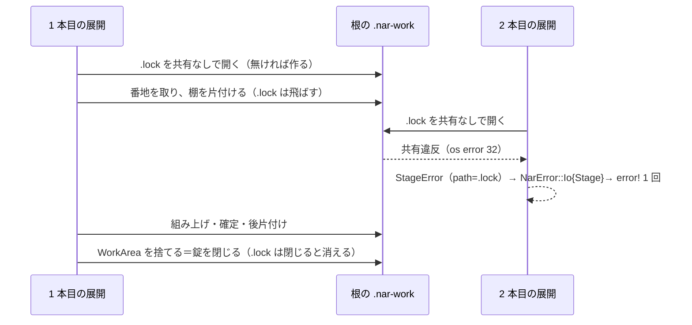
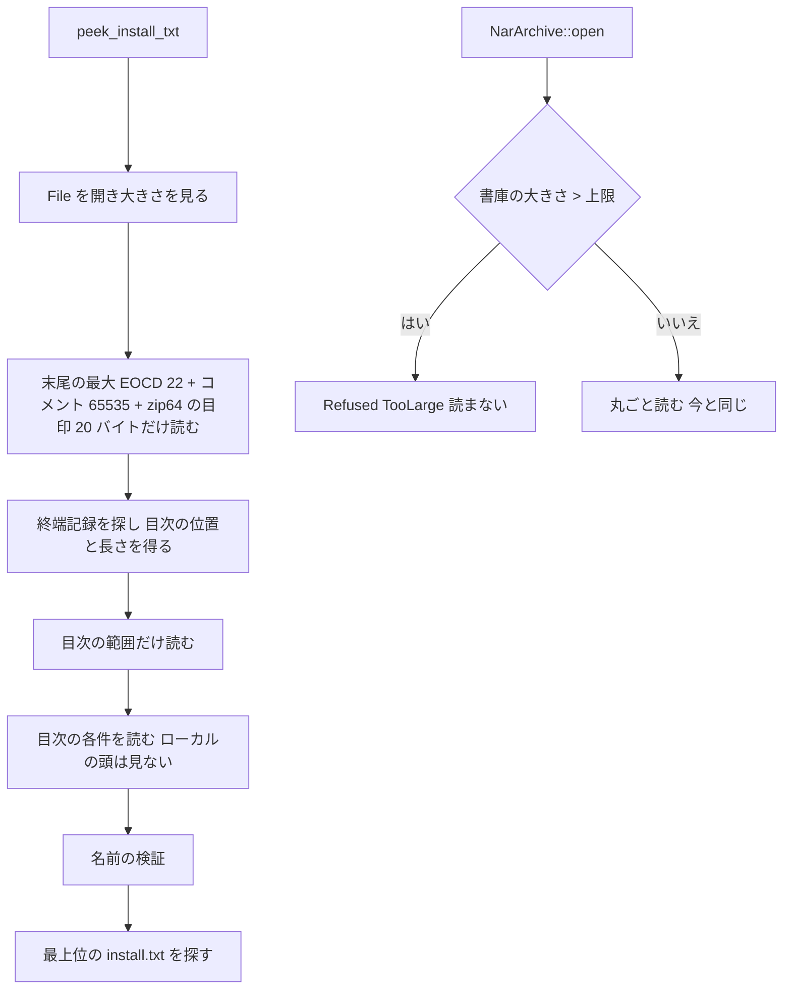

# 設計書: audit-ghost-catalog

## 概要

**目的**: ゴーストの読み込み（`crates/areka-ghost/`）・`.nar` のインストール（`crates/areka-nar/`）・利用者のデータの置き場（`crates/areka-user-data/`）の 3 つのクレートについて、ponytail の audit が出した 91 件の指摘（`research.md` §3 の #1〜#91）のうち、要件 9.1 で直すと決めた 88 件を直す。直した後に同じ範囲へ audit をかけ直して、新しい指摘を 0 件にする。

**使う人**: 開発者。直しの形は ponytail の「いちばん小さい完全な変更」に従う。消せるものは消し、写しは 1 か所にまとめ、呼び出し元・テスト・fixture まで直し切る。新しい機能は足さない。

**変わること**: 本番の振る舞いが変わるのは次の所だけ。⑴ 2 つの areka が同じ根へ同時に入れると、後の方が失敗する（今は先の方の作業フォルダを消す）。⑵ 投げ込みの判定は書庫の末尾と目次だけを読む。大きすぎる書庫は読む前に断る。⑶ 名前の検査・同梱の宛先・リンクの扱いが厳しくなる。⑷ 記憶の写しが自分の中へ入り込む形を断り、古い作業フォルダを片付ける。⑸ `AREKA_PROFILE_DIR` の空・相対の値を使わない。⑹ OnBoot のシェル名が一覧と同じ読み方になる。⑺ 同じプロセス内の SHIORI の読み込みが DLL のフォルダを依存の探し先に入れ、フォルダの形を helper の道とそろえる。⑻ かけ直し（タスク 18.2・18.4）の直し: 同梱は 64 件まで探す。descript の読み直しで消えた名前は `%selfname2` などからも消える。`install.txt` の大小だけ違う同じ鍵は後の行が勝つ。インストール先の根は一時の置き場を除いてから選ぶ。巻き戻せた失敗と組み上げの失敗では作業フォルダをその場で消す。書庫は上限を越えて読まない。宛先より上の段のリンクはたどる（宛先そのものと宛先の中のリンクは断る）。ほかはテストの直し・写しの寄せ・要らないコードの削除で、外から見た振る舞いは変わらない。

### Goals

- 要件 9.1 の 88 件を、3 つの組（Must fix・Should fix・Nice to have）とも直す。
- 直したバグと危ない所の 1 件ごとに、壊れたら落ちるテストを 1 本ずつ持たせる（#1・#45 は「錠を外すと赤」の形）。
- テストの `BoxedBackend` の写し 3 つを `recorder.rs` の 1 つにまとめる（要件 7）。
- タスクはファイルのまとまりで 18 本に束ねる（要件 9.13 の 20 以内）。
- 最後に同じ作法で audit をかけ直し、新しい指摘 0 件と全体テストの緑を記録する。

### Non-Goals

- #17・#41・#57 は直さない（要件 9.2）。
- 範囲の外のファイルの指摘（見つけてもその範囲の spec の持ち物）。
- `areka-parsers` の読みのずれ（ゴーストの `Name,Upper`）・`charset` の行の位置（`audit-parsers-sakura` の持ち物）。
- `shiori4-api`（v0.2.0）の作り直し。`shiori_inproc.rs` の指摘は今の形のまま直す（要件 9.11）。
- 依存の追加（`Cargo.lock` は変えない）。

## 境界の約束

### この spec が持つもの

- 3 つのクレートの全ファイル（本番・テスト・テストの道具・`Cargo.toml`）の直し。
- `.nar-work` の棚の錠（#1）・書庫の部分読み（#2）・記憶の写しの自己包含の拒みと古い作業フォルダの片付け（#15・#16）という、新しく足す小さな仕組み。どれも各クレートの中に閉じる。
- `areka-ghost` のテストの道具の置き場（`src` は `test_support.rs`、`tests/` は `common.rs`・`recorder.rs`・`spine_e2e_test.rs`）。
- 下の「範囲の外で触るファイル」の表の変更（直しのために要る分だけ）。

### 範囲の外（持たないもの）

- 範囲の外のファイルの見直し。見つけた指摘は直さない（要件 6.2）。
- `vendors/` の下（要件 6.3）。
- `doc/`・`docs/` を名指す行。`crates/areka-ghost/src/sylphya_wiring.rs` の `doc/COMPAT_ARCHITECTURE.md` を名指す行（38 行目あたり）は変えない（要件 5.7）。#30 の直しは同じファイルの 164〜172 行目だけを触る。
- `areka-parsers` の中の変更（大小を無視する鍵の読みの関数・`resolve` の撤去は `audit-parsers-sakura`）。
- `crates/log-capture-kit/tests/file_length_guard_test.rs` の例外表（触らない。ただし `inproc_e2e_test.rs` が 1,000 行以下になったときだけ、その 1 行を消して件数を 9→8 にする＝「1,000 行の番人」の節）。

### 使ってよい依存

- 今の依存だけ: `std`（`OpenOptionsExt::share_mode`・`custom_flags`・`std::path::absolute`）・`windows`（今の機能の中の `LoadLibraryExW`）・`tracing`。dev 側は `temp-path-kit`・`log-capture-kit`・`sample-ghost-kit`・`shiori4-testdll`（どれも既に各クレートの dev-dependencies にある）。
- `areka-parsers` の、`audit-parsers-sakura` が kv の隣に置く「鍵の大小を無視し空の値を落とす descript の読み」（以下「parsers の小文字の表」・名前と署名は同 spec の設計が決める）。
- 依存の向き: `areka-ghost` → `areka-parsers`・`areka-sylphya`・`shiori-host32-host`（今と同じ）。`areka` → 3 つのクレート（今と同じ）。新しい向きは作らない。クレートの間の新しい path の依存も作らない（`Cargo.lock` が変わる）。

### 見直しが要る変化（Revalidation Triggers）

- `areka_nar::peek_install_txt` の答えの決まり（ローカルの頭の壊れは見なくなる＝在ると答えた後に `open` が断ることがある）。呼び手の `crates/areka/src/input_events/file_drop.rs` は署名も扱いも変わらない。
- `areka_nar` の展開が同じ根への同時の 2 本目を `NarError::Io { phase: Stage }` で断る。インストールの机（`crates/areka/src/install/`）は失敗をそのまま `OnInstallFailure` へ渡す。
- `areka_nar` が書庫の大きさの上限（`Unsupported::TooLarge`）で断る形が 1 つ増える。
- `areka_user_data::app_profile_dir`・`readonly_app_profile_dir` が空・相対の `AREKA_PROFILE_DIR` を捨てる。
- `areka_user_data::establish_readonly_from` の引数が 1 つ減る。
- `areka_ghost::catalog::BasewareRoot::ghost_dir`・`balloon_dir` が消える。`areka_ghost::config::listed_name` が増える。
- `shiori_host32_host::map_get_reply` が公開になる。
- `areka_sylphya::persist::PersistIo` に `Arc<T>` への包括の実装が増える（範囲の外の写しはそのまま動く）。

### 範囲の外で触るファイル

下の表のファイルの持ち主は、どれも C17 に居ない（要件 6.1 の申し合わせは要らない）。C17 で並走する相手と分け合う所は 3 つ: `audit-parsers-sakura`（「申し合わせと順」の節）・一時フォルダの番人の例外表（`audit-emo-present` も行を持つ）・1,000 行の番人の例外表（`audit-emo-compose`・`audit-emo-present`・`audit-seriko` も行を持つ）。どちらの表も、件数は着地の前に表の行から数え直す。

| ファイル | 指摘 | 持ち主 | 変える中身 |
|---|---|---|---|
| `crates/log-capture-kit/tests/file_length_guard_test.rs`（条件つき） | `inproc_e2e_test.rs` が 1,000 行以下になったときだけ | `audit-test-kits` | 例外表から `inproc_e2e_test.rs` の 1 行を消し、件数 9→8（「1,000 行の番人」の節） |
| `crates/log-capture-kit/tests/temp_path_guard_test.rs` | #4・#5 | `audit-test-kits` | 例外表の 5 行を消す・`ALLOWED_COUNT` 19→14・`PROCESS_UNIQUE_COUNT` 16→12・`IntentionallyFixed` の種別と `INTENTIONALLY_FIXED_COUNT` を消す（使う項目が 0 になり、組まれない種別が警告になるため）・`CALIBRATION_DROPPED_ENTRY` を `crates/areka/src/install/fetch_url.rs` へ替える・それに合う doc の文言。C17 で並走する `audit-emo-present` も同じ表に行を持つ（`crates/areka-emo-present/src/balloon_test_support.rs`）ので、件数はここに書いた数を写さず、各タスク（T10・T15・T17）の前に `main` を取り込んで表の行から数え直す。この 5 行は未着手の `temp-path-exceptions-to-target`（この表の行を `target\test-roots` へ移す spec）の受け持ちを先に取るので、完了のときに roadmap の同 spec の行へ残りの行数と、本 spec が 5 行を取ったことを書く。行は消すタスクごとに消し、件数もそのタスクで合わせる（T10 で 2 行＝17・14、T15 で 2 行＝15・13 と種別の削除と較正の替え、T17 で 1 行＝14・12。読み出しのみの 2 は変わらない） |
| `crates/areka-sylphya/src/persist/io.rs` | #40 | `audit-sylphya-actor` | `impl<T: PersistIo + Sync + ?Sized> PersistIo for Arc<T>`（3 つの口をすべて中身へ渡す）とそのテスト 1 本（同じファイルの `mod tests`） |
| `crates/shiori-host32-host/src/client.rs`・`lib.rs` | #27 | `audit-shiori-host32` | `map_get_reply` を `pub` にして `lib.rs` から出す |
| `crates/areka/src/mcp/resolve.rs` | #25 | `audit-areka-app` | `listed_value` の中身を `areka_ghost::config::listed_name` の呼び出しへ |
| `crates/areka/src/boot_resolve_tests.rs`・`boot_resolve_option_tests.rs`・`boot_resolve_balloon_tests.rs`・`boot_resolve_mark_text_tests.rs` | #56 | `audit-areka-app` | `ghost_dir(..)`／`balloon_dir(..)` を `ghost_store().join(..)`／`balloon_store().join(..)` へ |
| `crates/areka/src/install/judge_tests.rs` | #71 | `audit-areka-install-update` | `charset_declared` を名指す 1 か所を消す |
| `crates/areka/src/readonly_run_tests.rs` | #72 | `audit-areka-app` | `establish_readonly_from` の 3 つ目の引数を消す |
| `crates/areka`・`crates/areka-mcp-bridge` のテストのうち、空・相対の `AREKA_PROFILE_DIR` を `app_profile_dir` に渡して結果を見るもの | #18 | `audit-areka-app`・`audit-mcp-update-crates` | 実装で grep して、在れば期待を新しい決まりへ（無ければ触らない） |

`audit-parsers-sakura` との申し合わせ（要件 9.10・9.14）は「申し合わせと順」の節に書く。

## つくり

### 今の形と守るもの

- `areka-nar` は「読む（`container`）→ 名前を確かめる（`names`）→ `install.txt` を解く（`manifest`）→ 計画（`plan`）→ 組み上げと確定（`install`）」の一方向の層。記録は公開面（`open`・`install`）が `Err` を返す直前に 1 回だけ出す（`log_failure`）。内側は `StageError`／`RefuseReason` を返すだけで記録しない。新しい失敗もこの道を通す。
- `areka-user-data` は純粋な決め（`decide`・`app_profile_dir`）と、入出力の薄い口（`establish`・`copy`）に分かれる。
- `areka-ghost` の本番の層は変えない。テストの道具は「単体テスト（`src`）」「結合テスト（`tests/`）」の 2 つの組み立ての単位があり、互いのコードは見えない。だから道具の置き場は単位ごとに 1 つずつ（`src/test_support.rs` と `tests/ghost/common.rs`）。1 つにはできない。

### 依存の向き（変えない）

`std`・`windows` → `areka-parsers`・`areka-sylphya`・`shiori-host32-host` → `areka-nar`・`areka-user-data`・`areka-ghost` → `areka`。どの直しも左から右の向きだけで呼ぶ。

### 技術の層

| 層 | 使うもの | この spec での役目 | 注 |
|---|---|---|---|
| ファイルの錠 | `std::os::windows::fs::OpenOptionsExt`（`share_mode(0)`・`custom_flags(FILE_FLAG_DELETE_ON_CLOSE)`） | #1 の `.nar-work\.lock` | 依存は増えない |
| 部分読み | `std::fs::File`・`std::io::{Seek, Read}` | #2 の末尾と目次だけの読み | 依存は増えない |
| DLL の読み込み | `windows::Win32::System::LibraryLoader::LoadLibraryExW` | #28 | 今の `LibraryLoader` の機能の中 |
| パスの整え | `std::path::absolute` | #15・#18・#29 | — |
| 記録 | `tracing` | #18・#30 の `error!` | 既存の決まり（`logging.md`） |

## ファイルの構成

新しいファイルは 2 つ（テストの道具）と、条件つきの 1 つ（`crates/areka-nar/src/plan_no_write_tests.rs`・#14）。ほかは今のファイルの直し。

### 新しいファイル

```
crates/areka-ghost/src/test_support.rs      # #36: src の単体テストの共有の道具（run_bounded・test_system_vars・RecordingSink・NoopSink・ゴーストの fixture・有界の終了・OnBoot を待つ輪）
crates/areka-user-data/src/test_support.rs  # #73: tree・profile ほかのテストの道具
```

どちらも `lib.rs` に `#[cfg(test)] mod test_support;` を 1 行足して読む（`pub(crate)`）。

### 直すファイル（クレートごと）

**`crates/areka-nar/src/`**
- `install.rs` — #1 棚の錠（`WorkArea` が錠を持つ・`prepare_shelf` は錠のファイルを飛ばす）・#8 リンクを拒む・#64 比べ方をそろえる・#62 doc・#63 待ちの差し替え。
- `container.rs` — #2 終端記録の位置決めと目次の読みを、全体のバイト列でも末尾と目次だけでも使える形に分ける。
- `lib.rs` — #2 `peek_install_txt` を部分読みに・`read_archive_bytes` の大きさの先回り・#64 `entry_bytes`。
- `names.rs` — #3 予約名・#6 暗黙のフォルダとファイルの衝突・#64 比べ方の関数 `fold`／`same_name` を置く。
- `plan.rs` — #64 `path_in_folder`・`leading_segments_match` を `same_name` へ。
- `manifest.rs` — #7 同じ宛先の同梱を拒む・#71 `charset_declared` を消す。
- `error.rs` — `Unsupported::TooLarge` の doc を「宣言の総和か書庫そのものの大きさ」に（語彙は増やさない）。
- `plan_no_write_tests.rs`（新・条件つき）— #14 で `plan_tests.rs` が 950 行を下回らないときだけ、「書き込みをしない」の塊を移す兄弟のテスト。
- テスト: `plan_tests.rs`・`plan_source_path_tests.rs`・`plan_roots_tests.rs`・`install_tests.rs`・`install_commit_tests.rs`・`install_nested_tests.rs`・`lib_tests.rs`・`lib_peek_tests.rs`・`lib_entry_tests.rs`・`lib_skip_tests.rs`・`lib_vocabulary_tests.rs`・`container_tests.rs`・`manifest_tests.rs`・`manifest_companion_tests.rs`・`names_tests.rs`・`error_tests.rs`（#9〜#14・#60〜#70 と各直しの縛るテスト）。

**`crates/areka-user-data/src/`**
- `copy.rs` — #15 自己包含の拒み・#16 番地の取り直しと古い作業フォルダの片付け・#20 先を越された枝を関数へ・#74 積み上げで歩く。
- `lib.rs` — #18 `AREKA_PROFILE_DIR` の値の検査（`app_profile_dir`）・`test_support` の 1 行。
- `establish.rs` — #18 `readonly_app_profile_dir` も同じ検査を通す・#19 一覧の読み失敗を記録・#72 使わない引数を消す。
- テスト: `copy_tests.rs`・`lib_tests.rs`・`establish_tests.rs`・`establish_locate_tests.rs`・`establish_readonly_tests.rs`。

**`crates/areka-ghost/src/`**
- `catalog.rs` — #22 `lowercased` を parsers の小文字の表へ乗り換える（それまでは `pub(crate)`）・#23 `read_descript` を `NotFound` の形に・#55 1 回の復号・#56 2 つの関数を消す。
- `catalog_roots.rs` — #78 4 行と注を消す。
- `config.rs` — #22 シェル名の読み・#25 `listed_name` を置く。
- `shiori_inproc.rs` — #26 allow と段落・#27 `map_get_outcome` を消す・#28 `LoadLibraryExW`・#29 フォルダの形。
- `shiori_wiring.rs` — #29 `helper_load_dir` を `pub(crate)`。
- `sylphya_wiring.rs` — #30（164〜172 行目だけ）。
- `ticker.rs` — #53・#54。
- `sink.rs` — #58・#59。
- `prop_sink.rs` — #40 写しを消す。
- `lib.rs` — `#[cfg(test)] mod test_support;`。
- テスト: `runtime_tests.rs`・`dispatcher_choice_tests.rs`・`dispatcher_slot_tests.rs`・`dispatcher_choice_timeout_tests.rs`・`dispatcher_test_support.rs`・`ticker_tests.rs`・`relay.rs`（中のテストの道具）・`runtime_origin_tests.rs`・`runtime_within_tests.rs`・`runtime_shell_tests.rs`・`runtime_names_tests.rs`・`shiori_wiring_empty_tests.rs`・`translate_wiring_tests.rs`・`translate_wiring_e2e_tests.rs`・`catalog_test_support.rs`・`catalog_tests.rs`・`catalog_all_shells_tests.rs`・`catalog_roots_tests.rs`・`catalog_roots_temporary_tests.rs`・`catalog_roots_ghost_balloon_tests.rs`・`shiori_inproc_tests.rs`・`shiori_inproc_adapter_tests.rs`・`shiori_inproc_host_tests.rs`・`config.rs` の `mod tests`。

**`crates/areka-ghost/tests/`**
- `ghost/recorder.rs` — #42 `pub struct BoxedBackend`（435→約 490 行）。
- `ghost/common.rs` — #43 `resolve_helper_exe`・#44 `run_bounded`／`run_bounded_shutdown`・#89 panic と止まりを分ける・#88 理由の切れた allow を消す（`common.rs` を使わない実行ファイルが出るなら残す。実装で確かめる）。
- `ghost/inproc_fixture.rs` — #5 置き場・#45 錠つきの共有ゴースト・#48 4 つを消す・#87・#88。
- `ghost/inproc_e2e_test.rs` — #4（I3）・#42・#44・#45・#85・#86・#88。**分けない**。
- `ghost/snapshot_capture_test.rs`・`ghost/real_pasta_test.rs`・`real_pasta_online.rs` — #42〜#47・#88。
- `ghost/spine_e2e_test.rs`（親）と `spine_e2e_test_s1`〜`s7`・`spine_e2e_test_global_log_probe.rs`・`ghost/sylphya_integration_test.rs`・`ghost.rs` — #4（S7）・#49〜#52・#89〜#91。

## 流れ

### #1 棚の錠



- 待たずにすぐ失敗にする。根が 2 つの書庫を 2 つのプロセスが逆の順で掘っても、待ち合って止まることが無い。
- 錠を持つのは `WorkArea` を作ってから捨てるまで（`NarArchive::place` の中＝組み上げ・確定・後片付けの全部）。同じプロセスの中の 2 本も同じ決まりで断る（今は互いの作業フォルダを消し合う）。

### #2 投げ込みの判定の読み



## 新しい形を引く直し

### #1 `.nar-work` の棚の錠（`crates/areka-nar/src/install.rs`）

| 項目 | 中身 |
|---|---|
| 目的 | 同じ根へ同時に入れる 2 本が、互いの作業中のフォルダを消さない |
| 要件 | 3.1・4.1・4.2・4.3・5.2 |

**形**
- `const SHELF_LOCK: &str = ".lock";`（棚の直下）。
- `WorkArea` に欄 `_lock: std::fs::File` を足す。`WorkArea::create_at` は、根の確かめの後に `create_dir_all(棚)` → `.lock` を `read(true).write(true).create(true).share_mode(0).custom_flags(FILE_FLAG_DELETE_ON_CLOSE)` で開く → 今までどおり番地を取って片付ける。（`areka-nar` は `windows` に依存しないので、`FILE_FLAG_DELETE_ON_CLOSE` は名前つきの定数 `0x0400_0000` で書く）開けなければ `StageError { path: <棚>\.lock, source }` を返す（呼び手の `place` が `IoPhase::Stage` の `NarError::Io` にし、`log_failure` が `error!` を 1 回出す。新しい記録の名前は作らない）。
- `prepare_shelf` は名前が `.lock`（ASCII の大小を無視）の項目を飛ばす（残り物にも数えない）。
- 棚がファイルのときの失敗（`fails_when_the_shelf_is_not_a_folder`）は、`create_dir_all(棚)` の失敗として今と同じ `path == 棚` で返る。

**前提と後の状態**
- 錠を持っている間だけ片付けが走る。片付けが消すのは「錠を持っていない＝誰も使っていない」棚の項目だけになる。
- `WorkArea` を捨てると錠が閉じ、`.lock` は消える（異常終了でも OS が閉じて消す）。展開の後に根の木を比べるテストの期待は変わらない。消えることは縛るテストで確かめる。消えない作りだと分かったら、根の木を比べるテストに `.nar-work\.lock` を足すのでなく、閉じた後に `.lock` を消す 1 手を `WorkArea` の `Drop` に置く（どちらでも「錠のファイルは持っている間だけ在る」を守る）。

**縛るテスト**（`install_tests.rs`）
- `a_second_work_area_on_the_same_root_fails_and_leaves_the_first_intact`: 1 本目の `WorkArea::create(root)` を持ったまま 2 本目を作る → 2 本目は `Err`（`path` が `.lock`）・1 本目の作業フォルダが在る。**錠を外すと赤**（2 本目が成功し、その片付けが 1 本目の作業フォルダを消す）。決定論（1 つのスレッドで順に呼ぶ）。
- `the_shelf_lock_is_released_when_the_work_area_is_dropped`: 捨てた後に同じ根でもう 1 本作れる・`.lock` が無い。
- `a_stray_file_on_the_shelf_is_swept`（#11）: 棚に `junk.txt` を置いて作る → 消えている・残り物は空。

### #2 書庫の部分読みと大きさの先回り（`container.rs`・`lib.rs`）

| 項目 | 中身 |
|---|---|
| 目的 | UI スレッドの投げ込みの判定が大きな書庫で止まらず、メモリも食わない。`open` は読む前に大きさで断る |
| 要件 | 3.1・3.2・4.1・4.2 |

**`container.rs` の形**（署名は crate の内側だけ）

```rust
/// 末尾に読む長さ（終端記録 22＋コメント 65535＋zip64 の目印 20）。
pub(crate) const TAIL_WINDOW: usize;

/// 目次の場所（ファイルの頭からの位置・長さ・件数）。
pub(crate) struct CentralSpan { pub count: usize, pub offset: u64, pub size: usize }

/// `tail` はファイルの最後の `tail.len()` バイト（ファイルが短ければ全部）。
/// `archive_len` はファイル全体の長さ。範囲の検査は `archive_len` で行う。
pub(crate) fn locate_central_directory(tail: &[u8], archive_len: u64) -> Result<CentralSpan, RefuseReason>;

/// 目次のバイト列 `cd` から `count` 件を読む。`whole` が Some なら各件のローカルの頭も
/// その場で確かめて `data` を埋める（今と同じ順に断る）。None なら `data` は空の範囲で、
/// 伸長には使えない（投げ込みの判定だけが使う）。
pub(crate) fn read_central_headers(cd: &[u8], count: usize, whole: Option<&[u8]>) -> Result<Vec<RawEntry>, RefuseReason>;

/// 今までの入口（署名は変えない）＝ locate_central_directory(bytes, len) → read_central_headers(&bytes[cd], count, Some(bytes))。
pub(crate) fn read_central_directory(bytes: &[u8]) -> Result<Vec<RawEntry>, RefuseReason>;
```

- `find_eocd`・`read_eocd` は `tail` の上で動く（`tail` の終わりはファイルの終わり）。目次の終わりの検査は `archive_len` と比べる。zip64 の目印は `tail` の中で見る（窓に 20 バイト足してあるので、コメントが最大でも目印は窓の中）。
- 宣言の大きさの総和の上限（1 GiB）は今と同じく目次の読みの中で見る（判定も `open` も同じ）。
- `RawEntry` に欄は足さない。`data` は判定の道では `0..0`（doc に「目次だけの読みでは空」と書く）。

**`lib.rs` の形**
- `peek_install_txt(path)`: `File::open` → `metadata().len()` → 末尾 `min(len, TAIL_WINDOW)` を `Seek::End` で読む → `locate_central_directory` → 目次の範囲を `Seek::Start` で読む → `read_central_headers(.., None)` → `validate_entry_names` → `locate_install_txt`。読みの失敗は今と同じ `NarError::Io { phase: Read }`、構造と名前の拒みは `Refused`。記録は出さない（今と同じ）。
- `read_archive_bytes(path)` は `read_archive_bytes_within(path, MAX_ARCHIVE_LEN)` を呼ぶ。`MAX_ARCHIVE_LEN = 2 * MAX_TOTAL_DECLARED_SIZE`（2 GiB）。理由: 受け入れる中身は宣言の総和で 1 GiB まで。格納の中身はその大きさのまま、圧縮の中身は縮めない時でもほぼ同じ大きさで、頭の分を入れても 2 倍は越えない。越える書庫は中身を全部読んでも必ず断ることになる。越えたら読まずに `Refused { reason: UnsupportedEntry { index: 0, name: 書庫全体, what: TooLarge } }`（zip64 の拒みと同じ組み方。`container.rs` の `unsupported(b"", 0, Unsupported::TooLarge)` を `pub(crate) fn archive_too_large() -> RefuseReason` で包んで `lib.rs` から使う）。`open` の出口が `error!` を 1 回出す（今と同じ道）。`peek_install_txt` も読む前に同じ上限を見て、越えれば読まずに同じ断りを返す（UI スレッドが読む量を抑え、`open` と答えを揃える）。目次だけを切り出して読むときも、断りの知らせに載せる位置は目次の位置を足して、ファイルの頭からの位置に戻す（今の知らせの値を変えない）。
- 判定と `open` の答えの関係: 目次と名前で決まる答え（在る・無い・名前の拒み・構造の拒み）は今までどおり一致する。ローカルの頭だけが壊れた書庫は、判定が「在る」と答え、`open` が `CorruptArchive` で断る（＝インストール対象として扱い、入らなければ `OnInstallFailure`）。`peek_install_txt` の doc にこの 1 点を書く。

**縛るテスト**
- `lib_peek_tests.rs` `peek_reads_only_the_table_of_contents`: 最上位に `install.txt` を持つ書庫の、最初の件のローカルの頭の署名をこわす → 判定は `Ok(true)`・`open` は `CorruptArchive`。判定が丸ごと読む形へ戻ると赤。
- `lib_peek_tests.rs` `peek_finds_the_end_record_behind_a_long_comment`: コメント 65535 バイトの書庫で `Ok(true)`（窓の端の検査）。
- `lib_peek_tests.rs` `open_refuses_an_archive_longer_than_the_limit_before_reading`: `read_archive_bytes_within(path, len - 1)` が `TooLarge`、`(path, len)` が読める。先回りを消すと赤。
- 既存の `six_samples_answer_as_designed_without_any_record`・`the_answer_agrees_with_how_the_procedure_opens_the_same_archive` は変えずに通る（壊れた終端記録・無いファイル・`..` の拒み）。

### #15・#16 記憶の写しの守り（`crates/areka-user-data/src/copy.rs`）

| 項目 | 中身 |
|---|---|
| 目的 | 写す元の中へ写さない。落ちたプロセスの作業フォルダで後の写しが失敗しない・溜まらない |
| 要件 | 3.1・4.1・4.2・4.3・5.2 |

**形**
- 先頭で `fn is_within(inner: &Path, outer: &Path) -> bool` を見る。両方を `std::path::absolute` にし、部品ごとに `to_lowercase` で比べて `outer` が `inner` の前置きなら真。`to` か `work_root` が `from` の下なら `CopyError::Io { path: <下にある方>, error: io::Error::new(InvalidInput, "写す元の中へは写さない") }` を返す（呼び手の `establish::migrate` と `areka::roots::user_root` は既に `error!` を出す）。`absolute` が失敗したら同じ `CopyError::Io`。
- 番地: `fn make_work_dir(shelf: &Path, mut serial: impl FnMut() -> u64) -> Result<PathBuf, CopyError>` が `<pid>-<連番>` を `create_dir` し、`AlreadyExists` なら連番を進めて取り直す（ほかの失敗はそのまま返す）。本番は `NEXT_WORK` の閉包を渡す。
- 片付け: `const STALE_WORK_AFTER: Duration = 24 時間;` と `fn sweep_stale(shelf: &Path, now: SystemTime)`。棚の直下の項目のうち更新時刻が `now` から `STALE_WORK_AFTER` 以上前のものを消す。消せなければ既存の `warn!` `user_data_copy_work_left` を出して続ける（写しそのものの失敗ではない）。読めない項目・時刻が取れない項目は触らない。写しの初め（棚を作った直後）に `SystemTime::now()` で 1 回呼ぶ。生きている写しの作業フォルダは新しいので消えない。
- #74: `build` を明示の `Vec<(PathBuf, PathBuf)>` の積み上げで歩く形にする（リンクの拒み・読み取り専用の属性の落とし・数え方は今のまま）。
- #20: 入れ替えの後の「先を越されたか」の判定（今の 82〜94 行目）を `fn finish_rename(work: &Path, to: &Path, result: io::Result<()>) -> Result<CopyDone, CopyError>` に出す。

**縛るテスト**（`copy_tests.rs`）
- `refuses_to_copy_into_itself`（#15）: `to = from\x\to` と `work_root = from\x` の 2 つでそれぞれ `InvalidInput`・`to` が無い。検査を外すと止まらないか深い所で落ちる＝赤。
- `a_taken_work_address_is_skipped`（#16）: 棚に `<pid>-0` を先に作り、0 から始まる閉包で `make_work_dir` → `<pid>-1`。取り直しを外すと `AlreadyExists` で赤。
- `stale_work_folders_are_swept_and_fresh_ones_kept`（#16）: 項目の更新時刻を読み、`now = 更新時刻 + 24 時間` で消え、`+ 24 時間 − 1 秒` で残る。
- `a_raced_destination_returns_raced_and_drops_the_work`（#20）: 在る `to` へ `finish_rename` → `Raced`・作業フォルダが無い。
- `deep_trees_copy_on_a_small_stack`（#74）: 深さ 2,000 段（1 段 1 字）の木を、スタック 256 KiB のスレッドで写す。再帰に戻すとスタックが溢れて実行ファイルごと落ちる＝赤。根は `TempPath` の下。

### #45 I1・I2 の共有ゴーストの錠（`crates/areka-ghost/tests/ghost/inproc_fixture.rs`）

| 項目 | 中身 |
|---|---|
| 目的 | 同じ固定の根を使う I1 と I2 が、互いの初回の記録を消したり残したりしない |
| 要件 | 4.1・4.2・4.5 |

**形**
- `static SHARED_GHOST_LOCK: Mutex<()>`。
- `pub struct SharedGhost { _guard: MutexGuard<'static, ()>, root: &'static Path }` と `pub fn root(&self) -> &Path`。
- `pub fn shared_test_ghost() -> SharedGhost`: 錠を取り（毒は `into_inner` で越える）、取った後で `ghost\master\profile\areka` を消す（無いのは通す・ほかの失敗は panic＝黙って 2 回目扱いで走らない）。組み立て（`OnceLock`）は今のまま。
- `pub fn try_shared_test_ghost() -> Option<SharedGhost>`: `try_lock` の形（塞がっていれば `None`・消さない）。縛るテストだけが使う。
- I1・I2 は `let shared = shared_test_ghost(); let ghost_root = shared.root().to_path_buf();` とし、`shared` を終了の確かめまで持つ（`_` で捨てない）。組みの確かめのテスト（`inproc_fixture.rs` の `mod tests`）も同じ口で取る。

**縛るテスト**（`inproc_fixture.rs` の `mod tests`）
- `the_shared_ghost_is_not_reset_while_another_test_holds_it`: `shared_test_ghost()` を持ったまま `profile\areka\sylphya.toml` を書く → `try_shared_test_ghost()` が `None`・記録が残る → 持ち物を捨てて `shared_test_ghost()` を取り直す → 記録が消えている。**錠を外すと赤**（2 本目がすぐに取れて記録を消す＝I2 の消去が I1 の記録を消す競りを 1 つのスレッドの順で再現する）。待ち時間を使わない決定論。

### #6・#64 名前の比べ方（`names.rs`・`plan.rs`・`install.rs`・`lib.rs`）と #7（`manifest.rs`）

| 項目 | 中身 |
|---|---|
| 目的 | 名前の検証・計画・展開・同梱の宛先で、大小の比べ方を 1 つにそろえる。暗黙のフォルダとファイルの衝突を検証で止める |
| 要件 | 3.1・3.2・4.1・4.2・9.9 |

**形**
- `names.rs` に `pub(crate) fn fold(name: &str) -> String`（`to_lowercase`）と `pub(crate) fn same_name(a: &str, b: &str) -> bool`（`fold(a) == fold(b)`）を置く。今の `validate_entry_names` の鍵は `fold` を使う（振る舞いは今と同じ）。
- #64: `plan.rs` の `path_in_folder`・`leading_segments_match`、`install.rs` の `copy_existing` の切り抜きの比べと `kept`、`lib.rs` の `entry_bytes` を `same_name` に替える。`eq_ignore_ascii_case` で書庫の名前どうし・宛先の名前どうしを比べる所はほかに残さない（定数の綴り `install.txt` との比べは残してよい）。
- #6: `validate_entry_names` の表を `BTreeMap<String, (String, bool)>`（畳んだ全体のパス → 綴りとフォルダか）にし、別に `BTreeMap<String, String>`（畳んだ先祖の前置き → それを生んだエントリの綴り）を持つ。ファイルのエントリの畳んだパスが先祖の表に在る、またはエントリの先祖の前置きがファイルとして表に在るとき `CaseCollision { a, b }`。明示のフォルダのエントリ（`x/`）と `x/y.txt` は衝突ではない。
- #7: `manifest.rs` の `collect_companions` が、見つけた順に `fold(directory)` を集合に持ち、2 つ目が重なれば `RefuseReason::InvalidDirectoryName { key: "<2 つ目の接頭辞>.directory", value: 綴り }` で書庫ごと断る（語彙は増やさない。`crates/areka/src/install/judge.rs` の割り当ても変わらない）。本体の宛先と同梱の宛先の重なりは今の計画（`overridden`）が扱う。

**縛るテスト**
- `names_tests.rs` `a_file_collides_with_a_folder_another_entry_implies`（`x` と `x/y.txt`・順を逆にしても・`X` と `x/y.txt`）・`an_explicit_folder_entry_and_its_children_do_not_collide`。
- `plan_roots_tests.rs` `a_full_width_companion_folder_is_carved_out_case_insensitively`（#64: `ＢＡＬ` の同梱と書庫の `ｂａｌ/` → 同梱として見つかり本体に入らない）。
- `install_tests.rs` `refresh_keep_matches_non_ascii_names_case_insensitively`（#64: `kept` の全角）。
- `manifest_companion_tests.rs` `two_companions_naming_the_same_folder_refuse_the_archive`（#7: `balloon.directory,foo` と `balloon0.directory,FOO`）。

### #22 OnBoot のシェル名の読み（`config.rs`・`catalog.rs`）

- 形: `resolve_shell_name` は、シェルの `descript.txt` を一覧と同じ表（鍵の大小を無視・空の値は無い）で読み、`name` を引く。無ければ今どおりフォルダ名へ倒し `warn!`。`decode` には今どおり `default_encoding` を渡す。
- 表を作る関数: 最終の形は parsers の小文字の表。乗り換える前の間は、`catalog.rs` の `lowercased` を `pub(crate)` にして文字コードを引数に取る形にし（`catalog` の呼び手は `DefaultEncoding::Ansi` を渡す）、`config.rs` がそれを使う。parsers の小文字の表が `main` に入ったら、`catalog.rs` の `lowercased` を消して両方を乗り換える（「申し合わせと順」）。
- 縛るテスト（`config.rs` の `mod tests`）: `shell_name_key_is_read_case_insensitively`（`Name,Foo` → `Foo`）・`an_empty_shell_name_falls_back_to_the_folder_name`（`name,` → フォルダ名）。乗り換えの後も同じテストが通る。

## 指摘ごとの直し方（#1〜#91）

「束」はタスクのまとまり（次の節）。「縛るテスト」は、直したバグと危ない所が壊れたら落ちるテスト（要件 4.1）。「—」はテストの直しそのもの・写しの寄せ・削除で、今あるテストが同じ結果で通ることを確かめる（要件 4.5・7.2）。場所の行番号は `research.md` §3 の時点のもの。

### Must fix

| # | 直し方 | 範囲の外 | 縛るテスト | 束 |
|---|---|---|---|---|
| 1 | 棚の錠（上の節） | — | `a_second_work_area_on_the_same_root_fails_and_leaves_the_first_intact`（錠を外すと赤）・`the_shelf_lock_is_released_when_the_work_area_is_dropped` | T3 |
| 2 | 部分読みと大きさの先回り（上の節） | — | `peek_reads_only_the_table_of_contents`・`peek_finds_the_end_record_behind_a_long_comment`・`open_refuses_an_archive_longer_than_the_limit_before_reading` | T4 |
| 3 | `RESERVED_STEMS` に `COM¹ COM² COM³ LPT¹ LPT² LPT³` を足す（比べ方は今の ASCII の大小無視のまま。上付きの字は大小を持たない） | — | `names_tests.rs` `superscript_com_and_lpt_names_are_reserved` | T5 |
| 4 | 4 つのテストの一時フォルダを `TempPath::new(..)` にし、手書きの一意な名前と `remove_dir_all` を消す。S7 は `TempPath` の下へ fixture を書く（消せなかった前回の上で起動しない） | `temp_path_guard_test.rs` の 4 行（消すタスクごとに件数も直す） | 一時フォルダの番人（`every_exception_still_has_a_real_hit`・`no_unlisted_entry_point_use`。`%TEMP%` へ戻すと赤） | T10（2 つの src のテスト）・T15（I3）・T17（S7） |
| 5 | `shared_test_ghost` の根を `<ワークスペース>\target\test-roots\areka_shiori4_test_ghost_shared` へ（`env!("CARGO_MANIFEST_DIR")` の 2 つ上の `target`＝`temp-path-kit` と同じ式）。固定の名前とプロセスをまたぐ再利用は残す | `temp_path_guard_test.rs` の `inproc_fixture.rs` の行・`IntentionallyFixed` と件数・`CALIBRATION_DROPPED_ENTRY` を `crates/areka/src/install/fetch_url.rs` へ | 一時フォルダの番人（同上）・較正 `dropping_a_known_exception_turns_the_guard_red` | T15 |

### Should fix

| # | 直し方 | 範囲の外 | 縛るテスト | 束 |
|---|---|---|---|---|
| 6 | 暗黙のフォルダとファイルの衝突を `CaseCollision`（上の節） | — | `a_file_collides_with_a_folder_another_entry_implies`・`an_explicit_folder_entry_and_its_children_do_not_collide` | T5 |
| 7 | 同じ宛先の同梱を `InvalidDirectoryName` で書庫ごと拒む（要件 9.9・上の節） | — | `two_companions_naming_the_same_folder_refuse_the_archive` | T6 |
| 8 | `copy_existing` が `file_type().is_symlink()` を先に見て、リンク（ジャンクションを含む）なら `StageError { path: リンク, source: io::Error::new(InvalidInput, "リンクはたどらない") }`。`place` が `NarError::Io{Stage}` にし `log_failure` が `error!`（要件 9.6） | — | `install_tests.rs` `a_link_inside_an_existing_destination_fails_the_stage_with_its_path`（`mklink /J` で作る・`areka-user-data` の `copy_tests` と同じ手）・リンクの先は触られていない | T6 |
| 9 | 「根へ何も書かない」の写しを、長さでなくバイト列で比べる（#12 の共有の `tree`）。較正は `b"1"`→`b"2"` | — | —（テストそのもの） | T1 |
| 10 | `.declared_size(MAX_TOTAL_DECLARED_SIZE)` にする | — | —（テストそのもの。`>` を `>=` にすると赤） | T2 |
| 11 | 棚のファイルを消す枝のテストを足す | — | `a_stray_file_on_the_shelf_is_swept` | T3 |
| 12 | `lib_tests` の `tree`／`walk`／`hold` を `pub(super)` にして `install_tests`・`install_commit_tests` の写しを消す。`root_with_ghost` と「読む→検証→解く」の道具を `plan_tests.rs` に 1 つ（`pub(super)`）置き `install_tests` から使う | — | — | T1 |
| 13 | `lib_tests.rs` に `pub(super) fn assert_source_has_no_io(source, needles, harmless)` を置き、`container_tests`・`manifest_tests`・`names_tests` の 3 つの走査と較正をそれへ（`Path` と `path::` のずれは 1 つにそろう） | — | —（較正は残る） | T2 |
| 14 | #60・#12・#61・#9 で `plan_tests.rs` を減らす。950 行を下回らなければ「書き込みをしない」の塊（876〜971 行目あたり）を兄弟の `plan_no_write_tests.rs` へ移す（`plan.rs` に `#[cfg(test)] #[path]` を 1 つ足す） | — | — | T1 |
| 15 | 自己包含の拒み（上の節） | — | `refuses_to_copy_into_itself` | T7 |
| 16 | 番地の取り直し・古い作業フォルダの片付け（上の節） | — | `a_taken_work_address_is_skipped`・`stale_work_folders_are_swept_and_fresh_ones_kept` | T7 |
| 18 | `lib.rs` に `fn usable_profile_env(profile_env: Option<&OsStr>) -> Option<PathBuf>` を置く。今の `absolute` で読み、空・相対なら `error!`（`event = "profile_dir_env_unusable"`・値つき）を出して `None`。`profile_env` を見る 4 か所＝`app_profile_dir`・`readonly_app_profile_dir`・`establish_from`（記憶の移しを飛ばす判定・`establish.rs` 100 行目）・`locate_app_profile`（中継への答え・同 175 行目）が、入口で 1 回だけ検査した結果を使う（生の `profile_env.is_none()` を残さない）。`error!` は入口（`establish_from`・`locate_app_profile`・`establish_readonly` の入口）で 1 回だけ出し、起動の中で何度も呼ばれる `app_profile_dir` の中では出さない。絶対パスは今どおり使う（要件 9.4） | 呼び手の署名は変わらない。範囲の外のテストが空・相対の値の結果を見ていれば直す | `lib_tests.rs` `an_empty_or_relative_profile_env_is_ignored_with_an_error`（空と相対で書ける根の `profile\areka`・ERROR が 1 件ずつ）・`establish_readonly_tests.rs` `readonly_reads_beside_when_the_profile_env_is_relative`・`establish_tests.rs` `establish_still_migrates_when_the_profile_env_is_empty`（空の値でも隣の記憶を写す）・`establish_locate_tests.rs` `locate_answers_migration_pending_when_the_profile_env_is_empty`（空の値で `MigrationPending`。生の判定へ戻すと `Ready` で赤） | T8 |
| 19 | `flatten()` をやめ、各 `Err` を既存の `warn!` `user_data_marker_unreadable` で記録して次へ | — | `establish_locate_tests.rs` `an_unreadable_listing_entry_is_logged`（読めない項目を差し込める内側の関数で、WARN が 1 件） | T8 |
| 20 | 先を越された枝を `finish_rename` に出してテスト（上の節） | — | `a_raced_destination_returns_raced_and_drops_the_work` | T7 |
| 21 | 失敗の道のテストを `log_capture_kit::capture` で包み、`app_memory_migrate_failed`・`user_root_unavailable`（`create_failed`）の ERROR が 1 件出ることを見る。`user_data_copy_work_left` の WARN を見るテストを 1 本（`copy.rs` の `discard` を、中のファイルを `share_mode(0)` で掴んだフォルダに対して直に呼ぶ） | — | —（テストそのもの） | T8 |
| 22 | シェル名を一覧と同じ表で読む（上の節・要件 9.10） | 「申し合わせと順」 | `shell_name_key_is_read_case_insensitively`・`an_empty_shell_name_falls_back_to_the_folder_name` | T9（乗り換えは T18 の頭まで） |
| 23 | `read_descript` を `NotFound` の形にし（`is_file` の先回りを消す）、`master_descript_keys` は `read_descript(&master_descript(g))` に | — | `catalog_tests.rs` `a_descript_that_is_a_folder_warns_in_both_readers` | T9 |
| 24 | `readme,..\outside.txt` と `readme,sub\x.txt` で `readme == None` を見る 1 件 | — | —（テストそのもの） | T9 |
| 25 | `config.rs` に `pub fn listed_name(name: Option<&str>, ghost_root: &Path) -> String`（空でない名、無ければ根の絶対パスの末尾の区切りを除いた字）。`listed_ghost_name` と範囲の外の `listed_value` がそれを使う。テストの 3 つ目の写しも | `crates/areka/src/mcp/resolve.rs` | `config.rs` `listed_name_falls_back_to_the_absolute_root_without_a_trailing_separator` | T9 |
| 26 | `#![allow(dead_code)]` とその段落を消す（`non_snake_case` は残す）。出た警告の物は、ツリー全体で使われていないことを確かめて消す | — | — | T10 |
| 27 | `map_get_reply` を公開し、`shiori_inproc.rs` の `map_get_outcome` を消して使う（要件 9.11） | `crates/shiori-host32-host/src/client.rs`・`lib.rs` | 既存の `client.rs` の判定の順のテストと同じ プロセス内の道のテスト（同じ結果） | T10 |
| 28 | `load_library_quiet` を `LoadLibraryExW(.., None, LOAD_LIBRARY_SEARCH_DLL_LOAD_DIR \| LOAD_LIBRARY_SEARCH_DEFAULT_DIRS)` に。渡すのは絶対パス（#29） | — | `shiori_inproc_tests.rs` `a_relative_dll_path_is_refused`（今の作業フォルダから組み立てた相対パスでは読めず、同じ DLL の絶対パスでは読める。`LoadLibraryW` へ戻すと相対パスが読めて赤） | T10 |
| 29 | `helper_load_dir` を `pub(crate)` にし、`inproc_connect` も `load` のフォルダと DLL のパスをそれで整える（失敗は `error!`＋`Err(String)` の今の形） | — | `shiori_inproc_tests.rs` `inproc_connect_accepts_a_relative_mount_folder`（`TempPath` の下に DLL を写したゴーストを、今の作業フォルダからの相対パスで `resolve` して接続できる。#28 で相対の DLL パスは読めないので、整えを外すと赤） | T10 |
| 30 | `warn!` を `error!` に（続行は変えない・要件 9.5）。164〜172 行目だけ | — | `sylphya_wiring.rs` の兄弟テスト `a_dead_sylphya_barrier_is_logged_as_error`（役者を畳んでから sink を呼び ERROR が 1 件） | T11 |
| 31 | 同期の檻で `Tick(7_000)`→`Tick(7_500)` を送り `Tick(0.0)`→`Tick(0.5)` を見る。競る `try_recv` の 1 本は直す | — | —（テストそのもの・`/ 100.0` にすると赤） | T14（#75 の後） |
| 32 | `[一時(t), 無い(gone), a]` で `head_skipped == Some(gone)` を見る 1 件 | — | —（テストそのもの） | T9 |
| 33 | `crate::test_log_capture::capture` で包み WARN を見る | — | —（テストそのもの） | T10 |
| 34 | 道具の手写しの `inproc_connect` を消し、`TempPath` の下に DLL を写した fixture から `resolve`→`inproc_connect(..)()` で組む。DLL の探しは `test_support.rs` の 1 つに（`runtime_tests`・`shiori_inproc_tests` も） | — | — | T10 |
| 35 | `catalog::test_support` を `pub(crate)` にして `put`・`put_ghost_in`・`put_balloon`・`two_roots`・`catalog_warns` を 1 つずつ。写しを消す | — | — | T9 |
| 36 | `src/test_support.rs` に `run_bounded`・`test_system_vars`・`RecordingSink`・`NoopSink`・ゴーストの fixture・有界の終了（`shutdown_bounded`）・OnBoot を待つ輪を 1 つずつ。写しと「取り込めない」の注を消す。`dispatcher_test_support.rs` は dispatcher に固有の物だけ残す（空になれば消す） | — | — | T12 |
| 37 | `fake_options(root)` を 1 つにして 5 つの塊を置き換える | — | — | T13 |
| 38 | `FakeShioriBackend` を消し `ShioriWiring::Custom(Box::new(crate::shiori_wiring::empty_connect()))` に | — | — | T13 |
| 39 | `boot_happy_path_…` を消す（要件 9.5）。見ていることは `into_parts_exposes_live_senders_…` が見る | — | — | T13 |
| 40 | `areka-sylphya` に包括の実装（3 つの口を渡す・`Sync` を要る）。範囲の中の `SharedGateIo`（`runtime_tests.rs`）と `SharedFakeIo`（`prop_sink.rs`）を消して `Arc<FakePersistIo>` を直に渡す。範囲の外の 20 の写しは残す（要件 9.12） | `crates/areka-sylphya/src/persist/io.rs` | `io.rs` の `mod tests` `an_arc_forwards_all_three_methods`（`withholds` が真を返す偽物を `Arc` で包んで真） | T13 |
| 42 | `recorder.rs` に `pub struct BoxedBackend(pub Box<dyn ShioriBackend>)` と全部の口の委譲を 1 つ。3 つの写しと各ファイルの要らなくなった `use shiori_host32_host::{…}` を消す（要件 7） | — | —（3 つのテストが同じ結果で通る・要件 7.2） | T16 |
| 43 | `common.rs` に `resolve_helper_exe` を 1 つ。3 つの写しを消す（`areka-kanade` の 4 つ目は残す） | — | — | T16 |
| 44 | `common.rs` に `run_bounded`／`run_bounded_shutdown`。`ghost` の実行ファイルの 6 つと `real_pasta_online.rs` の写し・待ちの輪 2 つを使い替える | — | — | T16（spine の子は T17） |
| 45 | 錠つきの共有ゴースト（上の節） | — | `the_shared_ghost_is_not_reset_while_another_test_holds_it`（錠を外すと赤） | T15 |
| 46 | `SampleRoot::acquire("emo2")` に DLL を写す形にし、`write_real_pasta_ghost_fixture` と `unique_temp_dir` を消す | — | —（環境変数で動くテスト・形を `real_pasta_online.rs` とそろえる） | T16 |
| 47 | 捨てている失敗を `expect` に、`profile` を写さない（#46 の `SampleRoot` の形）、待ちの後に `assert!(observed)` | — | —（テストそのもの） | T16 |
| 48 | `TempGhost`・`assemble_test_ghost`・`ASSEMBLE_FS_LOCK`・自分のテストを消し、名指す doc も直す | — | — | T15 |
| 49 | S5 を `boot_with_kanade_stop` で起こし `Stopped { cause: DeadlineExceeded }` を見る | — | —（テストそのもの・締切の道が試される） | T17 |
| 50 | 親の `spine_e2e_test.rs` に `write_ghost_fixture(name)`・`join_bounded`・`expected_from_shiori_call`・`BOUND` を 1 つずつ。子は `super::`、`sylphya_integration_test` は `crate::spine_e2e_test::` で使う。`run_bounded` は `crate::common`、`unique_temp_dir` は `TempPath` | — | — | T17 |
| 51 | 親に `boot_script()` と `expected_boot_prefix(&config)` を置き、S3 はその長さで待つ | — | — | T17 |
| 52 | 刻みは `super::spin_pumping_ticks`、待つだけの輪は親の `wait_until(what, cond)` に | — | — | T17 |

### Nice to have

| # | 直し方 | 範囲の外 | 縛るテスト | 束 |
|---|---|---|---|---|
| 53 | `target = "…"` の欄を `lane = "…"` に改名（記録の target は今のモジュールのまま） | — | — | T11 |
| 54 | 古い注の段落を消す | — | — | T11 |
| 55 | `companion_balloon` は 1 回だけ復号して解き、行の有無の表と値の表をそこから作る | — | —（今の同梱のテストが同じ結果） | T9 |
| 56 | `ghost_dir`・`balloon_dir` を消し、テストを `ghost_store().join(..)`／`balloon_store().join(..)` に | `crates/areka/src/boot_resolve*_tests.rs` の 4 つ | — | T9 |
| 58 | 落ちないテストを消す | — | — | T11 |
| 59 | `LogSink::log` の本体を `emit` へ移して消す | — | — | T11 |
| 60 | `plan_and_skipped_of`・`plan_of` を消して `let (plan, skipped, _) = accepted(..)` に | — | — | T1 |
| 61 | 同じ install.txt の頭を親の `plan_tests.rs` に 1 つ（`pub(super)`） | — | — | T1 |
| 62 | doc を「宛先は無いことがある・`survivors` を見よ」に直し、テストに `assert!(!first_stuck.exists())` | — | —（テストそのもの） | T6 |
| 63 | `ON_RENAME_REFUSED` の隣に `#[cfg(test)]` の thread_local の待ちの長さ（既定は今の 2 秒）を置き、掴みっぱなしのテストだけが 0 にする（要件 9.7）。本番の 2 秒は変えない | — | —（既存の掴みのテストが同じ結果で速くなる） | T6 |
| 64 | `same_name` で比べ方をそろえる（上の節） | — | `a_full_width_companion_folder_is_carved_out_case_insensitively`・`refresh_keep_matches_non_ascii_names_case_insensitively` | T5 |
| 65 | 手書きを `builder.write_to(&path)` に | — | — | T2 |
| 66 | 落ちようのない 3 本と重複の塊を消す | — | — | T2 |
| 67 | 定数どうしを比べる assert を消す | — | — | T2 |
| 68 | 自前の 1,000 行の検査を消す（要件 9.5・全体の番人が受け持つ） | — | — | T2 |
| 69 | `manifest_companion_tests.rs` の重複の 3 組を消す | — | — | T2 |
| 70 | `Option<Option<&str>>` を `bool` に | — | — | T2 |
| 71 | `charset_declared` の欄を消し、縛る 8 つの assert と範囲の外の 1 か所を直す（要件 9.8） | `crates/areka/src/install/judge_tests.rs` | — | T6 |
| 72 | `establish_readonly_from` の `_profile_env` を消す | `crates/areka/src/readonly_run_tests.rs` | — | T8 |
| 73 | `src/test_support.rs`（user-data）に `tree`・`profile` ほかを 1 つずつ | — | — | T8 |
| 74 | 積み上げで歩く（上の節） | — | `deep_trees_copy_on_a_small_stack` | T7 |
| 75 | `StartTalk::new(..)` と `close_and_join` に置き換える（約 −150 行） | — | — | T14 |
| 76 | 必ず真の 5 つの assert を消す | — | — | T14 |
| 77 | 重なる「隠しシェルを除く」の 1 本を消し、SJIS は道具を使う | — | — | T9 |
| 78 | `root_key` の `C:` の枝 4 行と注を消す | — | — | T9 |
| 79 | `dispatcher_choice_timeout_tests.rs` の警告のテスト 1 本（`unreadable_choice_timeout_logs_warn_once_…`）と、それだけが使う道具を消す。もう 1 本は残す。消すのは `audit-parsers-sakura` の `areka-sakura` の 1 本が `main` に入ってから（要件 9.14） | （相手が足す） | 相手の `areka-sakura` のテスト | T14（間に合わなければ T18 の頭） |
| 80 | 空振りの 2 行と誤った注を消す | — | — | T13 |
| 81 | 定数でも緑になるテストを消す | — | — | T11 |
| 82 | 名前を見ていることに合わせる | — | — | T11 |
| 83 | 200 ms 待つ assert を消す（同じ決まりは時間なしの L115-141 が見る） | — | — | T11 |
| 84 | #36 の有界の終了を使う | — | — | T12 |
| 85 | I1 と I2 の駆動の輪を 1 つの関数に | — | — | T16 |
| 86 | I1 の「ずれ」の assert を消す | — | — | T16 |
| 87 | `locate` の檻は (c) だけ残す | — | — | T15 |
| 88 | 古い注を直し、理由の切れた `#![allow(dead_code)]` 2 つを消す（`recorder.rs:16` は残す） | — | — | T15・T16 |
| 89 | 共有の `run_bounded` で `Disconnected`（閉包が panic した）と時間切れを分けて報告する | — | `common.rs` の自己テスト `run_bounded_reports_a_panic_as_a_panic`（閉包が panic → 文言が「panic」で、「止まった」でない。`#[should_panic(expected = ..)]`） | T16 |
| 90 | `CapturedLine` を消して `CapturedEvent` を直に見る（`install()` は番人の表どおり残す） | — | — | T17 |
| 91 | doc の文言を直す | — | — | T17 |

### 直さない 3 件（要件 9.2・要件 2.5 の記録）

| # | 種類 | 裁定 |
|---|---|---|
| 17 | ⑴ 開発者の裁定 | 完了 `areka-P0-user-data-root` 要件 5.5「写せなくても書ける根の `profile\areka\` を置き場として続ける」 |
| 41 | ⑴ 開発者の裁定 | 完了 `areka-P0-ghost-shell-balloon-switch` 要件 4.1「Ref7＝切替先で使うシェルのフォルダ名」。ukadoc はどちらとも決めない。SSP での測りはしない |
| 57 | ⑴ 開発者の裁定 | 完了 `areka-P0-baseware-root-layout` 要件 2.4 の素性 7 項目 |

検証の記録（T18）にこの表を写し、audit のかけ直しで同じ 3 件が出ても数えない（要件 8.2）。

## タスクの束と順

ファイルのまとまりで 18 本に束ねる（要件 9.13）。順は「1,000 行の近いファイルを先に減らす」「共有の道具を作ってから使う」「範囲の外の相手待ちは最後」。

| 束 | 中身（指摘） | 主なファイル | 先に要るもの |
|---|---|---|---|
| T1 | `plan_tests.rs` を減らす: #14・#60・#61・#12・#9 | `areka-nar` の `plan_tests`・`plan_source_path_tests`・`plan_roots_tests`・`install_tests`・`install_commit_tests`・`lib_tests` | — |
| T2 | `areka-nar` のテストの写しと落ちないテスト: #10・#13・#65〜#70 | `lib_tests`・`container_tests`・`manifest_tests`・`names_tests`・`error_tests`・`manifest_companion_tests`・`lib_*_tests` | T1 |
| T3 | 棚の錠: #1・#11 | `install.rs`・`install_tests.rs` | T1 |
| T4 | 部分読み: #2 | `container.rs`・`lib.rs`・`error.rs`・`lib_peek_tests.rs` | T2 |
| T5 | 名前: #3・#6・#64 | `names.rs`・`plan.rs`・`install.rs`・`lib.rs`・`names_tests`・`plan_roots_tests`・`install_tests` | T3 |
| T6 | 同梱・リンク・宣言・確定のテスト: #7・#8・#62・#63・#71 | `manifest.rs`・`install.rs`・`manifest_*tests`・`install_commit_tests`・`install_nested_tests`・`install_tests`・範囲の外 `judge_tests.rs` | T5 |
| T7 | 写し: #15・#16・#20・#74 | `areka-user-data` の `copy.rs`・`copy_tests.rs` | — |
| T8 | 置き場の決め: #18・#19・#21・#72・#73 | `lib.rs`・`establish.rs`・新 `test_support.rs`・各テスト・範囲の外 `readonly_run_tests.rs` | T7 |
| T12 | `areka-ghost` の `src` のテストの道具: #36・#84 | 新 `test_support.rs`・`lib.rs`・#36 の各テスト | — |
| T13 | `runtime_tests.rs` を減らす: #37・#38・#39・#80・#40 | `runtime_tests.rs`・`prop_sink.rs`・範囲の外 `areka-sylphya/src/persist/io.rs` | T12 |
| T14 | dispatcher のテスト: #75 → #31・#76・#79 | `dispatcher_choice_tests`・`dispatcher_slot_tests`・`dispatcher_choice_timeout_tests` | T12 |
| T9 | 一覧と設定: #22・#23・#24・#25・#32・#35・#55・#56・#77・#78 | `catalog.rs`・`catalog_roots.rs`・`config.rs`・catalog のテスト・範囲の外 `resolve.rs`・`boot_resolve*_tests.rs` | T12 |
| T10 | 同じプロセス内の SHIORI: #26〜#29・#33・#34・#4（src の 2 つ） | `shiori_inproc.rs`・`shiori_wiring.rs`・`shiori_inproc_*tests`・範囲の外 `shiori-host32-host`・`temp_path_guard_test.rs`（2 行） | T12 |
| T11 | 刻み・記録・sylphya の小さい直し: #30・#53・#54・#58・#59・#81〜#83 | `sylphya_wiring.rs`・`ticker.rs`・`sink.rs`・`ticker_tests.rs` | T12 |
| T15 | 共有ゴーストと一時フォルダ: #4（I3）・#5・#45・#48・#87・#88 | `inproc_fixture.rs`・`inproc_e2e_test.rs`・`temp_path_guard_test.rs`（2 行・種別・較正） | T10 |
| T16 | `BoxedBackend` と結合テストの道具: #42（要件 7）・#43・#44・#46・#47・#85・#86・#88・#89 | `recorder.rs`・`common.rs`・`inproc_e2e_test.rs`・`snapshot_capture_test.rs`・`real_pasta_test.rs`・`real_pasta_online.rs` | T15 |
| T17 | spine: #4（S7）・#49〜#52・#90・#91 | `spine_e2e_test.rs` と子・`sylphya_integration_test.rs`・`ghost.rs`・`temp_path_guard_test.rs`（1 行） | T16 |
| T18 | 相手待ちの 2 件（#22 の乗り換え・#79 の削除）→ audit のかけ直しと直し（要件 8.1・8.2・8.3）→ 全体テスト（要件 8.4） | 範囲の全部 | 全部・相手の着地 |

見立て: 18 タスク（20 以内なので 2 本目の spec は要らない。タスクの段で 20 を越えたら残る Nice to have を 2 本目へ回す＝要件 9.13）。表の並びが実装の順（T1〜T8 と T12〜T14 は互いに独立。どちらの組から始めてもよいが、`areka-ghost` の中は T12 → T13・T14 → T9〜T11 → T15 → T16 → T17）。

## 申し合わせと順（`audit-parsers-sakura`・要件 9.10・9.14）

- **#22**: T9 で、parsers の小文字の表が `main` に在ればそれを使い、`catalog.rs` の `lowercased` を消す。無ければ `lowercased` を `pub(crate)`（文字コードを引数）にして `config.rs` も使い、バグはその場で直す。T18 の頭で `main` を取り込み、parsers の小文字の表へ乗り換えて `lowercased` を消す。この spec の完了は相手の関数が `main` に入った後にする（自前の写しを残したまま完了しない）。
- **#79**: 相手の `areka-sakura` の 1 本が `main` に在れば T14 で消す。無ければ T18 の頭で消す。
- **`resolve` の撤去**: 相手の最後の段で、この範囲の呼び手（`package::resolve(..)`）を `resolve_with_shell(.., None)` へ替える。この spec は呼び手の形を変えない。行がぶつかったら後から着地する側が合わせる。この spec の直しはどれも `resolve` の呼び方に依らない。
- 時刻の約束はこれだけ。どちらが先に着地しても、上の順で同じ終わりの形になる。

## 1,000 行の番人

| ファイル | 今 | 直しの後の見立て | 守り方 |
|---|---|---|---|
| `crates/areka-ghost/tests/ghost/inproc_e2e_test.rs` | 1,160 | **約 1,045 行**（1,030〜1,070）＝#4 −12・#45 +2・#42 −58・#44 −13・#85 −20・#86 −12 | 例外表に載る。**分けない**。直しは全部入れる。T15・T16 の終わりに行数を測り、1,000 行以下になったときに限り、例外表 `OVER_LIMIT_ALLOWED` からこの 1 行を消して件数を 9→8 にする（番人の `every_over_limit_exception_is_still_over_the_limit` が求める直し・2026-11-05 設計の討議で承認）。消す前に、同じ表に行を持つ C17 の `audit-emo-compose`・`audit-emo-present`・`audit-seriko` へ知らせ、件数は着地のときに表の行から数え直す |
| `crates/areka-ghost/src/runtime_tests.rs` | 993 | 約 780 | T12・T13 で先に減らす。足す直しはその後 |
| `crates/areka-nar/src/plan_tests.rs` | 977 | 約 930 | T1 で先に減らす（#14）。足りなければ兄弟のファイルへ |
| `crates/areka-ghost/src/dispatcher_choice_tests.rs` | 936 | 約 790 | T14 の中で #75 を #31 より先に |
| `crates/areka-nar/src/lib_tests.rs` | 922 | 約 880 | T2 で減らしてから T4 の縛るテストは `lib_peek_tests.rs` へ |
| `crates/areka-nar/src/install_tests.rs` | 804 | 約 820 | T1 で写しを消してから T3・T5・T6 のテストを足す |

ほかのファイルは 900 行を越えない見立て。足す前に越えそうなら新しい兄弟のファイルへ（要件 5.1）。

## 要件の対応

| 要件 | 中身 | 受け持つ所 |
|---|---|---|
| 1.1・1.2・1.3・1.4・1.5 | 洗い出し | 済み（`research.md` §1・§3）。T18 のかけ直しで同じ作法（上限なし・全部読む） |
| 2.1・2.2・2.3・2.4・2.5・2.6 | 討議で確定 | 済み（要件 9）。「直さない 3 件」の表（2.5 の記録） |
| 3.1 | 全部直す | 「指摘ごとの直し方」の 88 行・T1〜T17 |
| 3.2 | 呼び出し元まで | 「範囲の外で触るファイル」・各行の「範囲の外」 |
| 3.3 | 消す前に確かめる | 消す行（#26・#38・#39・#48・#56・#58・#59・#66〜#69・#71・#72・#78・#80・#81・#83・#86・#90）はツリー全体を grep してから消す（各タスクの完了の条件） |
| 3.4 | 新しい機能を足さない | 足すのは錠・部分読み・守りの検査だけ（どれも指摘の直し） |
| 4.1 | 1 件 1 本のテスト | 各行の「縛るテスト」 |
| 4.2 | 決定論 | #1・#45 は 1 つのスレッドの順で再現。#16 は時刻を渡す。#83 の時間待ちを消す。新しいテストは時間待ちを使わない |
| 4.3 | `target` の下 | #4・#5・#74 のテストの根は `TempPath`／`target\test-roots\` |
| 4.4 | 実 GPU | 範囲に GPU を使うテストは無い |
| 4.5 | 古びたテストを改める | #9・#10・#31・#49 ほか、的を外さずに直す |
| 5.1 | 1,000 行 | 「1,000 行の番人」 |
| 5.2 | `error!`＋`Err` | 「失敗の扱い」 |
| 5.3 | 正規の終了 | #36・#44・#84・#89 の有界の終了は畳み切る形。#39 で畳まないテストを消す |
| 5.4 | 文字化け | 端末へ出す文を足さない。#22 は読む側（descript の読み）を直す |
| 5.5・5.6 | 依存を足さない（足す要が出たら議題） | 「使ってよい依存」・`Cargo.lock` は変えない |
| 5.7 | `doc/`・`docs/` の行 | 「範囲の外」（`sylphya_wiring.rs` の 38 行目は触らない） |
| 6.1 | 走っている相手と申し合わせ | 「申し合わせと順」 |
| 6.2 | 要る変更だけ | 「範囲の外で触るファイル」の表の中身だけ |
| 6.3 | `vendors/` | 触らない |
| 7.1・7.2・7.3 | `BoxedBackend` | #42（T16）・`recorder.rs` の 1 つ。写しは 0 |
| 8.1・8.2・8.3 | かけ直し 0 件 | T18（記録は `research.md` に「かけ直しの結果」として） |
| 8.4 | 全体テスト | T18 の最後に `pwsh -NoProfile -File tools/test-all.ps1` |
| 9.1 | 88 件 | 「指摘ごとの直し方」 |
| 9.2 | 残す 3 件 | 「直さない 3 件」 |
| 9.3 | #4・#5 と例外表 | #4・#5 の行・「範囲の外で触るファイル」 |
| 9.4 | #18 | #18 の行 |
| 9.5 | #30・#39・#68・#79 | 各行 |
| 9.6 | #8 | #8 の行 |
| 9.7 | #63 | #63 の行 |
| 9.8 | #71 | #71 の行 |
| 9.9 | #7 | #7 の行と「#6・#64…と #7」の節 |
| 9.10 | #22 | 「#22」の節・「申し合わせと順」 |
| 9.11 | `shiori_inproc.rs` を今 | T10 |
| 9.12 | #40 | #40 の行 |
| 9.13 | 1 本・束・20 以内 | 「タスクの束と順」 |
| 9.14 | 申し合わせ | 「申し合わせと順」 |

## 失敗の扱い

- `areka-nar`: 新しい失敗（#1 の錠・#8 のリンク・#2 の大きさ・#6・#7 の拒み）はどれも今の値（`StageError`→`NarError::Io{Stage}`、`RefuseReason`→`NarError::Refused`）で返り、公開面の出口の `log_failure` が `error!` を 1 回出す。内側では記録しない（二重の記録を作らない）。判定の `peek_install_txt` は今どおり記録せず、呼び手（`file_drop.rs`）が `warn!` を出す。
- `areka-user-data`: #15 は `CopyError::Io`（`InvalidInput`）で返り、呼び手が `error!`（`app_memory_migrate_failed`・`user_data_copy_failed`）。#18 は値を捨てたことを入口で `error!` `profile_dir_env_unusable` として 1 回出し、次の決め（書ける根の `profile\areka`）へ進む。#16 の片付けで消せない物は `warn!` `user_data_copy_work_left`（写しの成否には関わらない）。#19 は `warn!` `user_data_marker_unreadable`。
- `areka-ghost`: #30 は `error!`（続行）。#29 の整えの失敗は `error!`＋`Err(String)`（`inproc_connect` の今の形）。#22 の読めない・鍵が無いは今どおり `warn!`＋フォルダ名。
- テストの道具: 失敗を捨てない（#4 の S7・#45 の消去・#47 の写しは `expect`／panic）。

## テストの方針

- **単体（`areka-nar`）**: 棚の錠の 2 本目の拒みと解放（#1）・目次だけの読みとコメントの端と大きさの先回り（#2）・予約名（#3）・暗黙のフォルダの衝突（#6）・同じ宛先の同梱（#7）・宛先の中のリンク（#8）・全角の比べ（#64）。どれも `sample_ghost_kit` の `NarBuilder`／`WorkDir`（`target` の下）で組む。
- **単体（`areka-user-data`）**: 自己包含の拒み（#15）・番地の取り直しと時刻を渡した片付け（#16）・先を越された枝（#20）・小さなスタックでの深い木（#74）・空と相対の環境変数（#18）・一覧の読み失敗の記録（#19）・失敗の道の ERROR（#21）。
- **単体（`areka-ghost`）**: シェル名の鍵の大小と空の値（#22）・descript がフォルダのとき（#23）・`listed_name`（#25）・相対の DLL パスの拒み（#28）・フォルダの整え（#29）・sylphya の barrier の ERROR（#30）。
- **結合（`areka-ghost/tests`）**: 共有ゴーストの錠（#45）・`run_bounded` の panic の分け（#89）・`BoxedBackend` の寄せの後も I1・I2・snapshot・real_pasta_online が同じ結果（要件 7.2）・S5 の締切の道（#49）。
- **番人**: 一時フォルダの番人（#4・#5）と 1,000 行の番人（`inproc_e2e_test.rs` が越えたまま）が緑。
- **仕上げ**: 範囲へ audit をかけ直して新しい指摘 0 件（直さない 3 件は数えない）・全体テストが緑（T18）。

## 安全の考え

- `.nar` とゴーストのフォルダは信用できない外からの入力。#2 の部分読みでも、目次と名前の検査（`..`・絶対パス・予約名・大小の衝突・リンクのエントリ・宣言の上限）は 1 つも削らない。ローカルの頭とデータの検査は `open` が全部行う（書く前に止まる）。
- #8 はインストール済みのゴーストの中のリンクをたどらない（写しの決まりを `areka-user-data` とそろえる）。
- #28 は DLL の植え込みの穴を塞ぐ（DLL のフォルダを依存の探し先に入れ、作業フォルダと PATH を外す）。
