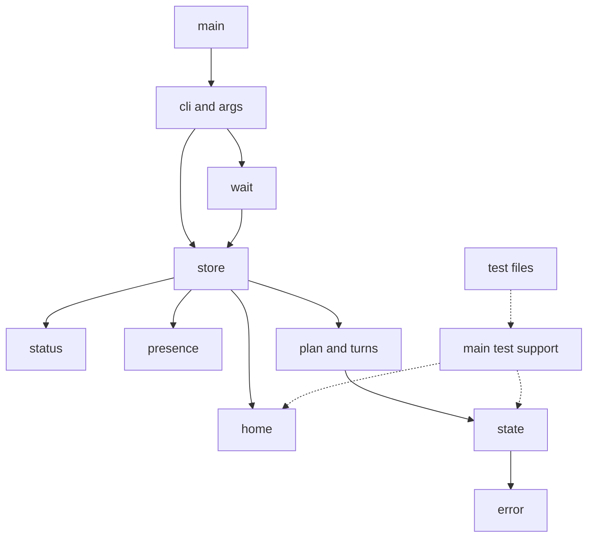
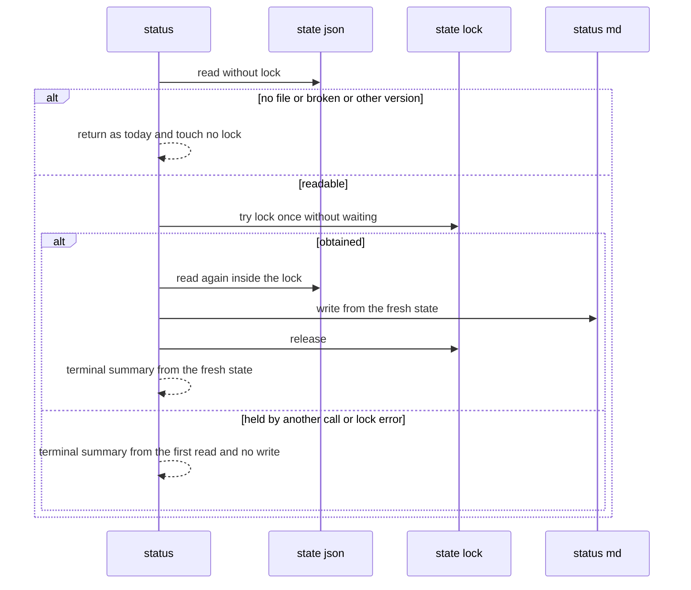

# 設計: audit-impl-watch

## Overview

**Purpose**: 机の貸し出しのアプリ `areka-impl-watch`（クレート `crates/areka-impl-watch/`）に ponytail の audit をかけて出た 17 件（Must fix 0・Should fix #1〜#7・Nice to have #8〜#17。`research.md` §3）を、全部直す。直さずに残す指摘は 0 件（要件 9.1）。

**Users**: 並んで走る実装セッション（スキルから実行ファイルを直に呼ぶ）と、`status.md` を読む開発者。直しの後も、外への約束（コマンド・引数・終了コード・端末へ出す文・`--help`・状態ファイルの形と版 2・置き場所の下のファイルの名前）は 1 つも変わらない。

**Impact**: 本番の振る舞いが変わるのは 3 件だけ。#1＝`unstop` と再開の出来事が参加者を表の鍵で見る。#8＝`status` が `state.lock` を待たずに 1 回だけ試し、取れたときだけ `status.md` を書く。#9＝`status.md` の一時ファイルをディスクへ確定しない。残りの 14 件はテストとコメントの直しで、テストの写しを 1 か所へ寄せて約 −270 行になる。

### Goals
- 17 件を、この設計の「指摘ごとの直し」（§Components）のとおりに直す（3.1・9.1〜9.4）。
- 直したバグと危ない所（#1・#8）と、テストの抜け（#2・#3）に、壊れたら落ちるテストを 1 本ずつ置く（4.1）。
- 直しの後にもう一度 audit をかけて新しい指摘を 0 件にし、全体テスト・実機テストを緑にする（8.1〜8.6）。

### Non-Goals
- 新しい机・コマンド・決まり・引数（3.4）。
- 状態ファイルの形・版の変更（欄 `Participant::id` は消さない＝9.2・6.4・7.3）。
- 範囲の外のファイルの見直し（置き方の道具 `tools/impl-watch-install.ps1` は `audit-tools-scripts` の持ち物）。
- clippy の機械的な直し（`clippy-199-lints` の持ち物）。

## Boundary Commitments

### This Spec Owns
- `crates/areka-impl-watch/` の全ファイル（本番 12・テスト 27・`Cargo.toml`）のうち、§File Structure Plan に挙げたファイルの直し。
- 新しいテストの支えのファイル `crates/areka-impl-watch/src/main_test_support.rs`（クレートのテスト全体で共通の支え。#7）。
- `doc/impl-watch.md` の `status` と `status.md`・`state.lock` に触れる文（#8 で変わる文 4 か所＝384・576・586・588 行目。9.3・3.2）。

### Out of Boundary
- `crates/areka/`・`Cargo.lock`・`vendors/`・`runtime-module-untangle` が書き換えるファイル（6.3・6.8）。どの直しも触らない。
- スキル（`kiro-impl`・`kiro-complete`・`kiro-next`・`release`・`update`・`kiro-watch-clear`）・`tools/impl-watch-install.ps1`・steering `structure.md`。外への約束が変わらないので直す所が無い（6.6 の対象にならない）。
- 完了した spec の文書（`.kiro/specs/completed/` の下）。#8 は完了 `areka-P0-impl-watch` の design.md 567 行目が「わかっていて受け入れた限界」と書いた所を直すが、完了 spec の文書は書き替えない（要件の討議で直すと確定＝9.3）。
- 置き場所（`AREKA_IMPL_WATCH_HOME`）の実行ファイルと状態ファイル（7.1・7.2）。触るのは着地の後の置き直し（8.8）だけ。

### Allowed Dependencies
- Rust の標準ライブラリ（`std::fs::File::try_lock`＝Rust 1.89 から安定。`store.rs` がもう使っている・手元の rustc 1.100.0）。
- 今ある依存（`serde`・`serde_json`・`thiserror`・`tracing`・`tracing-subscriber`・開発用 `temp-path-kit`）だけ。依存を足さない（5.6）。
- 層の向き `error` → `state` → `plan`（子 `turns`）→ `home`／`presence`／`status` → `store` → `wait` → `cli`（子 `args`）→ `main`。テストだけのモジュール（`*_tests.rs`・`*_test_support.rs`）はこの向きの外で、本番のモジュールからは読まない。

### Revalidation Triggers
- 状態ファイルの形・版、コマンド・引数・終了コード・端末の文・`--help` の行が変わる直し（この設計には無い。出たら 6.5 の議題）。
- `status` が `state.lock` に触る仕方（#8）。`state.lock` を握るほかの道（`with_state`・`clear`・待ちの抹消）を変えるときは、#8 のテストを見直す。
- `src/` に本番のファイルを足すとき（#3 の見張りが自動で拾う。名前が `_tests.rs`・`_test_support.rs` で終わる本番のファイルは作らない）。

## Architecture

### Existing Architecture Analysis
- 判断の核 `plan::apply`（回収 → コマンド → 番の決め直し）は純粋で、`main_layering_tests.rs` が `plan.rs`・`plan_turns.rs` の綴りを見張る。直しはこの性質を保つ（#1 は核の中の引数の受け渡しだけ）。
- 口 `store.rs` は「排他 → 時計 → 読み → 退避のログ → 判断 → 書き → 出来事のログ → 読み物」の順を持つ。#8 はこの順を `summary` にも当てはめ、#9 は「読み物の確定」だけを外す。
- テストは兄弟のファイル（`<stem>_tests.rs`・`<stem>_test_support.rs`。steering `structure.md` のテストの配置）。支えがモジュールごとに写されているのが #4〜#7・#10 の指摘。

### Architecture Pattern & Boundary Map



- 実線は本番の読み込みの向き（今のまま）。点線はテストだけの読み込みで、新しい `main_test_support`（#7）は `home`（`Home`）と `state`（`State`）だけを読む。本番のモジュールは `main_test_support` を読まない。
- 新しく置くのは `main_test_support.rs` 1 本だけ（写しを寄せる先。理由は「設計の決め D3」）。

### Technology Stack

| Layer | Choice / Version | Role in Feature | Notes |
|-------|------------------|-----------------|-------|
| CLI | `areka-impl-watch.exe`（Rust edition 2024・rustc 1.100.0） | 直す対象 | 依存の増減 0 |
| Data / Storage | `state.json`（版 2）・`state.lock`・`status.md` | #8・#9 で書き方が変わるのは `status.md` だけ | 形・名前は不変 |
| Runtime | `std::fs::File::try_lock`（安定 1.89） | #8 の 1 回だけの試し | `store.rs` の `lock` と同じ道具 |

### 設計の決め（研究の §6〜§8 の議題 B を閉じる）

- **D1（#2 の形）**: 全探索の不変ではなく、名指しのテスト 1 本にする。不変「渡した机の組＝申し込んだ組」は状態だけでは書けない（`DeskGranted` の出来事が要り、`check_invariants` へ出来事を渡す配管が増える）。名指しのテストは `plan_turns.rs:304` を `if true` に変えると落ちる場面を直に組める。
- **D2（#3 の形）**: 手で持つファイルの一覧を消し、テストが走るたびに `src/` を読んで、名前が `_tests.rs`・`_test_support.rs` で終わらない `.rs` を全部見る（一覧と比べる案より短く、足したファイルを自動で拾う）。`main.rs` も対象に入れる（`#[path = "…"]` のリテラルを持つので、今の doc の「リテラルの無い起動ファイル」は事実と違う。この doc も直す）。
- **D3（#7 の寄せ方）**: 研究 §6 の案 B。新しいテストの支え `src/main_test_support.rs` を `main.rs` に `#[cfg(test)] #[path = "main_test_support.rs"] mod test_support;` で繋ぎ（名前は steering `structure.md` の導出規則 `<stem>_<モジュール名>.rs`＝`main` の `test_support`。`main_layering_tests.rs` と同じ形）、`crate::test_support` として読む。案 A（`store_test_support.rs` へ寄せる）は `home_tests`・`presence_tests` が `store` の支えを読む逆向きになるので取らない。`main_layering_tests.rs` の見張りには扱いを足さない（名前が `_test_support.rs` で終わるので D2 の走査から外れ、純粋さの走査は `plan.rs`・`plan_turns.rs` だけを見る）。`main.rs` の層の向きの doc に「テストだけのモジュールは向きの外」を 1 文足す。
- **D4（#9 の形）**: `replace` に確定するかの引数 `sync: bool` を 1 つ足す。読み物だけ別の書き方にすると、一時ファイルの名前・失敗のときの後始末・改名の試し直しが 2 組になる。
- **D5（#8 の読み直し）**: `summary` は今どおり排他の外で 1 度読み（無い・壊れた・版の合わないファイルはここで今どおり返る＝ロックのファイルを作らない）、`state.lock` を 1 回だけ試し、取れたら排他の中で読み直した状態から `status.md` と端末の要約の両方を作る。取れなかったら最初に読んだ状態から要約だけを作る。
- **D6（調べ: 読み手の一瞬の失敗）**: 指摘にしない（研究 §9.2）。今の Rust の `fs::rename`（Windows）は `MoveFileExW`（置き換えつき）を先に呼び、`ERROR_ACCESS_DENIED` のときだけ `FILE_RENAME_FLAG_POSIX_SEMANTICS` つきの付け替えへ倒れる。読み手の `fs::read`・`fs::metadata` は `FILE_SHARE_DELETE` を含む共有で開く。この機械で、書き手 1 本（一時ファイル → 付け替えを 3,000 回）と読み手 4 本（`fs::read`＋`fs::metadata` を回し続ける）を 2 回走らせ、読み 73,369 回で読み手の失敗 0・付け替えの失敗 0 だった。想定の負荷で起きる場合を作れないので指摘にしない。
- **D7（完了 spec との突き合わせ）**: #8 の `try_lock` は、完了 `areka-P0-impl-watch` の要件と食い違わない。要件 9.4 は「状態の確認を状態を変えない読み取りとして行い（回収も行わない）」で、排他を取らないとは書いていない（同じ spec の requirements.md に「排他を取らない」「ロック無し」の語は無い＝grep）。排他を取らないと書いたのは同じ spec の design.md（398 行目「ロック無し」・567 行目「`summary`（`status`）は排他を取らずに `status.md` を置き換えるので…」）で、設計の段の受け入れた限界。要件の討議（議題 1）で直すと確定済み。

## File Structure Plan

### Directory Structure
```
crates/areka-impl-watch/src/
├── main.rs                  # 変更: テストの支えの mod を 1 つ足し、層の向きの doc に 1 文（#7）
├── main_test_support.rs     # 新規: クレートのテスト全体で共通の支え T0・entries・names・home_in・read_state（#7）
├── main_layering_tests.rs   # 変更: ASCII の見張りが src/ を読んで本番のファイルを全部見る（#3）
├── error.rs                 # 変更: WrongShape の doc（#17）
├── state.rs                 # 変更: Participant::id の doc（#1）
├── plan.rs                  # 変更: Unstop と resume が鍵で見る・先頭の doc（#1・#17）
├── plan_turns.rs            # 変更: resume の呼び手 3 か所が鍵を渡す（#1）
├── store.rs                 # 変更: summary の 1 回だけの試し・replace の sync 引数（#8・#9）
└── （テストのファイルは Modified Files の表）
doc/impl-watch.md            # 変更: コマンドの表の status の行・status.md の節の文・置き場所のファイルの表の state.lock と status.md の行（#8）
```

### Modified Files

| ファイル | 変わること | 指摘 |
|---|---|---|
| `src/plan.rs` | `Command::Unstop` を `state.participants.iter_mut()` の鍵で比べ、出来事 `Unstopped` に鍵を載せる。`resume` は識別を引数で受け、`Resumed` に載せる。1 行目の doc から「規則 1〜7」を落とす | #1・#17 |
| `src/plan_turns.rs` | `resume` の呼び手 3 か所（`load_running`＝`id`・`replan`＝`iter_mut()` の鍵・`grant_one`＝`request.id`）が識別を渡す | #1 |
| `src/state.rs` | `Participant::id` に doc を 1 行（表の鍵の写し・判断は読まない・状態ファイルの形を変えないために残す） | #1 |
| `src/error.rs` | `Damage::WrongShape` の doc を「版は合うが欄の形が合わない」に | #17 |
| `src/store.rs` | `lock` から `open_lock`（ファイルを開くだけ）を切り出す。`summary` は D5 の順で 1 回だけ試す。`replace(…, sync: bool)`・`write_synced` を `write_temp(path, bytes, sync)` に。モジュールの doc と `summary`・`write_status` の doc を合わせる | #8・#9 |
| `src/main.rs` | `#[cfg(test)] #[path = "main_test_support.rs"] mod test_support;` と doc の 1 文 | #7 |
| `src/main_test_support.rs`（新規） | `pub(crate)` の `T0`・`entries`・`names`・`home_in`（→ `Home`）・`read_state(dir: &Path)` | #7 |
| `src/main_layering_tests.rs` | ASCII の見張りの一覧を消し、`src/` を読む形へ。モジュールの doc の「11 本」「`main.rs` を除く」を直す | #3 |
| `src/plan_test_support.rs` | `T0` を消して `crate::test_support::T0` を読む。`merge`・`merged`・`load_running`・`granted`・`resumed` を受け取る。`fake_presence_answers_present_unless_told_absent`（255-261）を消す | #6・#7・#15 |
| `src/plan_desk_tests.rs`・`plan_liveness_tests.rs`・`plan_stop_tests.rs`・`plan_turns_tests.rs`・`plan_reclaim_tests.rs`・`plan_clear_tests.rs` | 写した組み立てと手書きの組み立てを支えへ置き換え、`T0` の読み込み先を替える。`plan_liveness_tests.rs` の `holds_merge` の写しを消して `super::holds_merge`、協力的な進め方が参加者を鍵で見る（`cooperative_move` の `participant.id`）。#15・#16 の消し・まとめ。#1 と #2 のテストを足す | #1・#2・#6・#7・#15・#16 |
| `src/cli_test_support.rs` | `sample`・`line`（と `Opt` の読み込み）を消す。`not_applied`・`waits` を受け取る。`entries`・`names`・`read_state` を消して共通の支えを読む | #4・#5・#7 |
| `src/cli_tests.rs`・`cli_args_tests.rs`・`cli_commands_tests.rs`・`cli_desk_tests.rs`・`cli_wait_tests.rs` | #4・#5・#13・#14 の直し（下の Components） | #4・#5・#13・#14 |
| `src/store_test_support.rs`・`store_tests.rs`・`store_ports_tests.rs` | `T0`・`home_in`・`names`・`read_state` を共通の支えへ（`read_state(&home)` は `read_state(&home.dir)`）。`store_ports_tests.rs` の `lossy` の写しを消して `super::lossy`。#8 のテストを足す | #7・#8・#10 |
| `src/status_tests.rs`・`wait_test_support.rs`・`home_tests.rs`・`presence_tests.rs` | `T0`・`entries`・`home_in` の写しを消して共通の支えを読む（`status_tests.rs` の `T0_UTC` は残す）。`home_tests.rs` の重なった 2 本を消す | #7・#12 |
| `src/state_tests.rs` | `a_file_without_version_does_not_read_as_the_current_version`（143-146）を消す | #11 |
| `doc/impl-watch.md` | 576 行目の文を直す。384 行目の表の `status` の行に「ほかの呼び出しが `state.lock` を握っている間は `status.md` を書かない」を足す。置き場所のファイルの表の 586 行目（`state.lock`＝「状態を変える間だけ握る」）に「`status` が `status.md` を書く間も一瞬握る」を、588 行目（`status.md`＝「`status` のたびに書き直される」）に「ほかの呼び出しが排他を握っている回は書き直さない」を足す | #8 |
| `src/cli.rs` | `status` の doc（353 行目「読み物を書き」）を「排他が取れたときだけ読み物を書き」に。コメントだけで、コードと端末の文は変えない | #8 |

- 1,000 行の番人: どのファイルも越えない。足すのは `plan_stop_tests.rs`（698 → 約 730）・`plan_turns_tests.rs`（486 → #16 で減ってから約 +30）・`store_ports_tests.rs`（742 → 約 760）。`plan_desk_tests.rs`（924）には足さず、#6 で減る。
- 触らないもの: `cli.rs` のコード（doc の 1 行だけ直す）・`cli_args.rs`（`--help` の本文・端末の文。`status` の `--help` の行 `read without changing: write status.md and print a summary. 0=done`（`cli_args.rs:419`）は外への約束なので変えない。書かない回があっても「書く役目のコマンド」という説明として誤りではない）・`status.rs`・`wait.rs`・`home.rs`・`presence.rs`・`Cargo.toml`・`tests/real.rs`・`tests/real/mod.rs`（#8 の後も今の主張のまま通る見込み。§Testing Strategy で回して確かめる）。

## System Flows

#8 の `status`（D5）:



- 取れなかったとき、`status.md` は排他を持っている側が変化を書いたときに新しくなる（変化の無い呼び出し＝変わらない `tick` などは書かないので、居る・居ないの印と時刻は次の変更か次の `status` まで前のまま。手順書の「次の変更か、もう一度の `status` で直る」のとおり）。
- ロックのファイルを開けない・試しが OS の失敗を返したときは、読み物が書けなかったときと同じ `warn!`（`[store] status.md not written; the result stands`・`error` の欄つき）を 1 行残し、要約と終了コードは変えない（5.2 の例外＝完了 spec の要件 10.2 の読み物の扱い）。他人が握っている（`WouldBlock`）ときは失敗ではないので記録しない（握っている側が書く）。
- 状態ファイルが在るのに `state.lock` がまだ無い（手で置いた状態ファイル）ときは、`status` が `state.lock` を作る。名前はもう置き場所の下のファイルの名前に在り（`doc/impl-watch.md` の置き場所のファイルの表）、外への約束は変わらない。

## Requirements Traceability

| 要件 | 中身 | 設計で受ける所 |
|---|---|---|
| 1.1・1.2・1.3・1.4・1.5・1.6 | audit・測り直し・全件・全部読む・番号と組・約束の欄 | 済み（`research.md` §1〜§4。17 件・40 ファイル・外への約束を変える指摘 0） |
| 2.1・2.2・2.3・2.4・2.5・2.6 | 討議で確定・残すのは 3 種類だけ・記録・20 本の切り分け | 済み（`research.md` §7 の討議の結果・要件 9.1＝残す 0 件）。タスクは 12 本で 20 を越えない（2.6 は不要） |
| 3.1 | 確定した指摘を全部直す | §Components の「指摘ごとの直し」17 行・タスクの見取り図 1〜9 |
| 3.2 | 壊れる呼び出し元を全部直す | §File Structure Plan の表・#8 の `doc/impl-watch.md`・タスクごとの grep（`participant.id`・`read_state(`・`T0`・`summary(`） |
| 3.3 | 消す前に使われていないことを確かめる | #4・#5・#10〜#16 の消す物ごとに、ツリー全体の grep をタスクの完了条件に置く |
| 3.4 | 新しい機能を足さない | Non-Goals・Revalidation Triggers |
| 4.1 | 直した 1 件ごとにテスト | §Testing Strategy の「新しいテスト」（#1・#8・#2・#3）。#9 は速さだけの直しで観測できる振る舞いが無いので足さない |
| 4.2 | 決定論 | 新しいテストは眠らず、時刻は `T0`、ロックは同じプロセスの別のハンドルで握る |
| 4.3・4.4 | 根は `target` の下・子プロセスの置き場所の上書き | 新しいテストは `TempPath::under_target`。実機テストは今の `Desk::command` のまま |
| 4.5 | GPU | 当たらない（GPU を使うテストは無い） |
| 4.6 | 古びたテストを改める | #8 の後に `status` で `state.lock` が作られる場合を見る既存の名前の確かめを grep で洗う（タスク 2）。#13〜#16 のまとめ |
| 5.1 | 1,000 行 | §File Structure Plan の行の見込み |
| 5.2 | 記録の無い失敗の道を作らない | #8 の試しの OS の失敗は `warn!`。`summary` の読み直しの失敗は `read_only` が `error!` を出して `Err` |
| 5.3 | 終了の道 | 待ち・見張りの道は触らない |
| 5.4・5.5 | 文字化け・端末の文は ASCII | 端末の文は 1 つも変えない。新しいリテラルは ASCII（#3 の見張りが見る） |
| 5.6・5.7 | 依存を足さない | Allowed Dependencies（`File::try_lock` は標準） |
| 6.1・6.2 | 範囲の外は申し合わせ・要る変更だけ | 範囲の外は `doc/impl-watch.md` の 4 か所だけ（C19 で走る他の spec の持ち物ではない） |
| 6.3・6.8 | 触らないファイル | Out of Boundary・タスク 11 の差分の確かめ |
| 6.4・6.5・6.6・6.7 | 外への約束は足すだけ・変えるなら議題 | 外への約束を変える直しは 0 件（#1 は欄を残す・#8 は書く時が変わるだけ） |
| 7.1・7.2・7.3 | 置き場所に触れない・版を上げない | 直しの確かめは常時テストと実機テスト（置き場所を `target` の下へ上書き）だけ。版は 2 のまま |
| 8.1・8.2・8.3・8.7 | かけ直しの audit・0 件まで・5 回目の打ち切り | タスク 10 |
| 8.4・8.5・8.6 | 全体テスト・実機テスト・差分の確かめ | タスク 11 |
| 8.8 | 着地の後の置き直し | タスク 12 |
| 9.1 | 17 件を全部直す | §Components の「指摘ごとの直し」 |
| 9.2 | #1 の直し方とテスト | §Components「判断の核」・新しいテスト T1a・T1b |
| 9.3 | #8 の直し方・手順書の文・テスト | §System Flows・§Components「状態ファイルの口」・新しいテスト T8 |
| 9.4 | #2〜#7・#9〜#17 は設計で決める | 設計の決め D1〜D5・§Components の表 |

## Components and Interfaces

### 指摘ごとの直し（要件 9.1・9.4）

| # | 直し | 消す物 | 足すテスト | 要件 |
|---|---|---|---|---|
| 1 | `Unstop`・`resume` が表の鍵で見る。欄 `id` は残し、doc で「判断は読まない」と書く。テストの協力的な進め方も鍵で見る | — | T1a・T1b | 9.2・4.1 |
| 2 | 名指しのテスト 1 本（D1） | — | T2 | 4.1 |
| 3 | ASCII の見張りが `src/` を読む（D2） | 手で持つ 11 本の一覧 | （見張りそのもの・較正は T3） | 4.1 |
| 4 | `cli_test_support.rs` の `sample`・`line`・`Opt` の読み込みを消す。`cli_tests.rs:79`・`:142` は `args(&["watch", "--id", "a1", "--repo", "areka"])`。`cli_args_tests.rs` の `args` の写しを消して入口の側の `args` を読む（`sample`・`line` は `cli_args_tests.rs` に残す＝使い手はそこだけ。37-38 行目の注を「使い手はここだけ」に直す） | 約 −30 行 | — | 3.3 |
| 5 | `not_applied`・`waits` を `cli_test_support.rs` へ移して 2 か所の写しを消す。`cli_desk_tests.rs:174-175` を `put_state` に | 約 −10 行 | — | 3.3 |
| 6 | `merge(id, repo, bug)`・`merged(id)`（`pr` "281"・`sha` "414d43eb"）・`load_running(id)`（内容 `PURPOSE`）・`granted(id, desks, stopped)`・`resumed(id, why)` を `plan_test_support.rs` へ移し、写しと手書き（研究 §3 #6 の行）を置き換える。`plan_liveness_tests.rs` の `merge` は `merge(id, repo, false)`。`holds_merge` の写しを消して `super::holds_merge`。値の綴りに頼る主張は支えの値に合わせる | 約 −60 行 | — | 3.3・4.6 |
| 7 | D3。`T0`（4 か所）・`entries`（3）・`names`（2）・`home_in`（→ `Home` の 2 か所）・`read_state`（2）を `main_test_support.rs` の 1 か所に。`cli_test_support.rs` の `home_in`（→ `PathBuf`＝置き場所にする子のフォルダの道筋）は別物なので残す | 約 −40 行 | — | 3.3 |
| 8 | §System Flows（D5）。`doc/impl-watch.md` の 4 か所・`cli.rs:353` の doc | — | T8 | 9.3・4.1 |
| 9 | D4。`write_state` は `sync: true`・`write_status` は `sync: false` | — | なし（速さだけ・観測できる振る舞いが無い） | 3.1 |
| 10 | `store_ports_tests.rs:63-65` を消して `super::lossy` | 3 行 | — | 3.3 |
| 11 | `state_tests.rs:143-146` を消す | 4 行 | — | 3.3 |
| 12 | `home_tests.rs:111-121` の 2 本を消す（較正の 3 本目 `the_spellings_named_by_the_design_are_refused_and_create_nothing` が同じ 2 つを先に呼ぶ） | 11 行 | — | 3.3 |
| 13 | `clear --repo` と `--desk` の使い方の誤りを 1 つずつ `cli_tests.rs` の `a_usage_error_reads_and_writes_nothing` の並びへ足し、`cli_commands_tests.rs:457-485`・`cli_desk_tests.rs:249-263` を消す。「状態の在るときも変えない」の主張は、同じ並びを状態ファイルの在る置き場所でも回して状態のバイトが変わらないことを見る形で残す | 約 −40 行 | — | 3.3・4.6 |
| 14 | `--help` の「名前の行を探して次の行を比べる」2 本（`:619-636`・`:758-790`）を 1 本の表のテストにまとめ、`:541-547` の `merge` の行の重なりを消す。見る行の中身は 1 字も減らさない | 約 −20 行 | — | 3.3 |
| 15 | `plan_liveness_tests.rs:390-393`・`:401-404`（JSON の前後の比べ）・`plan_stop_tests.rs:145-149`・`plan_desk_tests.rs:244` を消し、`plan_test_support.rs:255-261` のテストを消す。`test_holder_merge_and_merge_waiter_request_are_refused_byte_for_byte` を `…_are_refused_and_change_nothing` に改名 | 約 −20 行 | — | 3.3 |
| 16 | `plan_turns_tests.rs` の `replan_twice_changes_nothing_the_second_time` を消す。`overlapping_scene` に「渡る順」の確かめを入れて `overlapping_scene_grants_every_request_through_the_cooperative_run` を消す（順の主張 U → M → L は `["L","U","M"]` の場面で残す）。走っている負荷テストの記録の 3 か所（`plan_turns_tests.rs:457-486`・`plan_stop_tests.rs:433-470`・`:520-545`）を「両方空き・test だけ持たれる・sole だけ持たれる・両方持たれる」の 1 本の表のテストに（置き場所は `plan_turns_tests.rs`） | 約 −50 行 | — | 3.3・4.6 |
| 17 | `error.rs:61`・`plan.rs:1` の doc（`plan.rs` は「番の決まり（`plan_turns.rs`）・回収・番の決め直し・出来事」） | — | — | 3.1 |

- 消す・まとめるテストは、消す前に「同じ後退で落ちる別のテストが残る」ことを研究 §3 の根拠のとおり確かめる（4.6・直しの的を外して緑にしない）。

### 判断の核（`plan.rs`・`plan_turns.rs`・`state.rs`）

| Field | Detail |
|-------|--------|
| Intent | 参加者の識別を表の鍵 1 つにする（#1）・doc を今のコードに合わせる（#17） |
| Requirements | 9.2・4.1・6.4・7.3 |

**Responsibilities & Constraints**
- 判断の中で `Participant::id` を読む所を 0 にする（今は `plan.rs:355`・`:359`・`:574` の 3 か所）。書くのは `join` のままで、新しいファイルにも欄は今どおり載る（古い実行ファイルが同じファイルを読んでも `unstop --id` が当たる）。
- 純粋さを保つ（`main_layering_tests.rs` の禁じた綴りを足さない）。

**Contracts**: Service [x]

##### Service Interface
```rust
// plan.rs（非公開・変更）: 戻したら出来事 Resumed { id: id.to_owned(), why } を 1 件。
fn resume(id: &str, participant: &mut Participant, why: &'static str, now: u64, events: &mut Vec<Event>);

// Command::Unstop { id: Option<String> } の扱い（変更）:
// for (key, participant) in state.participants.iter_mut() で、名指しは key と比べ、
// 出来事は Event::Unstopped { id: key.clone() }。Verdict と文は今のまま。
```
- Preconditions: 呼び手は表の鍵と、その鍵の参加者を渡す（`replan` は `iter_mut()`、`load_running`・`grant_one` は手元の識別）。
- Postconditions: 欄 `id` が鍵と違う・空の参加者でも、`unstop --id <鍵>` は当たり、出来事の識別は鍵になる。
- Invariants: 状態ファイルの形と版 2 は変わらない。

### 状態ファイルの口（`store.rs`）

| Field | Detail |
|-------|--------|
| Intent | `status` の読み物を排他の中の状態からだけ書く（#8）・読み物の確定を外す（#9） |
| Requirements | 9.3・4.1・5.2・6.4 |

**Responsibilities & Constraints**
- `summary` は待たない（試しは 1 回）。端末の要約・終了コード・`no state file` の扱いは今のまま。
- 状態ファイルが無い・壊れている・版が合わないときは、今どおりロックのファイルにも読み物にも触らない（最初の読みで返る）。
- 状態ファイルの書き（`write_state`）は今どおりディスクへ確定してから付け替える。

**Contracts**: Service [x] / State [x]

##### Service Interface
```rust
impl Store {
    /// 変わらない形。D5 の順で、状態ファイルが無ければ None。
    pub fn summary(&self) -> Result<Option<String>, WatchError>;

    /// 新規（非公開）: state.lock を開くだけ（在ればそのまま・無ければ作る）。lock と summary が使う。
    fn open_lock(&self) -> Result<File, WatchError>;

    /// 変更（非公開）: sync が真のときだけ一時ファイルを sync_all してから付け替える。
    fn replace(&self, path: &Path, bytes: &[u8], op: &'static str, sync: bool) -> Result<(), WatchError>;
}

/// 変更（非公開・旧 write_synced）: 新しいファイルに全部書き、sync が真ならディスクへ確定する。
fn write_temp(path: &Path, bytes: &[u8], sync: bool) -> io::Result<()>;
```

##### State Management
- 排他の扱い: `summary` は `open_lock()` の後に `File::try_lock()` を 1 回。`Ok` なら `StateLock` に包んで（落とすと解ける）その中で `read_only()` をもう 1 度呼び、`Some` ならその状態で `write_status` と `render_terminal`、`None`（手で消された）なら `Ok(None)`、`Err` はそのまま返す（`read_only` が `error!` を出している）。`WouldBlock` は書かずに最初の状態で要約。開けない・`TryLockError::Error` は `warn!` を 1 行残して同じ扱い。
- 時刻 `self.time()?` は今どおり、状態ファイルが在るときに 1 度取る（時計の失敗で `status` が 1 になるのは今と同じ）。

**Implementation Notes**
- Integration: `lock()` は `open_lock()` を使う形に書き直すだけで、試し方（10 ms × 最長 10 秒）は変えない。
- Validation: T8（取れないときは書かない・放した後は書く）。既存の `summary_returns_the_terminal_summary_even_when_the_reading_matter_cannot_be_written`・cli の `status` のテスト・実機の `an_unwritable_status_md_changes_no_result_and_leaves_a_warning`（`warn!` が `status` で 1 行増える主張）が今のまま通る。
- Risks: 実機テストで、待ちの周期の一回り（30 秒ごとに一瞬 `state.lock` を握る）と `status` が重なると、その回の `status` は読み物を書かない。実機テストで `status` の直後に `status.md` を読む所（`tests/real.rs` の 138・348・410・627・654 行目の付近）は、どれも読み物の中身を状態を変えた呼び出しが書いているか、ほかのプロセスが居ない場面なので、主張は変わらない見込み。タスク 11 の実機テストで確かめる。

### テストの共通の支え（`main_test_support.rs`）

| Field | Detail |
|-------|--------|
| Intent | クレートのテスト全体で写されていた支えを 1 か所に置く（#7） |
| Requirements | 3.1・3.3・5.1 |

##### Service Interface
```rust
// crate::test_support（#[cfg(test)]・main.rs から #[path = "main_test_support.rs"]）
pub(crate) const T0: u64 = 1_791_000_000; // UTC 2026-10-03T04:00:00Z
pub(crate) fn entries(dir: &Path) -> Vec<PathBuf>;     // 直下の道筋・並べ替え済み
pub(crate) fn names(dir: &Path) -> Vec<String>;        // 直下の名前・並べ替え済み
pub(crate) fn home_in(root: &TempPath) -> Home;        // 一時フォルダを置き場所にした Home
pub(crate) fn read_state(dir: &Path) -> State;         // dir の state.json を状態として読む（無い・読めないなら panic）
```
- 読むのは `crate::home::Home`・`crate::state::State`・`temp_path_kit`・`std::fs` だけ。本番のモジュールからは読まない。
- 各テストは `use crate::test_support::{…}` で直に読む（支えのファイルで出し直さない）。

### 構造の見張り（`main_layering_tests.rs`）

- `files_that_write_to_the_terminal_have_ascii_only_literals` は、`Path::new(env!("CARGO_MANIFEST_DIR")).join("src")` を読み、名前が `.rs` で終わり `_tests.rs`・`_test_support.rs` で終わらないファイルを全部、`fs::read_to_string` で読んで今と同じ 2 つを確かめる（ファイルごとの「リテラルを 1 つも拾えない」の較正は残す）。見たファイルが 0 本なら赤（道筋の誤りの較正）。
- 常に回る較正を 2 つ足す（手で 1 度だけの T3 に頼らない）: ⑴ 見たファイルの名前に `main.rs` と `cli.rs` が入っている。⑵ 名前の絞り込みを 1 つの関数に切り出し、その関数の名前ごとのテストで、`cli_args.rs`・`plan_turns.rs`・`main.rs` は見る側、`plan_tests.rs`・`plan_test_support.rs`・`main_test_support.rs`・`main_layering_tests.rs` は外す側になることを確かめる。
- 判断の中核の純粋さのテスト（`include_str!` の 2 本）は変えない。

## Data Models

- 変わらない。`State`・`Participant`（欄 `id` を含む）・版 2 の JSON の形はそのまま（6.4・7.3）。`Participant::id` に doc が 1 行増えるだけ。

## Error Handling

- 新しい失敗の道は作らない。#8 の試しの OS の失敗は、読み物が書けなかったときと同じ扱い（`warn!`・結果は変えない）。`summary` の読み直しが失敗したら、`read_only` が `error!` を出して `Err` を返し、`status` は今の読みの失敗と同じ終了コード 1 と文になる（5.2）。
- `replace` の失敗の後始末（一時ファイルを消す）は `sync` の値によらず同じ。

## Testing Strategy

### 新しいテスト（壊れたら落ちる 1 本ずつ・4.1）

| 名 | 置き場所 | 見ること | 較正（直しを戻すと赤になるか） |
|---|---|---|---|
| T1a | `plan_stop_tests.rs` | 表の鍵 `a`・欄 `id` が空の「止まった」参加者に `Unstop { id: Some("a") }` → 当てはまり、「作業中」に戻り、出来事は `Unstopped { id: "a" }`。名指しなしの `Unstop` でも出来事の識別は `a` | 355 行目を欄と比べる形へ戻すと赤 |
| T1b | `plan_stop_tests.rs` | 欄 `id` が空の「止まった」参加者が、番の決め直しの再開（`no-sole`）で `Resumed { id: "a", why: "no-sole" }` になる | `resume` が欄を読む形へ戻すと赤 |
| T2 | `plan_turns_tests.rs` | `a`・`b` の状態で `request("a", Sole)` → `b` が止まる → `a` が番を受け、`state.test` は `None`、`DeskGranted.desks` は `Sole`。続けて参加した `d` の `request("d", Test)` が同じ呼び出しで渡る（`d` は停止要請中・ひとり占めは待たれていない） | `plan_turns.rs:304` を `if true` に変えると赤 |
| T3 | `main_layering_tests.rs` | D2 の走査（見張りそのもの） | 宣言しない一時のファイル `src/zz_probe.rs`（中身 `const X: &str = "日本語";`）を置くと赤・消すと緑（手で 1 度確かめ、記録に残す） |
| T8 | `store_ports_tests.rs` | `with_state(watch("a"))` の後に `status.md` を消し、`hold_state_lock` で握ったまま `summary()` → 要約は返る・`status.md` は無い。放した後の `summary()` → `status.md` が在る（較正） | `summary` を「取れなくても書く」に戻すと赤 |

### 既存のテストの扱い
- 単体（判断の核）: #6・#15・#16 で寄せ・消し・まとめた後も、`plan_liveness_tests.rs` の全探索（深さ 6・到達 1,000 超）と各テストの末尾の固定点の確かめが通る。
- 入口（cli）: #4・#5・#13・#14 の後も、使い方の誤りが何も読み書きしないこと（状態の無い置き場所と在る置き場所の両方）、`--help` の行の中身が今のまま見られる。
- 口（store）: #7・#9・#10 の後も、置き換え・退避・読み物の失敗の扱いのテストが通る。`status` の後に置き場所の名前の一覧を見るテストで、状態ファイルを手で置いてから `status` を呼ぶもの（`state.lock` がまだ無い）は、#8 で `state.lock` が増える。grep（`"status"` と `names(`）で洗い、在れば主張を直しに合わせる（4.6）。
- 実機（`tests/real.rs`）: 変えない。タスク 11 で `cargo test -p areka-impl-watch --test real -- --ignored` を回し、#8 の後も緑であることを確かめる（同時の変更を見る `simultaneous_changes_are_all_kept` を含む）。

### Performance
- #9 で、状態を変える 1 回の `sync_all` は 2 回 → 1 回。#8 で `status` は `state.lock` を一瞬握る（読み直し＋読み物の書き。確定はしない）。どちらも待ちの上限 10 秒（`LOCK_LIMIT`）に比べて小さい。計測は足さない（速さの主張をテストで縛らない）。

## タスクの見取り図（`/kiro-spec-tasks` 向け・12 本）

| # | タスク | 指摘 | 触るファイル | 並べてよいか |
|---|---|---|---|---|
| 1 | 参加者を表の鍵で見る＋T1a・T1b | #1 | `plan.rs`・`plan_turns.rs`・`state.rs`・`plan_stop_tests.rs`・`plan_liveness_tests.rs`（`cooperative_move`） | 2・3 と並べてよい |
| 2 | `status` の 1 回だけの試し＋T8＋手順書の 4 か所＋`cli.rs:353` の doc | #8 | `store.rs`・`store_ports_tests.rs`・`cli.rs`（doc だけ）・`doc/impl-watch.md`・（洗った cli テスト） | 1 と並べてよい |
| 3 | 読み物の確定を外す・`lossy` の写し・`WrongShape` の doc | #9・#10・#17（`error.rs`） | `store.rs`・`store_ports_tests.rs`・`error.rs` | 2 の後（同じファイル） |
| 4 | `--desk sole` だけの番のテスト T2 | #2 | `plan_turns_tests.rs` | 1 の後 |
| 5 | ASCII の見張りを `src/` を読む形に＋常に回る較正 2 つ＋T3 の手の較正 | #3 | `main_layering_tests.rs` | 独立 |
| 6 | クレートのテストの共通の支え | #7 | `main.rs`・`main_test_support.rs`（新）・支えとテストの 14 ファイルの読み込み | 1〜5 の後 |
| 7 | 入口のテストの支えの寄せと重なりの整理 | #4・#5・#13・#14 | `cli_*` のテスト 6 ファイル | 6 の後 |
| 8 | 判断の核のテストの支えの寄せと重なりの整理 | #6・#15・#16 | `plan_*` のテスト 7 ファイル | 6 の後（7 と並べてよい） |
| 9 | 残りの消し・doc | #11・#12・#17（`plan.rs:1`） | `state_tests.rs`・`home_tests.rs`・`plan.rs` | 6 の後 |
| 10 | かけ直しの audit（上限なし・全部読む）→ 出た指摘を直す → 0 件まで（5 回目で打ち切りの決まり＝8.7）・記録 | 8.1・8.2・8.3・8.7 | 範囲の全部・`research.md`（記録） | 1〜9 の後 |
| 11 | 全体テスト `pwsh -NoProfile -File tools/test-all.ps1`・実機テスト `cargo test -p areka-impl-watch --test real -- --ignored`（排他テストの机を取って回す）・既定のブランチとの差分の確かめ（6.3 のファイル・`crates/areka/`・`Cargo.lock`・`vendors/` の差分 0、`cli_args.rs`・`status.rs`・`wait.rs` の差分 0、`cli.rs`・`state.rs` はコメントだけ）・記録 | 8.4・8.5・8.6 | — | 10 の後 |
| 12 | 着地の後の置き直し: `main` へ squash merge された後に `pwsh -NoProfile -File <リポジトリ>\tools\impl-watch-install.ps1` を回し、`OK check: --help exit 0` が出て `clear` の行が出ないことを確かめ、結果を開発者への完了の報告と、着地した PR への一言（`gh pr comment`）に残す | 8.8 | 置き場所の実行ファイルだけ | `/kiro-complete` の後 |

- タスク 1〜9 の各完了条件: `cargo test -p areka-impl-watch` が緑・触ったファイルが 1,000 行以下・消した名前と移した名前がツリー全体の grep で残っていない（3.2・3.3）。
- タスク 12 は `/kiro-impl` の中では回せない（着地の前は 7.1 の禁止に当たる）。`/kiro-complete` が squash merge した後に、同じセッションで行う。
