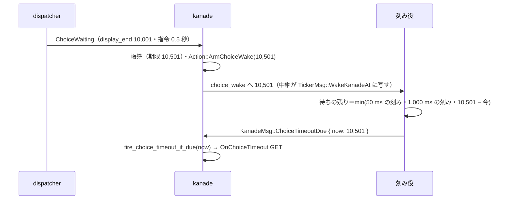

# 設計書: audit-kanade

## 概要

**目的**: kanade（ゴーストの起動・ふだん・終了の段取りを決める役者）のクレート `crates/areka-kanade/` について、ponytail の audit が出した 96 件の指摘（`research.md` §3 の #1〜#96）を、要件 9.1 のとおり全部直す（#63 は一部を残す＝要件 9.6）。あわせて申し送りの clippy の赤（要件 7）を直し、最後に同じ範囲へ audit をかけ直して新しい指摘を 0 件にする。

**使う人**: 開発者。直しの形は ponytail の「いちばん小さい完全な変更」に従う。消せるものは消し、写しは 1 か所にまとめ、呼び出し元・テスト・fixture まで直し切る。新しい機能は足さない。

**変わること**: 外から見た振る舞いが変わるのは次の所だけ。⑴ 外から来た台本（MCP の `sakurascript`）の CR・LF・NUL は受け付けの時点で取り除く（SSP と同じ見え方）。SHIORI へ送る頭書きの値に 3 字が残っていれば、ID は送らずに断り、Reference は 3 字を取り除いて送る（#1）。⑵ 切替の保留中は台詞の切れ目の印のイベントを送らない（#2）。⑶ 終了・切替の保留中は `RaiseEvent` と property の返しを SHIORI へ送らない（#3）。⑷ 置き換えた古いトークの遅い完了は、置き換えの種類を問わず info で捨てる（#4）。⑸ 空白だけの台本は、どの入口でも台本として扱う（#5）。⑹ 利用者の中断は、押されたバルーンのトークが今のトークのときだけ止める（#6）。⑺ 選択待ちの時間切れは期限ちょうどに出る（#7）。⑻ 帳簿と今のトークが食い違ったら warn を出して帳簿を消す（#8）。⑼ 空の `opening()` を Status に出さない（#63）。⑽ 記録の段の名 `on_close_notify` を、後始末の NOTIFY の OnClose にだけ付ける（#67）。ほかはテストの直し・写しの寄せ・要らないコードの削除で、外から見た振る舞いは変わらない。

### Goals

- 要件 9.1 の 96 件を、3 つの組（Must fix 2・Should fix 51・Nice to have 43）とも直す。#63 は 5 状態の語彙を残し、空の `opening()` のバグだけ直す（要件 9.6）。
- 直したバグと危ない所の 1 件ごとに、壊れたら落ちるテストを 1 本ずつ持たせる（要件 4.1）。
- `cargo clippy -p areka-kanade --all-targets --no-deps -- -D warnings` を、結合テストの隠れた 11 件まで含めて 0 件にする（要件 7・9.8）。
- タスクはファイルのまとまりで 19 本に束ねる（要件 9.10）。
- 最後に同じ作法で audit をかけ直し、新しい指摘 0 件と全体テストの緑を記録する（要件 8）。

### Non-Goals

- #63 の 5 状態（`Minimizing`・`Induction`・`Passive`・`TimeCritical`・`Opening`）の語彙の削除（要件 9.6）。
- 範囲の外のファイルの指摘（見つけてもその範囲の spec の持ち物・要件 6.7）。`crates/areka/src/emo2_boot/spine_conformance_script.rs` の古い行番号の注（`research.md` §4）もそのまま残す。
- #96 の `resolve_helper_exe` の写しを共通の試験の道具へ寄せること（範囲の外の `crates/areka-ghost/tests/ghost/common.rs` と `crates/shiori-host32-host/tests/` に及ぶ。この spec では注だけを直す）。
- 依存の追加（`Cargo.lock` は変えない・要件 5.5）。

## 境界の約束

### この spec が持つもの（Boundary Commitments）

- `crates/areka-kanade/` の全ファイル（本番・テスト・テストの道具・`Cargo.toml`）の直し。
- 新しく足す小さな形 4 つ。どれも kanade の中か、kanade の呼び手の結線に閉じる。
  - 頭書きの値の 3 字の守り（#1・`crate::sstp` の 1 定数と、送る点の 1 か所）。
  - 選択待ちの期限の知らせ（#7・`KanadeMsg::ChoiceTimeoutDue`・`KanadeConfig.choice_wake`・刻み役の 1 回だけの起こし）。
  - 中断の知らせのトークの番号（#6・`KanadeMsg::UserBreak` の欄 `talk_id`）。
  - SHIORI の手空きの周期の引数（#33・私的な関数 `run_shiori_loop` の引数 1 つ）。
- 下の「範囲の外で触るファイル」の表の変更（直しのために要る分だけ）。

### 範囲の外（Out of Boundary）

- 範囲の外のファイルの見直し。見つけた指摘は直さない（要件 6.7）。
- `vendors/` の下（要件 6.8）。
- `crates/areka/` の下で、要件 6.1 の例外と下の「申し合わせ」の 2 ファイルを除く全部。`placement-crate-split` が触る `crates/areka/` の外のファイル（`log-capture-kit` の `file_length_guard_test.rs`・`temp_path_guard_test.rs`、wintf の `ecs/window_proc/` の 2 つ、`tools/perf/fixtures/`・`tools/perf/fixtures-loop/`）にも触らない（要件 6.2）。
- `crates/log-capture-kit/tests/with_default_guard_test.rs` の例外表（`tests/kanade/failure_test.rs` の行）。`failure_test.rs` は分けないので表は変わらない（「1,000 行の番人」の節）。この表は `placement-crate-split` の触る 2 つには入らない（同 spec の要件の書く 2 つは `file_length_guard_test.rs` と `temp_path_guard_test.rs`）。
- `areka-talk`・`areka-actor` の公開の口（要件 6.4）。この spec はどちらにも触らない。
- 完了した `areka-P0-choice-select-events` の design.md（保管の写し）。「Tick で判定」の決めを改めたことは、この設計と `research.md` に記録する（要件 9.5）。

### 使ってよい依存（Allowed Dependencies）

- 今の依存だけ: `std`（`str::replace`／`str::contains` に字の配列を渡す形・`std::sync::mpsc`）・`tracing`・`thiserror`・`areka-talk`・`areka-actor`（今の口のまま）。dev 側は `log-capture-kit`（今の dev-dependencies）。
- 依存の向き（変えない）: `areka-talk`・`areka-actor` → `areka-kanade` → `areka-ghost` → `areka`。kanade は `areka-ghost` の型（`TickerMsg`）を知らない。期限の知らせの起こしは、kanade が `Sender<MonotonicMs>` を受け取り、`areka-ghost` の結線が中継で `TickerMsg` へ写す（今の「中継 2 本で輪を解く」と同じ形）。
- 新しいクレートの間の path の依存は作らない（`Cargo.lock` が変わる）。

### 見直しが要る変化（Revalidation Triggers）

- `KanadeMsg` に `ChoiceTimeoutDue { now }` が増える。`KanadeMsg::UserBreak` に `talk_id: Option<TalkId>` が増える（要件 9.9 の例外）。
- `KanadeConfig` に `choice_wake: Option<Sender<MonotonicMs>>` が増える（既定 `None`＝今と同じく毎秒の刻みだけで判定）。
- `areka_ghost::ticker::TickerMsg` に `WakeKanadeAt(MonotonicMs)` が増える（`crates/areka` は `Close` を組むだけで `match` しないので変わらない）。
- `areka_kanade::resources::resource_username` が消える（要件 9.9）。`areka_kanade::events` の再輸出から 7 つの名前が消える（#61・外の使い手 0 件）。`resource_get` は #62 の呼び手が使うので残す。
- `areka_kanade::shiori::ShioriBusy::Request` が GET か NOTIFY かを持つ（#67・外の使い手 0 件）。
- `Phase::ClosePending` から `reason` の欄が消える（#16・`pub(crate)` の型）。
- `crates/areka/src/update/worker.rs:137` が、終了・切替の保留中に `RaiseOutcome::NotSteady` を受けるようになる（#3・コードは変わらない）。
- 外から来た台本の改行が、再生の前に消える（#1）。MCP の `sakurascript` の答え（`SstpSendOutcome`）の値は変わらない。

### 範囲の外で触るファイル

どの持ち主も、`placement-crate-split` を除いて C18 に居ない（要件 6.6 の申し合わせは要らない）。

| ファイル | 指摘 | 持ち主 | 変える中身 |
|---|---|---|---|
| `crates/areka-ghost/src/ticker.rs` | #7 | `audit-ghost-catalog`（着地済み） | `TickerMsg::WakeKanadeAt(MonotonicMs)`・`impl From<MonotonicMs> for TickerMsg`・`spawn_ticker` の待ちに 1 回だけの起こしを足す・`spawn_loop_ticker` は新しい値を読み飛ばす |
| `crates/areka-ghost/src/ticker_tests.rs` | #7 | 同上 | 起こしの残り時間の純粋な関数のテストと、刻み役が期限で `ChoiceTimeoutDue` を 1 回送るテスト |
| `crates/areka-ghost/src/runtime.rs` | #7 | 同上 | 刻み役が本物のとき（`TickerMode::Real`）だけ、起こしの線を作って `KanadeConfig.choice_wake` に渡し、刻み役の起動の後に中継（`spawn_relay::<MonotonicMs, TickerMsg>`）でつなぐ。中継の取っ手は今の 2 本と同じく持って畳む。取っ手は公開の束 `GhostHandles` に `choice_wake_relay: Option<ActorHandle>` として足し（`into_parts` が渡す）、畳むときは `down_relay` の後に join する |
| `crates/areka-ghost/src/runtime_tests.rs`・`tests/ghost/spine_e2e_test_s2_connect_failure.rs`・`spine_e2e_test_s3_helper_liveness_detected.rs`・`spine_e2e_test_s6_full_disconnect.rs`・`sylphya_integration_test.rs` | #7 | `audit-ghost-catalog`（着地済み） | `GhostHandles` を欄を全部挙げて分けている所（`runtime_tests.rs:144`・`s2:67`・`s3:149`・`s6:89`・`sylphya_integration_test.rs:132`）に `choice_wake_relay: _` を 1 つずつ足す |
| `crates/areka-ghost/tests/ghost/spine_e2e_test.rs`・`sylphya_integration_test.rs` | #62 | `audit-ghost-catalog`（着地済み） | `resources::resource_username(x)` を `resources::resource_get("username", x)` に（後者は注の名前だけ） |
| `crates/areka/src/log_history.rs` | #92 | 要件 6.1 の例外 | `TARGET_SCRIPT` の値を `areka_kanade::script_log::TARGET` に（名前は残す＝`log_history_tests.rs` ほかの使い手は変わらない） |
| `crates/areka/src/mcp/sakurascript_log_tests.rs` | #92 | 要件 6.1 の例外 | 一致を縛るテスト `kanade_target_is_the_log_history_script_target` と、それだけが使う `use` を消す |
| `crates/areka/src/input_events/user_break.rs` | #6 | 要件 6.1 の例外 | 押下の入口が表示の側のトークの番号を読み、`send_break` が `KanadeMsg::UserBreak { scope, talk_id }` を組む |
| `crates/areka/src/input_events/user_break_tests.rs`・`shell_box_handler_tests.rs` | #6 | 要件 6.1・9.9 の例外 | `UserBreak { scope: N }` の行だけを `UserBreak { scope: N, talk_id: None }` に（`{ .. }` の行は変わらない）。ほかの行は触らない |
| `crates/areka/src/input_events/user_break_talk_id_tests.rs`（新） | #6 | 要件 6.1 の例外（`input_events/` の `user_break.rs` のテスト） | 番号を運ぶ縛るテスト。`crate::placement::test_support` は使わない |
| **申し合わせ** `crates/areka/src/emo2_boot/balloon_visibility.rs` | #6 | `placement-crate-split` の書き換えの範囲（`placement` は名指さない） | 読み口 1 つ `pub(crate) fn talk_id(&self) -> Option<TalkId>` |
| **申し合わせ** `crates/areka/src/emo2_boot/frame/wiring.rs` | #6 | 同上（`crate::placement::zorder_group_ledger` を名指す） | 読み口 1 つ `pub(crate) fn shown_talk_id(&self) -> Option<TalkId>`（`self.balloon_visibility.talk_id()`） |

### `placement-crate-split` との申し合わせ（要件 6.1・6.6・9.9）

- #6 の番号の運び道を測った結果（「#6」の節）、要件 6.1 の例外に挙げた 3 つのファイルの外へ **2 つ** 及ぶ: `crates/areka/src/emo2_boot/balloon_visibility.rs`（読み口 1 つ・約 4 行）と `crates/areka/src/emo2_boot/frame/wiring.rs`（読み口 1 つ・約 5 行・`placement` を名指すファイル）。押されたバルーンに出ている台詞のトークの番号を持つのは、表示の側の可視の状態（`BalloonVisibilityState.talk_id`・時間切れの知らせ `BalloonTimeout` と同じ源）だけで、その欄は `emo2_boot` の外から読めないため。
- 入力の側だけで閉じる形（中断の旗の線 `NoUserBreakSignal::TalkStarted` に番号を載せる）は採らない。入力の段は表示の更新の段より先に回るので、新しいトーク Y の始まりが届いた時点で画面にはまだ X の台詞が出ており、入力の側の番号は Y になる＝#6 の行き違いが残る（「#6」の節）。
- 申し合わせ済み（2026-11-06 `placement-crate-split` の返事）: 同 spec は `balloon_visibility.rs` に触らず、`frame/wiring.rs` は 36 行目の `use crate::placement::zorder_group_ledger::ZOrderGroupLedger;` を `areka_placement::…` に書き換えるだけで、ほかの行には触らない。どちらも同 spec の着地の後に足してよい。足す行で配置の型を使うなら `areka_placement::…` で書く。要件 6.1 の例外の列にこの 2 ファイルを足すことは、設計の討議で開発者に確かめる。後から着地した側が行を合わせる（どちらも足すだけなので、ぶつかるのは `use` の行だけの見立て）。
- `user_break_tests.rs`・`shell_box_handler_tests.rs` は `UserBreak` の行だけを直す（要件 9.9）。新しいテストは新しいファイル `user_break_talk_id_tests.rs` に置き、`capture_logs`・`LogEvent`・`ExpectField` を使わない（記録を見る要が無い形にした）。
- `log_history.rs` は 1 行、`sakurascript_log_tests.rs` はテスト 1 本の削除（#92）。どちらも `crate::placement::` を名指さない。
- **実装を始める時期**: この spec の実装（`/kiro-impl`）は `placement-crate-split` の着地の後に、新しい形（`areka_placement::…`・同 spec が動かす `log-capture-kit` の `ExpectField`・`expect_one`）の上で始める（2026-11-06 棚卸の頼み・開発者は `placement-crate-split` と `wintf-visual-tree` を先に実装させる予定）。同 spec は着地したらこのセッションへ知らせる約束（共有のメモにも記録）。

## つくり

### 今の形と守るもの

- 段取りは「状態＋入力 → 状態＋行い」の純粋な関数（`schedule/`）。殻（`actor*.rs`）が SHIORI との往復を同期で回し、答えをすぐ入れ直す。新しい入力（`Input::ChoiceTimeoutDue`）と行い（`Action::ArmChoiceWake`）もこの形に乗せる。純粋な層は時計を読まない（時刻は入力に載せて渡す）。
- SHIORI へ出る点は `actor.rs` の `round_trip_raw` の 1 か所。送ってよいかの判定・欠番の印の置き換え・`shiori_request` の記録はここで全イベントに効く。#1 の二段目もここに置く。
- 失敗の記録は「`error!` を出し、`ShioriOutcome::Failed` を返す」。選択・アンカー・クリックの段の応答待ちに届いた失敗は 204 と同じに扱い（ゴーストを降ろさない）、ほかの応答待ちの失敗は `Unloading{Fault}` へ倒れる（`mod.rs` の横断の腕）。この規律は変えない。
- 刻み役（`areka-ghost` の ticker）だけが本物の時計を読む。kanade は 1,000 ms ごとの `Tick` と、#7 で足す期限の知らせで時刻を受ける。

### 技術の層

| 層 | 使うもの | この spec での役目 | 注 |
|---|---|---|---|
| 文字の検査 | `str::contains` と `str::replace` に `[char; 3]` を渡す | #1 の 3 字の検査と取り除き | 依存は増えない |
| スレッド間の知らせ | `std::sync::mpsc`・`areka_ghost::relay::spawn_relay` | #7 の起こしの線と中継 | 今の中継 2 本と同じ部品 |
| 待ち | `Receiver::recv_timeout` | #7 の刻み役の 1 回だけの起こし・#33 の手空きの周期 | 今の待ちに 1 つ足すだけ |
| 記録 | `tracing` | 各直しの `warn!`／`error!`／`info!` | 既存の決まり（`logging.md`） |

## ファイルの構成（File Structure Plan）

### 新しいファイル

```
crates/areka-kanade/src/actor_header_guard_tests.rs            # #1: 送る点の二段目の守りのテスト（actor.rs の兄弟・actor_tests.rs は 983 行なので足さない）
crates/areka-kanade/src/schedule/steady_choice_wake_tests.rs   # #7: 期限の知らせの純粋な層のテスト（steady_choice_timeout_tests.rs は 876 行なので足さない）
crates/areka-kanade/tests/kanade/choice_test_wake_tests.rs     # #7: 殻を通した期限の知らせのテスト（choice_test.rs の子）
crates/areka/src/input_events/user_break_talk_id_tests.rs      # #6: 中断の知らせが表示の側の番号を運ぶテスト（user_break.rs の兄弟）
```

どれも親のファイルに `#[cfg(test)] #[path = ".."] mod ..;`（結合テストは `mod ..;`）を 1 行足して読む。

### 消すファイル

```
crates/areka-kanade/src/schedule/schedule_variant_tests.rs     # #25（mod.rs の宣言も）
crates/areka-kanade/tests/kanade/boot_test.rs                  # #50（tests/kanade.rs の mod の行も）
```

### 直すファイル（まとまりごと）

**殻（`crates/areka-kanade/src/`）**
- `actor.rs` — #1 二段目（ID の検査・Reference の取り除き）・#54・#55・#56・#58・#7（行い `ArmChoiceWake` の実行・`KanadeMsg::ChoiceTimeoutDue` の写し）・#6（`KanadeMsg::UserBreak` の写し）。
- `actor_sstp.rs` — #5（台本の有無の関数を呼ぶ）・#58（`answer` が値で受ける）。
- `actor_resources.rs` — #9（`outcome_of` を `schedule/resources.rs` へ移す）。
- `actor_stop.rs` — #57。
- `msg.rs` — #7（`KanadeMsg::ChoiceTimeoutDue`・`KanadeConfig.choice_wake`）・#6（`UserBreak` の欄）・#94 の注。
- `lib.rs` — #16（`schedule` への許しを外す）・#61（再輸出 7 つを消す）・#62（`resource_username` の再輸出を消す）・#94 の注。
- `sstp.rs` — #1（3 字の定数 `LINE_BREAKERS` を置き、`validate_notify` の閉包をそれで書く）。
- `status.rs` — #23（`mod tests` の 4 本を消す）・#63（空の `OpeningKinds` を出さない）。
- `talk.rs` — #80（`mod tests` を消す）。
- `shiori/real.rs` — #14・#18（`collapsible_if`）・#33。`shiori/probe.rs` — #67。
- テスト: `actor_tests.rs`・`actor_resources_tests.rs`・`actor_translate_tests.rs`・`actor_sstp_tests.rs`・`actor_stop_notify_tests.rs`・`actor_online_tests.rs`・`actor_raise_reply_tests.rs`・`translate_tests.rs`・`msg_tests.rs`・`msg_fault_tests.rs`・`change_tests.rs`・`status_derive_tests.rs`・`shiori/real_tests.rs`・`real_resource_mark_tests.rs`・`real_idle_tests.rs`・`probe_tests.rs`。

**段取り（`crates/areka-kanade/src/schedule/`）**
- `steady.rs` — #11・#64・#65・#66・#8・#4・#5・#7（`fire_choice_timeout_if_due` を期限の知らせからも呼ぶ）。
- `mod.rs` — #11（`take_talk_id`）・#5（`has_script`）・#4・#7（`Input::ChoiceTimeoutDue` の腕）・#6（`Input::UserBreak` の腕）・#25（mod の宣言）・#94。
- `types.rs` — #4（欄の名）・#7（`Input`・`Action` の値）・#6（`Input::UserBreak` の欄）・#16（`ClosePending.reason` を消す）・#94。
- `boot.rs` — #9・#11・#15・#62・#94。`change.rs` — #3・#10・#11・#16。`close.rs` — #10・#11・#16・#66・#36（中のテスト）。`talk_gap.rs` — #2。`sstp.rs`（段取りの方）— #1 一段目・#4・#5・#15。
- `events.rs` — #13・#12・#93。`anchor.rs`・`choice.rs` — #12・#28。`resources.rs` — #9・#27・#62・#94。`script_log.rs` — #60・#92。`balloon_events.rs` — #59・#94。`user_break.rs` — #6。`steady_choice_script.rs` — #4（欄の名）。
- テスト: `schedule_tests.rs`・`schedule_log_firing_tests.rs`・`steady_flow_tests.rs`・`steady_choice_tests.rs`・`steady_choice_timeout_tests.rs`・`steady_choice_script_tests.rs`・`steady_test_support.rs`・`boot_sequence_tests.rs`・`boot_reply_branch_tests.rs`・`boot_root_tests.rs`・`boot_reload_tests.rs`・`boot_test_support.rs`・`events_tests.rs`・`events_change_tests.rs`・`sstp_tests.rs`・`sstp_notify_tests.rs`・`talk_gap_tests.rs`・`translate_path_tests.rs`・`translate_test_support.rs`・`balloon_events_cleanup_tests.rs`・`change_tests.rs`・`change_property_tests.rs`・`user_break_tests.rs`、ほか `UserBreak`／`ClosePending`／`choice_prev_talk` を組むテスト（実装で grep して全部）。

**結合テスト（`crates/areka-kanade/tests/`）**
- `kanade.rs`（#50 の mod・#96 の注）・`kanade/common/`（`mod.rs`・`common_bounded.rs`・`common_harness.rs`・`common_mock_shiori.rs`・`common_mock_sakura.rs`・`common_recording.rs`・`common_fixture.rs`）・各テストのファイル（下の束の表）。

## 新しい形を引く直し

### #1 外から来た台本の CR・LF・NUL（`schedule/sstp.rs`・`actor.rs`・`sstp.rs`）

| 項目 | 中身 |
|---|---|
| 目的 | 外から来た文字列の改行が SHIORI への頭書きに入って行を切ったり、偽の行を差し込んだりしない |
| 要件 | 3.1・4.1・4.2・5.2・9.2 |

**一段目（要件 9.2 で確定）**: `schedule/sstp.rs` の `on_send` は、受け付けた直後（`accepts` の後）に台本から 3 字を取り除いてから採番・翻訳へ進む。取り除いたら `info!`（`event = "sstp_send_line_breaks_removed"`・取り除いた字数）を 1 件。返事の語 `SstpSendOutcome` は変えない。3 字だけの台本は空の台本になり、今の「0 文字なら翻訳へ預けずに再生の開始を返す」道へ進む（SSP の測り＝§10 と同じく、空の台本も 1 本の台本として今のトークを置き換える）。

**二段目（設計で決めた）**: `actor.rs` の `round_trip_raw`（SHIORI へ出る唯一の点）で、全てのイベントに次を効かせる。
- 3 字の定数は `crate::sstp` に `pub(crate) const LINE_BREAKERS: [char; 3]`（CR・LF・NUL）を 1 つ置き、`validate_notify` の中の閉包もこれで書く（同じ字の組が 2 か所に写らない）。
- **ID**: 送ってよいかの判定（`allowed`）の頭に「ID の綴りに 3 字が無い」を足す。当たれば今の `event_id_not_allowed`（`error!`＋`ShioriOutcome::Failed(ShioriFailure::Internal)`）。名前を変えて送ることはしない（別のイベントになる）。外の値が ID になりうるのは選択（`\q` の ID）とアンカーの名前だけで、その応答待ちの失敗は今の規律で 204 と同じに扱われる（ゴーストは降りない）。外から頼まれた名前（`Sstp`・`Property`）は入口と送る点の `validate_notify` で既に断っている。固定の名前（`Static`・`Translate`）は定数なので当たらない。
- **Reference**: 今の `replace_absent_markers` の輪に、欠番の印の判定の後で「3 字を含めば取り除いて `warn!`（`event = "reference_line_break_removed"`・ID・添字）」を足す（関数の名は `clean_references` に）。翻訳の要求の添字 1 にちょうど NUL 1 字の欠番の印は今どおり残す（先に飛ばす）。ほかの位置の欠番の印は今どおり空文字にする。
- **順**: ID の検査と送ってよいかの判定（`allowed`・`Sstp`／`Property` の `validate_notify` を含む）は、取り除く前の生の Reference で行い、通った呼び出しだけを取り除いて送る。今の `round_trip_raw` は欠番の印の置き換え（`actor.rs:637`）が判定（`:664`）より前にあるので、この 2 つの順を入れ替える（先に取り除くと、外から頼まれた `Sstp`／`Property` の Reference の改行を断る今の検査が黙って効かなくなる）。
- #56 で `Sstp` と `Property` の腕を 1 つにまとめる（同じ検査）。

**二段目の扱いを「Reference は取り除いて送る・ID は断る」にした理由と、採らなかった形**
- 3 字が二段目まで届く道は、一段目の後では SHIORI の答え由来の値（答えの台本の中の CR や NUL が `OnChoiceTimeout`・`OnBalloonClose` などの Ref0 に戻る）くらいで、作者の台本 1 つで起きる。送る点で断ると、翻訳の要求は輸送路の失敗として `translate_failed` → `Unloading{Fault}`、毎秒の問い合わせなどは横断の腕で `Unloading{Fault}` になり、1 つの悪い値でゴーストが降ろされる。
- 取り除いて送る形は、同じ点で欠番の印を空文字に置き換えて `warn!` を残す今の形（「外から入った値が線の上で行ごと消えるのを止める・送る 1 か所で全イベントに効かせる」）と同じで、SSP の見え方（改行を取り除いて再生する＝§10）とも揃う。送る要求そのものは失敗ではないので、要件 5.2（失敗は `error!`＋エラーの戻り値）の外で、記録は `warn!` で残る。
- 採らない: ⒜ Reference も断って `Failed(Internal)` を返す（上のとおりゴーストが降りる）。⒝ `ShioriFailure` に新しい値を足し、呼び手ごとに「返事なし」へ写す（語彙と写しが 3 か所増える・送る要求は失敗ではない）。⒞ `Failed(Shiori(..))` に化けさせて今のエラー応答の写しに乗せる（記録が「SHIORI がエラー応答」と嘘を言う）。

**縛るテスト**
- `schedule/sstp_tests.rs` `send_strips_line_breaks_before_playing_and_translating`: 普段の状態で `SstpSend` に「1 行目・CR LF・2 行目・NUL・3 行目」の台本 → 再生の開始の台本と翻訳の依頼の台本がどちらも 3 字の無い字列・`info!` が 1 件。取り除きを外すと赤。
- `actor_header_guard_tests.rs`（新）:
  - `a_reference_with_line_breaks_is_sent_without_them`: Ref0 に 3 字を含む GET を `round_trip_request` で送る → 偽の shiori が受けた Ref0 に 3 字が無い・`reference_line_break_removed` の WARN が 1 件。取り除きを外すと赤。
  - `an_event_id_with_a_line_break_is_refused_before_the_wire`: `EventId::Choice` の名前に LF を含む GET → 偽の shiori は何も受けない・答えは `Failed(Internal)`・`event_id_not_allowed` の ERROR が 1 件。検査を外すと送られて赤。
  - `an_sstp_reference_with_a_line_break_is_still_refused_at_the_wire`: `EventId::Sstp` の Ref に LF を含む NOTIFY → 今どおり送る前に断られる（偽の shiori は何も受けない・`Failed(Internal)`）。取り除きを判定より前に戻すと送られて赤。
  - `the_translate_absent_marker_survives_the_guard`: 翻訳の要求の添字 1 の欠番の印は NUL のまま届き、WARN は 0 件（二段目が印を壊さない）。
- 記録の捕まえは殻のテストが今使う `log_capture_kit::capture` の形（`actor_error_response_tests.rs` と同じ）。

### #7 選択待ちの時間切れを期限ちょうどに（kanade と `areka-ghost` の刻み役）

| 項目 | 中身 |
|---|---|
| 目的 | `\![set,choicetimeout,500]` で表示の終わりが 10,001 なら、`OnChoiceTimeout` は 10,501 に出る（今は 11,000 の刻みまで待つ） |
| 要件 | 3.1・3.2・4.1・4.2・5.2・6.3・9.5 |

**決め**: 期限が決まる時点（選択待ちの帳簿ができる時）は kanade に分かる＝プッシュで知らせる。kanade は時計を持たないので、時計を持つ刻み役に「この時刻に 1 回だけ起こして」と頼み、刻み役が本物の時計でその時刻を過ぎたと見たら、その時の時刻を載せた知らせを kanade へ送る。kanade は今の判定の関数（`fire_choice_timeout_if_due`）をその時刻でそのまま呼ぶ。毎秒の刻みでの判定は残す（起こしの線が無い構成や、知らせが遅れたときに、刻みが過ぎた時間の分を拾う）。どちらから呼んでも、出した時点で帳簿は `TimeoutInFlight` になるので二重には出ない。



**kanade の形**
- `msg.rs`: `KanadeMsg::ChoiceTimeoutDue { now: MonotonicMs }`（足すだけ・doc に「刻み役が選択待ちの期限で 1 回だけ送る。`Tick` と違い OnSecondChange を出さない」）。`KanadeConfig` に `pub choice_wake: Option<std::sync::mpsc::Sender<MonotonicMs>>`（既定 `None`・`KanadeConfig::new` が入れる）。
- `types.rs`: `Input::ChoiceTimeoutDue { now }`・`Action::ArmChoiceWake(MonotonicMs)`。`Input` と `Action` を網羅で `match` する所（`route`・`execute_batch`・テストの道具ほか）は実装で grep して全部に腕を足す。
- `steady.rs` の `on_choice_waiting`: 期限が `Some` なら、行いに `Action::ArmChoiceWake(deadline)` を 1 つ返す（無効化の指令＝期限 `None` なら返さない）。
- `mod.rs` の `route`: `Input::ChoiceTimeoutDue { now }` は `Steady` なら `steady::on_choice_timeout_due(state, now)`、ほかの相は `trace!`（`choice_timeout_due_ignored`）で何もしない。`state.last_now` は動かさない（`Tick` だけが進める今の決めのまま）。
- `steady.rs` に `on_choice_timeout_due(state, now)`: `fire_choice_timeout_if_due(&mut state, now)` が `Some` ならその行い、`None`（帳簿が無い・選択が先に済んだ・期限の前）なら `trace!`（`choice_timeout_due_not_fired`）で空。pump は出さない。`fire_choice_timeout_if_due` の doc の「`on_tick` が呼ぶ」を「`on_tick` と期限の知らせの 2 つから呼ぶ」に改める（完了 `areka-P0-choice-select-events` の design.md:566「Tick で判定」を改めた旨と要件 9.5 を 1 行）。
- `actor.rs`: `KanadeMsg::ChoiceTimeoutDue { now }` を `Input::ChoiceTimeoutDue { now }` に写す。行い `ArmChoiceWake(at)` は `config.choice_wake` が `Some` なら送り、送れなければ `warn!`（`event = "choice_wake_send_failed"`・`at`）を残して続ける（毎秒の刻みが拾うので失敗ではない）。`None` なら何もしない。

**刻み役の形（`crates/areka-ghost/src/ticker.rs`）**
- `TickerMsg::WakeKanadeAt(MonotonicMs)` と `impl From<MonotonicMs> for TickerMsg`（中継が使う）。
- `spawn_ticker` の輪に `let mut kanade_wake: Option<MonotonicMs> = None;`。待ちの残りは `dispatcher.remaining(now).min(kanade.remaining(now)).min(wake_remaining(kanade_wake, now))`。`Ok(WakeKanadeAt(at))` を受けたら `kanade_wake = Some(at)`（新しい頼みは古い頼みを置き換える）にして輪の頭へ。`Timeout` の腕で、今の 2 系統の判定の後に `kanade_wake` が `now` 以下なら取り出して `KanadeMsg::ChoiceTimeoutDue { now }` を送る（kanade が切れていれば今の sticky の扱い）。
- 純粋な関数 `fn wake_remaining(at: Option<MonotonicMs>, now: MonotonicMs) -> Duration`（`None` は `Duration::MAX`・過ぎていれば `ZERO`）。
- `spawn_loop_ticker` の輪は `WakeKanadeAt` を読み飛ばす（`Close` だけで止まる今のまま）。

**結線（`crates/areka-ghost/src/runtime.rs`）**
- `options.ticker` が `TickerMode::Real` のときだけ、kanade の起動の前に `let (wake_tx, wake_rx) = mpsc::channel::<MonotonicMs>();` を作って `config.choice_wake = Some(wake_tx)`。刻み役の起動の後に `spawn_relay::<MonotonicMs, TickerMsg>("choice-wake-relay", wake_rx, ticker_tx.clone())`。中継の取っ手は今の `start_relay_handle`・`down_relay_handle` と同じく `GhostRuntime` に持ち、同じ順で畳む（kanade が止まると送り端が落ち、中継は自然に終わる）。`into_parts` は取っ手を全部 `GhostHandles`（公開の束）で渡すので、欄 `choice_wake_relay: Option<ActorHandle>` を足し、畳む順は「kanade の join → `down_relay` → `choice_wake_relay` → 刻み役の `Close`」（kanade の後に止まるので、中継が刻み役の送り端を持っていても詰まらない）。欄を全部挙げて分けている `areka-ghost` のテスト 5 か所は `choice_wake_relay: _` を足す（「範囲の外で触るファイル」の表）。`TickerMode::Disabled`（決定論のテスト）は今のまま `None`。

**採らなかった形**
- 刻み役の kanade の系統を細かくする（50 ms など）: OnSecondChange の 1 秒の周期が崩れ、50 ms の丸めも残る。
- 期限で余分な `KanadeMsg::Tick` を送る: 選択が先に済んでいると、その刻みで OnSecondChange が余分に出る（`Tick` は pump を兼ねる）。
- kanade の殻が自分で `recv_timeout` で待つ: kanade に時計を持たせる要があり、刻み役の時計（`GetTickCount64`）と別の時計を混ぜて時刻を作ることになる（観測より先の時刻を作りうる）。
- dispatcher に期限を計らせる: 期限の写し（既定 30,000 ms・指令の 3 値の語彙）は kanade の領分（DD-8）で、dispatcher の 50 ms の刻みの丸めも残る。
- 刻み役が共有の数（`AtomicU64`）を毎回読む: 変わる時点が分かるのにプルになる（開発者の決め「変わった時点が分かるならプッシュ」）。

**縛るテスト**
- `schedule/steady_choice_wake_tests.rs`（新）:
  - `choice_waiting_with_a_deadline_asks_for_a_wake_at_the_deadline`: 表示の終わり 10,001・指令 0.5 → 行いに `ArmChoiceWake(10_501)` が 1 つ。指令 0 と -1（無効化）では 0 件。
  - `the_deadline_notice_fires_exactly_at_the_deadline`: 帳簿を作った後に `ChoiceTimeoutDue { now: 10_500 }` → 行いが空・帳簿は `Waiting` のまま。`{ now: 10_501 }` → `OnChoiceTimeout` の GET が 1 つ・帳簿は `TimeoutInFlight`。その後の `Tick(11_000)` では二度目が出ない。知らせの腕を外すと赤。
  - `a_late_notice_after_the_choice_is_resolved_does_nothing`: 選択を確定した後に `ChoiceTimeoutDue` → 行いが空・OnSecondChange も出ない。
- `tests/kanade/choice_test_wake_tests.rs`（新・`choice_test.rs` の子）`kanade_asks_the_ticker_and_fires_on_the_deadline_notice`: `choice_wake` に送り端を入れた構成で起こし、選択待ちを作る → 受け端に期限の値が 1 つ届く → `KanadeMsg::ChoiceTimeoutDue { now: 期限 }` を送る → 記録に `OnChoiceTimeout` の GET が 1 件（毎秒の刻みは送らない）。
- `crates/areka-ghost/src/ticker_tests.rs`: `wake_remaining_is_zero_at_and_after_the_wake_and_max_without_one`（純粋な関数）と `the_ticker_sends_one_deadline_notice_to_kanade`（時計を固定の値に差し替えた刻み役へ `WakeKanadeAt(その値)` を送る → kanade の受け端に `ChoiceTimeoutDue { now }` が 1 通・続けて待っても 2 通目は来ない）。

### #6 利用者の中断にトークの番号を載せる（kanade と `crates/areka` の入力の側）

| 項目 | 中身 |
|---|---|
| 目的 | 読み終えたトーク X のバルーンを押した瞬間に次のトーク Y が始まっても、利用者が見ていない Y を止めない |
| 要件 | 3.1・3.2・4.1・6.1・6.3・6.6・9.9 |

**番号の運び道を測った結果**（要件 9.9 の「設計で測る」）
- 押下の入口 `on_left_press`／`on_box_press`（`input_events/user_break.rs`）が持つのはスコープだけ。押されたバルーンに今出ている台詞のトークの番号を持つのは、表示の側の可視の状態 `BalloonVisibilityState.talk_id`（`emo2_boot/balloon_visibility.rs`・更新の段で表示の合図 `TalkLifecycleSignal::TalkStarted { talk_id }` を畳んで置き換える）だけ。時間切れの知らせ `BalloonTimeout { talk_id }` も同じ欄から出る（`balloon_visibility_phase.rs`）。
- その状態は `Emo2Wiring.balloon_visibility`（`emo2_boot/frame/wiring.rs`・`pub(in crate::emo2_boot)`）にあり、欄 `talk_id` は `balloon_visibility` の中でしか読めない。入力の段は `Emo2Wiring` を既に読む（`on_left_press` がバルーンの可視を表示の層に照会している）。
- よって触るのは 4 ファイル: `user_break.rs`（入口と送り出し）・新しいテストのファイル・`balloon_visibility.rs`（読み口 1 つ）・`frame/wiring.rs`（読み口 1 つ）。後の 2 つが要件 6.1 の例外の外で、申し合わせの点（上の節）。
- 入力の側の旗の線（`NoUserBreakSignal::TalkStarted`）に番号を載せる形は採らない: 入力の段は更新の段より前に回るので、Y の始まりがその線で届いた時点で、画面にはまだ X の台詞が出ている＝入力の側の番号は Y になり、#6 の行き違いが残る。表示の側の番号は「最後に描いた時点で出ていた台詞のトーク」なので、利用者が押したバルーンの番号になる。

**kanade の形**
- `msg.rs`: `KanadeMsg::UserBreak { scope: u32, talk_id: Option<TalkId> }`。doc に「`talk_id` は押されたバルーンに出ていた台詞のトーク（表示の側が観測できなければ `None`）」。
- `types.rs`: `Input::UserBreak { scope, talk_id }`。`actor.rs`・`mod.rs` はそのまま写す。
- `schedule/user_break.rs` の `on_user_break(state, scope, talk_id)`: 再生中のトーク `current` があり、`talk_id` が `Some(x)` で `x != current` なら、止めずに `debug!`（`event = "balloon_break_no_talk"`・`reason = "other_talk"`・両方の番号）を残して表 C（`balloon_events::on_idle_double_click`）へ渡す（要件 9.9「合わなければ表 C」）。表 C は再生中なら送らずに理由を記録する（C1）。`None`（表示の側が番号を知らない）は今どおり今のトークを止める（2026-11-06 設計の討議の議題 2・開発者「承認」）。本番でも、配送から番号を受け取っていないトークでは表示の側の会話開始の合図が `TalkStarted { talk_id: None }` になるので、`None` で止めないと、そのトークではダブルクリックの中断が効かなくなる。`None` の場面では #6 の行き違いが残る（番号の分かる場面だけ直る）。再生中でないときは今どおり表 C、二重の中断の判定と受け入れは今のまま。
- `talk_id` を `Option` にした理由: 表示の側は「観測できない」を `None` で運ぶ決まり（可視の照会 `balloon_visible: Option<bool>` と同じ）で、`Emo2Wiring` の無い構成（入力の側のテストの多く）でも知らせの形は 1 つで済む。時間切れの知らせ（`TalkId` のまま・番号が無ければ送らない）と違い、中断は「隠せ」と組で送るので、番号が無くても kanade へ届け、kanade が今どおり今のトークを止める。

**入力の側の形（`crates/areka/src/input_events/user_break.rs`）**
- `fn shown_talk_id(world: &World) -> Option<TalkId>`（`world.get_non_send::<Emo2Wiring>().and_then(Emo2Wiring::shown_talk_id)`）。
- `press_with_visibility` と `on_box_press` は、`UserBreakWiring` を可変で借りる前にこれを読み、`send_break(&wiring, scope, talk_id)` へ渡す。2 つの関数の引数は変えない（テストの呼び出しの行を変えないため）。
- `send_break` は `KanadeMsg::UserBreak { scope: scope as u32, talk_id }` を組む。記録（`balloon_break_send_failed`）に `talk_id` を足す。
- `balloon_visibility.rs`: `pub(crate) fn talk_id(&self) -> Option<TalkId>`。`frame/wiring.rs`: `pub(crate) fn shown_talk_id(&self) -> Option<TalkId>`（今の読み口 `presenter()` と同じ「読む口だけを開ける」形）。

**縛るテスト**
- kanade `schedule/user_break_tests.rs`: `a_break_for_another_talk_stops_nothing_and_goes_to_table_c`（Y を再生中に `talk_id: Some(X)` → `CancelChoice` が出ない・帳簿 `user_break_talk` は空・`balloon_break_no_talk`（`other_talk`）が 1 件。照合を外すと Y が止まって赤）・`a_break_without_a_talk_id_stops_the_current_talk`（`None` → 今どおり今のトークを止める・`CancelChoice` が出て帳簿 `user_break_talk` に今のトーク。`None` を「合わない」に入れると赤）・今の受け入れのテストは `talk_id: Some(今のトーク)` で同じ結果。
- `crates/areka/src/input_events/user_break_talk_id_tests.rs`（新）`send_break_carries_the_talk_id_it_was_given`: `UserBreakWiring::new(..)` に線をつないで `send_break(&wiring, 2, Some(TalkId(7)))` → kanade の受け端に `UserBreak { scope: 2, talk_id: Some(TalkId(7)) }`・表示の側に `TalkLifecycleSignal::UserBreak`。記録は見ない（`capture_logs` を使わない）。読み口 2 つは欄を返すだけの配線なので、檻に入れない（判断の分岐は kanade の照合が持つ）。
- 今のテストの直し: kanade の `UserBreak` を組むテスト（`user_break_tests.rs`・`balloon_events_*_tests.rs`・`change_*_tests.rs`・`external_state_tests.rs`・`talk_gap_tests.rs`・`msg_tests.rs`・`types.rs` の doc ほか）は `talk_id: Some(今のトーク)` を足して同じ結果を見る。`crates/areka` の 2 つのテストのファイルは `UserBreak { scope: N }` の行だけを `talk_id: None` 入りに。

### #33 SHIORI の手空きの周期を引数に（`shiori/real.rs`）

| 項目 | 中身 |
|---|---|
| 目的 | 手空きのテスト 4 本が本物の 500 ms の周期と 2 秒の上限で競わない（重い机で偽の赤が出ない・1 本 1〜2 秒眠らない） |
| 要件 | 3.1・4.2 |

- 私的な `run_shiori_loop(rx, backend, on_down, probe, idle_interval: Duration)`。本番の `spawn_shiori_actor` は `IDLE_INTERVAL` を渡す（公開の定数と値は変えない・`tests/kanade/idle_pump_test.rs` は今どおり読む）。
- `real_idle_tests.rs` は周期 5 ms・上限 10 秒（`IDLE_WAIT`）で回す。上限は「壊れていれば待つ長さ」で、緑のときは数十 ms で抜ける。
- 採らない: 待ちを偽の受け端へ差し替える（`Receiver` を包む型が増え、本番の待ちの形と離れる）。

## 指摘ごとの直し方（#1〜#96）

「束」はタスクのまとまり（次の節）。「縛るテスト」は、直したバグと危ない所が壊れたら落ちるテスト（要件 4.1）。「—」はテストの直しそのもの・写しの寄せ・削除・注の直しで、今あるテストが同じ結果で通ることを確かめる（要件 4.5・7.2）。場所の行番号は `research.md` §3 の時点のもの。消す直しは、消す前にツリー全体（テスト・fixture・設定・文字列）を grep して使われていないことを確かめる（要件 3.3）。

### Must fix

| # | 直し方 | 範囲の外 | 縛るテスト | 束 |
|---|---|---|---|---|
| 1 | 一段目は `on_send` で 3 字を取り除く・二段目は送る点で ID を断り Reference を取り除く（上の節） | — | `send_strips_line_breaks_before_playing_and_translating`・`actor_header_guard_tests.rs` の 4 本 | T6 |
| 2 | `talk_gap::begin` に「切替の保留あり → 送らず `Left{GhostChange}`」の枝を足す（`decide` の決めと揃える） | — | `talk_gap_tests.rs` `marked_request_with_pending_change_sends_nothing_and_leaves_for_ghost_change`（枝を外すと `OnShellChanging` が送られて赤） | T5 |

### Should fix（本番のコード）

| # | 直し方 | 範囲の外 | 縛るテスト | 束 |
|---|---|---|---|---|
| 3 | `on_raise_event`・`on_property_event` の「定常でなければ捨てる」に「終了か切替の保留あり」を足す。記録は今の `raise_event_not_steady`・`property_event_not_steady` の `warn!` に `reason`（`not_steady`／`close_pending`／`change_pending`）を足す（要件 9.3） | `crates/areka/src/update/worker.rs` はコードは変わらない（保留中に `NotSteady` を受ける） | `change_property_tests.rs` `raise_and_property_events_are_dropped_while_close_or_change_is_pending`（4 通り＝2 つの入口 × 2 つの保留・行いが空・WARN 1 件ずつ） | T5 |
| 4 | 欄 `choice_prev_talk` を `prev_talk` に改名し、どの置き換え（選択・マウスの答え・SSTP の台本・時間切れの答え）でも古い番号を入れる。消すのは今の「次の差し替え」の点のまま。`types.rs:224-226` の doc を今の決めに（要件 9.7） | — | `schedule_log_firing_tests.rs` `late_done_of_a_talk_replaced_by_a_mouse_answer_or_a_send_is_info_not_error`（A 再生中にマウスの答えで B に置き換え → A の完了は info・`unknown_talk_done` の ERROR は 0 件。SSTP の台本でも同じ） | T2 |
| 5 | `schedule/mod.rs` に `pub(crate) fn has_script(s: &str) -> bool`（空でなければ真＝空白だけも台本）を置き、`actor_sstp.rs` の `first_reply_of`・`schedule/sstp.rs:126` の NOTIFY の腕・`steady.rs` の定常の Value の腕の 3 か所から呼ぶ（要件 9.4） | — | `actor_raise_reply_tests.rs:155-187` のずれを固定したテストを `whitespace_only_answer_is_a_script_on_every_path` に改める（返事は「台本あり」・今のトークは置き換わる。trim に戻すと赤）・`sstp_notify_tests.rs` に空白だけの答えで再生が始まる 1 件 | T5 |
| 6 | 中断の知らせにトークの番号（上の節） | `crates/areka/src/input_events/` の 3 ファイル＋申し合わせの 2 ファイル | `a_break_for_another_talk_stops_nothing_and_goes_to_table_c`・`a_break_without_a_talk_id_stops_the_current_talk`・`send_break_carries_the_talk_id_it_was_given` | T17 |
| 7 | 期限の知らせ（上の節・要件 9.5） | `crates/areka-ghost/src/ticker.rs`・`ticker_tests.rs`・`runtime.rs` | `steady_choice_wake_tests.rs` の 3 本・`choice_test_wake_tests.rs`・`ticker_tests.rs` の 2 本 | T16 |
| 8 | `choice_timeout_ledger_stale` を `warn!` に上げ、その場で `clear_choice_ledger(state, "choice_timeout_ledger_stale")`。doc の「trace で観測」を改める（要件 9.7） | — | `schedule_log_firing_tests.rs` `a_stale_choice_ledger_is_warned_once_and_cleared`（帳簿の相手と今のトークを食い違わせた状態を直に組み、刻み 2 回で WARN は 1 件・帳簿は空） | T2 |
| 9 | `outcome_of` を `schedule/resources.rs` へ移して `actor_resources.rs` と `boot.rs` の `on_prefetch_reply` から呼ぶ。boot は固有の `warn!` と記録だけ残す。想定外の答えの理由の綴りは 1 つに | — | —（照会と先読みの今のテストが同じ結果） | T7 |
| 10 | `fn talk_wait_deadline(state, now, config) -> Option<MonotonicMs>` 相当の判定を `close.rs` に 1 つ置き（式は `deadline_from(Some(now), config)`）、`close.rs` と `change.rs` の刻みの腕から呼ぶ。`change.rs:319` の空振りの帳簿の消去は消す。`change.rs:12` の doc を合わせる | — | —（終了と切替の待ちの今のテスト） | T5 |
| 11 | steady の 4 つの写しを `super::start_talk(..)` に。採番は `mod.rs` の `fn take_talk_id(state: &mut State) -> TalkId` 1 つにし、10 か所の `+= 1` をそれへ | — | —（番号を見る今のテスト。採番が 1 か所になるので重なりの穴が構造で消える） | T2 |
| 12 | `anchor.rs` の `plan_anchor` と `choice.rs:71` が `events::is_allowed_choice_event(id)` を呼ぶ | — | —（アンカーと選択の今のテスト） | T3 |
| 13 | `on_mouse_move`・`on_mouse_double_click` の中身を `mouse_get(..)` の 1 行に（約 −30 行） | — | —（`events_tests.rs` のマウスの Reference のテスト） | T3 |
| 14 | `ShioriConnection` に私的な `fn client(&mut self, id: &str, resource: bool) -> Shiori3Client<'_>` を置き、4 つの手から呼ぶ。本文検査の件数（`real_tests.rs:728` の 4 件・`real_resource_mark_tests.rs` の 2 件）を新しい形に合わせる（趣旨＝版と印を必ず通す、は保つ・要件 9.7） | — | —（本文検査そのもの） | T8 |
| 15 | `boot.rs:304・323` で `sstp::BOOT_GREETING_ORIGIN` を使う。`sstp_tests.rs:539` の定数どうしの assert を消す | — | —（同じ定数を使うので綴りの食い違いが構造で消える） | T5 |
| 16 | `lib.rs` の `schedule` への `#[allow(dead_code)]` とその注を消す。2026-11-06 の実測（`target\audit-kanade\dead-code-forced.txt`）で、許しの下に隠れていたのは `Phase::ClosePending` の欄 `reason` の 1 件だけ（テストの組み立てでは 0 件）。欄は本番で読まれず、終了の理由は `state.pending_close` が持つので、欄ごと消す（本番の 3 か所＝`steady.rs:933`・`close.rs:211`・`change.rs:374` と、組むテスト約 20 か所を直す） | — | —（`cargo clippy --all-targets -D warnings` が番人） | T9 |
| 17 | `run_bounded`・その再輸出・`#[allow(unused_imports)]`・`mod.rs:14` の言及・`BlockOn::Notify` を消し、`#![allow(dead_code)]` も外す。外して出た警告の物も、使われていないことを確かめて消す | — | — | T12 |
| 18 | `real.rs:331` を `if a && let ..` に。`type_complexity` 4 件は各ファイルに型の別名を 1 つずつ（`actor_online_tests.rs:21`＝T1・`schedule_tests.rs:419`＝T4・`balloon_events_cleanup_tests.rs:189`＝T10・`user_break_tests.rs:127`＝T17）。結合テストの 11 件は clippy の示す形に（`manual_contains` 7＝T14・T15、`doc_lazy_continuation` 3＝T15、`drain_collect` 1＝T12）。直す前と同じテストを同じ結果で通す（要件 7.2・9.8） | — | —（T19 で `-D warnings` が 0 件） | T1・T4・T8・T10・T12・T14・T15・T17・T19 |

### Should fix（`src` のテスト）

| # | 直し方 | 範囲の外 | 縛るテスト | 束 |
|---|---|---|---|---|
| 19 | 前者を消す（`tests/kanade/failure_test.rs:750` が同じことを見る）。後者は join の後に偽の shiori の記録に `Unload` が無いことを足す | — | —（テストそのもの・故障の道へ倒すと後者が赤） | T1 |
| 20 | `all_phases` に切替の 4 相を足し、件数 12 を 16 に | — | —（`queryable` を切替中に真へ壊すと赤） | T1 |
| 21 | `seams_are_plain_string_closures_movable_to_another_thread` を消す | — | — | T1 |
| 22 | 8 本を消す（約 330 行）。`Shiori("400")` の Display の 1 行だけ `msg_fault_tests.rs` へ移す | — | — | T1 |
| 23 | `status.rs` の `mod tests` の 4 本を消す | — | — | T9 |
| 24 | `observed.makoto[0].0` が期待の台本と等しいことを足す | — | —（別の台本を渡すように壊すと赤） | T1 |
| 25 | `schedule_variant_tests.rs` と `mod.rs:652-655` の宣言を消し、`schedule_tests.rs` の `choice_input`・`mouse_move` の `pub(super)` を外す（本番の網羅の `match` が同じ保証を持つ・要件 9.7） | — | — | T4 |
| 26 | `state_snapshot_preserves_the_talk_axis_of_phase` を消す | — | — | T4 |
| 27 | 落ちない 3 本と `:343-354` の後半を消す（`resource_username` の比べは #62 で対象ごと消える） | — | — | T7 |
| 28 | 2 本を消す（値は他のテストが縛る・要件 9.7） | — | — | T11 |
| 29 | 2 本の片方（`:417-443`）を消す | — | — | T2 |
| 30 | `schedule_log_firing_tests.rs` に `change::step` を直に回すテストを 2 本（`ChangePending` に `Notified`＝`change_phase_unexpected`・`ChangeTalkWait` に `ShioriReply`＝`change_input_ignored`） | — | テストそのもの（warn を消すと赤） | T4 |
| 31 | `change_tests.rs` に受理→`Failed(Timeout)`→`Unloading{Fault}` かつ `state.change.is_some()` の 1 本 | — | テストそのもの（故障の道で帳簿を消すと赤） | T11 |
| 32 | 2 本を `log_capture_kit::capture` で包み `unload_non_clean`（WARN）・`unload_failed`（ERROR）を 1 件ずつ見る。非 Clean の降ろしの後に偽物の状態を `Exited` にし、続く手空きで `ShioriDown` が来ないことを見る | — | テストそのもの（`warn!`／`error!`／`unloaded = true` を消すと赤） | T8 |
| 33 | 手空きの周期を引数に（上の節） | — | —（手空きのテスト 4 本が同じ主張で速く・競わずに通る） | T8 |
| 34 | 下ごしらえ（`boot_until_greeting_playing`・`steady`・`active`・`strings`・`config`・`warn_or_above`・`change_request`・`fingerprint`）を `translate_test_support.rs` に 1 つずつ置き、`sstp_tests`・`sstp_notify_tests`・`talk_gap_tests`・`translate_path_tests` から呼ぶ。`fingerprint` は `sstp_notify` 入りに揃える | — | — | T10 |
| 35 | 3 組の片方（`sstp_notify_tests.rs` 側）を消す | — | — | T10 |
| 36 | `State { phase, last_now, next_talk_id, ..State::initial() }` の形にし、`cfg`・`get_ids`・素通しの `initial()`／`config()` を `boot_test_support.rs` に寄せる | — | — | T4 |

### Should fix（結合テスト）

| # | 直し方 | 範囲の外 | 縛るテスト | 束 |
|---|---|---|---|---|
| 37 | `:348` の送りだけ結果を捨てる形（`let _ =`）にし、注で「送れなくても返信端は捨てられ `Dropped` が届く」を 1 行 | — | テストそのもの | T15 |
| 38 | `drop(sender)` の後に `join_bounded_then_commands(..)` で読み、`Start` だけを拾って判定する | — | テストそのもの（別れのトークを起こすように壊すと赤） | T15 |
| 39 | `FailKind::make` を公開して `witness` を `kind.make()` に。`FailOn` に注入の文言を持たせ、`failure_test.rs` はこのテストにしか無い文言を注入する | — | テストそのもの（起動の道が `shiori_failed` を出さなくなると、選択のテストの順に依らず赤） | T15 |
| 40 | 期限を `started + DEFAULT_TIMEOUT` に（doc の 5 秒と揃う） | — | — | T15 |
| 41 | 記録の中の `OnSecondChange` が 3 件あることを 1 行で見る | — | テストそのもの（刻みを捨てるように壊すと赤） | T15 |
| 42 | `wait_until` を消し（刻みは `release_all` より先に入口へ送っているので順は決まる）、`idle_pump_test.rs:222` は `drive_ticks_until_disconnect` と同じ短い sleep に。`:109` の誤った注も消す | — | — | T15 |
| 43 | 「送らない」の確かめだけ「記録のどの呼び出しの ID も `OnMouse` で始まらない」（`iter().any` と `starts_with("OnMouse")` の否定）の形に | — | テストそのもの（NOTIFY で出るように壊すと赤） | T14 |
| 44 | `common_harness.rs` に私的な `assemble(shiori, stop_sink, sakura_builder)` を 1 本にし、7 つの `spawn_harness*` は 1 行で呼ぶ（公開の名前は残す） | — | — | T12 |
| 45 | sakura は `spawn_mock_sakura` を `spawn_mock_sakura_gated(.., Vec::new()).0` に。shiori は失敗の注入と塞ぎの注入を受ける 1 本の輪に | — | — | T12 |
| 46 | `common_harness.rs` に `Harness::finish(label)`（中ではいつも `join_bounded_then_commands`）を 1 つ置き、約 30 か所をそれへ。`Driven` の型も 1 つに | — | — | T13 |
| 47 | `pumps`・`resumed_get_after_*`・`send`／`tick`／`binding` を `common_recording.rs` に 1 つずつ。`record(&call)` は `expected_call(call.clone())` に | — | — | T12 |
| 48 | `establish_choice_wait` に `directive: Option<f64>` を足し（ほかの呼び手は `None`）、`choice_test_timeout_directive_tests.rs` の写しと `DISPLAY_END_MS` を消す | — | — | T15 |
| 49 | 4 か所を `expected_call(..)` にし、記録を見ない輪（`:612-640`）を消す（924→約 840 行） | — | — | T14 |
| 50 | `boot_test.rs` と `tests/kanade.rs` の `mod boot_test;` を消す（`full_run_test.rs` が同じ起動の列を見る。要件 9.7） | — | — | T15 |
| 51 | cage 9 を消し、`steady_test.rs` 側の名前を cage 8 の説明に書く（要件 9.7） | — | — | T14 |
| 52 | cage 10 を消す（要件 9.7） | — | — | T14 |
| 53 | 「最後が Unload」を cage 1 へ移し cage 4 を消す（要件 9.7） | — | — | T14 |

### Nice to have

| # | 直し方 | 範囲の外 | 縛るテスト | 束 |
|---|---|---|---|---|
| 54 | `ReplyError::Timeout` の腕を `Err(_)` として `Dropped` の腕にまとめる | — | — | T6 |
| 55 | `send_shiori` を消し、呼び手で `shiori.send(msg).is_err()` | — | — | T6 |
| 56 | `EventId::Sstp(name) \| EventId::Property(name)` を 1 つの腕に（#1 と同じ所） | — | — | T6 |
| 57 | `handoff_of` は `Phase::Unloading` でなければ `None` を返す 1 行を頭に | — | — | T9 |
| 58 | `answer` が台本を値で受け取り、`actor_sstp.rs:92` の複製を消す | — | — | T9 |
| 59 | `shown_script` が `&str` を返す（無ければ `""`） | — | — | T9 |
| 60 | 表示の語の `String` は空でない `StartTalk` を見つけたときだけ作る | — | — | T7 |
| 61 | `events` の再輸出から `allowed_static`・`is_allowed_choice_event`・`on_balloon_break`・`on_balloon_close`・`on_balloon_timeout`・`on_ghost_changed`・`value_replaces_active_talk` の 7 つを消す（外の使い手 0 件を grep で確かめてから）。`resources` の `resource_get` は #62 の呼び手が使うので残す。doc の「`tests/` が使うものだけを出す」を実態に合わせる | — | — | T3 |
| 62 | `resource_username` と再輸出を消し、呼び手を `resource_get("username", ..)` に（`boot.rs:81`・`boot_reply_branch_tests.rs:32`・`boot_sequence_tests.rs:35`・`tests/kanade/full_run_test.rs:104`・範囲の外の 2 つ。`boot_test.rs:101` は #50 で消える・要件 9.9） | `crates/areka-ghost/tests/ghost/spine_e2e_test.rs:168`・`sylphya_integration_test.rs:27`（注） | — | T7 |
| 63 | 5 状態の語彙は残す（⑵・要件 9.6）。`ExecutionStatus::from_states` が、種類の空な `Opening` を集合から落とす（doc「空集合は Opening 自体を非アクティブとする」のとおり） | — | `status_derive_tests.rs` `an_empty_opening_set_renders_no_opening`（空の `OpeningKinds` だけ → Status の行なし・ほかの状態と並べても `opening()` が出ない。落とす 1 行を外すと赤） | T9 |
| 64 | 届かない腕（`steady.rs:825-828`）を消して `other => steady_reply_unexpected` に任せ、doc を今の道（`mod.rs:546` は Failed も渡す）に合わせる | — | — | T2 |
| 65 | 最後の腕の文言を「置き換えない出どころの Value」に | — | — | T2 |
| 66 | `steady.rs:54` の `let _ = &other;` を消し、`let _ = other` の腕は `_ =>` に（warn に答えの種類を 1 語足す）。`_config` は呼び手 5 か所と一緒に外す | — | — | T2 |
| 67 | `ShioriBusy::Request` を `Request { id: String, notify: bool }` にし（`run_shiori_loop` が `ShioriCall` の種類で入れる）、`on_close_notify` は NOTIFY の OnClose だけに付ける（完了 `areka-P0-session-mark-residue` の design.md:214 の趣旨＝後始末の通知を見分ける、は保つ・要件 9.7） | 公開の enum の形が変わるが外の使い手は 0 件（grep で確かめる） | `probe_tests.rs` `an_on_close_get_that_was_waiting_is_not_labelled_on_close_notify`（GET の OnClose → `on_close_notify` でない・NOTIFY の OnClose → `on_close_notify`） | T8 |
| 68 | 比べる相手を `Translated::local(ORIGINAL)` で回した `step` どうしの比較に替え、手書きの写し `step_untranslated` を消す（要件 9.7） | — | — | T10 |
| 69 | 先に `Input::Mouse` を入れて GET を送ってから答える（`translate_path_tests.rs` の `steady_replace` と同じ） | — | — | T10 |
| 70 | 逃げ道の枝を消し、刻み 1 回で `DeadlineExceeded` を見る | — | — | T10 |
| 71 | `not_playing`・`playing` を `with_phase` 1 つに | — | — | T17 |
| 72 | `on_mouse_extended` に `MouseEventKind::Move` を直に渡し、行いが空で WARN `mouse_extended_unexpected_kind` が出ることを 1 本（`schedule_log_firing_tests.rs`） | — | テストそのもの | T4 |
| 73 | Notified／Unloaded を輪で流し、残段なしなら `ResolveChoice`・時間切れなら `CancelChoice` が 1 つずつ出ることを 1 本（`steady_choice_tests.rs`） | — | テストそのもの | T11 |
| 74 | 直に呼ぶ 3 本を消す（要件 9.7） | — | — | T11 |
| 75 | `steady_waiting` を `steady_with_ledger` で作り、台本と期限だけ上書き | — | — | T11 |
| 76 | `:563-589` を消す | — | — | T4 |
| 77 | 3 本を消す | — | — | T1 |
| 78 | `run_bounded` で `Disconnected`（閉包が panic した）と時間切れを分けて報告する | — | `actor_tests.rs` `run_bounded_reports_a_panic_as_a_panic`（`#[should_panic(expected = ..)]` で文言が「panic」） | T1 |
| 79 | 重なる 4 本を消し、`KanadeConfig::new` の既定値のテストを `msg_tests.rs` の 1 つに（30,000 の値は残す＝裁定 5・要件 9.7） | — | — | T1 |
| 80 | `talk.rs` の `mod tests` を消す | — | — | T9 |
| 81 | 長さの assert と数え上げの注を消し、doc の「23」を消す | — | — | T3 |
| 82 | 回す相の一覧に `BootPrefetch` と `BootVersion{talk: Some}` を足す | — | — | T4 |
| 83 | `boxed()` を消して `Box::new` を直に | — | — | T8 |
| 84 | 表を 1 本の `HashMap<&str, Response>` に、enum を 1 つに。使われない台詞の 3 欄と `ChoiceResponse::NoContent` は消して定数を使う | — | — | T12 |
| 85 | `mouse_test_test_support.rs` に `mouse_input(kind, ..)` を 1 つ置き、5 つの写しを消す | — | — | T12 |
| 86 | 前の assert が通れば必ず通る assert を消す（`full_run_test`・`idle_pump_test`＝T15、`steady_test`・`mouse_test_talk_start_tests`＝T14） | — | — | T14・T15 |
| 87 | 後のテストの確かめを前のテストの末尾へ移して 1 本に（要件 9.7） | — | — | T14 |
| 88 | K5・K5'・K6 を消し、cage 5a・5b・6 の入力にドラッグを 1 つ足す（要件 9.7） | — | — | T14 |
| 89 | 回らない輪と古い注を消し、`:69` と同じ 1 行に | — | — | T15 |
| 90 | 期限手前の刻みを `CHOICE_DEADLINE_MS - 1` に | — | テストそのもの（値を 29,001〜29,999 に壊すと赤） | T15 |
| 91 | `assert_eq!(notify_index + 1, unload_index)` にし、1 か所でしか使わない包みを中に書く | — | — | T15 |
| 92 | `log_history.rs` の `TARGET_SCRIPT` の値を `areka_kanade::script_log::TARGET` に、一致のテストを消す。`script_log.rs:16` の注を「areka はこの定数を使う」に（要件 9.9） | `crates/areka/src/log_history.rs`・`crates/areka/src/mcp/sakurascript_log_tests.rs` | — | T7 |
| 93 | `REF2_WHEEL_M1` の doc を「移動の Ref2 は常に "0"（ホイールの量は `OnMouseWheel` が運ぶ）」に。冒頭の表は `OnFirstBoot` の行を直し、足りない行（`OnDestroy`・マウスの 9 語・`OnFileDrop2`・`OnDirectoryDrop`・SSTP の `OnTranslate`）を足す。#13 で減らした後に足す | — | — | T3 |
| 94 | 本番のコードの古い注を今の事実に書き換える（§3 の一覧のとおり） | — | — | T18 |
| 95 | `src` のテストの古い注を書き直すか消す（`steady_flow_tests.rs` の分は T2 で #29 と一緒に） | — | — | T2・T18 |
| 96 | 結合テストの古い注と数・名前を今に合わせ、プレースホルダの段落を消す。`resolve_helper_exe` の写しは注で「同じ探し方の写しが他のクレートにある」と書くだけにする（寄せは範囲の外・Non-Goals） | — | — | T18 |

### 直さずに残す 1 件（要件 2.5 の記録・要件 9.6）

| # | 残す部分 | 種類 | 裁定 |
|---|---|---|---|
| 63 | 5 状態（`Minimizing`・`Induction`・`Passive`・`TimeCritical`・`Opening`）の語彙と `OpeningKinds`・`OpeningKind` | ⑵ わざと置いた先送りの印 | 完了 `status-execution-states` 要件 6.1・6.2「語彙に留める」。2026-11-06 の要件の討議で開発者が推奨案を承認。空の `OpeningKinds` から `opening()` が出るバグは直す（上の表） |

T19 の検証の記録にこの表を写し、audit のかけ直しで同じ所が出ても数えない（要件 8.2）。

## タスクの束と順

ファイルのまとまりで 19 本に束ねる（要件 9.10）。表の並びが実装の順。順の決め: ⑴ 1,000 行の近いファイルは、減らす直しを足す直しより先に置く（T1〜T4 が `actor_tests.rs`・`steady.rs`・`events.rs`・`schedule_tests.rs` を先に減らす） ⑵ 共有の道具を作ってから使う（T12 → T13 → T14・T15） ⑶ 範囲の外へ及ぶ 2 件（#7・#6）は、範囲の中を減らし終えた後に置き、#6 は申し合わせの時間を取るため後ろから 3 番目。

| 束 | 中身（指摘） | 主なファイル | 先に要るもの |
|---|---|---|---|
| T1 | 殻のテストを減らす: #19・#77・#78・#20・#21・#22・#24・#79・#18（`actor_online_tests.rs`） | `actor_tests.rs`・`actor_resources_tests.rs`・`translate_tests.rs`・`actor_translate_tests.rs`・`actor_sstp_tests.rs`・`actor_stop_notify_tests.rs`・`msg_tests.rs`・`msg_fault_tests.rs`・`change_tests.rs`・`actor_online_tests.rs` | — |
| T2 | 定常の段取りを減らし、控えと帳簿を直す: #11・#64・#65・#66・#8・#4・#29・#95（`steady_flow_tests.rs`） | `steady.rs`・`mod.rs`・`types.rs`・`boot.rs`・`change.rs`・`close.rs`・`sstp.rs`・`steady_choice_script.rs`・`steady_flow_tests.rs`・`schedule_log_firing_tests.rs`・`choice_prev_talk` を名指すテスト | — |
| T3 | 送る点の規則と events を減らす: #13 → #12・#93・#81・#61 | `events.rs`・`anchor.rs`・`choice.rs`・`events_tests.rs`・`events_change_tests.rs`・`lib.rs` | — |
| T4 | 段取りのテストの写しを減らす: #25・#26・#76・#36・#82・#30・#72・#18（`schedule_tests.rs`） | `schedule_variant_tests.rs`（消す）・`mod.rs`・`schedule_tests.rs`・`boot_sequence_tests.rs`・`boot_reply_branch_tests.rs`・`boot_root_tests.rs`・`boot_reload_tests.rs`・`boot_test_support.rs`・`close.rs`（中のテスト）・`schedule_log_firing_tests.rs` | T2 |
| T5 | 入口の決まりをそろえる: #2・#3・#5・#10・#15 | `talk_gap.rs`・`talk_gap_tests.rs`・`change.rs`・`change_property_tests.rs`・`actor_sstp.rs`・`steady.rs`・`schedule/sstp.rs`・`actor_raise_reply_tests.rs`・`sstp_notify_tests.rs`・`close.rs`・`boot.rs`・`sstp_tests.rs` | T2 |
| T6 | 外からの台本の守り: #1・#54・#55・#56 | `crate::sstp`（`src/sstp.rs`）・`schedule/sstp.rs`・`actor.rs`・`sstp_tests.rs`・`actor_header_guard_tests.rs`（新） | T1・T5 |
| T7 | リソースと記録の target: #9・#27・#60・#62・#92 | `actor_resources.rs`・`boot.rs`・`resources.rs`・`script_log.rs`・`lib.rs`・`tests/kanade/full_run_test.rs`・範囲の外 `spine_e2e_test.rs`・`sylphya_integration_test.rs`・`log_history.rs`・`sakurascript_log_tests.rs` | T4 |
| T8 | SHIORI の殻: #14・#18（`real.rs`）・#32・#33・#67・#83 | `shiori/real.rs`・`real_tests.rs`・`real_resource_mark_tests.rs`・`real_idle_tests.rs`・`probe.rs`・`probe_tests.rs` | — |
| T9 | 許しと小物: #16・#23・#57・#58・#59・#63・#80 | `lib.rs`・`types.rs`・`ClosePending` を組む本番 3 か所とテスト・`status.rs`・`status_derive_tests.rs`・`actor_stop.rs`・`actor_sstp.rs`・`actor.rs`・`balloon_events.rs`・`talk.rs` | T6・T7 |
| T10 | sstp・翻訳・切れ目のテスト: #34・#35・#68・#69・#70・#18（`balloon_events_cleanup_tests.rs`） | `translate_test_support.rs`・`sstp_tests.rs`・`sstp_notify_tests.rs`・`talk_gap_tests.rs`・`translate_path_tests.rs`・`balloon_events_cleanup_tests.rs` | T5・T6 |
| T11 | 選択と切替のテスト: #28・#31・#73・#74・#75 | `choice.rs`・`schedule/change_tests.rs`・`steady_choice_tests.rs`・`steady_choice_timeout_tests.rs`・`steady_test_support.rs` | T2 |
| T12 | 結合テストの共有の道具: #17・#44・#45・#47・#84・#85・#18（`drain_collect`） | `tests/kanade/common/` の全部・`mouse_test_test_support.rs`・`mouse_test_drag_tests.rs`・`mouse_test_event_layout_tests.rs`・`translate_test.rs`・`choice_test_test_support.rs`・`status_query_test.rs`・`external_status_test.rs`・`close_test_boot_greeting_tests.rs`・`steady_test.rs` | — |
| T13 | 後始末の手順を 1 つに: #46 | `common_harness.rs` と約 30 か所の各ファイル | T12 |
| T14 | 結合テストの定常とマウス: #43・#49・#51・#52・#53・#86（steady・mouse）・#87・#88・#18（`manual_contains` 3） | `steady_test.rs`・`mouse_test_*.rs` | T13 |
| T15 | 結合テストの終了・失敗・選択・照会: #37〜#42・#48・#50・#86（full_run・idle_pump）・#89・#90・#91・#18（`manual_contains` 4・`doc_lazy_continuation` 3） | `status_query_test.rs`・`failure_test.rs`・`common_mock_shiori.rs`・`choice_test_stage_failure_tests.rs`・`idle_pump_test.rs`・`full_run_test.rs`・`close_test_boot_greeting_tests.rs`・`choice_test_timeout_directive_tests.rs`・`choice_test_test_support.rs`・`choice_test_timeout_tests.rs`・`boot_test.rs`（消す）・`tests/kanade.rs`・`close_test_handshake_tests.rs` | T13 |
| T16 | 選択待ちの時間切れを期限ちょうどに: #7 | `msg.rs`・`types.rs`・`mod.rs`・`steady.rs`・`actor.rs`・`steady_choice_wake_tests.rs`（新）・`tests/kanade/choice_test.rs`・`choice_test_wake_tests.rs`（新）・範囲の外 `ticker.rs`・`ticker_tests.rs`・`runtime.rs`・`GhostHandles` を分ける `areka-ghost` のテスト 5 か所 | T2・T6・T15 |
| T17 | 利用者の中断のトークの番号: #6・#71・#18（`user_break_tests.rs`） | `msg.rs`・`types.rs`・`mod.rs`・`actor.rs`・`schedule/user_break.rs`・`UserBreak` を組む kanade のテスト・範囲の外 `input_events/user_break.rs`・`user_break_tests.rs`・`shell_box_handler_tests.rs`・`user_break_talk_id_tests.rs`（新）・申し合わせの `balloon_visibility.rs`・`frame/wiring.rs` | T16・`placement-crate-split` の着地（申し合わせ済み） |
| T18 | 古い注: #94・#95（残り）・#96 | §3 の #94〜#96 の一覧のファイル | T1〜T17 |
| T19 | 仕上げ: clippy の 0 件（要件 7.1・9.8）→ audit のかけ直しと直し（要件 8.1〜8.4）→ 全体テスト（要件 8.5） | 範囲の全部 | 全部 |

見立て: 19 タスク（20 以内なので 2 本目の spec は要らない・要件 9.10。タスクの段で 20 を大きく越えたら、残る Nice to have を同じ範囲の 2 本目へ回す）。T1・T8・T12 は互いに独立で、ほかの束とファイルが重ならない。

## 1,000 行の番人

| ファイル | 今 | 直しの後の見立て | 守り方 |
|---|---|---|---|
| `src/actor_tests.rs` | 983 | 約 860（#19 −35・#77 −90・#78 +5） | T1 で先に減らす。#1 のテストは足さず新しい兄弟のファイルへ |
| `src/schedule/steady.rs` | 973 | 約 935（#11 −40・#64 −5・#66 −8・#8 +2・#7 +15） | T2 で減らしてから T5（#5）・T16（#7）が足す |
| `src/schedule/events.rs` | 943 | 約 930（#13 −30・#93 +15） | T3 の中で #13 を #93 より先に |
| `src/schedule/steady_flow_tests.rs` | 931 | 約 900（#29 −25・#95 −5） | 足すテストは無い（#4・#8 のテストは `schedule_log_firing_tests.rs` へ） |
| `tests/kanade/steady_test.rs` | 924 | 約 760（#49 −80・#46 −40・#87 −20・#86 −20） | 減らすだけ |
| `src/schedule/schedule_tests.rs` | 903 | 約 810（#26 −32・#76 −27・#36 −30） | T4。#30・#72 のテストは `schedule_log_firing_tests.rs` へ |
| `src/schedule/events_tests.rs` | 887 | 約 875（#81 −10） | 足すテストは無い |
| `src/schedule/steady_choice_timeout_tests.rs` | 876 | 約 760（#74 −100・#75 −15） | #7 のテストは足さず新しい `steady_choice_wake_tests.rs` へ |
| `tests/kanade/failure_test.rs` | 863 | 約 850（#38 +3・#39 +5・#46 −20） | **分けない**（`crates/log-capture-kit/tests/with_default_guard_test.rs:145` の例外表に名指しされ、ケースを兄弟のファイルへ移すと表の行を直す要が出る） |
| `src/actor.rs` | 852 | 約 870（#54〜#56 −15・#1 +20・#7 +12） | 上限の内 |
| `src/schedule/schedule_log_firing_tests.rs` | 720 | 約 830（#4・#8・#30・#72 +140・#36 −30） | 上限の内 |
| `src/shiori/real_tests.rs` | 740 | 約 795（#32 +60・#83 −5） | 上限の内 |
| `crates/areka-ghost/src/runtime.rs` | 834 | 約 850（#7 +15） | 上限の内 |

ほかのファイルは 900 行を越えない見立て。足す前に越えそうなら新しい兄弟のファイルへ（要件 5.1）。

## 失敗の扱い

- #1: ID の 3 字は今の `event_id_not_allowed`（`error!`＋`Failed(Internal)`）。Reference の 3 字は送る要求の失敗ではないので、取り除いて `warn!`（`reference_line_break_removed`）。受け付けの取り除きは `info!`（`sstp_send_line_breaks_removed`）。
- #3: 送らずに捨てる入口は今の `warn!`（`raise_event_not_steady`・`property_event_not_steady`）に理由を足す。返事のある `RaiseEvent` は今どおり `NotSteady` を返す。
- #7: 起こしの頼みが送れないときは `warn!`（`choice_wake_send_failed`）で続ける（毎秒の刻みが拾う）。期限の知らせが空振りしたときは `trace!`。刻み役が kanade へ送れないときは今の sticky の扱い（`info!` を 1 回）。
- #8: 帳簿の食い違いは `warn!`（`choice_timeout_ledger_stale`）＋その場で帳簿を消す（同じ枝を毎秒通らない）。
- #6: 番号が `Some` で今のトークと合わない中断は `debug!`（`balloon_break_no_talk`・`reason = "other_talk"`）＋表 C（表 C が送らない理由を記録する）。送り出しの失敗は今の `error!`（`balloon_break_send_failed`）に番号を足す。
- #2: 今の `settle` の決まり（返信端へ 1 回）。
- 新しい `panic!`・`unwrap` は本番に足さない。テストの道具は失敗を捨てない（#38・#39・#47 の形）。

## テストの方針

- **段取り（純粋な層・`src/schedule/`）**: 切替の保留中の切れ目の印（#2）・保留中の通知の依頼（#3）・置き換えの後の遅い完了（#4）・空白だけの台本（#5）・番号の合わない中断（#6）・期限ちょうどの時間切れと起こしの頼み（#7）・帳簿の食い違い（#8）・SEND の 3 字（#1 の一段目）。どれも状態を直に組んで `step` を回す決定論のテスト（時計を読まない）。
- **殻（`src/actor*`）**: 送る点の 3 字（#1 の二段目）・空白だけの返事（#5）。偽の shiori の線で決定論に回す。
- **SHIORI の殻（`src/shiori/`）**: 降ろしの記録と手空きの死活（#32）・短い周期の手空き（#33）・記録の段の名（#67）。
- **結合（`tests/kanade/`）**: 殻を通した期限の知らせ（#7）と、写しを寄せた後も各テストが同じ結果（要件 4.5・7.2）。並列で重い机でも競らない形（#37・#38・#39・#40・#42 の直し）。
- **範囲の外**: 刻み役の 1 回だけの起こし（`ticker_tests.rs`）・中断の番号の運び（`user_break_talk_id_tests.rs`）。
- **番人**: `cargo clippy -p areka-kanade --all-targets --no-deps -- -D warnings` が 0 件（T19）・1,000 行の番人・`with_default` の番人（例外表は変わらない）。
- 一時フォルダ: 範囲のテストは一時フォルダを新しく使わない（要件 4.3。今も `temp_dir` の使い手は 0 件）。GPU を使うテストは範囲に無い（要件 4.4）。
- **仕上げ**: 範囲へ audit をかけ直して新しい指摘 0 件（#63 の残す部分は数えない）・全体テストが緑（T19）。

## 安全の考え

- MCP の `sakurascript` と SHIORI の答えは信用できない外からの入力。#1 は受け付けと送る点の二段で、頭書きの行を切る字を通さない。二段目は全てのイベントに効き、`Sstp`・`Property` の今の検査（`validate_notify`）は 1 つも削らない。
- #7 の起こしの頼みは kanade から刻み役への一方向で、刻み役は時刻を受け取るだけ（外から届く値ではない）。
- #6 の番号は UI のスレッドの中の値で、外から届かない。

## 要件の対応

| 要件 | 中身 | 受け持つ所 |
|---|---|---|
| 1.1・1.2・1.3・1.4・1.5 | 洗い出し | 済み（`research.md` §1・§3）。T19 のかけ直しで同じ作法（上限なし・全部読む） |
| 2.1・2.2・2.3・2.4・2.5・2.6 | 討議で確定 | 済み（要件 9）。「直さずに残す 1 件」の表（2.5 の記録）。⑶ に当たる #1・#3・#5 は SSP の測り（`research.md` §10）で決めた（2.3） |
| 3.1 | 全部直す | 「指摘ごとの直し方」の 96 行・T1〜T18 |
| 3.2 | 呼び出し元まで | 「範囲の外で触るファイル」・各行の「範囲の外」・#16・#4・#6・#62 の呼び手の一覧 |
| 3.3 | 消す前に確かめる | 消す行（#16・#17・#19・#21・#22・#23・#25〜#29・#35・#50〜#55・#61・#62・#64・#74・#76・#77・#79〜#81・#83・#86・#88・#89）はツリー全体を grep してから消す（各タスクの完了の条件） |
| 3.4 | 新しい機能を足さない | 足すのは #1 の守り・#7 の起こし・#6 の欄・#33 の引数だけ（どれも指摘の直し） |
| 4.1 | 1 件 1 本のテスト | 各行の「縛るテスト」・新しい形の 4 節 |
| 4.2 | 決定論 | 段取りのテストは時刻を入力に載せる。#7 は期限の前後 1 ms で見る。#33・#37・#38・#42 で時計の競りを除く |
| 4.3 | `target` の下 | 一時フォルダを新しく使わない（「テストの方針」） |
| 4.4 | 実 GPU | 範囲に GPU を使うテストは無い |
| 4.5 | 古びたテストを改める | #5（ずれを固定したテスト）・#14（本文検査の件数）・#16（`ClosePending` を組むテスト）・#4（欄の名）・#6（`UserBreak` を組むテスト）を、的を外さずに直す |
| 5.1 | 1,000 行 | 「1,000 行の番人」 |
| 5.2 | `error!`＋`Err` | 「失敗の扱い」 |
| 5.3 | 正規の終了 | #7 の中継は今の 2 本と同じ順で畳む。#78 は有界の待ちが panic を取り違えない。終了の道の直しは無い |
| 5.4 | 文字化け | 端末へ出す文を足さない |
| 5.5・5.6 | 依存を足さない | 「使ってよい依存」・`Cargo.lock` は変えない（足す要は出ていない） |
| 6.1 | `crates/areka/` | 「範囲の外で触るファイル」・「`placement-crate-split` との申し合わせ」（例外の外の 2 ファイルは申し合わせの後・設計の討議で確かめる） |
| 6.2 | `placement-crate-split` の外のファイル | 「範囲の外（Out of Boundary）」＝触らない |
| 6.3 | kanade の公開の口 | 変えるのは要件 9.9 の 2 か所だけ。足すのは `KanadeMsg::ChoiceTimeoutDue`・`KanadeConfig.choice_wake`。#61 の 7 つ・#67 は外の使い手 0 件 |
| 6.4 | `areka-talk`・`areka-actor` | 触らない |
| 6.5 | 破らないと直せないとき | #6 の 2 ファイルを申し合わせの点として明記（黙って避けない・申し合わせが成らなければ T17 の前に開発者へ） |
| 6.6 | 走っている相手と申し合わせ | 「`placement-crate-split` との申し合わせ」 |
| 6.7 | 要る変更だけ | 「範囲の外で触るファイル」の表の中身だけ・Non-Goals |
| 6.8 | `vendors/` | 触らない |
| 7.1・7.2 | clippy | #18（各束で型の別名と示す形）・T19 で `-D warnings` が 0 件・直す前と同じテストを同じ結果で |
| 8.1・8.2・8.3・8.4 | かけ直し 0 件 | T19（記録は `research.md` に「かけ直しの結果」として） |
| 8.5 | 全体テスト | T19 の最後に `pwsh -NoProfile -File tools/test-all.ps1` |
| 9.1 | 96 件 | 「指摘ごとの直し方」 |
| 9.2 | #1 | 「#1」の節 |
| 9.3 | #3 | #3 の行 |
| 9.4 | #5 | #5 の行 |
| 9.5 | #7 | 「#7」の節 |
| 9.6 | #63 | #63 の行・「直さずに残す 1 件」 |
| 9.7 | 完了した spec の細かい決め | #4・#8・#14・#25・#28・#50・#51・#52・#53・#67・#68・#74・#79・#87・#88 の行 |
| 9.8 | 結合テストの 11 件 | #18 の行・T12・T14・T15・T19 |
| 9.9 | #6・#62・#92 | 「#6」の節・#62・#92 の行・「申し合わせ」 |
| 9.10 | 1 本・束・20 以内 | 「タスクの束と順」 |
