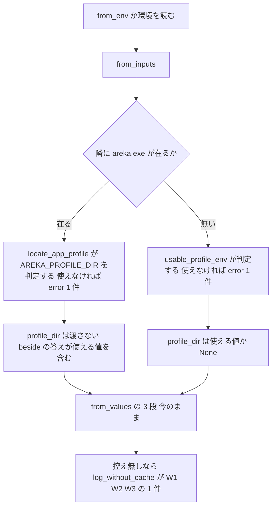

# 設計書: audit-mcp-update-crates

## 概要

**目的**: MCP の受け口（`crates/areka-mcp/`）・MCP の中継（`crates/areka-mcp-bridge/`）・ネットワーク更新のエンジン（`crates/areka-update/`）の 3 つのクレートについて、ponytail の audit が出した 51 件（`research.md` §3 の #1〜#51）を、要件の討議で確定したとおり 3 つの組とも全部直す。直した後に同じ範囲へ audit をかけ直して、新しい指摘を 0 件にする。

**使う人**: 開発者。直しの形は ponytail の「いちばん小さい完全な変更」に従う。消せるものは消し、写しは 1 か所にまとめ、呼び出し元・テストまで直し切る。新しい機能は足さない。

**変わること**: 本番の振る舞いが変わるのは #1 の 1 つだけ。中継は、空か相対の `AREKA_PROFILE_DIR` を控えの置き場に使わず、areka 本体と同じ判定の関数（`areka_user_data::usable_profile_env`）で `error!` を 1 件残して捨て、次の段（隣の areka の記憶の置き場か `LOCALAPPDATA`）へ進む。本番のコードのほかの直し（#14 の登録の道を 1 本にする・#26 の上限の判定を関数に出す・#42 の受付の失敗の待ちを関数に出す・#46 のパスを定数から組む）は、外から見た振る舞いを変えない。残りはテストの足し引き・テストの道具の寄せ・古い注の直し。

### Goals

- 51 件（Must fix 1・Should fix 38・Nice to have 12）を全部直す（要件の討議で確定・直さずに残す 0 件・後へ回す 0 件）。
- 直したバグと危ない所の 1 件ごとに、壊れたら落ちるテストを 1 本ずつ持たせる（「指摘ごとの直し方」の「縛るテスト」の列）。テストは決定論で、外のネットワークに出ない。
- 範囲の外のファイルは、`crates/areka-user-data/src/lib.rs` の `usable_profile_env` を `pub(crate)` から `pub` にする 1 語（と、その説明の文の内部リンク 1 つ）と、消すテストの名を挙げている `doc/ssp-mcp/transport-diff-areka.md` のテスト名の欄のほかは変えない（要件 3.2・6.7・議題 1）。
- タスクはファイルのまとまりで 14 本に束ねる（要件 2.6 の 20 以内）。
- 最後に同じ作法で audit をかけ直し、新しい指摘 0 件・全体テストの緑・既定の枝との差分の確かめを記録する。

### Non-Goals

- 新しい機能（取得の全体の期限・`HTTP://` の大文字の受け入れ・`areka_update::fetch` の記録の行など、`research.md` §4 で指摘にしなかったもの）。
- 依存の追加と版上げ（`Cargo.toml`・`Cargo.lock` は変えない）。
- `crates/areka/` の直し（`mcp/`・`update/` は `audit-areka-install-update` と `runtime-module-untangle` の持ち物）。
- v0.2.0 で受け持つクレートに手を入れる spec（`mcp-set-property` ほか）の先取り。

## 境界の約束

### この spec が持つもの

- 3 つのクレートの全ファイル（本番・テスト・テストの道具・`Cargo.toml`。ただし `Cargo.toml` は変えない）の直し。
- 中継の控えの置き場の決め（`config.rs` の `Config::from_inputs`）を、areka 本体と同じ決まりにそろえること（#1）。
- 偽の受け口（`areka-mcp-bridge/tests/common/fake_server.rs`）の答え方「テストが開けるまで答えない」（`Reply::Gated`）と、「`nobody()` が握る番号の上で待ち受ける」口（`FakeServer::start_on`）。どちらもテストの道具の中だけ。
- 範囲の外から使われていない公開の物の削除 1 つ（`areka_mcp::tools::entrances`。範囲の外で 0 か所＝議題 2）。

### 範囲の外（持たないもの）

- 範囲の外のファイル全部。変えるのは `crates/areka-user-data/src/lib.rs` の `pub(crate) fn usable_profile_env` → `pub fn usable_profile_env` の 1 語（と説明の文の内部リンク 1 つ）と、`doc/ssp-mcp/transport-diff-areka.md` のテスト名の欄だけ（下の「範囲の外（2 つ）」）。同じ判定を中継に写さない（要件 6.7）。持ち主の `audit-ghost-catalog` は完了していて、C19 で `areka-user-data` に触る spec は無い（要件 6.6）。
- `crates/areka/`（`log_history.rs`・`log_history_convention_tests.rs`・`main.rs`・`mcp/`・`update/` を含む）と、C19 のほかの 7 本が触るファイル（ロードマップの C19 の行。`log-capture-kit` の番人 `file_length_guard_test.rs`・`workspace_scan_test.rs` を含む）（要件 6.2）。
- `crates/real-run-kit/`（`areka_mcp::server` の記録の出どころと 3 つの文・`areka_mcp_bridge::scan`・`config::Timeouts` を使う。どの直しもこれらを変えない）。
- `vendors/`（要件 6.8）。
- `areka-update` の `src/fetch.rs`・`src/winhttp.rs` のファイルの名と在りか（`log_history_convention_tests.rs` が読む・要件 6.3）。

### 使ってよい依存

- 今の依存だけ。`areka-mcp`: `rmcp`（=3.9.0）・`tokio`（rt・net・time）・`tokio-util`・`hyper`・`hyper-util`・`http-body-util`・`tower-service`・`serde_json`・`tracing`・`areka-actor`、dev は `log-capture-kit`。`areka-mcp-bridge`: `areka-mcp`・`areka-user-data`・`rmcp`・`tokio`（sync を含む）・`futures`・`http`・`sse-stream`・`httparse`・`serde_json`・`thiserror`・`tracing`・`tracing-subscriber`、dev は `temp-path-kit`・`log-capture-kit`・`tokio`（macros・rt-multi-thread）。`areka-update`: `encoding_rs`・`thiserror`・`tracing`・`windows`、dev は `log-capture-kit`・`sample-ghost-kit`。
- 依存の向き（変えない）: `areka-mcp-bridge` → `areka-mcp`・`areka-user-data`。`areka-update` は 3 つのうちどれにも依存しない。新しい向きは作らない。

### 見直しが要る変化（Revalidation Triggers）

- **中継の控えの置き場**: 空か相対の `AREKA_PROFILE_DIR` で、控えの置き場が「作業フォルダからの相対」から「次の段の置き場」に変わり、標準エラーに `error!`（`event = "profile_dir_env_unusable"`・target `areka_user_data`）が 1 件出る。使える（絶対の）値と未設定のときは今と同じ。
- **公開の形**: 消すのは `areka_mcp::tools::entrances` だけ（範囲の外の使い手 0 か所＝ツリー全体を grep 済み）。足すのは `areka_user_data::usable_profile_env` の `pub` だけ。`all_entrances`・`all_specs`・`start`・`McpServer`・`MCP_PATH`・`Config`（`from_values`・`from_parts`・`from_env`）・`Timeouts`・`scan` の形と、`areka_update` の公開の型と関数は変えない。
- **記録の文と出どころ**: 変えない。`server.rs` の 3 つの文（`real-run-kit` と `emo2_real_run/common_tests.rs` が読む）、`areka_update` の `lib.rs` の `tracing::` の行と `[areka_update]` の頭、モジュールのファイルの名（`log_history_convention_tests.rs` が読む）はそのまま。#46 は起動の記録の `url` の欄を `MCP_PATH` から組むが、出る値は同じ。

## つくり

### 今の形と守るもの

- `areka-mcp`: `server.rs`（束ね・`mcp` スレッド・`Drop`）→ `dispatch.rs`（`Origin`／`Host` の検査 → 振り分け → rmcp へ）→ `handler.rs`・`registry.rs`・`tools/`（10 本＋`check_script` の登録と UI スレッドへの橋）。JSON-RPC の解釈は rmcp に任せる分け方は変えない。
- `areka-mcp-bridge`: `config.rs`（値を読むのは `from_env` の 1 か所・判断は `from_inputs`／`from_values`）→ `service.rs`（答えの判断）→ `scan.rs`（探索）→ `http.rs`（自前の送り手）。#1 は `from_inputs` の中だけを直し、「読むのは 1 か所・判断は値だけ」の分け方を守る。
- `areka-update`: `lib.rs`（一周の段・記録は `lib.rs` の 1 か所）→ `diff`・`work`・`commit`・`delete`・`paths`・`winhttp`。記録の置き場（`lib_tests.rs` の文字の検査）と、`unsafe`／WinHTTP の綴りは `winhttp.rs`・`md5.rs` だけ、の決まりを守る（#26 の関数は `unsafe` も WinHTTP の API の綴りも持たない）。

### #1 の流れ（控えの置き場の決め）



- `locate_app_profile` は、使える `AREKA_PROFILE_DIR` を受けると必ず `AppProfile::Ready(<その値>)` を返す（`establish.rs` の `locate_app_profile`: 使える値があると下の `match` を飛ばし、`app_profile_dir` が `profile_env_dir` の値を先に返す＝R3 の答え）。だから隣に areka が居るときは `profile_dir` を渡さなくても置き場は今と同じで、記録も `locate_app_profile` の 1 件だけになる。

## ファイルの構成

範囲の外で変えるファイルは 2 つ（`areka-user-data` の 1 語と説明の 1 か所・`transport-diff-areka.md` のテスト名）。新しいファイルは作らない（どの足しも今のファイルが 1,000 行の番人の内側に収まる＝「1,000 行の番人」）。消すファイルは 1 つ。

### 消すファイル

- `crates/areka-mcp/src/tools/tools_socket_tests.rs`（#14・#18・#21）。写しでない往復（9 本の型つきの呼び出しが受け手に届く往復・ツールの答えを待つ間の `ping`）は `tools_own_socket_tests.rs` へ移してから消す。`tools/mod.rs` の `mod tools_socket_tests;` の行も消す。消す前にツリー全体（テスト・設定・台本・文字列）で `tools_socket_tests` の名が `tools/mod.rs` のほかに無いことを grep で確かめる（要件 3.3・設計の時点の測りでは 0 か所）。

### 直すファイル

**`crates/areka-mcp-bridge/`**
- `src/config.rs` — #1（`from_inputs` で `profile_dir` を決める形・`PROFILE_DIR_ENV` の説明・`from_values` の説明に「`profile_dir` は使える値だけ」）。
- `src/config_prepare_tests.rs` — #1・#2 の縛るテスト・`W3` の定数・234 行目あたりの注。
- `src/config_tests.rs` — #6（`from_parts_keeps_the_given_values` を消す）・#8（115〜117 行目の定数の比べを消す）。
- `src/http.rs` — `mod tests` を `pub(crate) mod tests` に（#10 で `scan_tests` が道具を借りる・`cfg(test)` の中だけ）。
- `src/http_tests.rs` — #3 の表のテスト・#6（`delete_session`・`get_stream` の答えのテスト）と #7（`written_is_true_only_for_the_failures_after_the_real_body`）を消す・#10（`real_receiver`・`only_the_check_arrived` を `pub(crate)` にして共有元にする・`nobody_listening_is_a_connect_failure` の書き下しを `nobody()` へ）。
- `src/scan_tests.rs` — #10（`patient`・`nobody`・`real_receiver`・`only_the_check_arrived` の写しを消し、共有元を使う）。
- `src/service.rs` — `mod failure_tests` を `pub(crate) mod failure_tests` に（#10 で `scan_tests` が `patient` を借りる・`cfg(test)` の中だけ）。
- `src/service_tests.rs` — #5（2 秒の遅れを門へ）・#10（`nobody()` を消し共有元を使う）。
- `src/service_retry_tests.rs` — #5（2 秒の遅れを門へ）・#50（`keep_closed` を消し、`nobody()`＋`FakeServer::start_on` へ）。
- `src/service_failure_tests.rs` — #44（通知を届けられなかった WARN のテスト）・#10（`patient` は今どおりここが共有元）。
- `src/cache_tests.rs` — #44（読めない控えの WARN を捕まえる）。
- `tests/common/fake_server.rs` — #5（`Reply::Gated`・`Gate`）・#9（`start_on` の立て直しの輪と `connections()` を消す）・#10（`nobody()` を置く）・#50（`start_on` を「`nobody()` が握る番号の上で待ち受ける」口に）。
- `tests/common/fake_server_tests.rs` — #9（`start_on` で立て直す節と `connections()` を使う所を書き直す）・#50 の較正のテスト。
- `tests/exe_test.rs` — #4（`run` に「閉じる前の待ち」を渡す口）・#10（`held` の書き下しを `nobody()` へ）。
- `tests/real_receiver_test.rs` — #10（`held` の書き下しを `nobody()` へ。今は `tests/common/fake_server.rs` を読み込んでいないので、`exe_test.rs` と同じ形で読み込む行と `#[allow(dead_code)]` の理由つきの説明を足す）。

**`crates/areka-mcp/`**
- `src/testkit.rs` — #25（写しの道具を寄せる）・#11・#40 のための `send_raw`。
- `src/dispatch.rs` — 変えない（#11・#12・#40・#41 はテストだけ）。
- `src/dispatch_shape_tests.rs` — #17（`forward_answers_after_rmcp_415_only_for_json_bodies` を消す）・#51（127〜128 行目の注）。
- `src/server.rs` — #42（受付の失敗の待ちを関数に出す）・#46（`url` を `MCP_PATH` から組む）。
- `src/server_tests.rs` — #13・#42 の縛るテスト・#49（`drop_closes_port` を消す）。
- `src/server_protocol_tests.rs` — #12（413 のテストを強める）・#18・#19・#20 を消す・#25（写しの道具を `testkit` から使う）。
- `src/server_gate_help_tests.rs` — #11 の縛るテスト・#40 の縛るテスト・#25。
- `src/server_params_shape_tests.rs` — #41 の 1 行・#25。
- `src/help.rs` — #46（`url` を `MCP_PATH` から組む）。
- `src/registry_tests.rs` — #15（`outcome_carries_text_image_and_is_error` を消す）。
- `src/check_tests.rs` — #25。
- `src/tools/mod.rs` — #14（`entrances` を消す・`register_rows` を行の列を受ける形にして `all_entrances` がそれを呼ぶ・`mod tools_socket_tests;` を消す）。
- `src/tools/tools_tests.rs` — #14（`entrances(..)` を `register_rows(TABLE, ..)` へ）・#22（38〜43 行目）・#24（`reply_wait_is_ten_seconds`）を消す・#25。
- `src/tools/tools_own_tests.rs` — #14（`entrances` との比べを `register_rows(TABLE, ..)` へ・`entrances_stays_ten` を消す＝#22）。
- `src/tools/tools_own_socket_tests.rs` — #14（写しでない往復を受け入れる・4 行目と 96 行目の注が名指す `tools_socket_tests.rs` を、消した後の形に直す）・#23（258〜272 行目を消す）・#48（242〜254 行目を `assert_eq!` だけに）・#25。
- `src/tools/bridge_tests.rs` — #16。

**`crates/areka-update/src/`**
- `winhttp.rs` — #26（`over_limit` を出す）・#51（3〜4 行目の注）。
- `winhttp_tests.rs` — #26 の縛るテスト。
- `testkit.rs` — #39（`target_fixture`・`SHARING_VIOLATION`・`MD5_ABC`）・#51（75 行目の注）。
- `testkit_tests.rs` — #34。
- `run_tests.rs` — #38（差し込みの組み立てを 1 つの関数に）・#39・#43 の縛るテスト・#51（3 行目の注）。
- `run_fail_tests.rs` — #27・#28・#29 の縛るテスト。
- `lib_tests.rs` — #35（245 行目）・#36（144 行目）・#38。
- `commit_tests.rs` — #30 の縛るテスト・#39。
- `delete_tests.rs` — #31（名前の大小と先頭の 0）・#45（自分を指すジャンクションの行）・#39。
- `paths_tests.rs` — #33・#45・#39。
- `work_tests.rs` — #45・#39。
- `diff_tests.rs` — #47・#39。
- `error_tests.rs` — #32・#36・#37。

**範囲の外（2 つ）**
- `crates/areka-user-data/src/lib.rs` — `pub(crate) fn usable_profile_env` を `pub fn usable_profile_env` にする（`lib.rs` の根に在るので `pub use` は要らない）。説明の文の中身は今のまま（「入口で 1 回だけ呼ぶ」は中継の `from_inputs` にも当たる）。ただし説明の頭の内部リンク ``[`profile_env_dir`]`` は `pub(crate)` の関数を指すので、`pub` にすると `cargo doc` が `private_intra_doc_links` の警告を出す。リンクを外して `` `profile_env_dir` `` の字面にする（文は同じ）。
- `doc/ssp-mcp/transport-diff-areka.md` — 「測ったテスト名」の欄が、この spec で消すテスト（#17 `forward_answers_after_rmcp_415_only_for_json_bodies`・#18 `tools_call_any_name_is_invalid_params`・#19 `unknown_method_is_jsonrpc_error_from_rmcp`・#20 `ping_returns_empty_object`・#14 `unknown_name_is_invalid_params`〔`tools_socket_tests.rs`〕）と 35 行目の `tools/tools_socket_tests.rs` を名指している。rmcp の版上げのときに回すテストの一覧なので、消すテストの名を、同じ値を確かめて残るテストの名へ差し替え（残るテストが既に同じ行に並んでいれば消すだけ）、35 行目のファイルの並びを消した後の形に直す。差し替え先は実装のときに grep で引く（表の値・状態・`message` を確かめているテスト）。表の値・判定の欄は変えない。C19 でこのファイルに触る spec は無い（`runtime-module-untangle` が触るのは `log-convention.md`）。`doc/ssp-mcp/areka-tools.md:173` は完了した `areka-P0-mcp-author-tools` の設計の写し（その spec の約束の記録）なので直さない。

## 新しい形を引く直し

### #1 中継の `AREKA_PROFILE_DIR`（`config.rs`）

| 項目 | 中身 |
|---|---|
| 目的 | 空か相対の `AREKA_PROFILE_DIR` で、控えを Claude Desktop の作業フォルダからの相対の置き場に書かない |
| 要件 | 3.1・3.5・4.1・4.2・5.2・6.1・6.7 |

```rust
// config.rs（形だけ。from_inputs の引数と戻りは変えない）
pub(crate) fn from_inputs(
    port_value: Option<&str>,
    profile_env: Option<&OsStr>,
    areka: Option<(&Path, &areka_user_data::Signals)>,
    local_app_data: Option<PathBuf>,
) -> Config {
    let beside = areka.map(|(exe_dir, signals)| {
        areka_user_data::locate_app_profile(signals, exe_dir, profile_env)
    });
    // 隣に areka が居れば、使える値は beside の答えが既に含み、使えない値の error! も
    // locate_app_profile が 1 件残した（同じ値を 2 度判定しない）。
    let profile_dir = match beside {
        Some(_) => None,
        None => areka_user_data::usable_profile_env(profile_env),
    };
    let config = Config::from_values(port_value, profile_dir, beside.clone(), local_app_data);
    log_without_cache(beside.as_ref(), &config);
    config
}
```

- `from_values` は変えない（`pub` の値だけの判定。呼び手の `from_inputs` が使える値だけを渡す。説明に「`profile_dir` は使える（絶対の）値だけを受ける。判定は `from_inputs`」と 1 行足す）。`config_tests.rs` の `cache_dir_follows_the_table` の ⑴（`profile_dir` があれば隣の答えがどれでもその下）は値だけの判定として今のまま通る（`from_inputs` からは、使える値と `Unlocatable` の組は来ない）。
- 21 行目の説明「空の値も『設定あり』として扱うのも同じ」は誤りになるので、「areka 本体と同じ名前・同じ決まり（空・相対の値は `error!` を残して捨てる＝`areka_user_data::usable_profile_env`）」に直す。
- 記録: 捨てた値の `error!` は `areka_user_data` の 1 件だけ（`event = "profile_dir_env_unusable"`・文 `AREKA_PROFILE_DIR is empty or relative; ignored`・ASCII）。中継の行（`[bridge]`）は足さない。控えを持たない結果になれば、今の W1〜W3 の 1 件が続く（記録の無い失敗の道を作らない）。

**縛るテスト**（`config_prepare_tests.rs`・`target` の下の根・環境変数は書き換えない）
- `an_unusable_profile_env_is_dropped_with_one_error`: 値 `""` と `"rel"` の 2 つについて、⑴ 隣に areka が無い（`run(&fx, Some(Path::new(v)), None)`）→ `cache_dir == lad\areka\mcp-bridge`・`profile_dir_env_unusable` の ERROR がちょうど 1 件 ⑵ 隣に zip の形の areka（`zip_layout_puts_cache_beside_exe` と同じ `Signals`）→ `cache_dir == exe\profile\areka\mcp-bridge`・同じ ERROR がちょうど 1 件。**直しを外すと赤**（⑴⑵ とも置き場が `mcp-bridge`／`rel\mcp-bridge` になり、⑴ は ERROR が 0 件）。

### #4・#5 偽の受け口の「門」と、exe の標準入力を閉じる時（D2・R1）

| 項目 | 中身 |
|---|---|
| 目的 | 本物の 1〜2 秒の遅れで順番を決めるテストを、テストが開けるまで答えない門と「届いた後に閉じる」形で決定論にする |
| 要件 | 4.1・4.2・4.5 |

```rust
// tests/common/fake_server.rs（足すもの）
/// テストが開けるまで答えを止める門。開けたら閉じない（後から届いた要求もすぐ通る）。
#[derive(Debug, Clone)]
pub struct Gate(Arc<tokio::sync::Semaphore>);

impl Gate {
    pub fn shut() -> Gate;         // 許しの数 0 の Semaphore（引数なしの new は clippy の new_without_default に当たるので名を変える）
    pub fn open(&self);            // Semaphore::close（同期の口・どのスレッドからでもよい）
    async fn passed(&self);        // acquire().await が Err（閉じた）を返すまで待つ
}

pub enum Reply {
    // …今の変種…
    /// 門が開くまで待ってから、中の答え方で答える。
    Gated(Gate, Box<Reply>),
}
```

- `respond` の頭の `while let Reply::Delayed(..)` の輪を、`Delayed`（眠る）と `Gated`（`gate.passed().await`）の両方をほどく輪にする。`Reply::Delayed(..) => unreachable!` の腕に `Reply::Gated(..)` も足す。
- 待つのは偽の受け口のスレッドの tokio（`current_thread`）の上の 1 つのタスクだけ。同じ受け口のほかの接続（`ping` など）は待たずに答える（受け口は接続ごとにタスクを立てる）。開ける側（`open`）は同期の口なので、同期のテストからも tokio のテストからも呼べる（R1 の答え: 部品のテストの束と通しのテストの束の両方が同じ 1 ファイルを読み、どちらでも同じに使える）。`Script` と `Reply` の `Clone`・`Debug` はそのまま（`Gate` は `Arc` を写す）。
- 門の待ちは上限を持たない。開け忘れたテストは `Desk::next` ほかの今の上限（`WAIT`・10 秒）で赤になって止まらない。

**#5 の直し**（`service_tests.rs` の `a_slow_request_does_not_hold_back_the_next_and_the_first_two_share_one_link`・`service_retry_tests.rs` の `a_slow_request_survives_another_request_forgetting_the_link`）: `Reply::Delayed(Duration::from_secs(2), …)` を `Reply::Gated(gate.clone(), …)` へ替え、`ping` の答えを確かめた後に `gate.open()` を呼んでから遅い答えを読む。門が開くまで遅い答えは来ないので、「`ping` が先に終わる」は負荷によらず必ず成り立つ。**直しを外すと赤**の意味は今と同じ（長い要求の間に次の要求が待たされる直し間違いは、`ping` の答えが門の前で止まって上限で赤）。

**#4 の直し**（`tests/exe_test.rs`）
- `run(port, profile_dir, input, read_stdout)` に引数 `before_close: Box<dyn FnOnce() + Send>` を足す。流すスレッドは書き終えた後、`before_close()` を呼んでから「閉じた時刻」を取り、標準入力を閉じる。`run_bridge` と `stdin_closed_while_stdout_is_never_read…` は何もしない `Box::new(|| ())` を渡す。
- `a_reply_coming_within_5s_after_stdin_closed_is_written_before_exit_code_0` は、偽の受け口を `Arc<FakeServer>` で持ち、`before_close` で `requests_of("tools/call")` が 1 件になるまで 10 ms ごとに見る（上限 `EXIT_WAIT`）。答えは今の `Reply::Delayed(1 秒)` のまま。閉じた時点で要求は既に届いているので、答えは閉じてから 1 秒以内に来る（exe の起動・探索・名乗りの確かめは閉じる前に終わっている）。5 秒の見込みに起動の時間が入らなくなる。
- `FakeServer` は `Send + Sync`（中は `Arc`・`Mutex`・`watch::Sender`・`oneshot::Sender`・`JoinHandle`）なので `Arc` で流すスレッドへ渡せる。

### #50・#9・#10 誰も待ち受けない番号の共有（D2 の続き）

| 項目 | 中身 |
|---|---|
| 目的 | 止めた受け口の番号を取り直す待ち（並んで走るテストに取られると 10 秒回って panic・tokio のスレッドを `std::thread::sleep` で止める）を無くす |
| 要件 | 4.1・4.2・4.5・3.3 |

```rust
// tests/common/fake_server.rs
/// 誰も待ち受けない番号: SO_REUSEADDR を付けて束ねたまま待ち受けないソケット。落とすまで、
/// 並んで走るテストの束ね（bind(0) も番号を決めた束ねも）にこの番号は渡らない。
pub fn nobody() -> (tokio::net::TcpSocket, u16);

impl FakeServer {
    /// OS が割り当てる空きポートで起こす（今と同じ）。
    pub fn start(script: Script) -> FakeServer;
    /// nobody() が握る番号の上で待ち受ける。止めた後も番号は nobody() が握り続けるので、
    /// その番号への接続は必ず断られる（覚えた先に areka が居なくなった形）。束ねられなければ panic。
    pub fn start_on(port: u16, script: Script) -> FakeServer;
}
```

- 受け口の束ね方を `tokio::net::TcpSocket` にそろえる: `start` は `TcpSocket::new_v4()` → `bind(127.0.0.1:0)`、`start_on` は `new_v4()` → `set_reuseaddr(true)` → `bind(127.0.0.1:port)`。番号は `local_addr()` で取り、ソケットを受け口のスレッドへ渡して、そのスレッドの tokio の中で `listen(1024)` する。立て直しの輪（期限まで 10 ms ごとに束ね直す）は消す。
- 機序（2026-11-13 にこの机で測った・.NET の `Socket` で Winsock を直に呼んで確かめた・`research.md` §10.2）: Windows では、`SO_REUSEADDR` を付けて束ねたまま待ち受けないソケット A が在る番号に、同じく `SO_REUSEADDR` を付けたソケット B が束ねて待ち受けられる。B が待ち受けている間の接続は B に届き、B を閉じた後の接続は `ConnectionRefused` になる。A が握っている間、`SO_REUSEADDR` の無い束ね（ほかのテストの `bind`）は断られ、`bind(0)` もその番号を受け取らない。片方だけに `SO_REUSEADDR` を付けた形（待ち受けている側に無い）は B の束ねが `WSAEACCES` で断られるので、`nobody()` の側にも付ける。
- `nobody()` は今 5 か所に写されている（`scan_tests.rs`・`service_tests.rs`・`http_tests.rs`・`exe_test.rs`・`real_receiver_test.rs`）。全部をこの 1 つにする（#10）。`SO_REUSEADDR` が付いても「握っている間ほかに渡らない」は同じ（上の測り）。
- `connections()` は消す（使うのは自己確認だけ。接続の記録は `wait` が返す `Log.connections` で見る）。
- `src/lib.rs`・`tests/exe_test.rs` の `#[allow(dead_code)]` は残す（使い手ごとに使う部品が違う理由の説明つき＝`research.md` §4 の ⑵ の決め）。

**#50 の直し**（`service_retry_tests.rs` の `a_request_reaches_areka_restarted_on_another_port_exactly_once`）: `let (_held, gone_port) = nobody(); let mut gone = FakeServer::start_on(gone_port, areka_saying("old"));` で起こし、`gone.stop()` の後の `keep_closed` を消す。テストの的（覚えた番号に接続できない → 覚えを捨てて探し直す → 新しいつなぎ先へ 1 回だけ送る）は変えない。`keep_closed` と、それだけが使う `Ipv4Addr`・`SocketAddr`・`Instant` の取り込みを消す。

**縛るテスト**（`fake_server_tests.rs`・部品のテストの束でだけ走る）
- `start_on_a_held_port_refuses_after_stop`: `nobody()` の番号で `start_on` → `TcpStream::connect` が通る → `stop()` → 同じ番号への接続が断られる → `std::net::TcpListener::bind(("127.0.0.1", port))` が断られる（握ったまま）。`nobody()` から `set_reuseaddr` を外すと `start_on` が束ねられずに赤、`start_on` から外しても赤。
- 今の自己確認の「止めると開いていた接続が閉じ、番号は接続を受けない」（158 行目あたり）は、`nobody()`＋`start_on` の受け口で行う（止めた後に番号がほかへ渡らないので、断られることが決定論になる）。続く「同じ番号に、別の名乗りで立て直す」節と、`connections()` の 2 か所（`:183`・`:426`）は消す（`:426` は `wait` の記録の `connections[held].closed` へ）。

### #11・#40 生のバイト列を送るテストの道具（`areka-mcp/src/testkit.rs`・D3）

```rust
/// 組み上がった要求のバイト列をそのまま送り、close_write なら書きの側を閉じてから、
/// サーバが閉じるまで読んで分ける（ヘッダの値に UTF-8 でないバイトを入れる・本文を約束より短く切る、のため）。
pub(crate) fn send_raw(addr: SocketAddr, raw: &[u8], close_write: bool) -> Response;
```

- `request` は今の引数のまま、頭を組んで `send_raw(addr, &bytes, false)` を呼ぶ形にする（読みの上限・切られたときの扱いは今の `read_until_closed`・`parse` のまま）。
- **#11 の縛るテスト**（`server_gate_help_tests.rs`）`non_utf8_origin_and_host_are_refused`: `Origin: http://\xff`（`Host` は `127.0.0.1:<port>`）を `POST /api/mcp/v1` へ送って 403。`dispatch.rs` の `from_utf8_lossy` を `to_str().ok()` に「簡単に」すると、`Origin` が「無し」になって通り、赤。続けて `Host: \xff` の 1 行も 403（こちらは `None` でも拒まれるので回帰は捕まえないが、置換文字入りの値が通らないことを見る）。hyper 1 の頭の読み（`httparse`）は値の中の 0x80〜0xFF を許すので、要求はサーバまで届く（実装の最初にこの前提が成り立つこと＝403 が返ることを確かめる）。
- **#40 の縛るテスト**（同じファイル）`a_body_shorter_than_its_length_is_400`: `Content-Length: 100` の頭と 10 バイトの本文を送って書きの側を閉じる → 400・本文 `Bad Request`。`Err(_)` の枝を 413 にしたり空の本文で rmcp へ渡したりする直し間違いは赤。

### #13・#42 終了の道と受付の失敗（`areka-mcp/src/server.rs`・D4）

- **#13 の縛るテスト**（`server_tests.rs`・子のモジュールなので非公開の欄に届く）`drop_detaches_when_the_thread_does_not_finish_in_time`: `spawn_actor::<(), _>("mcp-test", |_| {})` で取っ手を作り、`done` の送り手をテストが持ったまま（終わりの合図が来ない形）、`McpServer { listening: Some(Listening { addr, token: CancellationToken::new(), done, _inbox, _thread }) }` を組む。落とすのは別のスレッドで行い、そのスレッドが `capture` で記録を取って、かかった時間と一緒にテストのスレッドへ送る。テストのスレッドは `SHUTDOWN_WAIT + 5 秒` の期限で待つ。⑴ かかった時間が `SHUTDOWN_WAIT` 以上 ⑵ WARN「MCP: 待受の終わりを待ちきれなかった（切り離して先へ進む）」がちょうど 1 件・INFO 0 件。`recv_timeout` を `recv()` に直し間違えると落とすスレッドが戻らず、期限切れで赤（テストは止まらない。期限の後に送り手を捨てて、止まったスレッドをほどく）。テストの時間は約 2 秒増える（全体テストでは並んで走るので、全体の時間への響きは小さい）。
- **#42 の直し**: 受付のループの `Err(err)` の腕の中身（`warn!` と `ACCEPT_RETRY_WAIT` の眠り）を `async fn wait_after_accept_error(err: &std::io::Error)` に出し、腕はそれを呼ぶだけにする（記録の文・欄・待つ長さは変えない）。受付そのものを差し替える口は作らない（tokio の `TcpListener::accept` の失敗は決定論で起こせない）。
- **#42 の縛るテスト**（`server_tests.rs`）`an_accept_error_waits_before_the_next_try`: `current_thread` の tokio（時間を有効に）の上で `capture(|| rt.block_on(wait_after_accept_error(&io::Error::other("x"))))` → かかった時間が `ACCEPT_RETRY_WAIT` 以上・WARN 1 件。眠りの行を消すと赤。

### #14 登録の道を 1 本に（`areka-mcp/src/tools/mod.rs`）

```rust
/// 行を順に登録する（本番の all_entrances とテストが同じ道を通る）。読めない行は error! 1 件で飛ばす。
pub(crate) fn register_rows(
    rows: impl IntoIterator<Item = (&'static str, Parse)>,
    reply_wait: Duration,
) -> (ToolRegistry, Receiver<ToolRequest>);

/// 形は変えない（crates/areka/src/main.rs の 1 か所が呼ぶ）。
pub fn all_entrances(reply_wait: Duration) -> (ToolRegistry, Receiver<ToolRequest>) {
    let own = OWN_TABLE.iter().map(|&(definition, parse, _)| (definition, parse));
    register_rows(TABLE.into_iter().chain(own), reply_wait)
}
```

- `pub fn entrances` を消す（範囲の外の使い手 0 か所・議題 2）。`register_rows` は今どおり crate の中だけ。
- テストの乗り換え: `tools_tests.rs` の `entrances(..)`（4 か所）は `register_rows(TABLE, ..)` へ（守る中身＝10 本の行の登録・型つきの呼び出し・空の引数・溜まる受け口は同じ）。`broken_definition_row_is_skipped_with_one_error` は `register_rows(rows, ..)` のまま（配列を値で渡す）。`tools_own_tests.rs` の `all_entrances_is_ssp_ten_then_own_rows` は先頭 10 本を `register_rows(TABLE, ..)` と比べる。
- `tools_socket_tests.rs` のうち写しでないもの（9 本の型つきの呼び出しが本番の登録表を通って受け手に届く往復・ツールの答えを待つ間に `ping` が答える）は、`all_entrances` で組む `tools_own_socket_tests.rs` へ移す。残り（先頭 10 本の一致＝#21・知らない名前の -32602＝#18・道具の写し＝#25）は消す。

### #26 本文の上限の判定（`areka-update/src/winhttp.rs`・D5）

```rust
/// 読みかけ have バイトに、次の available バイトを足すと MAX_BODY_BYTES を越えるか。
fn over_limit(have: usize, available: u32) -> bool {
    available as usize > MAX_BODY_BYTES - have
}
```

- 置き場は `winhttp.rs` の中（`MAX_BODY_BYTES` の隣）。読みのループの `if available as usize > MAX_BODY_BYTES - body.len()` を `if over_limit(body.len(), available)` にする。`have ≤ MAX_BODY_BYTES` は前の回の判定が守るので引き算は溢れない（今と同じ）。
- `lib_tests.rs` の文字の検査に触れない: 足す行は `unsafe` の語も `WinHttp` の API の綴りも持たない。ファイルの名と在りかは変えない（要件 6.3）。
- **縛るテスト**（`winhttp_tests.rs`）`the_body_limit_is_exclusive_above_max`: `over_limit(0, MAX as u32)` は偽・`over_limit(0, MAX as u32 + 1)` は真・`over_limit(MAX - 1, 1)` は偽・`over_limit(MAX - 1, 2)` は真・`over_limit(MAX, 1)` は真。判定を消す・`>=` に変える直し間違いは赤。

### #45 起こしにくい失敗の枝（D7）

- 自分自身を指すジャンクション（`testkit::junction(&p, &p)`）を開くと、Windows は `ERROR_CANT_RESOLVE_FILENAME`（1921）を返す（2026-11-13 にこの机で測った・`research.md` §10.3）。`NotFound`・`NotADirectory` のどちらでもないので、次の 4 つの枝を決定論で通せる。根は `sample_ghost_kit::WorkDir`（今のテストと同じ置き場）で、落とすとき `remove_dir_all` はジャンクションを辿らずに消す。
  - `paths.rs` の `resolves_under` の `symlink_metadata` の `Err`（`:41`）と `canonicalize` の `Err`（`:37`）: `paths_tests.rs` `a_self_looping_junction_is_an_error_not_under`: `target/loop` を自分を指すジャンクションにし、`resolves_under(real, &target.join("loop").join("x"))` と `resolves_under(real, &target.join("loop"))` がどちらも `Err`（`NotFound` でない）。`Err` を `Ok(false)` に丸める直し間違いは赤。
  - `delete.rs` の `resolves_under` の `Err` → 取り除けない（`:139`）: `delete_tests.rs` `a_line_through_a_self_looping_junction_is_undeletable`: `delete.txt` に `loop/x.txt` → `undeletable` に 1 件・警告 0 件。
  - `work.rs` の `purge_committed` の棚を読めない枝（`:163-166`）: `work_tests.rs` `purge_lists_the_shelf_when_it_cannot_be_read`: `.update-work` を自分を指すジャンクションにし、`purge_committed(target).held == [棚]`・`removed` は空。
- 決定論で起こす差し込みが無い 2 つの枝は、テストを足さず、その場に 1 行の注を置いて閉じる（`research.md` の #45 の直し「見つからなければ記録に残して閉じる」のとおり・記録は `research.md` §10.3）:
  - `commit.rs` の戻しで作ったフォルダを消せない枝（`:143-145`）: 消す相手は確定がその場で作ったフォルダで、確定の途中に手を入れる口が無い（`NotFound`・`DirectoryNotEmpty` は今のテストが通る）。注 `// 試さない: 確定がその場で作ったフォルダを途中で掴む差し込みが無い（DirectoryNotEmpty と NotFound は commit_tests が通る）`。
  - `delete.rs` の `symlink_metadata` の `Err`（`:144`）: 直前の `resolves_under` が同じパスの `symlink_metadata` を先に見るので、ここで `NotFound` でない失敗が出るのは、その間にほかのプロセスが木を変えたときだけ。注 `// 試さない: 直前の resolves_under が同じパスを先に見る（ここに来るのはその間に木が変わったときだけ）`。
- エラーの扱い（`Err` を取り除けない一覧へ・`stuck` へ）は消さない（要件 5.2）。

## 指摘ごとの直し方（#1〜#51）

「束」はタスクのまとまり（次の節）。「縛るテスト」は、直したバグと危ない所が壊れたら落ちるテスト（要件 4.1）。「—」はテストの直しそのもの・写しの寄せ・削除・注の直しで、今あるテストが同じ結果で通ることを確かめる（要件 4.5）。行番号は `research.md` §3 の時点のもの（実装で関数名から引き直す）。

### Must fix

| # | 直し方 | 縛るテスト | 束 |
|---|---|---|---|
| 1 | `from_inputs` で使える値だけを `profile_dir` に渡す（上の節）・21 行目の説明・`from_values` の説明・範囲の外の 1 語 | `an_unusable_profile_env_is_dropped_with_one_error` | T1 |

### Should fix

| # | 直し方 | 縛るテスト | 束 |
|---|---|---|---|
| 2 | `config_prepare_tests.rs` に `W3`（`"[bridge] no place for the cache (AREKA_PROFILE_DIR, areka profile beside the bridge, LOCALAPPDATA: none available); running without it"`）を足し、234 行目あたりの注「W1〜W3 は 0 件」はそのまま本物になる | `no_place_for_the_cache_is_warned_once`: `Config::from_inputs(None, None, None, None)` と `(None, None, None, Some("rel".into()))` を `capture` で呼び、どちらも `cache_dir == None`・W3 の WARN がちょうど 1 件。`warn!` を消すと赤 | T1 |
| 3 | `http_tests.rs` に表のテストを 1 本（`read_reply(&mut &raw[..], &mut buf)`） | `replies_that_are_not_http_are_invalid_data`: 頭が 65 個・`Content-Length: x`・塊の長さ `zz`・塊の長さ `ffffffffffffffff`（`checked_add` が溢れる）の 4 行で `ErrorKind::InvalidData` | T4 |
| 4 | exe の標準入力を「届いた後に閉じる」（上の節） | 直した `a_reply_coming_within_5s_after_stdin_closed_is_written_before_exit_code_0`（的は同じ・時間の見込みに起動を入れない） | T3 |
| 5 | 2 秒の遅れを門へ（上の節） | 直した 2 本（的は同じ） | T2 |
| 6 | `from_parts_keeps_the_given_values`（`config_tests.rs`）と `delete_session`・`get_stream` の答えのテスト（`http_tests.rs:410-427`）を消す | — | T1・T4 |
| 7 | `written_is_true_only_for_the_failures_after_the_real_body` を消す（各失敗の場面のテストと `service_failure_tests.rs` の `classify` のテストが同じ分け方を見る） | — | T4 |
| 8 | `config_tests.rs:115-117` の定数の比べを消す（`exe_test.rs` の記録の行と `Timeouts::default()` の行が残る） | — | T1 |
| 9 | `start_on` の立て直しの輪と `connections()` を消し、`start_on` を #50 の口に作り替える。自己確認の立て直しの節を消す（上の節） | — | T2 |
| 10 | `nobody()` を `fake_server.rs` の 1 つに（上の節）。`real_receiver`・`only_the_check_arrived`（強い方＝`http_tests.rs` の、バイトの数まで見る形）は `http_tests.rs` を共有元にし（`http.rs` の `mod tests` を `pub(crate)` に）、`scan_tests.rs` の写しを消す。`patient` は `service_failure_tests.rs` を共有元にし（`service.rs` の `mod failure_tests` を `pub(crate)` に）、`scan_tests.rs` の写しを消す（確かめの上限は 10 秒で同じ） | — | T2 |
| 11 | `testkit::send_raw` で UTF-8 でない値を送る（上の節） | `non_utf8_origin_and_host_are_refused` | T6・T7 |
| 12 | 413 のテストで本文と `Content-Type` も見る。rmcp 3.9.0 の 413 は本文 `Payload Too Large: request body exceeds 4194304 bytes`・`Content-Type` なし（`server_side_http.rs` の `expect_json`＝R2 の答え）。自前の `plain` は本文 `Payload Too Large`・`text/plain; charset=utf-8` なので見分けられる | 強めた `body_over_limit_is_413`（本文が `Payload Too Large` ちょうど・`Content-Type` が `text/plain; charset=utf-8`）と `a_body_of_exactly_the_limit_is_not_413`（4 MiB ちょうどの本文で 413 でない）。`Limited` の包みか `LengthLimitError` の枝を消すと前者が赤、上限の比べを 1 つずらすと後者が赤 | T7 |
| 13 | 期限切れの枝を通すテスト（上の節） | `drop_detaches_when_the_thread_does_not_finish_in_time` | T8 |
| 14 | 登録の道を 1 本に・`entrances` と `tools_socket_tests.rs` を畳む（上の節） | —（本番の登録表を通る往復が `tools_own_socket_tests.rs` に移る） | T9 |
| 15 | `registry_tests.rs` の `outcome_carries_text_image_and_is_error` を消す | — | T10 |
| 16 | `bridge_tests.rs:252-262` は `:259` の `is_abandoned()` の確かめだけを残し、捕捉の行を消す。`:84-92` の 1 本を消す | — | T10 |
| 17 | `dispatch_shape_tests.rs` の `forward_answers_after_rmcp_415_only_for_json_bodies` を消す | — | T10 |
| 18 | `server_protocol_tests.rs:140-153` を消す（`tools_socket_tests.rs:130-133` は #14 で消える）。`server_gate_help_tests` と `tools_own_socket_tests` の 2 本を残す | — | T10 |
| 19 | `server_protocol_tests.rs:157-168` を消す | — | T10 |
| 20 | `server_protocol_tests.rs` の `ping_returns_empty_object`・`tools_list_is_empty`・`:203-208`（壊れた `{` の 415）を消す | — | T10 |
| 21 | `tools_socket_tests.rs` の側を消す（#14 で束ごと消える） | — | T9 |
| 22 | `tools_tests.rs:38-43`（`table_has_ten_rows_in_ssp_order`）と `tools_own_tests.rs` の `entrances_stays_ten` を消す。残る 10 行の縛りは `tools_tests.rs` の登録表の並びのテスト（`register_rows(TABLE, ..)` で組む）と `check_tests.rs:262` | — | T9 |
| 23 | `tools_own_socket_tests.rs:258-272` を消す | — | T9 |
| 24 | `tools_tests.rs` の `reply_wait_is_ten_seconds` を消す | — | T9 |
| 25 | `testkit.rs` に寄せる（D6）: `Response::result()`・`Response::error()`（今の `result_of`／`error_of`）・`stateless_meta()`・`post_legacy`・`post_stateless`・`call_params`・`assert_no_request`・`assert_invalid_params`（登録表を引数で受ける形）・`SAVED_LIST`・`HELP`・`STATELESS`・`obj()`。バイトまで同じ写しは 1 つをそのまま移し、違いが引数だけのものは引数にする。使う側（`server_protocol_tests`・`server_gate_help_tests`・`server_params_shape_tests`・`tools_own_socket_tests`・`tools_tests`・`check_tests`）は `crate::testkit::…` を使う | — | T6 |
| 26 | `over_limit` を出す（上の節） | `the_body_limit_is_exclusive_above_max` | T11 |
| 27 | `run_fail_tests.rs` に 1 本 | `updates_txt_failing_for_another_reason_is_a_manifest_fetch_failure`: `FakeFetch::new().fail(&url("updates.txt"), FetchError::Timeout)`（`updates2.dau` は 404）→ `ManifestFetch { name: UpdatesTxt }`・`file() == Some("updates.txt")`・ERROR 1 件。`ManifestMissing` に直し間違えると赤 | T11 |
| 28 | `run_fail_tests.rs` に 1 本 | `a_failed_run_reports_another_runs_residue`: 確定の途中で戻す形の前に `.update-work/9-9/old/b.txt` を置く → `err.leftovers == [そのフォルダ]`・`leftover` の WARN 1 件。`Vec::new()` を返す・`keep()` の残りを落とす直し間違いは赤 | T11 |
| 29 | `run_fail_tests.rs` に 1 本 | `the_manifest_that_cannot_be_staged_fails_at_commit`: 最後のファイルを取る `on_get` の差し込みで、作業場所の `new/updates2.dau` という名のフォルダを先に作る → `WorkArea` が `Stage::Commit` で返る。段を `Download` に直し間違えると赤 | T11 |
| 30 | `commit_tests.rs` に 1 本 | `an_escape_after_a_stuck_file_is_rollback_failed`: 1 件目の `a.bin` を `pin`（`:191-193` の形）し、2 件目をジャンクションで外へ出す（`:262-273` の形）→ `RollbackFailed`・`stuck == ["a.bin"]`。`EscapesTarget` に取り違えると赤 | T12 |
| 31 | `delete_files_orders_numerically…` の名前を `delete.txt`・`Delete1.TXT`・`delete02.txt`・`delete10.txt` に替える（NTFS は大小を区別しないので今の `delete1.txt`・`delete2.txt` と重ならない名前へ） | 直したテスト: 期待の順 `delete.txt, Delete1.TXT, delete02.txt, delete10.txt`。`to_ascii_lowercase` を消す・0 の扱いを変えると赤 | T12 |
| 32 | `error_tests.rs` の `all_kinds_are_unique`・`every_display_is_non_empty` を消す | — | T13 |
| 33 | `paths_tests.rs` の `local_path_is_the_target_joined_with_the_relative_name_as_is` を消す | — | T12 |
| 34 | `testkit_tests.rs` の `fake_fetch_hook_runs_before_the_answer_is_returned` を消す | — | T13 |
| 35 | `lib_tests.rs:245` の行を消す | — | T13 |
| 36 | 名前の並びの表（`error_tests.rs:94-105`）を残し、`error_tests.rs:72-75`（`all_kinds_has_eleven_entries`）と `lib_tests.rs:144` の行を消す（議題 3） | — | T13 |
| 37 | `error_tests.rs` の `manifest_name_file_names` を消す | — | T13 |
| 38 | `run_tests.rs` に `pub(super) fn pin_a_dll_when_b_is_fetched(f: &Fixture, fetch: FakeFetch) -> (FakeFetch, Rc<RefCell<Option<Pinned>>>)` を置き、`run_tests.rs:618-637` と `lib_tests.rs:106-127` が呼ぶ | — | T13 |
| 39 | `testkit.rs` に `pub(crate) fn target_fixture() -> (WorkDir, PathBuf, PathBuf)`（作業の根の `WorkDir`・`target`・`canonicalize` した `target`）と `SHARING_VIOLATION`・`MD5_ABC` を置き、6 つのファイルの `Fixture` はその上に各自の欄（`area` ほか）だけを足す | — | T13 |

### Nice to have

| # | 直し方 | 縛るテスト | 束 |
|---|---|---|---|
| 40 | `send_raw` で短い本文を送る（上の節） | `a_body_shorter_than_its_length_is_400` | T7 |
| 41 | `server_params_shape_tests.rs` に `Content-Type: application/json; charset=utf-8` の 1 行（`params` が配列の要求） | 足した行: rmcp の 415 でなく、今の表と同じ -32602 の答え。`starts_with` を `==` に直し間違えると赤 | T7 |
| 42 | 待ちを関数に出す（上の節） | `an_accept_error_waits_before_the_next_try` | T8 |
| 43 | `run_tests.rs` に差分 0 の走行を `"https://example.test/ghost/"` で 1 本 | `an_https_homeurl_runs`: `UpdateOutcome` の差分 0・`InvalidHomeurl` にならない。`|| starts_with("https://")` を消すと赤 | T11 |
| 44 | ⑴ `cache_tests.rs:116-120` の読みを `capture` で包む ⑵ `service_failure_tests.rs` に通知の 1 本 | ⑴ 直した `unwritable_place_keeps_going`: WARN「cannot read the cache」がちょうど 1 件（WARN の行を消すと赤） ⑵ `a_notification_areka_refuses_is_warned`: 記録を捕まえるため `#[tokio::test]` でなく `#[test]` で書き、`capture(|| current_thread の tokio.block_on(async { … }))` の中で `Desk` を回す（中継のタスクも同じスレッドで回るので記録が捕まる）。`ping` でつないだ後、台本で `notifications/x-test` に `Reply::Text(500, "no")` を当ててその通知を送り、受け口の記録でその接続が閉じたのを `wait` で待ってから `ping` を 1 往復し、`desk.close()` → WARN「the notification to areka failed」がちょうど 1 件。順の根拠: 中継が 500 の答えを読み終えた後の道（送り手の失敗 → rmcp の返し → 通知のタスクの `warn!`）は I/O を待たないので、`current_thread` の tokio は次の `ping` の I/O を待つ前にそれを回し切る。rmcp 3.9.0 の `Peer::send_notification` は送り手の答えを待って失敗を返す（`service.rs`）。実装の最初に WARN が出ることを確かめる。WARN の行を消すと赤 | T5 |
| 45 | 自分を指すジャンクションで 4 つの枝を通し、残る 2 つは注で閉じる（上の節） | `a_self_looping_junction_is_an_error_not_under`・`a_line_through_a_self_looping_junction_is_undeletable`・`purge_lists_the_shelf_when_it_cannot_be_read` | T12 |
| 46 | `help.rs:36` を `format!("http://127.0.0.1:{port}{MCP_PATH}")`、`server.rs:76` を `format!("http://{addr}{MCP_PATH}")` に（出る値は同じ・`real-run-kit` は文の頭で拾うので響かない） | —（今の `listen_logs_info_with_url` と help のテストが同じ値で通る） | T8 |
| 47 | `diff_tests.rs:110-130` を消す | — | T12 |
| 48 | `tools_own_socket_tests.rs:242-254` は `assert_eq!(instructions, THREE_SENTENCES)` だけを残す | — | T9 |
| 49 | `drop_closes_port` を消す。守る中身（畳んだ後は待受が閉じる＝要件 1.7・9.4 の元の spec）は `drop_with_open_connection_returns_within_bound` の INFO 1 件が見る（`mcp` スレッドは `accept_loop` のフューチャ＝受付の口を落とした後で合図を送り、`Drop` はその合図を受けて INFO を出す）。同じテストの説明に、この理由を 1 行足す | — | T8 |
| 50 | `nobody()`＋`start_on` へ（上の節・議題 4） | `start_on_a_held_port_refuses_after_stop`（道具の較正）・直した `a_request_reaches_areka_restarted_on_another_port_exactly_once` | T2 |
| 51 | 古い注 4 つを直す: `dispatch_shape_tests.rs:127-128` は `server_params_shape_tests.rs` の `non_object_params_answer_with_the_id_in_every_version` を名指す（#17 でその塊を消すなら注も一緒に消える）・`winhttp.rs:3-4` は「常時テストは純粋な判定（`winhttp_tests.rs`）だけを呼び、OS とネットを呼ぶ振る舞いは `#[ignore]` の実機の一周で確かめる」・`testkit.rs:75` は写し元を `areka-nar/src/lib_tests.rs` に・`run_tests.rs:3` は #38 の後の形（道具はこのファイルの 1 か所）に | — | T10・T11・T13 |

### 直さない・回した指摘（要件 2.5・6.5 の記録）

- 直さずに残す指摘（要件 2.2）は 0 件・後の spec へ回す指摘（要件 6.4・6.5）は 0 件（要件の討議で確定）。かけ直しの audit（T14）で出た指摘は全部数える（要件 7.2）。
- #45 の直しの中で、テストを足さず注で閉じる枝が 2 つある。これは「残す指摘」ではなく、要件の討議（2026-11-13 の一括承認）で直す対象として確定した #45 の直し方「安い差し込みの形が見つかったら足す・見つからなければ記録に残して閉じる」（`research.md` §3 の #45 の行・§10.3）そのものである。
  - `commit.rs` の戻しで作ったフォルダを消せない枝（`:143-145`）: 確定がその場で作ったフォルダを途中で掴む差し込みが無い（`DirectoryNotEmpty`・`NotFound` は `commit_tests` が通る）。
  - `delete.rs` の `symlink_metadata` の `Err`（`:144`）: 直前の `resolves_under` が同じパスを先に見るので、ここへ来るのはその間にほかのプロセスが木を変えたときだけ。
  - T14 のかけ直しの audit がこの 2 つの枝を同じ形で挙げたら、新しい指摘に数えず、`research.md` のかけ直しの結果にこの節と §10.3 を指して書く。

## タスクの束と順

ファイルのまとまりで 14 本に束ねる。順は「共有の道具を先に」「同じファイルを触る直しは続けて」「仕上げは最後」。

| 束 | 中身（指摘） | 主なファイル | 先に要るもの |
|---|---|---|---|
| T1 | 中継の設定: #1・#2・#6（`config_tests` 側）・#8 | `config.rs`・`config_prepare_tests.rs`・`config_tests.rs`・範囲の外の `areka-user-data/src/lib.rs`（1 語） | — |
| T2 | 偽の受け口と共有の道具: #9・#10・#50・#5 | `tests/common/fake_server.rs`・`fake_server_tests.rs`・`http.rs`（`pub(crate) mod tests`）・`service.rs`（`pub(crate) mod failure_tests`）・`http_tests.rs`・`scan_tests.rs`・`service_tests.rs`・`service_retry_tests.rs`・`tests/exe_test.rs`（`nobody()` の乗り換えだけ）・`tests/real_receiver_test.rs` | — |
| T3 | exe の標準入力: #4 | `tests/exe_test.rs` | T2 |
| T4 | 自前の送り手のテスト: #3・#6（`http_tests` 側）・#7 | `http_tests.rs` | T2 |
| T5 | 記録だけの枝: #44 | `cache_tests.rs`・`service_failure_tests.rs` | T2 |
| T6 | 受け口のテストの道具: #25・`send_raw` | `testkit.rs`・`server_protocol_tests.rs`・`server_gate_help_tests.rs`・`server_params_shape_tests.rs`・`tools/tools_own_socket_tests.rs`・`tools/tools_tests.rs`・`check_tests.rs`・`tools/tools_socket_tests.rs`（T9 で消すまでの間も緑に保つ） | — |
| T7 | 受け口の検査と本文: #11・#12・#40・#41 | `server_gate_help_tests.rs`・`server_protocol_tests.rs`・`server_params_shape_tests.rs` | T6 |
| T8 | 受け口の待受と終了: #13・#42・#46・#49 | `server.rs`・`server_tests.rs`・`help.rs` | — |
| T9 | 登録の道: #14・#21・#22・#23・#24・#48 | `tools/mod.rs`・`tools/tools_socket_tests.rs`（消す）・`tools/tools_tests.rs`・`tools/tools_own_tests.rs`・`tools/tools_own_socket_tests.rs`・範囲の外の `doc/ssp-mcp/transport-diff-areka.md`（テスト名の欄・#14 と T10 で消す #17〜#20 の分もここでまとめて直す） | T6・T10 |
| T10 | 受け口の重なったテスト: #15〜#20・#51（`dispatch_shape_tests` の注） | `registry_tests.rs`・`tools/bridge_tests.rs`・`dispatch_shape_tests.rs`・`server_protocol_tests.rs` | T6・T7 |
| T11 | 更新の一周の道: #26・#27・#28・#29・#43・#51（`winhttp.rs` の注） | `winhttp.rs`・`winhttp_tests.rs`・`run_fail_tests.rs`・`run_tests.rs` | — |
| T12 | 更新の確定・削除・パスのテスト: #30・#31・#33・#45・#47 | `commit.rs`（注 1 行）・`delete.rs`（注 1 行）・`commit_tests.rs`・`delete_tests.rs`・`paths_tests.rs`・`work_tests.rs`・`diff_tests.rs` | — |
| T13 | 更新のテストの整理: #32・#34〜#39・#51（`testkit.rs`・`run_tests.rs` の注） | `testkit.rs`・`testkit_tests.rs`・`error_tests.rs`・`lib_tests.rs`・`run_tests.rs`・`commit_tests.rs`・`delete_tests.rs`・`diff_tests.rs`・`paths_tests.rs`・`work_tests.rs` | T11・T12 |
| T14 | 仕上げ（下の「仕上げの確かめ」） | 範囲の全部 | T1〜T13 |

- 並べて進められる組: 中継（T1、T2 → T3・T4・T5）・受け口（T6 → T7 → T10 → T9、T8）・更新（T11・T12 → T13）。3 つの組は互いに独立（クレートが違う）。
- 同じファイルを触る束（`exe_test.rs` の T2 と T3、`server_protocol_tests.rs` の T6・T7・T10、`tools_own_socket_tests.rs` の T6・T9、`run_tests.rs` の T11・T13、`commit_tests.rs` ほかの T12・T13）は「先に要るもの」の順で続けて行う。
- 見立て 14 タスク（20 以内なので 2 本目の spec は要らない・要件 2.6）。

## 1,000 行の番人

| ファイル | 今 | 直しの後の見立て | 守り方 |
|---|---|---|---|
| `crates/areka-mcp-bridge/src/service_tests.rs` | 869 | 約 865（#5 ±0・#10 −8） | 足さない（#44 は `service_failure_tests.rs` へ） |
| `crates/areka-update/src/run_tests.rs` | 781 | 約 790（#43 +15・#38 −10・#39 −10） | #27〜#29 は `run_fail_tests.rs` へ |
| `crates/areka-mcp-bridge/src/http_tests.rs` | 737 | 約 720（#3 +25・#6 −18・#7 −24） | — |
| `crates/areka-mcp-bridge/tests/exe_test.rs` | 636 | 約 640 | — |
| `crates/areka-mcp/src/server_protocol_tests.rs` | 560 | 約 470（#18〜#20 −45・#25 −40・#12 +15） | — |
| `crates/areka-mcp-bridge/tests/common/fake_server.rs` | 518 | 約 530（`Gate` +20・`nobody` +10・`start_on` の輪 −15・`connections` −5） | — |
| `crates/areka-mcp-bridge/src/config_prepare_tests.rs` | 347 | 約 420 | — |
| `crates/areka-mcp/src/tools/tools_own_socket_tests.rs` | 272 | 約 330（移す往復 +90・#23・#48 −25・#25 −20） | — |
| `crates/areka-mcp/src/testkit.rs` | 199 | 約 300 | — |
| `crates/areka-update/src/run_fail_tests.rs` | 238 | 約 330 | — |

ほかのファイルは減るか、少し増えても 600 行を越えない。足す前に 950 行を越えそうなら新しい兄弟のファイルへ（要件 5.1・`structure.md` のテストの置き方）。

## 要件の対応

| 要件 | 中身 | 受け持つ所 |
|---|---|---|
| 1.1・1.2・1.3・1.4・1.5・1.6・1.7 | 洗い出し | 済み（`research.md` §1・§3・件 1 は #1）。T14 のかけ直しで同じ作法（3 つのクレートだけ・`main` を取り込んで測り直す・上限なし・全部読む・通し番号と組と場所・公開の形と範囲の外の欄） |
| 2.1・2.2・2.3・2.4・2.5・2.6 | 討議で確定 | 済み（`requirements.md`「要件の討議で確定したこと」）。⑶ に当たる指摘は無く ukadoc は引いていない（2.3）。この設計の「直さない・回した指摘」（2.5＝0 件）・「タスクの束と順」（2.6＝14 本） |
| 3.1 | 全部直す | 「指摘ごとの直し方」の 51 行・T1〜T13 |
| 3.2 | 呼び出し元まで | 各行の直しに範囲の中の呼び手とテストまで書いた。範囲の外の呼び手は書き換えが要らない（消す `entrances` は範囲の外で 0 か所・`from_inputs` は crate の中・`usable_profile_env` は足すだけ） |
| 3.3 | 消す前に確かめる | 「消すファイル」と、テストを消す各行。消す前にツリー全体を grep する（各タスクの完了の条件） |
| 3.4 | 新しい機能を足さない | 足すのは #1 の判定の呼び出し・#26 と #42 の関数の切り出し・テストの道具（門・`start_on`・`send_raw`）だけ |
| 3.5 | 件 1 | #1 の節（`usable_profile_env` で捨て、`error!` を残して次の段へ） |
| 4.1 | 1 件 1 本のテスト | 各行の「縛るテスト」（#1〜#5・#11〜#13・#26〜#31・#40〜#45・#50） |
| 4.2 | 決定論・外へ出ない | 門と「届いた後に閉じる」（#4・#5）・握った番号（#50）・偽の取得口（#27〜#29・#43）・ジャンクション（#30・#45）。ネットへ出るのは `127.0.0.1` だけ |
| 4.3 | `target` の下 | `TempPath::under_target`・`sample_ghost_kit::WorkDir`（今のテストと同じ根） |
| 4.4 | 実 GPU | 範囲に GPU を使うテストは無い |
| 4.5 | 古びたテストを改める | #4・#5・#50（的は同じまま決定論へ）・#14（`entrances` を `register_rows(TABLE, ..)` へ）・#31（名前を替える）・#49（INFO で見る） |
| 5.1 | 1,000 行 | 「1,000 行の番人」 |
| 5.2 | `error!`＋`Err` | 「失敗の扱い」。#1 は捨てた値を `error!` で記録し、控えを持たない結果になれば W1〜W3 が続く |
| 5.3 | 正規の終了 | 終了の道（`McpServer::drop`）は変えない。#13 が「待ちきれなければ切り離す」の正規の道を縛る |
| 5.4 | 文字化け | 端末へ出す文を足さない（#1 の `error!` は `areka-user-data` の ASCII の文） |
| 5.5・5.6 | 依存を足さない | 「使ってよい依存」。`Cargo.toml`・`Cargo.lock` は変えない（門は既にある `tokio::sync`・握った番号は `tokio::net::TcpSocket`） |
| 6.1 | 公開の形を変えない | 「見直しが要る変化」の公開の形の行。T14 で確かめる |
| 6.2 | `crates/areka/` ほかに触らない | 「範囲の外」。T14 で差分 0 を確かめる |
| 6.3 | `log_history_convention_tests.rs` | `fetch.rs`・`winhttp.rs` の名と在りかを変えない・`lib.rs` の記録の行を変えない（#26 は関数を足すだけ・#51 は注だけ） |
| 6.4・6.5 | 約束を破らないと直せない指摘 | 0 件（`research.md` §3） |
| 6.6 | 走っている相手と申し合わせ | 範囲の外で触る `areka-user-data` を受け持つ走っている spec は無い（C19 の行に無い・持ち主の `audit-ghost-catalog` は完了） |
| 6.7 | 要る変更だけ | `usable_profile_env` の 1 語と説明の内部リンク（同じ判定を写さない）・`transport-diff-areka.md` のテスト名の欄（消すテストの名の差し替え・要件 3.2） |
| 6.8 | `vendors/` | 触らない |
| 7.1・7.2・7.3 | かけ直し 0 件 | T14（「仕上げの確かめ」） |
| 7.4 | 全体テスト | T14 |
| 7.5 | 差分で約束を確かめる | T14 |

## 失敗の扱い

- **#1**: 空か相対の `AREKA_PROFILE_DIR` は `error!`（`event = "profile_dir_env_unusable"`・`value`）を 1 件出して捨てる。中継は止まらず、次の段で控えの置き場を決める（areka 本体と同じ「捨てて次の決めへ進む」）。次の段も無ければ、今の W1〜W3 の 1 件で「控え無しで走る」を記録する。
- **#42**: 受付の失敗は今どおり `warn!` と 100 ms の待ちで続ける（関数に出すだけ）。
- **#45**: `Err` を取り除けない一覧（`undeletable`）・`stuck`・`held` へ入れる今の扱いは変えない。テストが通すのは今の道。
- **テストの道具**: 門を開け忘れても、各テストの今の上限（`WAIT`・`EXIT_WAIT`・`DEADLINE`）で赤になって止まらない。`start_on` が束ねられなければ panic（テストの前提の崩れを黙って通さない）。

## テストの方針

- **単体（`areka-mcp-bridge` の設定）**: 使えない `AREKA_PROFILE_DIR` の 2 値 × 隣に areka の有無（#1）・控えの置き場が無い 2 形（#2）。どれも値の注入で、環境変数は書き換えない。
- **単体（`areka-mcp-bridge` の送り手と判断）**: HTTP として読めない 4 形（#3）・門で順を決める 2 本（#5）・覚えた番号が断られる形（#50）・読めない控えと届かない通知の WARN（#44）。
- **通し（`areka-mcp-bridge` の exe）**: 届いた後に標準入力を閉じる（#4）。
- **実ソケット（`areka-mcp` の受け口）**: UTF-8 でない `Origin`（#11）・413 の本文と上限ちょうど（#12）・短い本文の 400（#40）・`charset` つきの `Content-Type`（#41）・取っ手の期限切れ（#13）・受付の失敗の待ち（#42）。どれも `127.0.0.1` の空きポート。
- **単体（`areka-update`）**: 本文の上限の境（#26）・定義ファイルの取得の失敗・残骸・段（#27〜#29）・戻せずに外へ出る（#30）・名前の大小と先頭の 0（#31）・`https://` の更新先（#43）・自分を指すジャンクションの 3 本（#45）。
- **道具の較正**: `start_on_a_held_port_refuses_after_stop`（#50 の機序）・#45 のジャンクションのエラーが `NotFound` でないこと（各テストの最初の 1 行）・#11 の 403（hyper が値を通すこと）・#44 ⑵ の WARN（rmcp が送り手の失敗を返すこと）。前提が崩れていたら、テストを曲げずに止めて報告する。
- **消すテスト**: 残るテストが同じ中身を縛っていることを、消す行ごとに確かめる（#7 は各失敗の場面のテスト・#14 は移した往復・#22 は登録表の並びのテスト・#36 は名前の並びの表・#49 は INFO の確かめ）。
- **番人**: `log_history_convention_tests.rs`（書き換えなしで緑・要件 6.3）・1,000 行の番人・`lib_tests.rs` の文字の検査が緑。
- **仕上げ**: 範囲へ audit をかけ直して新しい指摘 0 件・全体テストが緑・既定の枝との差分の確かめ（T14）。

## 仕上げの確かめ（T14・要件 7）

1. `main` を取り込み、範囲の 3 つのクレートのファイルの数と行数を測り直す（要件 1.2 と同じ作法）。
2. 範囲の 3 つのクレートだけへ `/ponytail:ponytail-audit` をかけ直す。上限 20 件は外し、全部のファイルを 1 行目から最後まで読む（要件 7.1）。出た指摘は、直しが生んだ物も含めて直し、0 件になるまで繰り返す（直さずに残す・後へ回す指摘は 0 件なので、数えない指摘は無い・#45 の注で閉じた 2 つの枝は上の「直さない・回した指摘」のとおり）。かけ直しの回と結果を `research.md` の「かけ直しの結果」に残す（要件 7.3）。
3. `pwsh -NoProfile -File tools/test-all.ps1` が緑で終わる（要件 7.4）。
4. 既定の枝との差分で約束を確かめ、結果を `research.md` に残す（要件 7.5）:
   - `git diff --stat origin/main...HEAD -- crates/areka/ crates/real-run-kit/ crates/log-capture-kit/ vendors/ Cargo.lock` が空（要件 6.2・6.8・5.5）。C19 のほかの 7 本の触るファイル（ロードマップの C19 の行）にも差分が無い。
   - `git diff --name-only origin/main...HEAD` が範囲の 3 つのクレートと `.kiro/specs/audit-mcp-update-crates/` の下と `crates/areka-user-data/src/lib.rs` と `doc/ssp-mcp/transport-diff-areka.md` だけ。`areka-user-data` の差分は `usable_profile_env` の `pub(crate)` → `pub` と説明の内部リンクの 2 行だけ、`transport-diff-areka.md` の差分はテスト名の欄と 35 行目だけ（要件 6.7）。消したテストの名が `doc/` と範囲の注に残っていないことを grep で示す（要件 3.2・3.3）。
   - `crates/areka/src/log_history_convention_tests.rs` に差分が無く、全体テストで緑（要件 6.3）。`crates/areka-update/src/fetch.rs`・`winhttp.rs` が同じ名で在る。
   - 公開の形: 消した公開の物が `areka_mcp::tools::entrances` だけで、範囲の外で 0 か所であることを grep で示す。足した物が `areka_user_data::usable_profile_env` の `pub` だけであること。`server.rs` の 3 つの記録の文と `areka_update` の記録の行が同じ文で残っていること（要件 6.1）。
   - 3 つのクレートの `Cargo.toml` に差分が無い。

## 安全の考え

- #11 の検査（`Origin`／`Host`）は、ブラウザからの DNS の付け替えを止める守り。読めない値を「無し」へ倒さない今の作りを、テストで縛る（コードは変えない）。
- #1 は「信用できない入力（空・相対の環境変数）で、起こされた場所しだいのフォルダに書かない」へそろえる。
- #50 の `SO_REUSEADDR` はテストの道具の中だけで使う（本番の束ね＝`areka_mcp::start` の `std::net::TcpListener::bind` は変えない）。
