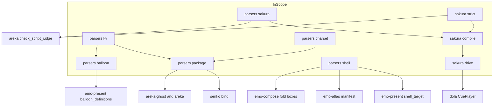
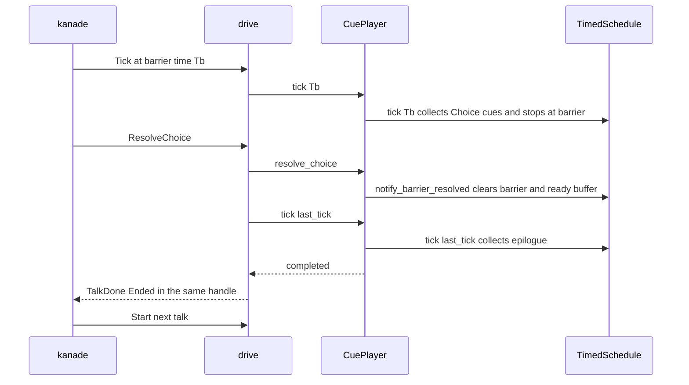
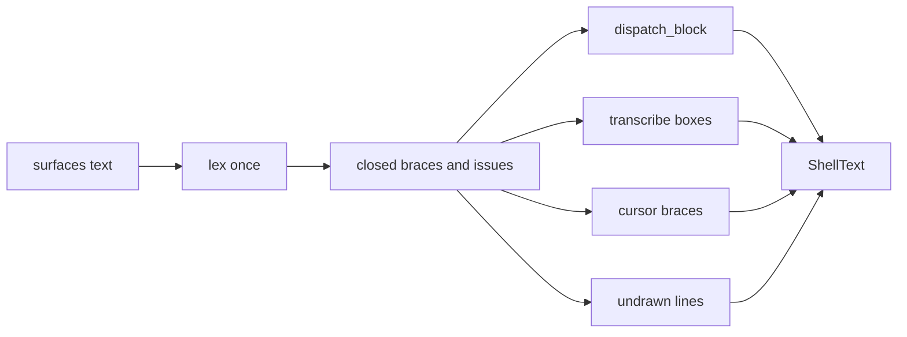

# 設計書: audit-parsers-sakura

> 2026-11-05・HEAD `d99ddfad`（コードは main `88eb0a43` と同じ）。指摘の番号は `research.md` 3 節の audit の通し番号。指摘ごとの直しの表は末尾の「指摘ごとの直し（一覧）」が正本で、本文は形の変わる所と決めた理由だけを書く。
> **設計の段で開発者に仰いで決めた 2 件**（2026-11-05 開発者「推奨案で承認」）: 指摘 6 の範囲の幅の上限は 8193（下の「開発者に仰いで決めた 2 件」の 1）・`areka-parsers` の dev-dependency に `log-capture-kit` を足す（同じく 2・要件 4.4 の承認された例外）。

## Overview

**Purpose**: `crates/areka-parsers/`・`crates/areka-sakura/` にかけた audit の指摘 93 件と申し送り 2 件（要件 7.11）を、指摘ごとに最も小さな完全な変更で直す。直した後にもう一度 audit をかけて新しい指摘 0 件、全体テストが緑、で終える。
**Users**: 開発者と、このコードの上で v0.2.0 の作り直しを始める 8 本の spec。
**Impact**: 外から見た振る舞いが変わるのは、要件 7 で確定した直しの分だけ（要件 2.8）。公開の形が変わるのは、`shell` の 1 回読みの口・`Surface.id` の削除・bindgroup の表・`resolve` の削除・`Instruction::Move` の削除・`#[non_exhaustive]` の削除・`ShellBoxes` の削除・`SakuraError` の削除。

### Goals
- 指摘 1〜93 のうち 59・60 を除く全件と、7.11 の 2 件を直す（要件 2.1・7.1）。
- バグと危ない所の直し 1 件ごとに、直しが壊れたら落ちる決定論のテストを置く（要件 3.1・3.2）。
- 範囲の外へ及ぶ直しを最後の段にまとめ、同じウェーブの相手と申し合わせた順で入れる（要件 4.2・7.10）。

### Non-Goals
- 指摘 59・60 の直し（要件 7.2）。
- ウェイトの `最小-最大` からランダムに選ぶ振る舞い（新しい機能＝要件 7.7 で起票だけ）。
- 範囲の外のファイルの指摘の直し（要件 4.3）。clippy の機械的な直し（要件 4.7）。
- 合図の終わりの時刻（dola が `start + duration` を f64 で足す）を ms の格子へ載せること（dola の持ち物・下の「残る危うさ」）。

## Boundary Commitments

### This Spec Owns
- `crates/areka-parsers/` と `crates/areka-sakura/` の全部の本番・テスト・`Cargo.toml`。
- 新しく置く公開の口: `kv::parse_kv_lowercased`・`package::shiori_dir`・`package::ScopeBinds`（と表の形の `BindGroupDefaults`）・`balloon::BalloonModel::key_issues`・`shell::parse_all`／`ShellText`／`ShellIssue`・`strict::read_note_point`／`command_point`・`compile::choice_timeout_of`。
- 消す公開の口: `package::resolve`・`package::BindScope` ほか 8 つの引き口・`shell::ShellBoxes`・`shell::Surface.id`・`sakura::Instruction::Move`／`MoveArgs`・`areka_sakura::error`（`SakuraError`）・`contract` の 8 つの再輸出・`strict_tap` と `compile_strict` の公開。
- 上の形の変化で壊れる範囲の外の呼び出し元とテストの直し（要件 4.1）。その範囲の外のファイルの指摘は直さない。

### Out of Boundary
- 範囲の外のファイルの見直し。`areka-emo-present`（`audit-emo-present`）・`areka-emo-compose`（`audit-emo-compose`）・`areka-seriko`（`audit-seriko`）・`areka-ghost`／`areka-nar`（`audit-ghost-catalog`）のファイルへは、形の変化に追随する行と、申し合わせで本 spec が引き受けた行（要件 7.10）だけを触る。
- `crates/areka-ghost/src/catalog.rs` を `parse_kv_lowercased` へ乗り換えること・`config.rs` が使うこと（`audit-ghost-catalog`）。
- `fold` の中の範囲の扱い（追記と除外を広げない直し＝`audit-emo-compose`）。
- `vendors/`・新しい依存（承認された例外の dev-dependency `log-capture-kit` 1 つのほか）・`areka-emo-text` への新しいファイル・`doc/` を名指す今の 3 行（`strict.rs:5`・`:15`・`sysvar.rs:44`）。
- `doc/` の中身は、網羅台帳 `doc/ukadoc-coverage/ledger/assets.toml` の 2 行（要件 7.9）のほかは触らない。

### Allowed Dependencies
- 依存の向き: `areka-parsers`（`encoding_rs`・`tracing`）← `areka-sakura`（`areka-parsers`・`areka-talk`・`areka-actor`・`dola`・`tracing`・`unicode-segmentation`）← 呼び出し元 8 クレート。上向きの依存を足さない。
- `areka-sakura` の `thiserror` を外す（要件 7.5）。`Cargo.lock` で変わるのは `areka-sakura` の塊の 1 行だけ（`thiserror` はほかの 20 クレートが使い続ける）。
- テストの道具は今ある dev-dependency（`areka-sakura` の `log-capture-kit`、`areka-parsers` の `temp-path-kit`・`sample-ghost-kit`）と、`areka-parsers` に足すワークスペースの `log-capture-kit`（dev-dependency だけ・2026-11-05 開発者承認・要件 4.4 と同じウェーブの約束 ⑶ の承認された例外）。`Cargo.lock` で変わるのは `areka-parsers` の塊の 1 行だけ。足すタスクの中で `tech.md` に登記する（brief「依存を足すなら tech.md へ登記して承認を得る」）。
- `dola` は呼ぶだけ。直すのは指摘 7 の 1 行だけ（下の「指摘 7」）。

### Revalidation Triggers
- `shell::Surface` の欄・`shell::parse_boxes` の戻り値・`package::BindGroupDefaults` の形・`package::resolve` の削除・`sakura::Instruction` の腕の増減（`#[non_exhaustive]` が無くなるので、腕を足すと範囲の外の `match` がコンパイルで止まる）。
- `shell::parse_all` の `ShellIssue` の腕の増減（記録の出し手は `areka-emo-present` の `shell_target.rs`）。
- 合図の開始時刻の f64 のビット（指摘 8）。時刻を比べるテストは範囲の外でも作り直しの対象になりうる。
- `MountModel.shiori.dir` の綴り（指摘 10）。`AskerId` の字がこの綴りから作られる。

## Architecture

### Existing Architecture Analysis
- `areka-parsers` は I/O を持たない転記の層で、例外は `package`（ゴーストのフォルダを読む）だけ。読めない入力で失敗を返さず、寛容に読む。
- `shell` は字句（`lexer`）→ 振り分け（`decode`）の 2 段。今は `parse`・`parse_boxes`・`parse_undrawn_elements`・`parse_cursor_braces` が同じ文を別々に字句に分ける。
- `areka-sakura` は parse 済みの命令列を dola の `CueSheet` へ組み（`compile`）、1 トーク 1 アクターで再生する（`drive`）。dola の `TimedSchedule` は同じ時刻の 2 回目の `tick` を、前の集めが残っていれば通さない（冪等の守り `schedule.rs:195-198`）。
- 守る型: 寛容な読み（失敗を返さず記録を残す）・`\!` は汎用キャリア 1 本・時刻は正確に・1 フレーム遅らせない・記録の無い失敗の道を作らない。

### Architecture Pattern & Boundary Map



**Architecture Integration**:
- Selected pattern: 今のファイルを直す（research.md 7 節の案 C）。写しを 1 つにする所（13・35・43）だけ、範囲の中に関数を 1 つ置く。
- 記録の出し方を 1 つにそろえる: **読み取りの層は「何を飛ばしたか」をデータで返し、記録は読み込む側が出す**。`balloon` の `KeyIssue`（今の形）を全部の数の鍵へ広げ、`shell` は同じ考えで `ShellIssue` を返す。理由は、`crates/areka/src/placement/measure.rs` の静かな読み込みが同じシェルを何度も読み、parsers の中で記録すると同じ行が重なるから。`package`・`charset` は今どおり parsers の中で `warn!` する（呼び手に記録の場所が無い・読むのは 1 回）。
- New components rationale: `ShellText`／`ShellIssue`（1 回の字句分けで 4 つの結果と崩れを返す＝35・33・34・36・5・6）・`ScopeBinds`（3 重の欄を 1 つの表へ＝15）・`strict` の 2 関数（判定の写しを 1 つへ＝43）。ほかは足さない。
- Steering compliance: 依存を足さない・1,000 行の番人・ログの無い失敗の道を作らない・`thiserror` の規約（`tech.md`）からは、`Err` を返さない 1 行の記録の型を外すだけで、返す失敗の型には触れない。

### Technology Stack

| Layer | Choice / Version | Role in Feature | Notes |
|-------|------------------|-----------------|-------|
| 読み取り | Rust 2024・`encoding_rs` 0.8・`tracing` | 文字コード・設定ファイル・さくらスクリプトの転記 | 変えない |
| 台本の組み立てと再生 | `dola`（ワークスペース）・`areka-talk`・`areka-actor` | 合図の表と 1 トークの再生 | `dola` は 1 行だけ直す（指摘 7） |
| テストの道具 | `log-capture-kit`（`areka-sakura`・`areka-parsers` の dev-dep）・`temp-path-kit`・`sample-ghost-kit` | ログの捕捉・一時の根・検体 | `areka-parsers` へは新しく足す（承認された例外・`tech.md` に登記） |
| 外す依存 | `thiserror`（`areka-sakura` だけ） | — | 要件 7.5 |

## File Structure Plan

### Directory Structure（範囲の中・新しいファイルは 1 つだけ）
```
crates/areka-parsers/src/
├── kv/parse.rs              # parse_kv_with_line（package から移す）・parse_kv をその上に・parse_kv_lowercased を新設
├── kv/validation_tests.rs   # 消す（53）
├── charset/prescan.rs       # 窓をやめ、ファイル全体を行で見る（7.11(b)・58）
├── balloon/                 # model.rs に key_issues・parse.rs の get_scalar が鍵の崩れを集める（18）
├── package/
│   ├── model.rs             # BindScope と 8 つの引き口を消す（12）・ScopeBinds と表の BindGroupDefaults（15）
│   ├── model_tests.rs       # 消す（16）
│   ├── resolve.rs           # 消す（46）
│   ├── resolve_shell.rs     # shiori_dir・folder_name の確かめ・parse_kv_lowercased（1・2・10・11）
│   └── resolve_bind.rs      # warn! と数の確かめ（9・14・47〜49）・parse_kv_with_line を kv へ（13）
├── sakura/
│   ├── lexer.rs             # 途中の引用符・旧形の題・q＋数字・引数を取らないタグ・ShorthandWord（24〜27・64・66）
│   ├── decode.rs            # 非有限の \n・Move の腕と decode_bang を消す・包みを畳む（3・28・65）
│   ├── model.rs             # Move／MoveArgs と #[non_exhaustive] を消す（28・30）
│   └── model_tests.rs       # 消す（32）
└── shell/
    ├── lexer.rs             # Token を閉じたブレスの列へ（35・68・33・34・71）
    ├── parse.rs             # parse_all と ShellText／ShellIssue（35）
    ├── decode.rs            # descript ブレスの並びの鍵・ウェイトの範囲・幅の上限・読めない数を飛ばす（4・5・6・36）
    ├── boxes.rs             # ShellBoxes を消す（76）
    ├── model.rs             # Surface.id と representative_id を消す（38）
    ├── model_tests.rs       # 消す（37）
    └── decode_tests_pattern_target_tests.rs → decode_pattern_target_tests.rs（75・改名）
crates/areka-sakura/src/
├── error.rs                 # 消す（41）
├── duration.rs              # text_playback_ms・ms_to_secs（8・形は変えない）
├── compile.rs               # 整数 ms の積み・Raw の腕を warn!・emit を 1 つ・choice_timeout_of（8・29・30・43・87・88・91〜93）
├── strict.rs                # read_note_point・command_point（43）
├── drive.rs                 # 解決の後の tick・send_done を 1 つ・stop を消す（7・39・77〜80）
├── drive_test_support.rs    # 共有の道具（85・90）
└── sysvar.rs                # 記録に台本を書かない（82・83）
```
- 新しいファイルは無い。`crates/areka-parsers/Cargo.toml` の `[dev-dependencies]` に `log-capture-kit = { path = "../log-capture-kit" }` を足し（理由の注釈はほかの行と同じ形）、`.kiro/steering/tech.md` に登記する。

### Modified Files（範囲の外・最後の段＝要件 7.10）
- `crates/areka-emo-present/src/shell_target.rs`（951 行）— `parse_all` へ乗り換え（相手の指摘 40 を引き受け）・`ShellIssue` を記録・`ShellBoxes` を `&[BoxDefinition]` へ。1,000 行を越えるなら記録の輪を新しいファイルへ置く（要件 5.1）。
- `crates/areka-emo-present/src/balloon_definitions.rs` — `key_issues()` を今の `warn!` の輪へ足す（18）。
- `crates/areka-emo-atlas/src/manifest.rs` — `Surface.id` の代わりにブレスの全部の番号を使う（38）。
- `crates/areka-emo-compose/src/boxes.rs` ほか・`areka-emo-present`・`areka-emo-text`（テストだけ）・`areka-seriko`・`crates/areka/` のテスト — `Surface { id }` の字面と `.id` の読み（38）・`ShellBoxes`（76）。
- `crates/areka-seriko/src/bind.rs` — `from_groups` の 3 枝を表から引く 1 本へ（15）。`crates/areka-ghost/src/runtime_shell_tests.rs`・`crates/areka/src/offline_dump/mod.rs` — 表の引き方（15）。
- `crates/areka-ghost/` の `resolve` の呼び手 9 ファイル・`crates/areka/src/placement/persist.rs` — `resolve_with_shell(.., None)`／`read_ghost_names`＋`shiori_dir`（46）。`crates/areka-ghost/tests/ghost/sylphya_integration_test.rs:286`・`:419` — `AskerId` の組み立て（10）。
- `crates/areka-nar/src/manifest_tests.rs:302-329` — 宣言に届くようになった振る舞いへ（7.11(b)）。
- `crates/areka/src/mcp/check_script_judge.rs` — `Move` の腕を消す・全部の腕・`strict` の 2 関数（28・30・43）。これは同じウェーブの持ち物でないので、該当のタスクの中で直す。
- `crates/dola/src/cue/schedule.rs` — `notify_barrier_resolved` で集めを空にする 1 行（7）。
- `crates/areka/src/emo2_boot/spine_conformance_script.rs:377-378` — 行の番号を名で（86）。
- `doc/ukadoc-coverage/ledger/assets.toml:6098`・`:7005` — 事実に合わせる（4・要件 7.9）。

## System Flows

### 指摘 7: 選択の解決と初回起動の後始末


- drive は解決が通ったら、同じ `handle` の中で最後に受けた時刻 `last_tick` のまま `player.tick` を 1 回呼び、完了を見る（時刻をずらさない・次の Tick を待たない）。
- `last_tick > Tb`（本番の流れ＝選ぶまでに Tick が来る）は drive の 1 行だけで直る。`last_tick == Tb`（解決が次の Tick より先に来る）は、dola の冪等の守りが古い集めを見て通さないので、`notify_barrier_resolved` で集めを空にする 1 行が要る。古い集めは区切りの Tick で既に配られていて、`CuePlayer` の `remaining` が二重の配りを止めるので、空にしても何も失わない。dola のテストで解決と次の `tick` の間に `ready()` を読むものは 0（`crates/dola/tests/cue/schedule_test.rs` の 8 か所を確かめた）。

### 指摘 35: シェルを 1 回だけ読む


- 今の 4 つの公開の関数（`parse`・`parse_boxes`・`parse_undrawn_elements`・`parse_cursor_braces`）は `parse_all` の 1 行の射影として残す（テストの呼び手 約 40 を変えない）。`decode(lex(..))` の形のテストも、`decode` を射影として残して変えない。

## Requirements Traceability

| Requirement | Summary | Components | Interfaces | Flows |
|-------------|---------|------------|------------|-------|
| 1.1, 1.2, 1.3, 1.4 | 範囲だけに audit・全部読む・全件・番号と組 | ギャップ分析（research.md 2・3 節・済み） | — | — |
| 1.5 | 直す対象を番号で確定 | 要件 7（済み）・本書の一覧 | — | — |
| 1.6 | 2 本目に切るか | 切らない（済み）・タスク 27 本 | — | — |
| 2.1 | 3 つの組とも直す | 一覧の全行 | — | — |
| 2.2, 2.3 | 残すのは裁定したものだけ | 59・60 を残す（7.2）。本書が新たに裁定を要すると見た 3 点は「裁定に触れる決め」に挙げる | — | — |
| 2.4 | 正典は ukadoc で確かめる | research.md 4 節・12 節（7.11(b)・6） | — | — |
| 2.5 | 範囲の外として落とさない | 一覧の全行（落としたものは 0） | — | — |
| 2.6, 2.7 | 最小の完全な変更・消す前にツリー全体で確かめる | 一覧の「触る所」・各タスクの消す前の grep | — | — |
| 2.8 | 振る舞いの変化は確定分だけ | 一覧の「振る舞い」の印 | — | — |
| 3.1 | 1 件 1 本の落ちるテスト | 一覧の「テスト」列 | log-capture-kit | — |
| 3.2 | 決定論 | 同期の driver・時限つきの受け取り・pure の関数 | — | — |
| 3.3 | 前提が変わるテストは直し、確かめを減らさない | 31・44 などの「残す側」の表（research.md 12 節） | — | — |
| 4.1 | 形を変えたら呼び出し元を全部直す | 最後の段のタスク 20〜24 | — | — |
| 4.2 | 同じウェーブの相手と申し合わせ | 最後の段・7.10 の 4 本 | — | — |
| 4.3 | 範囲の外は要る変更だけ | Out of Boundary | — | — |
| 4.4 | 依存を足さない・emo-text にファイルを足さない | Allowed Dependencies（外す `thiserror`・承認された例外の dev-dependency `log-capture-kit` 1 つ・emo-text へのファイルは 0） | — | — |
| 4.5, 4.6 | doc/ を名指す 3 行を変えない | 3 行は触らない（どの直しも要らない） | — | — |
| 4.7 | vendors・新しい機能・clippy | Non-Goals | — | — |
| 5.1 | 1,000 行 | File Structure Plan・Implementation Notes | — | — |
| 5.2 | 記録してから失敗 | Error Handling | — | — |
| 5.3 | 終了の道は正規 | 7（解決の後に完了を見る）・77・78 | drive | 指摘 7 |
| 5.4, 5.5 | 一時の根は target の下・GPU は実 GPU | `temp-path-kit` だけを使う・GPU のテストは足さない | — | — |
| 5.6 | 文字化けは読む側を直す | 7.11(b)・55 | charset | — |
| 6.1, 6.2, 6.3 | かけ直しで 0 件 | タスク 26 | — | — |
| 6.4 | 全体テストが緑 | タスク 27 | — | — |
| 7.1 | 59・60 のほかを 1 本で直す | 一覧 | — | — |
| 7.2 | 59・60 を残し理由を記録 | タスク 26 の検証の記録 | — | — |
| 7.3 | 17・25・28・30・36・38・61 を直す | 一覧 | — | — |
| 7.4, 7.5 | 12・22・41・79 を消す・thiserror を外す | 一覧・Allowed Dependencies | — | — |
| 7.6 | 正典に触れる直しの形 | 一覧の 4・5・6・10・18・24・33・34・47・55・71 | ShellIssue | 指摘 35 |
| 7.7 | ランダムなウェイトを起票 | タスク 25 | — | — |
| 7.8 | 26・27 を SSP で測る | research.md 11 節（済み）・一覧の 26・27 | — | — |
| 7.9 | 台帳の 2 行・86 の行の番号 | タスク 24 | — | — |
| 7.10 | 範囲の外の相手の持ち物は最後の段 | タスク 20〜24 | — | — |
| 7.11 | 申し送り 2 件 | 一覧の 7.11(a)・7.11(b) | — | — |

## Components and Interfaces

| Component | Domain | Intent | Req | Key Dependencies | Contracts |
|-----------|--------|--------|-----|------------------|-----------|
| kv の行つき分割と小文字の表 | parsers kv | 鍵の分割の写しを 1 つに・鍵の大文字小文字をそろえる | 2.6, 7.10 | — | Service |
| package の置き場の解決 | parsers package | シェル名の確かめ・SHIORI の置き場の綴り | 2.1, 7.6 | kv (P0) | Service |
| bindgroup の表 | parsers package | スコープ番号を鍵にした 1 つの表 | 2.6, 7.10 | seriko (P1) | State |
| balloon の鍵の崩れ | parsers balloon | 読めない数の鍵をデータで返す | 2.1, 7.6, 7.10 | emo-present (P1) | State |
| shell の 1 回読み | parsers shell | 1 回の字句分けで 4 つの結果と崩れを返す | 2.6, 7.6, 7.10 | emo-present (P0) | Service |
| strict の判定 | sakura strict | 印と choicetimeout の判定を 1 か所に | 2.6 | check_script_judge (P1) | Service |
| compile の時刻 | sakura compile | 開始時刻を整数 ms で積む | 2.1, 3.1 | duration (P0) | Service |
| drive の解決 | sakura drive | 解決の後に来ている項目を出して完了を見る | 2.1, 5.3 | dola (P0) | State |

### parsers kv

| Field | Detail |
|-------|--------|
| Intent | `キー,値` の分割を 1 つにし、ゴーストの descript を読む 2 か所の食い違いを無くす |
| Requirements | 2.6, 7.10 |

```rust
// kv/parse.rs
pub(crate) fn parse_kv_with_line(text: &str) -> BTreeMap<String, (String, usize)>; // 今の resolve_bind の版を移す・中身は変えない
pub fn parse_kv(text: &str) -> BTreeMap<String, String>;                            // 上の 1 行の射影（振る舞いは同じ）
pub fn parse_kv_lowercased(text: &str) -> BTreeMap<String, String>;                 // 空の値を落とし、鍵を ASCII で小文字に。同じ鍵は後の行が勝つ
```
- `parse_kv_lowercased` は `parse_kv_with_line` の上で行の順に並べてから畳む（大文字と小文字の綴りが混ざって 2 回出たとき、後の行が勝つ）。`catalog.rs` の今の版（`fn lowercased(bytes)`）は表の順で勝ち負けが決まるので、この 1 点だけ違う。乗り換える `audit-ghost-catalog` へ伝言で伝える。
- テスト: `kv/parse_tests.rs` の `lowercased_folds_keys_and_drops_empty`（`"Name,a\nTYPE,\n"` → `{name: a}`・`"name,a\nName,b"` → `b`）・`empty_key_lines_are_skipped`（19）。

### parsers package

```rust
pub fn shiori_dir(ghost_root: &Path) -> PathBuf;   // ghost_root.join("ghost").join("master")
fn folder_name(value: &str) -> Option<&OsStr>;     // 成分がちょうど 1 つの Component::Normal のときだけ
pub type BindGroupDefaults = BTreeMap<u32, ScopeBinds>; // 鍵＝スコープ番号（0＝sakura・1＝kero・2 以上＝char）
#[derive(Clone, Debug, PartialEq, Eq, Default)]
pub struct ScopeBinds {                             // #[non_exhaustive] を付けない（seriko のテストが組む）
    pub default_on: Vec<u32>,
    pub names: Vec<BindGroupName>,
    pub mustselect: Vec<String>,
    pub multiple: Vec<String>,
}
```
- `seriko.defaultsurfacedirectoryname` の値は `folder_name` が `Some` のときだけ使う。空の値は 11 で「無し」になり、黙って `master`。空でなく確かめに通らない値（`..\x`・絶対パス・`.`・`a\b`）は `warn!`（値とゴーストの根）を残して `master`。`master` が無ければ今と同じ `ShellDirMissing`。呼び手が名を渡す道（`Some(name)`）と `crates/areka/src/boot_resolve.rs:414-422` は契約が違う（名は呼び手が選び、`descript.txt` の在りも見る）ので寄せない。
- `BindGroupName` も `#[non_exhaustive]` を外して `package` から出す（seriko のテストが組めるように）。
- 表の名前 `BindGroupDefaults` を残すので、`BindGroupDefaults::default()` を使う所は変わらない。

### parsers balloon

- `BalloonModel` に `key_issues: Vec<KeyIssue>` を足し、`pub fn key_issues(&self) -> &[KeyIssue]` と `pub(crate) fn with_key_issues` を置く。`get_scalar` は鍵が在って読めないとき（空の値を含む＝矢印の鍵と同じ）に 1 件積む。`windowposition.x` は `center` などの語を正しく持つので積まない（理由を 1 行の注釈に）。`ArrowKeys.issues` はそのまま。
- 読み込む側（`balloon_definitions.rs`）は今の矢印の `warn!` の輪へ `key_issues()` を足すだけ。文の頭 `balloon_definitions:` と欄は変えない（今のテスト `balloon_definitions_tests.rs:187-216` が緑のまま）。

### parsers shell

```rust
pub fn parse_all(input: &str) -> ShellText;
#[derive(Clone, Debug, PartialEq)]
pub struct ShellText {
    pub shell: Shell,
    pub boxes: Vec<BoxDefinition>,
    pub undrawn: Vec<UndrawnElementLine>,
    pub cursor_braces: Vec<CursorBrace>,
    pub issues: Vec<ShellIssue>,
}
#[derive(Clone, Debug, PartialEq)]          // #[non_exhaustive] を付けない（30 と同じ理由）
pub enum ShellIssue {
    UnclosedAtEnd { heading: String, line: usize },     // 34: 終わりで閉じていないブレス（中身は今どおり落とす）
    ClosedByNextBrace { heading: String, line: usize }, // 33: `}` が抜け、次の `{` で区切り直した
    UnreadableNumber { heading: String, text: String }, // 36: 読めない数の記述子・項目を飛ばした
    RangeTooWide { heading: String, text: String },     // 6: 幅が上限を越えた範囲を飛ばした（記録は error!）
    WaitRange { heading: String, text: String },        // 5: `最小-最大` の最小を待ちにした（ランダムは未対応）
}
```
- 字句の段の `Token`（`pub(crate)`）は `Brace { header, body, line }`・`TopLevel(fields)`・`Unclosed { heading, line }`・`Reopened { heading, line }` の 4 つにする。`BlockStart`・`Line`・`BlockEnd`・`Raw` と `raw_lines_from` を消す（68）。decode の決して走らない 3 枝（`decode.rs:70-74`・`:79-81`・`:99-103`）は形の上で無くなる。
- 見出しの決め（33・71 を 1 つの規則で）: `{` だけの行が来たら、前のブレスの区切りから後で、最初の欄が areka の読むブレスの名（`descript`・`surface` で始まる・`.surface.alias` で終わる・`balloon.` で始まる・`.cursor` で終わる）である最も近い行を見出しにする。そういう行が無ければ今どおり `{` の直前の有意な行。見出しと `{` の間の行は ukadoc の「ブレス名、{}、各設定として認識されない行はすべてコメント行」に従いコメントとして捨てる。開いた本体の中で `{` が来たら、同じ選び方で本体の行から見出しを選び、その前の行で前のブレスを閉じて（中身は残す）`Reopened` を出す。
- 範囲の幅の上限（6・設計の討議の議題 1 で改め）: **シェル全体の範囲の幅の合計**を数え、`parse_target_element` で `Range{start,end}` の `end - start + 1` を足すと合計が上限を越える記述子は飛ばして `RangeTooWide` を積む（1 つの範囲・1 つの見出しの中の繰り返し・見出しの重ね、のどれでも膨らませられない）。見出しのほかの記述子とシェルのほかの部分は読む。記述子が 1 つも残らないブレスは積まない（36 と同じ）。除外の範囲（`!a-b`）は広げないので上限をかけない。`boxes.rs` も同じ `parse_targets` を通るので同じ上限がかかる（記録は画像の側で 1 回だけ）。**上限は幅 8193**（`const RANGE_WIDTH_CAP: u64 = 8193`）＝ukadoc が MATERIA だけの制限として載せる数を借りた（一般の決まりは「割り振りは基本的に自由」で、SSP 向けの実在のシェルは 8193 以上の番号も使う＝番号の値は縛らない）。ukadoc「なお、MATERIAではsurfaceIDにつかえる数字は0から8192までという制限がある。」（https://ukatech.shillest.net/ukadoc-spec/descript/shell-surfaces/#caption_standarddef） の番号の数（0〜8192）。上限は幅だけにかけ、番号の値にはかけない（`surface10000` も `surface10000-18192` も読む）。越えた記述子は `error!` で記述子の字を名指して飛ばし（記録は `shell_target.rs`）、シェルは全体として読む。幅は `u64` で数える（`0-4294967295` の幅 2^32 が `u32` に入らないため）。
- 読めない数（36）: 要素の層・当たりの番号・アニメの番号・パターンの番号・対象の記述子・別名の項目は、読めなければ 0 にせず飛ばして `UnreadableNumber` を積む。範囲の両端は trim する。座標（`field_i64`）とウェイトは今どおり 0。見出しがちょうど `surface.alias` のブレスは、`sakura.surface.alias` と同じく読まない（今は空の surface 0 を作っている）。
- ウェイト（5）: 欄を trim し、`-` を含めば最初の `-` で分けて両側を trim、両方が `u32` なら小さい方を待ちにして `WaitRange` を積む。それ以外は今どおり `parse::<u32>().unwrap_or(0)`。

### sakura strict と compile

```rust
// compile.rs（parse_choice_timeout の隣）
pub fn choice_timeout_of(name: &str, raw_args: &[String]) -> Option<ChoiceTimeoutDirective>; // set,choicetimeout のときだけ 1 回読む
// strict.rs
pub fn read_note_point(note: &ReadNote) -> DetectionPoint;                                      // 30 の後は全部の腕
pub fn command_point(handled: bool, choice_timeout: Option<ChoiceTimeoutDirective>) -> Option<DetectionPoint>;
// duration.rs
pub(crate) fn text_playback_ms(text: &str) -> u64;  // cluster_count × CHAR_NOMINAL_MS
pub(crate) fn ms_to_secs(ms: u64) -> f64;           // ms as f64 / 1000.0（dispatcher の Tick と同じ式）
pub fn text_playback_duration(text: &str) -> f64;   // 形も値も変えない（中で上の 2 つを使う）
```
- 開始時刻の積み（8）: `offset_ms: u64` に `saturating_add` で積み、各命令の頭で 1 回だけ `ms_to_secs` で秒にする。`Duration::as_secs_f64` は Tick の式 `(now-base) as f64 / 1000.0` と 1118 ms などで 1 ulp 食い違うので使わない（research.md 12 節で測った）。積む値はどれも整数 ms（`\wN`・`\_w[ms]` は `Duration::from_millis`・字は 50 ms/クラスタ）なので失うものは無い。注釈 `shortcut: 待ちは整数 ms（parser が from_millis で作る）、1 ms 未満の Duration は切り捨て、そういう待ちを足すときに見直す` を置く。

### sakura drive

- 解決（7）: `ResolveChoice` の `Some` の腕で `player.tick(last_tick)` を呼んでから `settle_after_tick` へ。`TalkDone{Ended}` は同じ `handle` の中で出る。
- `send_done(&self, talk_id, reason, quit_reserved)` 1 本にする（77）。落とす直前の `stop()` と `mut` を消す（78）。`choice_notified` を戻す継ぎ目を消す（79・compile は 1 トークに区切りを高々 1 つしか出さない＝`compile.rs:451`・`:458-465`）。

## Data Models

- 変わる型: `shell::Surface`（`id` を消す）・`shell::ShellBoxes`（消す）・`package::BindGroupDefaults`（表へ）・`package::BindGroupName`（`#[non_exhaustive]` を外す）・`balloon::BalloonModel`（`key_issues` を足す）・`sakura::Instruction`／`ReadNote`／`CharCodeDrop`（`#[non_exhaustive]` を外す・`Move` を消す）。
- 不変: 読み取りは失敗を返さない（`package` の `MountError` は今のまま）。`ShellIssue` は読み込みの結果の一部で、記録の出し手は読み込む側。

## Error Handling

### Error Strategy
- parsers の中で記録するもの（`warn!`）: charset の解けないラベルと壊れた並び（17・55）・シェル名の確かめに通らない値（1）・シェルの descript が NotFound 以外で読めない（9）・崩れた bindoption と `.default`（14）・数の形の違う bindgroup の番号（47）・空のカテゴリ（48）・パーツ名の無い `.name` に鍵と行の番号（49）。
- データで返し、読み込む側が記録するもの: `KeyIssue`（18・`warn!`）・`ShellIssue`（`RangeTooWide` は `error!`、ほかは `warn!`・`shell_target.rs` で `records.emits()` のときだけ）。
- areka-sakura: 合わない `ResolveChoice` を `warn!`（39）・知らないタグの Raw を `warn!(event = "raw_ignored", head = 先頭 64 字, bytes)`（29）・非有限の Tick を `error!(tick = t, ..)`（41・`SakuraError` を通さない）・sysvar のフォールバックは台本を書かず `vars`（置き換えた名）と `script_bytes`（82）。

### Monitoring
- 新しい記録の `event` 欄はほかの腕と同じく snake の固定の名。29 の `warn!` は知らないタグを使う実物のゴーストで出るようになる（意図どおり）。

## Testing Strategy

- **pure のテスト（parsers）**: 3・24〜27・64（字句と転記の入出力）、4・5・6・33・34・36・71（`parse_all` の結果と `issues`）、1・2・10・11・46〜48（一時の根は `temp-path-kit`＝ワークツリーの `target` の下）、18・19・20・21・54・55・7.11(b)。
- **ログのテスト**: areka-sakura は `log_capture_kit::capture` で 29・39・41・82・7.11(a) を確かめる（同期の driver を使い、スレッドの競りを持ち込まない）。areka-parsers の 9・14・17・49 も、足す dev-dependency の `log_capture_kit::capture` で同じ形に確かめる（一時の根は `temp-path-kit`）。
- **drive の段のテスト（同期の driver）**: 7＝`drive_choice_tests.rs` の `resolved_choice_flushes_due_epilogue_before_following_close`。区切りの Tick の後に Tick を 1 つ挟む形（A）と、挟まない形（B・dola の 1 行で緑）の 2 つ。どちらも `ResolveChoice` が `Break` を返し、最後の合図が `areka.prop.set` のキャリア、`TalkDone` が `Ended` で 1 回。
- **時刻の格子のテスト**: 8＝`compile_sheet_tests.rs` の `start_times_sit_on_the_millisecond_grid`（`a\s[0]b\s[0]c\s[1]` の開始時刻がビットで `[0.05, 0.1, 0.15]`、`\s[1]` が `150 as f64 / 1000.0`）。期待値が変わる今のテストは `compile_sheet_tests.rs:74-78`（`wait_accumulation_is_monotonic`・0.15000000000000002 → 0.15）と `drive_delivery_tests.rs:204-208`（`undue_cues_are_withheld_until_their_at_is_reached`・0.7499999999999999 → 0.75）の 2 本だけ。
- **範囲の外の追随**: 形の変化（38・76・15・46・10）で壊れるテストは字面と引き方だけを直し、確かめの中身を変えない（要件 3.3）。
- **完了**: タスク 26（かけ直しで 0 件を明示）・タスク 27（`pwsh -NoProfile -File tools/test-all.ps1`）。

## 開発者に仰いで決めた 2 件（2026-11-05 開発者「推奨案で承認」）

1. **指摘 6 の範囲の幅の上限＝8193**。要件 7.6 の「元からある頭打ちだけから決める」に当てて、ukadoc が MATERIA だけの制限として載せる数（一般の決まりは「割り振りは基本的に自由」・番号の値は縛らない）を借りる。ukadoc「なお、MATERIAではsurfaceIDにつかえる数字は0から8192までという制限がある。」（https://ukatech.shillest.net/ukadoc-spec/descript/shell-surfaces/#caption_standarddef） を使う（調べたほかの候補＝番号の型 `u32`・GPU の面の最大寸・`AnimationLimits` が使えない理由は research.md 12.3）。上限は 1 つの範囲の幅（`end - start + 1`）だけにかけ、番号の値にはかけない。越えた記述子は飛ばして `RangeTooWide` を積み、`shell_target.rs` が記述子を名指して `error!` を出す。シェルは全体として読む。`audit-emo-compose` が本 spec に任せた値（そちらの指摘 1⑶）もこれで決まる＝伝言で伝える。
2. **`areka-parsers` の dev-dependency に `log-capture-kit` を足す**（ワークスペースのクレート・テスト専用・要件 4.4 と同じウェーブの約束 ⑶ の承認された例外＝例外の記録は要件の側で進行役が書く）。`Cargo.lock` で変わるのは `areka-parsers` の塊の 1 行。最初に要るタスク（T2）で足し、`tech.md` に登記する。9・14・17・49 の落ちるテストは `areka-parsers` の中で `log_capture_kit::capture` を使う。

## 裁定に触れる決め（設計の討議へ）

- 27: 引数を取らないタグの一覧に `+`（`ghost-change-name-resolution` 要件 1.5）と `v`（`stay-on-top-directives`）が入り、完了 spec が固めた `\+[x]`→Raw・`\v[1]`→raise でない、が覆る。SSP で測った `\1`・`\e` と同じ規則を ukadoc が字の形だけを載せるタグへ当てた。`c` は `\c[char,…]` があるので一覧に入れない（research.md の一覧の誤り）。`w` は `\w[n]` を Raw に固めた今の決めのまま一覧に入れない。
- 65: 3 つの包みのうち `decode_passthrough_raw` だけを畳み、`decode_passthrough_tag`・`decode_passthrough_bare` は残して見出しの理由を書き直す。2 つの名は網羅台帳 `doc/ukadoc-coverage/ledger/sakura-script.toml` の 33 行と `doc/COMPAT_ARCHITECTURE.md:187` が名指しており、畳むと `doc/` の 34 行を直すことになる（要件 7.9 が許す `doc/` の直しは台帳の 2 行だけ）。
- 7: `dola` の 1 行（`notify_barrier_resolved` で集めを空にする）。範囲の外のクレートで、`audit-dola`（C18）は走っていない。入れないと、解決が次の Tick より先に来たときに 1 刻み遅れる（記憶「1 フレーム遅らせる解は取らない」）。
- 7.11(b): 宣言の位置を問わずファイル全体から `charset,` の行を探す。ukadoc の descript・install の `charset` の項には位置の決めが無く、`surfaces.txt` は「設定は、書くとすれば必ず一行目に書く必要があるcharset」、`surfacetable.txt` は「記載は必ずファイルの一行目に」とする（`surfaces.txt` へは寛容になる）。4,096 バイトの窓も外す。
- 50: 9 の直し（要件の討議の D7＝`warn!` だけ）では読み直しは減らない（research.md の「9 の直しで 1 つ減る」は誤り）。本 spec で減るのは 46 の `persist.rs` の 1 回だけで、`crates/areka/` の残りの読み直し（`placement/source.rs:153-157`・`emo2_boot/assets.rs:397`・`:406-411`・`offline_dump/mod.rs:130`・`:169`）は D7 の裁定どおり残す。

## 残る危うさ

- 8 の後も、トークの終わり（dola の `start + duration` の f64 の和）は ms の格子から 1 ulp 外れうる（150 ms＋800 ms → 0.9500000000000001）。`TalkDone` と後始末が 1 刻み遅れうる。直すには dola か合図の長さの持ち方に触れる＝本 spec の外。完了までに `/kiro-discovery` で起票する。
- 10 で `AskerId` の字（`MountModel.shiori.dir` の綴り）が変わる。`AskerId` はメモリの中だけで、永続の鍵ではない（`crates/areka-sylphya/src/` の永続の書式に `asker` は出ない）。
- `shell_target.rs` は 951 行で、乗り換えと記録で約 975 行になる。
- 29・17 の新しい `warn!` は、範囲の外の「警告 0 件」を数えるテストに当たりうる（検体は正しいので緑の見込み・全体テストで確かめる）。

## 指摘ごとの直し（一覧）

列: **直し**＝最小の完全な変更 ／ **外**＝範囲の外で触る所（【相手】は 7.10 の申し合わせの相手） ／ **テスト**＝壊れたら落ちるテスト（「—」は消すだけ・形だけ・説明だけで、要件 3.1 の対象でない）／ **T**＝タスクの番号（下の「タスクのまとまり」）。行の番号は 2026-11-05 の今のコードで確かめた（93 件とも出た。読みの違いは research.md 12 節）。

| # | 直し | 外 | テスト | T |
|---|---|---|---|---|
| 1 | `resolve_shell.rs:120-128`: 既定のシェル名を `folder_name` で確かめ、通らない空でない値は `warn!` で `master` | — | `resolve_shell_tests.rs` `default_dir_name_parent_escape_falls_back_to_master`・`..._absolute_falls_back_to_master` | 4 |
| 2 | 空の値は 11 で「無し」＝`master`、`.` は `folder_name` が断る | — | `default_dir_name_empty_or_dot_falls_back_to_master` | 4 |
| 3 | `decode.rs:454-466`: `Ok(p) if p.is_finite()` だけ受け、ほかは `ArgumentDefaulted` と 1.0 | — | `decode_tests.rs` `newline_non_finite_percent_falls_back_to_default`・`parse_noted_tests.rs:212` に 3 例 | 6 |
| 4 | `dispatch_block` の `descript` の腕で本体の各行に `decode_sort_key`（トップレベルの道は残す・後の行が勝つ） | 台帳 `assets.toml:6098`・`:7005` | `decode_tests_transcription_gap_tests.rs` `sort_keys_inside_descript_brace_are_transcribed` | 12・24 |
| 5 | `decode.rs:362`: ウェイトの範囲は小さい方を待ちにして `WaitRange`・モデルは変えない | 記録は `shell_target.rs`【emo-present】 | `decode_tests_animation_tests.rs` `pattern_wait_range_takes_minimum_and_is_reported` | 12・23 |
| 6 | `parse_target_element` でシェル全体の範囲の幅の合計が上限 8193 を越える `Range` の記述子を飛ばして `RangeTooWide`（番号の値にはかけない・設計の討議の議題 1） | 記録（`error!`）は `shell_target.rs`【emo-present】・fold は触らない【emo-compose】 | `decode_tests_append_tests.rs` `range_wider_than_cap_is_skipped_and_recorded`（`surface0-4294967295`・`surface.append5,0-4294967295` は飛ぶ）・`range_width_cap_boundary`（`surface0-8192` は読む・`surface0-8193` は飛ぶ・`surface10000` は読む）・`range_width_cap_is_shell_wide`（`surface0-8192,0-8192` の 2 つ目と、`surface0-8192` の後の `surface8193-8193` は飛ぶ） | 12・23 |
| 7 | drive の `Some` の腕で `player.tick(last_tick)`＋doc の直し | `dola/src/cue/schedule.rs` の 1 行 | `drive_choice_tests.rs` `resolved_choice_flushes_due_epilogue_before_following_close`（A・B） | 18・24 |
| 8 | `offset_ms: u64` の `saturating_add`・`ms_to_secs` で 1 回だけ秒へ・`text_playback_duration` の形は不変 | — | `compile_sheet_tests.rs` `start_times_sit_on_the_millisecond_grid`・期待値の直し 2 本 | 14 |
| 9 | `resolve_bind.rs:58-62`: NotFound 以外の読みの失敗を `warn!`（パスと誤り）・呼び手は変えない | — | `resolve_bind_tests.rs` `unreadable_shell_descript_warns_and_reads_no_binds`（`descript.txt` をフォルダにして読みを失敗させ、WARN 1 件と空の表） | 5 |
| 10 | `GHOST_MASTER` を消し `shiori_dir` を公開・`:41`・`:104` で使う | `areka-ghost/tests/ghost/sylphya_integration_test.rs:286`・`:419`【ghost-catalog】 | `resolve_shell_tests.rs` `shiori_dir_uses_native_separators`（`as_os_str` を比べる） | 22 |
| 11 | `parse_kv_lowercased` を kv へ・`resolve_shell.rs:68` で使う | `catalog.rs` の乗り換えは相手【ghost-catalog】 | `kv/parse_tests.rs` `lowercased_folds_keys_and_drops_empty`・`resolve_shell_tests.rs` `ghost_descript_keys_ignore_case`・`ghost_descript_empty_values_are_absent` | 1・4 |
| 12 | `model.rs:114-225`（`BindScope`・`pick`・8 つの引き口）とテスト `:281-501` を消す・`resolve_bind_tests.rs` の確かめは表の引き方へ | — | — | 21 |
| 13 | `parse_kv_with_line` を `kv/parse.rs` へ移し `parse_kv` をその射影に・テスト 3 本（`resolve_bind_tests.rs:585-606`）も移す | — | —（移したテストが守る） | 1 |
| 14 | `.default` の値が 0/1 でない・bindoption が読めないときに鍵・行・値つきで `warn!` | — | `resolve_bind_tests.rs` `misspelled_bindoption_warns`・`non_binary_default_warns`・`default_zero_does_not_warn` | 5 |
| 15 | 表 `BindGroupDefaults = BTreeMap<u32, ScopeBinds>`・`split_scope` は番号を返す・`scope_vec` を消す | `areka-seriko/src/bind.rs` の `from_groups` 2 つと `ScopeNames::read`【seriko】・`areka-ghost/src/runtime_shell_tests.rs:67`・`:71`【ghost-catalog】・`areka/src/offline_dump/mod.rs` | —（`resolve_bind_tests.rs:625-674`・`bind_tests.rs:464-520` が守る） | 21 |
| 16 | `package/model_tests.rs` と `mod.rs:20-21` を消す | — | — | 21 |
| 17 | `charset/decode.rs:35-38`・`:52-55` の `debug!` を `warn!` | — | `charset/decode_tests.rs` `unresolved_label_and_malformed_bytes_warn` | 2 |
| 18 | `get_scalar` が鍵の崩れを積む・`BalloonModel::key_issues` | `balloon_definitions.rs` の輪に 1 行【emo-present】 | `marker_tests.rs` `numeric_keys_report_unreadable_values` | 3・23 |
| 19 | テストを足すだけ | — | `kv/parse_tests.rs` `empty_key_lines_are_skipped` | 1 |
| 20 | `decode_tests.rs:40-48` を SJIS の `かくかく` を `Ansi` で読む形へ | — | 同じテストの書き直し | 2 |
| 21 | `marker.rs:96` に `.filter(|v| !v.is_empty())` | — | `marker_tests.rs` `arrow_filename_empty_is_absent` | 3 |
| 22 | `charset/model.rs:32-34` の 3 行と古い「タスク 2.3」の文（`model.rs:11-12`・`:30-31`・`prescan.rs:5-6`）を消す | — | — | 2 |
| 23 | `balloon/validation_tests.rs:178-208`・`balloon/model_tests.rs:240-253`・`charset/model_tests.rs:6-28`・`:49-64`・`charset/decode_tests.rs:10-23` を消す | — | — | 2・3 |
| 24 | `lexer.rs:364` の腕を `'"' if cur.is_empty() && !quote_consumed` に | — | `lexer_tests.rs` `mid_argument_quote_is_literal` | 6 |
| 25 | lexer に `legacy_q_title_end`: `\q…[ID]` の直後の `[…]` が閉じていれば題を 1 つの Text で出す | — | `validation_tests.rs` `legacy_q_title_followed_by_text_folds`・`parse_noted_tests.rs:107` に 1 例 | 7 |
| 26 | `lexer.rs:243-245` の旧形の印に 1 桁の数・`decode.rs:184` は `starts_with('q')` | — | `validation_tests.rs` `choice_legacy_q_serial_digit_kept_raw`（`\q10[a][b]` は今どおり） | 6 |
| 27 | `NO_ARG_TAGS`（`* - 0 1 4 5 6 7 C _! _+ _? _V __c __t _n _q a e h t u z`・`+` と `v` は入れない＝設計の討議の議題 2）の後の `[` は字のまま | — | `parse_word_boundary_tests.rs` `bracket_after_no_arg_tag_is_text`・前提の変わる 6 本の書き直し（research.md 12 節） | 7 |
| 28 | `Move`・`MoveArgs`・`decode_bang` を消し `"!"` を `decode_passthrough_bang` へ・compile の腕を消す | `areka/src/mcp/check_script_judge.rs:89-94` | `validation_tests.rs` `move_bang_is_generic_command` | 8 |
| 29 | `compile.rs:426` を `Instruction::Raw(raw) =>` の `warn!(event = "raw_ignored", head, bytes)` に | — | `compile_arm_tests.rs` `raw_is_dropped_with_one_warning` | 8 |
| 30 | `model.rs:23`・`:82`・`:180` の `#[non_exhaustive]` と `:12` の文を消す・`compile.rs:113` と `check_script_judge.rs:62` の `_` を消す・`check_script_judge.rs:129` を全部の腕に | `check_script_judge.rs`（`destination.rs`・`spine_conformance_script.rs`・`readme_cue_tests.rs`・`script_restriction_tests.rs` は変えない） | —（コンパイラが守る） | 8 |
| 31 | 写しのテストを消す（残す側は research.md 12 節の表） | — | — | 10 |
| 32 | `sakura/model_tests.rs` と `mod.rs:15-16` を消す | — | — | 10 |
| 33 | 見出しの決め・`Reopened` → `ClosedByNextBrace` | 記録は `shell_target.rs`【emo-present】 | `shell/lexer_tests.rs` `brace_line_inside_body_starts_new_brace` | 11・23 |
| 34 | `Unclosed` → `UnclosedAtEnd`（中身は今どおり落とす） | 記録は `shell_target.rs`【emo-present】 | `lexer_tests.rs:207` の書き直し・`parse_tests.rs` `parse_all_reports_unclosed_final_brace` | 11・23 |
| 35 | `parse_all`・`Token` を閉じたブレスの列へ・4 つの輪を 1 つに | `shell_target.rs:390-392`・`:440` を `parse_all` へ【emo-present・相手の 40】 | —（今の boxes・cursor・undrawn・parse のテストが射影を守る） | 11・23 |
| 36 | 読めない数は飛ばして `UnreadableNumber`・範囲の端を trim・`surface.alias` の見出しは読まない | 記録は `shell_target.rs`【emo-present】・fold【emo-compose】と seriko の別名の引き【seriko】は変えない（期待値が変われば最後の段で直す） | `decode_tests_lenient_input_tests.rs` `unreadable_numbers_are_skipped_not_zero`・`decode_tests_skeleton_tests.rs:79-86` の書き直し | 12・23 |
| 37 | `shell/model_tests.rs` と `mod.rs:19-20` を消す | — | — | 13 |
| 38 | `Surface.id`・`representative_id` を消す | `areka-emo-atlas/src/manifest.rs:56`・`:65`・`:145`・`:184`（ブレスの全部の番号）・各クレートの `Surface { id }` の字面と `.id` の読み【emo-compose・emo-present・seriko】・emo-text と areka のテスト | `manifest.rs` のテスト `bind_only_paths_requires_every_id_of_range_brace` | 20 |
| 39 | `drive.rs:555` を `warn!` | — | `drive_choice_tests.rs` `mismatched_resolve_choice_is_warned` | 18 |
| 40 | `drive_delivery_tests.rs:131-142` を A+0.6 の直後の時限つきの受け取りに・`:164-172` の `assert_ne!` を消す・`bye_seen` の否定を `recv_timeout(NEG_WINDOW)` に | — | 同じテストの書き直し | 19 |
| 41 | `error.rs`・`lib.rs:39`・`:49`・`Cargo.toml:18` を消し `drive.rs:304-305` を `error!(tick = t, ..)` に | `Cargo.lock` の 1 行 | `non_finite_tick_is_ignored_and_playback_survives` を `capture` で包み ERROR 2 件の `tick` を確かめる | 15 |
| 42 | `contract.rs:54`・`:61`・`:64` から 8 つの名を消す | — | — | 15 |
| 43 | `choice_timeout_of`・`read_note_point`・`command_point` を置き、compile の 2 か所と check_script から使う | `check_script_judge.rs:58-66`・`:70-78` | `strict_tests.rs` の表のテスト（ReadNote 全部・6 通り） | 16 |
| 44 | compile の写しのテストを消し、`system_var_*` の 2 つの確かめを `sysvar_expansion_from_snapshot_is_deterministic` へ移す（research.md 12 節） | — | — | 17 |
| 45 | `compile_sheet_tests.rs:174-194`＋`representative_instructions`・`duration.rs:86-103`・`compile_font_tests.rs:81`・`:87` を消す | — | — | 17 |
| 46 | `resolve.rs` と `mod.rs:23`・`:39` を消し、呼び手を `resolve_with_shell(.., None)` へ | `areka-ghost` の 9 ファイル【ghost-catalog】・`areka/src/placement/persist.rs:30`・`:292`・`:307`・`:321`（`read_ghost_names`＋`shiori_dir`） | `areka/src/placement/persist_io_wiring_tests.rs` `load_restored_state_survives_missing_default_shell` | 22 |
| 47 | `decimal_u32`（数字だけ・先頭の 0 は `"0"` のときだけ）を `parse_bindgroup_id` と `split_scope` で使う | — | `resolve_bind_tests.rs` `bindgroup_number_rejects_plus_and_leading_zero` | 5 |
| 48 | `resolve_bind.rs:265` に `category.is_empty()` | — | `name_with_empty_category_is_rejected` | 5 |
| 49 | `parse_bindgroup_name` に鍵を渡し、`warn!` に `key` と `line` | — | `resolve_bind_tests.rs` `nameless_part_warnings_carry_key_and_line`（sakura と kero の 2 件の `key`・`line` が違う） | 5 |
| 50 | 46 で `persist.rs` のシェルの descript の読みが 1 つ減る。残りは D7 どおり残す（裁定に触れる決め） | — | —（46 のテスト） | 22 |
| 51 | `package/validation_tests.rs:124-129`・`:216-229` を消す（`resolve.rs` の写しは 46 で消える） | — | — | 21 |
| 52 | `package/mod.rs:11-17`・`resolve_shell.rs:7-12`・`resolve_bind.rs:3-6`・`:50-53` の doc を今の姿へ | — | — | 22 |
| 53 | `charset/decode_tests.rs:25-37`・`charset/validation_tests.rs:84-98`・`kv/validation_tests.rs`（と `kv/mod.rs:13-14`）を消す | — | — | 1・2 |
| 54 | `balloon/validation_tests.rs:47` を `Ansi` に・非 ASCII の値を 1 つ確かめる | — | 同じテストの書き直し | 3 |
| 55 | `decode.rs:32` の腕を `Some(enc) if enc.output_encoding() == enc`（`shiori-host32-host/src/charset.rs:52-60` と同じ判定） | — | `decode_tests.rs` `non_ascii_compatible_labels_fall_back` | 2 |
| 56 | `balloon/parse.rs:50-59`・`:68-72` の写しを減らす | — | — | 3 |
| 57 | 8 か所を `get_raw` に | — | — | 3 |
| 58 | 7.11(b) の書き直しで無くなる | — | — | 24 |
| 59 | 残す（要件 7.2・`model.rs:496-526`・`:772-805`） | — | — | 26 |
| 60 | 残す（要件 7.2・`parse.rs:76-87`・読み手は今 `placement/mod.rs:757-765`・`:827`） | — | — | 26 |
| 61 | `with_windowposition_raw`・`with_font_decoration_raw`・`with_font_shadow_raw`・`with_disable_font`・`with_marker_filename` を `pub(crate)`・`model.rs:69-89` の doc | — | — | 3 |
| 62 | `parse_tests.rs` の `map` を `pub(super)` にして `kv_map` を消す・`fixture_dir` を消す | — | — | 3 |
| 63 | `lib.rs:1`・`:5`・`balloon/mod.rs:3-5`・`charset/mod.rs:5` の doc を今の姿へ | — | — | 2・3 |
| 64 | `lexer.rs:201` を `Bare(String::new())`・`lexer.rs:51` と `model.rs:73-77` の doc を「おおよその組み直し」に | — | `lexer_bare_tag_tests.rs:238-239` の書き直し＋`末尾の\` の例 | 6 |
| 65 | `decode_passthrough_raw` を畳む・ほか 2 つは残して doc を直す（裁定に触れる決め） | — | — | 9 |
| 66 | `ShorthandWord { Wait, Balloon, Scope }`・守りの腕と `parse_noted_tests.rs:289` を消す | — | — | 9 |
| 67 | `decode_tests.rs:7-9`・`lexer_tests.rs:11-12` の見出し | — | — | 9 |
| 68 | 35 の `Token` の形で `Raw` と `raw_lines_from` が無くなる | — | — | 11 |
| 69 | `decode_surface_body` を畳む | — | — | 13 |
| 70 | `field_string` を `pub(super)` にして `boxes.rs:119` で使う・`is_box_element_method` を置き `boxes.rs:122`・`undrawn.rs:47` で使う | atlas の写しは記録だけ | — | 13 |
| 71 | 33 と同じ見出しの決め（間の行はコメント） | — | `lexer_tests.rs` `non_brace_line_between_header_and_brace_is_comment` | 11 |
| 72 | `decode_animations` の中に番号 → 位置の `HashMap`・`:314-315` の注釈を消す | — | —（今のアニメのテストが順を守る） | 13 |
| 73 | shell の写しのテストを 1 本ずつに（research.md 12 節） | — | — | 13 |
| 74 | `decode.rs:8-37`・`lexer.rs:25-29`・`:63-67`・`decode_tests.rs:3-10`・`decode_tests_skeleton_tests.rs:43-44`・`:65` の doc | — | — | 13 |
| 75 | `decode_pattern_target_tests.rs` へ改名・`decode.rs:622` の `#[path]` | — | — | 13 |
| 76 | `ShellBoxes` を消し `parse_boxes` は `Vec<BoxDefinition>` | `areka-emo-compose/src/boxes.rs:12`・`:158`・`:217`・`:223`・`:345`・`:348`【emo-compose】・`shell_target.rs:59`・`:533`・`:549`・`:569`【emo-present】 | — | 20 |
| 77 | `send_done` 1 本に（`error!` は残す） | — | — | 18 |
| 78 | `drive.rs:501` と `:496` の `mut`・関わる doc を消す | — | — | 18 |
| 79 | `drive.rs:544-547` を消し `:177-179` の doc | — | — | 18 |
| 80 | 組と `StrictTap` からゴースト名を外し台帳から写す | — | — | 19 |
| 81 | `strict_tap` を `pub(crate) mod`・`compile_strict` の再輸出を消し `pub(crate) fn` に | — | — | 19 |
| 82 | 記録を `vars` と `script_bytes` に | — | `sysvar_expand_tests.rs` `fallback_warning_names_vars_not_script` | 19 |
| 83 | `resolution_is_deterministic` を消す | — | — | 19 |
| 84 | `drive_delivery_tests.rs:229-253` の 3 か所を `recv_timeout(NEG_WINDOW)` に | — | 同じテストの書き直し | 19 |
| 85 | 道具を `drive_test_support.rs` へ（`recv_until_choice`・`MENU3_SCRIPT`・`one_sink`・地平の 1 つ）・`StartTalk` の字面 37 か所を `StartTalk::new` に | — | — | 19 |
| 86 | 行の番号を `resolve_system_var`・`DEFAULT_USERNAME` の名へ | `areka/src/emo2_boot/spine_conformance_script.rs:377-378` | — | 24 |
| 87 | `emit(scope, start, duration, payload)` 1 つ・`emit_barrier` を消す | — | — | 17 |
| 88 | `append_epilogue` は `sheet.absolute_end_time()` を呼ぶ（テストの独立の写しは残す） | dola は呼ぶだけ | — | 17 |
| 89 | `assert_cues_eq` を `compile_test_support.rs` へ・5 つの写しを置き換え | — | — | 17 |
| 90 | `Recording` を消し `drive::test_support::RecordingSink` を `pub(crate)` で使う | — | — | 17 |
| 91 | `Choice` の腕で `has_choice` を立てる | — | — | 17 |
| 92 | `compile.rs:603` の doc に選択待ちの区切りを書く | — | — | 15 |
| 93 | `append_epilogue` を `pub(crate)` | — | — | 15 |
| 7.11(a) | テストを足すだけ | — | `compile_choice_timeout_tests.rs` `unreadable_choice_timeout_warns_once_readable_none` | 16 |
| 7.11(b) | `prescan` を窓でなくファイル全体の行で見る（`shiori-host32-host/src/shiori3.rs:213-228` と同じ読み）・58 も消える | `areka-nar/src/manifest_tests.rs:302-329` を「宣言が使われる」へ【ghost-catalog】 | `prescan_tests.rs:43-50` を `non_ascii_before_declaration_is_still_found` に・`:52-65` を「4,096 を越えても見つかる」に | 24 |

## タスクのまとまり（27 本・タスク生成の下書き）

- **段 1 parsers の基礎**: T1 kv（11 の口・13・19・53 の kv）／T2 charset（`log-capture-kit` の dev-dependency と `tech.md` の登記・17・20・22・23 の charset・53 の charset・55・63 の charset）／T3 balloon（18 の parsers・21・23 の balloon・54・56・57・61・62・63）
- **段 2 package**: T4（1・2・11）／T5（9・14・47・48・49）
- **段 3 sakura（parsers）**: T6（3・24・26・64）／T7（25・27）／T8（28・30・29・`check_script_judge.rs`）／T9（65・66・67）／T10（31・32）
- **段 4 shell（足すだけ・公開の形を壊さない）**: T11（35・68・33・34・71）／T12（4・5・6・36）／T13（37・69・70・72〜75）
- **段 5 compile**: T14（8）／T15（41・42・92・93）／T16（43・7.11(a)）／T17（44・45・87〜91）
- **段 6 drive・strict・sysvar**: T18（7 の drive・39・77〜79）／T19（40・80〜85）
- **段 7 範囲の外（要件 7.10・相手が先に着地していれば main の上で、走っていれば伝言で順を決める）**: T20（38・76）／T21（12・15・16・51・36 で seriko の `resolve.rs` の別名の引きの期待値が変わらないことの確かめ＝要件 7.10）／T22（46・10・50・52）／T23（`shell_target.rs` の乗り換えと `ShellIssue` の記録・`balloon_definitions.rs` の `key_issues`）／T24（7.11(b)・58・7 の dola・4 の台帳・86）
- **段 8 確かめ**: T25（7.7 の起票と「残る危うさ」の 1 件の起票と、旧形の `\q` を選択肢として出す振る舞いの起票＝設計の討議の議題 3）／T26（かけ直し・0 件・59・60 の理由）／T27（全体テスト）
- 順の決め: T8 は T10 と T17 より先（同じテストのファイルに触る）。T11 は T12 より先。T16 は T8 の後（`read_note_point` が全部の腕になる）。段 7 は形を変えるので、各タスクの中で範囲の外の呼び出し元まで直してワークスペースを緑に戻す。

## 設計の討議で確定した 7 件（2026-11-05 開発者「承認」＝全議題を推奨案で）

1. **指摘 6 の上限はシェル全体の範囲の幅の合計 8193**（1 つの範囲の幅だけでは、同じ範囲を 1 行に並べる・見出しを重ねる、で膨らませられた＝設計の確かめの指摘 1）。手元の SSP のシェル 32 体で、範囲の幅の合計の最大は emo の 2,039（次は 100）＝4 倍の余裕。範囲を使わない番号は 1 つにつき字が要り、入力の大きさに比例するだけなので数えない。越えた記述子は `error!` で名指して飛ばし、シェルのほかの部分は読む。
2. **指摘 27 の引数を取らないタグの一覧に `+` と `v` を入れない**。完了した spec の決め（`\+[x]` は無視・`\v[1]` の扱い）を保つ。`\+` はゴーストの切り替えという副作用を持ち、SSP で測っていない。
3. **指摘 26 は、旧形 `\q0[ID][タイトル]` の字が吹き出しに漏れるのを止めるところまで**（旧形は見えない Raw＝完了した spec の要件 5.3）。SSP は旧形を選択肢として出す（research.md 11 節）。ukadoc の「[旧仕様] 選択肢」として出す振る舞いは、T25 で `/kiro-discovery` に起票する。
4. **指摘 7 の dola の 1 行（`notify_barrier_resolved` で集めを空にする）を入れる**。入れないと、選んだのが次の Tick より先のとき 1 刻み遅れる。
5. **申し送り 7.11(b) は、charset の宣言をファイル全体から位置を問わず探す**（4,096 バイトの窓も外す）。surfaces.txt の「必ず一行目」へは寛容になる。`areka-nar/src/manifest_tests.rs:302-329` の期待値の変化は `audit-ghost-catalog` に伝える。
6. **指摘 65 は `decode_passthrough_raw` だけを畳む**。`decode_passthrough_tag`・`decode_passthrough_bare` は `doc/` の 34 行が名指すので残し、見出しの説明を「名指されているので残す」に直す。
7. **`shell_target.rs` に新しいファイルを足さない**。`ShellIssue` の記録の文言（記述子・見出し・行の番号の欄と、`error!`／`warn!` の重さ）は parsers の `ShellIssue` の側（`impl ShellIssue { pub fn severity(&self) …; pub fn message(&self) … }` の形・記録そのものは出さない）に持たせ、`shell_target.rs` に足すのは呼ぶ数行だけにする。T23 の頭で行数を測り直す。`audit-emo-present` に伝える。

