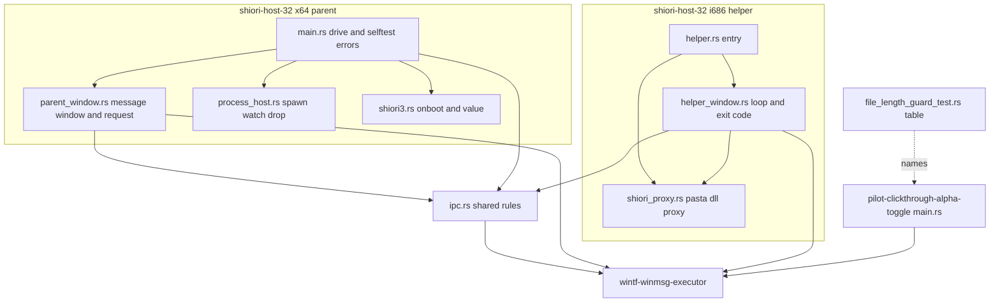
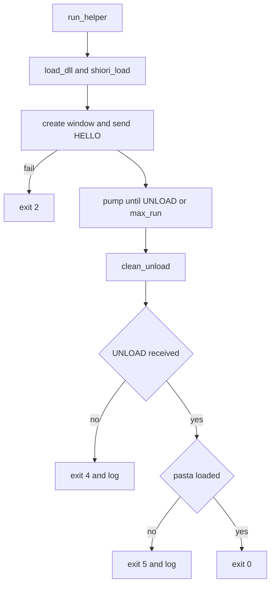
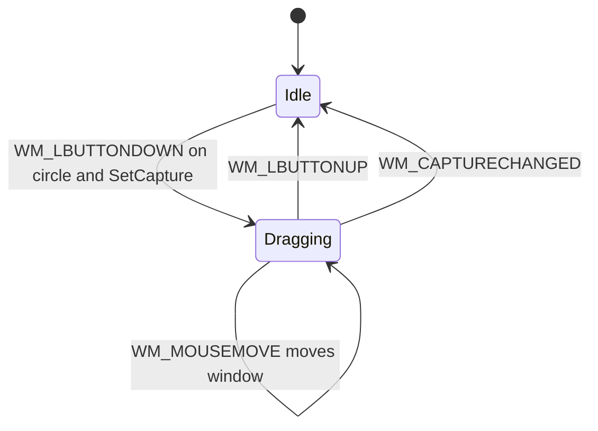

# 設計: audit-pilot

## Overview

**目的**: 先進坑の実験コードの置き場 `crates/pilot/`（`examples/pilot-windows-rs-next/` の下を除く）に ponytail の audit をかけて出た指摘 27 件（必ず直す 4・直したほうがよい 13・できれば 10＝`research.md` 5 節の番号）を、3 つの組とも全部直す。直さずに残す指摘は 0 件（要件 2.9）。

**使う人**: 開発者と、先進坑の知見を読む後の spec（本坑の設計者・次の先進坑の書き手）。先進坑を手で走らせ直したとき、起きていないことを「合格」と読まないこと、画面のクリックが効かない状態に入らないこと、コードと一次記録が逆のことを言わないことが得られる。

**変わること**: 32bit の先進坑 `shiori-host-32` は、合否の判定に使う終了コードと送りの失敗の呼び名が正しくなり、送りの層の写しが 1 か所にまとまり、死んだコードが消える。クリック透過の先進坑 `pilot-clickthrough-alpha-toggle` は、マウスの捕まえを失ったときにドラッグを終える。`crates/pilot` の実行例のうちテストを持つ 5 本は、全体テストの `cargo test --workspace` で組み立てて走る（今は 49 本が組み立てもされない）。一次記録（`README.md`・`REPORT.md`）は測った結果を書き換えず、日付と指摘の番号つきの書き足しだけを受ける。

### Goals

- 27 件を全部、いちばん小さく完全な形で直す（消せるものは消し、呼び元・テスト・見本・文書まで追う）。
- 直したバグ・危ない所（1・2・3・4・6・18）と、まとめ直した共有の決まり（7・8・9）に、壊れたら落ちる決定論のテストを置き、そのテストが全体テストで走る（要件 4.3・4.6）。
- 直した後に同じ範囲へもう一度 audit をかけて新しい指摘が 0 件、全体テストが緑（要件 4.1・4.4）。
- 先進坑の決まり（葉の隔離・空の `lib.rs`・本坑へ写さない）と、ウェーブ C22 の約束を守る（要件 5・7）。

### Non-Goals

- `examples/pilot-windows-rs-next/` の下（討議の決め 1）。`crates/pilot/README.md` にこの置き場の例外を書き足すこと（指摘 26）だけが範囲の中。
- 新しい先進坑・新しい実行例・新しい引数（要件 3.4）。ただし確定した指摘の直しとして、止まる道（子の helper を止める `Drop`）・記録（失敗のログ）・終了コードの値を足すことは新しい機能に数えない。
- `tools/test-all.ps1` の段を足すこと（`research.md` 11 節の案 C は採らない）。
- `pilot-clickthrough-alpha-toggle/main.rs` を割ること（C22 の約束 ⑵・要件 7.2）。中の既存のテスト 7 本も外へ移さない。
- `crates/sample-ghost-kit` の公開の形を変えること（要件 7.4）。依存を足すこと（要件 7.5）。

## Boundary Commitments

### This Spec Owns

- `crates/pilot/` のうち git に載ったファイルで、`examples/pilot-windows-rs-next/` の下でないもの全部（31 ファイル）の直し。
- 直しのために足すテストのファイル 3 本（同じフォルダの兄弟のファイル・`structure.md`「Unit Tests」の決まり）: `pilot-clickthrough-alpha-toggle/main_drag_tests.rs`・`shiori-host-32/helper_window_tests.rs`・`shiori-host-32/parent_window_tests.rs`。
- `.kiro/steering/two-tunnel.md` の「機械チェックは defer（要件 4.4）」の節への書き足し（要件 4.7）。
- 要件 7.3 の申し合わせの後に限り、`crates/log-capture-kit/tests/file_length_guard_test.rs` の例外表のうち `crates/pilot/examples/pilot-clickthrough-alpha-toggle/main.rs` の 1 件と、件数の行 `OVER_LIMIT_ALLOWED_COUNT`（4 → 3）。

### Out of Boundary

- `examples/pilot-windows-rs-next/` の下のファイル全部（読みもしない・直さない）。
- `crates/log-capture-kit/` のほかの所（表のほかの 3 件・`CALIBRATION_DROPPED_ENTRY`・判定の道具）。`audit-test-kits` の持ち物。
- `crates/sample-ghost-kit/`（使う側として `SampleRoot::acquire`・`emo2_ghost_master` を今のまま使うだけ）。
- `crates/wintf-winmsg-executor/`（使う側として `Window`・`MessageLoop`・`block_on`・`spawn_local` を今のまま使うだけ）。
- 本坑の `crates/shiori-host32-*`（名前が似ているだけで、この範囲から呼ばれず、この範囲を呼ばない）。
- `tools/test-all.ps1`・`tech.md`・`structure.md`・`workflow.md`・スキルの文書。
- 一次記録の「検証結果」（測った結果）の書き換え。

### Allowed Dependencies

- `crates/pilot/Cargo.toml` に今ある依存だけ: `wintf-winmsg-executor`・`event-listener`・`windows`（今の features: `Win32_System_DataExchange`・`Win32_System_Memory`・`Win32_Globalization`・`Win32_Graphics_Dxgi` とワークスペースの既定。`SetTimer`／`KillTimer`／`GetLastError`／`OpenProcess`／`WaitForSingleObject` は既定の `Win32_UI_WindowsAndMessaging`・`Win32_Foundation`・`Win32_System_Threading` にある）・`windows-core`、dev 依存の `sample-ghost-kit`・`wintf`・`areka-emo-*`・`bevy_ecs`・`tracing*`。
- 依存の向きは `pilot → 既存の crate` の一方向だけ。ほかの crate の `Cargo.toml` に `pilot` を書かない。
- `event-listener` は版の書き方だけを `{ workspace = true }` に変える（根の `[workspace.dependencies]` も `"5"`＝`Cargo.lock` は変わらない）。

### Revalidation Triggers

- 例外表から 1 件を外すこと（`file_length_guard_test.rs`）: 同じウェーブの `audit-test-kits` が表を読み直す。外す時期は要件 7.3 のとおり。
- `crates/pilot/Cargo.toml` の `[[example]]` に `test = true` を足すこと: 全体テストの x64 の段（`cargo test --workspace`）に新しく 50 本前後が乗る。全体テストの所要と赤の出方が変わる。
- `two-tunnel.md` の書き足し: 次に先進坑を掘る spec は、テストを持つ実行例を `[[example]]` に `test = true` で書く決まりを守る。
- `shiori-host-32` の helper の終了コードと引数の決まり（下の「データの約束」）: 一次記録を読んで走らせ直す人の手順が変わる。

## Architecture

### Existing Architecture Analysis

- `crates/pilot` は空の `lib.rs` と `examples/<名前>/` の下の実行例だけを持つ葉の crate（`two-tunnel.md`）。出荷する crate はどれも `pilot` に頼らないので、直しの呼び元は範囲の中にしかない。範囲の外の読み手は `research.md` 4 節の表のとおり（1,000 行の番人の表・在ることの番人・名指しの注記）で、名前を変えるファイルも消すファイルも無いので壊れない。
- `shiori-host-32` は 2 つの実行例（x64 の親 `main.rs` と i686 の helper `helper.rs`）が、`ipc.rs` を `#[path]` で両方に取り込む。ほかのファイルは片方だけに取り込まれる（親: `shiori3.rs`・`process_host.rs`・`parent_window.rs`／helper: `shiori_proxy.rs`・`helper_window.rs`／両方: `sample_support.rs`）。6 つのファイルの頭の `#![allow(dead_code)]` を消すと、`ipc.rs` の中で片方しか使わない物はその片方の組み立てで警告になる。そのため `ipc.rs` には両方が使う物だけを残し、親だけが使う受け皿セルと 1 往復の送りは `parent_window.rs` へ移す。
- 実行例は今どれも cargo の既定の `test = false` で、全体テストは普通のプログラムとして組むだけ（`research.md` 7 節）。設計の段で `cargo test -p pilot --examples --no-run`（x64）を 1 回回し、7 本の実行例のテストの組み立てが全部通ることを確かめた（警告 0・1 分 55 秒・`research.md` 15 節）。

### Architecture Pattern & Boundary Map



- **選んだ形**: 今の形のまま直す（`research.md` 11 節の案 A）。テストは各ファイルの今の形に合わせる＝インラインの `mod tests` を持つファイルはそこへ足し、テストの無いファイルに新しいテストのモジュールを置くときは兄弟のファイル（`structure.md`）。
- **依存の向き**: `main.rs → parent_window.rs／process_host.rs／shiori3.rs → ipc.rs → wintf-winmsg-executor・windows`。helper は `helper.rs → helper_window.rs → shiori_proxy.rs・ipc.rs`。`ipc.rs` は親にも helper にも上へ向けて頼らない。親だけのファイルと helper だけのファイルは互いを取り込まない。
- **steering に沿うこと**: 葉の隔離・空の `lib.rs`・1 仕様 1 フォルダは変えない。`two-tunnel.md` の「examples 腐敗検出」の先送りは、`crates/pilot` の実行例のテストの分だけを解き、その旨を steering に書き足す（討議の決め 2）。

### Technology Stack

| Layer | Choice / Version | Role in Feature | Notes |
|-------|------------------|-----------------|-------|
| 組み立て | cargo の `[[example]]` の `test = true` | 実行例のテストを `cargo test --workspace` で組み立てて走らせる | 新しい依存 0・新しい道具の段 0 |
| 窓とループ | `wintf-winmsg-executor`（木の中の写し） | message-only 窓・`MessageLoop::run`・`block_on` | 使い方だけ。中は変えない |
| Win32 | `windows` 0.62（今の features） | `SendMessageTimeoutW`＋`GetLastError`・`SetTimer`／`KillTimer`・`OpenProcess`／`WaitForSingleObject`（テストだけ） | features を足さない |
| 起床 | `event-listener` 5（`{ workspace = true }` に） | クリック透過の先進坑の `state_changed` | 版の書き方だけ変える |

## File Structure Plan

### Directory Structure

```
crates/pilot/
├── Cargo.toml                                  # [[example]] test = true を 5 本・event-listener を workspace に・注記（5・24）
├── README.md                                   # 独立のワークスペースの例外（26）・テストを持つ実行例の決まり（4.6 の追随）
└── examples/
    ├── pilot-balloon-asset-swap/
    │   ├── observe.rs                          # allow を 3 欄だけに（22）
    │   └── observe_tests.rs                    # 説明の行を 1 つ下へ（23）
    ├── pilot-clickthrough-alpha-toggle/
    │   ├── main.rs                             # 1・15・16・17・27（割らない）
    │   ├── main_drag_tests.rs                  # 新しい: 1 のテスト（捕まえを失う／ボタンを離す でドラッグが終わる）
    │   └── REPORT.md                           # 書き足し（1・15・16）
    ├── shiori-host-32/
    │   ├── ipc.rs                              # 両方が使う決まりだけ（3・7・8・9・10・11・21）
    │   ├── parent_window.rs                    # 受け皿セルと request を受け取る・数えを消す（7・9・13）
    │   ├── parent_window_tests.rs              # 新しい: 受け皿セルのテスト（ipc.rs から移す）
    │   ├── main.rs                             # 親の駆動（3・4・10・11・12・14）
    │   ├── process_host.rs                     # Drop・exe の選び方・言い換えの整理・引数だけ（4・6・12・20）
    │   ├── shiori3.rs                          # module_loaded を消す・build_onboot() 引数なし・lines()（10・14・19）
    │   ├── helper.rs                           # 引数だけを読む・古い注記（10・18・20）
    │   ├── helper_window.rs                    # 終了コード・状態と数えを消す・待ちを ipc へ（2・9・10・13・21）
    │   ├── helper_window_tests.rs              # 新しい: 終了コードの表
    │   ├── shiori_proxy.rs                     # unload は () ・load_dll の片付け・x86 だけのテスト（5・10・18）
    │   └── README.md                           # 書き足し（2・3・7・11）
    └── wintf-winmsg-executor/
        └── README.md                           # 「概要」の 3 か所をその場で直す（25）
```

### Modified Files（範囲の外）

- `.kiro/steering/two-tunnel.md` — 「機械チェックは defer（要件 4.4）」の節の末尾に、例外の段落を 1 つ書き足す（要件 4.7・文面は下の「文書の直し」）。
- `crates/log-capture-kit/tests/file_length_guard_test.rs` — 要件 7.3 の申し合わせの後だけ: `OVER_LIMIT_ALLOWED` から `crates/pilot/examples/pilot-clickthrough-alpha-toggle/main.rs` の 4 行の項目を消し、`OVER_LIMIT_ALLOWED_COUNT` を `4` から `3` にする。`CALIBRATION_DROPPED_ENTRY` はほかの項目を指しているので触らない。

### 触らないことを確かめたファイル

- `crates/log-capture-kit/tests/workspace_scan_test.rs:319`（`pilot-clickthrough-alpha-toggle/main.rs` が在ること）＝ファイルは消さない・名前を変えない。
- `crates/areka-kanade/tests/kanade/real_helper_test.rs:43`・`crates/areka/examples/emo-present.rs:152`（`shiori-host-32/main.rs` の検体の置き方を名指し）＝検体の置き方は変えない。
- `crates/wintf/src/win_style.rs:45`（`REPORT.md` の知見を名指し）＝REPORT は書き足すだけ。
- `.kiro/specs/completed/` の文書＝消す・名前を変えるファイルが無いので壊れない。消す識別子（`MsgTag::Load`・`PeerGone`・`HelperState`・`module_loaded`・`PAYLOAD_HEADER_LEN`・`poll_exit`・`wait_clean`・`decode_hwnd_le`・`encode_hwnd_le`・`GHOSTDIR`／`PARENT_HWND` の環境変数ほか）を、消す前にツリー全体（`vendors/` と `target/` を除く）で grep し、範囲の外の実行行に読み手が無いことを確かめる（要件 3.3。設計の段の grep では範囲の外のコードに 0 件）。

## System Flows

### helper の終わり方と終了コード（指摘 2）



- 親の go 基準(2) は今のまま「終了コード 0（kind=Clean）だけを合格」とする。上限で抜けた helper は 4 を返すので、UNLOAD の送りが失敗した走行は不成立になる。

### クリック透過の先進坑のドラッグの終わり（指摘 1）



- 終わりの片付けは 2 つの合図で同じ: `dragging.swap(false)` が `true` だったときだけ `ReleaseCapture`・`state_changed.notify(usize::MAX)`・ログ。`WM_LBUTTONUP` の中の `ReleaseCapture` が自分の窓へ `WM_CAPTURECHANGED` を送っても、`swap` が `false` を返すので二重に片付けない。

## Requirements Traceability

| Requirement | Summary | Components | Interfaces | Flows |
|-------------|---------|------------|------------|-------|
| 1.1, 1.2, 1.3, 1.4, 1.5, 1.6, 1.7, 1.8 | 範囲を決めて全件・全部読みで洗い出す（旗 (a)〜(c) を付ける） | `research.md`（ギャップ分析・済み）。旗 (a) は「文書の直し」、旗 (b) は ClickthroughDrag と LengthGuardEntry、旗 (c) は「実機の確かめ」が受ける | — | — |
| 1.9 | 実行例のテストが全体テストで走るか | `research.md` 7 節・15 節（組み立ての測り） | — | — |
| 2.1, 2.9 | 27 件全部を直す対象にする | 下の「指摘と直しの対応表」 | — | — |
| 2.2, 2.3, 2.4, 2.5 | 残す指摘は裁定のあるものだけ・⑶ は ukadoc を添える・裁定を覆さない・残したら記録 | 残すもの 0 件（記録する裁定も 0）。⑶ に当たる指摘も 0（14・19 は SHIORI/3.0 の要求と応答の形を変えない） | — | — |
| 2.6 | 20 タスクを越えそうなら切り分けを議題に | 「タスクの切り分けの見取り図」（15 本） | — | — |
| 2.7 | 品質の基準を理由に残さない | 7〜24・27 の直し | — | — |
| 2.8 | 理由つきの allow も狭める | `observe.rs`（22）・`DCompPipeline`（27） | — | — |
| 3.1 | 確定した指摘を全部直す | 全部品 | — | — |
| 3.2 | 壊れる読み手を全部直す | 「触らないことを確かめたファイル」・`file_length_guard_test.rs` | — | — |
| 3.3 | 消す前にツリー全体で確かめる | 各部品の「消すもの」・grep の手順 | — | — |
| 3.4 | 新しい機能を足さない | Non-Goals | — | — |
| 3.5 | 範囲の外の持ち主と申し合わせる | 例外表の 1 件（`audit-test-kits`） | — | — |
| 4.1, 4.2 | かけ直しで 0 件・出たら直してかけ直す | タスク 14 | — | — |
| 4.3 | 直したバグごとに全体テストで走るテスト | 「Testing Strategy」 | — | — |
| 4.4 | 全体テストが緑 | タスク 15 | — | — |
| 4.5 | 画面の操作は排他テストの机で SendInput | 実機の確かめ ⑵ | — | — |
| 4.6 | `test = true` で全体テストに乗せる・x64 で走れないものは走れる組み立てだけ | Cargo の配線・`shiori_proxy.rs` の `#[cfg(target_arch = "x86")]` | `[[example]]` | — |
| 4.7 | steering に書き足す | `two-tunnel.md` | — | — |
| 4.8 | 実機で 1 回ずつ確かめ直す | 実機の確かめ ⑴⑵ | — | ドラッグの終わり・helper の終わり方 |
| 5.1, 5.2 | 葉の隔離・本坑へ写さない | `lib.rs` に触らない・`examples/` の下だけ | — | — |
| 5.3 | 測った結果は書き換えず書き足す・25 は書き換え | 文書の直し | — | — |
| 5.4 | まるごと消す指摘が出たら議題に | 27 件に無い（かけ直しで出たら議題） | — | — |
| 6.1 | 1,000 行を越えさせない | 1 のテストを `main_drag_tests.rs` へ・`swap.rs`／`observe.rs` は越えない | — | — |
| 6.2 | 決定論のテストで網羅 | 「Testing Strategy」 | — | — |
| 6.3 | 記録の無い失敗の道を作らない | 「Error Handling」 | — | — |
| 6.4 | 終了の道は正規の実装 | `HelperHandle` の `Drop`（kill→wait）・helper の終了コード | — | helper の終わり方 |
| 6.5 | 実機の根と一時フォルダは `target` の下 | 新しい一時フォルダを作らない | — | — |
| 6.6 | GPU のテストは実 GPU | GPU を使うテストを足さない | — | — |
| 6.7 | 文字化けは読む側を直す | 端末の文字コードに触らない | — | — |
| 7.1, 7.2, 7.3 | 番人の表は申し合わせの後で 1 件を外す・`main.rs` は割らない | `file_length_guard_test.rs`・ClickthroughDrag・タスク 11 | — | — |
| 7.4 | 同じウェーブの公開の形を変えない | `sample-ghost-kit` に触らない | — | — |
| 7.5 | 依存を足さない | Allowed Dependencies | — | — |
| 7.6 | 申し合わせがつかないときの申し送り | タスク 11 の止まり方 | — | — |

## 指摘と直しの対応表（27 件）

| # | 組 | 直す所 | 直し（いちばん小さく完全な形） |
|---|---|---|---|
| 1 | 必ず | clickthrough `main.rs` | `WM_LBUTTONUP` の腕を `WM_LBUTTONUP \| WM_CAPTURECHANGED` にする（`MK_LBUTTON` は見ない）。ログは合図ごとに「ボタンを離した／捕まえを失った」を出す。テストは `main_drag_tests.rs` |
| 2 | 必ず | `helper_window.rs` | `run_until_unload_or` が「UNLOAD で抜けたか」を返し、`run_helper` は `exit_code(unloaded, loaded)` で 0／4／5 を返す |
| 3 | 必ず | `ipc.rs`・`main.rs` | `send_copydata` が 0 を受けたら `GetLastError()` を読み、`ERROR_TIMEOUT` なら `Timeout`、ほかは `SendFailed(code)`。応答が受け皿に無いことは `Ok(None)`（時間切れと呼ばない）。err(1) は `send_copydata` を直接使い、`Timeout` かつ経った時間が下限（`ERR_IPC_TIMEOUT` − 100 ms）以上・上限以下のときだけ合格 |
| 4 | 必ず | `process_host.rs`・`main.rs` | `resolve_helper_exe(env, args)` を `process_host.rs` に置き、`HELPER_EXE` が空でなければそれ、無ければ `--` で始まらない最初の引数 |
| 5 | 直した方 | `Cargo.toml`・`shiori_proxy.rs` | テストを持つ 5 本を `[[example]] … test = true`。本物の `pasta.dll` を読む `load_pasta_dll_and_call_load_without_crash` に `#[cfg(target_arch = "x86")]` |
| 6 | 直した方 | `process_host.rs` | `impl Drop for HelperHandle`: `try_wait` がまだ動いていると言えば、記録を出してから `kill()`→`wait()`。失敗も記録する |
| 7 | 直した方 | `ipc.rs`→`parent_window.rs` | `send_request` を `ParentMessageWindow::request`（`slot.clear(); send_copydata(..)?; Ok(slot.take())`）にし、受け皿セル `ResponseSlot` と一緒に `parent_window.rs` へ移す |
| 8 | 直した方 | `ipc.rs` | `copydata_payload` を `ipc.rs` に 1 つ置き、親と helper の 2 つの写しを消す |
| 9 | 直した方 | `ipc.rs` | `pump_until(hwnd, deadline, done)` を `ipc.rs` に 1 つ置く。窓に `SetTimer`（50 ms）を掛けて `WM_TIMER` でループを起こし、起こし役のスレッドと HWND の 4 バイトの回り道を消す。親の HELLO 待ちと helper の UNLOAD 待ちがこれを呼ぶ。err(1) の詰まった窓の止め方（1 回の `PostMessageW`）はそのまま |
| 10 | 直した方 | `shiori-host-32` の 6 ファイル＋`main.rs`・`helper.rs` | 6 つの `#![allow(dead_code)]` を消す。「本タスク・後続タスク・scaffolding・skeleton」の注記を消すか今の姿に書き直す。x64 の親・helper（通常とテスト）と i686 の helper の組み立てで警告 0 |
| 11 | 直した方 | `ipc.rs`・`helper_window.rs`・`main.rs`・`helper.rs` | `MsgTag::Load`（判別子 2 は欠番のまま・ほかの値は変えない）・`From`／`TryFrom`・`PAYLOAD_HEADER_LEN` とそのテスト・`PeerGone`・`decode_hwnd_le`・`encode_hwnd_le`（`hwnd_to_u32` に置き換え）・`ResponseSlot::new`・`DEFAULT_TIMEOUT`（helper だけが使う送りの上限は `helper_window.rs` の定数へ）・`let _ = ipc::DEFAULT_TIMEOUT;` を消す |
| 12 | 直した方 | `process_host.rs`・`main.rs` | `HelperHandle.helper_hwnd`・`poll_exit`・`wait_clean` を消し、待ちは `wait_kind` だけ。`poll_exit` を見るテストは `poll_exit_kind` で書き直す。`Go2Record.exit_code` も消す（`kind` が持つ） |
| 13 | 直した方 | `parent_window.rs`・`helper_window.rs` | 数え（`hellos`・`responses`・`unexpected`・`requests_handled`・`responses_sent`・`unknown_tags`）・`ParentShared::helper_hwnd()`・`ParentMessageWindow::hwnd()`・`shared()`・`HelperShared.reply_timeout`・`state` と `HelperState`・`helper_window::default_fixture_ghostdir` を消す。selftest の最後の確かめは `run_until_unload_or` の戻り値で行う |
| 14 | 直した方 | `shiori3.rs`・`main.rs` | `module_loaded` を消し、`build_onboot()` を引数なしに。呼び元 2 か所とテストを直す |
| 15 | 直した方 | clickthrough `main.rs` | `applier_done` の旗・引数・ループの確かめ・後片付けの 2 文と注記を消し、「`block_on` が戻ると `spawn_local` のタスクは進まない（`wintf-winmsg-executor` の約束）」の 1 行にする |
| 16 | 直した方 | clickthrough `main.rs` | `WM_LBUTTONDOWN` の内外の判定を `alpha_is_opaque(POINT { x: click_x, y: click_y }, cr)` にする（`cr` はクライアントの矩形で左上が 0）。ログの文面（`円中心=(..)` を含む）は変えない |
| 17 | 直した方 | clickthrough `main.rs` | ⑴ LAYERED を使う ⑵ DComp は窓の原点から合成し、`WS_POPUP` で client==window にしてある ⑶ 十字カーソル ⑷ 済んだことの未来形（タスク 3.x〜6.x）を消す ⑸ `alpha_is_opaque` に渡すのはクライアントの矩形（スクリーン座標）、を今の事実に。同じ誤りが `draw_circle` の説明にもあるので一緒に直す |
| 18 | できれば | `shiori_proxy.rs`・`helper.rs`・`helper_window.rs` | `shiori_unload` は `()` を返し、説明から `FreeLibrary` を消す（`ShioriEntries` の `Drop` がする）。i686 でテストが組めないという古い注記を消す。`load_dll` は `GetProcAddress` の失敗で `FreeLibrary(module)` してから `Err` を返す |
| 19 | できれば | `shiori3.rs` | `text.lines()` |
| 20 | できれば | `process_host.rs`・`helper.rs` | 引数だけにする（`argv[1]=ghostdir`・`argv[2]=parent_hwnd`）。`GHOSTDIR_ENV`・`PARENT_HWND_ENV` と `.env(..)` と helper の環境変数の読みを消す |
| 21 | できれば | `helper_window.rs`・`ipc.rs` | ⑴「sender が有効ならそれを優先」を「RESPONSE は起動時に受けた `parent_hwnd` へ返す（`wParam` の送り主は見ない）」に ⑵「别」→「別」（`pump_until` へ移ると行ごと消える） ⑶ `unsafe` でない関数の `# Safety` を普通の説明に |
| 22 | できれば | `observe.rs` | 頭の `#![allow(dead_code)]` を消し、`h_p`・`h_q`・`h_both` の 3 欄にだけ `#[allow(dead_code)] // Debug 出力のログでしか読まない` を付ける（名前は変えない＝ログの欄の名前が変わらない） |
| 23 | できれば | `observe_tests.rs` | 「当たり判定の閾値の境（0.9 と 0.1 は含む）」の行を `hit_rule_thresholds_are_inclusive` の上へ移す |
| 24 | できれば | `Cargo.toml` | 「[dependencies] は空」の注記を今の姿に、`event-listener = { workspace = true }`。注記の中の「task 3.1」などの古い印も消す |
| 25 | できれば | `wintf-winmsg-executor/README.md` | 「概要」だけをその場で直す: 「約 6 秒」→「約 8 秒（`RUN_SECS = 8`）」・「約 240 行」→ 今の行数・「`wintf-winmsg-executor = "0.0.5"`」→「木の中の写しを `{ workspace = true }` で使う」。「検証結果」は書き換えない |
| 26 | できれば | `crates/pilot/README.md` | 配置の決まりの下に、本線から独立したワークスペースを置く例外（`pilot-windows-rs-next`・`main.rs` を持たず自分の `Cargo.toml`／`Cargo.lock` を持つ・全体テストに乗らない）の 2 行を足す |
| 27 | できれば | clickthrough `main.rs` | `DCompPipeline` の持ち続けるだけの欄（`d3d`・`d2d_device`・`desktop`・`target`・`visual`）の名前を `_` で始め、構造体の `#[allow(dead_code)]` の行を消す |

## Components and Interfaces

| Component | Domain | Intent | Req Coverage | Key Dependencies | Contracts |
|-----------|--------|--------|--------------|------------------|-----------|
| 実行例のテストの配線 | 組み立て | テストを持つ 5 本を全体テストで走らせる | 4.3, 4.6, 7.5 | cargo (P0) | Batch |
| IpcRules（`ipc.rs`） | shiori-host-32 共有 | 親と helper が両方使う送り・受け・待ちの決まり | 3.1, 4.3, 6.3 | windows (P0), wintf-winmsg-executor (P0) | Service |
| ParentSide（`main.rs`・`parent_window.rs`・`process_host.rs`・`shiori3.rs`） | shiori-host-32 親 | 起こす・往復・判定・止める | 3.1, 4.3, 6.3, 6.4 | IpcRules (P0) | Service, State |
| HelperSide（`helper.rs`・`helper_window.rs`・`shiori_proxy.rs`） | shiori-host-32 helper | 窓・ループ・終了コード・pasta の読み | 3.1, 4.3, 6.3, 6.4 | IpcRules (P0) | Service, State |
| ClickthroughDrag（clickthrough `main.rs`） | クリック透過の先進坑 | ドラッグの終わり・後片付け・注記 | 3.1, 4.3, 6.1, 7.2, 7.3 | wintf-winmsg-executor (P0) | State |
| BalloonObserve（`observe.rs`・`observe_tests.rs`） | バルーン差し替えの先進坑 | allow を狭める・説明の位置 | 2.8, 3.1 | — | — |
| Docs | 文書 | 一次記録の書き足し・README・steering | 4.7, 5.3 | — | — |
| LengthGuardEntry（範囲の外） | 番人の表 | 1 件と件数の行を外す | 7.1, 7.3, 7.6 | `audit-test-kits` の着地 (P0) | — |

### 組み立て

#### 実行例のテストの配線

| Field | Detail |
|-------|--------|
| Intent | テストを持つ実行例を `cargo test --workspace` で組み立てて走らせる |
| Requirements | 4.3, 4.6, 7.5 |

**Responsibilities & Constraints**
- `crates/pilot/Cargo.toml` に `[[example]]` を書く: `pilot-balloon-asset-swap`・`pilot-clickthrough-alpha-toggle`・`pilot-dropfiles-on-wuc-window`・`shiori-host-32` は `name` と `test = true`（`path` は cargo の推し量り `examples/<name>/main.rs` に任せる）。今ある `shiori-host-32-helper` の項目に `test = true` を足す。`_template` と `wintf-winmsg-executor` はテストを持たないので書かない。
- x64 で走れない `shiori_proxy.rs` の `load_pasta_dll_and_call_load_without_crash` は `#[cfg(target_arch = "x86")]` で囲む（要件 4.6「走れる組み立てだけに限る」）。i686 で `cargo test -p pilot --example shiori-host-32-helper --target i686-pc-windows-msvc` を回したときだけ走る。
- `ipc.rs` のテストは親と helper の 2 つのテストの exe に入るので 2 回走る。どちらの組み立てでも同じ決まりが通ることの確かめとして受け入れる。

**Contracts**: Batch [x]
- Trigger: 全体テストの x64 の段（`tools/test-all.ps1` の `cargo test --workspace --no-fail-fast -j 4`）。
- Input / validation: `cargo metadata --no-deps` で上の 5 本が `test: true` になったことを確かめる。
- Output: 実行例ごとのテストの exe が走り、赤があれば全体テストが赤。

**Implementation Notes**
- 最初に `cargo test -p pilot --examples`（x64）を 1 回回し、今まで 1 度も走っていなかったテストのうち赤のものを数える。赤は今まで見えていなかった壊れなので、この spec で直す（直しが範囲の外へ及ぶなら議題）。
- 走るテストはどれも純粋な関数か、見えない窓・`cmd.exe`／`ping 127.0.0.1` を起こすもので、画面・GPU・検体を使わない（設計の段で中身を読んだ）。

### shiori-host-32 共有

#### IpcRules（`ipc.rs`）

| Field | Detail |
|-------|--------|
| Intent | 親と helper の両方が使う送り・受け・待ちの決まりの唯一の置き場 |
| Requirements | 3.1, 4.3, 6.3 |

**Responsibilities & Constraints**
- 両方の組み立てで使われる物だけを持つ（片方だけの物を置くと、`allow` を消した後に警告になる）。
- 判別子の値（Hello=1・Request=3・Response=4・Unload=5）は変えない。2 は欠番。
- 送りの失敗は Win32 のエラーで見分ける。応答が来なかったことは送りの失敗ではない（`ParentMessageWindow::request` の `Ok(None)`）。

**Contracts**: Service [x]

```rust
#[repr(u32)]
pub enum MsgTag { Hello = 1, Request = 3, Response = 4, Unload = 5 }
impl MsgTag {
    pub const fn as_u32(self) -> u32;
    pub fn try_from_u32(raw: u32) -> Result<Self, u32>; // 未知の値は Err(raw)
}

/// HWND の下 32 ビット（USER ハンドルは 32 ビットで足りる）。HELLO の中身はこれの to_le_bytes。
pub fn hwnd_to_u32(hwnd: HWND) -> u32;
pub fn hwnd_from_u32(value: u32) -> HWND; // x64 では上を 0 で埋める

pub enum IpcError {
    Timeout,          // GetLastError() == ERROR_TIMEOUT（時間切れ・SMTO_ABORTIFHUNG の打ち切り）
    SendFailed(u32),  // ほかの Win32 エラー（窓が無い 1400 など）。値は GetLastError のまま
}

/// WM_COPYDATA を 1 通送る。dwData＝tag の下 32 ビット・cbData＝payload の長さ・wParam＝self_hwnd。
pub fn send_copydata(target: HWND, self_hwnd: HWND, tag: MsgTag, payload: &[u8], timeout: Duration)
    -> Result<(), IpcError>;

/// 受けた WM_COPYDATA の LPARAM から（タグ＝dwData の下 32 ビット, 中身の写し）を取り出す。lparam が null なら None。
/// # Safety: lparam は WM_COPYDATA の LPARAM（OS が COPYDATASTRUCT を指すことを約束する）。
pub unsafe fn copydata_payload(lparam: LPARAM) -> Option<(u32, Vec<u8>)>;

/// hwnd の窓に SetTimer(50 ms) を掛けて MessageLoop::run を回し、done() が真になるか deadline で抜ける。
/// 抜けた後に KillTimer。戻り値は抜けたときの done()。
pub fn pump_until(hwnd: HWND, deadline: Instant, done: impl Fn() -> bool) -> bool;
```
- 事前条件: `pump_until` は `hwnd` を作ったスレッドで、ほかの `MessageLoop::run` のフィルタの中でないところから呼ぶ。
- 事後条件: `send_copydata` が `Err` を返すとき、`GetLastError` は送りの直後に 1 回だけ読む（間に別の Win32 呼び出しを挟まない）。
- `SetTimer` の確かめ（`research.md` 12 節の 4）: `MessageLoop::run` は `GetMessageW(None, 0, 0)` でスレッドの全部のメッセージを受け、目覚ましの印でないものは全部フィルタへ渡す（`crates/wintf-winmsg-executor/src/lib.rs:182-205`）。窓の手続きは `WM_TIMER` に `None` を返し `DefWindowProcW` が何もしない。message-only の窓も `SetTimer` の `WM_TIMER` を受ける。

**Implementation Notes**
- 消すもの: 11 の ⑴〜⑸⑺、`ResponseSlot`／`send_request`（`parent_window.rs` へ移す）、古い注記と `#![allow(dead_code)]`（10）、`# Safety` の誤り（21 ⑶）。
- テスト（インラインの `mod tests` へ足す）: 下の「Testing Strategy」。

### shiori-host-32 親

#### ParentSide

| Field | Detail |
|-------|--------|
| Intent | helper を起こし、HELLO を待ち、OnBoot を往復し、生存を見張り、UNLOAD を送り、終了コードを判定する。失敗で抜けるときは helper を止める |
| Requirements | 3.1, 4.3, 6.3, 6.4 |

**Contracts**: Service [x] / State [x]

```rust
// parent_window.rs
#[derive(Default)]
struct ResponseSlot { inner: RefCell<Option<Vec<u8>>> } // clear / store / take（new は持たない）
pub struct ParentMessageWindow { /* window: Window<ParentShared> */ }
impl ParentMessageWindow {
    pub fn create() -> Result<Self, String>;
    pub fn hwnd_u32(&self) -> u32;                                    // ipc::hwnd_to_u32
    pub fn pump_until_hello_or(&self, timeout: Duration) -> Option<u32>; // ipc::pump_until を呼ぶ
    /// 受け皿を空にして REQUEST を送り、送りが通ったら受け皿を取る。Ok(None)＝送れたが RESPONSE が来なかった。
    pub fn request(&self, helper: HWND, payload: &[u8], timeout: Duration)
        -> Result<Option<Vec<u8>>, ipc::IpcError>;
}

// process_host.rs
pub const HELPER_EXE_ENV: &str = "HELPER_EXE";
/// env が空でない値ならそれ、無ければ args（exe 名を除いた引数）のうち "--" で始まらない最初のもの。
pub fn resolve_helper_exe(env: Option<String>, args: impl IntoIterator<Item = String>) -> Option<PathBuf>;
pub struct HelperHandle { pub child: Child }
impl Drop for HelperHandle { fn drop(&mut self); } // まだ動いていれば記録→kill→wait
pub enum ExitKind { Clean, Abnormal(i32), Terminated } // classify / is_clean は今のまま
impl ProcessHost {
    pub fn spawn(helper_exe: &Path, ghostdir: &Path, parent_hwnd: u32) -> std::io::Result<HelperHandle>; // 引数だけで渡す
    pub fn poll_exit_kind(handle: &mut HelperHandle) -> Option<ExitKind>;
    pub fn wait_kind(handle: HelperHandle) -> std::io::Result<ExitKind>;
    pub fn terminate(handle: &mut HelperHandle) -> std::io::Result<()>;
}

// shiori3.rs
pub fn build_onboot() -> Vec<u8>;                 // 要求のバイト列は今と同じ
pub fn parse_value(response: &[u8]) -> Option<String>; // text.lines() で読む
```

**go(1) の失敗の文**（`main.rs`・指摘 3 の後半）: 失敗の種類ごとに確かめる向きを指す。
- `Err(Timeout)`: helper が時間内に REQUEST を捌かなかった（helper の窓が詰まっている）。
- `Err(SendFailed(code))`: 送れなかった（Win32 エラー `code`・HELLO の HWND が違う／helper の窓が無い）。
- `Ok(None)`: 送れたが RESPONSE が受け皿に届かなかった（helper の標準エラーを見る＝pasta の読み込みや `request` の失敗。それでなければ再入受領が不成立＝design §210 の Revalidation Trigger）。

**err(1)**（`main.rs`）: 詰まった窓へ `ipc::send_copydata` を `ERR_IPC_TIMEOUT`（500 ms）で送り、`Err(Timeout)` かつ `ERR_TIMEOUT_LOWER_BOUND`（400 ms）≦ 経った時間 ≦ `ERR_TIMEOUT_UPPER_BOUND`（1,500 ms）のときだけ合格。受け皿は使わない。

**go(2)**（`main.rs`）: 待ちは `ProcessHost::wait_kind`。`Clean` だけが合格。UNLOAD の送りが失敗したときの文は「helper は上限で抜けて終了コード 4 になり、go 基準(2) は不成立になる」にする。

**Implementation Notes**
- `HelperHandle` の `Drop` で、`drive` と `drive_err_helper_abnormal_exit` がどの `?` で抜けても helper は止まる（`process::exit` は `drive` が戻った後なので、`Drop` は先に走る）。`wait_kind` で待ち終えた後の `Drop` は `try_wait` が終わりを返すので何もしない。
- `mid_window_probe` は `parent.request(..)` を使い、`Ok(None)` は「応答なし」として補足の観測に記録する。
- 消すもの: 12・13（親の分）・14、`main.rs` の `let _ =` の 2 行、`use parent_window::ParentShared`、古い注記（10）。

### shiori-host-32 helper

#### HelperSide

| Field | Detail |
|-------|--------|
| Intent | pasta を読み、message-only 窓で HELLO を送り、REQUEST に応じ、UNLOAD か上限で抜け、抜け方を終了コードで返す |
| Requirements | 3.1, 4.3, 6.3, 6.4 |

**Contracts**: Service [x] / State [x]

```rust
// helper_window.rs
const SEND_TIMEOUT: Duration = Duration::from_secs(5); // HELLO と RESPONSE の送りの上限（ipc::DEFAULT_TIMEOUT の後継）
pub struct HelperShared { parent_hwnd: u32, entries: RefCell<Option<ShioriEntries>>, want_quit: Cell<bool> }
impl HelperMessageWindow {
    pub fn create(parent_hwnd: u32, entries: Option<ShioriEntries>) -> Result<Self, String>;
    /// UNLOAD を受けて抜けたら true、max_run で抜けたら false。
    pub fn run_until_unload_or(&self, max_run: Duration) -> bool; // ipc::pump_until を呼ぶ
    pub fn clean_unload(&self);
}
/// 0＝UNLOAD で抜け pasta を読めていた・4＝UNLOAD が来ずに上限で抜けた・5＝UNLOAD で抜けたが pasta を読めていなかった。
pub fn exit_code(unloaded: bool, loaded: bool) -> i32; // unloaded が false なら loaded に関係なく 4
pub fn run_helper(parent_hwnd: u32, ghostdir: &Path, max_run: Duration) -> i32; // 窓／HELLO の失敗は今のまま 2

// shiori_proxy.rs
impl ShioriByteProxy {
    pub fn load_dll(dll_path: &Path) -> Result<ShioriEntries, ProxyError>; // 引けなかったら FreeLibrary してから Err
    pub fn shiori_unload(e: &ShioriEntries);                              // () を返す
}
```
- `loaded` は `load_dll` と `shiori_load` の両方が通ったとき真。`shiori_load` が失敗しても、今のとおり `entries` は持ち続けて窓を立て、REQUEST の失敗を記録する（親が観測できる形を変えない）。
- `helper.rs` は引数だけを読む: `argv[1]=ghostdir`（無ければ検体 emo2）・`argv[2]=parent_hwnd`（10 進）。`--selftest-load`／`--selftest-loop` の判定が先なので並びはぶつからない。引数が無いときの文は「本番は親が `argv[1]=ghostdir argv[2]=parent_hwnd` で起こす」と今のモードを並べる（skeleton の語を消す）。
- 終了コードの一覧（helper の頭の説明に書く）: 0・2（窓／HELLO の失敗、`--selftest-load` の失敗）・3（`--selftest-loop` の失敗）・4・5。

**Implementation Notes**
- selftest の 4 段目は `run_until_unload_or(secs)` が `false` を返すこと、5 段目は `want_quit` を立てた後に `true` を返すことを確かめる（`HelperState` の確かめの代わり）。
- 消すもの: 13（helper の分）・`Ok(MsgTag::Load)` の腕・`default_fixture_ghostdir` の写し・古い注記（10・18）・`#![allow(dead_code)]`。

### クリック透過の先進坑

#### ClickthroughDrag（`pilot-clickthrough-alpha-toggle/main.rs`）

| Field | Detail |
|-------|--------|
| Intent | 捕まえを失ったときもドラッグを終える。効かない後片付けを消す。判定を 1 か所にする。注記を事実に |
| Requirements | 3.1, 4.3, 6.1, 7.2, 7.3 |

**Contracts**: State [x]
- 状態: `dragging: Arc<AtomicBool>`（今のまま）。終わりの合図は `WM_LBUTTONUP` と `WM_CAPTURECHANGED`（上の状態図）。
- `WM_CAPTURECHANGED` を選んだ理由（`research.md` 12 節の 3）: 捕まえを失った瞬間に 1 回だけ来るので、離したボタンが別の窓へ行っても終わりを取りこぼさない。`MK_LBUTTON` を見る形は次のマウスの動きまで終わりが遅れる。`wintf-winmsg-executor` の窓の手続きは全部のメッセージを閉包へ渡す（`crates/wintf-winmsg-executor/src/util/window.rs:263-304`）ので届く。

**Implementation Notes**
- 行数: 今 1,006 行。見込みは 15（約 −16）・16（約 −3）・27（−1＝`allow` の行）・1（約 +2〜3）・テストの接続宣言（+3）・17（0〜−3）で約 990 行＝1,000 行を下回る。ファイルは割らず、既存のテスト 7 本も動かさない。1,000 行以下になったら要件 7.3 の手順（タスク 11）に入る。
- 新しいテストは本番のファイルに足すと 1,000 行を越え直す（要件 6.1）ので、兄弟のファイル `main_drag_tests.rs` に置き、`main.rs` の末尾に `#[cfg(test)] #[path = "main_drag_tests.rs"] mod drag_tests;` を置く（既存の `mod tests` と名前がぶつからない名前）。
- 15 の後の `spawn_state_applier` は `loop { listener を張る → poll → 差分なら適用 → listener.await }` で、抜ける道を持たない。`block_on` が戻った後はタスクが進まず、プロセスの終わりで捨てられる（今もそう動いている＝REPORT の T8）。

### バルーン差し替えの先進坑

#### BalloonObserve

- `observe.rs`: 頭の `#![allow(dead_code)]` を消し、3 欄にだけ付ける（+2 行・852 → 約 854 行）。消した後にコンパイラがほかの未使用を挙げたら、それも消す（10 と同じ考え・かけ直しの前に片付く）。
- `observe_tests.rs`: 説明の 1 行を移す（行数は同じ）。

### 文書

#### Docs

**一次記録の書き足し**（要件 5.3・討議の決め 5）: 測った結果の文は 1 字も変えず、ファイルの末尾に次の節を足す。日付は書き足すコミットの日。

```markdown
## 測った後のコードの変更（追記・測った結果は書き換えていない）

- YYYY-MM-DD `audit-pilot` 指摘 N: 何をどう変えたか（1 行）。上の記録はこの変更の前のコードで測った。
```

| 書き足す先 | 指摘 | 書く中身（1 行ずつ） |
|---|---|---|
| `shiori-host-32/README.md` | 2 | helper は UNLOAD を受けずに上限で抜けたら 4、pasta を読めないまま UNLOAD で抜けたら 5 を返すようにした（go 基準(2) の「終了コード 0」は UNLOAD で抜けたときだけになった） |
| 同 | 3 | 送りの失敗を Win32 のエラーで見分け、`ERROR_TIMEOUT` だけを時間切れと呼ぶようにした。異常系 err(1) は経った時間の下限も見る |
| 同 | 7 | 1 往復の送りは `ParentMessageWindow::request` になり、受け皿セル `ResponseSlot` と一緒に `parent_window.rs` へ移った（`ipc.rs` には親と helper が両方使う決まりだけが残る） |
| 同 | 11 | `MsgTag::Load`（判別子 2）ほか使われていない物を `ipc.rs` から消した |
| `pilot-clickthrough-alpha-toggle/REPORT.md` | 1 | ドラッグはマウスの捕まえを失ったとき（`WM_CAPTURECHANGED`）にも終わるようにした。「追加検証で得た知見（ドラッグ移動・終了）」と申し送りは、ボタンを離したときの終わりだけを測った |
| 同 | 15 | 終わりに StateApplier を止める旗と起こしを消した（`block_on` が戻った後は効いていなかった）。T8 の正常終了はこの変更の前のコードで測った |
| 同 | 16 | クリックの受け取りのログの内外の判定を `alpha_is_opaque` に寄せた（判定の結果とログの文面は同じ）。T2・T3 の証跡はこの変更の前のコードで出した |

- 書き換え（25）: `wintf-winmsg-executor/README.md` の「概要」の 3 か所をその場で直す（対応表の 25）。「検証結果」の「wall-clock 6 秒」などは測った値なので触らない。

**`crates/pilot/README.md`**（26 と 4.6 の追随）: 「examples 配置規約」の箇条に 2 つ足す。
- 本線から独立したワークスペースを置く例外: `examples/pilot-windows-rs-next/` は `main.rs` を持たず、自分の `Cargo.toml`（`[workspace]`）と `Cargo.lock` を持つ。根の `members` に入らないので全体テストに乗らない。
- テストを持つ実行例は `Cargo.toml` の `[[example]]` に `test = true` を書き、全体テストで走らせる（2026-11-17 裁定・`two-tunnel.md`）。x64 で走れないテストは `#[cfg(target_arch = "x86")]` で囲む。

**`.kiro/steering/two-tunnel.md`**（要件 4.7）: 「機械チェックは defer（要件 4.4）」の節の末尾に次の段落を足す。

```markdown
**例外（2026-11-17 裁定・`audit-pilot`）**: examples 腐敗検出のうち、`crates/pilot` の実行例が持つテストの分は先送りしない。テストを持つ実行例は `crates/pilot/Cargo.toml` の `[[example]]` で `test = true` にし、全体テスト（`cargo test --workspace`）で組み立てて走らせる。32bit の本物の `pasta.dll` を読むテストのように x64 で走れないものは `#[cfg(target_arch = "x86")]` で、走れる組み立てだけに限る。依存の向きの機械ガード（`cargo metadata` 走査・`cargo-deny`）はこれまでどおり先送りする。
```

### 範囲の外

#### LengthGuardEntry（`file_length_guard_test.rs`）

- 消すのは表の 1 件（4 行）と件数の行の値だけ。
- 時期（要件 7.3・討議の決め 4）: `audit-test-kits` が着地済みなら、その後の `main` をこのブランチへ取り込んでから外す。まだなら、`audit-test-kits` のセッションに「`main.rs` が 1,000 行を下回るので、この 1 件と件数の行をこちらで外す」と伝え、相手の着地を待ってから外す（設計の段の 2026-11-17 では未着地）。
- 外すまでの間、このワークツリーでは番人の `every_over_limit_exception_is_still_over_the_limit` が赤になる。全体テスト（タスク 15）は外した後に回す。
- 申し合わせがつかないとき（最後の手段・要件 7.6）: 15 の行数の減りを次のウェーブへ申し送らず、外す 1 件そのものを「申し送り」として記録し、受け取る spec の brief か次の棚卸へ渡す。

## データの約束

| 何 | 決まり | 読み手 |
|---|---|---|
| helper の引数 | `argv[1]=ghostdir`・`argv[2]=parent_hwnd`（10 進）。環境変数 `GHOSTDIR`／`PARENT_HWND` は読まない（20） | `process_host.rs::spawn` |
| 親の helper の exe | 環境変数 `HELPER_EXE`（空でない値）、無ければ `--` で始まらない最初の引数（4） | README の実行法（変わらない） |
| helper の終了コード | 0・2・3・4・5（HelperSide の一覧） | 親の go 基準(2)（0 だけが合格） |
| WM_COPYDATA | `dwData` の下 32 ビット＝タグ（1・3・4・5）・`cbData`＝長さ・中身は生のバイト列・HELLO の中身は `hwnd_to_u32(..).to_le_bytes()` | 親と helper |

## Error Handling

### Error Strategy

失敗は今の先進坑の記録の形（`println!`／`eprintln!`）で、文を出してから失敗として返す（要件 6.3）。黙って捨てる道を足さない。

| 失敗 | 記録 | 返り方 |
|---|---|---|
| 送りの失敗（`SendFailed(code)`） | 呼び元が種類と `code` を文に入れる | `Err` |
| 送れたが応答なし | go(1) は「RESPONSE が受け皿に届かなかった」の文 | `Err(String)`（go(1)）／補足の観測（probe） |
| helper が上限で抜けた | helper が `eprintln!("[helper] UNLOAD が来ないまま上限 .. で抜けた（終了コード 4）")` | 終了コード 4 |
| helper が pasta を読めていない | 読み込みの失敗の時点の記録（今のまま）と、抜けるときの「終了コード 5」の文 | 終了コード 5 |
| 親が失敗で抜けるときの子 | `Drop` が「helper がまだ動いているので止める（pid）」を出してから kill。kill・wait の失敗も文に出す | 子は止まる |
| `load_dll` の引けないエントリ | `ProxyError::EntryNotFound(名前)`（今のまま）。`FreeLibrary` してから返す | `Err` |
| ドラッグの終わり | `[drag] 終了（ボタンを離した／捕まえを失った）` | 透過の付け外しを再開 |

### Monitoring

- 先進坑なので常時の見張りは持たない。実機の確かめ（下）で、上の文が出ることを目で見る。

## Testing Strategy

どのテストも決定論で、画面に何も出さず、GPU・検体・ネットを使わない（`ping 127.0.0.1` はループバックだけ）。全部が全体テストの `cargo test --workspace` で走る（`ipc.rs` の分は親と helper の 2 つの exe で走る）。

### 直したバグ・危ない所を落とすテスト（要件 4.3）

| 指摘 | 置き場 | テスト | 壊れたら |
|---|---|---|---|
| 1 | `main_drag_tests.rs`（新しい） | `make_window` で見えない窓を作り（`ShowWindow` しない・DComp を組まない）、`dragging` を立てて `SendMessageW(WM_CAPTURECHANGED)` → `dragging` が落ち、先に張った `state_changed.listen()` が起きている。同じ形で `WM_LBUTTONUP` も | `WM_CAPTURECHANGED` の腕が消えると落ちる |
| 2 | `helper_window_tests.rs`（新しい） | `exit_code` の表: (true,true)=0・(false,true)=4・(false,false)=4・(true,false)=5 | 上限で抜けても 0 に戻すと落ちる |
| 3 | `ipc.rs` の `mod tests` | ⑴ 作って壊した窓の HWND へ `send_copydata` → `Err(SendFailed(1400))`（`ERROR_INVALID_WINDOW_HANDLE`） ⑵ 別スレッドで `WM_COPYDATA` を受けると 1 秒眠る窓へ 100 ms で送る → `Err(Timeout)` | 失敗を全部 `Timeout` と呼ぶ形に戻すと ⑴ が落ちる |
| 4 | `process_host.rs` の `mod tests` | `resolve_helper_exe`: env 無し＋`["--selftest-errors", "h.exe"]` → `h.exe`・env 無し＋`["--selftest-errors"]` → `None`・env `""` は無いのと同じ・env `"a.exe"` が引数に勝つ | `nth(1)` に戻すと落ちる |
| 6 | `process_host.rs` の `mod tests` | `ping -n 30 127.0.0.1` を直に起こした `HelperHandle` の pid を `OpenProcess(PROCESS_SYNCHRONIZE)` で先に握り、`drop(handle)` の後に `WaitForSingleObject(h, 0) == WAIT_OBJECT_0` | `Drop` が子を止めないと落ちる |
| 18 | `shiori_proxy.rs` の `mod tests` | テストの exe が読んでいない System32 の DLL（`load`／`unload`／`request` を出さないもの）を、前に `GetModuleHandleW` が無いことを確かめてから `load_dll` → `EntryNotFound("load")`、後に `GetModuleHandleW` がまた無い | `FreeLibrary` を忘れると落ちる |

### まとめ直した共有の決まりのテスト

| 指摘 | 置き場 | テスト |
|---|---|---|
| 7 | `parent_window_tests.rs`（新しい・`ipc.rs` の受け皿セルのテストを移す） | `ResponseSlot` の clear→take=None・store→take=Some（1 回で消える）・clear が残りを消す |
| 8 | `ipc.rs` の `mod tests` | 手で組んだ `COPYDATASTRUCT`（x64 では `dwData` の上 32 ビットに値を入れる）を渡して、タグが下 32 ビットになり中身が写ること・`cbData` 0 は空・null の LPARAM は `None` |
| 9 | `ipc.rs` の `mod tests` | message-only 窓で `pump_until(hwnd, now+150ms, || false)` が `false` を返す（起こし役のスレッド無しで期限に抜ける）・`done` が 3 回目の呼び出しで真になる形で `true` を返し、期限（5 秒）よりずっと前に戻る |
| 11・3 | `ipc.rs` の `mod tests` | 判別子の往復と未知の値（2 を含む）。`From`／`TryFrom`・`PAYLOAD_HEADER_LEN` の確かめは消す。HWND の往復は `hwnd_to_u32`／`hwnd_from_u32` と `to_le_bytes` で書き直す |
| 12 | `process_host.rs` の `mod tests` | 既存の 4 本を `wait_kind`／`poll_exit_kind` で書き直す |
| 14・19 | `shiori3.rs` の `mod tests` | 既存の 3 本を `build_onboot()` で書き直す。`\n` だけの改行の応答の 1 本を足す |

### 組み立ての確かめ

- x64: `cargo test -p pilot --examples` の組み立てと走りで警告 0（10・22・27 の `allow` を消した後の確かめ）。
- i686: `cargo build -p pilot --example shiori-host-32-helper --target i686-pc-windows-msvc` と `cargo test -p pilot --example shiori-host-32-helper --target i686-pc-windows-msvc`（PowerShell で）。全体テストには i686 の `pilot` の段が無いので、実機の確かめ ⑴ の中で 1 回回す（`research.md` 12 節の 2・`tools/` の段は足さない）。

### 実機の確かめ（要件 4.8・実装の最後に 1 回ずつ）

1. **32bit の先進坑**: 走らせる前に `netstat -ano` で `127.0.0.1:9276` を握っているプロセスが無いことを確かめる（あれば持ち主のセッションに降ろしてもらう）。i686 の helper を組み、`$env:HELPER_EXE` に絶対パスを入れて `cargo run -p pilot --example shiori-host-32` で go 基準(1)(2) の PASS と終了コード 0、`-- --selftest-errors` で err(1)（経った時間が下限と上限の間）・err(2) の PASS を見る。同じ日に上の i686 のテストも回す。
2. **クリック透過の先進坑**: 排他テストの机で順を取り、`cargo run -p pilot --example pilot-clickthrough-alpha-toggle` を起こして、SendInput で円の上で左ボタンを押したまま Alt+Tab → 離す → カーソルを動かす。ログに `[drag] 終了（捕まえを失った）` が出て、窓がカーソルに付いてこず、円の外のクリックが背後へ抜けることを見る。最後に円をダブルクリックして終了コード 0。終わったらすぐ机を返す（要件 4.5）。

## タスクの切り分けの見取り図（15 本・`research.md` 11 節に沿う）

- どのタスクも、終わった時点で x64 の `cargo test -p pilot --examples --no-run` が通る形で終える（名前を消す・移すタスクは呼び元の行も同じタスクで直す）。`shiori-host-32` の 2〜9 は同じファイルを次々に触るので直列。並べられるのは 10 と 12 だけ。

| # | タスク | 指摘・要件 | 触るファイル | 並べられるか |
|---|---|---|---|---|
| 1 | 実行例のテストの配線と最初の走り | 5・24・4.6 | `Cargo.toml`・`shiori_proxy.rs`（cfg だけ） | 先頭 |
| 2 | 送りの層の決まり（送りの失敗・受け・HWND・消すもの） | 3（`send_copydata`）・8・11（`DEFAULT_TIMEOUT` を除く）・21⑶・10（ipc の分） | `ipc.rs` と、消す名前・移す関数の呼び元の行（`parent_window.rs`・`helper_window.rs`・`main.rs`） | 1 の後 |
| 3 | 待ちを 1 つに（`pump_until`） | 9・21⑵ | `ipc.rs`・`parent_window.rs`・`helper_window.rs` | 2 の後 |
| 4 | 親の窓と 1 往復の送り | 7・13（親）・10・3（err(1) の送りを `send_request` から `send_copydata` へ替える呼び元の直し。経った時間の下限の判定は 6） | `parent_window.rs`・`parent_window_tests.rs`・`ipc.rs`（移す元）・`main.rs`（呼び元＝go(1)・probe・err(1)） | 3 の後 |
| 5 | 子のプロセスの見張り | 4・6・12・20（親）・10 | `process_host.rs`・`main.rs`（呼び元） | 4 の後 |
| 6 | 親の駆動 | 3（go(1)・err(1)）・12（`Go2Record`）・14・19・10・11⑺ | `main.rs`（shiori-host-32）・`shiori3.rs` | 5 の後 |
| 7 | helper の終わり方と窓 | 2・13（helper）・21⑴・10 | `helper_window.rs`・`helper_window_tests.rs` | 6 の後 |
| 8 | helper の入口と pasta の読み | 18・20（helper）・10・11⑺・11（`ipc::DEFAULT_TIMEOUT` を消す＝読み手の `main.rs:73` は 6、`helper_window.rs` の 2 か所は 7 で外れ、最後の `helper.rs` をここで外してから消す） | `helper.rs`・`shiori_proxy.rs`・`ipc.rs`（`DEFAULT_TIMEOUT` の 1 件） | 7 の後 |
| 9 | 警告 0 の確かめと i686 の組み立て | 10 | （直しの残り） | 8 の後 |
| 10 | クリック透過の先進坑 | 1・15・16・17・27 | clickthrough `main.rs`・`main_drag_tests.rs` | 1 の後（2〜9 と並べられる＝触るファイルが重ならない）。完了の条件: `main.rs` が 1,000 行を下回った後、タスク 11 が済むまでの間に赤でよいのは `log-capture-kit` の `every_over_limit_exception_is_still_over_the_limit` の 1 本だけ（ほかの赤は直してから完了）。タスク 11 の着地待ちの間も 12〜14 は先へ進めてよい |
| 11 | 番人の表の 1 件（申し合わせ・取り込み・外す） | 7.1〜7.3・7.6 | `file_length_guard_test.rs` | 10 の後・`audit-test-kits` の着地待ち（待つ間は 12〜14 を進める）。外した後に赤だった 1 本が緑に戻ることを確かめる |
| 12 | バルーン差し替えと文書 | 22・23・25・26・4.7・5.3 | `observe.rs`・`observe_tests.rs`・README 4 本・REPORT・`two-tunnel.md` | 1 の後（並べられる・一次記録の書き足しは 6・8・10 の後） |
| 13 | 実機の確かめ | 4.5・4.8 | — | 9・10 の後 |
| 14 | かけ直し（新しい指摘 0 まで） | 4.1・4.2 | 範囲全部 | 12・13 の後 |
| 15 | 全体テスト | 4.4 | — | 11・14 の後 |

## Open Questions / Risks

- **リスク: 今まで走っていなかったテストが赤かもしれない**（タスク 1）。組み立ては通ることを確かめた（`research.md` 15 節）が、走らせてはいない。赤が出たらこの spec で直す。
- **リスク: 番人の表の 1 件を外せる時期が `audit-test-kits` の着地しだい**（タスク 11）。外すまでの間はこのワークツリーの番人が赤。全体テスト（タスク 15）はその後になる。
- **リスク: `SetTimer` での待ちを i686 で走らせるのは実機の確かめ ⑴ が初めて**。読んだ限りでは動く（IpcRules の確かめ）。動かなければ、起こし役のスレッドを `pump_until` の中の 1 か所に戻す（9 の「1 か所にまとめる」は満たしたまま）。
- 設計の討議で決めてほしい点は、下の報告の OPEN QUESTIONS にまとめた（`research.md` 15 節にも同じものを置く）。
